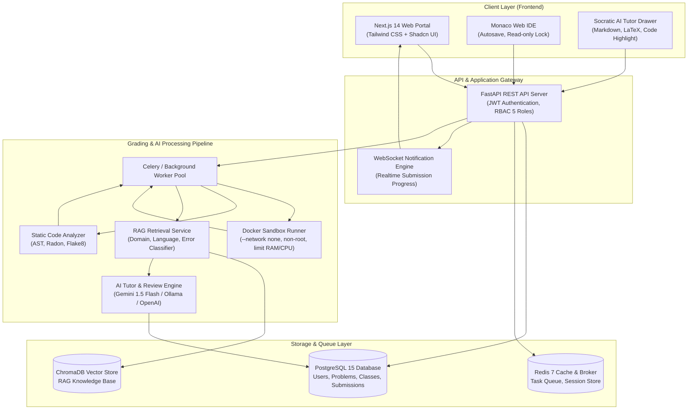
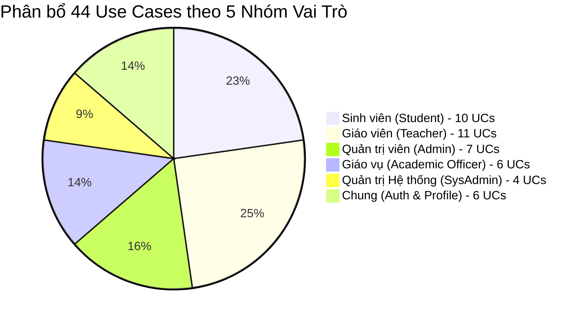
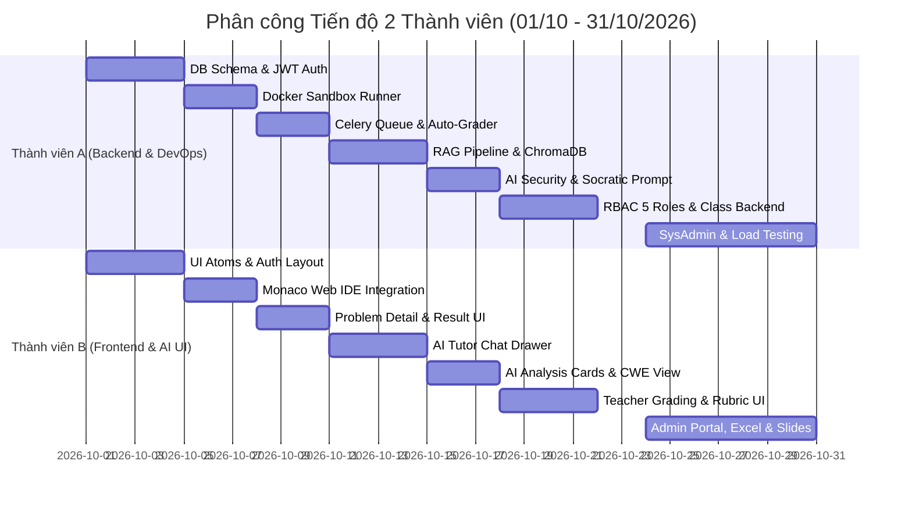

# BÁO CÁO TOÀN DIỆN ĐỊNH HƯỚNG, LỘ TRÌNH VÀ MỤC TIÊU DỰ ÁN
## ĐỀ TÀI: NỀN TẢNG ĐÁNH GIÁ MÃ NGUỒN TỰ ĐỘNG VÀ TRỢ GIẢNG LẬP TRÌNH THÔNG MINH TÍCH HỢP AI
### (AI-POWERED CODING TUTOR & AUTO-GRADER PLATFORM)

---

> **Tài liệu trao đổi chuyên môn và báo cáo tiến độ với Giảng viên Hướng dẫn (GVHD)**  
> **Thời gian thực hiện:** 01/10/2026 – 31/10/2026 (4 tuần)  
> **Quy mô nhóm:** 02 thành viên  
> **Phiên bản tài liệu:** v2.0 (Tháng 10/2026 - Chuẩn hóa 4 Giai đoạn & Bước thực hiện)

---

## 📑 MỤC LỤC TỔNG QUAN

1. [Thông Tin Chung & Bối Cảnh Đề Tài](#1-thông-tin-chung--bối-cảnh-đề-tài)
2. [Mục Tiêu Cốt Lõi & Tính Đột Phá Của Đề Tài](#2-mục-tiêu-cốt-lõi--tính-đột-phá-của-đề-tài)
3. [Phân Tích Tiếp Thu & Đối Chiếu Gợi Ý Của Giảng Viên](#3-phân-tích-tiếp-thu--đối-chiếu-gợi-ý-của-giảng-viên)
4. [Kiến Trúc Kỹ Thuật & Ngăn Xếp Công Nghệ (Tech Stack)](#4-kiến-trúc-kỹ-thuật--ngăn-xếp-công-nghệ-tech-stack)
5. [Mô Hình RAG & Cấu Trúc Kho Tri Thức Sư Phạm 2 Chiều](#5-mô-hình-rag--cấu-trúc-kho-tri-thức-sư-phạm-2-chiều)
6. [Quy Mô Nghiệp Vụ & 44 Use Cases (5 Nhóm Phân Quyền)](#6-quy-mô-nghiệp-vụ--44-use-cases-5-nhóm-phân-quyền)
7. [Chi Tiết 4 Giai Đoạn Chính & Các Bước Thực Hiện Tuần Tự](#7-chi-tiết-4-giai-đoạn-chính--các-bước-thực-hiện-tuần-tự)
8. [Phân Công Trách Nhiệm Chi Tiết (2 Thành Viên)](#8-phân-công-trách-nhiệm-chi-tiết-2-thành-viên)
9. [Mục Tiêu Cần Đạt & Tiêu Chí Nghiệm Thu (Deliverables & KPIs)](#9-mục-tiêu-cần-đạt--tiêu-chí-nghiệm-thu-deliverables--kpis)
10. [Các Câu Hỏi Trọng Tâm Xin Ý Kiến Định Hướng Từ Giảng Viên](#10-các-câu-hỏi-trọng-tâm-xin-ý-kiến-định-hướng-từ-giảng-viên)

---

## 1. THÔNG TIN CHUNG & BỐI CẢNH ĐỀ TÀI

### 1.1. Thông tin đề tài
* **Tên đề tài tiếng Việt:** Nền tảng Đánh giá Mã nguồn Tự động và Trợ giảng Lập trình Thông minh Tích hợp Trí tuệ Nhân tạo.
* **Tên đề tài tiếng Anh:** AI-Powered Coding Tutor & Automated Source Code Assessment Platform.
* **Môi trường ứng dụng:** Hỗ trợ công tác giảng dạy, thực hành lập trình và chấm thi tự động tại các Khoa/Viện Công nghệ Thông tin.

### 1.2. Bối cảnh & Vấn đề thực tế
* **Hạn chế của các hệ thống Chấm tự động cổ điển (Classic Online Judges như VNOJ, HackerRank, LeetCode):**
  - Chỉ đưa ra phán quyết nhị phân thô ráp: *Accepted (AC), Wrong Answer (WA), Time Limit Exceeded (TLE), Runtime Error (RTE)*.
  - Hoàn toàn thiếu tính sư phạm: Sinh viên không hiểu tại sao sai, sai ở bước tư duy nào, mã nguồn có bị thắt nút cổ chai (bottleneck) độ phức tạp hay không.
  - Không đánh giá được chất lượng lập trình (Clean Code, PEP 8, Code Smells) và các lỗ hổng bảo mật tiềm ẩn.
* **Thực trạng sinh viên sử dụng công cụ AI thương mại (ChatGPT/Copilot):**
  - Sinh viên thường copy toàn bộ đề bài vào ChatGPT để xin code giải sẵn $\rightarrow$ mất đi khả năng rèn luyện tư duy thuật toán độc lập.
  - AI thương mại dễ bị ảo giác (hallucination), không bám sát giáo trình chuẩn và chuẩn kiến thức của trường.
* **Áp lực đối với Giảng viên & Trợ giảng:**
  - Lớp học đông (hàng trăm sinh viên), giảng viên không thể đọc từng dòng code để sửa lỗi phong cách lập trình và tư vấn sư phạm cho từng em.

---

## 2. MỤC TIÊU CỐT LÕI & TÍNH ĐỘT PHÁ CỦA ĐỀ TÀI

Hệ thống được thiết kế theo mô hình **Hybrid Evidence-Grounded AI** (Đánh giá dựa trên bằng chứng thực thi kết hợp Trí tuệ Nhân tạo Sư phạm), xoay quanh **4 Trụ cột cốt lõi**:

```
┌─────────────────────────────────────────────────────────────────────────────────┐
│                           4 TRỤ CỘT CỐT LÕI CỦA HỆ THỐNG                        │
├───────────────────┬───────────────────┬───────────────────┬─────────────────────┤
│ 1. Web IDE        │ 2. Docker Sandbox │ 3. Auto-Grader    │ 4. Socratic AI      │
│    Chuyên Dụng    │    Cô Lập An Toàn │    Evidence Engine│    Tutor & Reviewer │
│ • Monaco Editor   │ • Non-root user   │ • Test case runner│ • Gợi mở Socratic   │
│ • Cú pháp đa ngôn │ • Limit CPU & RAM │ • Static Analyzer │ • RAG tra giáo trình│
│   ngữ (Py, C++,..)│ • Cắt mạng (None) │ • Đo Big-O, Flake8│ • Quét bảo mật CWE  │
└───────────────────┴───────────────────┴───────────────────┴─────────────────────┘
```

### Điểm đột phá khác biệt:
1. **Phương pháp Sư phạm Socratic (Không giải hộ code):** AI đóng vai trò người trợ giảng gợi mở: chỉ ra dòng nghi vấn, đặt câu hỏi gợi ý để sinh viên tự tìm ra lỗi logic, tuyệt đối không đưa code hoàn chỉnh để sinh viên copy-paste.
2. **AI có Căn cứ Thực thi (Evidence-Grounded AI):** AI chỉ đưa ra nhận xét sau khi đã nạp đầy đủ bằng chứng chạy thực tế từ Docker Sandbox (kết quả test case, memory peak, execution time, AST, cyclomatic complexity), loại bỏ hoàn toàn phán đoán vô căn cứ.
3. **Phân tách Rạch ròi giữa Điểm số và AI Review:** Điểm số chính thức (`Official Score`) do Test Cases và Giảng viên quyết định. AI chỉ đóng vai trò tư vấn, không can thiệp thay đổi điểm số.
4. **Vận hành Tối ưu với Chi phí 0 Đồng:** Ứng dụng mô hình LLM tiên tiến nhất qua Free Tier (Google Gemini Flash) kết hợp Local LLM (Ollama/Llama 3) và ChromaDB Vector Store.

---

## 3. PHÂN TÍCH TIẾP THU & ĐỐI CHIẾU GỢI Ý CỦA GIẢNG VIÊN

Nhóm đã nghiêm túc nghiên cứu và đối chiếu toàn bộ các ý kiến gợi ý của Giảng viên hướng dẫn vào kiến trúc hệ thống:

| STT | Gợi ý của Giảng viên | Giải pháp Thiết kế của Nhóm | Mức độ Đáp ứng |
| :---: | :--- | :--- | :---: |
| **1** | **Nộp mã nguồn trực tiếp trên Web** | Web IDE tích hợp **Monaco Editor** (trình soạn thảo của VS Code), hỗ trợ định dạng code, highlight cú pháp, chế độ làm bài tập trung và khóa Read-only khi đã nộp. | ✅ **100% Phù hợp** |
| **2** | **Docker Sandbox an toàn** | Môi trường container cô lập hoàn toàn: `--network none` (ngắt Internet), `user: nobody` (non-root), giới hạn RAM 256MB, CPU 1 core, timeout 2s để chặn triệt để fork bomb / mã độc. | ✅ **100% Phù hợp** |
| **3** | **AI đọc hiểu code (LLMs)** | Tích hợp LLM API (Google Gemini 1.5/2.0 Flash + OpenAI GPT-4o-mini dự phòng) kết hợp phân tích cú pháp AST. | ✅ **100% Phù hợp** |
| **4** | **Phân tích độ phức tạp thuật toán** | Kết hợp phân tích tĩnh (Static Analysis: `radon`, `ast`) và LLM để ước lượng độ phức tạp thời gian/không gian ($O(n), O(n \log n), O(n^2)$) và Cyclomatic Complexity. | ✅ **100% Phù hợp** |
| **5** | **Chấm điểm Clean Code & Phong cách** | Bộ kiểm tra chuẩn phong cách mã nguồn (`flake8`, PEP 8, naming conventions, code smells) kết hợp AI Review chấm điểm chất lượng code. | ✅ **100% Phù hợp** |
| **6** | **Gợi ý tối ưu hóa chi tiết như Trợ giảng** | Khung chat **Socratic AI Tutor**: giải thích nguyên nhân lỗi, dẫn chứng bài học liên quan và đưa ra câu hỏi định hướng tối ưu hóa cấu trúc dữ liệu. | ✅ **100% Phù hợp** |
| **7** | **Phát hiện lỗi bảo mật tiềm ẩn** | Xây dựng module **AI-based Security Analyzer** quét và cảnh báo các lỗi kinh điển theo danh mục **CWE Top 25 / OWASP** (SQL Injection, Buffer Overflow, Hardcoded Secrets, Unsafe File Access). | ✅ **100% Đã tích hợp** |
| **8** | **Khung tích hợp LangChain** | Sử dụng LangChain làm framework điều phối Prompt Templates, Output Parsers (Pydantic Schema) và liên kết Vector Store. | ✅ **100% Đã tích hợp** |
| **9** | **Mô hình mã nguồn mở cục bộ (Llama/Mistral)** | Thiết kế kiến trúc **Modular Multi-Provider**: hỗ trợ cấu hình chuyển đổi linh hoạt giữa Cloud API (Gemini/OpenAI) và Local LLM (Ollama - Llama 3 / Mistral 7B). | ✅ **100% Đã tích hợp** |

---

## 4. KIẾN TRÚC KỸ THUẬT & NGĂN XẾP CÔNG NGHỆ (TECH STACK)

### 4.1. Sơ đồ Kiến trúc Tổng thể Hệ thống



### 4.2. Bảng Ngăn xếp Công nghệ (Tech Stack)

| Tầng Kiến trúc | Công nghệ Lựa chọn | Lý do Lựa chọn & Ưu thế |
| :--- | :--- | :--- |
| **Frontend Web Portal** | **Next.js 14 (App Router) + TypeScript** | Tốc độ cao, Server-Side Rendering (SSR), hệ sinh thái component hiện đại, chuẩn UI/UX. |
| **Trình soạn thảo Code** | **Monaco Editor** | Lõi của VS Code chạy trên web: mượt mà, hỗ trợ đa ngôn ngữ, syntax highlighting, code folding. |
| **Backend REST API** | **Python FastAPI** | Hiệu năng tiệm cận Go/NodeJS (Asynchronous ASGI), tài liệu Swagger/OpenAPI tự động, hỗ trợ Pydantic type-safe. |
| **Cơ sở dữ liệu Quan hệ** | **PostgreSQL 15** | RDBMS chuẩn doanh nghiệp, toàn vẹn dữ liệu (ACID), hỗ trợ tốt quan hệ phân cấp lớp/khoa/bài nộp. |
| **Bộ nhớ đệm & Hàng đợi** | **Redis 7 + Celery** | Quản lý hàng đợi chấm bài bất đồng bộ, chống nghẽn hệ thống khi cả lớp cùng nộp bài sát deadline. |
| **Thực thi Mã Sandbox** | **Docker Container Engine** | Môi trường cô lập độc lập, áp đặt cứng hạn mức RAM (256MB), CPU (1 core), ngắt hoàn toàn Internet. |
| **Kho Vector RAG** | **ChromaDB (Local Vector DB)** | Lưu trữ và tìm kiếm vector nhúng (embeddings) siêu nhẹ, không cần cloud ngoài, truy vấn dưới 20ms. |
| **Lõi Trí tuệ Nhân tạo** | **Google Gemini 1.5 Flash / Ollama Llama 3** | Gemini Flash có Free Tier hào phóng (1.500 lượt/ngày), phản hồi siêu nhanh (< 1.5s), phân tích đa luồng tốt. |

### 4.3. Bảng Phân Tích Chi Phí Vận Hành (Mô Hình 0 Đồng)

| Dịch vụ / Tài nguyên | Nhà cung cấp / Nền tảng | Chi phí | Cơ chế Vận hành |
| :--- | :--- | :---: | :--- |
| **AI LLM API** | Google AI Studio (Gemini 1.5 Flash) | **0 VNĐ** | Miễn phí vĩnh viễn: 15 RPM (15 request/phút), 1.500 RPD (1.500 request/ngày). |
| **Local LLM Option** | Ollama (Llama 3.1 8B / Mistral 7B) | **0 VNĐ** | Mã nguồn mở chạy offline trên máy trạm khi không có Internet. |
| **Vector Database** | ChromaDB Local | **0 VNĐ** | Container mã nguồn mở chạy kèm Docker Compose. |
| **Text Embedding** | Sentence-Transformers / Google text-embedding | **0 VNĐ** | Chạy mô hình mã nguồn mở trên CPU host hoặc Google Free Tier. |
| **Database & Cache** | PostgreSQL 15 + Redis 7 | **0 VNĐ** | Phần mềm mã nguồn mở chạy local/server trường. |
| **Hạ tầng Docker** | Docker Engine & Docker Compose | **0 VNĐ** | Đóng gói toàn bộ trong 1 file cấu hình, chạy trên mọi máy tính. |

---

## 5. MÔ HÌNH RAG & CẤU TRÚC KHO TRI THỨC SƯ PHẠM 2 CHIỀU

### 5.1. Bản chất & Sự cần thiết của RAG trong Đồ án
* **RAG (Retrieval-Augmented Generation)** trong hệ thống này không phải là việc nạp bừa dữ liệu lớn từ Internet, mà là **"Số hóa cẩm nang sư phạm chuẩn mực của Khoa/Trường"**:
  1. Khi sinh viên gặp lỗi (ví dụ: *RecursionError / Maximum recursion depth*), hệ thống tra cứu chính xác phần bài giảng "Đệ quy và Điều kiện dừng" trong Vector DB.
  2. ContextBuilder gom đoạn tri thức đó nạp vào prompt cho LLM.
  3. AI sẽ giải thích dựa trên đúng thuật ngữ và phương pháp sư phạm mà thầy cô đã dạy trên lớp, tránh hiện tượng sinh viên bị rối do học thuật ngữ lạ từ Internet.

### 5.2. Ma trận Tri thức 2 Chiều (RAG Knowledge Taxonomy)

```
                              MA TRẬN KHO TRI THỨC RAG
                                         │
    ┌────────────────────────┬───────────┴──────────┬────────────────────────┐
    ▼                        ▼                      ▼                        ▼
 [PYTHON]                  [C++]                  [JAVA]               [JAVASCRIPT]
 • PEP 8 & Idioms         • Con trỏ & Bộ nhớ     • OOP & Collections   • ES6+ & Async/Await
 • Recursion & AST        • STL Containers       • Exception Handling  • Closures & Scope
 • 100+ Lỗi điển hình     • 100+ Lỗi điển hình   • 80+ Lỗi điển hình   • 80+ Lỗi điển hình
    │                        │                      │                        │
    └────────────────────────┼──────────────────────┴────────────────────────┘
                             ▼
               [6 TRỤ CỘT TRI THỨC CHUYÊN SÂU DÙNG CHUNG]
    1. Cấu trúc Dữ liệu & Giải thuật (Mảng, Stack, Queue, Tree, Graph, DP)
    2. Phân tích Độ phức tạp Thuật toán (Big-O thời gian & không gian)
    3. Bộ quy tắc Clean Code & Nhận diện Code Smells
    4. An toàn Lập trình & Phòng chống Lỗ hổng Bảo mật (CWE Top 25, OWASP)
    5. Cẩm nang Chẩn đoán Lỗi Thực thi (Debugging & Diagnostic Patterns)
    6. Ngân hàng Câu hỏi Gợi mở Sư phạm (Socratic Pedagogical Prompts)
```

---

## 6. QUY MÔ NGHIỆP VỤ & 44 USE CASES (5 NHÓM PHÂN QUYỀN)

Hệ thống được chuẩn hóa toàn diện gồm **44 Use Cases**, phân bổ chặt chẽ theo mô hình phân quyền dựa trên vai trò (RBAC - Role-Based Access Control):



### 6.1. Bảng Tổng Hợp 44 Use Cases Theo Nhóm Actor

| Nhóm Actor | Số lượng | Danh sách Use Cases Cốt Lõi & Mô Tả |
| :--- | :---: | :--- |
| **Xác thực & Chung** | **6 UCs** | `UC-01` Đăng nhập (JWT), `UC-02` Đăng xuất, `UC-03` Đổi mật khẩu, `UC-04` Quên mật khẩu, `UC-05` Xem hồ sơ cá nhân, `UC-06` Cập nhật hồ sơ. |
| **Sinh viên (Student)** | **10 UCs** | `UC-07` Xem danh sách bài tập được giao, `UC-08` Xem chi tiết đề bài & ví dụ, `UC-09` Viết mã trên Monaco IDE (Autosave nháp), `UC-10` Nộp bài chính thức (Tải file/Nộp trực tiếp, khóa Read-only), `UC-11` Xem trạng thái nộp bài, `UC-12` Xem kết quả chấm test case (AC/WA/TLE/RTE), `UC-13` Xem nhận xét AI (Clean code, Big-O, CWE Security), `UC-14` Tương tác hỏi đáp Socratic AI Tutor, `UC-15` Xem lịch sử các lần nộp bài, `UC-16` Xem bảng điểm cá nhân theo môn học. |
| **Giáo viên (Teacher)** | **11 UCs** | `UC-17` Quản lý ngân hàng bài tập (Tạo/Sửa/Xóa/Xem), `UC-18` Quản lý Test Cases (Ẩn/Hiện, Input/Output, Trọng số), `UC-19` Thiết lập Rubric chấm điểm, `UC-20` Giao bài tập cho lớp (Cài đặt Deadline cứng), `UC-21` Đóng/Mở lớp học phụ trách, `UC-22` Xem danh sách sinh viên trong lớp, `UC-23` Thống kê tiến độ nộp bài của lớp, `UC-24` Xem chi tiết bài nộp của sinh viên, `UC-25` Xem kết quả Auto-Grader và gợi ý từ AI, `UC-26` Chấm bài thủ công theo Rubric & Sửa điểm, `UC-27` **Xác nhận và Công bố Điểm chính thức (`Official Score`)**. |
| **Quản trị viên (Admin)** | **7 UCs** | `UC-28` Quản lý tài khoản toàn trường (Tạo/Khóa/Reset), `UC-29` Phân quyền tài khoản người dùng, `UC-30` **Import danh sách sinh viên/giảng viên từ file Excel/CSV chuẩn 5 cột**, `UC-31` Quản lý danh mục Môn học/Học phần, `UC-32` Quản lý danh mục Khoa / Viện / Bộ môn, `UC-33` Tạo và phân công lớp học cho Giảng viên, `UC-34` Xem báo cáo thống kê sử dụng toàn hệ thống. |
| **Giáo vụ (Academic Officer)** | **6 UCs** | `UC-35` Quản lý lớp học thuộc Khoa/Bộ môn phụ trách, `UC-36` Gán/Chuyển sinh viên giữa các lớp học, `UC-37` Khóa sổ điểm học phần cuối kỳ, `UC-38` Xuất bảng điểm tổng kết ra file Excel, `UC-39` Lưu trữ (Archive) và Phục hồi lớp học cũ, `UC-40` Báo cáo chất lượng học tập theo học kỳ. |
| **Quản trị Hệ thống (SysAdmin)** | **4 UCs** | `UC-41` **Cấu hình Tham số AI** (Đổi Provider Gemini/OpenAI/Ollama, chỉnh Prompt, Model, Temperature), `UC-42` **Cấu hình & Giám sát Docker Sandbox** (RAM, CPU limit, Timeout, dọn dẹp Container rác), `UC-43` Quản lý Vector DB & Nạp tri thức RAG, `UC-44` **Xem Nhật ký Hệ thống (System Logs & Audit Trail)**. |

### 6.2. Các Nguyên Tắc Nghiệp Vụ Cốt Lõi (Business Invariants)
1. **Nguyên tắc "1 Mốc Deadline Cứng":** Không cho phép nộp muộn. Khi đồng hồ hệ thống chạm deadline, server kích hoạt cơ chế tự động nộp bài dở dang (`Auto-Submit Draft`) của sinh viên.
2. **Nguyên tắc Nộp 1 Bản Duy Nhất:** Sinh viên sau khi bấm nộp bài chính thức thì trình soạn thảo khóa Read-only, không thể chỉnh sửa nhằm rèn tính cẩn trọng khi lập trình.
3. **Nguyên tắc Điểm Chính thức Thuộc về Giáo viên:** AI chỉ là cố vấn. Chỉ có giáo viên mới có quyền bấm nút *"Xác nhận điểm chính thức"* để ghi nhận điểm học tập vào sổ điểm.

---

## 7. CHI TIẾT 4 GIAI ĐOẠN CHÍNH & CÁC BƯỚC THỰC HIỆN TUẦN TỰ

Tổng thể dự án được phân rã thành **4 Giai Đoạn Chính**, bên trong mỗi giai đoạn bao gồm các **Bước Thực Hiện Tuần Tự** cụ thể:

### 🟢 GIAI ĐOẠN 1: HẠ TẦNG NỀN TẢNG & LÕI CHẤM BÀI TỰ ĐỘNG (01/10 – 07/10/2026)
* **Mục tiêu giai đoạn:** Xây dựng hoàn chỉnh kiến trúc cơ sở dữ liệu, môi trường thực thi cô lập an toàn Docker Sandbox và luồng nộp bài - chấm điểm test case cơ bản từ Web IDE đến máy chủ.
* **Các bước thực hiện chi tiết:**
  * **Bước 1.1: Thiết kế Cơ sở dữ liệu & Cấu hình Backend (01/10 - 02/10):**
    - Thiết kế sơ đồ ERD & Database Models (SQLAlchemy): Users, Problems, TestCases, Submissions, Classes.
    - Cấu hình Alembic Database Migrations và kết nối PostgreSQL 15.
    - Xây dựng Module Authentication JWT (Login, Logout, Refresh Token qua JWT, Password Hashing).
    - *Đầu ra:* Cơ sở dữ liệu hoàn chỉnh, API Auth đạt 100% unit tests.
  * **Bước 1.2: Xây dựng Docker Sandbox Runner Cô lập Bảo mật (03/10 - 04/10):**
    - Viết `Dockerfile.sandbox` cho Python và C++ chạy dưới quyền `user: nobody` (non-root).
    - Viết script `runner.py` với các cơ chế kiểm soát tài nguyên cứng: `--network none` (ngắt mạng), RAM 256MB, CPU 1 core, Timeout 2.0s.
    - Xây dựng bộ thu thập bằng chứng thực thi (`execution_evidence`): RAM đỉnh, thời gian chạy, mã lỗi (TLE, MLE, RTE, CE).
    - *Đầu ra:* Sandbox thực thi mã nguồn độc lập, ngăn chặn hoàn toàn mã độc và fork bomb.
  * **Bước 1.3: Tích hợp Hàng đợi Bất đồng bộ Redis & Celery (05/10):**
    - Cấu hình Redis 7 làm Message Broker & Result Backend.
    - Viết Grader Worker nhận submission $\rightarrow$ khởi chạy Docker Sandbox $\rightarrow$ so khớp Output $\rightarrow$ tính `auto_score`.
    - *Đầu ra:* Pipeline chấm bài bất đồng bộ, không gây block luồng API chính.
  * **Bước 1.4: Xây dựng Web IDE Monaco Editor & Giao diện Nộp bài (05/10 - 07/10):**
    - Khởi tạo dự án Next.js 14 (App Router, Tailwind CSS, Dark Mode).
    - Tích hợp trình soạn thảo Monaco Editor (chọn ngôn ngữ, phím tắt, autosave lưu nháp tự động).
    - Xây dựng màn hình Xem danh sách bài tập, Xem chi tiết đề bài, Nút Nộp bài và Khóa Read-only sau khi nộp.
    - Xây dựng Result View hiển thị kết quả kiểm thử (Bảng test case AC, WA, TLE, RTE).
    - *Đầu ra:* Giao diện Web IDE hoàn chỉnh cho sinh viên làm bài và nộp bài.
* 🏆 **Nghiệm thu Milestone 1 (07/10/2026):** Sinh viên đăng nhập $\rightarrow$ Làm bài trên Web IDE $\rightarrow$ Nộp bài $\rightarrow$ Docker Sandbox chạy thực tế $\rightarrow$ Trả về kết quả chấm điểm Test Case tự động.

---

### 🔵 GIAI ĐOẠN 2: TRÍ TUỆ NHÂN TẠO SOCRATIC & KHO TRI THỨC RAG (08/10 – 15/10/2026)
* **Mục tiêu giai đoạn:** Lắp ráp "Bộ não" AI có căn cứ thực thi, số hóa kho tri thức sư phạm vào Vector Database và xây dựng Trợ giảng AI định hướng tư duy theo phương pháp Socratic.
* **Các bước thực hiện chi tiết:**
  * **Bước 2.1: Xây dựng Bộ Phân Tích Tĩnh (Static Analysis Engine) (08/10 - 09/10):**
    - Tích hợp thư viện `ast` và `radon` để đo độ phức tạp thời gian/không gian (Big-O) và Cyclomatic Complexity.
    - Tích hợp `flake8` kiểm tra chuẩn Clean Code (PEP 8, đặt tên biến, cấu trúc hàm, phát hiện Code Smells).
    - *Đầu ra:* Module trích xuất chỉ số chất lượng code tự động từ mã nguồn.
  * **Bước 2.2: Xây dựng Kho Tri Thức RAG & Vector Database ChromaDB (10/10 - 11/10):**
    - Cài đặt ChromaDB container local, cấu hình mô hình nhúng Text Embeddings.
    - Chuẩn bị và số hóa 300+ tài liệu chuyên môn: DSA, 100+ mẫu lỗi phổ biến (Py/C++), Clean Code, CWE Security.
    - Viết script `ingest_knowledge.py` tự động chunking và nạp tài liệu kèm Metadata Tagging 2 chiều.
    - *Đầu ra:* Vector Store ChromaDB hoạt động, truy vấn đoạn tri thức chính xác dưới 30ms.
  * **Bước 2.3: Xây dựng ContextBuilder & Tích hợp LLM Đa Nguồn (12/10 - 13/10):**
    - Viết `ContextBuilder` tổng hợp: Đề bài + Code sinh viên + Evidence Sandbox + Kết quả Static Analysis + Tài liệu RAG.
    - Thiết kế System Prompt Socratic (Guardrails chống giải hộ bài) và Pydantic Schema cho JSON Structured Output.
    - Tích hợp Google Gemini 1.5 Flash API (kèm fallback sang Local LLM Ollama / Llama 3).
    - Xây dựng Module AI Security Analyzer quét các lỗi bảo mật theo danh mục CWE Top 25 / OWASP.
    - *Đầu ra:* AI Engine trả về phân tích Clean Code, Big-O, CWE Security và gợi ý Socratic chuẩn cấu trúc.
  * **Bước 2.4: Phát triển Giao diện Trợ giảng AI & Thẻ Đánh giá (13/10 - 15/10):**
    - Xây dựng Socratic AI Tutor Drawer gắn cạnh Monaco Editor (hỗ trợ Markdown, code highlight, hỏi đáp liên tục).
    - Xây dựng Thẻ Đánh Giá AI hiển thị 3 mảng: Clean Code, Ước lượng Big-O và Cảnh báo Lỗ hổng Bảo mật CWE.
    - *Đầu ra:* Trải nghiệm tương tác AI trực quan, sinh viên vừa code vừa được trợ giảng định hướng.
* 🏆 **Nghiệm thu Milestone 2 (15/10/2026):** AI đọc hiểu code, trích dẫn đúng bài học giáo trình từ RAG, cảnh báo lỗ hổng bảo mật CWE và hướng dẫn sinh viên tự sửa lỗi bằng các câu hỏi gợi mở logic.

---

### 🟡 GIAI ĐOẠN 3: PHÂN QUYỀN RBAC & CỔNG QUẢN LÝ ĐÀO TẠO GIÁO VIÊN (16/10 – 23/10/2026)
* **Mục tiêu giai đoạn:** Hoàn thiện toàn bộ quy trình nghiệp vụ đào tạo và chấm thi thực tế: quản lý lớp học, phân quyền 5 vai trò, giao bài tập, chốt deadline cứng và giáo viên chấm bài theo Rubric.
* **Các bước thực hiện chi tiết:**
  * **Bước 3.1: Hoàn thiện Phân quyền Đa Vai trò RBAC (16/10 - 17/10):**
    - Xây dựng Middleware RBAC bảo vệ API theo 5 vai trò: Sinh viên, Giáo viên, Quản trị viên, Giáo vụ, SysAdmin.
    - Thiết lập các Policy kiểm tra quyền truy cập theo từng Lớp học, Môn học và Khoa/Bộ môn.
    - *Đầu ra:* Hệ thống phân quyền chặt chẽ, ngăn chặn truy cập chéo trái phép.
  * **Bước 3.2: Xây dựng Cổng Quản lý Bài tập & Giao bài cho Lớp (18/10 - 19/10):**
    - API & UI Quản lý Ngân hàng Bài tập (Tạo, Sửa, Xóa, thiết lập Test Cases ẩn/hiện, trọng số điểm).
    - API & UI Giao bài cho lớp học: Cài đặt 1 mốc Deadline cứng duy nhất, chọn danh sách sinh viên được làm.
    - Xây dựng Background Cron Job: Tự động khóa nộp bài và thu bản nháp gần nhất (`Auto-Submit Draft`) khi hết giờ.
    - *Đầu ra:* Giáo viên giao bài thuận tiện, hệ thống tự động chốt deadline chuẩn xác từng giây.
  * **Bước 3.3: Xây dựng Cổng Chấm Bài & Xác nhận Điểm cho Giáo viên (20/10 - 22/10):**
    - Giao diện Giáo viên theo dõi tiến độ nộp bài của toàn lớp (tỷ lệ nộp, danh sách bài nộp).
    - Màn hình So sánh & Chấm bài: Xem song song Mã nguồn SV + Kết quả Sandbox + Nhận xét của AI.
    - Module Chấm bài theo Rubric tiêu chí (cho phép giáo viên lưu tạm và chỉnh sửa điểm thủ công).
    - Chức năng **"Xác nhận và Công bố Điểm chính thức (`Official Score`)"** ghi nhận điểm vào sổ cái học phần.
    - *Đầu ra:* Giáo viên chấm bài nhanh chóng với sự hỗ trợ của AI và làm chủ 100% điểm số chính thức.
  * **Bước 3.4: Xây dựng Bảng Điểm & Báo Cáo Học Phần (22/10 - 23/10):**
    - Bảng tổng hợp điểm cá nhân của sinh viên theo môn học (UC-16).
    - Bảng điểm tổng kết lớp học của giáo vụ và giáo viên (UC-25, UC-38).
    - *Đầu ra:* Sinh viên và giáo viên dễ dàng theo dõi kết quả học tập toàn diện.
* 🏆 **Nghiệm thu Milestone 3 (23/10/2026):** Quy trình đào tạo khép kín: Giáo viên giao bài $\rightarrow$ Sinh viên làm bài $\rightarrow$ Server tự động chốt deadline $\rightarrow$ Giáo viên chấm theo Rubric $\rightarrow$ Công bố điểm chính thức thành công.

---

### 🔴 GIAI ĐOẠN 4: QUẢN TRỊ NỀN TẢNG, KIỂM THỬ TẢI & BÀN GIAO ĐỒ ÁN (24/10 – 31/10/2026)
* **Mục tiêu giai đoạn:** Hoàn thiện các phân hệ quản trị cấp trường, tối ưu hiệu năng chịu tải, đóng gói sản phẩm hoàn chỉnh và chuẩn bị hồ sơ bảo vệ đồ án đạt kết quả xuất sắc nhất.
* **Các bước thực hiện chi tiết:**
  * **Bước 4.1: Phát triển Phân Hệ Quản Trị Cấp Trường & Giáo Vụ (24/10 - 25/10):**
    - Xây dựng Module Import danh sách người dùng từ file Excel/CSV chuẩn 5 cột (Mã SV, Họ tên, Email, Lớp, Vai trò).
    - Xây dựng Module Quản lý Khoa / Viện / Bộ môn, Môn học, và vòng đời lớp học (Đóng/Mở/Archive/Restore).
    - *Đầu ra:* Quản trị viên dễ dàng khởi tạo hàng trăm tài khoản sinh viên chỉ bằng 1 file Excel.
  * **Bước 4.2: Xây dựng Phân Hệ Quản Trị Hệ Thống (SysAdmin Tools) (26/10 - 27/10):**
    - Giao diện Cấu hình Tham số AI (đổi Provider Gemini/OpenAI/Ollama, điều chỉnh Prompt, Temperature).
    - Dashboard Giám sát & Quản trị Docker Sandbox (giám sát CPU/RAM thực tế, dọn container rác, cấu hình limit).
    - Giao diện Tra cứu Nhật ký Hệ thống (System Logs & Audit Trail).
    - *Đầu ra:* Quản trị viên hệ thống toàn quyền kiểm soát hạ tầng và tham số AI mà không cần sửa code.
  * **Bước 4.3: Kiểm Thử Bảo Mật Sandbox & Kiểm Thử Tải (28/10 - 29/10):**
    - Security Pentest Sandbox: Chạy thử các đoạn mã nguy hiểm (fork bomb, ghi đè file hệ thống, mở socket mạng) $\rightarrow$ Xác nhận Sandbox chặn 100%.
    - Load Testing: Giả lập 50-100 sinh viên nộp bài đồng thời vào Redis Queue $\rightarrow$ Đo độ trễ và độ ổn định.
    - *Đầu ra:* Báo cáo kết quả kiểm thử hiệu năng và chứng chỉ an toàn Sandbox.
  * **Bước 4.4: Đóng Gói Sản Phẩm, Viết Báo Cáo & Chuẩn Bị Bảo Vệ (30/10 - 31/10):**
    - Đóng gói toàn bộ hệ sinh thái bằng Docker Compose 1-lệnh (`docker compose up -d --build`).
    - Hoàn thiện tài liệu kỹ thuật, bộ dữ liệu RAG và sổ tay hướng dẫn cài đặt/sử dụng.
    - Hoàn thiện Cuốn Báo Cáo Đồ Án, Slide thuyết trình và Video clip demo tổng duyệt.
    - *Đầu ra:* Bộ hồ sơ nghiệm thu đồ án hoàn chỉnh 100% (44 Use Cases).
* 🏆 **Nghiệm thu Milestone 4 (31/10/2026):** Nghiệm thu toàn diện 44 Use Cases, sản phẩm vận hành mượt mà, sẵn sàng bàn giao và bảo vệ đồ án trước Hội đồng.

---

## 8. PHÂN CÔNG TRÁCH NHIỆM CHI TIẾT (2 THÀNH VIÊN)

Dự án được phân bổ cân đối giữa 2 thành viên chuyên trách:



### Chi tiết phân công:

#### 🟢 Thành viên A (Phụ trách Backend, Sandbox, AI Pipelines & Hạ tầng):
1. **Giai đoạn 1:** Thiết kế Database PostgreSQL 15, Migration Alembic, Docker Sandbox Runner cô lập, Redis Celery Queue.
2. **Giai đoạn 2:** Static Analyzer đo Cyclomatic Complexity, AST, Flake8; Hệ thống RAG ChromaDB; Gemini/Ollama API; AI Security CWE.
3. **Giai đoạn 3:** Middleware RBAC 5 vai trò, API Quản lý Lớp học, Cron Job chốt deadline, API Chấm điểm Rubric & Official Score.
4. **Giai đoạn 4:** API Import Excel, SysAdmin Tools (Cấu hình AI, Giám sát Sandbox, System Logs), Load Testing và Đóng gói Docker Compose.

#### 🔵 Thành viên B (Phụ trách Frontend, Giao diện Web IDE, Trải nghiệm AI & Portal Đào tạo):
1. **Giai đoạn 1:** Cấu trúc Next.js 14 App Router, Layout Auth, Monaco Web IDE, Autosave lưu nháp, Màn hình Nộp bài & Result View.
2. **Giai đoạn 2:** Socratic AI Tutor Drawer tương tác thời gian thực, Thẻ hiển thị Đánh giá Clean Code, Big-O, Lỗ hổng CWE.
3. **Giai đoạn 3:** Cổng Giáo viên: Quản lý bài tập, Form Giao bài cho lớp, Màn hình Chấm bài theo Rubric, Bảng điểm học phần.
4. **Giai đoạn 4:** Cổng Quản trị viên: Giao diện Import Excel 5 cột, Dashboard giám sát hệ thống, Slide thuyết trình, Video demo & Báo cáo.

---

## 9. MỤC TIÊU CẦN ĐẠT & TIÊU CHÍ NGHIỆM THU (DELIVERABLES & KPIS)

### 9.1. Chỉ số Kỹ thuật & Hiệu năng Mục tiêu (KPIs)
* **Tính an toàn Sandbox:** Ngăn chặn 100% các hành vi xâm nhập trái phép (đọc file `/etc/passwd`, fork bomb, chiếm dụng socket mạng).
* **Thời gian phản hồi (Latency):**
  - Chấm bài Sandbox: $< 2.0$ giây/bài nộp tiêu chuẩn.
  - Phân tích và phản hồi từ AI Socratic Tutor: $< 2.5$ giây.
  - Tìm kiếm đoạn tri thức RAG trong ChromaDB: $< 30$ mili-giây.
* **Độ chịu tải (Concurrency):** Chịu tải đồng thời tối thiểu **50 – 100 bài nộp/phút** thông qua cơ chế đệm Redis Queue mà không gây treo server.
* **Chi phí bản quyền & API:** **0 VNĐ (100% Free)** nhờ khai thác hiệu quả Free Tier của Google AI Studio và giải pháp mã nguồn mở.

### 9.2. Danh mục Sản phẩm Bàn giao (Deliverables)
1. **Mã nguồn hoàn chỉnh (Full Source Code):** Đầy đủ Frontend (Next.js 14), Backend (FastAPI), Sandbox Runner và RAG Service trên GitHub Repository.
2. **Gói Triển khai Tự động 1 Câu lệnh:** File `docker-compose.yml` khởi chạy toàn bộ 4-5 container chỉ bằng lệnh `docker compose up -d --build`.
3. **Kho Tri thức RAG Đã Số Hóa:** Bộ dữ liệu mẫu gồm 300+ tài liệu tri thức (DSA, Lỗi lập trình, PEP 8, Quy tắc An toàn mã nguồn CWE).
4. **Bộ Tài liệu Đặc tả Kỹ thuật Đầy đủ:**
   - Bản đặc tả chi tiết 44 Use Cases ([DOAN4.md](file:///d:/GITHUB/ai-coding-tutor/docs/dactaUC/DOAN4.md)).
   - Sơ đồ ca sử dụng tổng quan ([sodoUC.png](file:///d:/GITHUB/ai-coding-tutor/docs/dactaUC/sodoUC.png)).
   - Hướng dẫn tích hợp AI và RAG ([TONG_HOP_DINH_HUONG_AI_RAG_NANG_CAP.md](file:///d:/GITHUB/ai-coding-tutor/docs/NANG-CAP/TONG_HOP_DINH_HUONG_AI_RAG_NANG_CAP.md)).
5. **Báo cáo Đồ án & Slide Thuyết trình:** Cuốn báo cáo kỹ thuật hoàn chỉnh và slide trình chiếu phục vụ buổi bảo vệ chính thức.

---

## 10. CÁC CÂU HỎI TRỌNG TÂM XIN Ý KIẾN ĐỊNH HƯỚNG TỪ GIẢNG VIÊN

Để hoàn thiện sản phẩm đạt kết quả cao nhất và bám sát kỳ vọng của Hội đồng chấm thi, nhóm xin phép kính trình Giảng viên hướng dẫn một số câu hỏi chuyên môn:

### ❓ Câu hỏi 1: Về Lựa chọn AI Framework (LangChain vs Direct API calls)
* **Thực trạng:** Nhóm hiện có thể gọi trực tiếp API của Google Gemini / OpenAI thông qua SDK chính hãng kết hợp Pydantic Schema (cực kỳ nhẹ, tốc độ cao, dễ debug) hoặc bọc qua framework LangChain.
* **Xin ý kiến Cô:** *"Kính thưa Cô, trong phạm vi đồ án, việc gọi trực tiếp qua SDK kết hợp ContextBuilder tự viết có đáp ứng tốt tiêu chí đánh giá kỹ thuật không, hay bắt buộc phải import và sử dụng toàn bộ chuỗi Chain của thư viện LangChain ạ?"*

### ❓ Câu hỏi 2: Về Mô hình LLM ưu tiên cho buổi Báo cáo / Demo (Cloud LLM vs Local LLM)
* **Thực trạng:** 
  - Phương án Cloud (Google Gemini Flash Free Tier): Phản hồi siêu nhanh (1-2s), câu từ sư phạm trau chuốt, nhưng phụ thuộc kết nối Internet khi demo.
  - Phương án Local (Ollama + Llama 3 8B): Hoạt động hoàn toàn offline, nhưng đòi hỏi máy tính demo có GPU mạnh (tối thiểu 6GB VRAM) và tốc độ sinh từ chậm hơn (4-6s).
* **Xin ý kiến Cô:** *"Nhóm dự kiến cấu hình hệ thống ưu tiên chạy Cloud Gemini Flash để demo mượt mà, đồng thời bổ sung nút chuyển đổi sang Local Ollama để chứng minh khả năng tự chủ offline. Hướng tiếp cận này đã tối ưu cho buổi bảo vệ chưa ạ?"*

### ❓ Câu hỏi 3: Về Mức độ Chi tiết của Module Quét Lỗ hổng Bảo mật (AI Security Analysis)
* **Thực trạng:** Hệ thống hiện quét các lỗi bảo mật cấp độ mã nguồn bài tập (CWE Top 25: SQL Injection, Buffer Overflow, Hardcoded Secrets, Command Execution...).
* **Xin ý kiến Cô:** *"Cô có yêu cầu nhóm tập trung sâu vào nhóm lỗ hổng bảo mật cụ thể nào (ví dụ: An toàn bộ nhớ C++ hay An toàn dữ liệu web) để phù hợp nhất với định hướng nghiên cứu của Bộ môn không ạ?"*

### ❓ Câu hỏi 4: Về Kế hoạch Thử nghiệm Thực tế với Sinh viên (Pilot Testing)
* **Đề xuất:** Trong Tuần 4 (sau ngày 25/10), sau khi hoàn thiện Milestone 3, nhóm rất mong muốn xin phép Cô cho phép triển khai thử nghiệm một bài tập thực tế trên một nhóm sinh viên (15-20 bạn) để thu thập số liệu đánh giá độ hài lòng về phản hồi của AI Tutor làm dữ liệu thực nghiệm cho Báo cáo Đồ án.

---

> 🎯 **KẾT LUẬN & CAM KẾT CỦA NHÓM:**  
> Nhóm cam kết tuân thủ nghiêm ngặt tiến độ 4 giai đoạn (kết thúc đúng ngày **31/10/2026**), đảm bảo chất lượng hệ thống vận hành ổn định, bảo mật cao, đáp ứng trọn vẹn 100% các mục tiêu gợi ý của Giảng viên hướng dẫn và sẵn sàng cho buổi bảo vệ đồ án đạt kết quả xuất sắc nhất!
