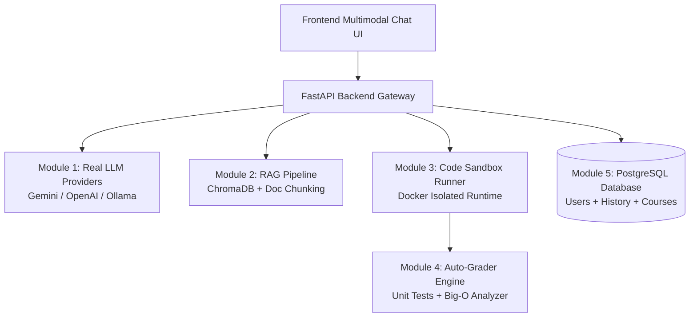

# 📋 BẢNG KIỂM THỬ TÍNH NĂNG & LỘ TRÌNH PHÁT TRIỂN TIẾP THEO
> **Dự án:** AI-Powered Coding Tutor & Auto-Grader Platform  
> **Phiên bản hiện tại:** Giao diện Trò chuyện Đa phương thức (Multimodal Studio v1.0)  
> **Cập nhật lần cuối:** 12/10/2026

---

## PHẦN 1: DANH SÁCH TÍNH NĂNG ĐÃ HOÀN THÀNH (BẢNG KIỂM THỬ)

Bạn có thể mở website tại [http://localhost:3000](http://localhost:3000) và kiểm tra từng tính năng theo các bước dưới đây:

### 1. 🌓 Chế độ Hiển thị & Giao diện (Theme & Layout)
| STT | Tính năng | Hướng dẫn kiểm tra | Kết quả mong đợi | Trạng thái |
|:---:|:---|:---|:---|:---:|
| 1.1 | **Chuyển đổi Dark / Light Mode** | Bấm vào nút biểu tượng **Mặt trời / Mặt trăng** ở góc trên bên phải thanh Header. | Toàn bộ giao diện (Sidebar, Header, thẻ gợi ý, tin nhắn, ô soạn thảo) chuyển đổi mượt mà giữa nền tối (Dark) và nền sáng (Light), lưu trạng thái khi F5 tải lại trang. | [x] Đã xong |
| 1.2 | **Thu gọn / Mở rộng Sidebar** | Bấm vào nút icon **PanelLeft** trên Header hoặc bấm tổ hợp phím `Ctrl + B`. | Sidebar thu gọn sang trái mượt mà, bấm lại để mở rộng ra; khung chat tự động dàn đều toàn màn hình. | [x] Đã xong |
| 1.3 | **Giao diện tương thích Mobile** | Thu nhỏ trình duyệt về kích thước điện thoại (< 768px). | Hiện icon Menu Hamburger, bấm vào mở Drawer Sidebar từ cạnh trái, bấm vùng mờ hoặc nút [X] để đóng. | [x] Đã xong |

---

### 2. 📎 Đa phương thức & Đính kèm Tệp (Multimodal & Upload)
| STT | Tính năng | Hướng dẫn kiểm tra | Kết quả mong đợi | Trạng thái |
|:---:|:---|:---|:---|:---:|
| 2.1 | **Dán ảnh trực tiếp từ Clipboard** | Nhấn phím `PrtScn` hoặc dùng công cụ Snipping Tool chụp màn hình, sau đó bấm `Ctrl + V` vào ô nhập chat. | Ảnh chụp tự động được tải lên và hiển thị thành huy hiệu ảnh thu nhỏ (Thumbnail) ngay phía trên ô nhập. | [x] Đã xong |
| 2.2 | **Đính kèm tệp qua nút Ghim kẹp** | Bấm vào icon **Kẹp giấy** 📎 dưới ô nhập, chọn một hoặc nhiều tệp (ảnh `.png`, `.jpg` hoặc code `.py`, `.cpp`, `.pdf`...). | Tệp xuất hiện trong danh sách đính kèm với icon phân loại tương ứng và dung lượng tệp. | [x] Đã xong |
| 2.3 | **Kéo thả tệp (Drag & Drop)** | Kéo một tệp từ Windows Explorer rồi thả vào vùng soạn thảo tin nhắn. | Khung soạn thảo đổi viền xanh, xuất hiện thông báo *"Thả hình ảnh hoặc tài liệu vào đây..."*, tệp được thêm vào danh sách. | [x] Đã xong |
| 2.4 | **Xem ảnh phóng to (Lightbox)** | Bấm vào ảnh thu nhỏ trong danh sách đính kèm hoặc trong tin nhắn đã gửi. | Modal phóng to ảnh xuất hiện với nền mờ tối, có thể bấm nút [X] hoặc phím `Esc` để đóng. | [x] Đã xong |
| 2.5 | **Xem trước nội dung code/văn bản** | Đính kèm một tệp code (ví dụ `.py`, `.cpp`, `.txt`) rồi click vào huy hiệu tệp đó. | Modal hiển thị toàn bộ nội dung code với số dòng, có nút **Sao chép** và nút **Tải về máy** (`.txt`/code). | [x] Đã xong |
| 2.6 | **Kiểm tra giới hạn dung lượng tệp** | Thử chọn một tệp ảnh > 10MB hoặc tệp tài liệu > 20MB. | Hệ thống hiện banner cảnh báo màu vàng liệt kê rõ tên tệp và lý do từ chối. | [x] Đã xong |

---

### 3. 💬 Trò chuyện & Hiệu ứng AI (Chat & Streaming)
| STT | Tính năng | Hướng dẫn kiểm tra | Kết quả mong đợi | Trạng thái |
|:---:|:---|:---|:---|:---:|
| 3.1 | **Gửi tin nhắn & Xuống dòng** | Nhập văn bản, nhấn `Enter` để gửi; nhấn `Shift + Enter` để xuống dòng mới. | Tin nhắn người dùng xuất hiện bên phải/trên; ô nhập tự động xóa trắng và reset chiều cao. | [x] Đã xong |
| 3.2 | **Hiệu ứng chữ chạy (Typewriter Streaming)** | Gửi một câu hỏi bất kỳ và quan sát câu trả lời của AI. | Câu trả lời gõ từng ký tự mượt mà kèm con trỏ nhấp nháy `|` giống ChatGPT. | [x] Đã xong |
| 3.3 | **Dừng phản hồi tức thì (Stop Streaming)** | Trong lúc AI đang chạy chữ, bấm vào nút vuông màu đỏ **Dừng (◼)** ở ô nhập. | Quá trình gõ dừng ngay lập tức, nội dung dừng tại vị trí đó và Toast thông báo *"Đã dừng tạo phản hồi"*. | [x] Đã xong |
| 3.4 | **Định dạng Markdown & Khối Code** | Quan sát phản hồi AI có chứa mã nguồn Python, in đậm, danh sách số. | Khối code có header đen hiển thị tên ngôn ngữ, icon Terminal và nút **Sao chép code** riêng. | [x] Đã xong |
| 3.5 | **Sao chép câu trả lời AI** | Bấm nút **"Sao chép câu trả lời"** ở thanh công cụ dưới tin nhắn AI. | Nội dung được chép vào Clipboard, nút chuyển thành icon tích xanh *"Đã sao chép!"*. | [x] Đã xong |
| 3.6 | **Đọc to câu trả lời (Text-to-Speech)** | Bấm nút **"Đọc to"** (icon Loa 🔊) dưới tin nhắn của AI. | Trình duyệt phát âm giọng đọc tiếng Việt/Anh; bấm lại để dừng đọc. | [x] Đã xong |
| 3.7 | **Đánh giá câu trả lời (Like / Dislike)** | Bấm vào nút Thumbs Up 👍 hoặc Thumbs Down 👎 dưới tin nhắn AI. | Icon đổi màu xanh/đỏ và ghi nhận phản hồi người dùng. | [x] Đã xong |
| 3.8 | **Tạo lại câu trả lời (Regenerate)** | Bấm nút **"Thử lại"** 🔄 ở tin nhắn cuối cùng của AI. | AI tạo lại nội dung mới từ đầu kèm hiệu ứng typewriter. | [x] Đã xong |
| 3.9 | **Sửa câu hỏi của người dùng** | Rê chuột vào tin nhắn của bạn, bấm icon **Cây bút** ✏️, chỉnh sửa nội dung và bấm *"Cập nhật & Gửi lại"*. | Tin nhắn được cập nhật lại và kích hoạt phản hồi mới từ AI. | [x] Đã xong |
| 3.10 | **Gợi ý câu hỏi tiếp theo (Follow-up chips)** | Bấm vào một trong các chip gợi ý màu xanh ở dưới phản hồi AI. | Câu hỏi gợi ý tự động được gửi đi ngay lập tức. | [x] Đã xong |
| 3.11 | **Thống kê từ, ký tự & Token** | Nhập văn bản dài vào ô soạn thảo và nhìn dòng thông số ở góc dưới cùng bên phải. | Hiển thị thời gian thực số lượng từ, số ký tự và ước tính ~token. | [x] Đã xong |

---

### 4. 🗂️ Quản lý Hội thoại (Conversations Management)
| STT | Tính năng | Hướng dẫn kiểm tra | Kết quả mong đợi | Trạng thái |
|:---:|:---|:---|:---|:---:|
| 4.1 | **Tạo đoạn chat mới** | Bấm nút `+ Cuộc trò chuyện mới` trên Sidebar, trên Header, hoặc bấm `Ctrl + Shift + O`. | Tạo phiên chat mới với màn hình chào mừng 4 ô gợi ý, tự động lưu phiên cũ. | [x] Đã xong |
| 4.2 | **Đổi tên đoạn chat trên Sidebar** | Rê chuột vào một đoạn chat trên Sidebar, bấm icon **Bút sửa** ✏️, nhập tên mới và nhấn `Enter` (hoặc icon tích xanh). | Tên cuộc trò chuyện đổi ngay lập tức và lưu vào `localStorage`. | [x] Đã xong |
| 4.3 | **Đổi tên đoạn chat trực tiếp trên Header** | Rê chuột vào tiêu đề đang hiển thị ở thanh Header trên cùng, bấm icon **Bút sửa**. | Cho phép sửa trực tiếp tiêu đề tại Header, nhấn `Enter` để lưu hoặc `Esc` để hủy. | [x] Đã xong |
| 4.4 | **Ghim đoạn chat lên đầu (Pin to Top)** | Rê chuột vào một đoạn chat trên Sidebar, bấm icon **Đinh ghim** 📌. | Cuộc trò chuyện được đưa lên vị trí đầu tiên của danh sách với icon ghim màu vàng. | [x] Đã xong |
| 4.5 | **Xuất lịch sử chat ra file text** | Rê chuột vào đoạn chat, bấm icon **Tải xuống** 📥. | Tải về máy tệp `.txt` chứa đầy đủ mốc thời gian, vai trò và nội dung chi tiết. | [x] Đã xong |
| 4.6 | **Xóa cuộc trò chuyện** | Bấm icon **Thùng rác** 🗑️ bên cạnh đoạn chat. | Hộp thoại xác nhận xuất hiện; bấm Xác nhận sẽ xóa phiên đó an toàn. | [x] Đã xong |
| 4.7 | **Tìm kiếm tin nhắn trong hội thoại** | Bấm icon **Kính lúp** trên Header hoặc bấm `Ctrl + F`. | Mở thanh tìm kiếm nổi, gõ từ khóa để lọc các tin nhắn chứa từ khóa đó theo thời gian thực. | [x] Đã xong |
| 4.8 | **Tìm kiếm cuộc trò chuyện trên Sidebar** | Gõ từ khóa vào ô *"Tìm kiếm..."* trên thanh bên. | Danh sách cuộc trò chuyện lọc tức thì theo từ khóa. | [x] Đã xong |

---

### 5. ⚙️ Cài đặt & Phím tắt (Settings & Shortcuts)
| STT | Tính năng | Hướng dẫn kiểm tra | Kết quả mong đợi | Trạng thái |
|:---:|:---|:---|:---|:---:|
| 5.1 | **Chọn Mô hình AI dự kiến** | Bấm vào menu thả xuống **Mô hình AI** ở Header (mặc định Gemini 1.5 Flash). | Menu xổ xuống với các lựa chọn: *Gemini 1.5 Flash*, *Gemini 1.5 Pro*, *Claude 3.5 Sonnet*, *GPT-4o*, *DeepSeek Coder*. Bấm chọn mô hình mong muốn. | [x] Đã xong |
| 5.2 | **Modal Cài đặt Tham số AI** | Bấm nút **"Cài đặt AI"** ở chân Sidebar. | Mở modal tùy chỉnh: Chọn phong cách Socratic / Giải thuật / Clean Code; kéo thanh trượt Temperature (0.0 - 1.0) và Max Tokens (512 - 4096). | [x] Đã xong |
| 5.3 | **Modal Bảng Phím tắt** | Bấm nút **"Phím tắt"** ở chân Sidebar hoặc nhấn phím `Ctrl + /` (hoặc phím `?`). | Hiển thị bảng tổng hợp toàn bộ phím tắt thao tác nhanh trong ứng dụng. | [x] Đã xong |

---

## PHẦN 2: LỘ TRÌNH CÁC TÍNH NĂNG MỚI ĐỂ TRIỂN KHAI TIẾP THEO

Dưới đây là các module chức năng cần thiết kế và tích hợp ở giai đoạn tiếp theo để hoàn thiện hệ sinh thái **AI Coding Tutor & Auto-Grader**:

---

### 🚀 Giai đoạn 1: Kết nối LLM Thực tế (Real LLM Integration)
- [ ] **Tích hợp Google Gemini API chính thức (`google-generativeai` / Vertex AI)**:
  - Gửi kèm prompt hệ thống theo phong cách Socratic.
  - Hỗ trợ truyền ảnh chụp màn hình (base64) trực tiếp vào model Gemini 1.5 Flash Vision.
- [ ] **Hỗ trợ LLM cục bộ (Local LLM via Ollama)**:
  - Cho phép người dùng chạy offline các mô hình như `qwen2.5-coder`, `deepseek-coder:6.7b` không tốn phí token.
- [ ] **Server-Sent Events (SSE) Streaming**:
  - Backend FastAPI stream từng token về frontend bằng chuẩn SSE thay cho typewriter giả lập hiện tại.

---

### 📚 Giai đoạn 2: Hệ thống RAG & Cơ sở Tri thức Đề bài (RAG Pipeline)
- [ ] **Trích xuất văn bản từ tài liệu (`.pdf`, `.docx`, `.pptx`, `.cpp`, `.py`)**:
  - Dùng `pypdf`, `python-docx` để đọc nội dung tài liệu sinh viên tải lên.
- [ ] **Cắt đoạn văn bản (Text Chunking) & Vector Database**:
  - Cắt nhỏ tài liệu bài giảng/đề bài thành các chunk từ 500-1000 tokens kèm metadata.
  - Lưu trữ embeddings vào **ChromaDB** hoặc **Qdrant**.
- [ ] **Tìm kiếm ngữ cảnh (Context Retrieval)**:
  - Khi sinh viên hỏi bài tập nào, hệ thống tự động tìm đúng đoạn đề bài và gợi ý bước giải thích hợp.

---

### 🛡️ Giai đoạn 3: Môi trường Chạy Code Cô lập (Secure Sandbox Execution)
- [ ] **Docker Sandbox Container**:
  - Môi trường chạy code an toàn không có mạng (`--network none`), giới hạn RAM (128MB), giới hạn CPU (0.5 core) và timeout (3-5 giây).
- [ ] **Hỗ trợ đa ngôn ngữ lập trình**:
  - C, C++ (GCC/Clang), Python 3.11, Java 17.
- [ ] **Phát hiện vòng lặp vô hạn & Lỗi tràn bộ nhớ**:
  - Tự động bắt lỗi Time Limit Exceeded (TLE) và Memory Limit Exceeded (MLE).

---

### 🧪 Giai đoạn 4: Chấm điểm Tự động & Phân tích Thuật toán (Auto-Grader)
- [ ] **Bộ chạy Test Cases**:
  - Chạy bộ test case ẩn và công khai, tính toán tỉ lệ pass (ví dụ 8/10 test cases passed).
- [ ] **Phân tích độ phức tạp thời gian & không gian (Big-O)**:
  - AI đọc AST (Abstract Syntax Tree) để phát hiện vòng lặp lồng nhau $O(n^2)$, đệ quy lãng phí, kiến nghị cấu trúc dữ liệu tối ưu ($O(n \log n)$).
- [ ] **Phát hiện lỗi rò rỉ bộ nhớ (Memory Leak)**:
  - Tích hợp công cụ Valgrind cho C/C++ để cảnh báo sinh viên các vùng nhớ chưa giải phóng `free()`.

---

### 👤 Giai đoạn 5: Xác thực, Quản lý Khóa học & Lịch sử
- [ ] **Xác thực người dùng (Auth System)**:
  - Đăng ký, đăng nhập bằng Email/Mật khẩu hoặc Google OAuth (JWT tokens).
  - Phân quyền: **Sinh viên** (học tập, làm bài) và **Giảng viên / Trợ giảng** (tạo bài tập, xem báo cáo).
- [ ] **Lưu trữ lịch sử chat lên PostgreSQL**:
  - Chuyển đổi từ lưu tạm `localStorage` sang đồng bộ cơ sở dữ liệu đám mây.
- [ ] **Dashboard thống kê học tập cho Sinh viên**:
  - Biểu đồ điểm số, số bài tập đã nộp, các chủ đề thuật toán còn yếu cần ôn luyện.

---

### 🎙️ Giai đoạn 6: Tương tác Giọng nói 2 chiều (Voice Assistant)
- [ ] **Nhận diện giọng nói (Speech-to-Text - STT)**:
  - Tích hợp Web Speech API (nhận diện giọng nói tiếng Việt trực tiếp khi sinh viên nhấn giữ nút Micro) hoặc OpenAI Whisper API.
- [ ] **Phản hồi âm thanh tự nhiên (Text-to-Speech - TTS)**:
  - Kết nối với Google Cloud TTS hoặc ElevenLabs để có giọng đọc AI tự nhiên và truyền cảm hơn.

---

### 📊 Giai đoạn 7: Bảng điều khiển dành cho Giảng viên (Teacher Dashboard)
- [ ] **Quản lý danh sách lớp & bài tập**:
  - Giảng viên tải lên bộ đề bài thực hành, test cases và rubric chấm điểm.
- [ ] **Phát hiện tương đồng mã nguồn (Plagiarism Detection)**:
  - So khớp mã nguồn giữa các sinh viên bằng thuật toán Moss (Measure of Software Similarity).
- [ ] **Báo cáo phân tích mức độ hiểu bài của lớp**:
  - AI tổng hợp các câu hỏi sinh viên hay thắc mắc nhất trong tuần để giảng viên giải đáp trên lớp.
