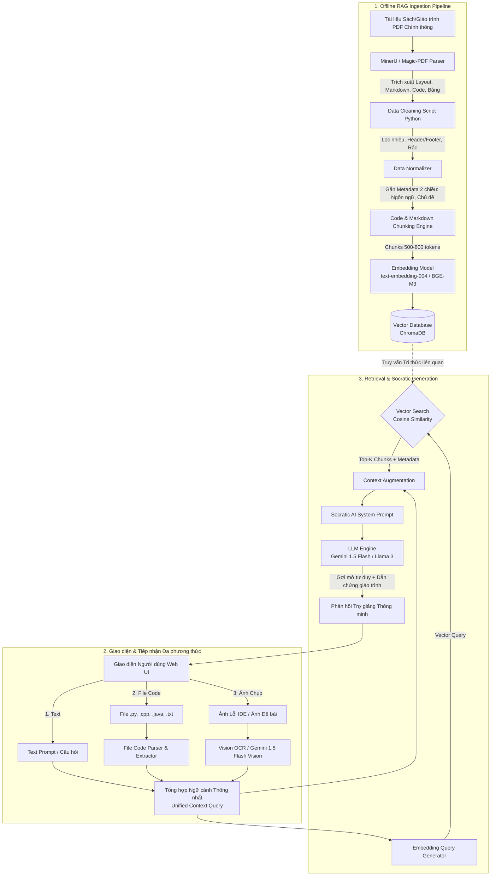

# LỘ TRÌNH 14 NGÀY TRIỂN KHAI HỆ THỐNG TRỢ GIẢNG ẢO & RAG ĐA PHƯƠNG THỨC (MULTIMODAL RAG)
> **Dự án:** AI-Powered Coding Tutor & Code Assessment Platform  
> **Thời gian:** 14 Ngày (2 Tuần Sprint)  
> **Mục tiêu:** Xây dựng hoàn chỉnh luồng xử lý từ Dữ liệu giáo trình chính thống -> Ingestion bằng MinerU -> Làm sạch & Chuẩn hóa -> Chunking & Embedding -> Vector DB -> Giao diện tiếp nhận đa phương thức (File + Ảnh + Text) -> Vector Search RAG -> LLM phản hồi theo phương pháp Socratic.

---

## MỤC LỤC
1. [Tổng quan Kiến trúc & Luồng Dữ liệu](#1-tổng-quan-kiến-trúc--luồng-dữ-liệu)
2. [Chi tiết Công nghệ & Cách sử dụng](#2-chi-tiết-công-nghệ--cách-sử-dụng)
   - 2.1. MinerU (Magic-PDF) - Bộ trích xuất tài liệu kỹ thuật cao cấp
   - 2.2. Pipeline Làm sạch (Cleaning) & Chuẩn hóa (Normalization) bằng Python
   - 2.3. Chiến lược Chia nhỏ (Chunking Strategy) cho Code & Lý thuyết
   - 2.4. Mô hình Nhúng (Embedding Model) & Vector Database (ChromaDB)
   - 2.5. Xử lý Đa phương thức (Multimodal Ingestion: Image, File, Text)
   - 2.6. LLM Socratic Prompting & RAG Grounding
   - 2.7. Giao diện (Next.js) & Backend API (FastAPI)
3. [Lộ trình 14 Ngày Chi tiết (Day-by-Day Sprint)](#3-lộ-trình-14-ngày-chi-tiết-day-by-day-sprint)
   - Tuần 1 (Ngày 1 - 7): Xây dựng Kho Tri Thức RAG & Ingestion Pipeline với MinerU
   - Tuần 2 (Ngày 8 - 14): Xử lý Đa Phương Thức, Tích hợp UI, LLM & Đóng gói Demo
4. [Kho Mã Nguồn Thực Thi Mẫu (Ready-to-use Scripts)](#4-kho-mã-nguồn-thực-thi-mẫu-ready-to-use-scripts)
5. [Quản trị Rủi ro & Khắc phục Sự cố Kỹ thuật (Troubleshooting)](#5-quản-trị-rủi-ro--khắc-phục-sự-cố-kỹ-thuật-troubleshooting)

---

## 1. TỔNG QUAN KIẾN TRÚC & LUỒNG DỮ LIỆU

Hệ thống được chia thành 2 luồng cốt lõi:
1. **Offline Ingestion Pipeline (Chuẩn bị kho tri thức RAG):** Tài liệu PDF giáo trình chính thống -> MinerU bóc tách Layout -> Python script làm sạch & chuẩn hóa -> Semantic/Code Chunking -> Embedding vector -> Vector DB.
2. **Online Query & Inference Pipeline (Phục vụ người dùng):** Người dùng nhập Text + gửi File code + tải Ảnh chụp lỗi -> Tiền xử lý đa phương thức chuyển hóa tất cả về văn bản -> Vectorize câu hỏi -> Tra cứu Vector DB -> Ghép ngữ cảnh giáo trình -> LLM suy luận theo phương pháp Socratic -> Trả lời người dùng trên giao diện.

### Sơ đồ Kiến trúc Tổng thể (Architecture Diagram)



---

## 2. CHI TIẾT CÔNG NGHỆ & CÁCH SỬ DỤNG

### 2.1. MinerU (Magic-PDF) - Bộ trích xuất tài liệu kỹ thuật
- **Lý do lựa chọn:** Tài liệu lập trình, giáo trình khoa học máy tính có cấu trúc rất phức tạp (cột kép, khối mã nguồn lồng ghép, bảng chân trị, công thức toán học). Các bộ parser truyền thống (như PyPDF, pdfplumber) thường làm vỡ cấu trúc thụt lề của code hoặc biến bảng biểu thành một đống chữ lộn xộn. **MinerU (Magic-PDF)** ứng dụng mô hình Deep Learning phân tích bố cục (LayoutLM/YOLO) giúp:
  - Nhận diện chính xác khối mã nguồn (`code block`) và bảo tồn thụt lề (indentation - tối quan trọng với Python).
  - Tách bảng biểu thành Markdown/HTML chuẩn.
  - Loại bỏ các vùng header/footer lặp lại tự động.
- **Cách cài đặt & Cấu hình:**
  ```bash
  # Cài đặt Magic-PDF / MinerU
  pip install magic-pdf[full] --extra-index-url https://wheels.myhloli.com

  # Tải mô hình weights cần thiết cho Layout và OCR
  # Đọc file cấu hình mẫu magic-pdf.json tại thư mục người dùng (~/magic-pdf.json)
  ```
- **Lệnh CLI thực thi:**
  ```bash
  magic-pdf -p data/01_original_documents/DOC02_Python_Tutorial.pdf -o data/03_parser_outputs/mineru -m auto
  ```
- **Sử dụng qua Python Script:**
  ```python
  from magic_pdf.pipe.UNIPipe import UNIPipe
  from magic_pdf.rw.DiskReaderWriter import DiskReaderWriter
  import os

  def parse_pdf_with_mineru(pdf_path: str, output_dir: str):
      with open(pdf_path, "rb") as f:
          pdf_bytes = f.read()
      writer = DiskReaderWriter(output_dir)
      pipe = UNIPipe(pdf_bytes, {"_pdf_type": "", "model_list": []}, writer)
      pipe.pipe_classify()
      pipe.pipe_analyze()
      pipe.pipe_parse()
      md_content = pipe.pipe_mk_markdown(output_dir, drop_mode="none")
      return md_content
  ```

---

### 2.2. Pipeline Làm sạch (Cleaning) & Chuẩn hóa (Normalization)
Sau khi MinerU tạo ra các file Markdown, dữ liệu vẫn cần được làm sạch sâu:
1. **Lọc nhiễu:**
   - Xóa các chuỗi watermark ("DRAFT", "Trường ĐH...", số trang "Trang 1/200").
   - Xóa các trang phụ lục, mục lục (TOC - Table of Contents) vì TOC gây nhiễu embedding khi search.
   - Chuẩn hóa ký tự Unicode tiếng Việt (chuyển về Unicode dựng sẵn `NFC`).
2. **Bảo tồn và Chuẩn hóa Code Blocks:**
   - Đảm bảo mọi khối code đều có định danh ngôn ngữ: ```` ```python ````, ```` ```cpp ````.
   - Chuẩn hóa tab thành 4 spaces, xóa khoảng trắng thừa ở cuối dòng.
3. **Gắn Metadata 2 chiều (Metadata Enrichment):**
   - **Chiều 1: Ngôn ngữ & Công nghệ:** `language` (Python, C++, Java, DSA).
   - **Chiều 2: Trụ cột chuyên môn:** `topic` (syntax_error, logic_error, big_o, clean_code, security_cwe, recursion).
   - **Thông tin nguồn:** `source_doc`, `chapter`, `page_range`.

---

### 2.3. Chiến lược Chia nhỏ (Chunking Strategy)
Để RAG không bị mất ngữ cảnh (context loss) khi tìm kiếm:
- **Nguyên tắc vàng:** Không bao giờ cắt ngang một hàm (`def`, `function`), một lớp (`class`), hoặc một khối mã nguồn.
- **Kỹ thuật:**
  - **Cấp độ 1: MarkdownHeaderTextSplitter:** Tách theo các thẻ tiêu đề `#`, `##`, `###` để mỗi chunk luôn thuộc về một chủ đề cụ thể.
  - **Cấp độ 2: RecursiveCharacterTextSplitter:** Đối với các phần giải thích lý thuyết quá dài, cắt với kích thước:
    - `chunk_size = 600 - 800` tokens (~2500 ký tự).
    - `chunk_overlap = 100 - 150` tokens (đảm bảo tính liên kết giữa 2 đoạn kề nhau).
    - `separators = ["\n\n```", "\n## ", "\n\n", "\n", ". ", " "]`.

---

### 2.4. Mô hình Nhúng (Embedding Model) & Vector Database

| Thành phần | Lựa chọn Khuyến nghị (Khuyên dùng) | Lựa chọn Thay thế (Offline / 0đ) | Giải thích |
|---|---|---|---|
| **Embedding Model** | `Google text-embedding-004` (768 dims) | `BAAI/bge-m3` (1024 dims) hoặc `all-MiniLM-L6-v2` | `text-embedding-004` hiểu ngữ nghĩa tiếng Việt & Code cực tốt, API miễn phí trong giới hạn; `bge-m3` là đỉnh cao local đa ngữ. |
| **Vector DB** | **ChromaDB Local** | **Qdrant (Docker)** | ChromaDB chạy nhúng trực tiếp dạng file hoặc Docker, không tốn chi phí quản lý, tốc độ truy vấn < 30ms. |

**Cách lưu trữ ChromaDB kèm Metadata:**
```python
import chromadb
from chromadb.utils import embedding_functions

client = chromadb.PersistentClient(path="./data/vector_db/chroma")
collection = client.get_or_create_collection(
    name="coding_tutor_knowledge",
    metadata={"hnsw:space": "cosine"} # Đo khoảng cách góc Cosine
)

# Thêm tài liệu
collection.add(
    ids=["doc02_chunk_001"],
    documents=["Đệ quy trong Python yêu cầu phải có điều kiện dừng..."],
    metadatas=[{
        "language": "python",
        "topic": "recursion",
        "source": "DOC02_Python_Tutorial.pdf",
        "chapter": "4. Functions & Recursion"
    }]
)
```

---

### 2.5. Xử lý Đa phương thức (Multimodal Ingestion: Image, File, Text)
Người dùng có 3 dạng đầu vào. Hệ thống sẽ chuẩn hóa tất cả về một định dạng văn bản có cấu trúc:
1. **Dữ liệu Dạng Text:** Câu hỏi của sinh viên (Ví dụ: *"Tại sao bài tập này của em chạy trên máy cá nhân được mà nộp lên lại báo lỗi đệ quy quá giới hạn?"*).
2. **Dữ liệu Dạng File:** File mã nguồn (`.py`, `.cpp`, `.java`, `.txt`, `.c`).
   - Đọc trực tiếp nội dung bằng Python `open(path, 'r', encoding='utf-8')`.
   - Bọc trong khối markdown: `\n```<language>\n<code_content>\n```\n`.
3. **Dữ liệu Dạng Ảnh (Image Processing):** Ảnh chụp màn hình lỗi Terminal, ảnh chụp giao diện IDE, hoặc ảnh chụp đề bài viết tay/sách.
   - **Công nghệ xử lý:** Sử dụng **Gemini 1.5 Flash Vision** (Multimodal LLM) để thực hiện OCR + Trích xuất cấu trúc chuyên dụng cho lập trình.
   - **System Prompt trích xuất ảnh:**
     ```text
     Bạn là bộ trích xuất thông tin ảnh kỹ thuật chuyên dụng. Hãy quan sát ảnh và chuyển đổi toàn bộ thông tin thành văn bản:
     1. Nếu có code: Trích xuất chính xác 100% từng dòng code, thụt lề, định dạng chuẩn Markdown.
     2. Nếu có lỗi console/terminal: Ghi rõ loại lỗi (TypeError, Traceback, Segmentation Fault, Stack trace).
     3. Nếu là đề bài: Trích xuất yêu cầu, input, output, constraints.
     ```

---

### 2.6. LLM Socratic Prompting & RAG Grounding
Trợ giảng AI không được giải bài tập hộ sinh viên. Hệ thống áp dụng triết lý **Socratic Method (Gợi mở tư duy)**:
- **Nguyên tắc:**
  - Nhận diện lỗi của sinh viên dựa trên Code + Ảnh lỗi.
  - Sử dụng kiến thức từ RAG để trích dẫn tài liệu chính thống.
  - Đặt ra 1-2 câu hỏi gợi mở để sinh viên tự phát hiện điểm bất hợp lý trong code của mình.
  - Không cung cấp full code giải bài ngay lập tức.

---

### 2.7. Giao diện (Next.js) & Backend API (FastAPI)
- **Frontend (Next.js 14 + Tailwind CSS + Lucide Icons):**
  - Khung Chat trực quan.
  - Khu vực Upload: Kéo thả file code (`.py`, `.cpp`, `.java`) hoặc ảnh (`.png`, `.jpg`).
  - Preview file/ảnh đã tải lên kèm nút gỡ bỏ.
  - Hiển thị Markdown phản hồi với syntax highlighting (Prism / Highlight.js).
  - Khối trích dẫn nguồn RAG (`Citations / Sources accordion`) hiển thị tên tài liệu và chương sách tham khảo.
- **Backend (FastAPI):**
  - Endpoint `POST /api/v1/tutor/chat-multimodal`.
  - Nhận dữ liệu dưới dạng `multipart/form-data`:
    - `prompt`: `str`
    - `language`: `Optional[str]`
    - `files`: `List[UploadFile]`
    - `images`: `List[UploadFile]`

---

## 3. LỘ TRÌNH 14 NGÀY CHI TIẾT (DAY-BY-DAY SPRINT)

```
TUẦN 1: XÂY DỰNG KHO TRI THỨC RAG CHÍNH THỐNG (INGESTION PIPELINE)
├── Ngày 01: Chuẩn bị tài liệu chính thống & Thiết lập môi trường MinerU
├── Ngày 02: Chạy MinerU parse toàn bộ tài liệu PDF -> Markdown & Assets
├── Ngày 03: Xây dựng Pipeline Python làm sạch dữ liệu (Data Cleaner)
├── Ngày 04: Chuẩn hóa Markdown, Trích xuất Metadata 2 chiều & Chunking Engine
├── Ngày 05: Thiết lập Vector DB (ChromaDB) & Chạy Pipeline Embedding toàn bộ tri thức
├── Ngày 06: Xây dựng Bộ kiểm tra chất lượng Retrieval (Recall@K, Precision@K)
└── Ngày 07: Review & Tối ưu hóa Kho Tri Thức RAG (Milestone 1)

TUẦN 2: BỘ XỬ LÝ ĐA PHƯƠNG THỨC, TÍCH HỢP UI & SOCRATIC TUTOR
├── Ngày 08: Xây dựng Module trích xuất File mã nguồn & Tài liệu phía Backend
├── Ngày 09: Xây dựng Module trích xuất Ảnh (Vision OCR / Gemini Flash Vision)
├── Ngày 10: Xây dựng Bộ tổng hợp Ngữ cảnh (Unified Context) & RAG Retriever Service
├── Ngày 11: Thiết kế System Prompt Socratic & Tích hợp LLM sinh phản hồi
├── Ngày 12: Xây dựng Giao diện Người dùng Web UI (Next.js Đa phương thức)
├── Ngày 13: Ghép nối End-to-End Frontend - Backend - RAG - LLM & Kiểm thử 30 Test Cases
└── Ngày 14: Đo lường hiệu năng, Đóng gói Docker Compose & Nghiệm thu Sprint (Milestone 2)
```

---

### CHI TIẾT TỪNG NGÀY TRONG LỘ TRÌNH

#### NGÀY 01: Chuẩn bị Tài liệu Chính thống & Môi trường MinerU
- **Mục tiêu:** Thu thập đầy đủ 5-10 tài liệu lập trình tiêu chuẩn và cài đặt thành công môi trường MinerU (Magic-PDF).
- **Các bước thực hiện:**
  1. Chuẩn bị tài liệu chính thống tại thư mục `data/01_original_documents/`:
     - Tài liệu Python chính thống: Python Tutorial, PEP 8 Style Guide, Python Recursion & DSA.
     - Tài liệu C++ chính thống: C++ Reference / Draft ISO, OOP C++, Memory Management & STL.
     - Tài liệu Thuật toán: Data Structures & Algorithms, Big-O Complexity.
     - Tài liệu Lỗi lập trình: Danh mục 100+ Common Errors & CWE Top 25.
  2. Tạo môi trường ảo Python 3.10/3.11 chuyên dụng cho RAG & Parser:
     ```bash
     python -m venv venv_rag
     .\venv_rag\Scripts\activate
     pip install --upgrade pip
     pip install "magic-pdf[full]" --extra-index-url https://wheels.myhloli.com
     ```
  3. Cấu hình file `magic-pdf.json` tải mô hình layout và OCR weights.
- **Tiêu chí hoàn thành (DoD):**
  - Lệnh `magic-pdf --version` chạy thành công không báo lỗi thiếu DLL/CUDA.
  - Có ít nhất 5 tài liệu chuẩn nằm trong `data/01_original_documents/`.

---

#### NGÀY 02: Parse Tài liệu PDF với MinerU
- **Mục tiêu:** Chuyển đổi toàn bộ tài liệu PDF thành định dạng Markdown thô kèm hình ảnh/bảng biểu.
- **Các bước thực hiện:**
  1. Viết script tự động hóa `scripts/preprocessing/run_mineru_batch.py` quét toàn bộ file trong `data/01_original_documents/`.
  2. Chạy MinerU trích xuất tài liệu sang thư mục `data/03_parser_outputs/mineru/`.
  3. Thu thập thông số thời gian xử lý và kiểm tra tính toàn vẹn của mã nguồn sau parse.
  4. Lưu log thực thi tại `data/04_benchmark/mineru_execution.log`.
- **Tiêu chí hoàn thành (DoD):**
  - Toàn bộ PDF được chuyển thành `.md` trong thư mục tương ứng.
  - Khối code trong file markdown không bị mất ký tự đặc biệt (`#include`, `def`, `->`, `cout <<`).

---

#### NGÀY 03: Viết Script Làm Sạch Dữ Liệu (Data Cleaning)
- **Mục tiêu:** Loại bỏ hoàn toàn nhiễu từ file markdown do MinerU sinh ra.
- **Các bước thực hiện:**
  1. Tạo script `scripts/preprocessing/clean_markdown.py`.
  2. Xây dựng các hàm lọc Regex chuyên dụng:
     - Xóa các dòng số trang rời rạc (`Page \d+`, `\d+ / \d+`).
     - Xóa headers lặp lại ở mỗi trang sách.
     - Xóa các link ảnh vô nghĩa hoặc bảng rỗng.
     - Chuẩn hóa khoảng trắng thừa, loại bỏ null bytes và fix encoding Unicode NFC.
  3. Lưu các file đã làm sạch vào thư mục `data/06_rag_dataset/cleaned/`.
- **Tiêu chí hoàn thành (DoD):**
  - File `.md` đầu ra sạch sẽ, dung lượng giảm 10-25% so với bản thô do loại bỏ rác.
  - Kiểm tra thủ công ngẫu nhiên 10 trang để khẳng định không bị mất nội dung quan trọng.

---

#### NGÀY 04: Chuẩn hóa & Xây dựng Engine Chia Nhỏ (Chunking Engine)
- **Mục tiêu:** Tạo các chunk ngữ cảnh độc lập, giàu metadata, bảo toàn trọn vẹn khối mã nguồn.
- **Các bước thực hiện:**
  1. Tạo script `scripts/rag/chunking_engine.py`.
  2. Sử dụng `MarkdownHeaderTextSplitter` để chia nhỏ văn bản theo các cấp độ Heading (`#`, `##`, `###`).
  3. Áp dụng `RecursiveCharacterTextSplitter` với `chunk_size = 700`, `chunk_overlap = 120` cho các phần đoạn văn dài.
  4. Gắn Metadata cho từng chunk:
     ```json
     {
       "chunk_id": "py_tut_ch04_0012",
       "source": "DOC02_Python_Tutorial.pdf",
       "language": "python",
       "topic": "control_flow_functions",
       "section_title": "4.6. Defining Functions",
       "has_code": true
     }
     ```
  5. Lưu toàn bộ chunk ra file `data/06_rag_dataset/chunks/all_chunks.json`.
- **Tiêu chí hoàn thành (DoD):**
  - Không có chunk nào vượt quá 1000 tokens.
  - 100% các khối mã nguồn (```` ``` ````) không bị cắt ngang ở giữa thân hàm.

---

#### NGÀY 05: Khởi tạo Vector Database & Chạy Embedding Pipeline
- **Mục tiêu:** Số hóa toàn bộ tri thức thành vector và lưu trữ vào ChromaDB.
- **Các bước thực hiện:**
  1. Viết script `scripts/rag/embed_and_index.py`.
  2. Cài đặt ChromaDB và thư viện Embeddings:
     ```bash
     pip install chromadb google-generativeai sentence-transformers
     ```
  3. Lựa chọn mô hình nhúng:
     - Phương án A (Cloud API): Google Gemini `text-embedding-004` (Chất lượng rất cao, nhanh).
     - Phương án B (Local 0đ): `BAAI/bge-m3` hoặc `sentence-transformers/all-MiniLM-L6-v2`.
  4. Thực hiện batch embedding (mỗi mẻ 50-100 chunks) để tránh rate limit hoặc nghẽn RAM.
  5. Lưu trữ chỉ mục tại thư mục persistent `data/vector_db/chroma/`.
- **Tiêu chí hoàn thành (DoD):**
  - Vector DB chứa 100% các chunk đã tạo (khoảng 500 - 2000 chunks tùy khối lượng sách).
  - Có thể thực hiện câu lệnh truy vấn mẫu và trả về kết quả trong dưới 50ms.

---

#### NGÀY 06: Xây dựng Bộ Kiểm Thử RAG Retrieval (Evaluation)
- **Mục tiêu:** Đo lường độ chính xác của Vector DB với các câu hỏi thực tế của sinh viên.
- **Các bước thực hiện:**
  1. Tạo bộ dữ liệu đánh giá gồm 20 câu hỏi thử nghiệm (`data/04_benchmark/rag_eval_queries.json`):
     - Ví dụ: *"Lỗi Maximum recursion depth exceeded trong Python là gì?"*, *"Cách giải phóng bộ nhớ con trỏ trong C++"*, *"Độ phức tạp của thuật toán QuickSort trường hợp xấu nhất"*.
  2. Viết script `scripts/rag/evaluate_retrieval.py` tính toán:
     - `Hit Rate@3` (Top 3 kết quả có chứa tài liệu chuẩn hay không).
     - `MRR (Mean Reciprocal Rank)` - Vị trí của tài liệu đúng.
  3. Thử nghiệm kết hợp bộ lọc Metadata (`filter={"language": "python"}`).
- **Tiêu chí hoàn thành (DoD):**
  - Tỷ lệ `Hit Rate@3` đạt trên 85% đối với các câu hỏi kỹ thuật chuẩn.

---

#### NGÀY 07: Tối ưu RAG & Review Milestone 1 (Hoàn thành Kho Tri Thức)
- **Mục tiêu:** Tinh chỉnh các tham số chunking/top_k và đóng gói module RAG độc lập.
- **Các bước thực hiện:**
  1. Nếu điểm tìm kiếm bị thấp ở các câu hỏi ngắn, thêm kỹ thuật **HyDE (Hypothetical Document Embeddings)** hoặc sinh Query expansion đơn giản.
  2. Viết class dịch vụ `RAGService` đóng gói vào `backend/app/services/rag_service.py` để backend gọi thuận tiện:
     - Hàm `rag_service.search(query: str, language: str = None, top_k: int = 4) -> List[Document]`.
  3. Viết Unit Test cho `RAGService`.
- **Tiêu chí hoàn thành (DoD):**
  - `RAGService` chạy độc lập, nhận query dạng text và trả về Top-K tài liệu chuẩn kèm nguồn gốc.

---

#### NGÀY 08: Xử lý Đa phương thức Cấp Backend - File Mã Nguồn & Docs
- **Mục tiêu:** Xây dựng module nhận diện và bóc tách nội dung từ các file mã nguồn/văn bản người dùng tải lên.
- **Các bước thực hiện:**
  1. Tạo module `backend/app/services/file_extractor.py`.
  2. Hỗ trợ các định dạng: `.py`, `.cpp`, `.c`, `.java`, `.txt`, `.md`, `.sql`.
  3. Cơ chế kiểm tra an toàn (Security validation):
     - Giới hạn kích thước file (tối đa 2MB/file).
     - Kiểm tra đuôi file hợp lệ, chống Path Traversal (`../../`).
     - Phát hiện mã độc cơ bản (bẫy shell script, file nhị phân giả mạo).
  4. Trích xuất nội dung và định dạng:
     ```markdown
     ### FILE ĐÍNH KÈM: solution.py
     ```python
     def binary_search(arr, target):
         # ... code của người dùng
     ```
     ```
- **Tiêu chí hoàn thành (DoD):**
  - Module nhận file upload bất kỳ trong danh sách cho phép và chuyển thành chuỗi Markdown hoàn hảo.

---

#### NGÀY 09: Xử lý Đa phương thức Cấp Backend - Trích xuất Ảnh (Vision OCR)
- **Mục tiêu:** Chuyển đổi ảnh chụp màn hình lỗi/code thành văn bản chính xác 100%.
- **Các bước thực hiện:**
  1. Tạo module `backend/app/services/image_extractor.py`.
  2. Tích hợp **Google Gemini 1.5 Flash Vision** (hoặc EasyOCR/PaddleOCR nếu muốn chạy local hoàn toàn):
     - Gửi ảnh qua API kèm Prompt trích xuất chuyên dụng.
     - Trích xuất: (1) Đoạn mã nguồn có trong ảnh, (2) Dòng thông báo lỗi (Error message/Traceback), (3) Ngữ cảnh xung quanh.
  3. Xử lý ảnh chất lượng thấp: Resize ảnh nếu quá lớn, chuyển ảnh sang base64 để gửi API.
  4. Xây dựng fallback: Nếu ảnh không chứa text/code, trả về cảnh báo thân thiện cho người dùng.
- **Tiêu chí hoàn thành (DoD):**
  - Tải lên ảnh chụp màn hình lỗi Terminal (ví dụ: `IndexError: list index out of range`), hệ thống trích xuất chính xác dòng lỗi và đoạn code gây lỗi.

---

#### NGÀY 10: Xây dựng Bộ Tổng hợp Ngữ Cảnh & RAG Retriever Service
- **Mục tiêu:** Kết hợp Text + File Content + Image Content thành một chuỗi truy vấn thống nhất và tìm kiếm trong Vector DB.
- **Các bước thực hiện:**
  1. Tạo module `backend/app/services/query_synthesizer.py`.
  2. Cơ chế tạo Unified Query:
     - **Truy vấn Vector (Search Query):** Rút trích câu hỏi chính và thông báo lỗi cốt lõi để làm vector query (tránh nhét toàn bộ 500 dòng code vào vector query vì sẽ làm loãng khoảng cách cosine).
     - **Ngữ cảnh LLM (Context Payload):** Ghép toàn bộ:
       ```
       [CÂU HỎI CỦA SINH VIÊN]
       ...
       [CODE TỪ FILE / ẢNH]
       ...
       [THÔNG BÁO LỖI PHÁT HIỆN ĐƯỢC]
       ...
       [TÀI LIỆU GIÁO TRÌNH CHÍNH THỐNG TỪ RAG]
       ...
       ```
  3. Kết nối với `RAGService` để lấy Top 3-4 chunks tri thức sát nhất.
- **Tiêu chí hoàn thành (DoD):**
  - Chạy thử luồng: Người dùng gửi 1 ảnh lỗi + 1 file code + 1 câu hỏi -> Sinh ra được đầy đủ Payload chuẩn bị gửi sang LLM.

---

#### NGÀY 11: Thiết Kế Socratic Prompt & Tích Hợp LLM Hoàn Chỉnh
- **Mục tiêu:** AI tạo phản hồi định hướng sư phạm, chuẩn mực, trích dẫn tài liệu học thuật.
- **Các bước thực hiện:**
  1. Tạo module `backend/app/services/tutor_engine.py`.
  2. Viết System Prompt Socratic hoàn chỉnh (xem mẫu ở Mục 4).
  3. Thiết lập kết nối LLM (Gemini 1.5 Flash API hoặc Ollama Llama 3):
     - Tham số: `temperature = 0.2` (đảm bảo tính chính xác kỹ thuật, không bịa đặt), `top_p = 0.95`.
  4. Cấu trúc hóa phản hồi:
     - Nhận xét sơ bộ bài làm.
     - Dẫn chứng kiến thức từ tài liệu chính thống (Trích dẫn rõ tên tài liệu, mục bài học).
     - Đặt câu hỏi gợi mở cho sinh viên suy nghĩ.
     - Lời khuyên Clean Code / Tối ưu thuật toán nếu có.
- **Tiêu chí hoàn thành (DoD):**
  - AI phản hồi không giải bài hộ mà hướng dẫn sinh viên từng bước phát hiện lỗi, viện dẫn đúng giáo trình đã nạp vào RAG.

---

#### NGÀY 12: Xây Dựng Giao Diện Người Dùng (Next.js Frontend)
- **Mục tiêu:** Tạo giao diện web thân thiện, hỗ trợ kéo thả file, ảnh và chat tương tác mượt mà.
- **Các bước thực hiện:**
  1. Tạo trang `frontend/src/app/tutor/page.tsx` (hoặc cập nhật Web IDE hiện tại).
  2. Thiết kế các thành phần giao diện (UI Components):
     - **Input Form:** Khung soạn thảo tin nhắn đa dòng (Auto-resize textarea).
     - **File/Image Attachment Bar:**
       - Nút đính kèm ảnh (kèm icon `ImageIcon`), xem thumbnail thu nhỏ trước khi gửi.
       - Nút đính kèm file code (kèm icon `CodeIcon`), hiển thị tên file và dung lượng.
     - **Chat Message Area:**
       - Tin nhắn người dùng (hiển thị câu hỏi + ảnh đính kèm thu nhỏ + file code đính kèm).
       - Tin nhắn AI Trợ Giảng (Render Markdown bằng `react-markdown`, hỗ trợ Syntax Highlighting với `prismjs` hoặc `highlight.js`).
     - **RAG Citations Badge:** Nút bấm xem các đoạn tài liệu tham khảo mà AI đã dùng để trả lời.
  3. Quản lý trạng thái tải: Hiệu ứng Loading "Trợ giảng đang đọc tài liệu & phân tích code...".
- **Tiêu chí hoàn thành (DoD):**
  - Người dùng có thể kéo thả ảnh chụp màn hình hoặc file `.py`/`.cpp` trực tiếp vào khung chat.

---

#### NGÀY 13: Ghép Nối End-to-End & Kiểm Thử 30 Kịch Bản Thực Tế
- **Mục tiêu:** Hoàn thiện API Endpoint tại Backend, kết nối Frontend với Backend và kiểm thử toàn diện.
- **Các bước thực hiện:**
  1. Xây dựng FastAPI Router: `POST /api/v1/tutor/multimodal-chat` tại `backend/app/api/v1/endpoints/tutor.py`.
  2. Kết nối API với Next.js Frontend sử dụng `fetch` hoặc `axios` (hỗ trợ `FormData`).
  3. Tiến hành kiểm thử 30 kịch bản thực tế:
     - **10 kịch bản chỉ Text:** Hỏi lý thuyết Big-O, giải thích cú pháp con trỏ C++, PEP 8.
     - **10 kịch bản Text + File Code:** Sinh viên gửi file bài làm và hỏi vì sao chạy chậm (Time Limit Exceeded).
     - **10 kịch bản Text + Ảnh chụp lỗi:** Sinh viên chụp ảnh màn hình terminal báo lỗi `Segmentation Fault` hoặc `RecursionError`.
  4. Tinh chỉnh ngưỡng tìm kiếm Cosine Similarity để loại bỏ các chunk RAG không liên quan.
- **Tiêu chí hoàn thành (DoD):**
  - Hệ thống chạy trơn tru từ giao diện người dùng đến khi nhận được phản hồi trong vòng dưới 3 - 5 giây.

---

#### NGÀY 14: Đo Lường, Đóng Gói Docker Compose & Nghiệm Thu Sprint
- **Mục tiêu:** Đóng gói toàn bộ hệ thống để chạy được ở bất kỳ máy tính nào với một câu lệnh, lập tài liệu nghiệm thu.
- **Các bước thực hiện:**
  1. Cập nhật `docker-compose.yml` để bổ sung dịch vụ Vector DB và kiểm tra các biến môi trường:
     - `GEMINI_API_KEY`, `CHROMA_PERSIST_DIRECTORY`, `CORS_ORIGINS`.
  2. Viết tài liệu hướng dẫn chạy nhanh `QUICKSTART_RAG_TUTOR.md`:
     - Cách nạp tài liệu mới vào RAG.
     - Cách khởi động Frontend và Backend.
  3. Chuẩn bị kịch bản Demo hoàn chỉnh:
     - Demo 1: Tải lên ảnh chụp màn hình lỗi -> AI nhận diện lỗi, trích tài liệu giáo trình và gợi ý sửa.
     - Demo 2: Tải lên file code C++ bị rò rỉ bộ nhớ (Memory Leak) -> AI chỉ ra nguyên tắc quản lý bộ nhớ theo tài liệu chuẩn.
- **Tiêu chí hoàn thành (DoD):**
  - Khởi chạy toàn bộ hệ thống bằng lệnh `docker compose up` hoặc 2 lệnh start local (`uvicorn` + `npm run dev`).
  - Toàn bộ tính năng hoạt động ổn định, không phát sinh lỗi crash.

---

## 4. KHO MÃ NGUỒN THỰC THI MẪU (READY-TO-USE SCRIPTS)

### 4.1. Script Làm Sạch & Chuẩn Hóa Markdown (`scripts/preprocessing/clean_markdown.py`)
```python
import os
import re
import unicodedata

def clean_markdown_content(raw_text: str) -> str:
    # 1. Chuẩn hóa Unicode tiếng Việt NFC
    text = unicodedata.normalize('NFC', raw_text)
    
    # 2. Xóa các header/footer dạng số trang (ví dụ: "Page 12 of 100", "Trang 45")
    text = re.sub(r'^(?:Page|Trang)\s+\d+(?:\s*(?:of|/)\s*\d+)?\s*$', '', text, flags=re.MULTILINE | re.IGNORECASE)
    
    # 3. Xóa các watermark phổ biến
    text = re.sub(r'(?:CONFIDENTIAL|DRAFT|DO NOT DISTRIBUTE)', '', text, flags=re.IGNORECASE)
    
    # 4. Chuẩn hóa khoảng trắng và dòng trống liên tiếp (tối đa 2 dòng trống)
    text = re.sub(r'\n{3,}', '\n\n', text)
    
    # 5. Bảo đảm các khối code có xuống dòng rõ ràng
    text = re.sub(r'([^\n])(```[a-zA-Z0-9_]*)', r'\1\n\2', text)
    
    return text.strip()

def process_cleaned_directory(input_dir: str, output_dir: str):
    os.makedirs(output_dir, exist_ok=True)
    for root, _, files in os.walk(input_dir):
        for file in files:
            if file.endswith('.md'):
                in_path = os.path.join(root, file)
                out_path = os.path.join(output_dir, file)
                with open(in_path, 'r', encoding='utf-8', errors='ignore') as f:
                    content = f.read()
                cleaned = clean_markdown_content(content)
                with open(out_path, 'w', encoding='utf-8') as f:
                    f.write(cleaned)
                print(f"[CLEANED] {file} -> {out_path}")

if __name__ == "__main__":
    process_cleaned_directory("data/03_parser_outputs/mineru", "data/06_rag_dataset/cleaned")
```

---

### 4.2. Script Chia Nhỏ & Nạp Vector DB ChromaDB (`scripts/rag/ingest_to_chroma.py`)
```python
import os
import glob
import chromadb
from chromadb.utils import embedding_functions

def chunk_markdown(file_path: str, chunk_size: int = 1500, overlap: int = 200):
    with open(file_path, 'r', encoding='utf-8') as f:
        text = f.read()
    
    # Tách đoạn theo tiêu đề Markdown
    sections = re.split(r'\n(?=#{1,3}\s)', text)
    chunks = []
    
    for sec in sections:
        sec = sec.strip()
        if not sec:
            continue
        if len(sec) <= chunk_size:
            chunks.append(sec)
        else:
            # Nếu phần quá dài, cắt nhỏ có gối đầu (overlap)
            start = 0
            while start < len(sec):
                end = min(start + chunk_size, len(sec))
                chunks.append(sec[start:end])
                if end == len(sec):
                    break
                start += (chunk_size - overlap)
    return chunks

def run_ingestion():
    # Khởi tạo ChromaDB Persistent Client
    client = chromadb.PersistentClient(path="./data/vector_db/chroma")
    
    # Sử dụng Default Embedding Function (hoặc Google/OpenAI Embedding Function)
    emb_fn = embedding_functions.DefaultEmbeddingFunction()
    collection = client.get_or_create_collection(
        name="ai_coding_tutor_knowledge",
        embedding_function=emb_fn,
        metadata={"hnsw:space": "cosine"}
    )
    
    md_files = glob.glob("data/06_rag_dataset/cleaned/*.md")
    total_chunks = 0
    
    for file_path in md_files:
        filename = os.path.basename(file_path)
        lang = "python" if "python" in filename.lower() else ("cpp" if "c++" in filename.lower() else "general")
        chunks = chunk_markdown(file_path)
        
        ids = [f"{filename}_{i}" for i in range(len(chunks))]
        metadatas = [{"source": filename, "language": lang, "chunk_index": i} for i in range(len(chunks))]
        
        # Batch insert
        collection.upsert(
            ids=ids,
            documents=chunks,
            metadatas=metadatas
        )
        total_chunks += len(chunks)
        print(f"[INGESTED] {filename}: {len(chunks)} chunks")
        
    print(f"==> HOÀN TẤT: Đã nạp {total_chunks} chunks vào ChromaDB!")

if __name__ == "__main__":
    import re
    run_ingestion()
```

---

### 4.3. Module Xử Lý Đa Phương Thức & Gemini Vision (`backend/app/services/multimodal_processor.py`)
```python
import base64
import os
import google.generativeai as genai
from typing import List, Optional

# Cấu hình Gemini API Key
genai.configure(api_key=os.getenv("GEMINI_API_KEY", ""))

async def extract_text_and_code_from_image(image_bytes: bytes, mime_type: str = "image/png") -> str:
    """
    Sử dụng Gemini 1.5 Flash Vision để bóc tách mã nguồn và thông báo lỗi từ ảnh chụp
    """
    model = genai.GenerativeModel("gemini-1.5-flash")
    
    prompt = """
    Bạn là chuyên gia thị giác máy tính lập trình. Hãy quan sát bức ảnh được tải lên:
    1. Nếu có code: Trích xuất chính xác 100% từng dòng code, giữ nguyên thụt lề, định dạng chuẩn ```<language>.
    2. Nếu có lỗi terminal/IDE: Trích xuất loại lỗi (Error type), dòng gây lỗi, và thông báo chi tiết (Traceback).
    3. Trả về kết quả dưới định dạng Markdown súc tích, trung thực, không suy đoán ngoài ảnh.
    """
    
    response = model.generate_content([
        prompt,
        {"mime_type": mime_type, "data": image_bytes}
    ])
    return response.text

def extract_code_from_uploaded_file(file_content: bytes, filename: str) -> str:
    """
    Bọc nội dung file đính kèm vào khối mã nguồn Markdown
    """
    ext = filename.split(".")[-1].lower() if "." in filename else "txt"
    lang_map = {
        "py": "python", "cpp": "cpp", "c": "c",
        "java": "java", "js": "javascript", "ts": "typescript", "sql": "sql"
    }
    lang = lang_map.get(ext, "")
    text_content = file_content.decode("utf-8", errors="replace")
    return f"\n### File đính kèm: `{filename}`\n```{lang}\n{text_content}\n```\n"
```

---

### 4.4. System Prompt Socratic Cho Trợ Giảng AI
```text
Bạn là "Socratic Coding Tutor" - Trợ giảng lập trình thông minh và ân cần của trường Đại học.
Mục tiêu cao nhất của bạn là giúp sinh viên TỰ PHÁT HIỆN LỖI và HIỂU BẢN CHẤT THUẬT TOÁN, tuyệt đối không đưa ra lời giải hoàn chỉnh ngay từ đầu.

NGUYÊN TẮC HOẠT ĐỘNG:
1. DỰA TRÊN TÀI LIỆU CHÍNH THỐNG (RAG GROUNDING):
   - Mọi giải thích về cú pháp, quy chuẩn và lý thuyết PHẢI dựa vào thông tin được cung cấp trong [TÀI LIỆU THAM KHẢO].
   - Khi đưa ra khái niệm, hãy nêu rõ nguồn (Ví dụ: "Theo Giáo trình C++ - Chương 5 về Quản lý bộ nhớ...").

2. PHƯƠNG PHÁP GỢI MỞ (SOCRATIC METHOD):
   - Bước 1: Công nhận bài làm của sinh viên và xác định vị trí gặp sự cố (ví dụ: dòng 15, điều kiện dừng của đệ quy).
   - Bước 2: Chỉ ra hiện tượng (Hiện tượng: Mảng bị vượt quá biên / Bộ nhớ không được giải phóng).
   - Bước 3: Đặt 1 câu hỏi dẫn dắt để sinh viên suy nghĩ (Ví dụ: "Em hãy kiểm tra xem khi n = 0 thì hàm của em sẽ gọi tiếp giá trị nào?").
   - Bước 4: Đưa ra tài liệu gợi ý nếu sinh viên cần đọc lại lý thuyết.

3. KHÔNG VI PHẠM NỘI QUY HỌC THUẬT:
   - Tuyệt đối KHÔNG viết lại toàn bộ bài giải đúng cho sinh viên.
   - Chỉ đưa ra các mẩu code tối giản (snippet 1-2 dòng) minh họa cho khái niệm trừu tượng.
```

---

### 4.5. FastAPI Controller Tiếp Nhận Request Đa Phương Thức
```python
from fastapi import APIRouter, UploadFile, File, Form, HTTPException
from typing import List, Optional
import chromadb
from chromadb.utils import embedding_functions

router = APIRouter(prefix="/tutor", tags=["Socratic AI Tutor"])

@router.post("/multimodal-chat")
async def multimodal_chat(
    prompt: str = Form(...),
    language: Optional[str] = Form(None),
    code_files: List[UploadFile] = File(default=[]),
    image_files: List[UploadFile] = File(default=[])
):
    try:
        accumulated_context = []
        
        # 1. Xử lý File code
        for file in code_files:
            content = await file.read()
            text_block = extract_code_from_uploaded_file(content, file.filename)
            accumulated_context.append(text_block)
            
        # 2. Xử lý Ảnh qua Vision
        for img in image_files:
            img_bytes = await img.read()
            mime = img.content_type or "image/png"
            ocr_text = await extract_text_and_code_from_image(img_bytes, mime)
            accumulated_context.append(f"\n### Thông tin trích xuất từ ảnh `{img.filename}`:\n{ocr_text}\n")
            
        # 3. Vector Search RAG
        client = chromadb.PersistentClient(path="./data/vector_db/chroma")
        collection = client.get_collection(
            name="ai_coding_tutor_knowledge",
            embedding_function=embedding_functions.DefaultEmbeddingFunction()
        )
        
        # Tìm kiếm 3 chunks tài liệu liên quan nhất
        query_text = prompt
        search_filter = {"language": language} if language else None
        rag_results = collection.query(
            query_texts=[query_text],
            n_results=3,
            where=search_filter
        )
        
        rag_docs = rag_results['documents'][0] if rag_results['documents'] else []
        rag_sources = rag_results['metadatas'][0] if rag_results['metadatas'] else []
        
        # 4. Tạo Full Prompt gửi LLM
        # (Gọi Gemini 1.5 Flash với Socratic System Prompt và trả kết quả cho sinh viên)
        # ...
        
        return {
            "status": "success",
            "reply": "Chào em, thầy đã nhận được code và ảnh lỗi...",
            "sources": rag_sources
        }
    except Exception as e:
        raise HTTPException(status_code=500, detail=str(e))
```

---

## 5. QUẢN TRỊ RỦI RO & KHẮC PHỤC SỰ CỐ KỸ THUẬT (TROUBLESHOOTING)

| Rủi ro / Vấn đề phát sinh | Nguyên nhân | Giải pháp xử lý triệt để |
|---|---|---|
| **MinerU chạy ngốn nhiều RAM hoặc lỗi CUDA trên Windows** | Máy trạm không có GPU NVIDIA đủ mạnh hoặc thiếu thư viện C++ Build Tools. | Chuyển MinerU sang chế độ CPU (`-m auto` hoặc `--device cpu`) hoặc chạy MinerU thông qua Docker Linux container / WSL 2. |
| **Ảnh chụp màn hình mờ khiến OCR nhận diện sai code** | Ảnh chụp bị lóa sáng, góc nghiêng hoặc độ phân giải thấp. | Thêm bộ tiền xử lý ảnh (tăng độ tương phản với OpenCV) và dùng Gemini 1.5 Flash Vision vốn có khả năng tự sửa lỗi chính tả code tốt hơn các OCR truyền thống. |
| **RAG tìm kiếm không đúng tài liệu (Retrieval Mismatch)** | Câu hỏi của sinh viên dùng từ ngữ đời thường, khác với thuật ngữ hàn lâm trong sách. | Áp dụng kỹ thuật **Query Rewriting**: Cho LLM viết lại câu hỏi của sinh viên thành các từ khóa kỹ thuật chuẩn trước khi nhúng vector tìm kiếm. |
| **LLM trả lời vượt quyền (vô tình giải luôn bài tập)** | Prompt hệ thống chưa đủ chặt chẽ trước các câu hỏi khẩn khoản của sinh viên. | Bổ sung thêm "Few-shot examples" trong System Prompt mô tả rõ các tình huống sinh viên xin code và cách từ chối lịch sự kèm câu hỏi định hướng. |
| **Vượt ngưỡng Rate Limit của API Free** | Gửi quá nhiều request embedding hoặc vision trong 1 phút. | Áp dụng cơ chế **Cache Redis** cho các câu hỏi trùng lặp hoặc chunk đã embed, cài đặt exponential backoff khi gọi API. |

---

## TỔNG KẾT & KẾ HOẠCH BÀN GIAO SAU 14 NGÀY
Kết thúc lộ trình 14 ngày, bạn sẽ có trong tay:
1. **Một kho tri thức RAG chính thống** đã được bóc tách bằng MinerU, làm sạch, chia chunk khoa học và lưu trữ hoàn chỉnh trong ChromaDB.
2. **Một Pipeline xử lý đa phương thức (Multimodal Ingestion)** có thể tiếp nhận đồng thời câu hỏi, file mã nguồn và ảnh chụp lỗi thực tế.
3. **Một Trợ giảng AI Socratic** hiểu sâu ngữ cảnh bài học, kiên nhẫn định hướng tư duy lập trình viên mà không đưa code giải sẵn.
4. **Một Web UI hoàn chỉnh** kết nối nhịp nhàng với Backend FastAPI, sẵn sàng để báo cáo đồ án và thử nghiệm thực tế với sinh viên.

