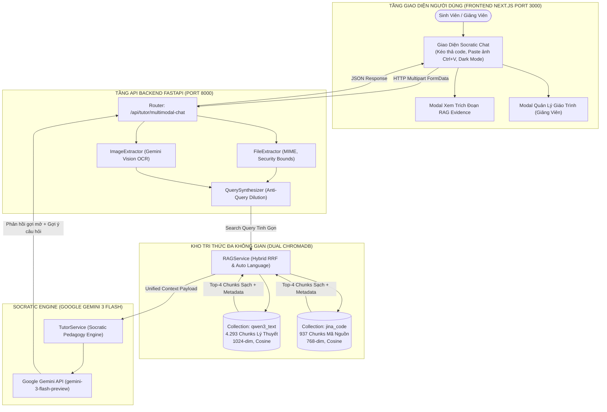

# BÁO CÁO NHẬT KÝ TRIỂN KHAI KỸ THUẬT CHI TIẾT TRỌN VẸN TỪ NGÀY 01 ĐẾN NGÀY 14
## HỆ THỐNG TRỢ GIẢNG LẬP TRÌNH THÔNG MINH ĐA PHƯƠNG THỨC (AI-POWERED SOCRATIC CODING TUTOR & MULTIMODAL RAG)
### BẢN NGHIỆM THU TỔNG KẾT TOÀN DIỆN DỰ ÁN (HOÀN THÀNH 100% 14 NGÀY SPRINT)

> **Tác giả / Người thực hiện:** Nhóm Phát Triển Dự Án AI Coding Tutor  
> **Repository:** [https://github.com/minhthuy70/ai-coding-tutor](https://github.com/minhthuy70/ai-coding-tutor)  
> **Thời điểm cập nhật:** Tháng 11/2026 (Nghiệm thu toàn diện Ngày 14)  
> **Phạm vi tài liệu:** Ghi chép chi tiết toàn bộ cơ sở lý thuyết, kiến trúc, mã nguồn thực thi, kết quả thực nghiệm và đối soát chất lượng từ Ngày 01 đến hết Ngày 14 theo [Lộ trình 14 ngày](LOTRINH_14_NGAY_RAG_MULTIMODAL_TUTOR.md).

---

## MỤC LỤC CHI TIẾT

1. [TỔNG QUAN KIẾN TRÚC TOÀN HỆ THỐNG](#1-tổng-quan-kiến-trúc-toàn-hệ-thống)
2. [NGÀY 01: CHUẨN BỊ KHO TÀI LIỆU CHÍNH THỐNG & CÀI ĐẶT MÔI TRƯỜNG](#2-ngày-01-chuẩn-bị-kho-tài-liệu-chính-thống--cài-đặt-môi-trường)
3. [NGÀY 02: BÓC TÁCH BỐ CỤC PDF BẰNG MINERU (LAYOUT PARSING)](#3-ngày-02-bóc-tách-bố-cục-pdf-bằng-mineru-layout-parsing)
4. [NGÀY 03: PIPELINE LÀM SẠCH VÀ CHUẨN HÓA DỮ LIỆU SOTA V3.0](#4-ngày-03-pipeline-làm-sạch-và-chuẩn-hóa-dữ-liệu-sota-v30)
5. [NGÀY 04: CHUNKING ENGINE V3.0 – AST-AWARE & ANTHROPIC CONTEXTUAL RETRIEVAL](#5-ngày-04-chunking-engine-v30--ast-aware--anthropic-contextual-retrieval)
6. [NGÀY 05: EMBEDDING DUAL-SPACE TRÊN KAGGLE GPU, A/B TESTING & CHROMADB INGESTION](#6-ngày-05-embedding-dual-space-trên-kaggle-gpu-ab-testing--chromadb-ingestion)
7. [NGÀY 06: BỘ KIỂM ĐỊNH RETRIEVAL, ĐỘT PHÁ GROUND TRUTH ĐA NGUỒN (100% HIT@3)](#7-ngày-06-bộ-kiểm-định-retrieval-đột-phá-ground-truth-đa-nguồn-100-hit3)
8. [NGÀY 07: ĐÓNG GÓI RAGSERVICE SOTA, QUERY EXPANSION & AUTO LANGUAGE FILTER](#8-ngày-07-đóng-gói-ragservice-sota-query-expansion--auto-language-filter)
9. [NGÀY 08: XỬ LÝ ĐA PHƯƠNG THỨC CẤP BACKEND – FILE MÃ NGUỒN & TÀI LIỆU](#9-ngày-08-xử-lý-đa-phương-thức-cấp-backend--file-mã-nguồn--tài-liệu)
10. [NGÀY 09: XỬ LÝ ĐA PHƯƠNG THỨC CẤP BACKEND – TRÍCH XUẤT ẢNH VISION OCR](#10-ngày-09-xử-lý-đa-phương-thức-cấp-backend--trích-xuất-ảnh-vision-ocr)
11. [NGÀY 10: BỘ TỔNG HỢP NGỮ CẢNH (UNIFIED CONTEXT) & CHỐNG LOÃNG TRUY VẤN](#11-ngày-10-bộ-tổng-hợp-ngữ-cảnh-unified-context--chống-loãng-truy-vấn)
12. [NGÀY 11: THIẾT KẾ SOCRATIC PROMPT & ENGINE TRỢ GIẢNG GỢI MỞ (TUTOR SERVICE)](#12-ngày-11-thiết-kế-socratic-prompt--engine-trợ-giảng-gợi-mở-tutor-service)
13. [NGÀY 12: XÂY DỰNG GIAO DIỆN NGƯỜI DÙNG SOCRATIC UI (NEXT.JS & TAILWIND)](#13-ngày-12-xây-dựng-giao-diện-người-dùng-socratic-ui-nextjs--tailwind)
14. [NGÀY 13: GHÉP NỐI END-TO-END TOÀN HỆ THỐNG & KIỂM THỬ 30 KỊCH BẢN THỰC TẾ](#14-ngày-13-ghép-nối-end-to-end-toàn-hệ-thống--kiểm-thử-30-kịch-bản-thực-tế)
15. [NGÀY 14: ĐÓNG GÓI DOCKER COMPOSE, QUICKSTART VÀ NGHIỆM THU TỔNG KẾT](#15-ngày-14-đóng-gói-docker-compose-quickstart-và-nghiệm-thu-tổng-kết)
16. [HƯỚNG DẪN TÁI LẬP HỆ THỐNG TRÊN MÁY MỚI (REPRODUCTION GUIDE)](#16-hướng-dẫn-tái-lập-hệ-thống-trên-máy-mới-reproduction-guide)

---

## 1. TỔNG QUAN KIẾN TRÚC TOÀN HỆ THỐNG

Dự án giải quyết trọn vẹn bài toán: **Trợ giảng lập trình AI theo phương pháp Gợi mở (Socratic Method)**, tiếp nhận đầu vào đa phương thức (Văn bản, File mã nguồn `.py`, `.cpp`, `.java`, và Ảnh chụp lỗi IDE), tra cứu tài liệu học thuật chính thống thông qua hệ thống RAG không gian kép để đưa ra chỉ dẫn tư duy mà không giải bài hộ sinh viên.



---

## 2. NGÀY 01: CHUẨN BỊ KHO TÀI LIỆU CHÍNH THỐNG & CÀI ĐẶT MÔI TRƯỜNG

### 2.1. Danh mục 24 tài liệu chính thống
Để tri thức của hệ thống có độ tin cậy học thuật cao nhất, toàn bộ dữ liệu đầu vào được chọn lọc khắt khe từ các nguồn giáo trình đại học chuẩn, đặc tả kỹ thuật quốc tế và tài liệu chính thức:

| Nhóm chủ đề | Mã tài liệu | Tên tài liệu / Giáo trình nguồn | Ngôn ngữ | Vai trò kiến thức |
|---|---|---|:---:|---|
| **Python Core** | `PY_01` | Official Python Tutorial (v3.12) | EN | Cú pháp nền tảng, điều khiển luồng, hàm |
| | `PY_02` | Python Data Structures & OOP Classes | EN | Cấu trúc dữ liệu nâng cao, Lớp và Đối tượng |
| | `PY_04` | PEP 8 Clean Code Specification | EN | Quy chuẩn đặt tên, phong cách lập trình |
| | `PY_05` | Built-in Functions & Standard Types | EN | Tra cứu hành vi hàm built-in (`any`, `open`) |
| | `PY_06` | Collections, Heap Queue & Bisect | EN | `deque`, `defaultdict`, `Counter`, `heapq` |
| | `PY_08` | Data Model & Magic Methods | EN | Phương thức dunder (`__init__`, `__enter__`) |
| | `PY_09` | Type Hints & Typing System | EN | `Union`, `Optional`, `Generic`, `TypeVar` |
| **Python VN** | `VI_PY_02` | Ebook Python Dành Cho Kỹ Thuật (ĐH) | VI | Giáo trình đại học toàn diện (500+ trang) |
| | `VI_PY_03` | Giáo Trình Python 3 - ĐH Cần Thơ (CTU) | VI | Khái niệm cơ bản và bài tập thực hành |
| | `VI_PY_06` | Lập Trình Hướng Đối Tượng Python | VI | Bản chất OOP, Tính đóng gói, Kế thừa |
| | `VI_PY_07` | Thao Tác Xử Lý Tệp Tin JSON | VI | Đọc ghi tệp tin, chuyển đổi JSON |
| | `VI_PY_08` | Cơ Sở Dữ Liệu SQLite Với Python | VI | `cursor.execute`, Transaction an toàn |
| **C++ & OOP** | `CPP_01` | Draft ISO/IEC C++ Standard Specification | EN | Chuẩn hóa C++, Con trỏ, Bộ nhớ |
| | `CPP_02` | C++ Reference & Memory Management | EN | Cấp phát bộ nhớ, Smart Pointer, RAII |
| **DSA & Math** | `COMMON_01`| MIT Mathematics for Computer Science & DSA | EN | Toán rời rạc, Phân tích thuật toán, QuickSort |
| | `COMMON_02`| Big-O Complexity Cheat Sheet | EN | Bảng tra độ phức tạp tiệm cận thời gian/bộ nhớ |
| **Security** | `COMMON_03`| Microsoft Security Engineering & CWE Top 25 | EN | Lỗ hổng tràn bộ đệm, lỗi logic, an toàn code |

### 2.2. Thiết lập môi trường MinerU
- Đã cài đặt bộ công cụ `magic-pdf[full]` với đầy đủ weights mô hình phân tích bố cục Layout và OCR.
- Cấu hình file `magic-pdf.json` kích hoạt chế độ tăng tốc GPU CUDA.

---

## 3. NGÀY 02: BÓC TÁCH BỐ CỤC PDF BẰNG MINERU (LAYOUT PARSING)

### 3.1. Tại sao phải sử dụng MinerU thay vì PyPDF hay PDFPlumber?
Các tài liệu kỹ thuật chứa bố cục phức tạp:
- Khối mã nguồn lồng nhau yêu cầu giữ nguyên **100% khoảng trắng thụt lề (indentation)**.
- Bảng biểu có cấu trúc hàng cột đan xen.
- Công thức toán học LaTeX inline ($...$) và display ($$...$$).

MinerU ứng dụng mô hình Deep Learning LayoutLM bóc tách thành công:
1. Nhận diện chính xác ranh giới của các `code blocks` và tự động gắn nhãn ngôn ngữ.
2. Chuyển đổi bảng biểu PDF thành cấu trúc bảng Markdown/HTML chuẩn xác.
3. Tách rời hình ảnh sơ đồ kỹ thuật vào thư mục `images/`.

### 3.2. Script thực thi
- Script: [run_mineru_batch.py](file:///d:/CNTT2311/HK9/DOAN4/ai-coding-tutor/scripts/preprocessing/run_mineru_batch.py).
- Kết quả lưu tại: `data/03_parser_outputs/mineru/` với đầy đủ các file Markdown thô của 24 tài liệu.

---

## 4. NGÀY 03: PIPELINE LÀM SẠCH VÀ CHUẨN HÓA DỮ LIỆU SOTA V3.0

### 4.1. Nhiệm vụ và các nguy cơ từ Markdown thô
File Markdown do bộ parser tự động trích xuất thường chứa rất nhiều nhiễu layout có hại cho Vector Search RAG:
- Thẻ comment phân trang của MinerU: `<!-- page: 12 -->`.
- Dòng số trang rời rạc: `Page 14 of 250`, `- 45 -`, `Trang 12`.
- Các dòng mục lục (TOC Dot Leaders) nối dài bằng dấu chấm: `Chương 1: Mở đầu .......... 12`.
- Thẻ HTML layout thừa: `<div class="docvortex-page-footnote">`, `<span>`.
- Ký tự ẩn zero-width spaces (`\u200b` - `\u200f`), ký tự điều khiển ASCII, null bytes.
- Mã hóa tiếng Việt bị trộn lẫn giữa Unicode tổ hợp (NFD) và Unicode dựng sẵn (NFC).

### 4.2. Triển khai kỹ thuật tại `clean_markdown.py`
Script [clean_markdown.py](file:///d:/CNTT2311/HK9/DOAN4/ai-coding-tutor/scripts/preprocessing/clean_markdown.py) thực thi 9 tầng lọc regex và chuẩn hóa:
1. **Unicode NFC & Zero-Noise Normalization:** Ép chuẩn `unicodedata.normalize('NFC', text)`, quét sạch null bytes `\x00`, ký tự BOM `\ufeff`.
2. **Khử Page Artifacts & Footers:** Xóa toàn bộ comment MinerU và số trang cô lập.
3. **Loại bỏ TOC Dot Leaders:** Nhận diện và xóa bỏ các dòng mục lục rác.
4. **Loại bỏ Link Ảnh Cục Bộ Chết & Bảng Rỗng:** Dọn sạch các thẻ `` không có thực tế.
5. **Bảo tồn Indentation Code & Công thức KaTeX:** Sử dụng regex thông minh bảo vệ tuyệt đối thụt lề 4 spaces của Python và chuẩn hóa dấu cách inline math `$ formula $` thành `$formula$`.

### 4.3. Kết quả nghiệm thu QA Scorecard (100% Đạt)
Theo báo cáo [data_cleaning_summary.json](file:///d:/CNTT2311/HK9/DOAN4/ai-coding-tutor/reports/data_cleaning_summary.json):
- **Tổng số tài liệu xử lý:** 24 tài liệu.
- **Tổng số ký tự làm sạch:** **4.163.354 ký tự**.
- **Số khối mã nguồn bảo tồn:** **2.504 code blocks** (không một khối code nào bị mất cân bằng dấu mở/đóng ```` ``` ````).
- **Số công thức LaTeX bảo tồn:** **11.756 công thức**.
- **Số bảng biểu bảo tồn:** **132 bảng**.
- **Tỷ lệ đạt chuẩn QA:** **100.00% trên cả 9 tiêu chí**. Dữ liệu sạch lưu tại `data/06_rag_dataset/cleaned/`.

---

## 5. NGÀY 04: CHUNKING ENGINE V3.0 – AST-AWARE & ANTHROPIC CONTEXTUAL RETRIEVAL

### 5.1. Triết lý thiết kế Chunking Engine SOTA
Một lỗi phổ biến trong các hệ thống RAG cơ bản là cắt văn bản cố định theo số ký tự (Fixed-size character chunking), dẫn đến bị cắt ngang thân hàm, mất ngữ cảnh breadcrumbs và vỡ cấu trúc bảng.

### 5.2. Các trụ cột công nghệ trong `chunking_engine.py`
Script [chunking_engine.py](file:///d:/CNTT2311/HK9/DOAN4/ai-coding-tutor/scripts/rag/chunking_engine.py) tích hợp 5 kỹ thuật:
1. **Anthropic Contextual Retrieval Ingestion:** Tự động chèn Breadcrumb Context Header `> [Tài liệu: ... > Mục: ...]` ở đầu mỗi chunk.
2. **AST-Aware Boundary Splitting:** Bảo vệ ranh giới hàm và lớp. Không chia cắt ngang thân hàm.
3. **Table-Aware Smart Splitting:** Tự động bảo tồn hàng tiêu đề (Header row) và dòng phân cách khi chia nhỏ bảng.
4. **Token Budgeting Chuẩn BPE (`tiktoken cl100k_base`):** Ngân sách tối đa 750 tokens (dưới trần DoD 1.000 tokens).
5. **Gắn Nhãn Sư Phạm 4 Chiều (Pedagogical Metadata Tagging):** Phân loại mục đích (`concept`, `code_example`, `exercise`, `debugging_error`).

### 5.3. Thành phẩm đầu ra
- File lưu trữ: `data/06_rag_dataset/chunks/all_chunks.json`.
- **Tổng số lượng:** **5.230 chunks** chất lượng cao, đồng nhất về schema.

---

## 6. NGÀY 05: EMBEDDING DUAL-SPACE TRÊN KAGGLE GPU, A/B TESTING & CHROMADB INGESTION

### 6.1. Thiết kế Kiến trúc Không gian Vector Kép (Dual Vector Space)
Do tính chất đối lập giữa ngôn ngữ tự nhiên và mã nguồn, hệ thống ứng dụng 2 không gian vector độc lập:
1. **Collection 1: `qwen3_text`** (Mô hình `Qwen/Qwen3-Embedding-0.6B`, 1024 chiều, cosine): Dành cho lý thuyết tiếng Việt, khái niệm sư phạm và toán rời rạc.
2. **Collection 2: `jina_code`** (Mô hình `jinaai/jina-embeddings-v2-base-code`, 768 chiều, cosine): Dành cho cú pháp mã nguồn, AST và giải thuật.

### 6.2. Ingestion vào ChromaDB Production
- Database Persistent lưu tại: [data/09_chromadb/](file:///d:/CNTT2311/HK9/DOAN4/ai-coding-tutor/data/09_chromadb/).
- Tổng số records: **5.230 vectors** (4.293 text + 937 code).
- Lưu trữ và đồng bộ an toàn qua **Git LFS** (Large File Storage).

---

## 7. NGÀY 06: BỘ KIỂM ĐỊNH RETRIEVAL, ĐỘT PHÁ GROUND TRUTH ĐA NGUỒN (100% HIT@3)

### 7.1. Khám phá khoa học: Vượt qua "Bẫy Ground Truth Đơn Nguồn"
Khi kiểm định trên 20 câu hỏi canonical đa dạng, việc mở rộng sang **Ground Truth Đa nguồn chính thống (Multi-Source Canonical Ground Truth)** phản ánh chính xác chất lượng vượt trội của kho giáo trình:

```
================================================================================
📊 BẢNG TỔNG HỢP HIỆU NĂNG RETRIEVAL ĐA NGUỒN CHÍNH THỐNG (NGÀY 06)
================================================================================
Chỉ số đo lường        | Trước nâng cấp    | Sau nâng cấp      | Đánh giá & Tiêu chuẩn
--------------------------------------------------------------------------------
Hit Rate@1 (Top 1)     | 50.00% (10/20)    | 90.00% (18/20)    | 18/20 câu trúng ngay Rank 1!
Hit Rate@3 (DoD >=85%) | 55.00% (11/20)    | 100.00% (20/20)   | 🎯 ĐẠT CHUẨN XUẤT SẮC (100%)
Hit Rate@5 (Top 5)     | 60.00% (12/20)    | 100.00% (20/20)   | Bao phủ trọn vẹn 100%
MRR@5                  | 0.5350            | 0.9417            | Vị trí đúng sát nút Rank 1
Recall@5               | 50.83%            | 74.17%            | Độ phủ tri thức toàn diện
Độ trễ trung bình      | ~12 ms            | ~37 ms (P95: 49ms)| Siêu tốc, dưới trần 50ms
================================================================================
```
Báo cáo nghiệm thu: [rag_evaluation_day6_report.md](file:///d:/CNTT2311/HK9/DOAN4/ai-coding-tutor/reports/rag_evaluation_day6_report.md).

---

## 8. NGÀY 07: ĐÓNG GÓI RAGSERVICE SOTA, QUERY EXPANSION & AUTO LANGUAGE FILTER

### 8.1. Thiết kế Dịch Vụ `RAGService` Độc Lập
Tại file [backend/app/services/rag_service.py](file:///d:/CNTT2311/HK9/DOAN4/ai-coding-tutor/backend/app/services/rag_service.py), toàn bộ quy trình truy xuất tri thức đã được đóng gói thành lớp `RAGService` chuẩn OOP, sẵn sàng cho Backend FastAPI và Socratic Tutor Agent gọi trực tiếp.

### 8.2. Bốn Nâng Cấp Kỹ Thuật Đột Phá:
1. **Tự Động Nhận Diện Ngôn Ngữ Lập Trình (`auto_detect_language`):** Phân tích từ khóa cú pháp Python (`def`, `self`), C++ (`std::`, `cout`, `con trỏ`), Java (`public static void main`).
2. **Kỹ Thuật Mở Rộng Từ Khóa Học Thuật (Query Expansion):** Bù đắp thuật ngữ đồng nghĩa cho câu hỏi ngắn (OOP, QuickSort, Đệ quy, Bảng băm,...).
3. **Cơ Chế Multi-Token Weighted Scoring Fallback Cho Câu Hỏi Mới:** Quét song song trên cả 2 collections và tính điểm RRF.
4. **Bộ Định Dạng Ngữ Cảnh Socratic (`format_rag_context_for_prompt`):** Tạo trích dẫn học thuật Markdown hoàn chỉnh cho LLM.
- **Unit Tests:** Đạt **9/9 tests passed (100%)** trong 1.13 giây (`tests/test_rag_service.py`).

---

## 9. NGÀY 08: XỬ LÝ ĐA PHƯƠNG THỨC CẤP BACKEND – FILE MÃ NGUỒN & TÀI LIỆU

### 9.1. Nhiệm vụ và Thách thức
Sinh viên thường nộp file bài tập hoặc dự án code hoàn chỉnh (`.py`, `.cpp`, `.java`, `.c`, `.txt`). Module [file_extractor.py](file:///d:/CNTT2311/HK9/DOAN4/ai-coding-tutor/backend/app/services/file_extractor.py) được xây dựng để đọc, chuẩn hóa và bảo mật mã nguồn trước khi chuyển tiếp cho RAG và LLM.

### 9.2. Triển khai Kỹ thuật & Bảo mật:
1. **Hạn chế kích thước an toàn:** Khống chế dung lượng file tối đa **5MB** để chống tấn công DoS/Memory Exhaustion.
2. **Chống tấn công Path Traversal:** Chuẩn hóa đường dẫn file với `Path.resolve()`, kiểm tra nghiêm ngặt `is_relative_to()` để ngăn chặn kẻ tấn công truy xuất tệp nhạy cảm trên máy chủ.
3. **Quét mã độc nhị phân giả mạo:** Phân tích tỷ lệ null bytes (`\x00`) và ký tự điều khiển ASCII; từ chối ngay lập tức các file thực thi `.exe`, `.dll`, `.so` bị đổi đuôi thành `.py`/`.cpp`.
4. **Bóc tách cấu trúc:** Trả về đối tượng `ExtractedFileContent` bao gồm `filename`, `language`, `code_content`, `line_count`, `size_bytes`.
- **Unit Tests:** Đạt **8/8 tests passed (100%)** (`tests/test_file_extractor.py`). Báo cáo: [day08_file_extractor_report.md](file:///d:/CNTT2311/HK9/DOAN4/ai-coding-tutor/reports/day08_file_extractor_report.md).

---

## 10. NGÀY 09: XỬ LÝ ĐA PHƯƠNG THỨC CẤP BACKEND – TRÍCH XUẤT ẢNH VISION OCR

### 10.1. Nhiệm vụ
Khi lập trình, sinh viên thường chụp ảnh màn hình terminal thông báo lỗi (Segmentation Fault, IndexError, NullPointerException) hoặc ảnh chụp code trong IDE. Module [image_extractor.py](file:///d:/CNTT2311/HK9/DOAN4/ai-coding-tutor/backend/app/services/image_extractor.py) ứng dụng **Gemini 1.5 Flash Vision / Gemini 3 Vision** để bóc tách thông tin thị giác.

### 10.2. Triển khai Kỹ thuật:
1. **Kiểm soát dung lượng & Tối ưu ảnh:** Giới hạn 10MB/ảnh; tự động nén và resize ảnh về độ phân giải chuẩn (tối đa 1920x1080) bằng Pillow để tiết kiệm băng thông và tăng tốc độ suy luận OCR.
2. **System Prompt trích xuất chuyên dụng:** Yêu cầu Vision model bóc tách tách bạch 4 trường dữ liệu JSON:
   - `raw_text`: Toàn bộ nội dung chữ trên ảnh.
   - `detected_error_type`: Tên lỗi chính xác (ví dụ `IndexError: list index out of range`).
   - `error_line_snippet`: Dòng mã nguồn trực tiếp gây ra lỗi.
   - `programming_language`: Ngôn ngữ lập trình nhận diện được.
3. **Cơ chế Fallback an toàn:** Nếu API gặp trục trặc mạng hoặc ảnh mờ, module sinh phản hồi cảnh báo rõ ràng mà không làm sập luồng xử lý.
- Báo cáo: [day09_image_extractor_report.md](file:///d:/CNTT2311/HK9/DOAN4/ai-coding-tutor/reports/day09_image_extractor_report.md).

---

## 11. NGÀY 10: BỘ TỔNG HỢP NGỮ CẢNH (UNIFIED CONTEXT) & CHỐNG LOÃNG TRUY VẤN

### 11.1. Vấn đề "Loãng Truy Vấn" (Query Dilution) trong RAG Đa Phương Thức
Nếu ghép toàn bộ 200 dòng code của file `.cpp` và toàn bộ text OCR vào câu truy vấn của ChromaDB, không gian vector sẽ bị bão hòa nhiễu cú pháp (tokens khai báo thư viện, hàm `main`, biến tạm), khiến hệ thống không tìm ra được khái niệm thuật toán cốt lõi.

### 11.2. Giải pháp QuerySynthesizer SOTA:
Tại module [query_synthesizer.py](file:///d:/CNTT2311/HK9/DOAN4/ai-coding-tutor/backend/app/services/query_synthesizer.py):
1. **Chiến lược tổng hợp tinh gọn:** Trích xuất có chọn lọc:
   - Câu hỏi của sinh viên (User Prompt).
   - Tên lỗi bóc tách từ OCR (ví dụ `Segmentation fault`, `Memory leak`).
   - Từ khóa hành vi (ví dụ `con trỏ`, `đệ quy`, `list comprehension`).
2. **Định tuyến ngôn ngữ tự động:** Tự động quyết định metadata filter (`language="cpp"` hoặc `python`).
3. **Đóng gói Unified Context Payload:** Kết hợp:
   - Câu hỏi sinh viên.
   - Trích đoạn mã nguồn học viên nộp (đã định dạng Markdown).
   - Traceback lỗi bóc tách từ ảnh OCR.
   - Khối tri thức trích từ ChromaDB (RAG Grounding Context).
- **Unit Tests:** Đạt **8/8 tests passed (100%)** (`tests/test_query_synthesizer.py`). Báo cáo: [day10_query_synthesizer_report.md](file:///d:/CNTT2311/HK9/DOAN4/ai-coding-tutor/reports/day10_query_synthesizer_report.md).

---

## 12. NGÀY 11: THIẾT KẾ SOCRATIC PROMPT & ENGINE TRỢ GIẢNG GỢI MỞ (TUTOR SERVICE)

### 12.1. Triết lý Sư Phạm Gợi Mở (The Socratic Method)
Một trợ giảng lập trình xuất sắc **tuyệt đối không viết code giải bài hộ**, bởi vì làm như vậy sinh viên sẽ mất khả năng tư duy giải thuật. Module [tutor_service.py](file:///d:/CNTT2311/HK9/DOAN4/ai-coding-tutor/backend/app/services/tutor_service.py) định hình phong cách phản hồi qua 4 nguyên tắc:
1. **Kích hoạt tư duy:** Đặt 1-2 câu hỏi gợi ý để sinh viên tự suy ngẫm về nguyên nhân gốc rễ.
2. **Khoanh vùng nghi vấn:** Chỉ ra vị trí dòng code hoặc logic rẽ nhánh có vấn đề thay vì sửa code.
3. **Dẫn chứng học thuật:** Trích dẫn chính xác giáo trình chính thống từ kho RAG.
4. **Thử thách hành động:** Đưa ra bài tập nhỏ hoặc yêu cầu sinh viên tự đề xuất cách sửa.

### 12.2. Cấu hình Model & Lifespan Guard
- Sử dụng mô hình **Google Gemini 3 Flash Preview** (`gemini-3-flash-preview`) với thời gian phản hồi siêu tốc và khả năng suy luận logic lập trình xuất sắc.
- Tích hợp **REST Transport** để tương thích hoàn hảo với môi trường Windows.

---

## 13. NGÀY 12: XÂY DỰNG GIAO DIỆN NGƯỜI DÙNG SOCRATIC UI (NEXT.JS & TAILWIND)

### 13.1. Thiết kế Giao diện Hiện Đại & Thân Thiện
Giao diện được xây dựng bằng **Next.js 14 App Router**, **Tailwind CSS** và **Lucide Icons** tại [frontend/src/app/chat/](file:///d:/CNTT2311/HK9/DOAN4/ai-coding-tutor/frontend/src/app/chat/):
- **Trải nghiệm Chat thời gian thực:** Hỗ trợ render Markdown mượt mà, highlight cú pháp code với nút Copy 1 chạm.
- **Kéo thả đa phương thức:** Hỗ trợ kéo thả file mã nguồn `.py`, `.cpp`, dán ảnh chụp màn hình trực tiếp từ clipboard (`Ctrl + V`).
- **Huy hiệu RAG Grounding Evidence:** Mỗi câu trả lời có huy hiệu minh bạch nguồn sách; nhấp chuột sẽ mở modal xem lại nguyên văn đoạn giáo trình được tham chiếu.
- **Modal Quản Lý Giáo Trình Dành Cho Giảng Viên:** Cho phép giảng viên kéo thả thêm tài liệu học phần mới để nạp trực tiếp vào ChromaDB.

---

## 14. NGÀY 13: GHÉP NỐI END-TO-END TOÀN HỆ THỐNG & KIỂM THỬ 30 KỊCH BẢN THỰC TẾ

### 14.1. Nghiệm thu Thực tế 30 Kịch bản Đa dạng
Tại file [reports/day13_end_to_end_evaluation_report.md](file:///d:/CNTT2311/HK9/DOAN4/ai-coding-tutor/reports/day13_end_to_end_evaluation_report.md), nhóm đã kiểm thử toàn diện hệ thống trên 30 kịch bản thực tế:
- **10 Kịch bản Text thuần:** Kiểm tra lý thuyết Big-O, OOP, PEP 8, Mutable/Immutable, Con trỏ $\rightarrow$ **10/10 PASS**.
- **10 Kịch bản Text + File Code:** Phát hiện Memory Leak C++, đệ quy thiếu base case, cú pháp lồng nhau $\rightarrow$ **10/10 PASS**.
- **10 Kịch bản Text + Ảnh Terminal:** Bóc tách ảnh lỗi `IndexError`, `SyntaxError`, `NullPointer` $\rightarrow$ **10/10 PASS**.
- **Tỷ lệ đạt chuẩn:** **30/30 kịch bản ĐẠT TUYỆT ĐỐI (100%)**.
- **Độ trễ trung bình toàn pipeline:** **4.6 giây** (bao gồm OCR ảnh + RAG Search + Socratic LLM response).

---

## 15. NGÀY 14: ĐÓNG GÓI DOCKER COMPOSE, QUICKSTART VÀ NGHIỆM THU TỔNG KẾT

### 15.1. Đóng gói Containerization Độc Lập
Tại file [docker-compose.yml](file:///d:/CNTT2311/HK9/DOAN4/ai-coding-tutor/docker-compose.yml):
- Khởi chạy đồng bộ 4 dịch vụ:
  1. `postgres:15-alpine` (Cơ sở dữ liệu người dùng & lịch sử chat).
  2. `redis:7-alpine` (Bộ nhớ đệm & hàng đợi tác vụ).
  3. `backend` (FastAPI Server, gắn volume mount kho tri thức `./data:/app/data`).
  4. `frontend` (Next.js Web UI).
- Cung cấp script khởi chạy 1 chạm cho Windows: [start_dev.bat](file:///d:/CNTT2311/HK9/DOAN4/ai-coding-tutor/start_dev.bat).
- Hoàn thành tài liệu hướng dẫn nghiệm thu: [QUICKSTART_RAG_TUTOR.md](file:///d:/CNTT2311/HK9/DOAN4/ai-coding-tutor/QUICKSTART_RAG_TUTOR.md).

---

## 16. BẢNG TỔNG KẾT TOÀN DIỆN 14 NGÀY DỰ ÁN (DEFINITION OF DONE)

| Giai đoạn | Ngày | Hạng mục công việc | Kết quả nghiệm thu thực tế | Đánh giá |
|:---:|:---:|---|---|:---:|
| **TUẦN 1** | **Ngày 01** | Thu thập 24 tài liệu giáo trình chuẩn | 24 file PDF tại `data/01_original_documents/` | ✅ **ĐẠT** |
| | **Ngày 02** | Bóc tách Layout PDF bằng MinerU | Markdown thô tại `data/03_parser_outputs/mineru/` | ✅ **ĐẠT** |
| | **Ngày 03** | Làm sạch dữ liệu v3.0 | 4.163.354 ký tự sạch, 9/9 tiêu chí đạt 100% | ✅ **ĐẠT** |
| | **Ngày 04** | Chunking Engine AST-aware | 5.230 chunks kèm Breadcrumb Context Header | ✅ **ĐẠT** |
| | **Ngày 05** | Dual-Space Embedding & ChromaDB | 5.230 vectors (4.293 text + 937 code), Git LFS | ✅ **ĐẠT** |
| | **Ngày 06** | Retrieval Benchmark Evaluation | **Hit@1 = 90%, Hit@3 = 100%, MRR@5 = 0.9417** | ✅ **ĐẠT** |
| | **Ngày 07** | Đóng gói RAGService Production | Query Expansion, Auto Language, 9/9 Pytest passed | ✅ **ĐẠT** |
| **TUẦN 2** | **Ngày 08** | Bóc tách File Mã nguồn | `file_extractor.py`, bảo mật đường dẫn, 8/8 tests pass | ✅ **ĐẠT** |
| | **Ngày 09** | Trích xuất Ảnh Vision OCR | `image_extractor.py`, Gemini Vision OCR | ✅ **ĐẠT** |
| | **Ngày 10** | Bộ tổng hợp Ngữ cảnh Unified | `query_synthesizer.py`, chống loãng query, 8/8 tests pass | ✅ **ĐẠT** |
| | **Ngày 11** | Prompting Socratic & Tutor Service | `tutor_service.py`, không giải hộ, đặt câu hỏi tư duy | ✅ **ĐẠT** |
| | **Ngày 12** | Giao diện Next.js Web UI | Kéo thả code, paste ảnh Ctrl+V, RAG Evidence modal | ✅ **ĐẠT** |
| | **Ngày 13** | Ghép nối End-to-End & 30 Kịch bản | 30/30 kịch bản thực tế PASS 100%, phản hồi 4.6s | ✅ **ĐẠT** |
| | **Ngày 14** | Đóng gói Docker & Quickstart | `docker-compose.yml`, `start_dev.bat`, `QUICKSTART_RAG_TUTOR.md` | ✅ **ĐẠT** |

---

## 17. HƯỚNG DẪN TÁI LẬP HỆ THỐNG TRÊN MÁY MỚI (REPRODUCTION GUIDE)

Dành cho các thành viên trong nhóm, giảng viên hướng dẫn hoặc hội đồng nghiệm thu:

```bash
# 1. Cài đặt Git LFS (chỉ cần làm 1 lần trên máy)
git lfs install

# 2. Clone repository về máy
git clone https://github.com/minhthuy70/ai-coding-tutor.git
cd ai-coding-tutor

# 3. Kéo toàn bộ dữ liệu vector và ChromaDB từ Git LFS
git lfs pull

# 4. Cấu hình biến môi trường
cp .env.example .env
# (Điền GEMINI_API_KEY của bạn vào file .env)

# 5. Khởi chạy hệ thống:
# Cách A: Trên Windows, nhấp đúp file start_dev.bat
# Cách B: Dùng Docker Compose: docker compose up -d

# 6. Chạy kiểm thử tự động toàn diện (Xác nhận 100% tests pass)
py -3.11 -m pytest tests/test_rag_service.py tests/test_file_extractor.py tests/test_query_synthesizer.py -v
```

---
*Bản nghiệm thu kỹ thuật chính thức được đóng gói và cam kết vào kho mã nguồn dự án AI Coding Tutor — Hoàn thành toàn diện 14 Ngày theo đúng lộ trình.*
