<!-- page: 1 -->


## NGÔN NGỮ LẬP TRÌNH python

Đỗ Thanh Nghị dtnghi@cit.ctu.edu.vn

12-2019

<!-- page: 2 -->

## Nội dung

Giới thiệu

Lập trình căn bản

Các kiểu dữ liệu phức

Lập trình hướng đối tượng

Vào/ra, ngoại lệ

Lập trình mạng

Lập trình Web

Python-MySQL

Giao diện GUI

Vẽ đồ thị

<!-- page: 3 -->

## Nội dung


## Giới thiệu

Lập trình căn bản

Các kiểu dữ liệu phức

Lập trình hướng đối tượng

Vào/ra, ngoại lệ

Lập trình mạng

Lập trình Web

Python-MySQL

Giao diện GUI

Vẽ đồ thị

<!-- page: 4 -->

## Giới thiệu Python

Python là ngôn ngữ lập trình cấp cao, tương tác, thông dịch, hướng đối tượng

Do Guido van Rossum đề xuất từ 1985 – 1990

Mã nguồn Python: giấy phép GNU General Public License (GPL)

Python sẵn dùng trên Unix, Linux, Mac OS, Windows

Top 5 ngôn ngữ lập trình phổ biến

Được sử dụng bởi các tổ chức tập đoàn như Wikipedia, Google, Yahoo!, CERN

<!-- page: 5 -->

## Giới thiệu Python

Dễ học (Easy-to-learn)

Dễ đọc (Easy-to-read)

Dễ bảo trì (Easy-to-maintain)

Thư viện chuẩn (standard library): tương thích UNIX, Linux, Windows và Mac

Chế độ tương tác: thực thi, kiểm tra, gỡ rối

Khả chuyển (Portable): phần cứng, hệ điều hành

Khả năng mở rộng (Extendable): thêm mô-đun

Kết nối với các hệ quản trị CSDL

Lập trình giao diện đồ họa GUI

Quy mô chương trình (Scalable)

<!-- page: 6 -->

## Giới thiệu Python

Python được sử dụng trong giảng dạy,

Tính toán khoa học,

Công nghệ sinh-tin học,

Phát triển ứng dụng Web,

Lập trình ứng dụng mạng, nghiên cứu an ninh mạng,

Kỹ thuật đồ họa, xử lý ảnh và thị giác máy tính,

Máy học và khai thác dữ liệu, xử lý ngôn ngữ tự nhiên, trí tuệ nhân tạo

Lập trình nhúng,

Quản trị hệ thống,

Lập trình trò chơi, v.v.

<!-- page: 7 -->

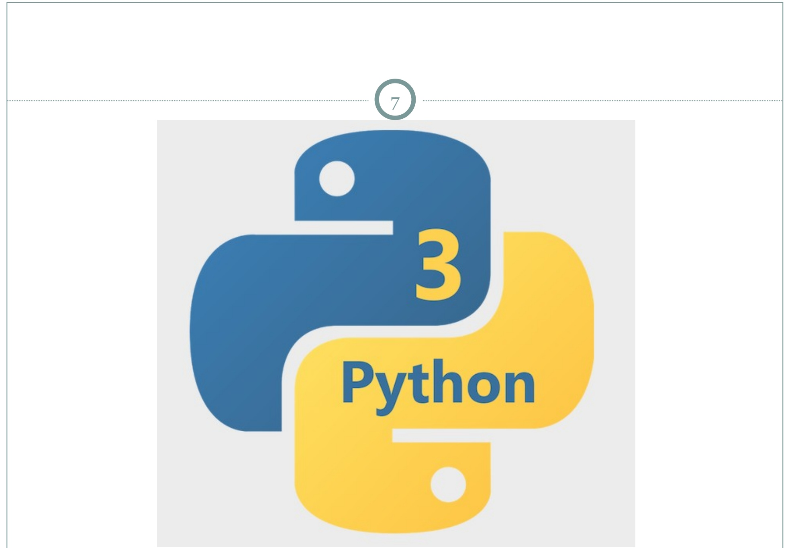

Python

<!-- page: 8 -->

## Nội dung


Giới thiệu

**Lập trình căn bản**

Các kiểu dữ liệu phức

Lập trình hướng đối tượng

Vào/ra, ngoại lệ

Lập trình mạng

Lập trình Web

Python-MySQL

Giao diện GUI

Vẽ đồ thị

<!-- page: 9 -->

## Trình thông dịch Python

[nghi@localhost python3]\$ python3 Python 3.8.10 (default, May 4 2021, 00:00:00) [GCC 10.2.1 20201125 (Red Hat 10.2.1-9)] on linux Type "help", "copyright", "credits" or "license" for more information. >>> print('Hello World!') Hello World!

<!-- page: 10 -->

## Thực thi chương trình Python

Soạn thảo chương trình: PyCharm, Geany, notepad++, Nano, Gedit, v.v.

Chương trình **hello.py** #!/usr/bin/python3 print('Hello World!')

## Thực thi hello.py

[nghi@localhost python3]\$ python3 hello.py Hello World!

<!-- page: 11 -->

Phân biệt ký tự thường hoa

Các từ khóa của Python được

| and | exec | not |
| --- | --- | --- |
| as | finally | or |
| assert | for | pass |
| break | from | print |
| class | global | raise |
| continue | if | return |
| def | import | try |
| del | in | while |
| elif | is | with |
| else | lambda | yield |
| except |  |  |

<!-- page: 12 -->

```python
Cú pháp
12
• Sử dụng # để chú thích 1 dòng trong chương trình
# comment
• Sử dụng ''' để chú thích 1 đoạn
"""
print("We are in a comment")
print('We are still in a comment')
"""

• Dấu ' và "
word = 'word'
sentence = "This is a sentence."
message = """This message will
... span several lines.""""
```

<!-- page: 13 -->

```lua
print("False")
```

## Cú pháp

Sử dụng canh lề (bắt buộc) để bao các khối lệnh của hàm, lớp hoặc luồng điều khiển

Số khoảng trắng dùng để canh lề có thể nhiều ít tuỳ ý nhưng tất cả lệnh trong một khối phải được canh lề như nhau

if True:

print("Answer")

print("True")

else:

<!-- page: 14 -->

## Cú pháp

```python
- Lệnh được viết trên nhiều dòng sử dụng ký tự \ 
    total = item_one + \
        item_two + \
        item_three
```

Lệnh được bao bằng các cặp dấu ngoặc: **[]**, **{}, ()** không cần phải sử dụng ký tự \ để tiếp tục dòng days = ['Monday', 'Tuesday', 'Wednesday', 'Thursday', 'Friday']

Dấu ; để cách nhiều lệnh trên dòng import sys; x = 'foo'; sys.stdout.write(x + '\n')

<!-- page: 15 -->

## Cú pháp

Nhóm nhiều câu lệnh đơn tạo nên một khối lệnh và cũng được gọi là bộ (suites)

Các lệnh phức như if, while, def và class cần một dòng header và một bộ

```python
- Dòng header bắt đầu câu lệnh (bằng một từ khoá tương ứng ví dụ như if, def, ...) và kết thúc bằng dấu hai chấm : theo sau là một suite
def hi(name):
    print('Hello ' + name)
    print('Have a good day!')
hi('nghi')
```

<!-- page: 16 -->

```perl
>>> print('hello')
hello
>>> print('hi','there')
hi there
>>> a = 7.0
>>> b = 2
>>> name = 'toto'
>>> print('%f/%d = %f' %(a, b, a/b))
7.000000/2 = 3.500000
>>> print('Hi %s' %name)
Hi toto
```

<!-- page: 17 -->

## Lệnh input trong Python

```txt
>>> name = input("Please enter your name: ")
Please enter your name: toto
>>> print('Hi %s' %name)
Hi toto
>>> a = int(input("a = "))
a = 5
>>> b = float(input("b = "))
b = 7.2
>>> a + b
12.2
```

<!-- page: 18 -->

## Biến, kiểu cơ bản, phép toán

Tên: ký tự bắt đầu phải là **alphabet** hoặc \_

Không cần khai báo, chỉ gán giá trị (sử dụng dấu =)

Được tạo ra trong lần đầu gán giá trị

Phạm vi biến: cục bộ, toàn cục

Tham khảo đến đối tượng

Thông tin về kiểu gắn liền với đối tượng

Kiểu cơ bản: int, float, complex, bool, string

Các phép toán số học: +, -, \*, /, %, \*\*

Phép toán so sánh: ==, !=, >, >=, <, <=

Phép toán luận lý: and, or, not

<!-- page: 19 -->

```python
>>> item_name = 'Computer'
>>> item_qty = 10
>>> item_value = 1000.23
>>> print(item_name, item_qty, item_value)
Computer 10 1000.23
>>> x = y = z = 1
>>> print(x, y, z)
1 1 1
>>> x,y,z = 1,2,'abcd'
>>> print(x, y, z)
1 2 abcd
>>> x, y = y, x
>>> print(x, y)
2 1
```

<!-- page: 20 -->

```lua
>>> var1 = "Python"
>>> def func1():
...     var1 = "PHP"
...     print("In side func1() var1 = ",var1)
...
>>> def func2():
...     global var1
...     print("In side func2() global var1 = ",var1)
...
>>> func1()
In side func1() var1 =  PHP
>>> func2()
In side func2() global var1 =  Python
```

<!-- page: 21 -->

```diff
Biến, kiểu cơ bản, phép toán
>>> x = 7.2
>>> x
7.2
>>> type(x)
<type 'float'>
>>> x = 'hello'
>>> x
'hello'
>>> type(x)
<type 'str'>
>>> x = 123456789
>>> x ** 2
15241578750190521
>>> z = 3+2j
>>> t = 2-1j
>>> z+t
(5+1j)
```

<!-- page: 22 -->

```csv
Biến, kiểu cơ bản, phép toán
>>> x = 7
>>> y = 2
>>> x%y
1
>>> x/y
3.5
>>> 1.0*x/y
3.5
>>> float(x)/y
3.5
>>> a = 7.2
>>> int(a)%y
1
>>> b = True
>>> type(b)
<class 'bool'>
```

<!-- page: 23 -->

```txt
>>> s = 'Hello World!'
>>> type(s)
<class 'str'>
>>> len(s)
12
>>> print(s)
Hello World!
>>> print(s[0])
H
>>> print(s[-1])
!
>>> print(s[2:5])
llo
>>> print(s[2:])
llo World!
>>> print(s * 2)
Hello World!Hello World!
>>> name = 'Ben ' + str(10)
>>> print(name)
Ben 10
```

<!-- page: 24 -->

## Cấu trúc rẽ nhánh if

```python
#eq: ax + b = 0
a = float(input('a = '))
b = float(input('b = '))
if (a==0):
    if (b==0):
        print('Pt vo dinh')
    else:
        print('Pt vo nghiem')
else:
    x = -b/a
    print('x = ', x)
```

<!-- page: 25 -->

```python
Cấu trúc điều khiển
25
• Cấu trúc lặp while
    while (cond):
        ...
        loop_body
        ...

        #s = 1 + 2 + ... + n
        n = int(input('n = '))
        s = 0
        i = 1
        while (i<=n):
            s = s + i
            i = i + 1

        print('s = 1 + 2 + ... + %d = %d' %(n, s))
```

<!-- page: 26 -->

```txt
Cấu trúc điều khiển
26
• Cấu trúc lặp for
    for iter_var in seqence:
        ...
        loop_body
        ...
```

<!-- page: 27 -->

```diff
• Hàm xây dựng sẵn trong các mô-đun
>>> import os
>>> import random as rand
>>> from math import sqrt, cos, sin
>>> os.system('ls -l')
total 8
-rw-rw-r-- 1 nghi nghi 41 Apr 18 09:01 hello.py
-rw-rw-r-- 1 nghi nghi 5 Apr 18 10:05 toto.txt
0
>>> r = rand.random()
>>> print(r)
0.3512297233213161
>>> x = 64
>>> sqrt(x)
8.0
```

<!-- page: 28 -->

Hàm do lập trình viên định nghĩa def function\_name ([parameters]):

body\_of\_the\_function

return ...

Tham số tùy chọn, có thể đặt giá trị mặc định

Hàm có thể trả hoặc không trả về kết quả

Đệ quy

<!-- page: 29 -->

```python
>>> def hi():
...     print('Hi there!')
...
>>> hi()
Hi there!
>>>
>>> def invite(name = 'Toto'):
...     print('Dear', name)
...     print('It will be a great pleasure')
...     print('if you attend the birthday party of Tutu')
...
>>> invite()
Dear Toto
It will be a great pleasure
if you attend the birthday party of Tutu
>>> invite('Philippe')
Dear Philippe
It will be a great pleasure
if you attend the birthday party of Tutu
```

<!-- page: 30 -->

```txt
>>> def addTwo(a, b):
...     return a + b
...
>>> def divide(a, b):
...     return a/b, a%b
...
>>> x = 2
>>> y = 3
>>> z = addTwo(x, y)
>>> print(z)
5
>>> p, q = divide(x, y)
>>> print(p, q)
0.666666666666666 2
```

<!-- page: 31 -->

```python
>>> def gcd(m, n):
...     while (m != n):
...             if (m > n):
...                 m = m - n
...             else:
...                 n = n - m
...     return m
...
>>> def coPrime(a, b):
...     if (gcd(a, b) != 1):
...             return
...     else:
...             print("%d and %d are co-prime" %(a,b))
...
>>> x, y = 2, 5
>>> coPrime(x, y)
2 and 5 are co-prime
```

<!-- page: 32 -->

```python
>>> def fact(n):
...     if (n == 1):
...             return 1
...     else:
...             return n*fact(n-1)
...
>>> n = 5
>>> print('%d! = %d' %(n,fact(n)))
5! = 120
```

<!-- page: 33 -->

## Nội dung


Giới thiệu

Lập trình căn bản

**Các kiểu dữ liệu phức**

Lập trình hướng đối tượng

Vào/ra, ngoại lệ

Lập trình mạng

Lập trình Web

Python-MySQL

Giao diện GUI

Vẽ đồ thị

<!-- page: 34 -->

```python
>>> a = 'Hello world!'
>>> b = "Hello world!"
>>> a == b
True
>>> a = "Khang's lecture"
>>> print(a)
Khang's lecture
>>> a = "One line.\nAnother line."
>>> print(a)
One line.
Another line.
>>> b = """One line,
... another line,
... and some...""""
>>> print(b)
One line,
another line,
and some...
```

<!-- page: 35 -->

```txt
>>> a = "58"
>>> type(a)
<class 'str'>
>>> b=int(a)
>>> b
58
>>> type(b)
<class 'int'>
>>> f = float('1.2e-3')
>>> f
0.0012
>>> print(f)
0.0012
>>> 0.0012
0.0012
>>> eval('23-12')
11
```

<!-- page: 36 -->

```txt
>>> a = "Part 1"
>>> b = "and part 2"
>>> a + ' ' + b
'Part 1 and part 2'
>>> s = a * 2
>>> print(s)
Part 1Part 1
>>> s[0]
'P'
>>> s[0:4]
'Part'
>>> s[5:]
'1Part 1'
>>> s[-1]
'1'
>>> s[6:-1]
'Part '
```

<!-- page: 37 -->

```python
>>> print(s)
Part 1Part 1
>>> len(s)
12
>>> 'p' in s
False
>>> 'P' in s
True
>>> 'Part' in s
True
>>> s[0] = 'B'
Traceback (most recent call last):
    File "<stdin>", line 1, in <module>
TypeError: 'str' object does not support item assignment
>>> s = 'B' + s[1:]
>>> print(s)
Bart 1Part 1
```

<!-- page: 38 -->

## Kiểu String


```python
>>> s = 'a string, with stuff'
>>> s.count('st')
2
>>> s.find('stu')
15
>>> s.split(' ')
['a', 'string', 'with', 'stuff']
>>> three = '3'
>>> three.isdigit()
True
>>> supper = s.upper()
>>> supper
'A STRING, WITH STUFF'
>>> s.rjust(30)
' a string, with stuff'
>>> 'newlines\n\n\n".strip()
' a string, with stuff'
>>> 'newlines\n\n\n'.strip()
' newlines
```

<!-- page: 39 -->

```txt
Kiểu List
Ordered collection of objects
>>> r
[1, 2.0, 3, 5]
>>> type(r)
<type 'list'>
>>> r[1]
2.0
>>> r[-1]
5
>>> r[1:3]
[2.0, 3]
>>> w = r + [10, 19]
>>> w
[1, 2.0, 3, 5, 10, 19]
>>> t = [0.0] * 10
>>> t
[0.0, 0.0, 0.0, 0.0, 0.0, 0.0, 0.0, 0.0, 0.0]
```

<!-- page: 40 -->

```txt
>>> r = [1, 2.0, 3, 5]
>>> r[3] = 'word'
>>> r
[1, 2.0, 3, 'word']
>>> r[0] = [9, 8]
>>> r
[[9, 8], 2.0, 3, 'word']
>>> r[0:3] = [1, 2, 5, 6]
>>> r
[1, 2, 5, 6, 'word']
>>> r[1:3] = []
>>> r
[1, 6, 'word']
>>> len(r)
3
>>> 6 in r
True
>>> r.index(6)
1
```

<!-- page: 41 -->

```txt
>>> r = [1, 2.0, 3, 5]
>>> r.append('thing')
>>> r
[1, 2.0, 3, 5, 'thing']
>>> r.append(['another', 'list'])
>>> r
[1, 2.0, 3, 5, 'thing', ['another', 'list']]
>>> r = [1, 2.0, 3, 5]
>>> r.extend(['item', 'another'])
>>> r
[1, 2.0, 3, 5, 'item', 'another']
>>> k = r.pop()
>>> k
'another'
>>> r
[1, 2.0, 3, 5, 'item']
```

<!-- page: 42 -->

```txt
>>> r = [2, 5, -1, 0, 20]
>>> r.sort()
>>> r
[-1, 0, 2, 5, 20]
>>> w = ['apa', '1', '2', '1234']
>>> w.sort()
>>> w
['1', '1234', '2', 'apa']
>>> w.reverse()
>>> w
['apa', '2', '1234', '1']
>>> v = w[:]
>>> v.reverse()
>>> v
['1', '1234', '2', 'apa']
>>> w
['apa', '2', '1234', '1']
```

<!-- page: 43 -->

```coffeescript
>>> s = 'biovitrum'
>>> w = list(s)
>>> w
['b', 'i', 'o', 'v', 'i', 't', 'r', 'u', 'm']
>>> w.reverse()
>>> w
['m', 'u', 'r', 't', 'i', 'v', 'o', 'i', 'b']
>>> r = ''.join(w)
>>> r
'murtivoib'
>>> d = '-'.join(w)
>>> d
'm-u-r-t-i-v-o-i-b'
>>> s = 'a few words'
>>> w = s.split()
>>> w
['a', 'few', 'words']
>>> ' | '.join(w)
'a | few | words'
```

<!-- page: 44 -->

## Kiểu List

```txt
>>> a = [1, 3, 2]
>>> b = a
>>> c = b[0:2]
>>> d = b[:]
>>> b.sort()
>>> a
[1, 2, 3]
```

a

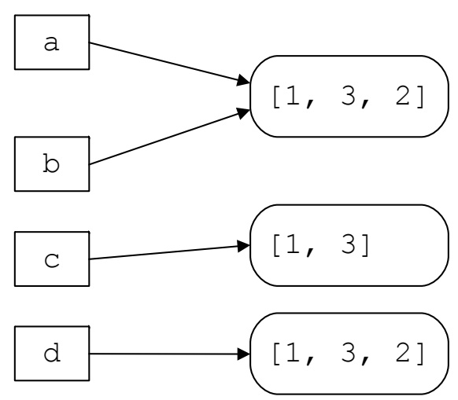

b

[1, 3, 2]

c

[1, 3, 2]

[1, 3]

<!-- page: 45 -->

```julia
Kiểu Tuples (as List, except immutable)
>>> t = (1, 3, 2)
>>> t[1]
3
>>> (a, b, c) = t
>>> a
1
>>> b
3
>>> a, b, c
(1, 3, 2)
>>> a, b = b, a
>>> a, b
(3, 1)
>>> r = list(t)
>>> r
[1, 3, 2]
>>> tuple(r)
(1, 3, 2)
```

<!-- page: 46 -->

```txt
>>> h = {'key': 12, 'nyckel': 'word'}
>>> h['key']
12
>>> h.has_key('nyckel')
True
>>> h['Per'] = 'Kraulis'
>>> h
{'nyckel': 'word', 'Per': 'Kraulis', 'key': 12}
>>> {'nyckel': 'word', 'Per': 'Kraulis', 'key': 12}
{'nyckel': 'word', 'key': 12, 'Per': 'Kraulis'}
>>> h['Per'] = 'Johansson'
>>> h
{'nyckel': 'word', 'Per': 'Johansson', 'key': 12}
>>> h = {'key': 12, 'nyckel': 'word'}
>>> del h['key']
>>> h
{'nyckel': 'word'}
```

<!-- page: 47 -->

## Kiểu Dictionary

```typescript
>>> h = {'key': 12, 'nyckel': 'word'}
>>> 'Per' in h
False
>>> h['Per']
Traceback (most recent call last):
  File "<stdin>", line 1, in <module>
KeyError: 'Per'
>>> h.get('Per', 'unknown')
'unknown'
>>> h.get('key', 'unknown')
12
>>> h.keys()
['nyckel', 'key']
>>> h.values()
['word', 12]
>>> len(h)
2
```

<!-- page: 48 -->

```txt
>>> h = {'key': 12, 'nyckel': 'word'}
>>> g = h.copy()
>>> del h['key']
>>> h
{'nyckel': 'word'}
>>> g
{'nyckel': 'word', 'key': 12}
>>> h['Per'] = 'Johansson'
>>> h
{'nyckel': 'word', 'Per': 'Johansson'}
>>> h.update(g)
>>> h
{'nyckel': 'word', 'key': 12, 'Per': 'Johansson'}
```

<!-- page: 49 -->

## Nội dung


Giới thiệu

Lập trình căn bản

Các kiểu dữ liệu phức

**Lập trình hướng đối tượng**

Vào/ra, ngoại lệ

Lập trình mạng

Lập trình Web

Python-MySQL

Giao diện GUI

Vẽ đồ thị

<!-- page: 50 -->

## Lập trình hướng đối tượng

Đối tượng (object)


Lớp (class)

Thực thể / thể hiện (instance)

Trạng thái (state)

Phương thức (method)

Truyền thông điệp (message passing)

Trừu tượng hoá (abstraction)

Đóng gói (encapsulation)

Kế thừa (inheritance)

Đa hình (polymorphism)

Tổng quát hoá (generalization)

Cụ thể hoá (specialization)

<!-- page: 51 -->

## Lập trình hướng đối tượng

## Định nghĩa lớp

class ClassName: 'Optional class documentation string class\_suite

class\_suite: các thuộc tính, phương thức (hàm)

Tham số đầu tiên của phương thức thường được đặt tên là **self** để thỏa:

obj.meth(args) = class.meth(obj, args)

name: public, **\_name**: protected, **\_\_name**: private

<!-- page: 52 -->

```python
>>> class Employee:
...     'Common base class for all employees'
...     empCount = 0
...
...     def __init__(self, name, salary):
...             self.name = name
...             self.salary = salary
...             Employee.empCount += 1
...
...     def displayCount(self):
...         print("Total Employee %d" % Employee.empCount)
...
...     def displayEmployee(self):
...         print("Name: ", self.name, ", Salary: ", self.salary)
...
>>>
```

<!-- page: 53 -->

## Tạo và sử dụng đối tượng

```txt
>>> emp1 = Employee("Toto", 2000)
>>> emp2 = Employee("Tutu", 5000)
>>> emp1.displayEmployee()
Name: Toto, Salary: 2000
>>> emp2.displayEmployee()
Name: Tutu, Salary: 5000
>>> print("Total Employee: %d" %Employee.empCount)
Total Employee: 2
>>> emp3 = emp2
>>> emp3.displayEmployee()
Name: Tutu, Salary: 5000
>>> print("Total Employee: %d" %Employee.empCount)
Total Employee: 2
```

<!-- page: 54 -->

```python
>>> emp1.age = 7
>>> emp1.age
7
>>> del emp1.age
>>> emp1.age
Traceback (most recent call last):
    File "<stdin>", line 1, in <module>
AttributeError: 'Employee' object has no attribute 'age'
>>> hasattr(emp1, 'age')
False
>>> setattr(emp1, 'age', 8)
>>> getattr(emp1, 'age')
8
>>> delattr(emp1, 'age')
>>> emp1.age
Traceback (most recent call last):
    File "<stdin>", line 1, in <module>
AttributeError: 'Employee' object has no attribute 'age'
```

<!-- page: 55 -->

>>> print("Employee.\_\_doc\_\_:", Employee.\_\_doc\_\_) Employee.\_\_doc\_\_: Common base class for all employees >>> print("Employee.\_\_name\_\_:", Employee.\_\_name\_\_ Employee.\_\_name\_\_: Employee >>> print("Employee.\_\_module\_\_:", Employee.\_\_module\_\_) Employee.\_\_module\_\_: \_\_main\_ >>> print("Employee.\_\_bases\_\_:", Employee.\_\_bases\_\_) Employee.\_\_bases\_\_: (&lt;class 'object'&gt;,) >>> print("Employee.\_\_dict\_\_:", Employee.\_\_dict\_\_) Employee.\_\_dict\_\_: {'\_\_module\_\_': '\_\_main\_\_', '\_\_doc\_\_': 'Common base class for all employees', 'empCount': 2, '\_\_init\_\_': &lt;function Employe e.__init__ at 0x7f220d64e3a0&gt;, 'displayCount': &lt;function Employee.disp layCount at 0x7f220d64e430&gt;, 'displayEmployee': &lt;function Employee.dis playEmployee at 0x7f220d64e4c0&gt;, '\_\_dict\_\_': &lt;attribute '__dict__' of 'Employee' objects&gt;, '\_\_weakref\_\_': &lt;attribute '__weakref__' of 'Emplo yee' objects&gt;}

<!-- page: 56 -->

```python
>>> class Point:
...     def __init( self, x=0, y=0):
...             self.x = x
...             self.y = y
...     def __del__(self):
...             class_name = self.__class__.__name__
...             print(class_name, "destroyed")
...
>>> pt1 = Point()
>>> pt2 = pt1
>>> pt3 = pt1
>>> print(id(pt1), id(pt2), id(pt3))
139784234776128 139784234776128 139784234776128
>>> del pt1
>>> del pt2
>>> del pt3
Point destroyed
```

<!-- page: 57 -->

## Kế thừa


## Định nghĩa lớp kế thừa

class SubClassName (ParentClass1[, ParentClass2, ...]): 'Optional class documentation string' class\_suite

Hàm issubclass(sub, sup), isinstance(obj, Class),

Hàm super()

<!-- page: 58 -->

## Kế thừa (đa hình)

```python
>>> class Animal:
...     'Common base class for animals'
...
...     def __init__(self, name='no-name'):
...             self.name = name
...
...     def say(self):
...             print("%s can't say" %self.name)
...
>>> class Bird(Animal):
...     def say(self):
...             print("%s twitter" %self.name)
...
>>> class Cat(Animal):
...     def say(self):
...             print("%s meow" %self.name)
...
>>>
```

<!-- page: 59 -->

```txt
Kế thừa (đa hình)
>>> a = Animal()
>>> a.say()
no-name can't say
>>> a = Animal('Toto')
>>> a.say()
Toto can't say
>>> b = Bird('Flappy')
>>> b.say()
Flappy twitter
>>> c = Cat('Kitty')
>>> c.say()
Kitty meow
>>>
```

<!-- page: 60 -->

```python
>>> class Owl(Bird,Cat):
...     pass
...
>>> o = Owl('Chic')
>>> o.say()
Chic twitter
>>> class Owlx(Bird,Cat):
...     "extra Owl"
...     def say(self):
...             print("owl...")
...             Cat.say(self)
...
>>> ox =Owlx('ChicX')
>>> ox.say()
owl...
ChicX meow
```

<!-- page: 61 -->

## Định nghĩa chồng phép toán


OPERATOR

## FUNCTION

\_add\_\_(self, other)

\_\_mul\_\_(self, other)

\_sub\_\_(self, other)

\_mod\_\_(self, other)

\_truediv\_\_(self, other)

\_\_lt\_\_(self, other)

\_le\_\_(self, other)

\_\_eq\_\_(self, other)

\_\_ne\_\_(self, other)

\_gt\_\_(self, other)

\_\_ge\_\_(self, other)

getitem\_\_(self, index)

[index]

contains\_\_(self, value)

in

\_\_len\_\_(self)

## METHOD DESCRIPTION

\_str\_\_(self)

str

<!-- page: 62 -->

```python
>>> class Point2D:
...     def __init__(self, x=0, y=0):
...             self.x = x
...             self.y = y
...
...     def __str__(self):
...         return 'Point2D (%f, %f)' %(self.x, self.y)
...
...     def __add__(self,other):
...         return Point2D(self.x + other.x, self.y + other.y)
...
>>> p1 = Point2D(2,10)
>>> p2 = Point2D(5,-2)
>>> print(p1 + p2)
Point2D (7.000000, 8.000000)
```

<!-- page: 63 -->

```python
>>> class JustCounter:
...     __secretCount = 0
...
...     def count(self):
...             self.__secretCount += 1
...             print(self.__secretCount)
...
>>> counter = JustCounter()
>>> counter.count()
1
>>> counter.count()
2
>>> print(counter.__secretCount)
Traceback (most recent call last):
  File "<stdin>", line 1, in <module>
AttributeError: 'JustCounter' object has no attribute '__secretCount'
>>> print(counter._JustCounter__secretCount)
2
```

<!-- page: 64 -->

## Nội dung


Giới thiệu

Lập trình căn bản

Các kiểu dữ liệu phức

Lập trình hướng đối tượng

**Vào/ra, ngoại lệ**

Lập trình mạng

Lập trình Web

Python-MySQL

Giao diện GUI

Vẽ đồ thị

<!-- page: 65 -->

## Vào/ra


## Lệnh print, input

```txt
>>> print("Python is really a great language,", "isn't it?")
Python is really a great language, isn't it?
>>> istr = input("Enter your input: ")
Enter your input: My name is toto
>>> print("Received input is : ", istr)
Received input is :  My name is toto
>>> a = int(input("Enter an integer num: "))
Enter an integer num: 5
>>> b = float(input("Enter a float num: "))
Enter a float num: 7.2
>>> print(a, "+", b, "=", a + b)
5 + 7.2 = 12.2
>>> istr = input("Enter your input: ")
Enter your input: [x*5 for x in range(2,10,2)]
>>> print(eval(istr))
[10, _20, 30, 40]
```

<!-- page: 66 -->

```python
• Hàm
    file_obj = open(file_name [, access_mode][, buffering])
    file_obj.close()
    file_obj.write(string);
    file_obj.read([count]);
    file_obj.tell()
    file_obj.seek(offset[, from])

    import os
    os.rename(current_file_name, new_file_name)
    os.remove(file_name)
    os.mkdir("newdir")
    os.chdir("newdir")
    os.getcwd()
    os.rmdir('dirname')
```

## Vào/ra tập tin


<!-- page: 67 -->

```txt
>>> fo = open("foo.txt", "w")
>>> print("Name of the file: ", fo.name)
Name of the file: foo.txt
>>> print("Closed or not : ", fo.closed)
Closed or not : False
>>> print("Opening mode : ", fo.mode)
Opening mode : w
>>> fo.write("Python is a great language.\nYeah its great!!\n")
45
>>> fo.close()
```

<!-- page: 68 -->

## Vào/ra tập tin

```python
>>> fo = open("foo.txt", "r+")
>>> str = fo.read(10)
>>> print("Read String is : ", str)
Read String is :  Python is
>>> position = fo.tell();
>>> print("Current file position : ", position)
Current file position : 10
>>> position = fo.seek(0)
>>> str = fo.read()
>>> print("File content is : \n", str)
File content is :
  Python is a great language.
Yeah its great!!
>>> fo.close()
```

<!-- page: 69 -->

```txt
>>> import os
>>> os.rename("foo.txt", "foo1.txt")
>>> os.remove("foo1.txt")
>>> os.mkdir("/tmp/test")
>>> os.chdir("/home/nghi")
>>> os.getcwd()
'/home/nghi'
>>> os.rmdir("/tmp/test")
```

<!-- page: 70 -->

## Ngoại lệ

## Lệnh

assert Expression[, Arguments]

raise [Exception [, args [, traceback]]]

try:

You do your operations here;

except ExceptionI:

If there is ExceptionI, then execute this block. except ExceptionII:

If there is ExceptionII, then execute this block. else:

If there is no exception then execute this block. finally:

This would always be executed.

<!-- page: 71 -->

```txt
>>> def KelvinToFahrenheit(Temperature):
...     assert (Temperature >= 0),"Colder than absolute zero!"
...     return ((Temperature-273)*1.8)+32
...
>>> print(KelvinToFahrenheit(273))
32.0
>>> print(int(KelvinToFahrenheit(505.78)))
451
>>> print(KelvinToFahrenheit(-5))
Traceback (most recent call last):
  File "<stdin>", line 1, in <module>
  File "<stdin>", line 2, in KelvinToFahrenheit
AssertionError: Colder than absolute zero!
```

<!-- page: 72 -->

```python
>>> try:
...     fh = open("testfile", "r")
...     fh.write("This is my test file for exception handling!!")
... except IOError:
...     print("Error: can\'t find file or read data")
... else:
...     print("Written content in the file successfully")
... finally:
...     print("This would always be executed!!")
...
Error: can't find file or read data
This would always be executed!!
```

<!-- page: 73 -->

```python
Ngoại lệ
73

def functionName(level):
    if level < 1:
        raise Exception("Invalid level!", level)
        # The code below to this would not be executed
        # if we raise the exception

try:
    functionName(0)
except Exception:
    print("<!>: Invalid level")

class Networkerror(RuntimeError):
    def __init__(self, arg):
        self.args = arg

try:
    raise Networkerror("Bad hostname")
except Networkerror as e:
    print(e.args)
```

<!-- page: 74 -->


## Nội dung

Giới thiệu

Lập trình căn bản

Các kiểu dữ liệu phức

Lập trình hướng đối tượng

Vào/ra, ngoại lệ

**Lập trình mạng**

Lập trình Web

Python-MySQL

Giao diện GUI

Vẽ đồ thị

<!-- page: 75 -->

Socket

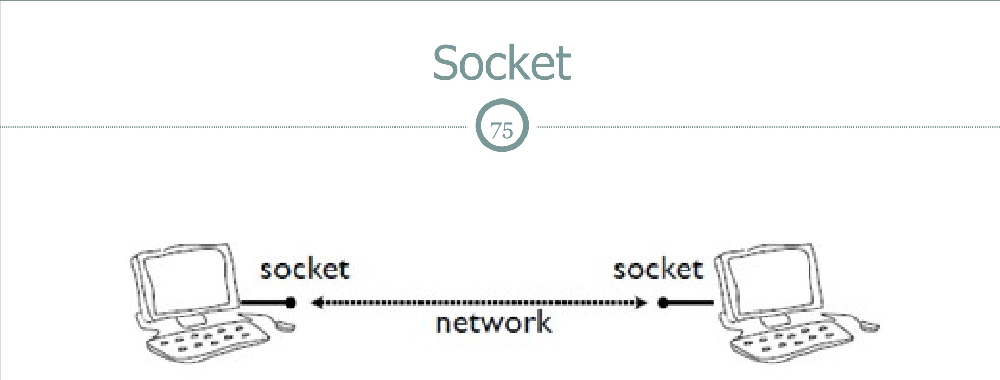

<!-- page: 76 -->

## Nghi thức TCP

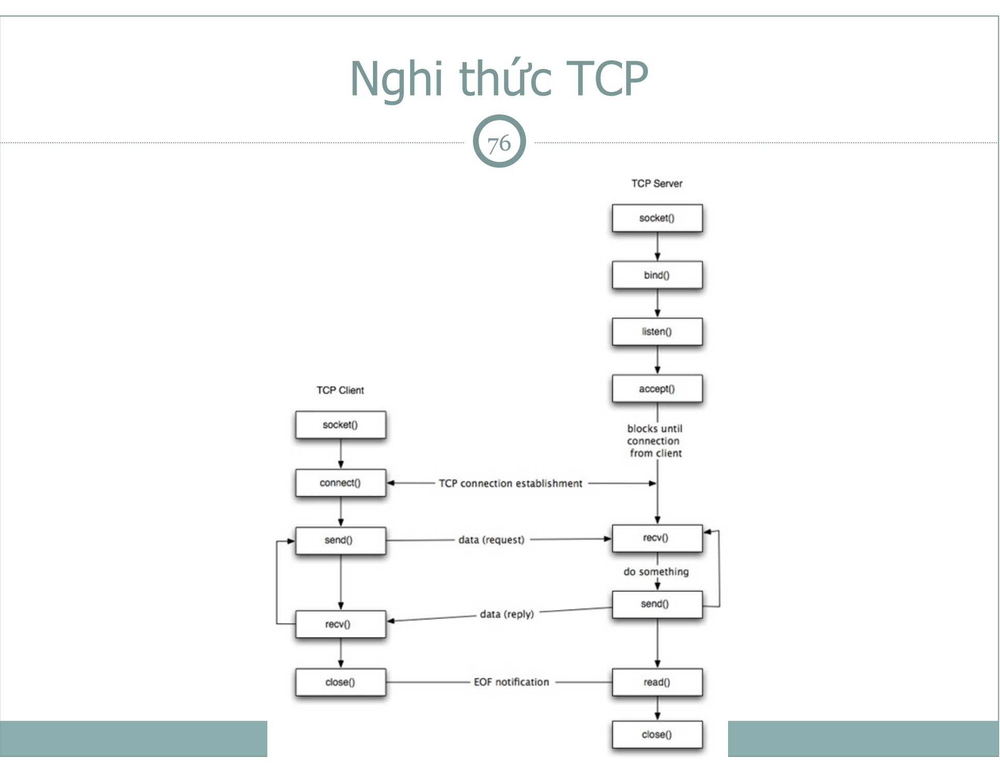

<!-- page: 77 -->

## Nghi thức UDP

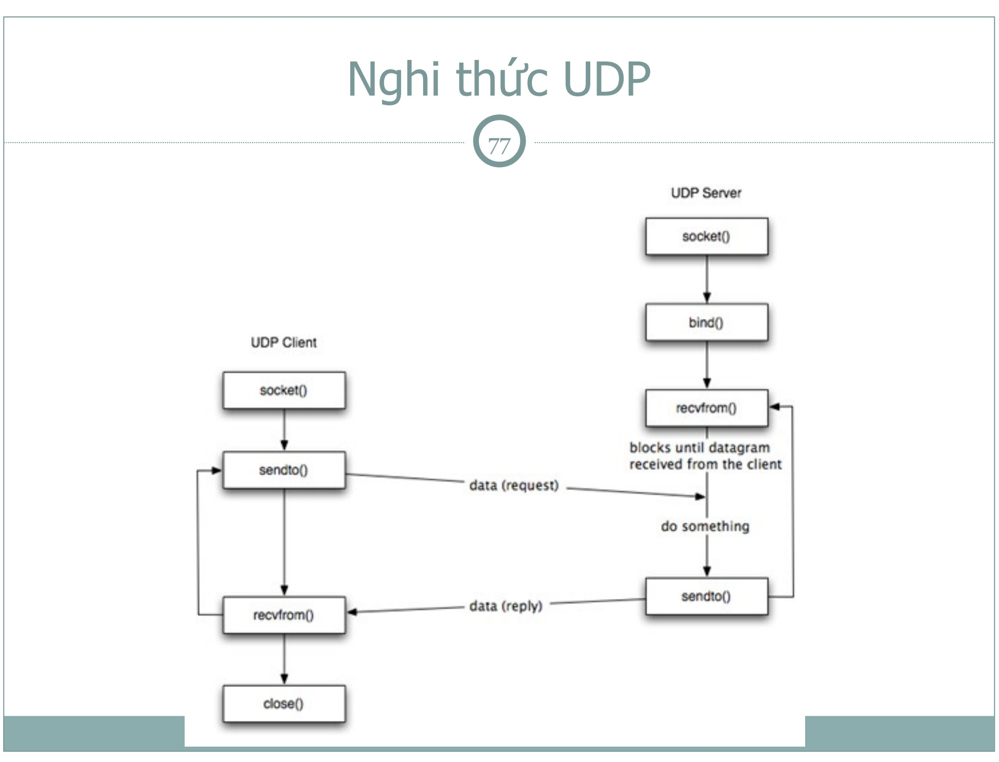

<!-- page: 78 -->

## Socket trong Python

## Mô-đun socket


import socket

Phương thức socket (s) phía server s.bind((hostname, port)) s.listen(backlog) s.accept()

Phương thức socket (s) phía client s.connect(hostname, port)

<!-- page: 79 -->

## Socket trong Python

```python
- Phương thức socket (s) chung
s.recv(buflen[, flags])
s.send(data[, flags])
s.recvfrom(buflen[, flags])
s.sendto(data[,flags], (addr, port))
s.close()
socket.gethostname()
socket.gethostbyname(hostname)
>>> import socket
>>> host_name = socket.gethostname()
>>> print("Host name: %s" %host_name)
Host name: localhost.localdomain
>>> addr = socket.gethostbyname(host_name)
>>> print("IP address: %s" %addr)
IP address: 127.0.0.1
```

<!-- page: 80 -->


## hello\_s.py (Hello server, TCP)

```python
import socket

s = socket.socket(socket.AF_INET, socket.SOCK_STREAM)
s.bind(("', 5555))
s.listen(5)

while True:
    cli, (remhost, remport) = s.accept()
    print("Received connection from", remhost)
    msg = "Hello %s\n" %remhost
    cli.send(msg.encode('ascii'))
    cli.close()
```

<!-- page: 81 -->

## hello\_c.py (Hello client, TCP)

```python
import socket
s = socket.socket(socket.AF_INET, socket.SOCK_STREAM)
s.connect(('172.30.35.72', 5555))
msg = s.recv(1024)
print(msg.decode('ascii'))
s.close()
```

<!-- page: 82 -->

## hello\_s\_udp.py (Hello server, UDP)

```python
import socket

s = socket.socket(socket.AF_INET, socket.SOCK_DGRAM)
s.bind("", 5555))

while True:
    data, (a, p) = s.recvfrom(1024)
    print("Received data from", a)
    msg = "Hello %s\n" %a
    s.sendto(msg.encode('ascii'), (a, p))
```

<!-- page: 83 -->


## hello\_c\_udp.py (Hello client, UDP)

```python
import socket

s = socket.socket(socket.AF_INET, socket.SOCK_DGRAM)
msg = "Hi there\n"
s.sendto(msg.encode('ascii'), ('172.30.35.72', 5555))
data, (a, p) = s.recvfrom(1024)
print(data.decode('ascii'))
s.close()
```

<!-- page: 84 -->

Cài đặt server phục vụ cùng lúc nhiều client 84

Phương thức cài đặt: luồng, tiến trình con, bất đồng bộ

clients

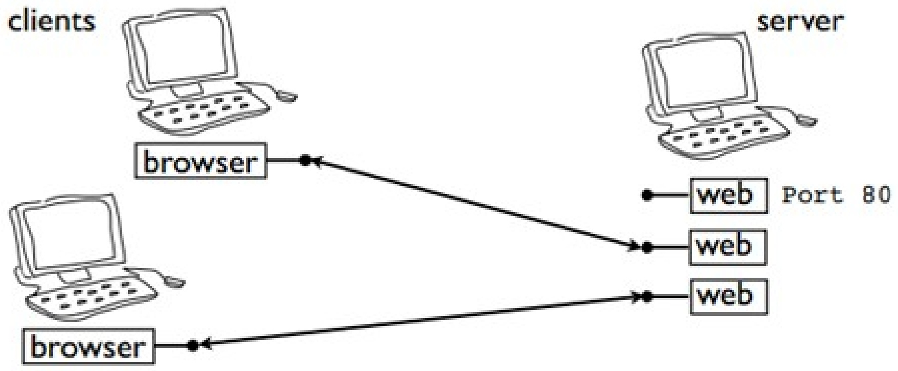

<!-- page: 85 -->

## Cài đặt Echo server với luồng 85

```python
import socket
import threading

def handle_client(c, a, p):
    print("Connection from : "+ a + ":" + str(p))
    msg = "\nWelcome to the server\n\n"
    c.sendall(msg.encode('ascii'))
    while True:
        data = c.recv(1024)
        c.sendall(data)
        data = data.decode('ascii')
        if data[0:1] == '#':
            break

        c.close()
        return

s = socket.socket(socket.AF_INET, socket.SOCK_STREAM)
s.setsockopt(socket.SOL_SOCKET, socket.SO_REUSEADDR, 1)
s.bind(( '',9999))
s.listen(5)
while True:
    c,(a,p) = s.accept()
    t = threading.Thread(target=handle_client, args=(c,a,p))
    t.start()
```

<!-- page: 86 -->

## Cài đặt Echo server với tiến trình con

```python
import socket
import os, signal

s = socket.socket(socket.AF_INET, socket.SOCK_STREAM)
s.setsockopt(socket.SOL_SOCKET, socket.SO_REUSEADDR, 1)
s.bind((',9999))
s.listen(5)
signal.signal(signal.SIGCHLD, signal.SIG_IGN)
while True:
    c,(a, p) = s.accept()
    if os.fork() == 0:
        # Child process. Manage client
        print("Connection from : "+ a + ":" + str(p))
        msg = "\nWelcome to the server\n\n"
        c.sendall(msg.encode('ascii'))
        while True:
            data = c.recv(1024)
            c.sendall(data)
            data = data.decode('ascii')
            if data[0:1] == '#':
                break
            c.close()
            os._exit(0)
    else:
        # Parent process. Clean up and go
        # back to wait for more connections
        c.close()
```

<!-- page: 87 -->

## Cài đặt Echo server với select

```python
import select
import socket

s = socket.socket(socket.AF_INET, socket.SOCK_STREAM)
s.setsockopt(socket.SOL_SOCKET, socket.SO_REUSEADDR, 1)
s.bind(("',9999))
s.listen(5)
clients = []
clients.append(s)
while True:
    # Look for activity on any of my sockets
    input, output, err = select.select priests, [], [])
    # Process all sockets with input
    for i in input:
        if i == s:
            # handle the server socket
            c, (a, p) = s.accept()
            clients.append(c)
            print("Connection from : "+ a + ":" + str(p))
            msg = "\nWelcome to the server\n\n"
            c.sendall(msg.encode('ascii'))
        else:
            # handle all other sockets
            data = i.recv(1024)
            data = data.decode('ascii')
            if (not data) or (data[0:1]=='#'):
                i.close()
                clients.remove(i)
            else:
                i.sendall(data.encode('ascii'))
s.close()
```

<!-- page: 88 -->

## Lập trình giao tiếp các dịch vụ Internet

| Nghi thức | Dịch vụ | Cổng | Mô-đun |
| --- | --- | --- | --- |
| HTTP | Hypertext Transfer (Web) | 80 | httplib, urllib, xmlrpclib |
| NTP | Network time | 123 | ntplib |
| FTP | File transfer | 21/20 | ftplib, urllib |
| SMTP | Simple mail transfer | 25 | smtplib |
| POP3 | Post office | 110 | poplib |
| IMAP4 | Internet message access | 143 | imaplib |
| Telnet | Command line | 23 | telnetlib |
| Gopher | Document transfer | 70 | gopherlib, urllib |
| NNTP | Usenet news transfer | 119 | nntplib |

<!-- page: 89 -->

## Lấy giờ từ server thời gian trên Internet 89

>>> import ntplib >>> import time >>> ntp\_client = ntplib.NTPClient() >>> response = ntp\_client.request('pool.ntp.org') >>> print(time.ctime(response.tx\_time)) Mon Apr 18 15:21:10 2022

<!-- page: 90 -->

```python
import ftplib

FTP_SERVER = '172.30.35.70'
USER_NAME = 'invite'
PASSWD = 'passwd'

#Connecting to FTP server
ftp = ftplib.FTP(FTP_SERVER)
#Login to FTP server
ftp.login(USER_NAME, PASSWD)
#List the files in the home directory
print("File list at %s:%s" %(FTP_SERVER, ftp.pwd()))
print(ftp.retrlines('LIST'))
ftp.quit()
```

<!-- page: 91 -->

```python
import ftplib

FTP_SERVER = '172.30.35.70'
USER_NAME = 'invite'
PASSWD = 'passwd'
FILE_NAME = '107.pdf'

#Connecting to FTP server
ftp = ftplib.FTP(FTP_SERVER)
#Login to FTP server
ftp.login(USER_NAME, PASSWD)
#Download logo.png in the home directory
f = open(FILE_NAME, "wb")
ftp.retrbinary('RETR ' + FILE_NAME, f.write)
f.close()
ftp.quit()
```

<!-- page: 92 -->

```python
import ftplib

FTP_SERVER = '172.30.35.70'
USER_NAME = 'invite'
PASSWD = 'passwd'
FILE_NAME = 'logo.png'

#Connecting to FTP server
ftp = ftplib.FTP(FTP_SERVER)
#Login to FTP server
ftp.login(USER_NAME, PASSWD)
#Upload P432-1152.pdf in the home directory
ftp.storbinary("STOR " + FILE_NAME, open(FILE_NAME, "rb"), 1024)
print("Uploaded file: %s" %FILE_NAME)
ftp.quit()
```

<!-- page: 93 -->

```python
GUI email sử dụng SMTP của Google
import smtplib
from email.mime.multipart import MIMEMultipart
from email.mime.text import MIMEText

SMTP_SERVER = 'smtp.gmail.com'
SMTP_PORT = 587
sender = 'dtnghi@gmail.com'
passwd = 'xxxxx'
receiver = 'pynet.ctu@gmail.com'

#Email message
msg = MIMEMultipart()
msg['Subject'] = 'Python Email Test'
msg['To'] = 'pynet.ctu@gmail.com'
msg['From'] = 'dtnghi@gmail.com'
body = 'My first email.'
msg.attach(MIMEText(body, 'plain'))

#Create smtp session
smtp = smtplib.SMTP(SMTP_SERVER, SMTP_PORT)
smtp.ehlo()
smtp.starttls()
smtp.ehlo()
smtp.login(sender, passwd)

smtp.sendmail(sender, receiver, msg.as_string())
print("Email sent."]
smtp.quit()
```

<!-- page: 94 -->

## Đọc email từ POP3 của Google

```python
import poplib

POP3_SERVER = 'pop.googlemail.com'
POP3_PORT = 995
username = 'pynet.ctu@gmail.com'
passwd = 'xxxx'

#Create pop3 session
mailbox = poplib.POP3_SSL(POP3_SERVER, POP3_PORT)
mailbox.user(username)
mailbox.pass_(passwd)

num_messages = len(mailbox.list()[1])
print("Total emails: %s" %num_messages)
print("Getting first message")
for msg in mailbox.retr(1)[1]:
    print(msg)
print("Getting last message")
for msg in mailbox.retr(num_messages)[1]:
    print(msg)

mailbox.quit()
```

<!-- page: 95 -->

## Đọc email từ IMAP của Google

```python
import imaplib

IMAP_SERVER = 'imap.googleapis.com'
IMAP_PORT = 993
username = 'pynet.ctu@gmail.com'
passwd = 'xxxx'

#Create imap session
mailbox = imaplib.IMAP4_SSL(IMAP_SERVER, IMAP_PORT)
mailbox.login(username, passwd)

mailbox.select('Inbox')
typ, data = mailbox.search(None, 'ALL')
idx = data[0].split()
print(idx)
print("Total emails: ", len(idx))
print("Getting last message")
num = idx[-1]
print("Getting first message")
num = idx[0]
typ, data = mailbox.fetch(num, '(RFC822)')
print('%s\n' % data[0][1])

mailbox.close()
mailbox.logout()
```

<!-- page: 96 -->

```python
import http.client as httplib
httpconn = httplib.HTTPConnection("172.18.54.56", 80)
httpconn.request("GET", "/hello.html")
resp = httpconn.getresponse()
if resp.status == 200:
    resp_data = resp.read()
    print(resp_data.decode('ascii'))
httpconn.close()
```

<!-- page: 97 -->

## HTTP HEAD

```python
import http.client as httplib

httpconn = httplib.HTTPConnection("172.18.54.56", 80)

httpconn.request("HEAD", "/hello.html")
resp = httpconn.getresponse()
print(resp.status, resp.reason)
if resp.status == 200:
    resp_head = resp.getheaders()
    print(resp_head)

httpconn.close()
```

<!-- page: 98 -->

```python
import http.client as httplib
import urllib.parse

httpconn = httplib.HTTPConnection("172.18.54.56", 80)

head = {"Content-Type": "application/x-www-form-urlencoded", "Accept": "text/plain"}
parameters = urllib.parse.urlencode({"name": "Nghi", "age": "41"})
httpconn.request("POST", "/form-cgi.php", parameters, head)
resp = httpconn.getresponse()
if resp.status == 200:
    print("Outputting Request Body\n")
    resp_data = resp.read()
    resp_data = resp_data.decode('ascii')
    lines = resp_data.split("<br>")
    #print(lines)
    for line in lines:
        print(line.strip())

httpconn.close()
```

<!-- page: 99 -->

## Nội dung


Giới thiệu

Lập trình căn bản

Các kiểu dữ liệu phức

Lập trình hướng đối tượng

Vào/ra, ngoại lệ

Lập trình mạng

**Lập trình Web**

Python-MySQL

Giao diện GUI

Vẽ đồ thị

<!-- page: 100 -->

## Lập trình Web

## CGI (common gateway interface)

Tập hợp các chuẩn mà nó định nghĩa làm thế nào thông tin được trao đổi giữa Web server và một chương trình kịch bản

Khi có một yêu cầu từ Web browser (client) gửi đến Web server, thay vì server gửi lại nội dung tập tin đến client, thì Web server có thể gọi thực thi chương trình CGI và output của chương trình CGI gửi lại cho client

Chương trình CGI: C/C++, Perl, Python, PHP, Shell Script, etc.

<!-- page: 101 -->

```perl
#!/usr/bin/python3

print('Content-type:text/html\r\n\r\n')
print('<html>')
print('<head>')
print('<title>Hello World - First CGI Program</title>')
print '</head>')
print('<body>')
print('<h2>Hello World! This is my first CGI program</h2>')
print '</body>')
print '</html>')
```

<!-- page: 102 -->

```erb
1 <form action="/cgi-bin/hello_post.py" method="post">
2 First Name: <input type="text" name="first_name"><br>
3 Last Name: <input type="text" name="last_name">
4 <input type="submit" value="Submit">
5 </form>
```

<!-- page: 103 -->

```python
#!/usr/bin/python3
# Import modules for CGI handling
import cgi, cgitb

# Create instance of FieldStorage
form = cgi.FieldStorage()

# Get data from fields
first_name = form.getvalue('first_name')
last_name = form.getvalue('last_name')

print("Content-type:text/html\r\n\r\n")
print("<html>")
print("<head>")
print("<title>Hello - Second CGI Program</title>")
print("</head>")
print("<body>")
print("<h2>Hello %s %s</h2>" % (first_name, last_name))
print("</body>")
print("</html>")
```

<!-- page: 104 -->

```html
radio-form.html
    <form action="/cgi-bin/radiobutton.py" method="post">
        <input type="radio" name="subject" value="maths"> Maths
        <input type="radio" name="subject" value="physics"> Physics
        <input type="submit" value="Select Subject">
            </form>
```

<!-- page: 105 -->

```python
#!/usr/bin/python3

# Import modules for CGI handling
import cgi, cgitb

# Create instance of FieldStorage
form = cgi.FieldStorage()

# Get data from fields
if form.getvalue('subject'):
    subject = form.getvalue('subject')
else:
    subject = "Not set"

print("Content-type:text/html\r\n\r\n")
print("<html>")
print("<head>")
print("<title>Radio - Fourth CGI Program</title>")
print("</head>")
print("<body>")
print("<h2> Selected Subject is %s</h2>" % subject)
print("</body>")
print("</html>")
```

<!-- page: 106 -->

## Lập trình Web


```txt
<form action="/cgi-bin/dropdown.py" method="post">
<select name="dropdown">
<option value="Maths" selected>Maths</option>
<option value="Physics">Physics</option>
</select>
<input type="submit" value="Submit">
</form>
```

<!-- page: 107 -->

```python
dropdown.py ×
#!/usr/bin/python3

# Import modules for CGI handling
import cgi, cgitb

# Create instance of FieldStorage
form = cgi.FieldStorage()

# Get data from fields
if form.getvalue('dropdown'):
    subject = form.getvalue('dropdown')
else:
    subject = "Not entered"

print("Content-type:text/html\r\n\r\n")
print("<html>")
print("<head>")
print("<title>Dropdown Box - Sixth CGI Program</title>")
print("</head>")
print("<body>")
print("<h2> Selected Subject is %s</h2>" % subject)
print("</body>")
print("</html>")
```

<!-- page: 108 -->

## Nội dung


Giới thiệu

Lập trình căn bản

Các kiểu dữ liệu phức

Lập trình hướng đối tượng

Vào/ra, ngoại lệ

Lập trình mạng

Lập trình Web

**Python-MySQL**

Giao diện GUI

Vẽ đồ thị

<!-- page: 109 -->


## Python-MySQL (mysql-connector-python)

Python có thể giao tiếp với hầu hết các HQTCSDL: MongDB, MySQL, PostgreSQL, SQL Server, Informix, Oracle, Sybase, etc.

Tạo kết nối đến CSDL

```python
import mysql.connector

mydb = mysql.connector.connect(
    host="localhost",
    user="yourusername",
    password="yourpassword",
    database="mydatabase"
)

mycursor = mydb.cursor()
```

Thực hiện câu truy vấn mycursor.execute("SQL command")

<!-- page: 110 -->

```txt
create-tab.py
import mysql.connector
mydb = mysql.connector.connect(
    host="localhost",
    user="user1",
    password="puser1",
    database="mydb"
)
mycursor = mydb.cursor()
mycursor.execute("CREATE TABLE customers (name VARCHAR(255), address VARCHAR(255))")
```

<!-- page: 111 -->

```python
import mysql.connector
mydb = mysql.connector.connect(
    host="localhost",
    user="user1",
    password="puser1",
    database="mydb"
)
mycursor = mydb.cursor()

sql = "INSERT INTO customers (name, address) VALUES (%s, %s)"
val = ("John", "Highway 21")
mycursor.execute(sql, val)

mydb.commit()

print(mycursor.rowcount, "record inserted.")
```

<!-- page: 112 -->

```python
import mysql.connector
mydb = mysql.connector.connect(
    host="localhost",
    user="user1",
    password="puser1",
    database="mydb"
)
mycursor = mydb.cursor()
mycursor.execute("SELECT * FROM customers")
myresult = mycursor.fetchall()
for x in myresult:
    print(x)
```

<!-- page: 113 -->

```python
select1.py ×
import mysql.connector
mydb = mysql.connector.connect(
    host="localhost",
    user="user1",
    password="puser1",
    database="mydb"
)
mycursor = mydb.cursor()
mycursor.execute("SELECT * FROM customers")
myresult = mycursor.fetchall()
print(myresult)
```

<!-- page: 114 -->


## Nội dung

Giới thiệu

Lập trình căn bản

Các kiểu dữ liệu phức

Lập trình hướng đối tượng

Vào/ra, ngoại lệ

Lập trình mạng

Lập trình Web

Python-MySQL

**Giao diện GUI**

Vẽ đồ thị

<!-- page: 115 -->

```python
from Tkinter import *
root = Tk()
w = Label(root, text="Hello Tkinter!")
w.pack()
root.mainloop()
```

<!-- page: 116 -->

```python
from Tkinter import *

root = Tk()

Label(root,
    text="Red Text in Times Font",
    fg = "red",
    font = "Times").pack()
Label(root,
    text="Green Text in Helvetica Font",
    fg = "light green",
    bg = "dark green",
    font = "Helvetica 16 bold italic").pack()
Label(root,
    text="Blue Text in Verdana bold",
    fg = "blue",
    bg = "yellow",
    font = "Verdana 10 bold").pack()

root.mainloop()
```

<!-- page: 117 -->

```python
from Tkinter import *
root = Tk()
img = PhotoImage(file='python.gif')
my_image = Label(root, image=img)
```

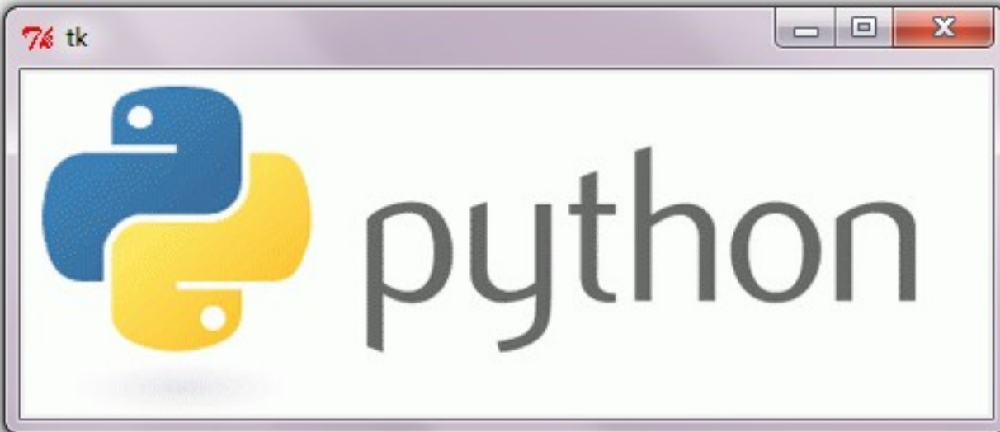

<!-- page: 118 -->

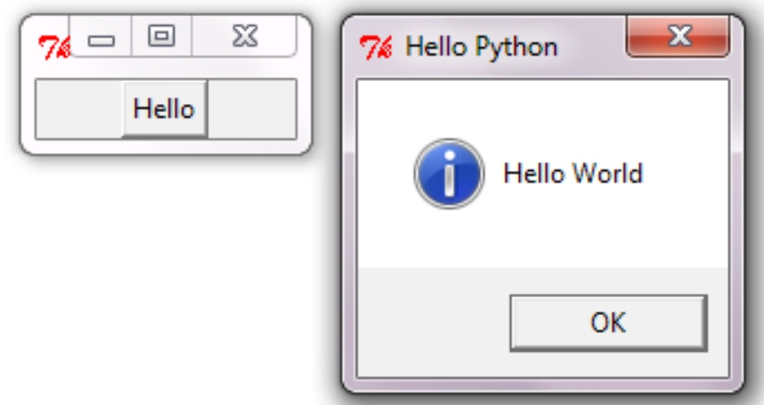

```python
import Tkinter
import tkinter.Tk()

top = Tkinter.Tk()

def helloCallBack():
    tkinter.showinfo( "Hello Python", "Hello World")

B = Tkinter.Button(top, text ="Hello", command = helloCallBack)

B.pack()
top.mainloop()
```

<!-- page: 119 -->

## MENU

```python
root = tk.Tk()
menu_bar = tk.Menu(root)
file_menu = tk.Menu(menu_bar, tearoff=0)
file_menu.add_command(label="Quit", command=root.destroy)
menu_bar.add_cascade(label="File", menu=file_menu)
root.config(menu=menu_bar)
root.mainloop()
```

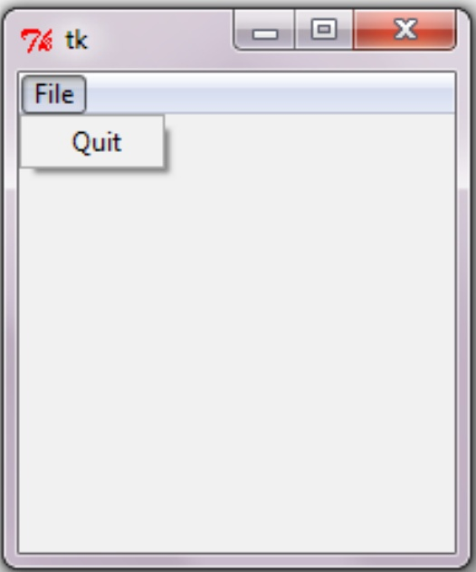

<!-- page: 120 -->

## RADIO BUTTON

## import Tkinter as tk

```python
root = tk.Tk()
v = tk.IntVar()
tk.Label(root,
    text=""Choose a
programming language:"",
    justify = tk.LEFT,
    padx = 20).pack()
tk.Radiobutton(root,
    text="Python",
    padx = 20,
    variable=v,
    value=1).pack(anchor Republic)
tk.Radiobutton(root,
    text="Perl",
    padx = 20,
    variable=v,
    value=2).pack(anchor Republic)
root.mainloop()
```

<!-- page: 121 -->

```python
import Tkinter as tk

root = tk.Tk()
var1 = tk.IntVar()
tk.Checkbutton(root, text="male", variable=var1).grid(row=0, sticky(tk.W)
var2 = tk.IntVar()
tk.Checkbutton(root, text="female", variable=var2).grid(row=1, sticky(tk.W)
root.mainloop()
```

<!-- page: 122 -->

```python
import Tkinter as tk

def show_values():
    print (w1.get(), w2.get())

root = tk.Tk()
w1 = tk.Scale(root, from_=0, to=42)
w1.pack()
w2 = tk.Scale(root, from_=0, to=200, orient=tk.HORIZONTAL)
w2.pack()
tk.Button(root, text='Show', command=show_values).pack()

root.mainloop()
```

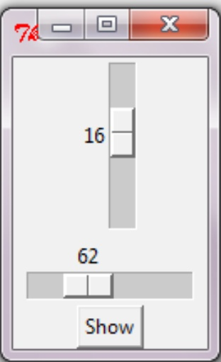

<!-- page: 123 -->

```python
import Tkinter as tk

def show_entries():
    print("First Name: %s\nLast Name: %s" % (e1.get(), e2.get()))
root = tk.Tk()
tk.Label(root, text="First Name").grid(row=0)
tk.Label(root, text="Last Name").grid(row=1)

e1 = tk.Entry(root)
e2 = tk.Entry(root)

e1.grid(row=0, column=1)
e2.grid(row=1, column=1)

tk.Button(root, text='Quit', command=root.quit).grid(row=3, column=0, sticky(tk.W, pady=4)
tk.Button(root, text='Show', command=show_entries).grid(row=3, column=1, sticky(tk.W, pady=4)
root.mainloop( )
```

<!-- page: 124 -->

```python
import Tkinter as tk

def show_text():
    print(T.get('1.0', tk.END))

root = tk.Tk()

T = tk.Text(root, height=2, width=30)
T.pack()
T.insert(tk.END, "Just a text Widget\nin two lines\n")
B = tk.Button(root, text='Show', command=show_text)
B.pack()
root.mainloop()
```

<!-- page: 125 -->

## Nội dung


Giới thiệu

Lập trình căn bản

Các kiểu dữ liệu phức

Lập trình hướng đối tượng

Vào/ra, ngoại lệ

Lập trình mạng

Lập trình Web

Python-MySQL

Giao diện GUI

**Vẽ đồ thị**

<!-- page: 126 -->


## Vẽ đồ thị với Matplotlib

## Ví dụ đơn giản

from matplotlib import pyplot as plt

plt.plot([1,2,3],[4,5,1])

plt.show()

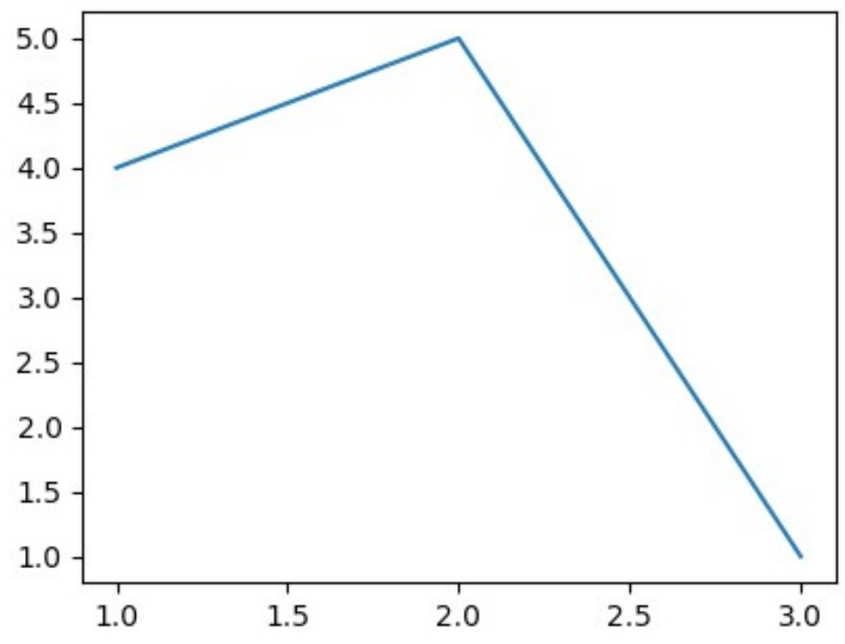

<!-- page: 127 -->

```matlab
• Các tùy chọn màu
    'r' = red; 'g' = green; 'b' = blue; 'c' = cyan
    'm' = magenta; 'y' = yellow; 'k' = black; 'w' = white

• Các tùy chọn linestyle
    '-' = solid
    '--' = dashed
    ':' = dotted
    '-.' = dot-dashed
    '.' = points
    'o' = filled circles
    '^' = filled triangles
```

<!-- page: 128 -->

```python
• Ví dụ đơn giản với label, title, legend, ylim, linestyle
from matplotlib import pyplot as plt
import numpy as np

x = np.linspace(0, 20, 1000)
y1 = np.sin(x)
y2 = np.cos(x)

plt.plot(x, y1, '-b', label='sine')
plt.plot(x, y2, '-r', label='cosine')
plt.legend(loc='upper right')

plt.ylim(-1.5, 2.0)
```

<!-- page: 129 -->

## Vẽ đồ thị với Matplotlib

Ví dụ đơn giản với label, title, legend, ylim, linestyle plt.xlabel('x')

plt.show()

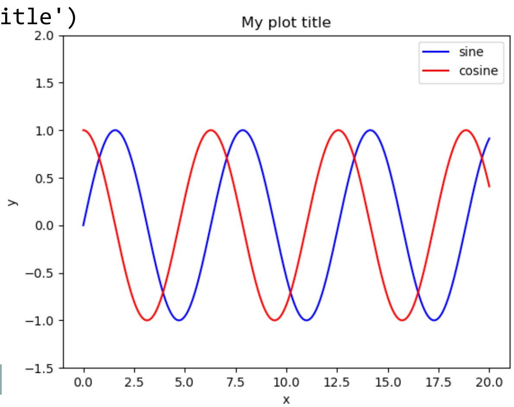

<!-- page: 130 -->

```python
Vĩ dụ với linestyle
from matplotlib import pyplot as plt
import numpy as np

x1 = np.linspace(0, 10, 20)
y1 = np.sin(x1)
x2 = np.linspace(0, 10, 1000)
y2 = np.sin(x2)
plt.plot(x1, y1, 'bo', label='sampled')
plt.plot(x2, y2, ':k', label='continuous')
plt.legend()
plt.show()
```

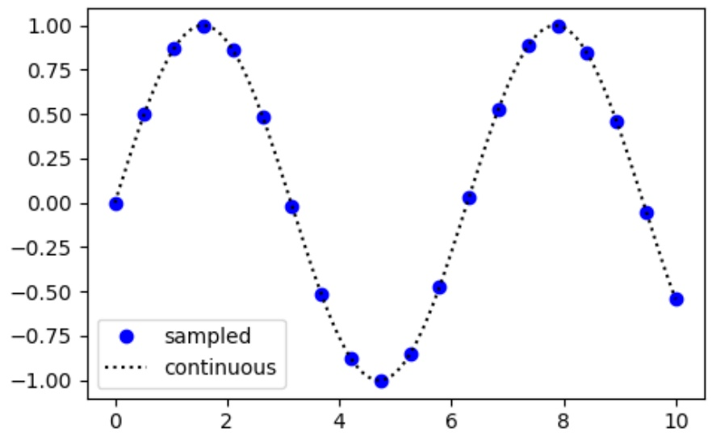

<!-- page: 131 -->

```python
• Vẽ nhiều đồ thị
import matplotlib.pyplot as plt

fig = plt.figure()
ax1 = fig.add_subplot(131)
ax2 = fig.add_subplot(132)
ax3 = fig.add_subplot(133)

ax1.bar([1,2,3],[3,4,5])
ax2.barh([1,2,3],[3,1,2])
ax3.scatter([0,1,2,3,4],[2,1,3,6,4])

plt.show()
```

<!-- page: 132 -->

## Vẽ đồ thị với Matplotlib

## Vẽ nhiều đồ thị

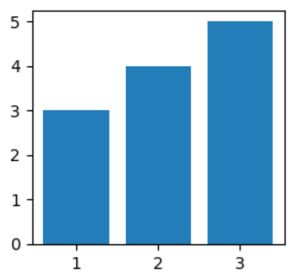

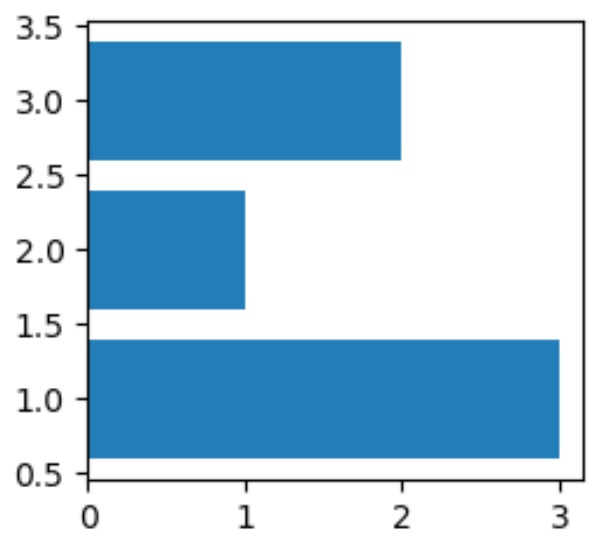

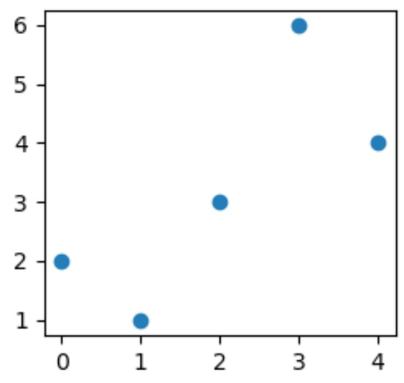

<!-- page: 133 -->

```python
Vẽ đồ thị với Matplotlib
• Vẽ biểu đồ histogram
from matplotlib import pyplot as plt
import numpy as np
x = np.random.normal(size=1000)
fig, ax = plt.subplots()
H = ax.hist(x, bins=50, alpha=0.5, histtype='stepfilled')
plt.show()
```

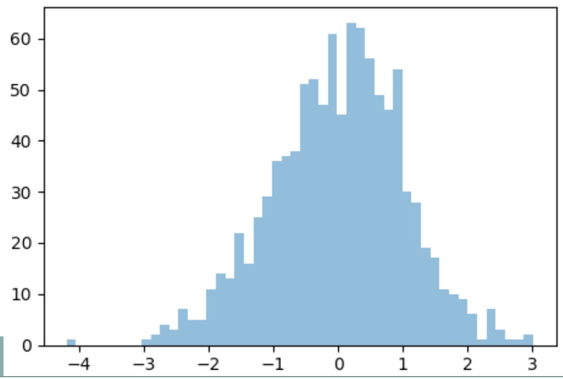

<!-- page: 134 -->

```python
• Vẽ đồ thị pie
import matplotlib.pyplot as plt
labels = 'Python', 'C++', 'Ruby', 'Java'
sizes = [215, 130, 245, 210]
colors = ['gold','yellowgreen','lightcoral','lightskyblue']
explode = (0.1, 0, 0, 0)  # explode 1st slice

plt.pie(sizes, explode=explode,
labels=labels, colors=colors,
autopct='%1.1f%',
shadow=True, startangle=140)

plt.axis('equal')
plt.show()
```

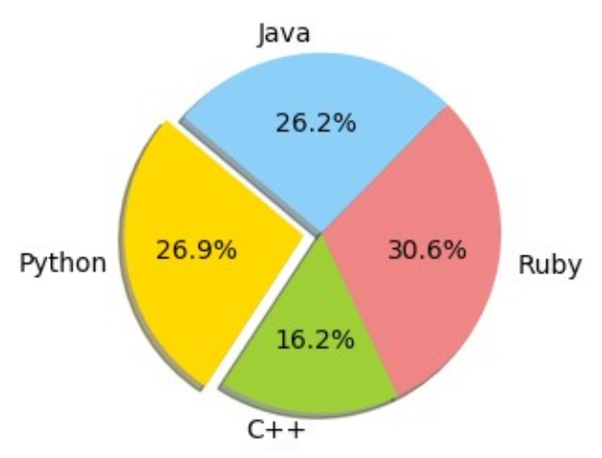

<!-- page: 135 -->

## Vẽ đồ thị với Matplotlib

## Vẽ đồ thị boxplot


import matplotlib.pyplot as plt value1 = [82,76,24,40,67,62,75,78, 71,32,98,89,78,67,72,82,87,66,56,52] value2=[62,5,91,25,36,32,96,95,3, 90,95,32,27,55,100,15,71,11,37,21] value3=[23,89,12,78,72,89,25,69,68, 86,19,49,15,16,16,75,65,31,25,52] value4=[59,73,70,16,81,61,88,98, 10,87,29,72,16,23,72,88,78,99,75,30]

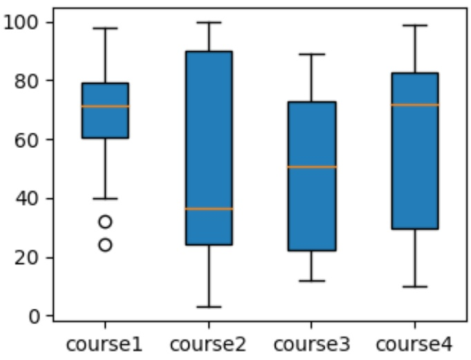

```txt
box_plot_data=[value1,value2,value3,value4]
plt.boxplot(box_plot_data,patch_artist=True,
```

```python
labels=['course1','course2','course3','course4'])
plt.show()
```

<!-- page: 136 -->

## Vẽ đồ thị với Matplotlib

## Vẽ đồ thị contour


```python
from matplotlib import pyplot as plt
import numpy as np
xlist = np.linspace(-3.0, 3.0, 100)
ylist = np.linspace(-3.0, 3.0, 100)
x, y = np.meshgrid(xlist, ylist)
z = np.sqrt(x**2 + y**2)
plt.figure()
cp = plt.contourf(x, y, z)
plt.colorbar(cp)
plt.show()
```

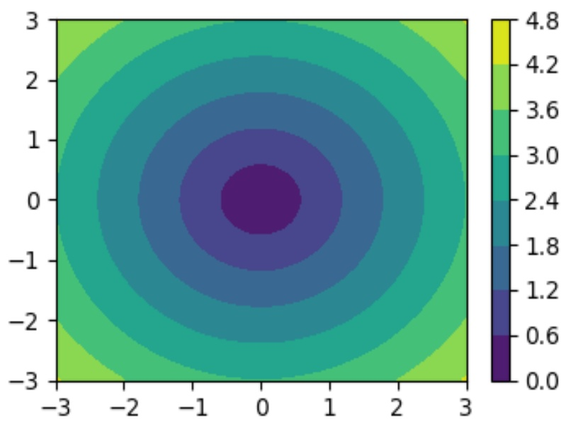

<!-- page: 137 -->

```txt
ax.scatter(x, y, z, c=c)
plt.show()
```

## Vẽ đồ thị với Matplotlib

## Vẽ đồ thị 3D

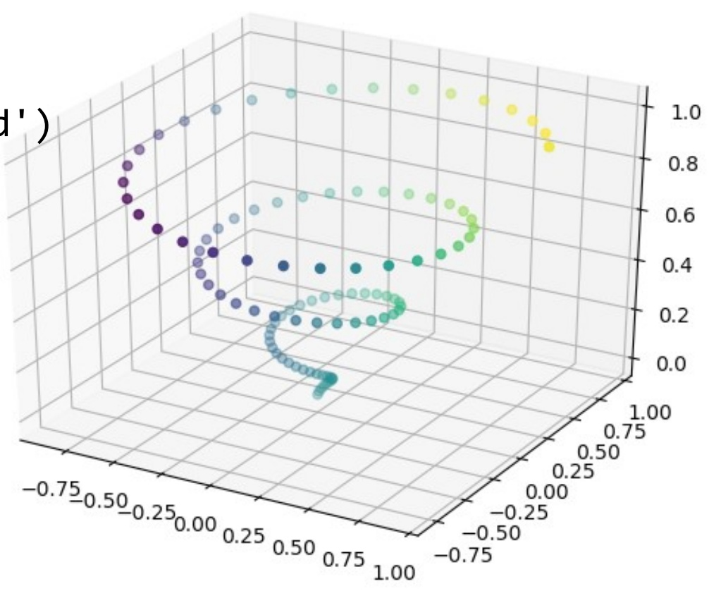

<!-- page: 138 -->

```python
• Vẽ đồ thị chuyển động
from matplotlib import animation
from matplotlib import pyplot as plt
import numpy as np
fig, ax = plt.subplots()
ax.set_xlim(0, 2)
ax.set_ylim(-2, 2)
x = np.linspace(0, 2, 1000)
y = np.zeros_like(x)
line, = ax.plot(x, y, lw=2)

# initialization function: plot the background of each frame
def init():
    line.set_data([], [])
    return line,
```

<!-- page: 139 -->

```python
• Vẽ đồ thị với Matplotlib
# animation function. This is called sequentially
def animate(i):
    y = np.sin(2 * np.pi * (x - 0.01 * i))
    line.set_data(x, y)
    return line,

# call the animator. blit=True means only re-draw
# the parts that have changed.
anim = animation.FuncAnimation(fig, animate, init_func=init,
                             frames=200, interval=20, blit=True)

plt.show()
```

<!-- page: 140 -->

## Vẽ đồ thị với Matplotlib

Ghi đồ thị 140 from matplotlib import pyplot as plt plt.savefig(file\_name)

## Đóng đồ thị

plt.cla()

plt.clf()

plt.close()

<!-- page: 141 -->

## Tài liệu tham khảo

D. Beazley, B.K. Jones, “Python Cookbook”, O'Reilly Media, 3rd ed., 2013

M. O. Faruque Sarker, “Python Network Programming Cookbook”, Packt Publishing, 2014

Tutorialspoint, “Python Tutorial", 2019

W3Schools, "Python Tutorial", 2019

Python, https://www.python.org
