<!-- page: 1 -->

# Python code for Artificial Intelligence Foundations of Computational Agents

# David L. Poole and Alan K. Mackworth

Version 0.9.18 of March 10, 2026.

[https://aipython.org](https://aipython.org) [https://artint.info](https://artint.info)

©David L Poole and Alan K Mackworth 2017-2025.

All code is licensed under a Creative Commons Attribution-NonCommercial-ShareAlike 4.0 International License. See: [https://creativecommons.org/licen](https://creativecommons.org/licenses/by-nc-sa/4.0/deed.en)ses/[by-nc-sa/4.0/deed.en](https://creativecommons.org/licenses/by-nc-sa/4.0/deed.en)

This document and all the code can be downloaded from

[https://artint.info/AIPython/](https://artint.info/AIPython/) or from [https://aipython.org](https://aipython.org)

The authors and publisher of this book have used their best efforts in preparing this book. These efforts include the development, research and testing of the programs to determine their effectiveness. The authors and publisher make no warranty of any kind, expressed or implied, with regard to these programs or the documentation contained in this book. The author and publisher shall not be liable in any event for incidental or consequential damages in connection with, or arising out of, the furnishing, performance, or use of these programs.

<!-- page: 2 -->

<!-- page: 3 -->

## Contents

- **Contents** 3
- **1 Python for Artificial Intelligence** 9
- 1.1 Why Python? 9
- 1.2 Getting Python 10
- 1.3 Running Python 10
- 1.4 Pitfalls 11
- 1.5 Features of Python 11
- 1.5.1 f-strings 11
- 1.5.2 Lists, Tuples, Sets, Dictionaries and Comprehensions 12
- 1.5.3 Generators 13
- 1.5.4 Functions as first-class objects 14
- 1.6 Useful Libraries 16
- 1.6.1 Timing Code 16
- 1.6.2 Plotting: Matplotlib 16
- 1.7 Utilities 18
- 1.7.1 Display 18
- 1.7.2 Argmax 19
- 1.7.3 Probability 20
- 1.8 Testing Code 21
- **2 Agent Architectures and Hierarchical Control 25**
- 2.1 Representing Agents and Environments 25
- 2.2 Paper buying agent and environment 27
- 2.2.1 The Environment 27
- 2.2.2 The Agent 28

<!-- page: 4 -->

- 2.2.3 Plotting 29
- 2.3 Hierarchical Controller 31
- 2.3.1 Body 31
- 2.3.2 Middle Layer 33
- 2.3.3 Top Layer 35
- 2.3.4 World 35
- 2.3.5 Plotting 36
- **3 Searching for Solutions 41**
- 3.1 Representing Search Problems 41
- 3.1.1 Explicit Representation of Search Graph 43
- 3.1.2 Paths 45
- 3.1.3 Example Search Problems 47
- 3.2 Generic Searcher and Variants 54
- 3.2.1 Searcher 54
- 3.2.2 GUI for Tracing Search 55
- 3.2.3 Frontier as a Priority Queue 60
- 3.2.4 A\* Search 61
- 3.2.5 Multiple Path Pruning 63
- 3.3 Branch-and-bound Search 65
- **4 Reasoning with Constraints 69**
- 4.1 Constraint Satisfaction Problems 69
- 4.1.1 Variables 69
- 4.1.2 Constraints 70
- 4.1.3 CSPs 71
- 4.1.4 Examples 74
- 4.2 A Simple Depth-first Solver 83
- 4.3 Converting CSPs to Search Problems 85
- 4.4 Consistency Algorithms 87
- 4.4.1 Direct Implementation of Domain Splitting 89
- 4.4.2 Consistency GUI 91
- 4.4.3 Domain Splitting as an interface to graph searching 94
- 4.5 Solving CSPs using Stochastic Local Search 96
- 4.5.1 Any-conflict 98
- 4.5.2 Two-Stage Choice 99
- 4.5.3 Updatable Priority Queues 101
- 4.5.4 Plotting Run-Time Distributions 103
- 4.5.5 Testing 104
- 4.6 Discrete Optimization 105
- 4.6.1 Branch-and-bound Search 107
- **5 Propositions and Inference 109**
- 5.1 Representing Knowledge Bases 109
- 5.2 Bottom-up Proofs (with askables) 112
- [https://aipython.org](https://aipython.org) Version 0.9.18 March 10, 2026

<!-- page: 5 -->

- 5.3 Top-down Proofs (with askables) 114
- 5.4 Debugging and Explanation 115
- 5.5 Assumables 119
- 5.6 Negation-as-failure 122
- **6 Deterministic Planning 125**
- 6.1 Representing Actions and Planning Problems 125
- 6.1.1 Robot Delivery Domain 126
- 6.1.2 Blocks World 128
- 6.2 Forward Planning 130
- 6.2.1 Defining Heuristics for a Planner 133
- 6.3 Regression Planning 135
- 6.3.1 Defining Heuristics for a Regression Planner 137
- 6.4 Planning as a CSP 138
- 6.5 Partial-Order Planning 142
- **7 Supervised Machine Learning 149**
- 7.1 Representations of Data and Predictions 150
- 7.1.1 Creating Boolean Conditions from Features 153
- 7.1.2 Evaluating Predictions 155
- 7.1.3 Creating Test and Training Sets 157
- 7.1.4 Importing Data From File 158
- 7.1.5 Augmented Features 161
- 7.2 Generic Learner Interface 163
- 7.3 Learning With No Input Features 164
- 7.3.1 Evaluation 167
- 7.4 Decision Tree Learning 168
- 7.5 k-fold Cross Validation and Parameter Tuning 173
- 7.6 Linear Regression and Classification 176
- 7.6.1 Rating Data 183
- 7.7 Boosting 189
- 7.7.1 Gradient Tree Boosting 192
- **8 Neural Networks and Deep Learning 195**
- 8.1 Layers 195
- 8.1.1 Linear Layer 196
- 8.1.2 ReLU Layer 198
- 8.1.3 Sigmoid Layer 199
- 8.2 Feedforward Networks 199
- 8.3 Optimizers 201
- 8.3.1 Stochastic Gradient Descent 201
- 8.3.2 Momentum 202
- 8.3.3 RMS-Prop 203
- 8.4 Dropout 204
- 8.5 Examples 204
- [https://aipython.org](https://aipython.org) Version 0.9.18 March 10, 2026

<!-- page: 6 -->

- 8.6 Plotting Performance 206
- 8.7 Language Tokenizer 210
- 8.8 Bigram with Empirical Probabilities 217
- 8.9 N-Grams with token embeddings 218
- **9 Reasoning with Uncertainty 227**
- 9.1 Representing Probabilistic Models 227
- 9.2 Representing Factors 227
- 9.3 Conditional Probability Distributions 229
- 9.3.1 Logistic Regression 230
- 9.3.2 Noisy-or 230
- 9.3.3 Tabular Factors and Prob 231
- 9.3.4 Decision Tree Representations of Factors 232
- 9.4 Graphical Models 234
- 9.4.1 Showing Belief Networks 236
- 9.4.2 Example Belief Networks 236
- 9.5 Inference Methods 242
- 9.5.1 Showing Posterior Distributions 243
- 9.6 Naive Search 245
- 9.7 Recursive Conditioning 246
- 9.8 Variable Elimination 250
- 9.9 Stochastic Simulation 254
- 9.9.1 Sampling from a discrete distribution 254
- 9.9.2 Sampling Methods for Belief Network Inference 256
- 9.9.3 Rejection Sampling 256
- 9.9.4 Likelihood Weighting 257
- 9.9.5 Particle Filtering 258
- 9.9.6 Examples 260
- 9.9.7 Gibbs Sampling 261
- 9.9.8 Plotting Behavior of Stochastic Simulators 263
- 9.10 Hidden Markov Models 265
- 9.10.1 Exact Filtering for HMMs 267
- 9.10.2 Localization 269
- 9.10.3 Particle Filtering for HMMs 272
- 9.10.4 Generating Examples 274
- 9.11 Dynamic Belief Networks 275
- 9.11.1 Representing Dynamic Belief Networks 275
- 9.11.2 Unrolling DBNs 279
- 9.11.3 DBN Filtering 281
- **10 Learning with Uncertainty 283**
- 10.1 Bayesian Learning 283
- 10.2 K-means 287
- 10.3 EM 292
- [https://aipython.org](https://aipython.org) Version 0.9.18 March 10, 2026

<!-- page: 7 -->

- **11 Causality 299**
- 11.1 Do Questions 299
- 11.2 Counterfactual Reasoning 302
- 11.2.1 Choosing Deterministic System 302
- 11.2.2 Firing Squad Example 306
- **12 Planning with Uncertainty 309**
- 12.1 Decision Networks 309
- 12.1.1 Example Decision Networks 311
- 12.1.2 Decision Functions 317
- 12.1.3 Recursive Conditioning for Decision Networks 318
- 12.1.4 Variable elimination for decision networks 321
- 12.2 Markov Decision Processes 324
- 12.2.1 Problem Domains 325
- 12.2.2 Value Iteration 334
- 12.2.3 Value Iteration GUI for Grid Domains 335
- 12.2.4 Asynchronous Value Iteration 339
- **13 Reinforcement Learning 343**
- 13.1 Representing Agents and Environments 343
- 13.1.1 Environments 343
- 13.1.2 Agents 344
- 13.1.3 Simulating an Environment-Agent Interaction 345
- 13.1.4 Party Environment 347
- 13.1.5 Environment from a Problem Domain 348
- 13.1.6 Monster Game Environment 349
- 13.2 Q Learning 352
- 13.2.1 Exploration Strategies 355
- 13.2.2 Testing Q-learning 355
- 13.3 Q-leaning with Experience Replay 357
- 13.4 Stochastic Policy Learning Agent 360
- 13.5 Model-based Reinforcement Learner 362
- 13.6 Reinforcement Learning with Features 365
- 13.6.1 Representing Features 365
- 13.6.2 Feature-based RL learner 368
- 13.7 GUI for RL 371
- **14 Multiagent Systems 379**
- 14.1 Minimax 379
- 14.1.1 Creating a two-player game 380
- 14.1.2 Minimax and $\alpha$-$\beta$ Pruning 383
- 14.2 Multiagent Learning 385
- 14.2.1 Simulating Multiagent Interaction with an Environment 385
- 14.2.2 Example Games 388
- 14.2.3 Testing Games and Environments 390
- [https://aipython.org](https://aipython.org) Version 0.9.18 March 10, 2026

<!-- page: 8 -->

- **15 Individuals and Relations 393**
- 15.1 Representing Datalog and Logic Programs 393
- 15.2 Unification 395
- 15.3 Knowledge Bases 396
- 15.4 Top-down Proof Procedure 398
- 15.5 Logic Program Example 400
- **16 Knowledge Graphs and Ontologies 403**
- 16.1 Triple Store 403
- 16.2 Integrating Datalog and Triple Store 406
- **17 Relational Learning 409**
- 17.1 Collaborative Filtering 409
- 17.1.1 Plotting 413
- 17.1.2 Loading Rating Sets from Files and Websites 416
- 17.1.3 Ratings of top items and users 417
- 17.2 Relational Probabilistic Models 419
- **18 Version History 425**
- **Bibliography 427**
- **Index 429**

<!-- page: 9 -->

# Python for Artificial Intelligence

AIPython contains runnable code for the book Artificial Intelligence, foundations of computational agents, 3rd Edition [Poole and Mackworth, 2023]. It has the following design goals:

• Readability is more important than efficiency, although the asymptotic complexity is not compromised. AIPython is not a replacement for welldesigned libraries, or optimized tools. Think of it like a model of an engine made of glass, so you can see the inner workings; don’t expect it to power a big truck, but it lets you see how an engine works to power a truck.

• It uses as few libraries as possible. A reader only needs to understand Python. Libraries hide details that we make explicit. The only library used is matplotlib for plotting and drawing.

## 1.1 Why Python?

We use Python because Python programs can be close to pseudo-code. It is designed for humans to read.

Python is reasonably efficient. Efficiency is usually not a problem for small examples. If your Python code is not efficient enough, a general procedure to improve it is to find out what is taking most of the time, and implement just that part more efficiently in some lower-level language. Many lower-level languages interoperate with Python nicely. This will result in much less programming and more efficient code (because you will have more time to optimize) than writing everything in a lower-level language. Much of the code here is more efficiently implemented in libraries that are more difficult to understand.

<!-- page: 10 -->

## 1.2 Getting Python

You need Python 3.9 or later ([https://python.org/](https://python.org/)) and a compatible version of matplotlib ([https://matplotlib.org/](https://matplotlib.org/)). This code is not compatible with Python 2 (e.g., with Python 2.7).

Download and install the latest Python 3 release from [https://python.org/](https://python.org/) or [https://www.anaconda.com/download](https://www.anaconda.com/download) (free download includes many libraries). This should also install pip. You can install matplotlib using

pip install matplotlib

in a terminal shell (not in Python). That should “just work”. If not, try using pip3 instead of pip.

The command python or python3 should then start the interactive Python shell. You can quit Python with a control-D or with quit().

To upgrade matplotlib to the latest version (which you should do if you install a new version of Python) do:

pip install --upgrade matplotlib

We recommend using the enhanced interactive python **ipython** ([https://ipython.org/](https://ipython.org/)) [Pérez and Granger, 2007]. To install ipython after you have installed python do:

pip install ipython

## 1.3 Running Python

We assume that everything is done with an interactive Python shell. You can either do this with an IDE, such as IDLE that comes with standard Python distributions, or just running ipython or python (or perhaps ipython3 or python3) from a shell.

Here we describe the most simple version that uses no IDE. If you download the zip file, and cd to the “aipython” folder where the .py files are, you should be able to do the following, with user input in bold. The first python command is in the operating system shell; the -i is important to enter interactive mode.

**python -i searchGeneric.py**

Testing problem 1:

7 paths have been expanded and 4 paths remain in the frontier

Path found: A --> C --> B --> D --> G

Passed unit test

>>> **searcher2 = AStarSearcher(searchProblem.acyclic\_delivery\_problem) #A\*** >>> **searcher2.search() # find first path**

16 paths have been expanded and 5 paths remain in the frontier

```txt
o103 --> o109 --> o119 --> o123 --> r123
```

>>> **searcher2.search() # find next path**

<!-- page: 11 -->

21 paths have been expanded and 6 paths remain in the frontier

o103 --> b3 --> b4 --> o109 --> o119 --> o123 --> r123

>>> **searcher2.search() # find next path**

28 paths have been expanded and 5 paths remain in the frontier

```txt
o103 --> b3 --> b1 --> b2 --> b4 --> o109 --> o119 --> o123 --> r123
```

>>> **searcher2.search() # find next path**

No (more) solutions. Total of 33 paths expanded.

You can then interact at the last prompt.

There are many textbooks for Python. The best source of information about python is [https://www.python.org/](https://www.python.org/). The documentation is at [https://docs.python.org/3/](https://docs.python.org/3/).

The rest of this chapter is about what is special about the code for AI tools. We only use the standard Python library and matplotlib. All of the exercises can be done (and should be done) without using other libraries; the aim is for you to spend your time thinking about how to solve the problem rather than searching for pre-existing solutions.

## 1.4 Pitfalls

It is important to know when side effects occur. Often AI programs consider what would/might happen given certain conditions. In many such cases, we don’t want side effects. When an agent acts in the world, side effects are appropriate.

In Python, you need to be careful to understand side effects. For example, the inexpensive function to add an element to a list, namely append, changes the list. In a functional language like Haskell or Lisp, adding a new element to a list, without changing the original list, is a cheap operation. For example if x is a list containing n elements, adding an extra element to the list in Python (using append) is fast, but it has the side effect of changing the list x. To construct a new list that contains the elements of x plus a new element, without changing the value of x, entails copying the list, or using a different representation for lists. In the searching code, we will use a different representation for lists for this reason.

## 1.5 Features of Python

## 1.5.1 f-strings

Python can use matching ', ", ''' or """, the latter two respecting line breaks in the string. We use the convention that when the string denotes a unique symbol, we use single quotes, and when it is designed to be for printing, we use double quotes.

<!-- page: 12 -->

We make extensive use of f-strings [https://docs.python.org/3/tutorial/inputoutput.html](https://docs.python.org/3/tutorial/inputoutput.html). In its simplest form

$$
f" \text {str1} \{\mathrm{e1} \} \text {str2} \{\mathrm{e2} \} \text {str3}"
$$

where e1 and e2 are expressions, is an abbreviation for

$$
" \text {str1}" + \text {str(e1)} +" \text {str2}" + \text {str(e2)} +" \text {str3}"
$$

where + is string concatenation, and str is a function that returns a string representation of its argument.

## 1.5.2 Lists, Tuples, Sets, Dictionaries and Comprehensions

We make extensive uses of lists, tuples, sets and dictionaries (dicts). See [https://docs.python.org/3/library/stdtypes.html](https://docs.python.org/3/library/stdtypes.html). Lists use “[...]” , dictionaries use " {key : value, ... }". , sets use “{...}” (without the :), tuples use “(…)”

One of the nice features of Python is the use of **comprehensions**: list, tuple, set and dictionary comprehensions.

A list comprehension is of the form

[fe for e in iter if cond]

is the list values fe for each e in iter for which cond is true. The “if cond” part is optional, but the “for” and “in” are not optional. Here e is a variable (or a pattern that can be on the left side of =), iter is an iterator, which can generate a stream of data, such as a list, a set, a range object (to enumerate integers between ranges) or a file. cond is an expression that evaluates to either True or False for each e, and fe is an expression that will be evaluated for each value of e for which cond returns True. For example:

```txt
>>> [e*e for e in range(20) if e%2==0]
[0, 4, 16, 36, 64, 100, 144, 196, 256, 324]
```

Comprehensions can also be used for sets and dictionaries. For example, the following creates an index for list a:

```javascript
>>> a = ["a","f","bar","b","a","aaaaa"]
>>> ind = {a[i]:i for i in range(len(a))}
>>> ind
{'a': 4, 'f': 1, 'bar': 2, 'b': 3, 'aaaaa': 5}
>>> ind['b']
3
```

which means that 'b' is the element with index 3 in the list.

The assignment of ind could have also be written as:

```txt
>>> ind = {val:i for (i,val) in enumerate(a)}
```

where enumerate is a built-in function that, given a dictionary, returns an generator of (index, value) pairs.

<!-- page: 13 -->

## 1.5.3 Generators

Python has generators which can be used for a form of lazy evaluation – only computing values when needed.

A comprehension in round parentheses gives a generator that can generate the elements as needed. The result can go in a list or used in another comprehension, or can be called directly using next. The procedure next takes an iterator and returns the next element (advancing the iterator); it raises a StopIteration exception if there is no next element. The following shows a simple example, where user input is prepended with >>>

```txt
>>> a = (e*e for e in range(20) if e%2==0)
>>> next(a)
0
>>> next(a)
4
>>> next(a)
16
>>> list(a)
[36, 64, 100, 144, 196, 256, 324]
>>> next(a)
Traceback (most recent call last):
    File "<stdin>", line 1, in <module>
StopIteration
```

Notice how list(a) continued on the enumeration, and got to the end of it.

To make a procedure into a generator, the yield command returns a value that is obtained with next. It is typically used to enumerate the values for a for loop or in generators. (The yield command can also be used for coroutines, but AIPython only uses it for generators.)

A version of the built-in range, with 2 or 3 arguments (and positive steps) can be implemented as:<sup>1</sup>

```python
def myrange(start, stop, step=1):
    """enumerates the values from start in steps of size step that are
    less than stop.
    """
    assert step>0, f"only positive steps implemented in myrange: {step}"
    i = start
    while i<stop:
        yield i
        i += step

print("list(myrange(2,30,3)):",list(myrange(2,30,3)))
```

<sup>1</sup>Numbered lines are Python code available in the code-directory, aipython. The name of the file is given in the gray text above the listing. The numbers correspond to the line numbers in that file.

<!-- page: 14 -->

The built-in range is unconventional in how it handles a single argument, as the single argument acts as the second argument of the function. The built-in range also allows for indexing (e.g., range(2,30,3)[2] returns 8), but the above implementation does not. However myrange also works for floats, whereas the built-in range does not.

Exercise 1.1 Implement a version of myrange that acts like the built-in version when there is a single argument. (Hint: make the second argument have a default value that can be recognized in the function.) There is no need to make it work with indexing.

Yield can be used to generate the same sequence of values as in the example above.

```python
def ga(n):
    """generates square of even nonnegative integers less than n"""
    for e in range(n):
        if e%2==0:
            yield e*e
a = ga(20)
```

The sequence of next(a), and list(a) gives exactly the same results as the comprehension at the start of this section.

It is straightforward to write a version of the built-in enumerate called myenumerate:

```python
def myenumerate(iter, start=0):
    i = start
    for e in iter:
        yield i,e
        i += 1
```

## 1.5.4 Functions as first-class objects

Python can create lists and other data structures that contain functions. There is an issue that tricks many newcomers to Python. For a local variable in a function, the function uses the last value of the variable when the function is called, not the value of the variable when the function was defined (this is called “late binding”). This means if you want to use the value a variable has when the function is created, you need to save the current value of that variable. Whereas Python uses “late binding” by default, the alternative that newcomers often expect is “early binding”, where a function uses the value a variable had when the function was defined. The following examples show how early binding can be implemented.

Consider the following programs designed to create a list of 5 functions, where the ith function in the list is meant to add i to its argument:

<!-- page: 15 -->

## 1.5. Features of Python

```python
pythonDemo.py — (continued)

fun_list1 = []
for i in range(5):
    def fun1(e):
        return e+i
    fun_list1.append(fun1)

fun_list2 = []
for i in range(5):
    def fun2(e,iv=i):
        return e+iv
    fun_list2.append(fun2)

fun_list3 = [lambda e: e+i for i in range(5)]

fun_list4 = [lambda e,iv=i: e+iv for i in range(5)]

i=56
```

Try to predict, and then test to see the output, of the output of the following calls, remembering that the function uses the latest value of any variable that is not bound in the function call:

```python
pythonDemo.py — (continued) ________________
# in Shell do
## ipython -i pythonDemo.py
# Try these (copy text after the comment symbol and paste in the Python prompt):
# print([f(10) for f in fun_list1])
# print([f(10) for f in fun_list2])
# print([f(10) for f in fun_list3])
# print([f(10) for f in fun_list4])
```

In the first for-loop, the function fun1 uses i, whose value is the last value it was assigned. In the second loop, the function fun2 uses iv. There is a separate iv variable for each function, and its value is the value of i when the function was defined. Thus fun1 uses late binding, and fun2 uses early binding. fun\_list3 and fun\_list4 are equivalent to the first two (except fun\_list4 uses a different i variable).

One of the advantages of using the embedded definitions (as in fun1 and fun2 above) over the lambda is that is it possible to add a \_\_doc\_\_ string, which is the standard for documenting functions in Python, to the embedded definitions.

<!-- page: 16 -->

## 1.6 Useful Libraries

## 1.6.1 Timing Code

In order to compare algorithms, you may want to compute how long a program takes to run; this is called the **run time** of the program. The most straightforward way to compute the run time of foo.bar(aaa) is to use time.perf\_counter(), as in:

```python
import time
start_time = time.perf_counter()
foo.bar(aaa)
end_time = time.perf_counter()
print("Time:", end_time - start_time, "seconds")
```

Note that time.perf\_counter() measures clock time; so this should be done without user interaction between the calls. On the interactive python shell, you should do:

```txt
start_time = time.perf_counter(); foo.bar(aaa); end_time = time.perf_counter()
```

If this time is very small (say less than 0.2 second), it is probably very inaccurate; run your code multiple times to get a more accurate count. For this you can use timeit ([https://docs.python.org/3/library/timeit.html](https://docs.python.org/3/library/timeit.html)). To use timeit to time the call to foo.bar(aaa) use:

```python
import timeit
time = timeit.timeit("foo.bar(aaa)",
            setup="from __main__ import foo,aaa", number=100)
```

The setup is needed so that Python can find the meaning of the names in the string that is called. This returns the number of seconds to execute foo.bar(aaa) 100 times. The number should be set so that the run time is at least 0.2 seconds.

You should not trust a single measurement as that can be confounded by interference from other processes. timeit.repeat can be used for running timeit a few (say 3) times. When reporting the time of any computation, you should be explicit and explain what you are reporting. Usually the minimum time is the one to report (as it is the run with less interference).

## 1.6.2 Plotting: Matplotlib

The standard plotting for Python is matplotlib ([https://matplotlib.org/](https://matplotlib.org/)). We will use the most basic plotting using the pyplot interface.

Here is a simple example that uses most of AIPython uses. The output is shown in Figure 1.1.

<!-- page: 17 -->

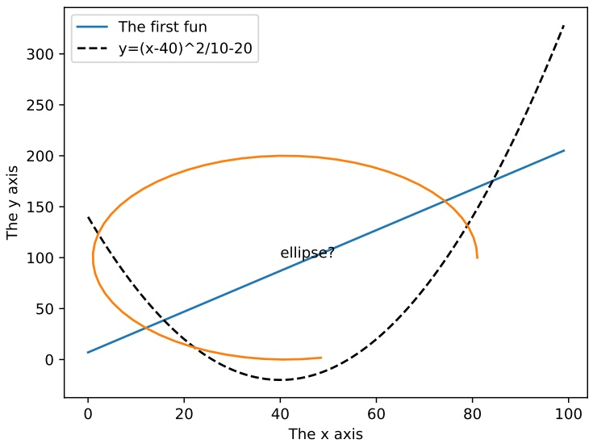

Figure 1.1: Result of pythonDemo code

```python
def myplot(minv,maxv,step,fun1,fun2):
    global fig, ax # allow them to be used outside myplot()
    plt.ion() # make it interactive
    fig, ax = plt.subplots()
    ax.set_xlabel("The x axis")
    ax.set_ylabel("The y axis")
    ax.set_xscale('linear') # Makes a 'log' or 'linear' scale
    xvalues = range(minv,maxv,step)
    ax.plot(xvalues,[fun1(x) for x in xvalues],
        label="The first fun")
    ax.plot(xvalues,[fun2(x) for x in xvalues], linestyle='--',color='k',
        label=fun2.__doc__) # use the doc string of the function
    ax.legend(loc="upper right") # display the legend

def slin(x):
    """y=2x+7"""
    return 2*x+7
def sqfun(x):
    """y=(x-40)^2/10-20"""
    return (x-40)**2/10-20

# Try the following from shell:
# python -i pythonDemo.py
# myplot(0,100,1,slin,sqfun)
# ax.legend(loc="best")
# import math
# ax.plot([41+40*math.cos(th/10) for th in range(50)],

https://aipython.org Version 0.9.18 March 10, 2026
```

<!-- page: 18 -->

```python
#           [100+100*math.sin(th/10) for th in range(50)])
# ax.text(40,100,"ellipse?")
# ax.set_xscale('log')
```

At the end of the code are some commented-out commands you should try in interactive mode. Cut from the file and paste into Python (and remember to remove the comments symbol and leading space).

## 1.7 Utilities

## 1.7.1 Display

To keep things simple, using only standard Python, AIPython code is written using a text-oriented tracing.

The method self.display is used to trace the program. Any call

```txt
self.display(level,to_print...)
```

where the level is less than or equal to the value for max\_display\_level will be printed. The to\_print . . . can be anything that is accepted by the built-in print (including any keyword arguments).

The definition of display is:

```python
class Displayable(object):
    """Class that uses 'display'.
    The amount of detail is controlled by max_display_level
    """
    max_display_level = 1 # can be overridden in subclasses or instances

    def display(self,level,*args,**nargs):
        """print the arguments if level is less than or equal to the
        current max_display_level.
        level is an integer.
        the other arguments are whatever arguments print can take.
        """
        if level <= self.max_display_level:
            print(*args, **nargs) ##if error you are using Python2 not Python3
```

In this code, args gets a tuple of the positional arguments, and nargs gets a dictionary of the keyword arguments. This will not work in Python 2, and will give an error.

Any class that wants to use display can be made a subclass of Displayable. To change the maximum display level to 3 for a class do:

Classname.max\_display\_level = 3

<!-- page: 19 -->

which will make calls to display in that class print when the value of level is less-than-or-equal to 3. The default display level is 1. It can also be changed for individual objects (the object value overrides the class value).

The value of max\_display\_level by convention is:

0 display nothing

1 display solutions (nothing that happens repeatedly)

2 also display the values as they change (little detail through a loop)

3 also display more details

**4 and above** even more detail

To implement a graphical user interface (GUI), the definition of display can be overridden. See, for example, SearcherGUI in Section 3.2.2 and ConsistencyGUI in Section 4.4.2. These GUIs use the AIPython code unchanged.

## 1.7.2 Argmax

Python has a built-in max function that takes a generator (or a list or set) and returns the maximum value. The argmaxall method takes a generator of (element, value) pairs, as for example is generated by the built-in enumerate(list) for lists or dict.items() for dictionaries. It returns a list of all elements with maximum value; argmaxe returns one of these values at random. The argmax method takes a list and returns the index of a random element that has the maximum value. argmaxd takes a dictionary and returns a key with maximum value.

```python
import random
import math

def argmaxall(gen):
    """gen is a generator of (element,value) pairs, where value is a real.
    argmaxall returns a list of all of the elements with maximal value.
    """
    maxv = -math.inf      # negative infinity
    maxvals = []     # list of maximal elements
    for (e,v) in gen:
        if v > maxv:
            maxvals, maxv = [e], v
        elif v == maxv:
            maxvals.append(e)
    return maxvals

def argmaxe(gen):
    """gen is a generator of (element,value) pairs, where value is a real.
    argmaxe returns an element with maximal value.
```

<!-- page: 20 -->

```python
If there are multiple elements with the max value, one is returned at
        random.
    """
    return random.choice(argmaxall(gen))

def argmax(lst):
    """returns maximum index in a list"""
    return argmaxe(enumerate(lst))
# Try:
# argmax([1,6,3,77,3,55,23])

def argmaxd(dct):
    """returns the arg max of a dictionary dct"""
    return argmaxe(dct.items())
# Try:
# arxmaxd({2:5,5:9,7:7})
```

Exercise 1.2 Change argmaxe to have an optional argument that specifies whether you want the “first”, “last” or a “random” index of the maximum value returned. If you want the first or the last, you don’t need to keep a list of the maximum elements. Enable the other methods to have this optional argument, if appropriate.

## 1.7.3 Probability

For many of the simulations, we want to make a variable True with some probability. flip(p) returns True with probability p, and otherwise returns False.

```python
def flip(prob):
    """return true with probability prob"""
    return random.random() < prob
```

The select\_from\_dist method takes in a item : probability dictionary, and returns one of the items in proportion to its probability. The probabilities should sum to 1 or more. If they sum to more than one, the excess is ignored.

```python
def select_from_dist(item_prob_dist):
    """ returns a value from a distribution.
    item_prob_dist is an item:probability dictionary, where the
        probabilities sum to 1.
    returns an item chosen in proportion to its probability
    """
    ranreal = random.random()
    for (it,prob) in item_prob_dist.items():
        if ranreal < prob:
            return it
        else:
            ranreal -= prob
    raise RuntimeError(f"{item_prob_dist} is not a probability
        distribution")
```

<!-- page: 21 -->

## 1.8 Testing Code

It is important to test code early and test it often. We include a simple form of **unit test**. In your code, you should do more substantial testing than done here. Make sure you should also test boundary cases.

The following code tests argmax, but only if utilities is loaded in the toplevel. If it is loaded in a module the test code is not run. The value of the current module is in \_\_name\_\_ and if the module is run at the top-level, its value is "\_\_main\_\_". See [https://docs.python.org/3/library/\_\_main\_\_.html](https://docs.python.org/3/library/__main__.html).

```python
def test():
    """Test part of utilities"""
    assert argmax([1,6,55,3,55,23]) in [2,4]
    print("Passed unit test in utilities")
    print("run test_aipython() to test (almost) everything")

if __name__ == "__main__":
    test()
```

The following imports all of the python code and does a simple check of all of AIPython that has automatic checks. If you develop new algorithms or tests, add them here!

```python
def test_aipython():
    import pythonDemo, display
    # Agents: currently no tests
    import agents, agentBuying, agentEnv, agentMiddle, agentTop,
        agentFollowTarget
    # Search:
    print("***** testing Search ****")
    import searchGeneric, searchBranchAndBound, searchExample, searchTest
    searchGeneric.test(searchGeneric.AStarSearcher)
    searchBranchAndBound.test(searchBranchAndBound.DF_branch_and_bound)
    searchTest.run(searchExample.problem1,"Problem 1")
    import searchGUI, searchMPP, searchGrid
    # CSP
    print("\n***** testing CSP ****")
    import cspExamples, cspDFS, cspSearch, cspConsistency, cspSLS
    cspExamples.test_csp(cspDFS.dfs_solve1)
    cspExamples.test_csp(cspSearch.solver_from_searcher)
    cspExamples.test_csp(cspConsistency.ac_solver)
    cspExamples.test_csp(cspConsistency.ac_search_solver)
    cspExamples.test_csp(cspSLS.sls_solver)
    cspExamples.test_csp(cspSLS.any_conflict_solver)
    import cspConsistencyGUI, cspSoft
    # Propositions
    print("\n***** testing Propositional Logic ****")
```

<!-- page: 22 -->

95 **import** logicBottomUp, logicTopDown, logicExplain, logicAssumables, logicNegation 96 logicBottomUp.test() 97 logicTopDown.test() 98 logicExplain.test() 99 logicNegation.test() 100 # Planning 101 **print**("\n\*\*\*\*\* testing Planning \*\*\*\*\*") 102 **import** stripsHeuristic 103 stripsHeuristic.test\_forward\_heuristic() 104 stripsHeuristic.test\_regression\_heuristic() 105 **import** stripsCSPPlanner, stripsPOP 106 # Learning 107 **print**("\n\*\*\*\*\* Learning with no inputs \*\*\*\*\*") 108 **import** learnProblem, learnNoInputs, learnDT, learnLinear 109 learnNoInputs.test\_no\_inputs(training\_sizes=[4]) 110 data = learnProblem.Data\_from\_file('data/carbool.csv', one\_hot=True, target\_index=-1, seed=123) 111 **print**("\n\*\*\*\*\* Decision Trees \*\*\*\*\*") 112 dtl=learnDT. DT\_learner(data) 113 dtl.learn() 114 dtl.evaluate() 115 **print**("\n\*\*\*\*\* Linear Learning \*\*\*\*\*") 116 ll=learnLinear.Linear\_learner(data) 117 ll.learn() 118 ll.evaluate() 119 **import** learnCrossValidation, learnBoosting 120 # Deep Learning 121 **import** learnNN 122 **print**("\n\*\*\*\*\* testing Neural Network Learning \*\*\*\*\*") 123 nn= learnNN.NN\_from\_arch(data, arch=[3]) 124 nn.learn() 125 nn.evaluate() 126 # Uncertainty 127 **print**("\n\*\*\*\*\* testing Uncertainty \*\*\*\*\*") 128 **import** probGraphicalModels, probRC, probVE, probStochSim 129 probGraphicalModels.InferenceMethod.testIM(probRC.ProbSearch) 130 probGraphicalModels.InferenceMethod.testIM(probRC.ProbRC) 131 probGraphicalModels.InferenceMethod.testIM(probVE.VE) 132 probGraphicalModels.InferenceMethod.testIM(probStochSim.RejectionSampling, threshold=0.1) 133 probGraphicalModels.InferenceMethod.testIM(probStochSim.LikelihoodWeighting, threshold=0.1) 134 probGraphicalModels.InferenceMethod.testIM(probStochSim.ParticleFiltering, threshold=0.1) 135 probGraphicalModels.InferenceMethod.testIM(probStochSim.GibbsSampling, threshold=0.1) 136 **import** probHMM, probLocalization, probDBN 137 # Learning under uncertaint 138 **print**("\n\*\*\*\*\* Learning under Uncertainty \*\*\*\*\*")

<!-- page: 23 -->

139 **import** learnBayesian, learnKMeans, learnEM 140 learnKMeans.testKM() 141 learnEM.testEM() 142 # Causality: currently no tests 143 **import** probDo, probCounterfactual 144 # Planning under uncertainty 145 **print**("\n\*\*\*\*\* Planning under Uncertainty \*\*\*\*\*") 146 **import** decnNetworks 147 decnNetworks.test(decnNetworks.fire\_dn) 148 **import** mdpExamples 149 mdpExamples.test\_MDP(mdpExamples.partyMDP) 150 **import** mdpGUI 151 # Reinforcement Learning: 152 **print**("\n\*\*\*\*\* testing Reinforcement Learning \*\*\*\*\*") 153 **import** rlQLearner 154 rlQLearner.test\_RL(rlQLearner.Q\_learner, alpha\_fun=**lambda** k:10/(9+k)) 155 **import** rlQExperienceReplay 156 rlQLearner.test\_RL(rlQExperienceReplay.Q\_ER\_learner, alpha\_fun=**lambda** k:10/(9+k)) 157 **import** rlStochasticPolicy 158 rlQLearner.test\_RL(rlStochasticPolicy.StochasticPIAgent, alpha\_fun=**lambda** k:10/(9+k)) 159 **import** rlModelLearner 160 rlQLearner.test\_RL(rlModelLearner.Model\_based\_reinforcement\_learner) 161 **import** rlFeatures 162 rlQLearner.test\_RL(rlFeatures.SARSA\_LFA\_learner, es\_kwargs={'epsilon':1}, eps=4) 163 **import** rlQExperienceReplay, rlModelLearner, rlFeatures, rlGUI 164 # Multiagent systems: currently no tests 165 **import** rlStochasticPolicy, rlGameFeature 166 # Individuals and Relations 167 **print**("\n\*\*\*\*\* testing Datalog and Logic Programming \*\*\*\*\*") 168 **import** relnExamples 169 relnExamples.test\_ask\_all() 170 # Knowledge Graphs and Ontologies 171 **print**("\n\*\*\*\*\* testing Knowledge Graphs and Ontologies \*\*\*\*\*") 172 **import** knowledgeGraph, knowledgeReasoning 173 knowledgeGraph.test\_kg() 174 # Relational Learning: currently no tests 175 **import** relnCollFilt, relnProbModels 176 **print**("\n\*\*\*\*\* End of Testing\*\*\*\*\*")

<!-- page: 24 -->

<!-- page: 25 -->

# Agent Architectures and Hierarchical Control

This implements the controllers described in Chapter 2 of Poole and Mackworth [2023]. It defines an architecture that is also used by reinforcement learning (Chapter 13) and multiagent learning (Section 14.2).

AIPython only provides sequential implementations of the control. More sophisticated version may have them run concurrently. Higher-levels call lowerlevels. The higher-levels calling the lower-level works in simulated environments where the lower-level are written to make sure they return (and don’t go on forever), and the higher level doesn’t take too long (as the lower-levels will wait until called again). More realistic architecture have the layers running concurrently so the lower layer can keep reacting while the higher layers are carrying out more complex computation.

## 2.1 Representing Agents and Environments

Both agents and the environment are treated as objects in the sense of objectoriented programming, with an internal state they maintain, and can evaluate methods. In this chapter, only a single agent is allowed; Section 14.2 allows for multiple agents.

An **environment** takes in actions of the agents, updates its internal state and returns the next percept, using the method do.

An **agent** implements the method select\_action that takes a percept and returns the next action, updating its internal state as appropriate.

The methods do and select\_action are chained together to build a simulator. Initially the simulator needs either an action or a percept. There are two variants used:

<!-- page: 26 -->

An agent implements the initial\_action(percept) method which is used initially. This is the method used in the reinforcement learning chapter (page 343).

• The environment implements the initial\_percept() method which gives the initial percept for the agent. This is the method is used in this chapter.

The state of the agent and the state of the environment are represented using standard Python variables, which are updated as the state changes. The percept and the actions are represented as variable-value dictionaries.

Agent and Environment are subclasses of Displayable so that they can use the display method described in Section 1.7.1. raise NotImplementedError() is a way to specify an abstract method that needs to be overridden in any implemented agent or environment.

```python
from display import Displayable

class Agent(Displayable):

    def initial_action(self, percept):
        """return the initial action."""
        return self.select_action(percept) # same as select_action

    def select_action(self, percept):
        """return the next action (and update internal state) given percept
        percept is variable:value dictionary
        """
        raise NotImplementedError("go") # abstract method
```

The environment implements a do(action) method where action is a variablevalue dictionary. This returns a percept, which is also a variable-value dictionary. The use of dictionaries allows for structured actions and percepts.

Note that

```python
class Environment(Displayable):
    def initial_percept(self):
        """returns the initial percept for the agent"""
        raise NotImplementedError("initial_percept") # abstract method

    def do(self, action):
        """does the action in the environment
        returns the next percept """
        raise NotImplementedError("Environment.do") # abstract method
```

The simulator is initialized with initial\_percept and then the agent and the environment take turns in updating their states and returning the action and the percept. This simulator runs for n steps. A slightly more sophisticated simulator could run until some stopping condition.

<!-- page: 27 -->

## 2.2. Paper buying agent and environment

```python
class Simulate(Displayable):
    """simulate the interaction between the agent and the environment
    for n time steps.
    """
    def __init__(self, agent, environment):
        self.agent = agent
        self.env = environment
        self.percept = self.env.initial_percept()
        self.percept_history = [self.percept]
        self.action_history = []

    def go(self, n):
        for i in range(n):
            action = self.agent.select_action(self.percept)
            self.display(2,f"i={i} action={action}")
            self.percept = self.env.do(action)
            self.display(2,f"   percept={self.percept}")
```

## 2.2 Paper buying agent and environment

```txt
To run the demo, in folder "aipython", load "agents.py", using e.g., ipython -i agentBuying.py, and copy and paste the commented-out commands at the bottom of that file.
```

This is an implementation of Example 2.1 of Poole and Mackworth [2023]. You might get different plots to Figures 2.2 and 2.3 as there is randomness in the environment.

## 2.2.1 The Environment

The environment state is given in terms of the time and the amount of paper in stock. It also remembers the in-stock history and the price history. The percept consists of the price and the amount of paper in stock. The action of the agent is the number to buy.

Here we assume that the price changes are obtained from the price\_delta list which gives the change in price for each time. When the time is longer than the list, it repeats the list. Note that the sum of the changes is greater than zero, so that prices tend to increase. There is also randomness (noise) added to the prices. The agent cannot access the price model; it just observes the prices and the amount in stock.

```python
_______agentBuying.py — Paper-buying agent
import random
from agents import Agent, Environment, Simulate
from utilities import select_from_dist
```

<!-- page: 28 -->

```python
class TP_env(Environment):
    price_delta = [0, 0, 0, 21, 0, 20, 0, -64, 0, 0, 23, 0, 0, 0, -35,
        0, 76, 0, -41, 0, 0, 0, 21, 0, 5, 0, 5, 0, 0, 0, 5, 0, -15, 0, 5,
        0, 5, 0, -115, 0, 115, 0, 5, 0, -15, 0, 5, 0, 5, 0, 0, 0, 5, 0,
        -59, 0, 44, 0, 5, 0, 5, 0, 0, 0, 5, 0, -65, 50, 0, 5, 0, 5, 0, 0,
        0, 5, 0]
    sd = 5 # noise standard deviation

    def __init__(self):
        """paper buying agent"""
        self.time=0
        self.stock=20
        self.stock_history = [] # memory of the stock history
        self.price_history = [] # memory of the price history

    def initial_percept(self):
        """return initial percept"""
        self.stock_history.append(self.stock)
        self.price = round(234+self.sd*random.gauss(0,1))
        self.price_history.append(self.price)
        return {'price': self.price,
            'instock': self.stock}

    def do(self, action):
        """does action (buy) and returns percept consisting of price and instock"""
        used = select_from_dist({6:0.1, 5:0.1, 4:0.1, 3:0.3, 2:0.2, 1:0.2})
        # used = select_from_dist({7:0.1, 6:0.2, 5:0.2, 4:0.3, 3:0.1,
            2:0.1}) # uses more paper
        bought = action['buy']
        self.stock = self.stock+bought-used
        self.stock_history.append(self.stock)
        self.time += 1
        self.price = round(self.price
            + self.price_delta[self.time%len(self.price_delta)] #
                repeating pattern
            + self.sd*random.gauss(0,1)) # plus randomness
        self.price_history.append(self.price)
        return {'price': self.price,
            'instock': self.stock}
```

## 2.2.2 The Agent

The agent does not have access to the price model but can only observe the current price and the amount in stock. It has to decide how much to buy.

The belief state of the agent is an estimate of the average price of the paper, and the total amount of money the agent has spent.

<!-- page: 29 -->

## 2.2. Paper buying agent and environment

```python
class TP_agent(Agent):
    def __init__(self):
        self.spent = 0
        percept = env.initial_percept()
        self.ave = self.last_price = percept['price']
        self.instock = percept['instock']
        self.buy_history = []

    def select_action(self, percept):
        """return next action to carry out
        """
        self.last_price = percept['price']
        self.ave = self.ave+(self.last_price-self.ave)*0.05
        self.instock = percept['instock']
        if self.last_price < 0.9*self.ave and self.instock < 60:
            tobuy = 48
        elif self.instock < 12:
            tobuy = 12
        else:
            tobuy = 0
        self.spent += tobuy*self.last_price
        self.buy_history.append(tobuy)
        return {'buy': tobuy}
```

Set up an environment and an agent. Uncomment the last lines to run the agent for 90 steps, and determine the average amount spent.

```python
agentBuying.py — (continued) ____

    env = TP_env()
    ag = TP_agent()
    sim = Simulate(ag,env)
    #sim.go(90)
    #ag.spent/env.time ## average spent per time period
```

## 2.2.3 Plotting

The following plots the price and number in stock history:

```python
import matplotlib.pyplot as plt

class Plot_history(object):
    """Set up the plot for history of price and number in stock"""
    def __init__(self, ag, env):
        self.ag = ag
        self.env = env
        plt.ion()
        fig, self.ax = plt.subplots()
        self.ax.set_xlabel("Time")
        self.ax.set_ylabel("Value")
```

<!-- page: 30 -->

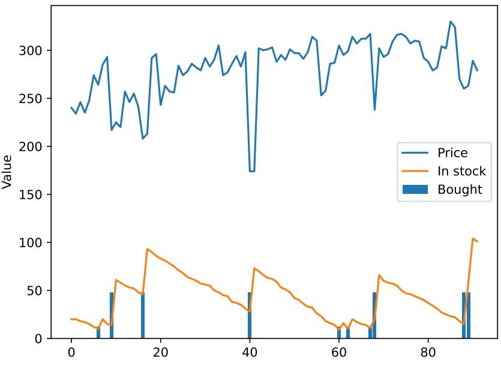

Figure 2.1: Percept and command traces for the paper-buying agent

```python
def plot_env_hist(self):
    """plot history of price and instock"""
    num = len(env.stock_history)
    self.ax.plot(range(num),env.price_history,label="Price")
    self.ax.plot(range(num),env.stock_history,label="In stock")
    self.ax.legend()

def plot_agent_hist(self):
    """plot history of buying"""
    num = len(ag.buy_history)
    self.ax.bar(range(1,num+1), ag.buy_history, label="Bought")
    self.ax.legend()

# sim.go(100); print(f"agent spent \${ag.spent/100}")
# pl = Plot_history(ag,env); pl.plot_env_hist(); pl.plot_agent_hist()
```

Figure 2.1 shows the result of the plotting in the previous code.

Exercise 2.1 Design a better controller for a paper-buying agent.

• Justify a performance measure that is a fair comparison. Note that minimizing the total amount of money spent may be unfair to agents who have built up a stockpile, and favors agents that end up with no paper.

• Give a controller that can work for many different price histories. An agent can use other local state variables, but does not have access to the environment model.

<!-- page: 31 -->

• Is it worthwhile trying to infer the amount of paper that the home uses? (Try your controller with the different paper consumption commented out in TP\_env.do.)

## 2.3 Hierarchical Controller

```txt
To run the hierarchical controller, in folder "aipython", load "agentTop.py", using e.g., ipython -i agentTop.py, and copy and paste the commands near the bottom of that file.
```

In this implementation, each layer, including the top layer, implements the environment class, because each layer is seen as an environment from the layer above.

The robot controller is decomposed as follows. The world defines the walls. The body describes the robot’s position, and its physical abilities such as whether its whisker sensor of on. The body can be told to steer left or right or to go straight. The middle layer can be told to go to x-y positions, avoiding walls. The top layer knows about named locations, such as the storage room and location o103, and their x-y positions. It can be told a sequence of locations, and tells the middle layer to go to the positions of the locations in turn.

## 2.3.1 Body

Rob\_body defines everything about the agent body, its position and orientation and whether its whisker sensor is on. It implements the Environment class as it is treated as an environment by the higher layers. It can be told to turn left or right or to go straight.

```python
import math
from agents import Environment
import matplotlib.pyplot as plt
import time

class Rob_body(Environment):
    def __init__(self, world, init_pos=(0,0), init_dir=90):
        """ world is the current world
        init_pos is a pair of (x-position, y-position)
        init_dir is a direction in degrees; 0 is to right, 90 is
            straight-up, etc
        """
        self.world = world
        self.rob_pos = init_pos
        self.rob_dir = init_dir
        self.turning_angle = 18 # degrees that a left makes
        self.whisker_length = 6 # length of the whisker
        self.whisker_angle = 30 # angle of whisker relative to robot
```

<!-- page: 32 -->

```python
self.crashed = False

def percept(self):
    return {'rob_pos':self.rob_pos,
        'rob_dir':self.rob_dir, 'whisker':self.whisker(),
            'crashed':self.crashed}
initial_percept = percept # use percept function for initial percept too

def do(self, action):
    """ action is {'steer':direction}
    direction is 'left', 'right' or 'straight'.
    Returns current percept.
    """
    if self.crashed:
        return self.percept()
    direction = action['steer']
    compass_deriv =
        {'left':1,'straight':0,'right':-1}[direction]*self.turning_angle
    self.rob_dir = (self.rob_dir + compass_deriv +360)%360 # make in
        range [0,360)
    x,y = self.rob_pos
    rob_pos_new = (x + math.cos(self.rob_dir*math.pi/180),
                    y + math.sin(self.rob_dir*math.pi/180))
    path = (self.rob_pos,rob_pos_new)
    if any(line_segments_intersect(path,wall) for wall in
        self.world.walls):
            self.crashed = True
    self.rob_pos = rob_pos_new
    self.world.do({'rob_pos':self.rob_pos,
                      'crashed':self.crashed, 'whisker':self.whisker()})
    return self.percept()
```

The Boolean whisker method returns True when the the robots whisker sensor intersects with a wall.

```python
def whisker(self):
    """returns true whenever the whisker sensor intersects with a wall
    """
    whisk_ang_world = (self.rob_dir-self.whisker_angle)*math.pi/180
        # angle in radians in world coordinates
    (x,y) = self.rob_pos
    wend = (x + self.whisker_length * math.cos(whisk_ang_world),
            y + self.whisker_length * math.sin(whisk_ang_world))
    whisker_line = (self.rob_pos, wend)
    hit = any(line_segments_intersect(whisker_line,wall)
        for wall in self.world.walls)
    return hit

def line_segments_intersect(linea, lineb):
    """returns true if the line segments, linea and lineb intersect.
```

<!-- page: 33 -->

## 2.3. Hierarchical Controller

```python
A line segment is represented as a pair of points.
A point is represented as a (x,y) pair.
"""
((x0a,y0a),(x1a,y1a)) = linea
((x0b,y0b),(x1b,y1b)) = lineb
da, db = x1a-x0a, x1b-x0b
ea, eb = y1a-y0a, y1b-y0b
denom = db*ea-eb*da
if denom==0:  # line segments are parallel
    return False
cb = (da*(y0b-y0a)-ea*(x0b-x0a))/denom # intersect along line b
if cb<0 or cb>1:
    return False # intersect is outside line segment b
ca = (db*(y0b-y0a)-eb*(x0b-x0a))/denom # intersect along line a
return 0<=ca<=1 # intersect is inside both line segments

# Test cases:
# assert line_segments_intersect(((0,0),(1,1)),((1,0),(0,1)))
# assert not line_segments_intersect(((0,0),(1,1)),((1,0),(0.6,0.4)))
# assert line_segments_intersect(((0,0),(1,1)),((1,0),(0.4,0.6)))
```

## 2.3.2 Middle Layer

The middle layer acts like both a controller (for the body layer) and an environment for the upper layer. It has to tell the body how to steer. Thus it calls env.do(·), where env is the body. It implements do(\cdot) for the top layer, where the action specifies an x-y position to go to and a timeout.

```python
from agents import Environment
import math

class Rob_middle_layer(Environment):
    def __init__(self, lower):
        """The lower-level for the middle layer is the body.
        """
        self.lower = lower
        self.percept = lower.initial_percept()
        self.straight_angle = 11 # angle that is close enough to straight ahead
        self.close_threshold = 1 # distance that is close enough to arrived
        self.close_threshold_squared = self.close_threshold**2 # just compute it once

    def initial_percept(self):
        return {}

    def do(self, action):
        """action is {'go_to':target_pos,'timeout':timeout}
```

<!-- page: 34 -->

```python
target_pos is (x,y) pair
timeout is the number of steps to try
returns {'arrived':True} when arrived is true
    or {'arrived':False} if it reached the timeout
"""
if 'timeout' in action:
    remaining = action['timeout']
else:
    remaining = -1  # will never reach 0
target_pos = action['go_to']
arrived = self.close_enough(target_pos)
while not arrived and remaining != 0:
    self.percept = self.lower.do({"steer":self.steer(target_pos)})
    remaining -= 1
    arrived = self.close_enough(target_pos)
return {'arrived':arrived}
```

The following method determines how to steer depending on whether the goal is to the right or the left of where the robot is facing.

```python
def steer(self, target_pos):
    if self.percept['whisker']:
        self.display(3,'whisker on', self.percept)
        return "left"
    else:
        return self.head_towards(target_pos)

def head_towards(self, target_pos):
    """ given a target position, return the action that heads towards that position
    """
    gx,gy = target_pos
    rx,ry = self.percept['rob_pos']
    goal_dir = math.acos((gx-rx)/math.sqrt((gx-rx)*(gx-rx)
                          +(gy-ry)*(gy-ry)))*180/math.pi
    if ry>gy:
        goal_dir = -goal_dir
    goal_from_rob = (goal_dir - self.percept['rob_dir']+540)%360-180
    assert -180 < goal_from_rob <= 180
    if goal_from_rob > self.straight_angle:
        return "left"
    elif goal_from_rob < -self.straight_angle:
        return "right"
    else:
        return "straight"

def close_enough(self, target_pos):
    """True when the robot's position is within close_threshold of target_pos
    """
```

<!-- page: 35 -->

## 2.3. Hierarchical Controller

```python
gx,gy = target_pos
    rx,ry = self.percept['rob_pos']
    return (gx-rx)**2 + (gy-ry)**2 <= self.close_threshold_squared
```

## 2.3.3 Top Layer

The top layer treats the middle layer as its environment. Note that the top layer is an environment for us to tell it what to visit.

```python
from display import Displayable
from agentMiddle import Rob_middle_layer
from agents import Agent, Environment

class Rob_top_layer(Agent, Environment):
    def __init__(self, lower, world, timeout=200 ):
        """lower is the lower layer
        world is the world (which knows where the locations are)
        timeout is the number of steps the middle layer goes before giving up
        """
        self.lower = lower
        self.world = world
        self.timeout = timeout # number of steps before the middle layer should give up

    def do(self,plan):
        """carry out actions.
        actions is of the form {'visit':list_of_locations}
        It visits the locations in turn.
        """
        to_do = plan['visit']
        for loc in to_do:
            position = self.world.locations[loc]
            arrived = self.lower.do({'go_to':position, 'timeout':self.timeout})
            self.display(1,"Goal",loc,arrived)
```

## 2.3.4 World

The world defines the walls and implements tracing.

```python
agentEnv.py — (continued) ________________
import math
from display import Displayable
import matplotlib.pyplot as plt

class World(Environment):
https://aipython.org Version 0.9.18 March 10, 2026
```

<!-- page: 36 -->

```python
def __init__(self, walls = {}, locations = {},
    plot_size=(-10,120,-10,60)):
    """walls is a set of line segments
        where each line segment is of the form ((x0,y0),(x1,y1))
    locations is a loc:pos dictionary
        where loc is a named location, and pos is an (x,y) position.
    """
    self.walls = walls
    self.locations = locations
    self.loc2text = {}
    self.history = [] # list of (pos, whisker, crashed)
    # The following control how it is plotted
    plt.ion()
    fig, self.ax = plt.subplots()
    #self.ax.set_aspect('equal')
    self.ax.axis(plot_size)
    self.sleep_time = 0.05  # time between actions (for real-time
        plotting)
    self.draw()

def do(self, action):
    """action is {'rob_pos':[x,y), 'whisker':Boolean, 'crashed':Boolean}
    """
    self.history.append((action['rob_pos'],action['whisker'],action['crashed'])) x,y = action['rob_pos']
    if action['crashed']:
        self.display(1, "*Crashed*")
        self.ax.plot([x],[y],"r*",markersize=20.0)
    elif action['whisker']:
        self.ax.plot([x],[y],"ro")
    else:
        self.ax.plot([x],[y],"go")
    plt.draw()
    plt.pause(self.sleep_time)
    return {'walls':self.walls}
```

## 2.3.5 Plotting

The following is used to plot the locations, the walls and (eventually) the movement of the robot. It can either plot the movement if the robot as it is going (with the default env.plotting = True), or not plot it as it is going (setting env.plotting = False; in this case the trace can be plotted using pl.plot\_run()).

```python
def draw(self):
    for wall in self.walls:
        ((x0,y0),(x1,y1)) = wall
        self.ax.plot([x0,x1],[y0,y1],"-k",linewidth=3)
    for loc in self.locations:
```

<!-- page: 37 -->

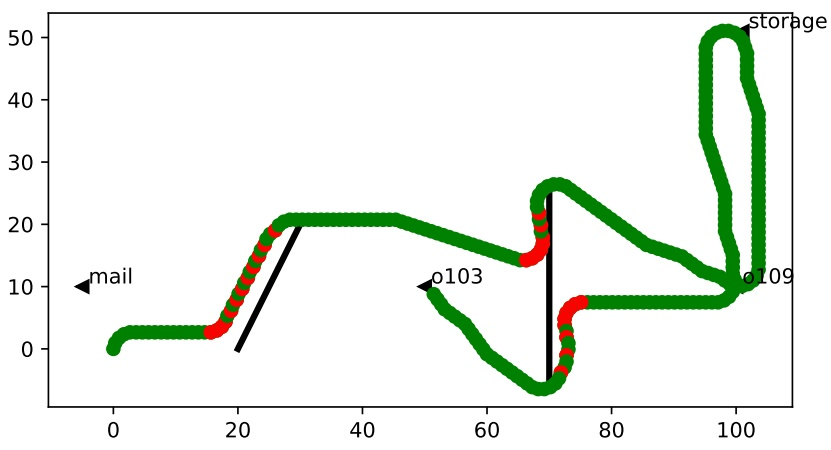

Figure 2.2: A trace of the trajectory of the agent. Red dots correspond to the whisker sensor being on; the green dot to the whisker sensor being off. The agent starts at position (0, 0) facing up.

```python
self.plot_loc(loc)

def plot_loc(self, loc):
    (x,y) = self.locations[loc]
    if loc in self.loc2text:
        for e in self.loc2text[loc]:
            e.remove() # e.set_visible(False)
    self.loc2text[loc] = (
        self.ax.text(x,y,"*",ha="center",va="center",size=20),
                self.ax.text(x+2.0,y+1,loc)) # label above and to
            the right
```

The following example shows a plot of the agent as it acts in the world. Figure 2.2 shows the result of the commented-out top.do

```python
from agentEnv import Rob_body, World

def rob_ex():
    global world, body, middle, top
    world = World(walls = {{{(20,0),(30,20)), ((70,-5),(70,25))},
        locations = {'mail':(-5,10),
            'o103':(50,10),
                'o109':(100,10),'storage':(101,51)})
    body = Rob_body(world)
    middle = Rob_middle_layer(body)
    top = Rob_top_layer(middle, world)

# try:
# top.do({'visit':['o109','storage','o109','o103']})
# You can directly control the middle layer:
```

<!-- page: 38 -->

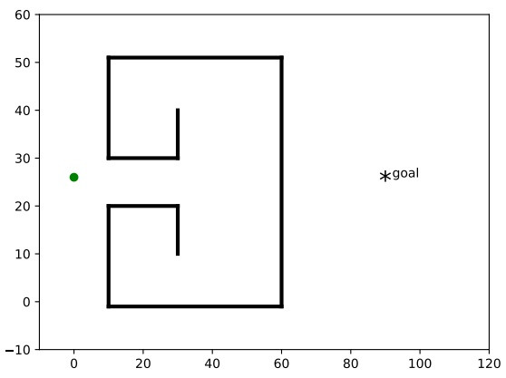

Figure 2.3: Robot trap

```python
# middle.do({'go_to':(30,-5), 'timeout':200})
# Can you make it go around in circles?
# Can you make it crash?

if __name__ == "__main__":
    rob_ex()
    print("Try: top.do({'visit':['o109','storage','o109','o103']})")
```

Exercise 2.2 When does the robot go in circles? How could this be recognized and/or avoided?

Exercise 2.3 When does the agent crash? What sensor would avoid that? (Think about the worse configuration of walls.) Design a whisker-like sensor that never crashes (assuming it starts far enough from a wall) and allows the robot to go as close as possible to a wall.

Exercise 2.4 The following implements a robot trap (Figure 2.3). It is called a trap because, once it has hit the wall, it needs to follow the wall, but local features are not enough for it to know when it can head to the goal. Write a controller that can escape the “trap” and get to the goal. Would a beter sensor work? See Exercise 2.4 in the textbook for hints.

```python
agentTop.py — (continued) ____
# Robot Trap for which the current controller cannot escape:
def robot_trap():
    global trap_world, trap_body, trap_middle, trap_top
    trap_world = World({((10, 51), (60, 51)), ((30, 10), (30, 20)),
                      ((10, -1), (10, 20)), ((10, 30), (10, 51)),
                      ((30, 30), (30, 40)), ((10, -1), (60, -1)),
                      ((10, 30), (30, 30)), ((10, 20), (30, 20)),
                      ((60, -1), (60, 51))},
    locations={'goal):(90,25)})
https://aipython.org Version 0.9.18 March 10, 2026
```

<!-- page: 39 -->

## 2.3. Hierarchical Controller

```python
trap_body = Rob_body(trap_world,init_pos=(0,25), init_dir=90)
    trap_middle = Rob_middle_layer(trap_body)
    trap_top = Rob_top_layer(trap_middle, trap_world)

# Robot trap exercise:
# robot_trap()
# trap_body.do({'steer':'straight'})
# trap_top.do({'visit':['goal']})
# What if the goal was further to the right?
```

## Plotting for Moving Targets

Exercise 2.5 of Poole and Mackworth [2023] refers to targets that can move. The following implements targets than can be moved using the mouse. To move a target using the mouse, press on the target, move it, and release at the desired location. This can be done while the animation is running.

```python
import matplotlib.pyplot as plt
from agentEnv import Rob_body, World
from agentMiddle import Rob_middle_layer
from agentTop import Rob_top_layer

class World_follow(World):
    def __init__(self, walls = {}, locations = {}, epsilon=5):
        """plot the agent in the environment.
        epsilon is the threshold how how close someone needs to click to select a location.
        """
        self.epsilon = epsilon
        World.__init__(self, walls, locations)
        self.canvas = self.ax.figure.canvas
        self.canvas.mpl_connect('button_press_event', self.on_press)
        self.canvas.mpl_connect('button_release_event', self.on_release)
        self.canvas.mpl_connect('motion_notify_event', self.on_move)
        self.pressloc = None
        for loc in self.locations:
            self.display(2,f" loc {loc} at {self.locations[loc]}")

    def on_press(self, event):
        print("press", event)
        self.display(2,'v',end="")
        self.display(2,f"Press at ({event.xdata},{event.ydata}")
        self.pressloc = None
        if event.xdata:
            for loc in self.locations:
                lx,ly = self.locations[loc]
                if abs(event.xdata- lx) <= self.epsilon and abs(event.ydata- ly) <= self.epsilon :
```

<!-- page: 40 -->

```python
self.display(2,f"moving {loc} from ({event.xdata},
            {event.ydata})" )
        self.pressloc = loc

    def on_release(self, event):
        self.display(2,''^',end="")
        if self.pressloc is not None and event.xdata:
            self.display(2,f"Placing {self.pressloc} at {(event.xdata,
                event.ydata)}")
            self.locations[self.pressloc] = (event.xdata, event.ydata)
            self.plot_loc(self.pressloc)
        self.pressloc = None

    def on_move(self, event):
        if self.pressloc is not None and event.inaxes:
            self.display(2,'-',end="")
            self.locations[self.pressloc] = (event.xdata, event.ydata)
            self.plot_loc(self.pressloc)
        else:
            self.display(2,'.',end="")

def rob_follow():
    global world, body, middle, top
    world = World_follow(walls = {{{(20,0),(30,20)), ((70,-5),(70,25))},
                    locations = {'mail':(-5,10), 'o103':(50,10),
                            'o109':(100,10),'storage':(101,51)})
    body = Rob_body(world)
    middle = Rob_middle_layer(body)
    top = Rob_top_layer(middle, world)

# top.do({'visit':['o109','storage','o109','o103']})

if __name__ == "__main__":
    rob_follow()
    print("Try: top.do({'visit':['o109','storage','o109','o103']}")
```

Exercise 2.5 Do Exercise 2.5 of Poole and Mackworth [2023].

Exercise 2.6 Change the code to also allow walls to move.

<!-- page: 41 -->

# Searching for Solutions

## 3.1 Representing Search Problems

A search problem consists of:

• a start node

• a neighbors function that given a node, returns an enumeration of the arcs from the node

• a specification of a goal in terms of a Boolean function that takes a node and returns true if the node is a goal

a (optional) heuristic function that, given a node, returns a non-negative real number. The heuristic function defaults to zero.

As far as the searcher is concerned a node can be anything. If multiple-path pruning is used, a node must be hashable. In the simple examples, it is a string, but in more complicated examples (in later chapters) it can be a tuple, a frozen set, or a Python object.

In the following code, “raise NotImplementedError()” is a way to specify that this is an abstract method that needs to be overridden to define an actual search problem.

```python
searchProblem.py — representations of search problems
from display import Displayable
import matplotlib.pyplot as plt
import random

class Search_problem(Displayable):
    """A search problem consists of:
```

<!-- page: 42 -->

```python
* a start node
* a neighbors function that gives the neighbors of a node
* a specification of a goal
* a (optional) heuristic function.
The methods must be overridden to define a search problem.""

def start_node(self):
    """returns start node"""
    raise NotImplementedError("start_node") # abstract method

def is_goal(self,node):
    """is True if node is a goal"""
    raise NotImplementedError("is_goal") # abstract method

def neighbors(self,node):
    """returns a list (or enumeration) of the arcs for the neighbors node"""
    raise NotImplementedError("neighbors") # abstract method

def heuristic(self,n):
    """Gives the heuristic value of node n.
    Returns 0 if not overridden."""
    return 0
```

The neighbors is a list or enumeration of arcs. A (directed) arc is the pair (from\_node,to\_node), but can also contain a non-negative cost (which defaults to 1) and can be labeled with an action. The action is not used for the search, but is useful for displaying and for plans (sequences of of actions).

```python
class Arc(object):
    """An arc consists of
      a from_node and a to_node node
      a (non-negative) cost
      an (optional) action
    """
    def __init__(self, from_node, to_node, cost=1, action=None):
      self.from_node = from_node
      self.to_node = to_node
      self.cost = cost
      assert cost >= 0, (f"Cost cannot be negative: {self}, cost={cost}")
      self.action = action

    def __repr__(self):
      """string representation of an arc"""
      if self.action:
        return f"{self.from_node} --{self.action}--> {self.to_node}"
      else:
        return f"{self.from_node} --> {self.to_node}"
```

<!-- page: 43 -->

## 3.1.1 Explicit Representation of Search Graph

The first representation of a search problem is from an explicit graph (as opposed to one that is generated as needed).

An **explicit graph** consists of

• a list or set of nodes

• a list or set of arcs

• a start node

• a list or set of goal nodes

(optionally) a hmap dictionary that maps a node to a heuristic value for that node. This could conceivably have been part of nodes, but the heuristic value depends on the goals.

• (optionally) a positions dictionary that maps nodes to their x-y position. This is for showing the graph visually.

To define a search problem, you need to define the start node, the goal predicate, the neighbors function and, for some algorithms, a heuristic function.

```python
class Search_problem_from_explicit_graph(Search_problem):
    """A search problem from an explicit graph.
    """

    def __init__(self, title, nodes, arcs, start=None, goals=set(), hmap={},
        positions=None):
        """ A search problem consists of:
        * list or set of nodes
        * list or set of arcs
        * start node
        * list or set of goal nodes
        * hmap: dictionary that maps each node into its heuristic value.
        * positions: dictionary that maps each node into its (x,y) position
        """
        self.title = title
        self.neighs = {}
        self.nodes = nodes
        for node in nodes:
            self.neighs[node]=[]
        self.arcs = arcs
        for arc in arcs:
            self.neighs[arc.from_node].append(arc)
        self.start = start
        self.goals = goals
        self.hmap = hmap
        if positions is None:
```

<!-- page: 44 -->

```python
selfish positions = {node: (random.random(), random.random()) for
            node in nodes}
    else:
        selfPositons = positions

def start_node(self):
    """returns start node"""
    return self.start

def is_goal(self,node):
    """is True if node is a goal"""
    return node in self.goals

def neighbors(self,node):
    """returns the neighbors of node (a list of arcs)"""
    return self.neighs[node]

def heuristic(self,node):
    """Gives the heuristic value of node n.
    Returns 0 if not overridden in the hmap."""
    if node in self.hmap:
        return self.hmap[node]
    else:
        return 0
```

## Graphical Display of a Search Graph

The show() method displays the graph, and is used for the figures in this document.

```python
def show(self, fontsize=10, node_color='orange', show_costs = True):
        """Show the graph as a figure
        """
        self.fontsize = fontsize
        self.show_costs = show_costs
        plt.ion()  # interactive
        fig, ax = plt.subplots()
        ax.set_axis_off()
        ax.set_title(self.title, fontsize=fontsize)
        self.show_graph(ax, node_color)

    def show_graph(self, ax, node_color='orange'):
```

<!-- page: 45 -->

## 3.1. Representing Search Problems

```python
bbox =
    dict(boxstyle="round4,pad=1.0,rounding_size=0.5",facecolor=node_color)
for arc in self.arcs:
    self.show_arc(ax, arc)
for node in self.nodes:
    self.show_node(ax, node, node_color = node_color)

def show_node(self, ax, node, node_color):
    x,y = self.positions[node]
    ax.text(x,y,node,bbox=dict(boxstyle="round4,pad=1.0,rounding_size=0.5",
                   facecolor=node_color),
        ha='center',va='center', fontsize=self.fontsize)

def show_arc(self, ax, arc, arc_color='black', node_color='white'):
    from_pos = self.positions[arc.from_node]
    to_pos = self.positions[arc.to_node]
    ax.annotate(arc.to_node, from_pos, xytext=to_pos,
        arrowprops={'arrowstyle':'<|-', 'linewidth': 2,
                    'color':arc_color},
        bbox=dict(boxstyle="round4,pad=1.0,rounding_size=0.5",
                   facecolor=node_color),
        ha='center',va='center',
        fontsize=self.fontsize)
    # Add costs to middle of arcs:
    if self.show_costs:
        ax.text((from_pos[0]+to_pos[0])/2, (from_pos[1]+to_pos[1])/2,
            arc.cost, bbox=dict(pad=1,fc='w',ec='w'),
            ha='center',va='center',fontsize=self.fontsize)
```

## 3.1.2 Paths

A searcher will return a path from the start node to a goal node. A Python list is not a suitable representation for a path, as many search algorithms consider multiple paths at once, and these paths should share initial parts of the path. If we wanted to do this with Python lists, we would need to keep copying the list, which can be expensive if the list is long. An alternative representation is used here in terms of a recursive data structure that can share subparts.

A path is either:

• a node (representing a path of length 0) or

an initial path, and an arc at the end, where the from\_node of the arc is the node at the end of the initial path.

These cases are distinguished in the following code by having arc=None if the path has length 0, in which case initial is the node of the path. Note that we only use the most basic form of Python’s yield for enumerations (Section 1.5.3).

<!-- page: 46 -->

```python
class Path(object):
    """A path is either a node or a path followed by an arc"""

    def __init__(self,initial,arc=None):
        """initial is either a node (in which case arc is None) or
        a path (in which case arc is an object of type Arc)"""
        self.initial = initial
        self.arc=arc
        if arc is None:
            self.cost=0
        else:
            self.cost = initial.cost+arc.cost

    def end(self):
        """returns the node at the end of the path"""
        if self.arc is None:
            return self.initial
        else:
            return self.arc.to_node

    def nodes(self):
        """enumerates the nodes of the path from the last element backwards
        """
        current = self
        while current.arc is not None:
            yield current.arc.to_node
            current = current.initial
        yield current.initial

    def initial_nodes(self):
        """enumerates the nodes for the path before the end node.
        This calls nodes() for the initial part of the path.
        """
        if self.arc is not None:
            yield from self.initial.nodes()

    def __repr__(self):
        """returns a string representation of a path"""
        if self.arc is None:
            return str(self.initial)
        elif self.arc.action:
            return f"{self.initial}\n --{self.arc.action}-->
                {self.arc.to_node}"
        else:
            return f"{self.initial} --> {self.arc.to_node}"
```

<!-- page: 47 -->

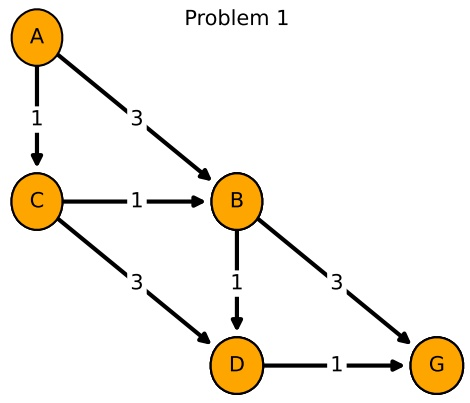

Figure 3.1: problem1

## 3.1.3 Example Search Problems

The first search problem is one with 5 nodes where the least-cost path is one with many arcs. See Figure 3.1, generated using problem1.show(). Note that this example is used for the unit tests, so the test (in searchGeneric) will need to be changed if this is changed.

```python
from searchProblem import Arc, Search_problem_from_explicit_graph,
    Search_problem

problem1 = Search_problem_from_explicit_graph('Problem 1',
        {'A','B','C','D','G'},
        [Arc('A','B',3), Arc('A','C',1), Arc('B','D',1), Arc('B','G',3),
            Arc('C','B',1), Arc('C','D',3), Arc('D','G',1)],
        start = 'A',
        goals = {'G'},
        positions={'A': (0, 1), 'B': (0.5, 0.5), 'C': (0,0.5),
                'D': (0.5,0), 'G': (1,0)})
```

The second search problem is one with 8 nodes where many paths do not lead to the goal. See Figure 3.2.

```python
problem2 = Search_problem_from_explicit_graph('Problem 2',
    {'A','B','C','D','E','G','H','J'},
    [Arc('A','B',1), Arc('B','C',3), Arc('B','D',1), Arc('D','E',3),
        Arc('D','G',1), Arc('A','H',3), Arc('H','J',1)],
    start = 'A',
    goals = {'G'},
    positions={'A':(0, 1), 'B':(0, 3/4), 'C':(0,0), 'D':(1/4,3/4),
            'E':(1/4,0), 'G':(2/4,3/4), 'H':(3/4,1), 'J':(3/4,3/4)})
```

<!-- page: 48 -->

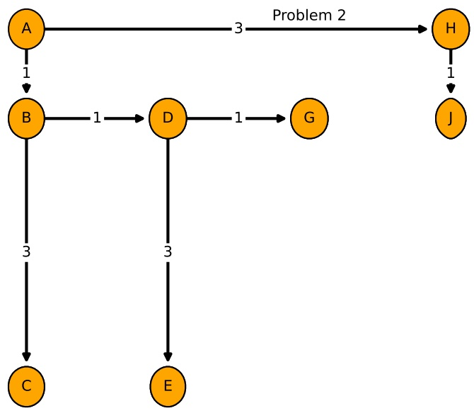

Figure 3.2: problem2

The third search problem is a disconnected graph (contains no arcs), where the start node is a goal node. This is a boundary case to make sure that weird cases work.

```python
problem3 = Search_problem_from_explicit_graph('Problem 3',
        {'a','b','c','d','e','g','h','j'},
        [],
        start = 'g',
        goals = {'k','g'})
```

The simp\_delivery\_graph is shown Figure 3.3. This is the same as Figure 3.3 of Poole and Mackworth [2023].

```python
searchExample.py — (continued)
simp_delivery_graph = Search_problem_from_explicit_graph("Acyclic Delivery Graph",
    {'A', 'B', 'C', 'D', 'E', 'F', 'G', 'H', 'J'},
    [   Arc('A', 'B', 2),
        Arc('A', 'C', 3),
        Arc('A', 'D', 4),
        Arc('B', 'E', 2),
        Arc('B', 'F', 3),
        Arc('C', 'J', 7),
        Arc('D', 'H', 4),
        Arc('F', 'D', 2),
```

<!-- page: 49 -->

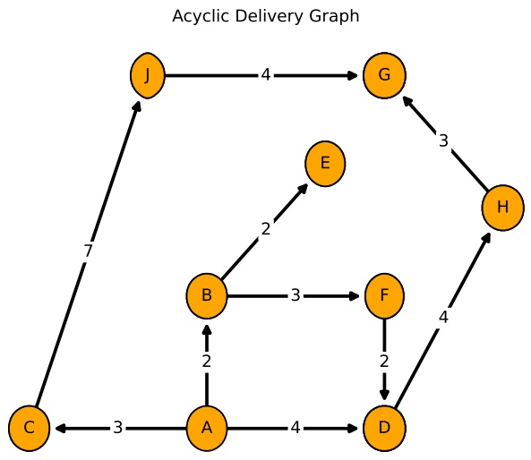

Figure 3.3: simp\_delivery\_graph.show()

```txt
Arc('H', 'G', 3),
            Arc('J', 'G', 4)],
start = 'A',
goals = {'G'},
hmap = {
    'A': 7,
    'B': 5,
    'C': 9,
    'D': 6,
    'E': 3,
    'F': 5,
    'G': 0,
    'H': 3,
    'J': 4,
},
positions = {
    'A': (0.4,0.1),
    'B': (0.4,0.4),
    'C': (0.1,0.1),
    'D': (0.7,0.1),
    'E': (0.6,0.7),
    'F': (0.7,0.4),
    'G': (0.7,0.9),
    'H': (0.9,0.6),
    'J': (0.3,0.9)
}
```

<!-- page: 50 -->

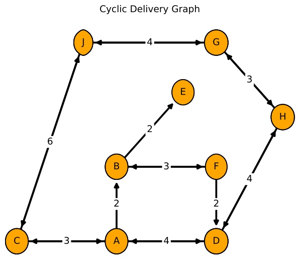

Figure 3.4: cyclic\_simp\_delivery\_graph.show()

73 )

cyclic\_simp\_delivery\_graph is the graph shown Figure 3.4. This is the graph of Figure 3.10 of [Poole and Mackworth, 2023]. The heuristic values are the same as in simp\_delivery\_graph.

```python
searchExample.py — (continued)
cyclic_simp_delivery_graph = Search_problem_from_explicit_graph("Cyclic
    Delivery Graph",
    {'A', 'B', 'C', 'D', 'E', 'F', 'G', 'H', 'J'},
    [   Arc('A', 'B', 2),
        Arc('A', 'C', 3),
        Arc('A', 'D', 4),
        Arc('B', 'E', 2),
        Arc('B', 'F', 3),
        Arc('C', 'A', 3),
        Arc('C', 'J', 6),
        Arc('D', 'A', 4),
        Arc('D', 'H', 4),
        Arc('F', 'B', 3),
        Arc('F', 'D', 2),
        Arc('G', 'H', 3),
        Arc('G', 'J', 4),
        Arc('H', 'D', 4),
        Arc('H', 'G', 3),
        Arc('J', 'C', 6),
        Arc('J', 'G', 4)],
```

<!-- page: 51 -->

## 3.1. Representing Search Problems

```python
start = 'A',
goals = {'G'},
hmap = {
    'A': 7,
    'B': 5,
    'C': 9,
    'D': 6,
    'E': 3,
    'F': 5,
    'G': 0,
    'H': 3,
    'J': 4,
},
positions = {
    'A': (0.4,0.1),
    'B': (0.4,0.4),
    'C': (0.1,0.1),
    'D': (0.7,0.1),
    'E': (0.6,0.7),
    'F': (0.7,0.4),
    'G': (0.7,0.9),
    'H': (0.9,0.6),
    'J': (0.3,0.9)
})
```

The next problem is the tree graph shown in Figure 3.5, and is Figure 3.15 in Poole and Mackworth [2023].

```python
searchExample.py — (continued)
tree_graph = Search_problem_from_explicit_graph("Tree Graph",
    {'A', 'B', 'C', 'D', 'E', 'F', 'G', 'H', 'I', 'J', 'K', 'L', 'M', 'N',
        'O',
        'P', 'Q', 'R', 'S', 'T', 'U', 'V', 'W', 'X', 'Y', 'Z', 'AA', 'BB',
        'CC',
        'DD', 'EE', 'FF', 'GG', 'HH', 'II', 'JJ', 'KK'},
    [ Arc('A', 'B', 1),
        Arc('A', 'C', 1),
        Arc('B', 'D', 1),
        Arc('B', 'E', 1),
        Arc('C', 'F', 1),
        Arc('C', 'G', 1),
        Arc('D', 'H', 1),
        Arc('D', 'I', 1),
        Arc('E', 'J', 1),
        Arc('E', 'K', 1),
        Arc('F', 'L', 1),
        Arc('G', 'M', 1),
        Arc('G', 'N', 1),
        Arc('H', 'O', 1),
        Arc('H', 'P', 1),
        Arc('J', 'Q', 1),
```

<!-- page: 52 -->

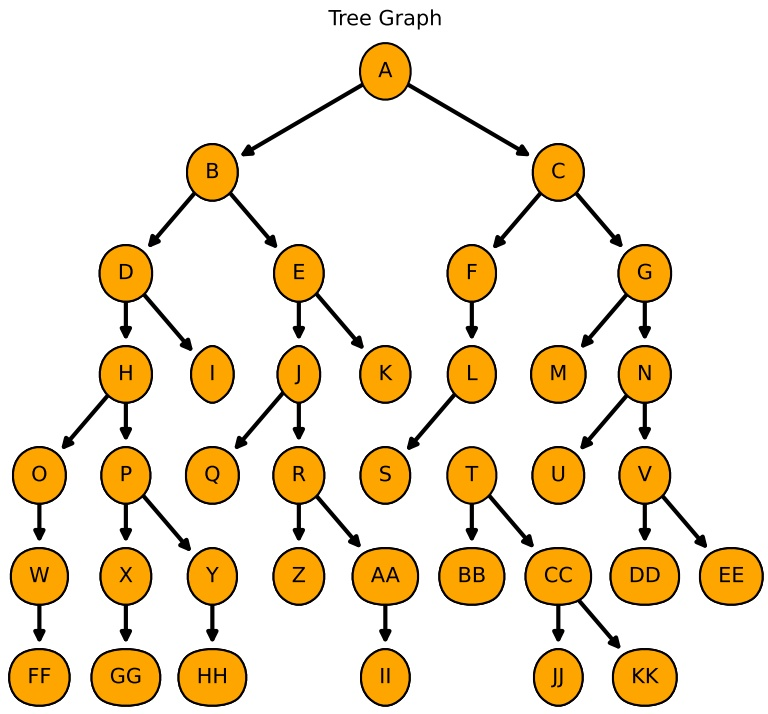

Figure 3.5: tree\_graph.show(show\_costs = False)

| 138 | Arc('J', 'R', 1), |
| --- | --- |
| 139 | Arc('L', 'S', 1), |
| 140 | Arc('L', 'T', 1), |
| 141 | Arc('N', 'U', 1), |
| 142 | Arc('N', 'V', 1), |
| 143 | Arc('O', 'W', 1), |
| 144 | Arc('P', 'X', 1), |
| 145 | Arc('P', 'Y', 1), |
| 146 | Arc('R', 'Z', 1), |
| 147 | Arc('R', 'AA', 1), |
| 148 | Arc('T', 'BB', 1), |
| 149 | Arc('T', 'CC', 1), |
| 150 | Arc('V', 'DD', 1), |
| 151 | Arc('V', 'EE', 1), |
| 152 | Arc('W', 'FF', 1), |
| 153 | Arc('X', 'GG', 1), |
| 154 | Arc('Y', 'HH', 1), |
| 155 | Arc('AA', 'II', 1), |

<!-- page: 53 -->

```python
Arc('CC', 'JJ', 1),
Arc('CC', 'KK', 1)
],
start = 'A',
goals = {'K', 'M', 'T', 'X', 'Z', 'HH'},
positions = {
'A': (0.5,0.95),
'B': (0.3,0.8),
'C': (0.7,0.8),
'D': (0.2,0.65),
'E': (0.4,0.65),
'F': (0.6,0.65),
'G': (0.8,0.65),
'H': (0.2,0.5),
'I': (0.3,0.5),
'J': (0.4,0.5),
'K': (0.5,0.5),
'L': (0.6,0.5),
'M': (0.7,0.5),
'N': (0.8,0.5),
'O': (0.1,0.35),
'P': (0.2,0.35),
'Q': (0.3,0.35),
'R': (0.4,0.35),
'S': (0.5,0.35),
'T': (0.6,0.35),
'U': (0.7,0.35),
'V': (0.8,0.35),
'W': (0.1,0.2),
'X': (0.2,0.2),
'Y': (0.3,0.2),
'Z': (0.4,0.2),
'AA': (0.5,0.2),
'BB': (0.6,0.2),
'CC': (0.7,0.2),
'DD': (0.8,0.2),
'EE': (0.9,0.2),
'FF': (0.1,0.05),
'GG': (0.2,0.05),
'HH': (0.3,0.05),
'II': (0.5,0.05),
'JJ': (0.7,0.05),
'KK': (0.8,0.05)
}
)

# tree_graph.show(show_costs = False)
```

<!-- page: 54 -->

## 3.2 Generic Searcher and Variants

```txt
To run the search demos, in folder "aipython", load "searchGeneric.py", using e.g., ipython -i searchGeneric.py, and copy and paste the example queries at the bottom of that file.
```

## 3.2.1 Searcher

A Searcher for a problem can be asked repeatedly for the next path. To solve a search problem, construct a Searcher object for the problem and then repeatedly ask for the next path using search. If there are no more paths, None is returned.

```python
from display import Displayable

class Searcher(Displayable):
    """returns a searcher for a problem.
    Paths can be found by repeatedly calling search().
    This does depth-first search unless overridden
    """
    def __init__(self, problem):
        """creates a searcher from a problem
        """
        self.problem = problem
        self.initialize_frontier()
        self.num_expanded = 0
        self.add_to_frontier(Path(problem.start_node()))
        super().__init__()

    def initialize_frontier(self):
        self.frontier = []

    def empty_frontier(self):
        return self.frontier == []

    def add_to_frontier(self,path):
        self.frontier.append(path)

    def search(self):
        """returns (next) path from the problem's start node
        to a goal node.
        Returns None if no path exists.
        """

        while not self.empty_frontier():
            self.path = self.frontier.pop()
            self.num_expanded += 1
            if self.problem.is_goal(self.path.end)): # solution found
                self.solution = self.path # store the solution found
```

<!-- page: 55 -->

```python
self.display(1, f"Solution: {self.path} (cost:
        {self.path.cost})\n",
        self.num_expanded, "paths have been expanded and",
            len(self.frontier), "paths remain in the
                frontier")
    return self.path
else:
    self.display(4,f"Expanding: {self.path} (cost:
        {self.path.cost})")
    neighs = self.problem.neighbors(self.path.end())
    self.display(2,f"Expanding: {self.path} with neighbors
        {neighs}")
    for arc in reversed(list(neighs)):
        self.add_to_frontier(Path(self.path,arc))
    self.display(3, f"New frontier: {[p.end() for p in
        self.frontier]}")

self.display(0,"No (more) solutions. Total of",
            self.num_expanded,"paths expanded.")
```

Note that this reverses the neighbors so that it implements depth-first search in an intuitive manner (expanding the first neighbor first). The call to list is for the case when the neighbors are generated (and not already in a list). Reversing the neighbors might not be required for other methods. The calls to reversed and list can be removed, and the algorithm still implements depth-first search.

To use depth-first search to find multiple paths for problem1 and simp\_delivery\_graph, copy and paste the following into Python’s read-evaluate-print loop; keep finding next solutions until there are no more:

```python
searchGeneric.py — (continued) ____

# Depth-first search for problem1:
# searcher1 = Searcher(searchExample.problem1)
# searcher1.search() # find first solution
# searcher1.search() # find next solution (repeat until no solutions)

# Depth-first search for simple delivery graph:
# searcher_sdg = Searcher(searchExample.simp_delivery_graph)
# searcher_sdg.search() # find first or next solution
```

Exercise 3.1 Implement breadth-first search. Only add\_to\_frontier and/or pop need to be modified to implement a first-in first-out queue.

## 3.2.2 GUI for Tracing Search

[This GUI implements most of the functionality of the solve model of the nowdiscontinued AISpace.org search app.]

Figure 3.6 shows the GUI that can be used to step through search algorithms. Here the path A → B is being expanded, and the neighbors are E and F. The other nodes at the end of paths of the frontier are C and D. Thus the

<!-- page: 56 -->

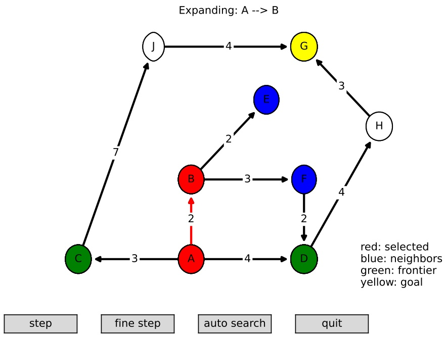

Figure 3.6: SearcherGUI(Searcher, simp\_delivery\_graph)

frontier contains paths to C and D, used to also contain A → B, and now will contain A → B → E and $A\rightarrow B\rightarrow F.$

SearcherGUI takes a search class and a problem, and lets one explore the search space after calling go(). A GUI can only be used for one search; at the end of the search the loop ends and the buttons no longer work.

This is implemented by redefining display. The search algorithms don’t need to be modified. If you modify them (or create your own), you just have to be careful to use the appropriate number for the display. The first argument to display has the following meanings:

## 1. a solution has been found

2. what is shown for a “step” on a GUI; here it is assumed to be the path, the neighbors of the end of the path, and the other nodes at the end of paths on the frontier

3. (shown with “fine step” but not with “step”) the frontier and the path selected

4. (shown with “fine step” but not with “step”) the frontier.

It is also useful to look at the Python console, as the display information is printed there.

<!-- page: 57 -->

```python
import matplotlib.pyplot as plt
from matplotlib.widgets import Button
import time

class SearcherGUI(object):
    def __init__(self, SearchClass, problem,
                      fontsize=10,
                      colors = {'selected':'red', 'neighbors':'blue',
                     'frontier':'green', 'goal':'yellow'},
                    show_costs = True):
        self.problem = problem
        self.searcher = SearchClass(problem)
        self.problem-centsize = fontsize
        self.colors = colors
        self.problem.show_costs = show_costs
        self.quitting = False

        fig, self.ax = plt.subplots()
        plt.ion() # interactive
        self.ax.set_axis_off()
        plt.subplots_adjust(bottom=0.15)
        step_butt = Button(fig.add_axes([0.1,0.02,0.2,0.05]), "step")
        step_butt_on_clicked(self.step)
        fine_butt = Button(fig.add_axes([0.4,0.02,0.2,0.05]), "fine step")
        fine_butt_on_clicked(self.finestep)
        auto_butt = Button(fig.add_axes([0.7,0.02,0.2,0.05]), "auto search")
        auto_butt_on_clicked(self.auto)
        fig.canvas.mpl_connect('close_event', self.window_closed)
        self.ax.text(0.85,0, '\n'.join(self.colors[a]+": "+a
                            for a in self.colors))
        self.problem.show_graph(self.ax, node_color='white')
        self.problem.show_node(self.ax, self.problem.start,
                             self.colors['frontier'])
        for node in self.problem.nodes:
            if self.problem.is_goal(node):
                self.problem.show_node(self.ax, node,self.colors['goal'])
        plt.show()
        self.click = 7 # bigger than any display!
        self.searcher.display = self.display
        try:
            while self.searcher.frontier:
                path = self.searcher.search()
        except ExitToPython:
            print("GUI closed")
        else:
            print("No more solutions")

    def display(self, level, *args, **nargs):
        if self.quitting:
```

<!-- page: 58 -->

```python
raise ExitToPython()
if level <= self.click: #step
    print(*args, **nargs)
    self.ax.set_title(f"Expanding: {self.searcher.path}",
                     fontsize=self.problemfontsize)
    if level == 1:
        self.show_frontier(self.colors['frontier'])
        self.show_path(self.colors['selected'])
        self.ax.set_title(f"Solution Found: {self.searcher.path}",
                     fontsize=self.problemfontsize)
    elif level == 2: # what should be shown if node in multiple?
        self.show_frontier(self.colors['frontier'])
        self.show_path(self.colors['selected'])
        self.show_neighbors(self.colors['neighbors'])
    elif level == 3:
        self.show_frontier(self.colors['frontier'])
        self.show_path(self.colors['selected'])
    elif level == 4:
        self.show_frontier(self.colors['frontier'])

    # wait for a button click
    self.click = 0
    plt.draw()
    while self.click == 0 and not self.quitting:
        plt.pause(0.1)
    if self.quitting:
        raise ExitToPython()
    # undo coloring:
    self.ax.set_title("")
    self.show_frontier('white')
    self.show_neighbors('white')
    path_show = self.searcher.path
    while path_show.arc:
        self.problem.show_arc(self.ax, path_show.arc, 'black')
        self.problem.show_node(self.ax, path_show.end(), 'white')
        path_show = path_show.initial
    self.problem.show_node(self.ax, path_show.end(), 'white')
    if self.problem.is_goal(self.searcher.path.end()):
        self.problem.show_node(self.ax, self.searcher.path.end(),
                             self.colors['goal'])
    plt.draw()

def show_frontier(self, color):
    for path in self.searcher.frontier:
        self.problem.show_node(self.ax, path.end(), color)

def show_path(self, color):
    """color selected path"""
    path_show = self.searcher.path
```

<!-- page: 59 -->

## 3.2. Generic Searcher and Variants

```python
while path_show.arc:
        self.problem.show_arc(self.ax, path_show.arc, color)
        self.problem.show_node(self.ax, path_show.end(), color)
        path_show = path_show.initial
    self.problem.show_node(self.ax, path_show.end(), color)

def show_neighbors(self, color):
    for neigh in self.problem.neighbors(self.searcher.path.end()):
        self.problem.show_node(self.ax, neigh.to_node, color)

def auto(self, event):
    self.click = 1
def step(self,event):
    self.click = 2
def finestep(self, event):
    self.click = 3
def window_closed(self, event):
    self.quitting = True

class ExitToPython(Exception):
    pass
```

```python
from searchGeneric import Searcher, AStarSearcher
from searchMPP import SearcherMPP
import searchExample
from searchBranchAndBound import DF_branch_and_bound

# to demonstrate depth-first search:
# sdfs = SearcherGUI(Searcher, searchExample.tree_graph)

# delivery graph examples:
# sh = SearcherGUI(Searcher, searchExample.simp_delivery_graph)
# sha = SearcherGUI(AStarSearcher, searchExample.simp_delivery_graph)
# shac = SearcherGUI(AStarSearcher,
    searchExample.cyclic_simp_delivery_graph)
# shm = SearcherGUI(SearcherMPP, searchExample.cyclic_simp_delivery_graph)
# shb = SearcherGUI(DF_branch_and_bound, searchExample.simp_delivery_graph)

# The following is AI:FCA figure 3.15, and is useful to show branch&bound:
# shbt = SearcherGUI(DF_branch_and_bound, searchExample.tree_graph)

if __name__ == "__main__":
    print("Try e.g.: SearcherGUI(Searcher,
        searchExample.simp_delivery_graph)")
```

<!-- page: 60 -->

## 3.2.3 Frontier as a Priority Queue

In many of the search algorithms, such as A∗ and other best-first searchers, the frontier is implemented as a priority queue. The following code uses the Python’s built-in priority queue implementations, heapq.

Following the lead of the Python documentation, [https://docs.python.org/3/library/heapq.html](https://docs.python.org/3/library/heapq.html), a frontier is a list of triples. The first element of each triple is the value to be minimized. The second element is a unique index which specifies the order that the elements were added to the queue, and the third element is the path that is on the queue. The use of the unique index ensures that the priority queue implementation does not compare paths; whether one path is less than another is not defined. It also lets us control what sort of search (e.g., depth-first or breadth-first) occurs when the value to be minimized does not give a unique next path.

The variable frontier\_index is the total number of elements of the frontier that have been created. As well as being used as the unique index, it is useful for statistics, particularly in conjunction with the current size of the frontier.

```python
import heapq      # part of the Python standard library
from searchProblem import Path

class FrontierPQ(object):
    """A frontier consists of a priority queue (heap), frontierpq, of
       (value, index, path) triples, where
    * value is the value we want to minimize (e.g., path cost + h).
    * index is a unique index for each element
    * path is the path on the queue
    Note that the priority queue always returns the smallest element.
    """

    def __init__(self):
        """constructs the frontier, initially an empty priority queue
        """
        self.frontier_index = 0 # the number of items added to the frontier
        self.frontierpq = [] # the frontier priority queue

    def empty(self):
        """is True if the priority queue is empty"""
        return self.frontierpq == []

    def add(self, path, value):
        """add a path to the priority queue
        value is the value to be minimized"""
        self.frontier_index += 1 # get a new unique index
        heapq.heappush(self.frontierpq,(value, -self.frontier_index, path))

    def pop(self):
        """returns and removes the path of the frontier with minimum value.
```

<!-- page: 61 -->

## 3.2. Generic Searcher and Variants

```python
"""
    (_,_,path) = heapq.heappop(self.frontierpq)
    return path
```

The following methods are used for finding and printing information about the frontier.

```python
def count(self,val):
    """returns the number of elements of the frontier with value=val"""
    return sum(1 for e in self.frontierpq if e[0]==val)

def __repr__(self):
    """string representation of the frontier"""
    return str([(n,c,str(p)) for (n,c,p) in self.frontierpq])

def __len__(self):
    """length of the frontier"""
    return len(self.frontierpq)

def __iter__(self):
    """iterate through the paths in the frontier"""
    for (_,_,path) in self.frontierpq:
        yield path
```

## 3.2.4 A∗ Search

For an A∗ **Search** the frontier is implemented using the FrontierPQ class.

```python
class AStarSearcher(Searcher):
    """returns a searcher for a problem.
    Paths can be found by repeatedly calling search().
    """

    def __init__(self, problem):
        super().__init__(problem)

    def initialize_frontier(self):
        self.frontier = FrontierPQ()

    def empty_frontier(self):
        return self.frontier.empty()

    def add_to_frontier(self,path):
        """add path to the frontier with the appropriate cost"""
        value = path.cost+self.problem.heuristic(path.end())
        self.frontier.add(path, value)
```

Code should always be tested. The following provides a simple **unit test**, using problem1 as the default problem.

<!-- page: 62 -->

```python
import searchExample

def test(SearchClass, problem=searchExample.problem1,
    solutions=[['G','D','B','C','A']] ):
    """Unit test for aipython searching algorithms.
    SearchClass is a class that takes a problem and implements search()
    problem is a search problem
    solutions is a list of optimal solutions
    """
    print("Testing problem 1:")
    schr1 = SearchClass(problem)
    path1 = schr1.search()
    print("Path found:",path1)
    assert path1 is not None, "No path is found in problem1"
    assert list(path1.nodes()) in solutions, "Shortest path not found in problem1"
    print("Passed unit test")

if __name__ == "__main__":
    #test(Searcher)   # what needs to be changed to make this succeed?
    test(AStarSearcher)

# example queries:
# searcher1 = Searcher(searchExample.simp_delivery_graph) # DFS
# searcher1.search() # find first path
# searcher1.search() # find next path
# searcher2 = AStarSearcher(searchExample.simp_delivery_graph) # A*
# searcher2.search() # find first path
# searcher2.search() # find next path
# searcher3 = Searcher(searchExample.cyclic_simp_delivery_graph) # DFS
# searcher3.search() # find first path with DFS. What do you expect to happen?
# searcher4 = AStarSearcher(searchExample.cyclic_simp_delivery_graph) # A*
# searcher4.search() # find first path

# To use the GUI for A* search do the following
# python -i searchGUI.py
# SearcherGUI(AStarSearcher, searchExample.simp_delivery_graph)
# SearcherGUI(AStarSearcher, searchExample.cyclic_simp_delivery_graph)
```

Exercise 3.2 Change the code so that it implements (i) best-first search and (ii) lowest-cost-first search. For each of these methods compare it to A∗in terms of the number of paths expanded, and the path found.

Exercise 3.3 The searcher acts like a Python iterator, in that it returns one value (here a path) and then returns other values (paths) on demand, but does not implement the iterator interface. Change the code so it implements the iterator interface. What does this enable us to do?

<!-- page: 63 -->

## 3.2.5 Multiple Path Pruning

```txt
To run the multiple-path pruning demo, in folder “aipython”, load “searchMPP.py”, using e.g., ipython -i searchMPP.py, and copy and paste the example queries at the bottom of that file.
```

The following implements A∗ with multiple-path pruning. It overrides search() in Searcher.

```python
from searchGeneric import AStarSearcher
from searchProblem import Path

class SearcherMPP(AStarSearcher):
    """returns a searcher for a problem.
    Paths can be found by repeatedly calling search().
    """
    def __init__(self, problem):
        super().__init__(problem)
        self.explored = set()

    def search(self):
        """returns next path from an element of problem's start nodes
        to a goal node.
        Returns None if no path exists.
        """
        while not self.empty_frontier():
            self.path = self.frontier.pop()
            if self.path.end() not in self.explored:
                self.explored.add(self.path.end())
                self.num_expanded += 1
                if self.problem.is_goal(self.path.end()):
                    self.solution = self.path # store the solution found
                    self.display(1, f"Solution: {self.path} (cost:
                        {self.path.cost})\n",
                    self.num_expanded, "paths have been expanded and",
                        len(self.frontier), "paths remain in the
                            frontier")
                return self.path
            else:
                self.display(4,f"Expanding: {self.path} (cost:
                    {self.path.cost}")
                neighs = self.problem.neighbors(self.path.end())
                self.display(2,f"Expanding: {self.path} with neighbors
                    {neighs}")
                for arc in neighs:
                    self.add_to_frontier(Path(self.path,arc))
                self.display(3, f"New frontier: {[p.end() for p in
                    self.frontier]}")
            self.display(0,"No (more) solutions. Total of",
```

<!-- page: 64 -->

```python
self.num_expanded,"paths expanded."]
from searchGeneric import test
if __name__ == "__main__":
    test(SearcherMPP)

import searchExample
# searcherMPPcdp = SearcherMPP(searchExample.cyclic_simp_delivery_graph)
# searcherMPPcdp.search() # find first path

# To use the GUI for SearcherMPP do
# python -i searchGUI.py
# import searchMPP
# SearcherGUI(searchMPP.SearcherMPP,
    searchExample.cyclic_simp_delivery_graph)
```

Exercise 3.4 Chris was very puzzled as to why there was a minus (“−”) in the second element of the tuple added to the heap in the add method in FrontierPQ in searchGeneric.py.

Sam suggested the following example would demonstrate the importance of the minus. Consider an infinite integer grid, where the states are pairs of integers, the start is (0,0), and the goal is (10,10). The neighbors of (i, j) are (i + 1, j) and (i, j + 1). Consider the heuristic function $h((i,j)) = |10 - i| + |10 - j|$ . Sam suggested you compare how many paths are expanded with the minus and without the minus. searchGrid is a representation of Sam’s graph. If something takes too long, you might consider changing the size.

```python
from searchProblem import Search_problem, Arc

class GridProblem(Search_problem):
    """a node is a pair (x,y)"""
    def __init__(self, size=10):
        self.size = size

    def start_node(self):
        """returns the start node"""
        return (0,0)

    def is_goal(self,node):
        """returns True when node is a goal node"""
        return node == (self.size,self.size)

    def neighbors(self,node):
        """returns a list of the neighbors of node"""
        (x,y) = node
        return [Arc(node,(x+1,y)), Arc(node,(x,y+1))]
    def heuristic(self,node):
        (x,y) = node
```

<!-- page: 65 -->

```python
return abs(x-self.size)+abs(y-self.size)

class GridProblemNH(GridProblem):
    """Grid problem with a heuristic of 0"""
    def heuristic(self,node):
        return 0

from searchGeneric import Searcher, AStarSearcher
from searchMPP import SearcherMPP
from searchBranchAndBound import DF_branch_and_bound

def testGrid(size = 10):
    print("\nWith MPP")
    gridsearchermpp = SearcherMPP(GridProblem(size))
    print(gridsearchermpp.search())
    print("\nWithout MPP")
    gridsearchera = AStarSearcher(GridProblem(size))
    print(gridsearchera.search())
    print("\nWith MPP and a heuristic = 0 (Dijkstra's algorithm)")
    gridsearchermppnh = SearcherMPP(GridProblemNH(size))
    print(gridsearchermppnh.search())
```

Explain to Chris what the minus does and why it is there. Give evidence for your claims. It might be useful to refer to other search strategies in your explanation. As part of your explanation, explain what is special about Sam’s example.

Exercise 3.5 Implement a searcher that implements cycle pruning instead of multiple-path pruning. You need to decide whether to check for cycles when paths are added to the frontier or when they are removed. (Hint: either method can be implemented by only changing one or two lines in SearcherMPP. Hint: there is a cycle if path.end() in path.initial\_nodes() ) Compare no pruning, multiple path pruning and cycle pruning for the cyclic delivery problem. Which works better in terms of number of paths expanded, computational time or space?

## 3.3 Branch-and-bound Search

```txt
To run the demo, in folder "aipython", load "searchBranchAndBound.py", and copy and paste the example queries at the bottom of that file.
```

Depth-first search methods do not need a priority queue, but can use a list as a stack. In this implementation of branch-and-bound search, we call search to find an optimal solution with cost less than bound. This uses depth-first search to find a path to a goal that extends path with cost less than the bound. Once a path to a goal has been found, that path is remembered as the best\_path, the bound is reduced, and the search continues.

<!-- page: 66 -->

```python
from searchGeneric import Searcher
from display import Displayable

class DF_branch_and_bound(Searcher):
    """returns a branch and bound searcher for a problem.
    An optimal path with cost less than bound can be found by calling search()
    """
    def __init__(self, problem, bound=float("inf"));
        """creates a searcher than can be used with search() to find an optimal path.
        bound gives the initial bound. By default this is infinite - meaning there
        is no initial pruning due to depth bound
        """
        super().__init__(problem)
        self.best_path = None
        self.bound = bound

    def search(self):
        """returns an optimal solution to a problem with cost less than bound.
        returns None if there is no solution with cost less than bound."""
        self.frontier = [Path(self.problem.start_node()]
        self.num_expanded = 0
        while self.frontier:
            self.path = self.frontier.pop()
            if self.path.cost+self.problem.heuristic(self.path.end()) < self.bound:
                # if self.path.end() not in self.path.initial_nodes(): # for cycle pruning
                self.display(2,"Expanding:",self.path,"cost:",self.path.cost)
                self.num_expanded += 1
                if self.problem.is_goal(self.path.end()):
                    self.best_path = self.path
                    self.bound = self.path.cost
                    self.display(1,"New best path:",self.path,"
                        cost:",self.path.cost)
                else:
                    neighs = self.problem.neighbors(self.path.end())
                    self.display(4,"Neighbors are",neighs)
                    for arc in reversed(list(neighs)):
                        self.add_to_frontier(Path(self.path, arc))
                    self.display(3, f"New frontier: {[p.end() for p in self.frontier]}")
                self.path = self.best_path
                self.solution = self.best_path
                self.display(1,f"Optimal solution is {self.best_path." if self.best_path
                    else "No solution found.",
```

<!-- page: 67 -->

```python
f"Number of paths expanded: {self.num_expanded}.")
    return self.best_path
```

Note that this code used reversed in order to expand the neighbors of a node in the left-to-right order one might expect. It does this because pop() removes the rightmost element of the list. The call to list is there because reversed only works on lists and tuples, but the neighbors can be generated.

Here is a unit test and some queries:

```python
from searchGeneric import test
if __name__ == "__main__":
    test(DF_branch_and_bound)

# Example queries:
import searchExample
# searcherb1 = DF_branch_and_bound(searchExample.simp_delivery_graph)
# searcherb1.search()      # find optimal path
# searcherb2 =
    DF_branch_and_bound(searchExample.cyclic_simp_delivery_graph,
        bound=100)
# searcherb2.search()      # find optimal path

# to use the GUI do:
# ipython -i searchGUI.py
# import searchBranchAndBound
# SearcherGUI(searchBranchAndBound.DF_branch_and_bound,
    searchExample.simp_delivery_graph)
# SearcherGUI(searchBranchAndBound.DF_branch_and_bound,
    searchExample.cyclic_simp_delivery_graph)
```

Exercise 3.6 In searcherb2, in the code above, what happens if the bound is smaller, say 10? What if it is larger, say 1000?

Exercise 3.7 Implement a branch-and-bound search using recursion. Hint: you don’t need an explicit frontier, but can do a recursive call for the children.

Exercise 3.8 Add loop detection to branch-and-bound search.

Exercise 3.9 After the branch-and-bound search found a solution, Sam ran search again, and noticed a different count. Sam hypothesized that this count was related to the number of nodes that an A∗ search would use (either expand or be added to the frontier). Or maybe, Sam thought, the count for a number of nodes when the bound is slightly above the optimal path case is related to how A∗ would work. Is there a relationship between these counts? Are there different things that it could count so they are related? Try to find the most specific statement that is true, and explain why it is true.

To test the hypothesis, Sam wrote the following code, but isn’t sure it is helpful:

<!-- page: 68 -->

```python
from searchBranchAndBound import DF_branch_and_bound
from searchMPP import SearcherMPP

DF_branch_and_bound.max_display_level = 1
Searcher.max_display_level = 1

def run(problem,name):
    print("\n\n********",name)

    print("\nA*:")
    asearcher = AStarSearcher(problem)
    print("Path found:",asearcher.search()," cost=",asearcher.solution.cost)
    print("there are",asearcher.frontier.count(asearcher.solution.cost),
        "elements remaining on the queue with
            f-value=",asearcher.solution.cost)

    print("\nA* with MPP:"),
    msearcher = SearcherMPP(problem)
    print("Path found:",msearcher.search()," cost=",msearcher.solution.cost)
    print("there are",msearcher.frontier.count(msearcher.solution.cost),
        "elements remaining on the queue with
            f-value=",msearcher.solution.cost)

    bound = asearcher.solution.cost*1.00001
    print("\nBranch and bound (with too-good initial bound of", bound,")")
    tbb = DF_branch_and_bound(problem,bound) # cheating!!!!!
    print("Path found:",tbb.search()," cost=",tbb.solution.cost)
    print("Rerunning B&B")
    print("Path found:",tbb.search())

    bbound = asearcher.solution.cost*10+10
    print("\nBranch and bound (with not-very-good initial bound of",
        bbound, ")")
    tbb2 = DF_branch_and_bound(problem,bbound)
    print("Path found:",tbb2.search()," cost=",tbb2.solution.cost)
    print("Rerunning B&B")
    print("Path found:",tbb2.search())

    print("\nDepth-first search: (Use ^C if it goes on forever)")
    tsearcher = Searcher(problem)
    print("Path found:",tsearcher.search()," cost=",tsearcher.solution.cost)

import searchExample
from searchTest import run
if __name__ == "__main__":
    run(searchExample.problem1,"Problem 1")
# run(searchExample.simp_delivery_graph,"Acyclic Delivery")
# run(searchExample.cyclic_simp_delivery_graph,"Cyclic Delivery")
# also test graphs with cycles, and graphs with multiple least-cost paths
```

<!-- page: 69 -->

# Reasoning with Constraints

## 4.1 Constraint Satisfaction Problems

## 4.1.1 Variables

A **variable** consists of a name, a domain and an optional (x,y) position (for displaying). The domain of a variable is a list or a tuple, as the ordering matters for some algorithms.

```python
import random

class Variable(object):
    """A random variable.
    name (string) - name of the variable
    domain (list) - a list of the values for the variable.
    an (x,y) position for displaying
    """

    def __init__(self, name, domain, position=None):
        """Variable
        name a string
        domain a list of printable values
        position of form (x,y) where 0 <= x <= 1, 0 <= y <= 1
        """
        self.name = name # string
        self.domain = domain # list of values
        self.position = position if position else (random.random(),
            random.random())
        self.size = len(domain)

    def __str__(self):
```

<!-- page: 70 -->

```python
return self.name

    def __repr__(self):
        return self.name # f"Variable({self.name})"
```

## 4.1.2 Constraints

A **constraint** consists of:

• A tuple (or list) of variables called the **scope**.

• A **condition**, a Boolean function that takes the same number of arguments as there are variables in the scope.

• An name (for displaying)

• An optional (x, y) position. The mean of the positions of the variables in the scope is used, if not specified.

```python
from variable import Variable

# for showing csps:
import matplotlib.pyplot as plt
import matplotlib.lines as lines

class Constraint(object):
    """A Constraint consists of
    * scope: a tuple or list of variables
    * condition: a Boolean function that can applied to a tuple of values
        for variables in scope
    * string: a string for printing the constraint
    """

    def __init__(self, scope, condition, string=None, position=None):
        self.scope = scope
        self.condition = condition
        self.string = string
        self.position = position

    def __repr__(self):
        return self.string

An assignment is a variable:value dictionary.
If con is a constraint:
```

con.can\_evaluate(assignment) is True when the constraint can be evaluated in the assignment. Generally this is true when all variables in the scope of the constraint are assigned in the assignment. [There are cases where it could be true when not all variables are assigned, such as if the constraint was “if x then y else z”, but that it not implemented here.]

<!-- page: 71 -->

con.holds(assignment) returns True or False depending on whether the condition is true or false for that assignment. The assignment assignment must assign a value to every variable in the scope of the constraint con (and could also assign values to other variables); con.holds gives an error if not all variables in the scope of con are assigned in the assignment. It ignores variables in assignment that are not in the scope of the constraint.

In Python, the ∗ notation is used for unpacking a tuple. For example, F(∗(1, 2, 3)) is the same as F(1, 2, 3). So if t has value (1, 2, 3), then F(∗t) is the same as F(1, 2, 3).

```python
def can_evaluate(self, assignment):
    """
    assignment is a variable:value dictionary
    returns True if the constraint can be evaluated given assignment
    """
    return all(v in assignment for v in self.scope)

def holds(self,assignment):
    """returns the value of Constraint con evaluated in assignment.

    precondition: all variables are assigned in assignment, ie
        self.can_evaluate(assignment) is true
    """
    return self.condition(*tuple(assignment[v] for v in self.scope))
```

## 4.1.3 CSPs

A constraint satisfaction problem (CSP) requires:

• title: a string title

• variables: a list or set of variables

• constraints: a set or list of constraints.

Other properties are inferred from these:

• var\_to\_const is a mapping from variables to set of constraints, such that var\_to\_const[var] is the set of constraints with var in their scope.

```python
class CSP(object):
    """A CSP consists of
    * a title (a string)
    * variables, a list or set of variables
    * constraints, a list of constraints
    * var_to_const, a variable to set of constraints dictionary
```

<!-- page: 72 -->

```python
"""
def __init__(self, title, variables, constraints):
    """title is a string
    variables is set of variables
    constraints is a list of constraints
    """
    self.title = title
    self.variables = variables
    self.constraints = constraints
    self.var_to_const = {var:set() for var in self.variables}
    for con in constraints:
        for var in con.scope:
            self.var_to_const[var].add(con)

def __str__(self):
    """string representation of CSP"""
    return self.title

def __repr__(self):
    """more detailed string representation of CSP"""
    return f"CSP({self.title}, {self.variables}, {([str(c) for c in self.constraints])})"
```

csp.consistent(assignment) returns true if the assignment is consistent with each of the constraints in csp (i.e., all of the constraints that can be evaluated evaluate to true). Unless the assignment assigns to all variables, consistent does not imply the CSP is consistent or has a solution, because constraints involving variables not in the assignment are ignored.

```python
def consistent(self,assignment):
    """assignment is a variable:value dictionary
    returns True if all of the constraints that can be evaluated
        evaluate to True given assignment.
    """
    return all(con.holds(assignment)
        for con in self.constraints
        if con.can_evaluate(assignment))
```

The **show** method uses matplotlib to show the graphical structure of a constraint network. This also includes code used for the consistency GUI (Section 4.4.2).

```python
def show(self, linewidth=3, showDomains=False, showAutoAC = False):
    self.linewidth = linewidth
    self.picked = None
    plt.ion()  # interactive
    self.arcs = {} # arc: (con,var) dictionary
    self.thelines = {} # (con,var):arc dictionary
    self.nodes = {} # node: variable dictionary
```

[https://aipython.org](https://aipython.org)

<!-- page: 73 -->

```python
self.fig, self.ax= plt.subplots(1, 1)
self.ax.set_axis_off()
for var in self.variables:
    if var.position is None:
        var.position = (random.random(), random.random())
self.showAutoAC = showAutoAC # used for consistency GUI
self.autoAC = False
domains = {var:var.domain for var in self.variables} if showDomains
    else {}
self.draw_graph(domains=domains)

def draw_graph(self, domains={}, to_do = {}, title=None, fontsize=10):
    self.ax.clear()
    self.ax.set_axis_off()
    if title:
        self.ax.set_title(title, fontsize=fontsize)
    else:
        self.ax.set_title(self.title, fontsize=fontsize)
    var_bbox = dict(boxstyle="round4,pad=1.0,rounding_size=0.5",
            facecolor="yellow")
    con_bbox = dict(boxstyle="square,pad=1.0",facecolor="lightyellow")
    self.autoACtext = self.ax.text(0,0,"Auto AC" if self.showAutoAC
        else "",
            bbox={'boxstyle':'square,pad=1.0',
            'facecolor':'pink'},
            picker=True, fontsize=fontsize)
    for con in self.constraints:
        if con.position is None:
            con.position = tuple(sum(var.position[i] for var in
                con.scope)/len(con.scope)
                    for i in range(2))
        cx,cy = con.position
        bbox = con_bbox
        for var in con.scope:
            vx,vy = var.position
            if (var,con) in to_do:
                color = 'blue'
            else:
                color = 'green'
            line = lines.Line2D([cx,vx], [cy,vy], axes=self.ax,
                color=color,
                    picker=True, pickradius=10,
                        linewidth=self.linewidth)
            self.arcs[line]=(var,con)
            self.thelines[(var,con)] = line
            self.ax.add_line(line)
        self.ax.text(cx,cy,con.string,
                bbox=con_bbox,
                    ha='center',va='center', fontsize=fontsize)
    for var in self.variables:
```

<!-- page: 74 -->

```python
x,y = var.position
if domains:
    node_label = f"{var.name}\n{domains[var]}"
else:
    node_label = var.name
node = self.ax.text(x, y, node_label, bbox=var_bbox,
        ha='center', va='center',
            picker=True, fontsize=fontsize)
self.nodes[node] = var
self.fig.canvas.mpl_connect('pick_event', self.pick_handler)
```

The following method is used for the GUI (Section 4.4.2).

```python
def pick_handler(self,event):
    mouseevent = event.mouseevent
    self.last_artist = artist = event.artist
    #print('***picker handler:',artist, 'mouseevent:', mouseevent)
    if artist in self.arcs:
        #print('### selected arc',self.arcs[artist])
        self.picked = self.arcs[artist]
    elif artist in self.nodes:
        #print('### selected node',self.nodes[artist])
        self.picked = self.nodes[artist]
    elif artist==self.autoACtext:
        self.autoAC = True
        #print("*** autoAC")
    else:
        print("### unknown click")
```

## 4.1.4 Examples

In the following code ne\_, when given a number, returns a function that is true when its argument is not that number. For example, if f=ne\_(3), then f(2) is True and f(3) is False. That is, ne\_(x)(y) is true when x ̸= y. Allowing a function of multiple arguments to use its arguments one at a time is called **currying**, after the logician Haskell Curry. Some alternative implementations are commented out; the uncommented one allows the partial functions to have names.

```python
from cspProblem import Variable, CSP, Constraint
from operator import lt,ne,eq,gt

def ne_(val):
    """not equal value"""
    # return lambda x: x != val # alternative definition
    # return partial(ne,val)  # another alternative definition
    def nev(x):
```

<!-- page: 75 -->

```python
return val != x
    nev.__name__ = f"{val} != "  # name of the function
    return nev

Similarly is_(x)(y) is true when x = y.
```

```python
def is_(val):
    """is a value"""
    # return lambda x: x == val # alternative definition
    # return partial(eq,val)  # another alternative definition
    def isv(x):
        return val == x
    isv.__name__ = f"{val} == "
    return isv

csp0 has variables X, Y and Z, each with domain {1,2,3}. The constraints are X < Y and Y < Z.
```

```python
cspExamples.py — (continued) ________________
X = Variable('X', {1,2,3}, position=(0.1,0.8))
Y = Variable('Y', {1,2,3}, position=(0.5,0.2))
Z = Variable('Z', {1,2,3}, position=(0.9,0.8))
csp0 = CSP("csp0", {X,Y,Z},
        [ Constraint([X,Y], lt, "X<Y"),
        Constraint([Y,Z], lt, "Y<Z")])
```

csp1 has variables A, B and C, each with domain {1, 2, 3, 4}. The constraints are A < B, B ̸= 2, and B < C. This is slightly more interesting than csp0 as it has more solutions. This example is used in the unit tests, and so if it is changed, the unit tests need to be changed. csp1 s is the same, but with only the constraints A < B and B < C

```python
cspExamples.py — (continued)

A = Variable('A', {1,2,3,4}, position=(0.2,0.9))
B = Variable('B', {1,2,3,4}, position=(0.8,0.9))
C = Variable('C', {1,2,3,4}, position=(1,0.3))
C0 = Constraint([A,B], lt, "A < B", position=(0.4,0.3))
C1 = Constraint([B], ne_(2), "B != 2", position=(1,0.7))
C2 = Constraint([B,C], lt, "B < C", position=(0.6,0.1))
csp1 = CSP("csp1", {A, B, C},
       [C0, C1, C2])

csp1s = CSP("csp1s", {A, B, C},
       [C0, C2]) # A<B, B<C
```

The next CSP, csp2 is Example 4.9 of Poole and Mackworth [2023]; the domain consistent network (after applying the unary constraints) is shown in Figure 4.2. Note that we use the same variables as the previous example and add two more.

```python
_cspExamples.py — (continued)
```

<!-- page: 76 -->

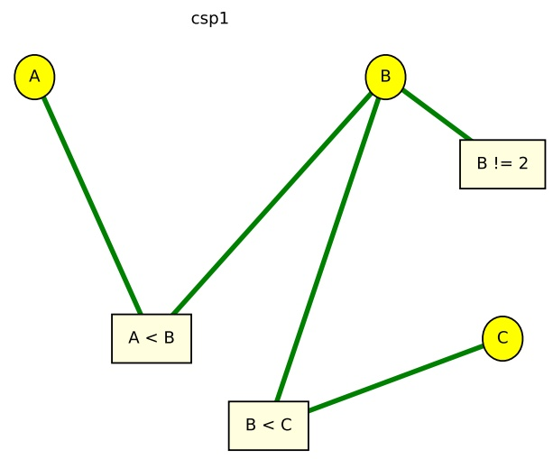

Figure 4.1: csp1.show()

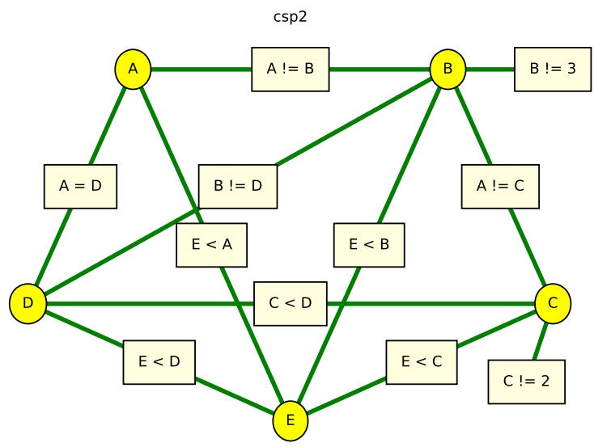

Figure 4.2: csp2.show()

<!-- page: 77 -->

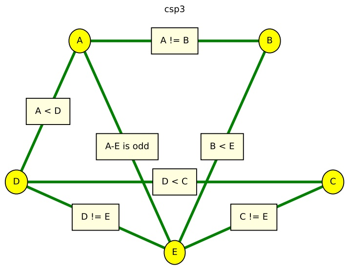

Figure 4.3: csp3.show()

```txt
D = Variable('D', {1,2,3,4}, position=(0,0.3))
E = Variable('E', {1,2,3,4}, position=(0.5,0))
csp2 = CSP("csp2", {A,B,C,D,E},
    [ Constraint([B], ne_(3), "B != 3", position=(1,0.9)),
        Constraint([C], ne_(2), "C != 2", position=(0.95,0.1)),
        Constraint([A,B], ne, "A != B"),
        Constraint([B,C], ne, "A != C"),
        Constraint([C,D], lt, "C < D"),
        Constraint([A,D], eq, "A = D"),
        Constraint([E,A], lt, "E < A"),
        Constraint([E,B], lt, "E < B"),
        Constraint([E,C], lt, "E < C"),
        Constraint([E,D], lt, "E < D"),
        Constraint([B,D], ne, "B != D"))])
```

The following example is another scheduling problem (but with multiple answers). This is the same as “scheduling 2” in the original AIspace.org consistency app.

```python
cspExamples.py — (continued) ____

csp3 = CSP("csp3", {A,B,C,D,E},
         [Constraint([A,B], ne, "A != B"),
         Constraint([A,D], lt, "A < D"),
         Constraint([A,E], lambda a,e: (a-e)%2 == 1, "A-E is odd"),
         Constraint([B,E], lt, "B < E"),
         Constraint([D,C], lt, "D < C"),
         Constraint([C,E], ne, "C != E"),
```

<!-- page: 78 -->

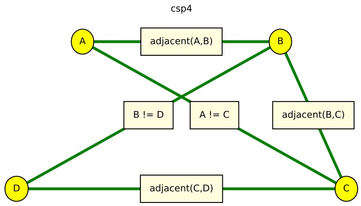

Figure 4.4: csp4.show()

```txt
Constraint([D,E], ne, "D != E"))])
```

The following example is another abstract scheduling problem. What are the solutions?

```python
def adjacent(x,y):
    """True when x and y are adjacent numbers"""
    return abs(x-y) == 1

csp4 = CSP("csp4", {A,B,C,D},
        [Constraint([A,B], adjacent, "adjacent(A,B)"),
        Constraint([B,C], adjacent, "adjacent(B,C)"),
        Constraint([C,D], adjacent, "adjacent(C,D)"),
        Constraint([A,C], ne, "A != C"),
        Constraint([B,D], ne, "B != D") ])
```

The following examples represent the crossword shown in Figure 4.5.

In the first representation, the variables represent words. The constraint imposed by the crossword is that where two words intersect, the letter at the intersection must be the same. The method meet\_at is used to test whether two words intersect with the same letter. For example, the constraint meet\_at(2,0) means that the third letter (at position 2) of the first argument is the same as the first letter of the second argument. This is shown in Figure 4.6.

```python
_cspExamples.py — (continued)
```

<!-- page: 79 -->

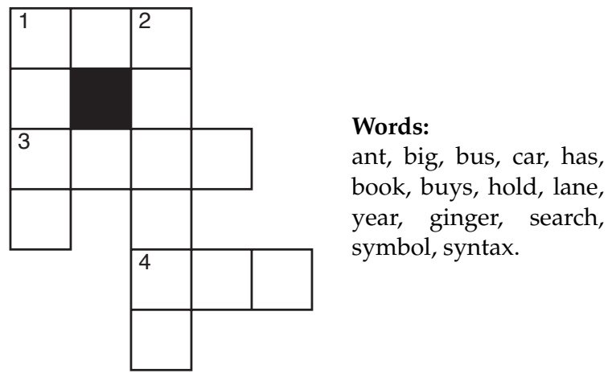

Figure 4.5: crossword1: a crossword puzzle to be solved

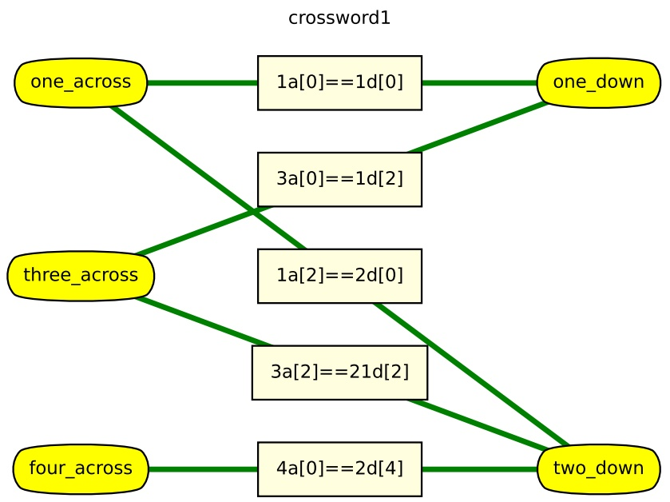

Figure 4.6: crossword1.show()

<!-- page: 80 -->

```python
"""returns a function of two words that is true
            when the words intersect at positions p1, p2.
The positions are relative to the words; starting at position 0.
meet_at(p1,p2)(w1,w2) is true if the same letter is at position p1 of
    word w1
    and at position p2 of word w2.
"""
def meets(w1,w2):
    return w1[p1] == w2[p2]
meets.__name__ = f"meet_at({p1},{p2}")
return meets

one_across = Variable('one_across', {'ant', 'big', 'bus', 'car', 'has'},
    position=(0.1,0.9))
one_down = Variable('one_down', {'book', 'buys', 'hold', 'lane', 'year'},
    position=(0.9,0.9))
two_down = Variable('two_down', {'ginger', 'search', 'symbol', 'syntax'},
    position=(0.9,0.1))
three_across = Variable('three_across', {'book', 'buys', 'hold', 'land',
    'year'}, position=(0.1,0.5))
four_across = Variable('four_across',{'ant', 'big', 'bus', 'car', 'has'},
    position=(0.1,0.1))
crossword1 = CSP("crossword1",
        {one_across, one_down, two_down, three_across,
            four_across},
        [Constraint([one_across,one_down],
            meet_at(0,0),"1a[0]==1d[0]");
        Constraint([one_across,two_down],
            meet_at(2,0),"1a[2]==2d[0]");
        Constraint([three_across,two_down],
            meet_at(2,2),"3a[2]==21d[2]")
        Constraint([three_across,one_down],
            meet_at(0,2),"3a[0]==1d[2]");
        Constraint([four_across,two_down],
            meet_at(0,4),"4a[0]==2d[4]")
    ])
```

In an alternative representation of a crossword (the “dual” representation), the variables represent letters, and the constraints are that adjacent sequences of letters form words. This is shown in Figure 4.7.

```python
words = {'ant', 'big', 'bus', 'car', 'has', 'book', 'buys', 'hold',
        'lane', 'year', 'ginger', 'search', 'symbol', 'syntax'}
def is_word(*letters, words=words):
    """is true if the letters concatenated form a word in words"""
    return "".join(letters) in words

letters = {"a", "b", "c", "d", "e", "f", "g", "h", "i", "j", "k", "l",
    "m", "n", "o", "p", "q", "r", "s", "t", "u", "v", "w", "x", "y",
https://aipython.org Version 0.9.18 March 10, 2026
```

<!-- page: 81 -->

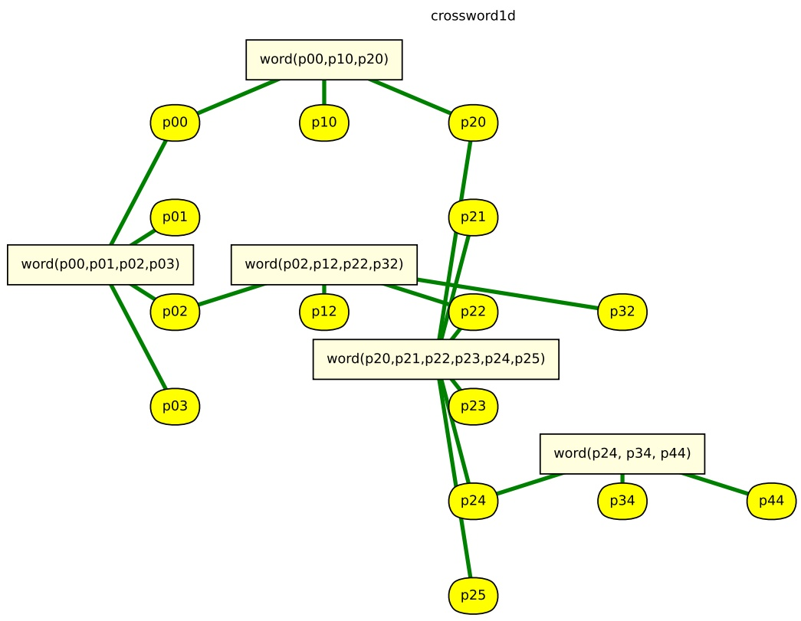

Figure 4.7: crossword1d.show()

```python
"z"}

# pij is the variable representing the letter i from the left and j down
  (starting from 0)
p00 = Variable('p00', letters, position=(0.1,0.85))
p10 = Variable('p10', letters, position=(0.3,0.85))
p20 = Variable('p20', letters, position=(0.5,0.85))
p01 = Variable('p01', letters, position=(0.1,0.7))
p21 = Variable('p21', letters, position=(0.5,0.7))
p02 = Variable('p02', letters, position=(0.1,0.55))
p12 = Variable('p12', letters, position=(0.3,0.55))
p22 = Variable('p22', letters, position=(0.5,0.55))
p32 = Variable('p32', letters, position=(0.7,0.55))
p03 = Variable('p03', letters, position=(0.1,0.4))
p23 = Variable('p23', letters, position=(0.5,0.4))
p24 = Variable('p24', letters, position=(0.5,0.25))
p34 = Variable('p34', letters, position=(0.7,0.25))
p44 = Variable('p44', letters, position=(0.9,0.25))
p25 = Variable('p25', letters, position=(0.5,0.1))

crossword1d = CSP("crossword1d",
```

<!-- page: 82 -->

```python
{p00, p10, p20, # first row
    p01, p21, # second row
    p02, p12, p22, p32, # third row
    p03, p23, #fourth row
    p24, p34, p44, # fifth row
    p25 # sixth row
},
[Constraint([p00, p10, p20], is_word, "word(p00,p10,p20)",
        position=(0.3,0.95)), #1-across
Constraint([p00, p01, p02, p03], is_word,
        "word(p00,p01,p02,p03)",
        position=(0,0.625)), # 1-down
Constraint([p02, p12, p22, p32], is_word,
        "word(p02,p12,p22,p32)",
        position=(0.3,0.625)), # 3-across
Constraint([p20, p21, p22, p23, p24, p25], is_word,
        "word(p20,p21,p22,p23,p24,p25)",
        position=(0.45,0.475)), # 2-down
Constraint([p24, p34, p44], is_word, "word(p24, p34,
        p44)",
        position=(0.7,0.325)) # 4-across
])
```

Exercise 4.1 How many assignments of a value to each variable are there for each of the representations of the above crossword? Do you think an exhaustive enumeration will work for either one?

The queens problem is a puzzle on a chess board, where the idea is to place a queen on each column so the queens cannot take each other: there are no two queens on the same row, column or diagonal. The **n-queens problem** is a generalization where the size of the board is an n × n, and n queens have to be placed.

Here is a representation of the n-queens problem, where the variables are the columns and the values are the rows in which the queen is placed. The original queens problem on a standard (8 × 8) chess board is n\_queens(8)

```python
def queens(ri,rj):
    """ri and rj are different rows, return the condition that the queens
        cannot take each other"""
    def no_take(ci,cj):
        """is true if queen at (ri,ci) cannot take a queen at (rj,cj)"""
        return ci != cj and abs(ri-ci) != abs(rj-cj)
    return no_take

def n_queens(n):
    """returns a CSP for n-queens"""
    columns = list(range(n))
    variables = [Variable(f"R{i}",columns) for i in range(n)]
        # note positions will be random
```

<!-- page: 83 -->

```txt
return CSP("n-queens",
        variables,
            [Constraint([variables[i], variables[j]], queens(i,j),"" )
                for i in range(n) for j in range(n) if i != j])

# try the CSP n_queens(8) in one of the solvers.
# What is the smallest n for which there is a solution?
```

Exercise 4.2 How many constraints does this representation of the n-queens problem produce? Can it be done with fewer constraints? Either explain why it can’t be done with fewer constraints, or give a solution using fewer constraints.

## Unit tests

The following defines a **unit test** for csp solvers, by default using example csp1.

```python
def test_csp(CSP_solver, csp=csp1,
        solutions=[{A: 1, B: 3, C: 4}, {A: 2, B: 3, C: 4}]):
    """CSP_solver is a solver that takes a csp and returns a solution
    csp is a constraint satisfaction problem
    solutions is the list of all solutions to csp
    This tests whether the solution returned by CSP_solver is a solution.
    """
    print("Testing csp with",CSP_solver.__doc__)
    sol0 = CSP_solver(csp)
    print("Solution found:",sol0)
    assert sol0 in solutions, f"Solution not correct for {csp}"
    print("Passed unit test")
```

Exercise 4.3 Modify test so that instead of taking in a list of solutions, it checks whether the returned solution actually is a solution.

Exercise 4.4 Propose a test that is appropriate for CSPs with no solutions. Assume that the test designer knows there are no solutions. Consider what a CSP solver should return if there are no solutions to the CSP.

Exercise 4.5 Write a unit test that checks whether all solutions (e.g., for the search algorithms that can return multiple solutions) are correct, and whether all solutions can be found.

## 4.2 A Simple Depth-first Solver

The first solver carries out a depth-first search through the space of partial assignments. This takes in a CSP problem and an optional variable ordering (a list of the variables in the CSP). It returns a generator of the solutions (see Section 1.5.3 on yield for enumerations).

```txt
_cspDFS.py — Solving a CSP using depth-first search.
```

<!-- page: 84 -->

```python
def dfs_solver(constraints, context, var_order):
    """generator for all solutions to csp.
    context is an assignment of values to some of the variables.
    var_order is a list of the variables in csp that are not in context.
    """
    to_eval = {c for c in constraints if c.can_evaluate(context)}
    if all(c.holds(context) for c in to_eval):
        if var_order == []:
            yield context
        else:
            rem_cons = [c for c in constraints if c not in to_eval]
            var = var_order[0]
            for val in var.domain:
                yield from dfs_solver(rem_cons, context|{var:val},
                    var_order[1:])
def dfs_solve_all(csp, var_order=None):
    """depth-first CSP solver to return a list of all solutions to csp.
    """
    if var_order == None: # use an arbitrary variable order
        var_order = list(csp.variables)
    return list( dfs_solver(csp.constraints, {}, var_order))

def dfs_solve1(csp, var_order=None):
    """depth-first CSP solver"""
    if var_order == None: # use an arbitrary variable order
        var_order = list(csp.variables)
    for sol in dfs_solver(csp.constraints, {}, var_order):
        return sol #return first one

if __name__ == "__main__":
    cspExamples.test_csp(dfs_solve1)

#Try:
# dfs_solve_all(cspExamples.csp1)
# dfs_solve_all(cspExamples.csp2)
# dfs_solve_all(cspExamples.crossword1)
# dfs_solve_all(cspExamples.crossword1d) # warning: may take a *very* long time!
```

Exercise 4.6 Instead of testing all constraints at every node, change it so each constraint is only tested when all of its variables are assigned. Given an elimination ordering, it is possible to determine when each constraint needs to be tested. Implement this. Hint: create a parallel list of sets of constraints, where at each position i in the list, the constraints at position i can be evaluated when the variable at position i has been assigned.

Exercise 4.7 Estimate how long dfs\_solve\_all(crossword1d) will take on your computer. To do this, reduce the number of variables that need to be assigned, so that the simplified problem can be solved in a reasonable time (between 0.1

<!-- page: 85 -->

second and 10 seconds). This can be done by reducing the number of variables in var\_order, as the program only splits on these. How much more time will it take if the number of variables is increased by 1? (Try it!) Then extrapolate to all of the variables. See Section 1.6.1 for how to time your code. Would making the code 100 times faster or using a computer 100 times faster help?

## 4.3 Converting CSPs to Search Problems

To run the demo, in folder "aipython", load "cspSearch.py", and copy and paste the example queries at the bottom of that file.

The next solver constructs a search space that can be solved using the search methods of the previous chapter. This takes in a CSP problem and an optional variable ordering, which is a list of the variables in the CSP. In this search space:

A node is a variable : value dictionary which does not violate any constraints (so that dictionaries that violate any conmtratints are not added).

An arc corresponds to an assignment of a value to the next variable. This assumes a static ordering; the next variable chosen to split does not depend on the context. If no variable ordering is given, this makes no attempt to choose a good ordering.

```python
from cspProblem import CSP, Constraint
from searchProblem import Arc, Search_problem

class Search_from_CSP(Search_problem):
    """A search problem directly from the CSP.

    A node is a variable:value dictionary"""
    def __init__(self, csp, variable_order=None):
        self.csp=csp
        if variable_order:
            assert set(variable_order) == set(csp.variables)
            assert len(variable_order) == len(csp.variables)
            self.variables = variable_order
        else:
            self.variables = list(csp.variables)

    def is_goal(self, node):
        """returns whether the current node is a goal for the search
        """
        return len(node)==len(self.csp.variables)

    def start_node(self):
        """returns the start node for the search
```

<!-- page: 86 -->

```python
"""
    return {}
```

The neighbors(node) method uses the fact that the length of the node, which is the number of variables already assigned, is the index of the next variable to split on. Note that we do not need to check whether there are no more variables to split on, as the nodes are all consistent, by construction, and so when there are no more variables we have a solution, and so don’t need the neighbors.

```python
def neighbors(self, node):
    """returns a list of the neighboring nodes of node.
    """
    var = self.variables[len(node)] # the next variable
    res = []
    for val in var.domain:
        new_env = node|{var:val} #dictionary union
        if self.csp.consistent(new_env):
            res.append(Arc(node,new_env))
    return res
```

The unit tests relies on a solver. The following procedure creates a solver using search that can be tested.

```python
import cspExamples
from searchGeneric import Searcher

def solver_from_searcher(csp):
    """depth-first search solver"""
    path = Searcher(Search_from_CSP(csp)).search()
    if path is not None:
        return path.end()
    else:
        return None

if __name__ == "__main__":
    test_csp(solver_from_searcher)

## Test Solving CSPs with Search:
searcher1 = Searcher(Search_from_CSP(cspExamples.csp1))
#print(searcher1.search()) # get next solution
searcher2 = Searcher(Search_from_CSP(cspExamples.csp2))
#print(searcher2.search()) # get next solution
searcher3 = Searcher(Search_from_CSP(cspExamples.crossword1))
#print(searcher3.search()) # get next solution
searcher4 = Searcher(Search_from_CSP(cspExamples.crossword1d))
#print(searcher4.search()) # get next solution (warning: slow)
```

Exercise 4.8 What would happen if we constructed the new assignment by assigning node[var] = val (with side effects) instead of using dictionary union? Give

<!-- page: 87 -->

an example of where this could give a wrong answer. How could the algorithm be changed to work with side effects? (Hint: think about what information needs to be in a node).

Exercise 4.9 Change neighbors so that it returns an iterator of values rather than a list. (Hint: use yield.)

## 4.4 Consistency Algorithms

```txt
To run the demo, in folder "aipython", load "cspConsistency.py", and copy and paste the commented-out example queries at the bottom of that file.
```

A Con\_solver is used to simplify a CSP using arc consistency.

```python
__________________________cspConsistency.py — Arc Consistency and Domain splitting for solving a CSP
from display import Displayable

class Con_solver(Displayable):
    """Solves a CSP with arc consistency and domain splitting
    """
    def __init__(self, csp):
        """a CSP solver that uses arc consistency
        * csp is the CSP to be solved
        """
        self.csp = csp
```

The following implementation of arc consistency maintains the set to\_do of (variable, constraint) pairs that are to be checked. It takes in a domain dictionary and returns a new domain dictionary. It needs to be careful to avoid side effects; this is implemented here by copying the domains dictionary and the to\_do set.

```python
def make_arc_consistent(self, domains=None, to_do=None):
    """Makes this CSP arc-consistent using generalized arc consistency
    domains is a variable:domain dictionary
    to_do is a set of (variable,constraint) pairs
    returns the reduced domains (an arc-consistent variable:domain
        dictionary)
    """
    if domains is None:
        self.domains = {var:var.domain for var in self.csp.variables}
    else:
        self.domains = domains.copy() # use a copy of domains
    if to_do is None:
        to_do = {(var, const) for const in self.csp.constraints
            for var in const.scope}
    else:

https://aipython.org Version 0.9.18 March 10, 2026
```

<!-- page: 88 -->

```python
to_do = to_do.copy() # use a copy of to_do
self.display(5,"Performing AC with domains", self.domains)
while to_do:
    self.arc_selected = (var, const) = self.select_arc(to_do)
    self.display(5, "Processing arc (", var, ",", const, ")")
    other_vars = [ov for ov in const.scope if ov != var]
    new_domain = {val for val in self.domains[var]
        if self.any_holds(self.domains, const, {var:
            val}, other_vars)}
    if new_domain != self.domains[var]:
        self.add_to_do = self.new_to_do(var, const) - to_do
        self.display(3, f"Arc: ({var}, {const}) is inconsistent\n"
            f"Domain pruned, dom({var}) ={new_domain} due to
            {const}")
        self.domains[var] = new_domain
        self.display(4, " adding", self.add_to_do if self.add_to_do
            else "nothing", "to to_do.")
        to_do |= self.add_to_do  # set union
    self.display(5, f"Arc: ({var},{const}) now consistent")
    self.display(5, "AC done. Reduced domains", self.domains)
    return self.domains

ef new_to_do(self, var, const):
    """returns new elements to be added to to_do after assigning
    variable var in constraint const.
    """
    return {(nvar, nconst) for nconst in self.csp.var_to_const[var]
        if nconst != const
        for nvar in nconst.scope
        if nvar != var}
```

The following selects an arc. Any element of to\_do can be selected. The selected element needs to be removed from to\_do. The default implementation just selects which ever element pop method for sets returns. The graphical user interface below allows the user to select an arc. Alternatively, a more sophisticated selection could be employed.

```python
def select_arc(self, to_do):
    """Selects the arc to be taken from to_do .
    * to_do is a set of arcs, where an arc is a (variable,constraint)
    pair
    the element selected must be removed from to_do.
    """
    return to_do.pop()
```

The value of new\_domain is the subset of the domain of var that is consistent with the assignment to the other variables. To make it easier to understand, the following treats unary (with no other variables in the constraint) and binary (with one other variables in the constraint) constraints as special cases. These cases are not strictly necessary; the last case covers the first two cases, but is

<!-- page: 89 -->

more difficult to understand without seeing the first two cases. Note that this case analysis is not in the code distribution, but can replace the assignment to new\_domain above.

```python
if len(other_vars)==0:          # unary constraint
    new_domain = {val for val in self.domains[var]
        if const.holds({var:val})}
elif len(other_vars)==1:      # binary constraint
    other = other_vars[0]
    new_domain = {val for val in self.domains[var]
        if any(const.holds({var: val,other:other_val})
            for other_val in self.domains[other])}
else:                    # general case
    new_domain = {val for val in self.domains[var]
        if self.any_holds(self.domains, const, {var: val}, other_vars)}
```

any\_holds is a recursive function that tries to finds an assignment of values to the other variables (other\_vars) that satisfies constraint const given the assignment in env. The integer variable ind specifies which index to other\_vars needs to be checked next. As soon as one assignment returns True, the algorithm returns True.

```python
def any_holds(self, domains, const, env, other_vars, ind=0):
    """returns True if Constraint const holds for an assignment
    that extends env with the variables in other_vars[ind:]
    env is a dictionary
    """
    if ind == len(other_vars):
        return const.holds(env)
    else:
        var = other_vars[ind]
        for val in domains[var]:
            if self.any_holds(domains, const, env|{var:val}, other_vars,
                ind + 1):
                return True
    return False
```

## 4.4.1 Direct Implementation of Domain Splitting

The following is a direct implementation of domain splitting with arc consistency. It implements the generator interface of Python (see Section 1.5.3). When it has found a solution it yields the result; otherwise it recursively splits a domain (using yield from).

```python
_______cspConsistency.py — (continued) ________________
def generate_sols(self, domains=None, to_do=None, context=dict()):
    """return list of all solution to the current CSP
```

<!-- page: 90 -->

```python
to_do is the list of arcs to check
context is a dictionary of splits made (used for display)
"""
new_domains = self.make_arc_consistent(domains, to_do)
if any(len(new_domains[var]) == 0 for var in new_domains):
    self.display(1,f"No solutions for context {context}")
elif all(len(new_domains[var]) == 1 for var in new_domains):
    self.display(1, "solution:", str({var: select(
        new_domains[var]) for var in new_domains}))
    yield {var: select(new_domains[var]) for var in new_domains}
else:
    var = self.select_var(x for x in self.csp.variables if
        len(new_domains[x]) > 1)
    dom1, dom2 = partition_domain(new_domains[var])
    self.display(5, "...splitting", var, "into", dom1, "and", dom2)
    new_doms1 = new_domains | {var:dom1}
    new_doms2 = new_domains | {var:dom2}
    to_do = self.new_to_do(var, None)
    self.display(4, " adding", to_do if to_do else "nothing", "to
        to_do.")
    yield from self.generate_sols(new_doms1, to_do,
        context|{var:dom1})
    yield from self.generate_sols(new_doms2, to_do,
        context|{var:dom1})

def solve_all(self, domains=None, to_do=None):
    return list(self.generate_sols())

def solve_one(self, domains=None, to_do=None):
    return select(self.generate_sols())

def select_var(self, iter_vars):
    """return the next variable to split"""
    return select(iter_vars)

def partition_domain(dom):
    """partitions domain dom into two.
    """
    split = len(dom) // 2
    dom1 = set(list(dom)[:split])
    dom2 = dom - dom1
    return dom1, dom2
```

```python
def select(iterable):
    """select an element of iterable.
    Returns None if there is no such element.

    This implementation just picks the first element.
    For many uses, which element is selected does not affect correctness,
https://aipython.org Version 0.9.18 March 10, 2026
```

<!-- page: 91 -->

```python
but may affect efficiency.
    """
    for e in iterable:
        return e # returns first element found
```

Exercise 4.10 Implement solve\_all that returns the set of all solutions without using yield. Hint: it can be like generate\_sols but returns a set of solutions; the recursive calls can be unioned; | is Python’s union.

Exercise 4.11 Implement solve\_one that returns one solution if one exists, or False otherwise, without using yield. Hint: Python’s “or” has the behavior A or B will return the value of A unless it is None or False, in which case the value of B is returned.

Unit test:

```python
import cspExamples
def ac_solver(csp):
    "arc consistency (ac_solver)"
    for sol in Con_solver(csp).generate_sols():
        return sol

if __name__ == "__main__":
    cspExamples.test_csp(ac_solver)
```

## 4.4.2 Consistency GUI

The consistency GUI allows students to step through the algorithm, choosing which arc to process next, and which variable to split.

Figure 4.8 shows the state of the GUI after two arcs have been made arc consistent. The arcs on the to\_do list arc colored blue. The green arcs are those have been made arc consistent. The user can click on a blue arc to process that arc. If the arc selected is not arc consistent, it is made red, the domain is reduced, and then the arc becomes green. If the arc was already arc consistent it turns green.

This is implemented by overriding select\_arc and select\_var to allow the user to pick the arcs and the variables, and overriding display to allow for the animation. Note that the first argument of display (the number) in the code above is interpreted with a special meaning by the GUI and should only be changed with care.

Clicking AutoAC automates arc selection until the network is arc consistent.

```python
cspConsistencyGUI.py — GUI for consistency-based CSP solving _________________
from cspConsistency import Con_solver
import matplotlib.pyplot as plt

class ConsistencyGUI(Con_solver):
    def __init__(self, csp, fontsize=10, speed=1, **kwargs):

https://aipython.org Version 0.9.18 March 10, 2026
```

<!-- page: 92 -->

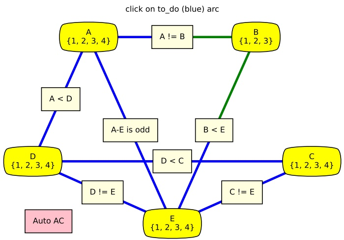

Figure 4.8: ConsistencyGUI(cspExamples.csp3).go()

```python
"""
csp is the csp to show
fontsize is the size of the text
speed is the number of animations per second (controls delay_time)
    1 (slow) and 4 (fast) seem like good values
"""
self.fontsize = fontsize
self.delay_time = 1/speed
self.quitting = False
Con_solver.__init__(self, csp, **kwargs)
csp.show(showAutoAC = True)
csp.fig.canvas.mpl_connect('close_event', self.window_closed)

def go(self):
    try:
        res = self.solve_all()
        self.csp.draw_graph(domains=self.domains,
                             title="No more solutions. GUI finished. ",
                             fontsize=self.fontsize)
        return res
except ExitToPython:
    print("GUI closed")

def select_arc(self, to_do):
    while True:
        self.csp.draw_graph(domains=self.domains, to_do=to_do,
                             title="click on to_do (blue) arc",
                             fontsize=self.fontsize)
        self.wait_for_user()
```

<!-- page: 93 -->

```python
if self.csp.autoAC:
    break
    picked = self.csp.picked
    self.csp.picked = None
    if picked in to_do:
        to_do.remove(picked)
        print(f"{picked} picked")
        return picked
    else:
        print(f"{picked} not in to_do. Pick one of {to_do}")
    if self.csp.autoAC:
        self.csp.draw_graph(domains=self.domains, to_do=to_do,
                          title="Auto AC", fontsize=self.fontsize)
        plt.pause(self.delay_time)
        return to_do.pop()

def select_var(self, iter_vars):
    vars = list(iter_vars)
    while True:
        self.csp.draw_graph(domains=self.domains,
                          title="Arc consistent. Click node to
                          split",
                          fontsize=self.fontsize)
        self.csp.autoAC = False
        self.wait_for_user()
        picked = self.csp.picked
        self.csp.picked = None
        if picked in vars:
            #print("splitting",picked)
            return picked
        else:
            print(picked,"not in",vars)

def display(self,n,*args,**nargs):
    if n <= self.max_display_level: # default display
        print(*args, **nargs)
    if n==1: # solution found or no solutions"
        self.csp.draw_graph(domains=self.domains, to_do=set(),
                          title=' '.join(args)+": click any node or
                          arc to continue",
                          fontsize=self.fontsize)
        self.csp.autoAC = False
        self.wait_for_user()
        self.csp.picked = None
    elif n==2: # backtracking
        plt.title("backtracking: click any node or arc to continue")
        self.csp.autoAC = False
        self.wait_for_user()
        self.csp.picked = None
    elif n==3: # inconsistent arc
```

<!-- page: 94 -->

```python
line = self.csp.thelines[self.arc_selected]
    line.set_color('red')
    line.set_linewidth(10)
    plt.pause(self.delay_time)
    line.set_color('limegreen')
    line.set_linewidth(self.csp.linewidth)
    #elif n==4 and self.add_to_do: # adding to to_do
    #   print("adding to to_do",self.add_to_do) ## highlight these arc

    def wait_for_user(self):
        while self.csp.picked == None and not self.csp.autoAC and not
            self.quitting:
            plt.pause(0.01) # controls reaction time of GUI
        if self.quitting:
            raise ExitToPython()

    def window_closed(self, event):
        self.quitting = True

class ExitToPython(Exception):
    pass

import cspExamples
# Try:
# ConsistencyGUI(cspExamples.csp1).go()
# ConsistencyGUI(cspExamples.csp3).go()
# ConsistencyGUI(cspExamples.csp3, speed=4, fontsize=15).go()

if __name__ == "__main__":
    print("Try e.g.: ConsistencyGUI(cspExamples.csp3).go()")
```

## 4.4.3 Domain Splitting as an interface to graph searching

An alternative implementation is to implement domain splitting in terms of the search abstraction of Chapter 3.

A node is a dictionary that maps the variables to their (pruned) domains..

```python
from searchProblem import Arc, Search_problem

class Search_with_AC_from_CSP(Search_problem,Displayable):
    """A search problem with arc consistency and domain splitting

    A node is a CSP """
    def __init__(self, csp):
        self.cons = Con_solver(csp) #copy of the CSP
        self.domains = self.cons.make_arc_consistent()

    def is_goal(self, node):
```

<!-- page: 95 -->

```python
"""node is a goal if all domains have 1 element"""
    return all(len(node[var]==1 for var in node)

def start_node(self):
    return self.domains

def neighbors(self,node):
    """returns the neighboring nodes of node.
    """
    neighs = []
    var = select(x for x in node if len(node[x])>1)
    if var:
        dom1, dom2 = partition_domain(node[var])
        self.display(2,"Splitting", var, "into", dom1, "and", dom2)
        to_do = self.cons.new_to_do(var,None)
        for dom in [dom1,dom2]:
            newdoms = node | {var:dom}
            cons_doms = self.cons.make_arc_consistent(newdoms,to_do)
            if all(len(cons_doms[v])>0 for v in cons_doms):
                # all domains are non-empty
                neighs.append(Arc(node,cons_doms))
            else:
                self.display(2,"...",var,"in",dom,"has no solution")
    return neighs
```

Exercise 4.12 When splitting a domain, this code splits the domain into half, approximately in half (without any effort to make a sensible choice). Does it work better to split one element from a domain?

Unit test:

```python
import cspExamples
from searchGeneric import Searcher

def ac_search_solver(csp):
    """arc consistency (search interface)"""
    sol = Searcher(Search_with_AC_from_CSP(csp)).search()
    if sol:
        return {v:select(d) for (v,d) in sol.end().items()]

if __name__ == "__main__":
    cspExamples.test_csp(ac_search_solver)

Testing:
```

```python
____cspConsistency.py — (continued) ________________
195 | ## Test Solving CSPs with Arc consistency and domain splitting:
196 | #Con_solver.max_display_level = 4 # display details of AC (0 turns off)
197 | #Con_solver(cspExamples.csp1).solve_all()
198 | #searcher1d = Searcher(Search_with_AC_from_CSP(cspExamples.csp1))
```

<!-- page: 96 -->

```r
#print(searcher1d.search())
#Searcher.max_display_level = 2 # display search trace (0 turns off)
#searcher2c = Searcher(Search_with_AC_from_CSP(cspExamples.csp2))
#print(searcher2c.search())
#searcher3c = Searcher(Search_with_AC_from_CSP(cspExamples.crossword1))
#print(searcher3c.search())
#searcher4c = Searcher(Search_with_AC_from_CSP(cspExamples.crossword1d))
#print(searcher4c.search())
```

## 4.5 Solving CSPs using Stochastic Local Search

To run the demo, in folder "aipython", load "cspSLS.py", and copy and paste the commented-out example queries at the bottom of that file. This assumes Python 3. Some of the queries require matplotlib.

The following code implements the two-stage choice (select one of the variables that are involved in the most constraints that are violated, then a value), the any-conflict algorithm (select a variable that participates in a violated constraint) and a random choice of variable, as well as a probabilistic mix of the three.

Given a CSP, the stochastic local searcher (SLSearcher) creates the data structures:

• variables\_to\_select is the set of all of the variables with domain-size greater than one. For a variable not in this set, we cannot pick another value from that variable.

var\_to\_constraints maps from a variable into the set of constraints it is involved in. Note that the inverse mapping from constraints into variables is part of the definition of a constraint.

```python
from cspProblem import CSP, Constraint
from searchProblem import Arc, Search_problem
from display import Displayable
import random
import heapq

class SLSearcher(Displayable):
    """A search problem directly from the CSP..

    A node is a variable:value dictionary"""
    def __init__(self, csp):
        self.csp = csp
        self.variables_to_select = {var for var in self.csp.variabless
            if len(var.domain) > 1}

https://aipython.org Version 0.9.18 March 10, 2026
```

<!-- page: 97 -->

```python
# Create assignment and conflicts set
self.current_assignment = None # this will trigger a random restart
self.number_of_steps = 0 #number of steps after the initialization
```

restart creates a new total assignment, and constructs the set of conflicts (the constraints that are false in this assignment).

```python
def restart(self):
    """creates a new total assignment and the conflict set
    """
    self.current_assignment = {var:random_choice(var.domain) for
        var in self.csp.variables}
    self.display(2,"Initial assignment",self.current_assignment)
    self.conflicts = set()
    for con in self.csp.constraints:
        if not con.holds(self.current_assignment):
            self.conflicts.add(con)
    self.display(2,"Number of conflicts",len(self.conflicts))
    self.variable_pq = None
```

The search method is the top-level searching algorithm. It can either be used to start the search or to continue searching. If there is no current assignment, it must create one. Note that, when counting steps, a restart is counted as one step, which is not appropriate for CSPs with many variables, as it is a relatively expensive operation for these cases.

This method selects one of two implementations. The argument prob\_best is the probability of selecting a best variable (one involving the most conflicts). When the value of prob\_best is positive, the algorithm needs to maintain a priority queue of variables and the number of conflicts (using search\_with\_var\_pq). If the probability of selecting a best variable is zero, it does not need to maintain this priority queue (as implemented in search\_with\_any\_conflict).

The argument prob\_anycon is the probability that the any-conflict strategy is used (which selects a variable at random that is in a conflict), assuming that it is not picking a best variable. Note that for the probability parameters, any value less that zero acts like probability zero and any value greater than 1 acts like probability 1. This means that when prob\_anycon = 1.0, a best variable is chosen with probability prob\_best, otherwise a variable in any conflict is chosen. A variable is chosen at random with probability 1 − prob\_anycon − prob\_best as long as that is positive.

This returns the number of steps needed to find a solution, or None if no solution is found. If there is a solution, it is in self.current\_assignment.

```python
def search(self,max_steps, prob_best=0, prob_anycon=1.0):
    """
    returns the number of steps or None if these is no solution.
    If there is a solution, it can be found in self.current_assignment
```

<!-- page: 98 -->

```python
max_steps is the maximum number of steps it will try before giving up
prob_best is the probability that a best variable (one in most conflict) is selected
prob_anycon is the probability that a variable in any conflict is selected
(otherwise a variable is chosen at random)
"""
if self.current_assignment is None:
    self.restart()
    self.number_of_steps += 1
    if not self.conflicts:
        self.display(1,"Solution found:", self.current_assignment, "after restart")
        return self.number_of_steps
if prob_best > 0: # we need to maintain a variable priority queue
    return self.search_with_var_pq(max_steps, prob_best, prob_anycon)
else:
    return self.search_with_any_conflict(max_steps, prob_anycon)
```

Exercise 4.13 This does an initial random assignment but does not do any random restarts. Implement a searcher that takes in the maximum number of walk steps (corresponding to existing max\_steps) and the maximum number of restarts, and returns the total number of steps for the first solution found. (As in search, the solution found can be extracted from the variable self.current\_assignment).

## 4.5.1 Any-conflict

In the any-conflict heuristic a variable that participates in a violated constraint is picked at random. The implementation need to keeps track of which variables are in conflicts. This is can avoid the need for a priority queue that is needed when the probability of picking a best variable is greater than zero.

```python
def search_with_any_conflict(self, max_steps, prob_anycon=1.0):
    """Searches with the any_conflict heuristic.
    This relies on just maintaining the set of conflicts;
    it does not maintain a priority queue
    """
    self.variable_pq = None # we are not maintaining the priority queue.
        # This ensures it is regenerated if
        #  we call search_with_var_pq.
    for i in range(max_steps):
        self.number_of_steps +=1
        if random.random() < prob_anycon:
            con = random_choice(self.conflicts) # pick random conflict
            var = random_choice(con.scope) # pick variable in conflict
        else:
            var = random_choice(self.variables_to_select)
```

<!-- page: 99 -->

```python
if len(var.domain) > 1:
    val = random_choice([val for val in var.domain
        if val is not
            self.current_assignment[var]])
    self.display(2,self.number_of_steps,":
        Assigning",var,"=",val)
    self.current_assignment[var]=val
    for varcon in self.csp.var_to_const[var]:
        if varcon.holds(self.current_assignment):
            if varcon in self.conflicts:
                self.conflicts.remove(varcon)
        else:
            if varcon not in self.conflicts:
                self.conflicts.add(varcon)
    self.display(2," Number of conflicts",len(self.conflicts))
    if not self.conflicts:
        self.display(1,"Solution found:", self.current_assignment,
            "in", self.number_of_steps,"steps")
        return self.number_of_steps
    self.display(1,"No solution in",self.number_of_steps,"steps",
        len(self.conflicts),"conflicts remain")
    return None
```

Exercise 4.14 This makes no attempt to find the best value for the variable selected. Modify the code to include an option selects a value for the selected variable that reduces the number of conflicts the most. Have a parameter that specifies the probability that the best value is chosen, and otherwise chooses a value at random.

## 4.5.2 Two-Stage Choice

This is the top-level searching algorithm that maintains a priority queue of variables ordered by the number of conflicts, so that the variable with the most conflicts is selected first. If there is no current priority queue of variables, one is created.

The main complexity here is to maintain the priority queue. When a variable var is assigned a value val, for each constraint that has become satisfied or unsatisfied, each variable involved in the constraint need to have its count updated. The change is recorded in the dictionary var\_differential, which is used to update the priority queue (see Section 4.5.3).

```python
def search_with_var_pq(self,max_steps, prob_best=1.0, prob_anycon=1.0):
    """search with a priority queue of variables.
    This is used to select a variable with the most conflicts.
    """
    if not self.variable_pq:
        self.create_pq()
    pick_best_or_con = prob_best + prob_anycon
```

<!-- page: 100 -->

```python
for i in range(max_steps):
    self.number_of_steps +=1
    randnum = random.random()
    ## Pick a variable
    if randnum < prob_best: # pick best variable
        var,oldval = self.variable_pq.top()
    elif randnum < pick_best_or_con: # pick a variable in a conflict
        con = random_choice(self.conflicts)
        var = random_choice(con.scope)
    else: #pick any variable that can be selected
        var = random_choice(self.variables_to_select)
    if len(var.domain) > 1: # var has other values
        ## Pick a value
        val = random_choice([val for val in var.domain if val is not
            self.current_assignment[var]])
        self.display(2,"Assigning",var,val)
        ## Update the priority queue
        var_differential = {}
        self.current_assignment[var]=val
        for varcon in self.csp.var_to_const[var]:
            self.display(3,"Checking",varcon)
            if varcon.holds(self.current_assignment):
                if varcon in self.conflicts: # became consistent
                    self.display(3,"Became consistent",varcon)
                    self.conflicts.remove(varcon)
                    for v in varcon.scope: # v is in one fewer
                        conflicts
                        var_differential[v] =
                            var_differential.get(v,0)-1
            else:
                if varcon not in self.conflicts: # was consis, not now
                    self.display(3,"Became inconsistent",varcon)
                    self.conflicts.add(varcon)
                    for v in varcon.scope: # v is in one more
                        conflicts
                        var_differential[v] =
                            var_differential.get(v,0)+1
        self.variable_pq.update_each_priority(var_differential)
        self.display(2,"Number of conflicts",len(self.conflicts))
    if not self.conflicts: # no conflicts, so solution found
        self.display(1,"Solution found:",
            self.current_assignment,"in",
                self.number_of_steps,"steps")
        return self.number_of_steps
self.display(1,"No solution in",self.number_of_steps,"steps",
            len(self.conflicts),"conflicts remain")
return None
```

create\_pq creates an updatable priority queue of the variables, ordered by the number of conflicts they participate in. The priority queue only includes variables in conflicts and the value of a variable is the negative of the number of

<!-- page: 101 -->

conflicts the variable is in. This ensures that the priority queue, which picks the minimum value, picks a variable with the most conflicts.

```python
def create_pq(self):
    """Create the variable to number-of-conflicts priority queue.
    This is needed to select the variable in the most conflicts.

    The value of a variable in the priority queue is the negative of the
    number of conflicts the variable appears in.
    """
    self.variable_pq = Updatable_priority_queue()
    var_to_number_conflicts = {}
    for con in self.conflicts:
        for var in con.scope:
            var_to_number_conflicts[var] =
                var_to_number_conflicts.get(var,0)+1
    for var,num in var_to_number_conflicts.items():
        if num>0:
            self.variable_pq.add(var,-num)

def random_choice(st):
    """selects a random element from set st.
    It would be more efficient to convert to a tuple or list only once
    (left as exercise)."""
    return random.choice(tuple(st))
```

Exercise 4.15 These implementations always select a value for the variable selected that is different from its current value (if that is possible). Change the code so that it does not have this restriction (so it can leave the value the same). Would you expect this code to be faster? Does it work worse (or better)?

## 4.5.3 Updatable Priority Queues

An **updatable priority queue** is a priority queue, where key-value pairs can be stored, and the pair with the smallest key can be found and removed quickly, and where the values can be updated. This implementation follows the idea of [http://docs.python.org/3.9/library/heapq.html](http://docs.python.org/3.9/library/heapq.html), where the updated elements are marked as removed. This means that the priority queue can be used unmodified. However, this might be expensive if changes are more common than popping (as might happen if the probability of choosing the best is close to zero).

In this implementation, the equal values are sorted randomly. This is achieved by having the elements of the heap being [val, rand, elt] triples, where the second element is a random number. Note that Python requires this to be a list, not a tuple, as the tuple cannot be modified.

<!-- page: 102 -->

```python
class Updatable_priority_queue(object):
    """A priority queue where the values can be updated.
    Elements with the same value are ordered randomly.

    This code is based on the ideas described in
    http://docs.python.org/3.3/library/heapq.html
    It could probably be done more efficiently by
    shuffling the modified element in the heap.
    """
    def __init__(self):
        self.pq = [] # priority queue of [val,rand,elt] triples
        self.elt_map = {} # map from elt to [val,rand,elt] triple in pq
        self.REMOVED = "*removed*" # a string that won't be a legal element
        self.max_size=0

    def add(self,elt,val):
        """adds elt to the priority queue with priority=val.
        """
        assert val <= 0,val
        assert elt not in self.elt_map, elt
        new_triple = [val, random.random(),elt]
        heapq.heappush(self.pq, new_triple)
        self.elt_map[elt] = new_triple

    def remove(self,elt):
        """remove the element from the priority queue"""
        if elt in self.elt_map:
            self.elt_map[elt][2] = self.REMOVED
            del self.elt_map[elt]

    def update_each_priority(self,update_dict):
        """update values in the priority queue by subtracting the values in
        update_dict from the priority of those elements in priority queue.
        """
        for elt,incr in update_dict.items():
            if incr != 0:
                newval = self.elt_map.get(elt,[0])[0] - incr
                assert newval <= 0, f"{elt}:{newval+incr}-{incr}"
                self.remove(elt)
                if newval != 0:
                    self.add(elt,newval)

    def pop(self):
        """Removes and returns the (elt,value) pair with minimal value.
        If the priority queue is empty, IndexError is raised.
        """
        self.max_size = max(self.max_size, len(self.pq)) # keep statistics
        triple = heapq.heappop(self.pq)
        while triple[2] == self.REMOVED:
```

<!-- page: 103 -->

## 4.5. Solving CSPs using Stochastic Local Search

```python
triple = heapq.heappop(self.pq)
    del self.elt_map[triple[2]]
    return triple[2], triple[0] # elt, value

def top(self):
    """Returns the (elt,value) pair with minimal value, without
        removing it.
    If the priority queue is empty, IndexError is raised.
    """
    self.max_size = max(self.max_size, len(self.pq)) # keep statistics
    triple = self.pq[0]
    while triple[2] == self.REMOVED:
        heapq.heappop(self.pq)
        triple = self.pq[0]
    return triple[2], triple[0] # elt, value

def empty(self):
    """returns True iff the priority queue is empty"""
    return all(triple[2] == self.REMOVED for triple in self.pq)
```

## 4.5.4 Plotting Run-Time Distributions

Runtime\_distribution uses matplotlib to plot run time distributions. Here the run time is a misnomer as we are only plotting the number of steps, not the time. Computing the run time is non-trivial as many of the runs have a very short run time. To compute the time accurately would require running the same code, with the same random seed, multiple times to get a good estimate of the run time. This is left as an exercise.

```python
import matplotlib.pyplot as plt
# plt.style.use('grayscale')

class Runtime_distribution(object):
    def __init__(self, csp, xscale='log'):
        """Sets up plotting for csp
        xscale is either 'linear' or 'log'
        """
        self.csp = csp
        plt.ion()
        self.fig, self.ax = plt.subplots()
        self.ax.set_xlabel("Number of Steps")
        self.ax.set_ylabel("Cumulative Number of Runs")
        self.ax.set_xscale(xscale) # Makes a 'log' or 'linear' scale

    def plot_runs(self,num_runs=100,max_steps=1000, prob_best=1.0,
        prob_anycon=1.0):
        """Plots num_runs of SLS for the given settings.
        """
```

<!-- page: 104 -->

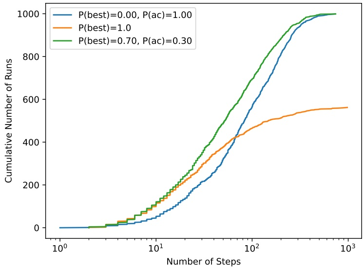

Figure 4.9: Run-time distributions for three algorithms on csp2.

```python
stats = []
SLSearcher.max_display_level, temp_mdl = 0,
       SLSearcher.max_display_level # no display
for i in range(num_runs):
    searcher = SLSearcher(self.csp)
    num_steps = searcher.search(max_steps, prob_best, prob_anycon)
    if num_steps:
        stats.append(num_steps)
stats.sort()
if prob_best >= 1.0:
    label = "P(best)=1.0"
else:
    p_ac = min(prob_anycon, 1-prob_best)
    label = "P(best)=%.2f, P(ac)=%.2f" % (prob_best, p_ac)
self.ax.plot(stats,range(len(stats)),label=label)
self.ax.legend(loc="upper left")
SLSearcher.max_display_level= temp_mdl #restore display
```

Figure 4.9 gives run-time distributions for 3 algorithms. It is also useful to compare the distributions of different runs of the same algorithms and settings.

## 4.5.5 Testing

```txt
cspSLS.py — (continued) ______________.
import cspExamples
https://aipython.org Version 0.9.18 March 10, 2026
```

<!-- page: 105 -->

```python
____cspSoft.py — Representations of Soft Constraints
from cspProblem import Variable, Constraint, CSP
class SoftConstraint(Constraint):
```

```python
def sls_solver(csp,prob_best=0.7):
    """stochastic local searcher (prob_best=0.7)"""
    se0 = SLSearcher(csp)
    se0.search(1000,prob_best)
    return se0.current_assignment
def any_conflict_solver(csp):
    """stochastic local searcher (any-conflict)"""
    return sls_solver(csp,0)

if __name__ == "__main__":
    cspExamples.test_csp(sls_solver)
    cspExamples.test_csp(any_conflict_solver)

## Test Solving CSPs with Search:
#se1 = SLSearcher(cspExamples.csp1); print(se1.search(100))
#se2 = SLSearcher(cspExamples.csp2); print(se2.search(1000,1.0)) # greedy
#se2 = SLSearcher(cspExamples.csp2); print(se2.search(1000,0)) #
    any_conflict
#se2 = SLSearcher(cspExamples.csp2); print(se2.search(1000,0.7)) # 70%
    greedy; 30% any_conflict
#SLSearcher.max_display_level=2 #more detailed display
#se3 = SLSearcher(cspExamples.crossword1); print(se3.search(100),0.7)
#p = Runtime_distribution(cspExamples.csp2)
#p.plot_runs(1000,1000,0) # any_conflict
#p.plot_runs(1000,1000,1.0) # greedy
#p.plot_runs(1000,1000,0.7) # 70% greedy; 30% any_conflict
```

Exercise 4.16 Modify this to plot the run time, instead of the number of steps. To measure run time use timeit ([https://docs.python.org/3.9/library/timeit.html](https://docs.python.org/3.9/library/timeit.html)). Small run times are inaccurate, so timeit can run the same code multi-ple times. Stochastic local algorithms give different run times each time called. To make the timing meaningful, you need to make sure the random seed is the same for each repeated call (see random.getstate and random.setstate in [https://docs.python.org/3.9/library/random.html](https://docs.python.org/3.9/library/random.html)). Because the run time for different seeds can vary a great deal, for each seed, you should start with 1 iteration and multiplying it by, say 10, until the time is greater than 0.2 seconds. Make sure you plot the average time for each run. Before you start, try to estimate the total run time, so you will be able to tell if there is a problem with the algorithm stopping.

## 4.6 Discrete Optimization

A SoftConstraint is a constraint, but where the condition is a real-valued cost function. The aim is to find the assignment with the lowest sum of costs. Because the definition of the constraint class did not force the condition to be Boolean, you can use the Constraint class for soft constraints too.

<!-- page: 106 -->

```python
"""A Constraint consists of
* scope: a tuple of variables
* function: a real-valued costs function that can applied to a tuple of values
* string: a string for printing the constraints. All of the strings must be unique.
for the variables
"""
def __init__(self, scope, function, string=None, position=None):
    Constraint.__init__(self, scope, function, string, position)

def value(self,assignment):
    return self.holds(assignment)
```

```python
A = Variable('A', {1,2}, position=(0.2,0.9))
B = Variable('B', {1,2,3}, position=(0.8,0.9))
C = Variable('C', {1,2}, position=(0.5,0.5))
D = Variable('D', {1,2}, position=(0.8,0.1))

def c1fun(a,b):
    if a==1: return (5 if b==1 else 2)
    else: return (0 if b==1 else 4 if b==2 else 3)
c1 = SoftConstraint([A,B],c1fun,"c1")
def c2fun(b,c):
    if b==1: return (5 if c==1 else 2)
    elif b==2: return (0 if c==1 else 4)
    else: return (2 if c==1 else 0)
c2 = SoftConstraint([B,C],c2fun,"c2")
def c3fun(b,d):
    if b==1: return (3 if d==1 else 0)
    elif b==2: return 2
    else: return (2 if d==1 else 4)
c3 = SoftConstraint([B,D],c3fun,"c3")

def penalty_if_same(pen):
    "returns a function that gives a penalty of pen if the arguments are the same"
    return lambda x,y: (pen if (x==y) else 0)

c4 = SoftConstraint([C,A],penalty_if_same(3),"c4")

scsp1 = CSP("scsp1", {A,B,C,D}, [c1,c2,c3,c4])

### The second soft CSP has an extra variable, and 2 constraints
E = Variable('E', {1,2}, position=(0.1,0.1))

c5 = SoftConstraint([C,E],penalty_if_same(3),"c5")
c6 = SoftConstraint([D,E],penalty_if_same(2),"c6")
scsp2 = CSP("scsp1", {A,B,C,D,E}, [c1,c2,c3,c4,c5,c6])
```

<!-- page: 107 -->

## 4.6.1 Branch-and-bound Search

Here we specialize the branch-and-bound algorithm (Section 3.3 on page 65) to solve soft CSP problems.

```python
from display import Displayable
import math

class DF_branch_and_bound_opt(Displayable):
    """returns a branch and bound searcher for a problem.
    An optimal assignment with cost less than bound can be found by calling search()
    """
    def __init__(self, csp, bound=math.inf):
        """creates a searcher than can be used with search() to find an optimal path.
        bound gives the initial bound. By default this is infinite - meaning there
        is no initial pruning due to depth bound
        """
        self.csp = csp
        self.best_asst = None
        self.bound = bound

    def optimize(self):
        """returns an optimal solution to a problem with cost less than bound.
        returns None if there is no solution with cost less than bound."""
        self.num_expanded=0
        self.cbsearch({}, 0, self.csp.constraints)
        self.display(1,"Number of paths expanded:",self.num_expanded)
        return self.best_asst, self.bound

    def cbsearch(self, asst, cost, constraints):
        """finds the optimal solution that extends path and is less the bound"""
        self.display(2,"cbsearch:",asst,cost,constraints)
        can_eval = [c for c in constraints if c.can_evaluate(asst)]
        rem_cons = [c for c in constraints if c not in can_eval]
        newcost = cost + sum(c.value(asst) for c in can_eval)
        self.display(2,"Evaluating:",can_eval,"cost:",newcost)
        if newcost < self.bound:
            self.num_expanded += 1
            if rem_cons==[:]
                self.best_asst = asst
                self.bound = newcost
                self.display(1,"New best assignment:",asst," cost:",newcost)
            else:
                var = next(var for var in self.csp.variables if var not in asst)
```

<!-- page: 108 -->

```python
for val in var.domain:
            self.cbsearch({var:val}|asst, newcost, rem_cons)

# bnb = DF_branch_and_bound_opt(scsp1)
# bnb.max_display_level=3 # show more detail
# bnb.optimize()
```

Exercise 4.17 What happens of some costs are negative? (Does it still work?) What if a value is added to all costs: does it change the optimum value, and does it affect efficiency? Make the algorithm work so that negative costs can be in the constraints. [Hint: make the smallest value be zero.]

Exercise 4.18 Change the stochastic-local search algorithms to work for soft constraints. Hint: Instead of the number of constraints violated, consider how much a change in a variable affects the objective function. Instead of returning a solution, return the best assignment found.

<!-- page: 109 -->

# Propositions and Inference

## 5.1 Representing Knowledge Bases

A clause consists of a head (an atom) and a body. A body is represented as a list of atoms. Atoms are represented as strings, or any type that can be converted to strings.

```python
class Clause(object):
    """A definite clause"""

    def __init__(self,head,body=[]):
        """clause with atom head and lost of atoms body"""
        self.head=head
        self.body = body

    def __repr__(self):
        """returns the string representation of a clause.
        """
        if self.body:
            return f"{self.head} <- {' & '.join(str(a) for a in
                self.body)}."
        else:
            return f"{self.head}."
```

An askable atom can be asked of the user. The user can respond in English or French or just with a “y”.

```python
class Askable(object):
    """An askable atom"""
```

<!-- page: 110 -->

```python
def __init__(self,atom):
    """clause with atom head and lost of atoms body"""
    self.atom=atom

def __str__(self):
    """returns the string representation of a clause."""
    return f"askable {self.atom}."

def yes(ans):
    """returns true if the answer is yes in some form"""
    return ans.lower() in ['yes', 'oui', 'y'] # bilingual
```

A knowledge base is a list of clauses and askables. To make top-down inference faster, this creates an atom\_to\_clause dictionary that maps each atom into the set of clauses with that atom in the head.

```python
from display import Displayable

class KB(Displayable):
    """A knowledge base consists of a set of clauses.
    This also creates a dictionary to give fast access to the clauses with
        an atom in head.
    """
    def __init__(self, statements=[]):
        self.statements = statements
        self.clauses = [c for c in statements if isinstance(c, Clause)]
        self.askables = [c.atom for c in statements if isinstance(c,
                Askable)]
        self.atom_to_clauses = {} # dictionary giving clauses with atom as
                head
        for c in self.clauses:
            self.add_clause(c)

    def add_clause(self, c):
        if c.head in self.atom_to_clauses:
            self.atom_to_clauses[c.head].append(c)
        else:
            self.atom_to_clauses[c.head] = [c]

    def clauses_for_atom(self,a):
        """returns list of clauses with atom a as the head"""
        if a in self.atom_to_clauses:
            return self.atom_to_clauses[a]
        else:
            return []

    def __str__(self):
        """returns a string representation of this knowledge base.
        """
        return '\n'.join([str(c) for c in self.statements])
```

<!-- page: 111 -->

Here is a trivial example (I think therefore I am) used in the unit tests:

```bazel
74 triv_KB = KB([
75 Clause('i_am', ['i_think']),
76 Clause('i_think'),
77 Clause('i_smell', ['i_exist'])
78 ])
```

Here is a representation of the electrical domain of the textbook:

```python
elect = KB([
    Clause('light_l1'),
    Clause('light_l2'),
    Clause('ok_l1'),
    Clause('ok_l2'),
    Clause('ok_cb1'),
    Clause('ok_cb2'),
    Clause('live_outside'),
    Clause('live_l1', ['live_w0']),
    Clause('live_w0', ['up_s2','live_w1']),
    Clause('live_w0', ['down_s2','live_w2']),
    Clause('live_w1', ['up_s1', 'live_w3RX]),
    Clause('live_w2', ['down_s1','live_w3' ])
    Clause('live_l2', ['live_w4RX]),
    Clause('live_w4', ['up_s3','live_w3' ])
    Clause('live_p_1', ['live_w3RX]),
    Clause('live_w3', ['live_w5', 'ok_cb1RX]),
    Clause('live_p_2', ['live_w6RX]),
    Clause('live_w6', ['live_w5', 'ok_cb2RX]),
    Clause('live_w5', ['live_outsideRX]),
    Clause('lit_l1', ['light_l1', 'live_l1', 'ok_l1RX),
    Clause('lit_l2', ['light_l2', 'live_l2', 'ok_l2RX),
    Askable('up_s1'),
    Askable('down_s1'),
    Askable('up_s2'),
    Askable('down_s2'),
    Askable('up_s3'),
    Askable('down_s2')
])

# print(kb)
```

The following knowledge base is false in the intended interpretation. One of the clauses is wrong; can you see which one? We will show how to debug it.

```python
logicProblem.py — (continued) ________________
elect_bug = KB([
    Clause('light_l2'),
    Clause('ok_l1'),
    Clause('ok_l2'),
```

<!-- page: 112 -->

```txt
Clause('ok_cb1'),
Clause('ok_cb2'),
Clause('live_outside'),
Clause('live_p_2', ['live_w6']),
Clause('live_w6', ['live_w5', 'ok_cb2']),
Clause('light_l1'),
Clause('live_w5', ['live_outside']),
Clause('lit_l1', ['light_l1', 'live_l1', 'ok_l1']),
Clause('lit_l2', ['light_l2', 'live_l2', 'ok_l2RX]),
Clause('live_l1', ['live_w0Range'),
Clause('live_w0', ['up_s2','live_w1Range]),
Clause('live_w0', ['down_s2','live_w2Range]),
Clause('live_w1', ['up_s3', 'live_w3Range]),
Clause('live_w2', ['down_s1','live_w3 Range'),
Clause('live_l2', ['live_w4Range'),
Clause('live_w4', ['up_s3','live_w3 Range]),
Clause('live_p_1', ['live_w3Range'),
Clause('live_w3', ['live_w5', 'ok_cb1Range'),
Askable('up_s1'),
Askable('down_s1'),
Askable('up_s2'),
Clause('light_l2'),
Clause('ok_l1'),
Clause('light_l2'),
Clause('ok_l1'),
Clause('ok_l2'),
Clause('ok_cb1'),
Clause('ok_cb2'),
Clause('live_outside'),
Clause('live_p_2', ['live_w6Range'),
Clause('live_w6', ['live_w5', 'ok_cb2Range'),
Clause('ok_l2'),
Clause('ok_cb1'),
Clause('ok_cb2'),
Clause('live_outside'),
Clause('live_p_2', ['live_w6Range'),
Clause('live_w6', ['live_w5', 'ok_cb2Range'),
Askable('down_s2'),
Askable('up_s3'),
Askable('down_s2')
])
# print(kb)
```

## 5.2 Bottom-up Proofs (with askables)

fixed\_point{kb} computes the fixed point of the knowledge base kb.

<!-- page: 113 -->

## 5.2. Bottom-up Proofs (with askables)

```python
from logicProblem import yes

def fixed_point(kb):
    """Returns the fixed point of knowledge base kb.
    """
    fp = ask_askables(kb)
    added = True
    while added:
        added = False # added is true when an atom was added to fp this iteration
        for c in kb.clauses:
            if c.head not in fp and all(b in fp for b in c.body):
                fp.add(c.head)
                added = True
                kb.display(2,c.head,"added to fp due to clause",c)
    return fp

def ask_askables(kb):
    return {at for at in kb.askables if yes(input("Is "+at+" true? "))
}
```

The following provides a trivial **unit test**, by default using the knowledge base triv\_KB:

```python
from logicProblem import triv_KB
def test(kb=triv_KB, fixedpt = {'i_am','i_think}): 
    fp = fixed_point(kb)
    assert fp == fixedpt, f"kb gave result {fp}"
    print("Passed unit test")
if __name__ == "__main__":
    test()

from logicProblem import elect
# elect.max_display_level=3 # give detailed trace
# fixed_point(elect)
```

Exercise 5.1 It is not very user-friendly to ask all of the askables up-front. Implement ask-the-user so that questions are only asked if useful, and are not re-asked. For example, if there is a clause $h\leftarrow a\land b\land c\land d\land e,$ where c and e are askable, c and e only need to be asked if a, b, d are all in fp and they have not been asked before. Askable e only needs to be asked if the user says “yes” to c. Askable c doesn’t need to be asked if the user previously replied “no” to e, unless it is needed for some other clause.

This form of ask-the-user can ask a different set of questions than the topdown interpreter that asks questions when encountered. Give an example where they ask different questions (neither set of questions asked is a subset of the other).

Exercise 5.2 This algorithm runs in time O(n<sup>2</sup>), where n is the number of clauses, for a bounded number of elements in the body; each iteration goes through each of the clauses, and in the worst case, it will do an iteration for each clause. It is possible to implement this in time O(n) time by creating an index that maps an

<!-- page: 114 -->

atom to the set of clauses with that atom in the body. Implement this. What is its complexity as a function of n and b, the maximum number of atoms in the body of a clause?

Exercise 5.3 It is possible to be more efficient (in terms of the number of elements in a body) than the method in the previous question by noticing that each element of the body of clause only needs to be checked once. For example, the clause $a \leftarrow b \land c \land d,$ needs only be considered when b is added to fp. Once b is added to fp, if c is already in fp, we know that a can be added as soon as d is added. Implement this. What is its complexity as a function of n and b, the maximum number of atoms in the body of a clause?

## 5.3 Top-down Proofs (with askables)

The following implements the top-down proof procedure for propositional definite clauses, as described in Section 5.3.2 and Figure 5.4 of Poole and Mackworth [2023]. It implements “choose” by looping over the alternatives (using Python’s any) and returning true if any choice leads to a proof.

prove(kb, goal) is used to prove goal from a knowledge base, kb, where a goal is a list of atoms. It returns True if kb ⊢ goal. The indent is used when displaying the code (and doesn’t need to be called initially with a non-default value).

```python
from logicProblem import yes

def prove(kb, ans_body, indent=""):
    """returns True if kb |- ans_body
    ans_body is a list of atoms to be proved
    """
    kb.display(2,indent,'yes <-',' & '.join(ans_body))
    if ans_body:
        selected = ans_body[0] # select first atom from ans_body
        if selected in kb.askables:
            return (yes(input("Is "+selected+" true? "))
                and prove(kb,ans_body[1:],indent+" "))
        else:
            return any(prove(kb,cl.body+ans_body[1:],indent+" ")
                    for cl in kb.clauses_for_atom(selected))
    else:
        return True  # empty body is true
```

The following provides a simple **unit test** that is hard wired for triv\_KB:

```python
from logicProblem import triv_KB
def test():
    a1 = prove(triv_KB,['i_am'])
    assert a1, f"triv_KB proving i_am gave {a1}"
    a2 = prove(triv_KB,['i_smell'])
```

<!-- page: 115 -->

```python
assert not a2, f"triv_KB proving i_smell gave {a2}"
    print("Passed unit tests")
if __name__ == "__main__":
    test()
# try
from logicProblem import elect
# elect.max_display_level=3 # give detailed trace
# prove(elect,'live_w6'])
# prove(elect,'lit_l1'])
```

Exercise 5.4 This code can re-ask a question multiple times. Implement this code so that it only asks a question once and remembers the answer. Also implement a function to forget the answers, which is useful if someone given an incorrect response.

Exercise 5.5 What search method is this using? Implement the search interface so that it can use A∗ or other searching methods. Define an admissible heuristic that is not always 0.

## 5.4 Debugging and Explanation

Here we modify the top-down procedure to build a proof tree than can be traversed for explanation and debugging.

prove\_atom(kb,atom) returns a proof for atom from a knowledge base kb, where a proof is a pair of the atom and the proofs for the elements of the body of the clause used to prove the atom. prove\_body(kb,body) returns a list of proofs for list body from a knowledge base, kb. The indent is used when displaying the code (and doesn’t need to have a non-default value).

```python
from logicProblem import yes # for asking the user

def prove_atom(kb, atom, indent=""):
    """returns a pair (atom,proofs) where proofs is the list of proofs
    of the elements of a body of a clause used to prove atom.
    """
    kb.display(2,indent,'proving',atom)
    if atom in kb.askables:
        if yes(input("Is "+atom+" true? ")):
            return (atom,"answered")
        else:
            return "fail"
    else:
        for cl in kb.clauses_for_atom(atom):
            kb.display(2,indent,"trying",atom,'<-',' & '.join(cl.body))
            pr_body = prove_body(kb, cl.body, indent)
            if pr_body != "fail":
                return (atom, pr_body)
        return "fail"
```

<!-- page: 116 -->

```python
def prove_body(kb, ans_body, indent=""):
    """returns proof tree if kb |- ans_body or "fail" if there is no proof
    ans_body is a list of atoms in a body to be proved
    """
    proofs = []
    for atom in ans_body:
        proof_at = prove_atom(kb, atom, indent+" ")
        if proof_at == "fail":
            return "fail" # fail if any proof fails
        else:
            proofs.append(proof_at)
    return proofs
```

The following provides a simple **unit test** that is hard wired for triv\_KB:

```python
from logicProblem import triv_KB
def test():
    a1 = prove_atom(triv_KB,'i_am')
    assert a1, f"triv_KB proving i_am gave {a1}"
    a2 = prove_atom(triv_KB,'i_smell')
    assert a2=="fail", "triv_KB proving i_smell gave {a2}"
    print("Passed unit tests")

if __name__ == "__main__":
    test()

# try
from logicProblem import elect, elect_bug
# elect.max_display_level=3 # give detailed trace
# prove_atom(elect, 'live_w6')
# prove_atom(elect, 'lit_l1')
```

The interact(kb) provides an interactive interface to explore proofs for knowledge base kb. The user can ask to prove atoms and can ask how an atom was proved.

To ask how, there must be a current atom for which there is a proof. This starts as the atom asked. When the user asks “how n” the current atom becomes the n-th element of the body of the clause used to prove the (previous) current atom. The command “up” makes the current atom the atom in the head of the rule containing the (previous) current atom. Thus "how n" moves down the proof tree and “up” moves up the proof tree, allowing the user to explore the full proof.

```python
____logicExplain.py — (continued) ________________
61 helptext = """Commands are:
62 ask atom    ask is there is a proof for atom (atom should not be in quotes)
63 how          show the clause that was used to prove atom
64 how n      show the clause used to prove the nth element of the body
```

<!-- page: 117 -->

```python
up        go back up proof tree to explore other parts of the proof tree
kb        print the knowledge base
quit        quit this interaction (and go back to Python)
help        print this text
"""
def interact(kb):
    going = True
    ups = []  # stack for going up
    proof="fail" # there is no proof to start
    while going:
        inp = input("logicExplain: ")
        inps = inp.split(" ")
        try:
            command = inps[0]
            if command == "quit":
                going = False
            elif command == "ask":
                proof = prove_atom(kb, inps[1])
                if proof == "fail":
                    print("fail")
                else:
                    print("yes")
            elif command == "how":
                if proof=="fail":
                    print("there is no proof")
                elif len(inps)==1:
                    print_rule(proof)
                else:
                    try:
                        ups.append(proof)
                        proof = proof[1][int(inps[1])] #nth argument of rule
                        print_rule(proof)
                    except:
                        print('In "how n", n must be a number between 0
                            and',len(proof[1])-1,"inclusive.")
            elif command == "up":
                if ups:
                    proof = ups.pop()
                else:
                    print("No rule to go up to.")
                print_rule(proof)
            elif command == "kb":
                print(kb)
            elif command == "help":
                print(helptext)
            else:
                print("unknown command:", inp)
                print("use help for help")
            except:
```

<!-- page: 118 -->

```python
print("unknown command:", inp)
        print("use help for help")

def print_rule(proof):
    (head,body) = proof
    if body == "answered":
        print(head,"was answered yes")
    elif body == []:
        print(head,"is a fact")
    else:
        print(head,"<-")
        for i,a in enumerate(body):
            print(i,":",a[0])

# try
# interact(elect)
# Which clause is wrong in elect_bug? Try:
# interact(elect_bug)
# logicExplain: ask lit_l1
```

The following shows an interaction for the knowledge base elect:

```txt
>>> interact(elect)
logicExplain: ask lit_l1
Is up_s2 true? no
Is down_s2 true? yes
Is down_s1 true? yes
yes
logicExplain: how
lit_l1 <-
0 : light_l1
1 : live_l1
2 : ok_l1
logicExplain: how 1
live_l1 <-
0 : live_w0
logicExplain: how 0
live_w0 <-
0 : down_s2
1 : live_w2
logicExplain: how 0
down_s2 was answered yes
logicExplain: up
live_w0 <-
0 : down_s2
1 : live_w2
logicExplain: how 1
live_w2 <-

https://aipython.org
```

<!-- page: 119 -->

## 5.5. Assumables

```txt
0 : down_s1
1 : live_w3
logicExplain: quit
>>>
```

Exercise 5.6 The above code only ever explores one proof – the first proof found. Change the code to enumerate the proof trees (by returning a list of all proof trees, or, preferably, using yield). Add the command "retry" to the user interface to try another proof.

## 5.5 Assumables

Atom a can be made assumable by including Assumable(a) in the knowledge base. A knowledge base that can include assumables is declared with KBA.

```python
from logicProblem import Clause, Askable, KB, yes

class Assumable(object):
    """An askable atom"""

    def __init__(self,atom):
        """clause with atom head and lost of atoms body"""
        self.atom = atom

    def __str__(self):
        """returns the string representation of a clause.
        """
        return "assumable " + self.atom + "."

class KBA(KB):
    """A knowledge base that can include assumables"""
    def __init__(self,statements):
        self.assumables = [c.atom for c in statements if isinstance(c,Assumable)]
        KB.__init__(self,statements)
```

```python
def prove_all_ass(self, ans_body, assumed=set()):
    """returns a list of sets of assumables that extends assumed
    to imply ans_body from self.
    ans_body is a list of atoms (it is the body of the answer clause).
    assumed is a set of assumables already assumed
```

<!-- page: 120 -->

```python
"""
if ans_body:
    selected = ans_body[0] # select first atom from ans_body
    if selected in self.askables:
        if yes(input("Is "+selected+" true? "))
            return self.prove_all_ass(ans_body[1:],assumed)
        else:
            return []  # no answers
    elif selected in self.assumables:
        return self.prove_all_ass(ans_body[1:],assumed|{selected})
    else:
        return [ass
            for cl in self.clauses_for_atom(selected)
            for ass in
                self.prove_all_ass(cl.body+ans_body[1:],assumed)
                ] # union of answers for each clause with
                    head=selected
else:                 # empty body
    return [assumed]  # one answer

f conflicts(self):
    """returns a list of minimal conflicts"""
    return minsets(self.prove_all_ass(['false']))
```

Given a list of sets, minsets returns a list of the minimal sets in the list. For example, minsets([{2, 3, 4}, {2, 3}, {6, 2, 3}, {2, 3}, {2, 4, 5}]) returns [{2, 3}, {2, 4, 5}].

```python
def minsets(ls):
    """ls is a list of sets
    returns a list of minimal sets in ls
    """
    ans = []    # elements known to be minimal
    for c in ls:
        if not any(c1<c for c1 in ls) and not any(c1 <= c for c1 in ans):
            ans.append(c)
    return ans

# minsets([{2, 3, 4}, {2, 3}, {6, 2, 3}, {2, 3}, {2, 4, 5}])
```

Warning: minsets works for a list of sets or for a set of (frozen) sets, but it does not work for a generator of sets (because variable ls is referenced in the loop). For example, try to predict and then test:

```txt
minsets(e for e in [{2, 3, 4}, {2, 3}, {6, 2, 3}, {2, 3}, {2, 4, 5}])
```

The diagnoses can be constructed from the (minimal) conflicts as follows. This also works if there are non-minimal conflicts, but is not as efficient.

```python
_logicAssumables.py — (continued)
```

```python
def diagnoses(cons):
    """cons is a list of (minimal) conflicts.
```

<!-- page: 121 -->

## 5.5. Assumables

```python
returns a list of diagnoses."""
    if cons == []:
        return [set()]
    else:
        return minsets([({e}|d)          # | is set union
            for e in cons[0]
            for d in diagnoses(cons[1:])])
```

Test cases:

```python
electa = KBA([
    Clause('light_l1'),
    Clause('light_l2'),
    Assume('ok_l1'),
    Assume('ok_l2'),
    Assume('ok_s1'),
    Assume('ok_s2'),
    Assume('ok_s3'),
    Assume('ok_cb1'),
    Assume('ok_cb2'),
    Assume('live_outside'),
    Clause('live_l1', ['live_w0']),
    Clause('live_w0', ['up_s2','ok_s2','live_w1 Bhar),
    Clause('live_w0', ['down_s2','ok_s2','live_w2 Bhar),
    Clause('live_w1', ['up_s1', 'ok_s1', 'live_w3 Bhar),
    Clause('live_w2', ['down_s1', 'ok_s1','live_w3' ]),
    Clause('live_l2', ['live_w4 Bhar),
    Clause('live_w4', ['up_s3','ok_s3','live_w3' ]),
    Clause('live_p_1', ['live_w3 Bhar),
    Clause('live_w3', ['live_w5', 'ok_cb1 Bhar),
    Clause('live_p_2', ['live_w6 Bhar),
    Clause('live_w6', ['live_w5', 'ok_cb2 Bhar),
    Clause('live_w5', ['live_outside Bhar),
    Clause('lit_l1', ['light_l1', 'live_l1', 'ok_l1 Bhar),
    Clause('lit_l2', ['light_l2', 'live_l2', 'ok_l2 Bhar),
    Askable('up_s1'),
    Askable('down_s1'),
    Askable('up_s2'),
    Askable('down_s2'),
    Askable('up_s3'),
    Askable('down_s2'),
    Askable('dark_l1'),
    Askable('dark_l2'),
    Clause('false', ['dark_l1', 'lit_l1 Bhar),
    Clause('false', ['dark_l2', 'lit_l2 Bhar])
])
# electa.prove_all_ass(['false'])
# cs=electa.conflicts()
# print(cs)
# diagnoses(cs)      # diagnoses from conflicts
```

<!-- page: 122 -->

Exercise 5.7 To implement a version of conflicts that never generates non-minimal conflicts, modify prove\_all\_ass to implement iterative deepening on the number of assumables used in a proof, and prune any set of assumables that is a superset of a conflict.

Exercise 5.8 Implement explanations(self,body), where body is a list of atoms, that returns a list of the minimal explanations of the body. This does not require modification of prove\_all\_ass.

Exercise 5.9 Implement explanations, as in the previous question, so that it never generates non-minimal explanations. Hint: modify prove\_all\_ass to implement iterative deepening on the number of assumptions, generating conflicts and explanations together, and pruning as early as possible.

## 5.6 Negation-as-failure

The negation of an atom a is written as Not(a) in a body.

```python
from logicProblem import KB, Clause, Askable, yes

class Not(object):
    def __init__(self, atom):
        self.theatom = atom

    def atom(self):
        return self.theatom

    def __repr__(self):
        return f"Not({self.theatom})"
```

Prove with negation-as-failure (prove\_naf) is like prove, but with the extra case to cover Not:

```python
def prove_naf(kb, ans_body, indent=""):
    """ prove with negation-as-failure and askables
    returns True if kb |- ans_body
    ans_body is a list of atoms to be proved
    """
    kb.display(2,indent,'yes <-',' & '.join(str(e) for e in ans_body))
    if ans_body:
        selected = ans_body[0] # select first atom from ans_body
        if isinstance(selected, Not):
            kb.display(2,indent,f"proving {selected.atom()}")
            if prove_naf(kb, [selected.atom()], indent):
                kb.display(2,indent,f"{selected.atom()} succeeded so
                    Not({selected.atom()}) fails")
            return False
        else:
```

<!-- page: 123 -->

## 5.6. Negation-as-failure

```python
kb.display(2,indent,f"{selected.atom()} fails so
Not({selected.atom()}) succeeds")
return prove_naf(kb, ans_body[1:],indent+" ")
if selected in kb.askables:
    return (yes(input("Is "+selected+" true? "))
        and prove_naf(kb,ans_body[1:],indent+" "))
else:
    return any(prove_naf(kb,cl.body+ans_body[1:],indent+" ")
            for cl in kb.clauses_for_atom(selected))
else:
    return True  # empty body is true
```

Test cases:

```python
triv_KB_naf = KB([
    Clause('i_am', ['i_think']),
    Clause('i_think'),
    Clause('i_smell', ['i_am', Not('dead')],
    Clause('i_bad', ['i_am', Not('i_think')]
])

triv_KB_naf.max_display_level = 4
def test():
    a1 = prove_naf(triv_KB_naf,['i_smell'])
    assert a1, f"triv_KB_naf failed to prove i_smell; gave {a1}"
    a2 = prove_naf(triv_KB_naf,['i_bad'])
    assert not a2, f"triv_KB_naf wrongly proved i_bad; gave {a2}"
    print("Passed unit tests")
if __name__ == "__main__":
    test()
```

```python
beach_KB = KB([
    Clause('away_from_beach', [Not('on_beach')]),
    Clause('beach_access', ['on_beach', Not('ab_beach_access')]),
    Clause('swim_at_beach', ['beach_access', Not('ab_swim_at_beach')]),
    Clause('ab_swim_at_beach', ['enclosed_bay', 'big_city',
        Not('ab_no_swimming_near_city')]),
    Clause('ab_no_swimming_near_city', ['in_BC', Not('ab_BC_beaches')])
])

# prove_naf(beach_KB, ['away_from_beach'])
# prove_naf(beach_KB, ['beach_access'])
# beach_KB.add_clause(Clause('on_beach',[]))
# prove_naf(beach_KB, ['away_from_beach'])
# prove_naf(beach_KB, ['swim_at_beach'])
# beach_KB.add_clause(Clause('enclosed_bay',[]))
# prove_naf(beach_KB, ['swim_at_beach'])
```

<!-- page: 124 -->

80 # beach\_KB.add\_clause(Clause('big\_city',[]))

81 # prove\_naf(beach\_KB, ['swim\_at\_beach'])

82 # beach\_KB.add\_clause(Clause('in\_BC',[]))

83 # prove\_naf(beach\_KB, ['swim\_at\_beach'])

<!-- page: 125 -->

# Deterministic Planning

## 6.1 Representing Actions and Planning Problems

The STRIPS representation of an action consists of:

• the name of the action

preconditions: a dictionary of feature:value pairs that specifies that the feature must have this value for the action to be possible

• effects: a dictionary of feature:value pairs that are made true by this action. In particular, a feature in the dictionary has the corresponding value (and not its previous value) after the action, and a feature not in the dictionary keeps its old value.

• a cost for the action

```python
class Strips(object):
    def __init__(self, name, preconds, effects, cost=1):
        """
        defines the STRIPS representation for an action:
        * name is the name of the action
        * preconds, the preconditions, is feature:value dictionary that must hold
        for the action to be carried out
        * effects is a feature:value map that this action makes true. The action changes the value of any feature specified here, and leaves other features unchanged.
```

<!-- page: 126 -->

```python
class STRIPS_domain(object):
    def __init__(self, feature_domain_dict, actions):
        """Problem domain
        feature_domain_dict is a feature:domain dictionary,
            mapping each feature to its domain
        actions
        """
        self.feature_domain_dict = feature_domain_dict
        self.actions = actions
```

```python
* cost is the cost of the action
    """
    self.name = name
    self.preconds = preconds
    self.effects = effects
    self.cost = cost

    def __repr__(self):
        return self.name
```

## A STRIPS domain consists of:

• A dictionary feature\_domain\_dict that maps each feature into a set of possible values for the feature. This is needed for the CSP planner.

• A set of actions, each represented using the Strips class.

A planning problem consists of a planning domain, an initial state, and a goal. The goal does not need to fully specify the final state.

```python
class Planning_problem(object):
    def __init__(self, prob_domain, initial_state, goal):
        """
        a planning problem consists of
        * a planning domain
        * the initial state
        * a goal
        """
        self.prob_domain = prob_domain
        self.initial_state = initial_state
        self.goal = goal
```

## 6.1.1 Robot Delivery Domain

The following specifies the robot delivery domain of Section 6.1, shown in Figure 6.1.

<!-- page: 127 -->

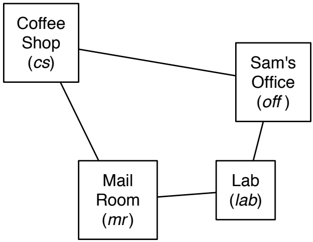

**Features to describe states Actions**

RLoc – Rob’s location mc – move clockwise

RHC – Rob has coffee mcc – move counterclockwise

SWC – Sam wants coffee puc – pickup coffee

MW – Mail is waiting dc – deliver coffee

RHM – Rob has mail pum – pickup mail

Figure 6.1: Robot Delivery Domain

```python
boolean = {False, True}
delivery_domain = STRIPS_domain(
    {'RLoc':''cs', 'off', 'lab', 'mr'}, 'RHC':boolean, 'SWC':boolean,
        'MW':boolean, 'RHM':boolean},          #feature:values dictionary
    { Strips('mc_cs', {'RLoc':'cs'}, {'RLoc':'off'}),
        Strips('mc_off', {'RLoc':'off'}, {'RLoc':'lab'}),
        Strips('mc_lab', {'RLoc':'lab'}, {'RLoc':'mr'}),
        Strips('mc_mr', {'RLoc':'mr'}, {'RLoc':'cs'}),
        Strips('mcc_cs', {'RLoc':'cs'}, {'RLoc':'mr'}),
        Strips('mcc_off', {'RLoc':'off'}, {'RLoc':'cs'}),
        Strips('mcc_lab', {'RLoc':'lab'}, {'RLoc':'off'}),
        Strips('mcc_mr', {'RLoc':'mr'}, {'RLoc':'lab'}),
        Strips('puc', {'RLoc':'cs', 'RHC':False}, {'RHC':True}),
        Strips('dc', {'RLoc':'off', 'RHC':True}, {'RHC':False, 'SWC':False}),
        Strips('pum', {'RLoc':'mr','MW':True}, {'RHM':True,'MW':False}),
        Strips('dm', {'RLoc':'off', 'RHM':True}, {'RHM':False})
    } )
```

<!-- page: 128 -->

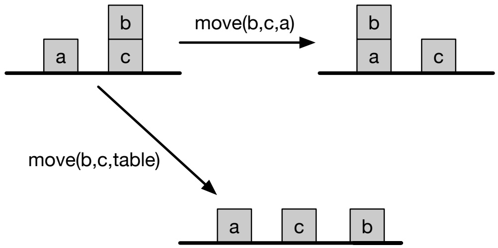

Figure 6.2: Blocks world with two actions

```python
problem0 = Planning_problem(delivery_domain,
                      {'RLoc':'lab', 'MW':True, 'SWC':True, 'RHC':False,
                      'RHM':False},
                      {'RLoc':'off'})
problem1 = Planning_problem(delivery_domain,
                      {'RLoc':'lab', 'MW':True, 'SWC':True, 'RHC':False,
                      'RHM':False},
                      {'SWC':False})
problem2 = Planning_problem(delivery_domain,
                      {'RLoc':'lab', 'MW':True, 'SWC':True, 'RHC':False,
                      'RHM':False},
                      {'SWC':False, 'MW':False, 'RHM':False})
```

## 6.1.2 Blocks World

The blocks world consist of blocks and a table. Each block can be on the table or on another block. A block can only have one other block on top of it. Figure 6.2 shows 3 states with some of the actions between them.

A state is defined by the two features:

• on where on(x) = y when block x is on block or table y

• clear where clear(x) = True when block x has nothing on it.

There is one parameterized action

• move $(x,y,z)$ move block x from y to z, where y and z could be a block or the table.

<!-- page: 129 -->

To handle parameterized actions (which depend on the blocks involved), the actions and the features are all strings, created for all the combinations of the blocks. Note that we treat moving to a block separately from moving to the table, because the blocks needs to be clear, but the table always has room for another block.

```python
### blocks world
def move(x,y,z):
    """string for the 'move' action"""
    return 'move_'+x+'_from_'+y+'_to_'+z
def on(x):
    """string for the 'on' feature"""
    return x+'_is_on'
def clear(x):
    """string for the 'clear' feature"""
    return 'clear_'+x
def create_blocks_world(blocks = {'a','b','c','d}): 
    blocks_and_table = blocks | {'table'}
    stmap = {Strips(move(x,y,z),{on(x):y, clear(x):True, clear(z):True},
                             {on(x):z, clear(y):True, clear(z):False})
        for x in blocks
        for y in blocks_and_table
        for z in blocks
        if x!=y and y!=z and z!=x}
    stmap.update({Strips(move(x,y,'table'), {on(x):y, clear(x):True},
                             {on(x):'table', clear(y):True})
        for x in blocks
        for y in blocks
        if x!=y})
    feature_domain_dict = {on(x):blocks_and_table-{x} for x in blocks}
    feature_domain_dict.update({clear(x):boolean for x in blocks_and_table})
    return STRIPS_domain(feature_domain_dict, stmap)
```

The problem blocks1 is a classic example, with 3 blocks, and the goal consists of two conditions. See Figure 6.3. This example is challenging because you can’t achieve one of the goals (using the minimum number of actions) and then the other; whichever one you achieve first has to be undone to achieve the second.

```python
stripsProblem.py — (continued) ________________
blocks1dom = create_blocks_world({'a','b','c'})
blocks1 = Planning_problem(blocks1dom,
    {on('a':'table', clear('a'):True,
        on('b':'c', clear('b'):True,
        on('c':'table', clear('c'):False}, # initial state
    {on('a':'b', on('c':'a'}) #goal
```

The problem blocks2 is one to invert a tower of size 4.

```txt
_______stripsProblem.py — (continued) ________
118 | blocks2dom = create_blocks_world({'a','b','c','d'})
```

<!-- page: 130 -->

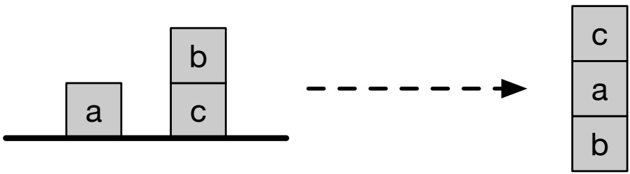

Figure 6.3: Blocks problem blocks1

```python
tower4 = {clear('a'):True, on('a':'b',
              clear('b'):False, on('b':'c',
              clear('c'):False, on('c':'d',
              clear('d'):False, on('d':'table'}
blocks2 = Planning_problem(blocks2dom,
    tower4, # initial state
    {on('d':'c',on('c':'b',on('b':'a'}) #goal
```

The problem blocks3 is to move the bottom block to the top of a tower of size 4.

```python
____stripsProblem.py — (continued) ________________
127 blocks3 = Planning_problem(blocks2dom,
128     tower4, # initial state
129     {on('d':'a', on('a':'b', on('b':'c'}) #goal
```

Exercise 6.1 Represent the problem of given a tower of 4 blocks (a on b on c on d on table), the goal is to have a tower with the previous top block on the bottom (b on c on d on a). Do not include the table in your goal (the goal does not care whether a is on the table). [Before you run the program, estimate how many steps it will take to solve this.] How many steps does an optimal planner take?

Exercise 6.2 Represent the domain so that on(x, y) is a Boolean feature that is True when x is on y, Does the representation of the state need to include negative on facts? Why or why not? (Note that this may depend on the planner; write your answer with respect to particular planners.)

Exercise 6.3 It is possible to write the representation of the problem without using clear, where clear(x) means nothing is on x. Change the definition of the blocks world so that it does not use clear but uses on being false instead. Does this work better for any of the planners?

## 6.2 Forward Planning

```txt
To run the demo, in folder "aipython", load "stripsForwardPlanner.py", and copy and paste the commented-out example queries at the bottom of that file.
```

<!-- page: 131 -->

In a forward planner, a node is a state. A state consists of an assignment, a feature:value dictionary, where all features have a value. Multiple-path pruning requires a hash function, and equality between states.

```python
from searchProblem import Arc, Search_problem
from stripsProblem import Strips, STRIPS_domain

class State(object):
    def __init__(self,assignment):
        self.assignment = assignment
        self.hash_value = None
    def __hash__(self):
        if self.hash_value is None:
            self.hash_value = hash(frozenset(self.assignment.items()))
        return self.hash_value
    def __eq__(self,st):
        return self.assignment == st lipidgment
    def __str__(self):
        return str(self lipidgment)
```

To define a search problem (page 41), you need to define the goal condition, the start nodes, the neighbors, and (optionally) a heuristic function. Here zero is the default heuristic function.

```python
def zero(*args,**nargs):
    """always returns 0"""
    return 0

class Forward_STRIPS(Search_problem):
    """A search problem from a planning problem where:
    * a node is a state
    * the dynamics are specified by the STRIPS representation of actions
    """
    def __init__(self, planning_problem, heur=zero):
        """creates a forward search space from a planning problem.
        heur(state,goal) is a heuristic function,
            an underestimate of the cost from state to goal, where
            both state and goals are feature:value dictionaries.
        """
        self.prob_domain = planning_problem.prob_domain
        self.initial_state = State(planning_problem.initial_state)
        self.goal = planning_problem.goal
        self.heur = heur

    def is_goal(self, state):
        """is True if node is a goal.

        Every goal feature has the same value in the state and the goal."""
        return all(state.assignment[prop]==self.goal[prop]
```

<!-- page: 132 -->

```python
for prop in self.goal)

def start_node(self):
    """returns start node"""
    return self.initial_state

def neighbors(self,state):
    """returns neighbors of state in this problem"""
    return [ Arc(state, self.effect(act,state.assignment), act.cost,
        act)
        for act in self.prob_domain.actions
        if self.possible(act,state lipidgment)]

def possible(self,act,state_asst):
    """True if act is possible in state.
    act is possible if all of its preconditions have the same value in
    the state"""
    return all(state_asst[pre] == act.preconds[pre]
        for pre in act.preconds)

def effect(self,act,state_asst):
    """returns the state that is the effect of doing act given
    state_asst
    Python 3.9: return state_asst | act.effects"""
    new_state_asst = state_asst.copy()
    new_state_asst.update(act.effects)
    return State(new_state_asst)

def heuristic(self,state):
    """in the forward planner a node is a state.
    the heuristic is an (under)estimate of the cost
    of going from the state to the top-level goal.
    """
    return self.heur(state.assignment, self.goal)
```

Here are some test cases to try.

```python
stripsForwardPlanner.py — (continued) ____

from searchBranchAndBound import DF_branch_and_bound
from searchMPP import SearcherMPP
import stripsProblem

# SearcherMPP(Forward_STrips(stripsProblem.problem1)).search() #A* with MPP
# DF_branch_and_bound(Forward_STrips(stripsProblem.problem1),10).search()
    #B&B
# To find more than one plan:
# s1 = SearcherMPP(Forward_STrips(stripsProblem.problem1)) #A*
# s1.search() #find another plan
```

<!-- page: 133 -->

## 6.2.1 Defining Heuristics for a Planner

Each planning domain requires its own heuristics. If you change the actions, you will need to reconsider the heuristic function, as there might then be a lower-cost path, which might make the heuristic non-admissible.

Here is an example of defining heuristics for the coffee delivery planning domain.

First define the distance between two locations, which is used for the heuristics.

```python
def dist(loc1, loc2):
    """returns the distance from location loc1 to loc2
    """
    if loc1==loc2:
        return 0
    if {loc1,loc2} in [{'cs','lab'},{'mr','off'}]:
        return 2
    else:
        return 1
```

Note that the current state is a complete description; there is a value for every feature. However the goal need not be complete; it does not need to define a value for every feature. Before checking the value for a feature in the goal, a heuristic needs to define whether the feature is defined in the goal.

```python
def h1(state,goal):
    """ the distance to the goal location, if there is one"""
    if 'RLoc' in goal:
        return dist(state['RLoc'], goal['RLoc'])
    else:
        return 0

def h2(state,goal):
    """ the distance to the coffee shop plus getting coffee and delivering it
    if the robot needs to get coffee
    """
    if ('SWC' in goal and goal['SWC']==False
        and state['SWC']==True
        and state['RHC']==False):
        return dist(state['RLoc'],'cs')+3
    else:
        return 0
```

The maximum of the values of a set of admissible heuristics is also an admissible heuristic. The function maxh takes a number of heuristic functions as arguments, and returns a new heuristic function that takes the maximum of the values of the heuristics. For example, h1 and h2 are heuristic functions and so maxh(h1,h2) is also. maxh can take an arbitrary number of arguments.

<!-- page: 134 -->

```python
def maxh(*heuristics):
    """Returns a new heuristic function that is the maximum of the
        functions in heuristics.
    heuristics is the list of arguments which must be heuristic functions.
    """
    # return lambda state,goal: max(h(state,goal) for h in heuristics)
    def newh(state,goal):
        return max(h(state,goal) for h in heuristics)
    return newh
```

The following runs the example with and without the heuristic.

```python
48  ##### Forward Planner ###
49 from searchMPP import SearcherMPP
50 from stripsForwardPlanner import Forward_STrips
51 import stripsProblem

52 def test_forward_heuristic(thisproblem=stripsProblem.problem1):
53     print("\n***** FORWARD NO HEURISTIC")
54     print(SearcherMPP(Forward_STrips(thisproblem)).search())

55     print("\n***** FORWARD WITH HEURISTIC h1")
56     print(SearcherMPP(Forward_STrips(thisproblem,h1)).search())

57     print("\n***** FORWARD WITH HEURISTIC h2")
58     print(SearcherMPP(Forward_STrips(thisproblem,h2)).search())

59     print("\n***** FORWARD WITH HEURISTICs h1 and h2")
60     print(SearcherMPP(Forward_STIPS(thisproblem,maxh(h1,h2))).search())

61     if __name__ == "__main__":
62     test_forward_heuristic()
```

Exercise 6.4 For more than one start-state/goal combination, test the forward planner with a heuristic function of just h1, with just h2 and with both. Explain why each one prunes or doesn’t prune the search space.

Exercise 6.5 Create a better heuristic than maxh(h1,h2). Try it for a number of different problems. In particular, try and include the following costs:

i) h3 is like h2 but also takes into account the case when Rloc is in goal.

ii) h4 uses the distance to the mail room plus getting mail and delivering it if the robot needs to get need to deliver mail.

iii) h5 is for getting mail when goal is for the robot to have mail, and then getting to the goal destination (if there is one).

Exercise 6.6 Create an admissible heuristic for the blocks world.

<!-- page: 135 -->

## 6.3 Regression Planning

```txt
To run the demo, in folder "aipython", load "stripsRegressionPlanner.py", and copy and paste the commented-out example queries at the bottom of that file.
```

In a regression planner a node is a subgoal that need to be achieved. A Subgoal consists of an assignment, a feature:value dictionary, which assigns some – but typically not all – of the state features. It is hashable so that multiple path pruning can work. The hash is only computed when necessary (and only once).

```python
from searchProblem import Arc, Search_problem

class Subgoal(object):
    def __init__(self,assignment):
        self.assignment = assignment
        self.hash_value = None
    def __hash__(self):
        if self.hash_value is None:
            self.hash_value = hash(frozenset(self.assignment.items()))
        return self.hash_value
    def __eq__(self,st):
        return self.assignment == st.assignment
    def __str__(self):
        return str(self.assignment)
```

A regression search has subgoals as nodes. The initial node is the top-level goal of the planner. The goal for the search (when the search can stop) is a subgoal that holds in the initial state.

```python
from stripsForwardPlanner import zero

class Regression_STRIPS(Search_problem):
    """A search problem where:
    * a node is a goal to be achieved, represented by a set of propositions.
    * the dynamics are specified by the STRIPS representation of actions
    """

    def __init__(self, planning_problem, heur=zero):
        """creates a regression search space from a planning problem.
        heur(state,goal) is a heuristic function;
        an underestimate of the cost from state to goal, where
        both state and goals are feature:value dictionaries
        """
    self.prob_domain = planning_problem.prob_domain
    self.top_goal = Subgoal(planning_problem.goal)
    self.initial_state = planning_problem.initial_state
```

<!-- page: 136 -->

```python
self.heur = heur

def is_goal(self, subgoal):
    """if subgoal is true in the initial state, a path has been found"""
    goal_asst = subgoal.assignment
    return all(self.initial_state[g]==goal_asst[g]
        for g in goal_asst)

def start_node(self):
    """the start node is the top-level goal"""
    return self.top_goal

def neighbors(self,subgoal):
    """returns a list of the arcs for the neighbors of subgoal in this problem"""
    goal_asst = subgoal.assignment
    return [ Arc(subgoal, self.weakest_precond(act,goal_asst), act.cost, act)
        for act in self.prob_domain.actions
            if self.possible(act,goal_asst)]

def possible(self,act,goal_asst):
    """True if act is possible to achieve goal_asst.

    the action achieves an element of the effects and the action doesn't delete something that needs to be achieved and the preconditions are consistent with other subgoals that need to be achieved
    """
    return ( any(goal_asst[prop] == act.effects[prop]
        for prop in act.effects if prop in goal_asst)
        and all(goal_asst[prop] == act.effects[prop]
            for prop in act.effects if prop in goal_asst)
        and all(goal_asst[prop]== act.preconds[prop]
            for prop in act.preconds if prop not in act.effects and prop in goal_asst)
        )

def weakest_precond(self,act,goal_asst):
    """returns the subgoal that must be true so goal_asst holds after act
    should be: act.preconds | (goal_asst - act.effects)
    """
    new_asst = act.preconds.copy()
    for g in goal_asst:
        if g not in act.effects:
            new_asst[g] = goal_asst[g]
    return Subgoal(new_asst)

def heuristic(self,subgoal):
```

<!-- page: 137 -->

## 6.3. Regression Planning

```python
"""in the regression planner a node is a subgoal.
    the heuristic is an (under)estimate of the cost of going from the
        initial state to subgoal.
    """
    return self.heur(self.initial_state, subgoal<|box_end|><|ref_start|>assignment)
```

```python
stripsRegressionPlanner.py — (continued) ____

from searchBranchAndBound import DF_branch_and_bound
from searchMPP import SearcherMPP
import stripsProblem

# SearcherMPP(Regression_STRIPS(stripsProblem.problem1)).search() #A* with MPP
#
    DF_branch_and_bound(Regression_STRIPS(stripsProblem.problem1),10).search() #B&B
```

Exercise 6.7 Multiple path pruning could be used to prune more than the current node. In particular, if the current node contains more conditions than a previously visited node, it can be pruned. For example, if {a:True, b:False} has been visited, then any node that is a superset, e.g., {a:True, b:False, d:True}, need not be expanded. If the simpler subgoal does not lead to a solution, the more complicated one will not either. Implement this more severe pruning. (Hint: This may require modifications to the searcher.)

Exercise 6.8 It is possible that, as knowledge of the domain, that some assignment of values to features can never be achieved. For example, the robot cannot be holding mail when there is mail waiting (assuming it isn’t holding mail initially). An assignment of values to (some of the) features is incompatible if no possible (reachable) state can include that assignment. For example, {'MW':True, 'RHM':True} is an incompatible assignment. This information may be useful information for a planner; there is no point in trying to achieve these together. Define a subclass of STRIPS\_domain that can accept a list of incompatible assignments. Modify the regression planner code to use such a list of incompatible assignments. Give an example where the search space is smaller.

Exercise 6.9 After completing the previous exercise, design incompatible assignments for the blocks world. (This can result in dramatic search improvements.)

## 6.3.1 Defining Heuristics for a Regression Planner

The regression planner can use the same heuristic function as the forward planner. However, just because a heuristic is useful for a forward planner does not mean it is useful for a regression planner, and vice versa. you should experiment with whether the same heuristic works well for both a regression planner and a forward planner.

The following runs the same example as the forward planner with and without the heuristic defined for the forward planner:

<!-- page: 138 -->

```python
###### Regression Planner
from stripsRegressionPlanner import Regression_STRIPS

def test_regression_heuristic(thisproblem=stripsProblem.problem1):
    print("\n***** REGRESSION NO HEURISTIC")
    print(SearcherMPP(Regression_STRIPS(thisproblem)).search())

    print("\n***** REGRESSION WITH HEURISTICs h1 and h2")
    print(SearcherMPP(Regression_STRIPS(thisproblem,maxh(h1,h2))).search())

if __name__ == "__main__":
    test_regression_heuristic()
```

Exercise 6.10 Try the regression planner with a heuristic function of just h1 and with just h2 (defined in Section 6.2.1). Explain how each one prunes or doesn’t prune the search space.

Exercise 6.11 Create a heuristic that is better for regression planning than heuristic\_fun defined in Section 6.2.1.

## 6.4 Planning as a CSP

To run the demo, in folder "aipython", load "stripsCSPPlanner.py", and copy and paste the commented-out example queries at the bottom of that file. This assumes Python 3.

The CSP planner assumes there is a single action at each step. This creates a CSP that can use any of the CSP algorithms to solve (e.g., stochastic local search or arc consistency with domain splitting).

It uses the same action representation as before; it does not consider factored actions (action features), or implement state constraints.

```python
from cspProblem import Variable, CSP, Constraint

class CSP_from_STRIPS(CSP):
    """A CSP where:
    * CSP variables are constructed for each feature and time, and each action and time
    * the dynamics are specified by the STRIPS representation of actions """

    def __init__(self, planning_problem, number_stages=2):
        prob_domain = planning_problem.prob_domain
        initial_state = planning_problem.initial_state
        goal = planning_problem.goal
        # self.action_vars[t] is the action variable for time t
```

<!-- page: 139 -->

```python
self.action_vars = [Variable(f"Action{t}", prob_domain.actions)
        for t in range(number_stages)]
# feat_time_var[f][t] is the variable for feature f at time t
feat_time_var = {feat: [Variable(f"{feat}_{t}",dom)
            for t in range(number_stages+1)]
    for (feat,dom) in
        prob_domain.feature_domain_dict.items()}

# initial state constraints:
constraints = [Constraint([feat_time_var[feat][0]], is_(val),
                    f"{feat}[0]={val}")
    for (feat,val) in initial_state.items()

# goal constraints on the final state:
constraints += [Constraint([feat_time_var[feat][number_stages]],
                   is_(val),
                   f"{feat}[{number_stages}]={val}")
    for (feat,val) in goal.items()]

# precondition constraints:
constraints += [Constraint([feat_time_var[feat][t],
    self.action_vars[t]],
                   if_(val,act),
                   f"{feat}[{t}]={val} if action[{t}]={act}")
    for act in prob_domain.actions
    for (feat,val) in act.preconds.items()
    for t in range(number_stages)]

# effect constraints:
constraints += [Constraint([feat_time_var[feat][t+1],
    self.action_vars[t]],
                   if_(val,act),
                   f"{feat}[{t+1}]={val} if action[{t}]={act}")
    for act in prob_domain.actions
    for feat,val in act.effects.items()
    for t in range(number_stages)]
# frame constraints:

constraints += [Constraint([feat_time_var[feat][t],
    self.action_vars[t], feat_time_var[feat][t+1]],
                   eq_if_not_in_({act for act in
                        prob_domain.actions
                            if feat in act.effects}),
                  f"{feat}[t]={feat}[{t+1}] if act not in
                        {set(act for act in prob_domain.actions
                            if feat in act.effects)}")
    for feat in prob_domain.feature_domain_dict
    for t in range(number_stages) ]
variables = set(self.action_vars) | {feat_time_var[feat][t]
                for feat in
```

<!-- page: 140 -->

```python
prob_domain.feature_domain_dict
        for t in range(number_stages+1)}
    CSP.__init__(self, "CSP_from_Strips", variables, constraints)

def extract_plan(self,soln):
    return [soln[a] for a in self.action_vars]
```

The following methods return methods which can be applied to the particular environment.

For example, is\_(3) returns a function that when applied to 3, returns True and when applied to any other value returns False. So is\_(3)(3) returns True and is\_(3)(7) returns False.

Note that the underscore (’\_’) is part of the name; we use the convention that a function with name ending in underscore returns a function. Commented out is an alternative style to define is\_ and if\_; returning a function defined by lambda is equivalent to returning the embedded function, except that the embedded function has a name. The embedded function can also be given a docstring.

```python
def is_(val):
    """returns a function that is true when it is it applied to val.
    """
    #return lambda x: x == val
    def is_fun(x):
        return x == val
    is_fun.__name__ = f"value_is_{val}"
    return is_fun

def if_(v1,v2):
    """if the second argument is v2, the first argument must be v1"""
    #return lambda x1,x2: x1==v1 if x2==v2 else True
    def if_fun(x1,x2):
        return x1==v1 if x2==v2 else True
    if_fun.__name__ = f"if x2 is {v2} then x1 is {v1}"
    return if_fun

def eq_if_not_in_(actset):
    """first and third arguments are equal if action is not in actset"""
    # return lambda x1, a, x2: x1==x2 if a not in actset else True
    def eq_if_not_fun(x1, a, x2):
        return x1==x2 if a not in actset else True
    eq_if_not_fun.__name__ = f"first and third arguments are equal if
        action is not in {actset}"
    return eq_if_not_fun
```

Putting it together, this returns a list of actions that solves the problem for a given horizon. If you want to do more than just return the list of actions, you might want to get it to return the solution. Or even enumerate the solutions (by using Search\_with\_AC\_from\_CSP).

<!-- page: 141 -->

## 6.4. Planning as a CSP

```python
def con_plan(prob,horizon):
    """finds a plan for problem prob given horizon.
    """
    csp = CSP_from_STRIPS(prob, horizon)
    sol = Con_solver(csp).solve_one()
    return csp.extract_plan(sol) if sol else sol
```

The following are some example queries.

```python
from searchGeneric import Searcher
from cspConsistency import Search_with_AC_from_CSP, Con_solver
from stripsProblem import Planning_problem
import stripsProblem

# Problem 0
# con_plan(stripsProblem.problem0,1) # should it succeed?
# con_plan(stripsProblem.problem0,2) # should it succeed?
# con_plan(stripsProblem.problem0,3) # should it succeed?
# To use search to enumerate solutions
#searcher0a =
    Searcher(Search_with_AC_from_CSP(CSP_from_STRIPS(stripsProblem.problem0,
1)))
#print(searcher0a.search()) # returns path to solution

## Problem 1
# con_plan(stripsProblem.problem1,5) # should it succeed?
# con_plan(stripsProblem.problem1,4) # should it succeed?
## To use search to enumerate solutions:
#searcher15a =
    Searcher(Search_with_AC_from_CSP(CSP_from_STRIPS(stripsProblem.problem1,
5)))
#print(searcher15a.search()) # returns path to solution

## Problem 2
#con_plan(stripsProblem.problem2, 6) # should fail??
#con_plan(stripsProblem.problem2, 7) # should succeed???

## Example 6.13
problem3 = Planning_problem(stripsProblem.delivery_domain,
            {'SWC':True, 'RHC':False}, {'SWC':False})
#con_plan(problem3,2) # Horizon of 2
#con_plan(problem3,3) # Horizon of 3

problem4 = Planning_problem(stripsProblem.delivery_domain,{"SWC':True},
            {'SWC':False, 'MW':False, 'RHM':False})

# For the stochastic local search:
#from cspSLS import SLSearcher, Runtime_distribution
```

<!-- page: 142 -->

```python
# cspplanning15 = CSP_from_STRIPS(stripsProblem.problem1, 5) # should succeed
#se0 = SLSearcher(cspplanning15); print(se0.search(100000,0.5))
#p = Runtime_distribution(cspplanning15)
#p.plot_runs(1000,1000,0.7) # warning may take a few minutes
```

## 6.5 Partial-Order Planning

```txt
To run the demo, in folder "aipython", load "stripsPOP.py", and copy and paste the commented-out example queries at the bottom of that file.
```

A partial order planner maintains a partial order of action instances. An action instance consists of a name and an index. You need action instances because the same action could be carried out at different times.

```python
from searchProblem import Arc, Search_problem
import random

class Action_instance(object):
    next_index = 0
    def __init__(self,action,index=None):
        if index is None:
            index = Action_instance.next_index
            Action_instance.next_index += 1
        self.action = action
        self.index = index

    def __str__(self):
        return f"{self.action}#{self.index}")

    __repr__ = __str__ # __repr__ function is the same as the __str__
        function
```

A partial-order planner is represented as a search problem (Section 3.1) where a node consists of:

• actions: a set of action instances.

constraints: a set of $(a_{1},a_{2})$ pairs, where $a_{1}$ and $a_{2}$ are action instances, which represents that $a_{1}$ must come before $a_{2}$ in the partial order. There are a number of ways that this could be represented. The code below represents the set of pairs that are in transitive closure of the before relation. This lets it quickly determine whether some before relation is consistent with the current constraints, at the cost of pre-computing and storing the transitive closure.

<!-- page: 143 -->

• agenda: a list of (s, a) pairs, where s is a (var, val) pair and a is an action instance. This means that variable var must have value val before a can occur.

causal\_links: a set of (a0, g, a1) triples, where a<sub>1</sub> and a<sub>2</sub> are action instances and g is a (var, val) pair. This holds when action a0 makes g true for action a<sub>1</sub>.

```python
class POP_node(object):
    """a (partial) partial-order plan. This is a node in the search space."""
    def __init__(self, actions, constraints, agenda, causal_links):
        """
        * actions is a set of action instances
        * constraints a set of (a0,a1) pairs, representing a0<a1,
            closed under transitivity
        * agenda list of (subgoal,action) pairs to be achieved, where subgoal is a (variable,value) pair
        * causal_links is a set of (a0,g,a1) triples,
            where ai are action instances, and g is a (variable,value) pair """
        self.actions = actions # a set of action instances
        self.constraints = constraints # a set of (a0,a1) pairs
        self.agenda = agenda # list of (subgoal,action) pairs to be achieved
        self.causal_links = causal_links # set of (a0,g,a1) triples

    def __str__(self):
        return ("actions: "+str({str(a) for a in self.actions})+
            "\nconstraints: "+
            str({(str(a1),str(a2)) for (a1,a2) in self.constraints})+
            "\nagenda: "+
            str([(str(s),str(a)) for (s,a) in self.agenda])+
            "\ncausal_links:"+            str({(str(a0),str(g),str(a2)) for (a0,g,a2) in self.causal_links}) )
```

extract\_plan constructs a total order of action instances that is consistent with the partial order.

```python
def extract_plan(self):
    """returns a total ordering of the action instances consistent
    with the constraints.
    raises IndexError if there is no choice.
    """
    sorted_acts = []
    other_acts = set(self.actions)
    while other_acts:
```

<!-- page: 144 -->

```python
a = random.choice([a for a in other_acts if
        all(((a1,a) not in self.constraints) for a1 in
            other_acts)])
    sorted_acts.append(a)
    other_acts.remove(a)
    return sorted_acts
```

POP\_search\_from\_STRIPS is an instance of a search problem. As such, it needs start nodes, a goal, and the neighbors function.

```python
from display import Displayable

class POP_search_from_STRIPS(Search_problem, Displayable):
    def __init__(self, planning_problem):
        Search_problem.__init__(self)
        self.planning_problem = planning_problem
        self.start = Action_instance("start")
        self.finish = Action_instance("finish")

    def is_goal(self, node):
        return node.agenda == []

    def start_node(self):
        constraints = {(self.start, self.finish)}
        agenda = [(g, self.finish) for g in
            self.planning_problem.goal.items()]
        return POP_node([self.start,self.finish], constraints, agenda, [] )
```

The neighbors method enumerates the neighbors of a given node, using yield.

```python
def neighbors(self, node):
    """enumerates the neighbors of node"""
    self.display(3,"finding neighbors of\n",node)
    if node.agenda:
        subgoal,act1 = node.agenda[0]
        self.display(2,"selecting",subgoal,"for",act1)
        new_agenda = node.agenda[1:]
        for act0 in node.actions:
            if (self.achieves(act0, subgoal) and
                self.possible((act0,act1),node.constraints)):
                    self.display(2," reusing",act0)
                    consts1 =
                        self.add_constraint((act0,act1),node.constraints)
                    new_clink = (act0,subgoal,act1)
                    new_cls = node.causal_links + [new_clink]
                for consts2 in
                    self.protect_cl_for_actions(node.actions,consts1,new_clink):
                        yield Arc(node,
```

<!-- page: 145 -->

```python
POP_node(node.actions,consts2,new_agenda,new_cls),
    cost=0)
for a0 in self.planning_problem.prob_domain.actions: #a0 is an
    action
    if self.achieves(a0, subgoal):
        #a0 achieves subgoal
        new_a = Action_instance(a0)
        self.display(2," using new action",new_a)
        new_actions = node.actions + [new_a]
        consts1 =
            self.add_constraint((self.start,new_a),node.constraints)
        consts2 = self.add_constraint((new_a,act1),consts1)
        new_agenda1 = new_agenda + [(pre,new_a) for pre in
            a0.preconds.items()]
        new_clink = (new_a,subgoal,act1)
        new_cls = node.causal_links + [new_clink]
        for consts3 in
            self.protect_all_cls(node.causal_links,new_a,consts2):
            for consts4 in
                self.protect_cl_for_actions(node.actions,consts3,new_clink):
                yield Arc(node,
                    POP_node(new_actions,consts4,new_agenda1,new_cls),
                    cost=1)
```

Given a causal link (a0, subgoal, a1), the following method protects the causal link from each action in actions. Whenever an action deletes subgoal, the action needs to be before a0 or after a1. This method enumerates all constraints that result from protecting the causal link from all actions.

```python
def protect_cl_for_actions(self, actions, constrs, clink):
    """yields constraints that extend constrs and
    protect causal link (a0, subgoal, a1)
    for each action in actions
    """
    if actions:
        a = actions[0]
        rem_actions = actions[1:]
        a0, subgoal, a1 = clink
        if a != a0 and a != a1 and self.deletes(a,subgoal):
            if self.possible((a,a0),constrs):
                new_const = self.add_constraint((a,a0),constrs)
                for e in
                    self.protect_cl_for_actions(rem_actions,new_const,clink):
                        yield e # could be "yield from"
            if self.possible((a1,a),constrs):
                new_const = self.add_constraint((a1,a),constrs)
                for e in
                    self.protect_cl_for_actions(rem_actions,new_const,clink):
                        yield e
            else:
```

<!-- page: 146 -->

```python
for e in
        self.protect_cl_for_actions(rem_actions,constrs,clink):
            yield e
else:
    yield constrs
```

Given an action act, the following method protects all the causal links in clinks from act. Whenever act deletes subgoal from some causal link (a0, subgoal, a1), the action act needs to be before a0 or after a1. This method enumerates all constraints that result from protecting the causal links from act.

```python
def protect_all_cls(self, clinks, act, constrs):
    """yields constraints that protect all causal links from act"""
    if clinks:
        (a0,cond,a1) = clinks[0] # select a causal link
        rem_clinks = clinks[1:] # remaining causal links
        if act != a0 and act != a1 and self.deletes(act,cond):
            if self.possible((act,a0),constrs):
                new_const = self.add_constraint((act,a0),constrs)
                for e in self.protect_all_cls(rem_clinks,act,new_const):
                    yield e
            if self.possible((a1,act),constrs):
                new_const = self.add_constraint((a1,act),constrs)
                for e in self.protect_all_cls(rem_clinks,act,new_const):
                    yield e
            else:
                for e in self.protect_all_cls(rem_clinks,act,constrs): yield e
        else:
            yield constrs
```

The following methods check whether an action (or action instance) achieves or deletes some subgoal.

```python
def achieves(self,action,subgoal):
    var,val = subgoal
    return var in self.effects(action) and self.effects(action)[var] ==
        val

def deletes(self,action,subgoal):
    var,val = subgoal
    return var in self.effects(action) and self.effects(action)[var] !=
        val

def effects(self,action):
    """returns the variable:value dictionary of the effects of action.
    works for both actions and action instances"""
    if isinstance(action, Action_instance):
        action = action.action
```

<!-- page: 147 -->

## 6.5. Partial-Order Planning

```python
if action == "start":
        return self.planning_problem.initial_state
    elif action == "finish":
        return {}
    else:
        return action.effects
```

The constraints are represented as a set of pairs closed under transitivity. Thus if (a, b) and (b, c) are the list, then (a, c) must also be in the list. This means that adding a new constraint means adding the implied pairs, but querying whether some order is consistent is quick.

```python
def add_constraint(self, pair, const):
    if pair in const:
        return const
    todo = [pair]
    newconst = const.copy()
    while todo:
        x0,x1 = todo.pop()
        newconst.add((x0,x1))
        for x,y in newconst:
            if x==x1 and (x0,y) not in newconst:
                todo.append((x0,y))
            if y==x0 and (x,x1) not in newconst:
                todo.append((x,x1))
        return newconst

def possible(self,pair,constraint):
    (x,y) = pair
    return (y,x) not in constraint

Some code for testing:
```

```python
from searchBranchAndBound import DF_branch_and_bound
from searchMPP import SearcherMPP
import stripsProblem

rplanning0 = POP_search_from_STRIPS(stripsProblem.problem0)
rplanning1 = POP_search_from_STRIPS(stripsProblem.problem1)
rplanning2 = POP_search_from_STRIPS(stripsProblem.problem2)
searcher0 = DF_branch_and_bound(rplanning0,5)
searcher0a = SearcherMPP(rplanning0)
searcher1 = DF_branch_and_bound(rplanning1,10)
searcher1a = SearcherMPP(rplanning1)
searcher2 = DF_branch_and_bound(rplanning2,10)
searcher2a = SearcherMPP(rplanning2)
# Try one of the following searchers
# a = searcher0.search()
# a = searcher0a.search()
```

<!-- page: 148 -->

213 # a.end().extract\_plan() # print a plan found 214 # a.end().constraints # print the constraints 215 # SearcherMPP.max\_display\_level = 0 # less detailed display 216 # DF\_branch\_and\_bound.max\_display\_level = 0 # less detailed display 217 # a = searcher1.search() 218 # a = searcher1a.search() 219 # a = searcher2.search() 220 # a = searcher2a.search()

<!-- page: 149 -->

# Supervised Machine Learning

This first chapter on machine learning covers the following topics:

• Data: how to load it, splitting into training, validation and test sets

Features: many of the features come directly from the data. Sometimes it is useful to construct features, e.g. height > 1.9m might be a Boolean feature constructed from the real-values feature height. The next chapter is about neural networks and how to learn features; the code in this chapter constructs them explicitly in what is often known as **feature engineering**.

Learning with no input features: this is the base case of many methods. What should you predict if you have no input features? This provides the base cases for many algorithms (e.g., decision tree algorithm) and baselines that more sophisticated algorithms need to beat. It also provides ways to test various predictors.

• Decision tree learning: one of the classic and simplest learning algorithms, which is the basis of many other algorithms.

• Cross validation and parameter tuning: methods to prevent overfitting.

• Linear regression and classification: other classic and simple techniques that often work well (particularly combined with feature learning or engineering).

• Boosting: combining simpler learning methods to make even better learners.

A good source of classic datasets is the UCI Machine Learning Repository [https://archive.ics.uci.edu/datasets](https://archive.ics.uci.edu/datasets) [Lichman, 2013] [Dua and Graff, 2017]. The SPECT, IRIS, and car datasets (carbool is a Boolean version of the car dataset) are from this repository.

<!-- page: 150 -->

```txt
ds. train a list of the training examples
```

| Dataset | # Examples | #Columns | Input Types | Target Type |
| --- | --- | --- | --- | --- |
| SPECT | 267 | 23 | Boolean | Boolean |
| IRIS | 150 | 5 | numeric | categorical |
| car | 1728 | 7 | categorical/numeric | categorical |
| carbool | 1728 | 7 | categorical/numeric | Boolean |
| holiday | 32 | 6 | Boolean | Boolean |
| mail_reading | 28 | 5 | Boolean | Boolean |
| tv_likes | 12 | 5 | Boolean | Boolean |
| simp_regr | 7 | 2 | numeric | numeric |

Figure 7.1: Some of the datasets used here.

## 7.1 Representations of Data and Predictions

The code uses the following definitions and conventions:

• A **dataset** is an enumeration of examples.

• An **example** is a list (or tuple) of values. The values can be numbers or strings.

• A **feature** is a function from examples into the range of the feature. Each feature f also has the following attributes:

f.ftype, the type of f, one of: "boolean", "categorical", "numeric"

f.frange, the set of values of f seen in the dataset, represented as a list. The ftype is inferred from the frange if not given explicitly.

f.\_\_doc\_\_, the docstring, a string description of f (for printing).

Thus for example, a **Boolean feature** is a function from the examples into {False, True}. So, if f is a Boolean feature, f.frange == [False, True], and if e is an example, f(e) is either True or False.

```python
learnProblem.py — A Learning Problem ____

import math, random, statistics
import csv
from display import Displayable
from utilities import argmax

boolean = [False, True]
```

A dataset is partitioned into a training set (train), a validation set (valid) and a test set (test). The target feature is the feature that a learner making a prediction of. A dataset ds has the following attributes:

ds.valid a list of the validation examples

<!-- page: 151 -->

## 7.1. Representations of Data and Predictions

ds.test a list of the test examples

ds.target\_index the index of the target

ds.target the feature corresponding to the target (a function from examples to target value)

ds.input\_features a list of the input features

```python
class Data_set(Displayable):
    """ A dataset consists of a list of training data and a list of test
    data.
    """

    def __init__(self, train, test=None, target_index=0,
            prob_test=0.10, prob_valid=0.11,
            num_properties=None, header=None, target_type= None,
            one_hot=False, seed=None):
        """A dataset for learning.
        train is a list of tuples representing the training examples
        test is the list of tuples representing the test examples
        if test is None, a test set is created by selecting each
            example with probability prob_test
        target_index is the index of the target.
            If negative, it counts from right.
            If target_index is larger than the number of properties,
            there is no target (for unsupervised learning)
        prob_valid probability a non-test example is in validation set
        num_properties is the number of properties (columns), if None, get
            from training set
        header is a list of names for the features
        target_type is either None for automatic detection of target type
            or one of "numeric", "boolean", "categorical"
        one_hot is True gives a one-hot encoding of categorical features
        seed is for random number; None gives a different test set each time
        """
        if seed: # given seed makes partition consistent from run-to-run
            random.seed(seed)
        self.prob_test = prob_test
        if test is None:
            train,test = partition_data(train, prob_test)
        self.train, self.valid = partition_data(train, prob_valid)
        self.test = test

        self.display(1,"Training set has",len(self.train),"examples. Number
            of columns: ",{len(e) for e in self.train})
        self.display(1,"Test set has",len(test),"examples. Number of
            columns: ",{len(e) for e in test})
        self.display(1,"Validation set has",len(self.valid),"examples.
            Number of columns: ",{len(e) for e in self.valid})
```

<!-- page: 152 -->

```python
if num_properties is None:
    self.num_properties = len(self.train[0])
else:
    self.num_properties = num_properties
if target_index < 0: #allows for -1, -2, etc.
    self.target_index = self.num_properties + target_index
else:
    self.target_index = target_index
self.header = header
self.domains = [set() for i in range(self.num_properties)]
for example in self.train:
    for ind,val in enumerate(example):
        self.domains[ind].add(val)
self.conditions_cache = {} # cache for computed conditions
self.create_features(one_hot)
if target_type:
    self.target.ftype = target_type
self.display(1,"There are",len(self.input_features),"input
    features")

ef __str__(self):
    if self.train and len(self.train)>0: # has training examples
        return (f"Data: {len(self.train)} training, {len(self.valid)}
            validation"
                "{len(self.test)} test examples; {len(self.train[0])}
                    features.")
    else:
        return (f"Data: {len(self.train)} training, {len(self.valid)}
            validation"
                "{len(self.test)} test examples")
```

A **feature** is a function that takes an example and returns a value in the range of the feature. Each feature has a **frange**, which gives the range of the feature, and an **ftype** that gives the type, one of “boolean”, “numeric” or “categorical”.

```python
def create_features(self, one_hot=False):
    """create the set of features.
    if one_hot==True makes categorical input features into Booleans
    """
    self.target = None
    self.input_features = []
    for i in range(self.num_properties):
        frange = list(self.domains[i])
        ftype = self.infer_type(frange)
        if one_hot and ftype == "categorical" and i !=
            self.target_index:
            for val in frange:
                def feat(e,index=i,val=val):
                    return e[index]==val
```

<!-- page: 153 -->

```python
if self.header:
            feat.__doc__ = self.header[i]+"="+val
        else:
            feat.__doc__ = f"e[{i}]={val}"
        feat.frange = boolean
        feat.type = "boolean"
        self.input_features.append(feat)
    else:
        def feat(e,index=i):
            return e[index]
        if self.header:
            feat.__doc__ = self.header[i]
        else:
            feat.__doc__ = "e[""+str(i)+"]"
        feat.frange = frange
        feat.ftype = ftype
        if i == self.target_index:
            self.target = feat
        else:
            self.input_features.append(feat)
```

The following tries to infer the type of each feature. Sometimes this can be wrong, (e.g., when the numbers are really categorical) and may need to be set explicitly.

```python
def infer_type(self,domain):
    """Infers the type of a feature with domain
    """
    if all(v in {True,False} for v in domain) or all(v in {0,1} for v in domain):
        return "boolean"
    if all(isinstance(v,(float,int)) for v in domain):
        return "numeric"
    else:
        return "categorical"
```

## 7.1.1 Creating Boolean Conditions from Features

Some of the algorithms require Boolean input features (features with range {0, 1}). In order to be able to use these algorithms on datasets with arbitrary domains of input variables, the following code constructs Boolean conditions from the attributes.

There are 3 cases:

• When the range only has two values, one is designated to be the “true” value.

• When the values are all numeric, assume they are ordered (as opposed to just being some classes that happen to be labelled with numbers) and

<!-- page: 154 -->

construct Boolean features for splits of the data. That is, the feature is e[ind] < cut for some value cut. The number of cut values is less than or equal to max\_num\_cuts.

When the values are not all numeric, it creates an indicator function for each value. An indicator function for a value returns true when that value is given and false otherwise. Note that we can’t create an indicator function for values that appear in the test set but not in the training or validation sets because we haven’t seen the test set. For the examples in the test set with a value that doesn’t appear in the training set for that feature, the indicator functions all return false.

There is also an option categorical\_only to create only Boolean features for categorical input features, and not to make cuts for numerical values.

```python
def conditions(self, max_num_cuts=8, categorical_only = False):
    """returns a list of boolean conditions from the input features
    max_num_cuts: maximum number of cute for numeric features
    categorical_only: only categorical features are made binary
    """
    if (max_num_cuts, categorical_only) in self.conditions_cache:
        return self.conditions_cache[(max_num_cuts, categorical_only)]
    conds = []
    for ind,frange in enumerate(self.domains):
        if ind != self.target_index and len(frange)>1:
            if len(frange) == 2:
                # two values, the feature is equality to one of them.
                true_val = list(frange)[1] # choose one as true
                def feat(e, i=ind, tv=true_val):
                    return e[i]==tv
                if self.header:
                    feat.__doc__ = f"{self.header[ind]}=={true_val}"
                else:
                    feat.__doc__ = f"e[{ind}]=={true_val}"
                feat.frange = boolean
                feat.ftype = "boolean"
                conds.append(feat)
    elif all(isinstance(val,(int,float)) for val in frange):
        if categorical_only: # numeric, don't make cuts
            def feat(e, i=ind):
                return e[i]
                feat.__doc__ = f"e[{ind."]
                conds.append(feat)
            else:
                # all numeric, create cuts of the data
                sorted_frange = sorted(frange)
                num_cuts = min(max_num_cuts,len(frange))
                cut_positions = [len(frange)*i//num_cuts for i in range(1,num_cuts)]
```

<!-- page: 155 -->

```python
for cut in cut_positions:
    cutat = sorted_frange[cut]
    def feat(e, ind_=ind, cutat=cutat):
        return e[ind_] < cutat

    if self.header:
        feat.__doc__ = self.header[ind]+"<"+str(cutat)
    else:
        feat.__doc__ = "e[""+str(ind)+""]<"+str(cutat)
    feat.frange = boolean
    feat.ftype = "boolean"
    conds.append(feat)
else:
    # create an indicator function for every value
    for val in frange:
        def feat(e, ind_=ind, val_=val):
            return e[ind_] == val_
        if self.header:
            feat.__doc__ = self.header[ind]+"==""+str(val)
        else:
            feat.__doc__= "e[""+str(ind)+" Compar="+str(val)
        feat.frange = boolean
        feat.ftype = "boolean"
        conds.append(feat)
    self.conditions_cache[(max_num_cuts, categorical_only)] = conds
    return conds
```

Exercise 7.1 Change the code so that it splits using e[ind] ≤ cut instead of e[ind] < cut. Check boundary cases, such as 3 elements with 2 cuts. As a test case, make sure that when the range is the 30 integers from 100 to 129, and you want 2 cuts, the resulting Boolean features should be e[ind] ≤ 109 and e[ind] ≤ 119 to make sure that each of the resulting domains is of equal size.

Exercise 7.2 This splits on whether the feature is less than one of the values in the training set. Sam suggested it might be better to split between the values in the training set, and suggested using

<div class="docvortex-algorithm" style="white-space: pre-wrap; font-family:monospace;">
$cutat = (sorted\_frange[cut] + sorted\_frange[cut - 1])/2$
</div>

Why might Sam have suggested this? Does this work better? (Try it on a few datasets).

## 7.1.2 Evaluating Predictions

A **predictor** is a function that takes an example and makes a prediction on the values of the target features.

A **loss** takes a prediction and the actual value and returns a non-negative real number; lower is better. The **error** for a dataset is either the mean loss, or sometimes the sum of the losses; they differ by a constant (the number of

<!-- page: 156 -->

examples). When reporting results the mean is usually used, as it can be interpreted independently of the dataset size. When it is the sum, this will be made explicit.

The function evaluate\_dataset returns the average error for each example, where the error for each example depends on the evaluation criteria.

```python
def evaluate_dataset(self, data, predictor, error_measure):
    """Evaluates predictor on data according to the error_measure
    predictor is a function that takes an example and returns a
        prediction for the target features.
    error_measure(prediction,actual) -> non-negative real
    """
    if data:
        try:
            value = statistics.mean(error_measure(predictor(e),
                self.target(e))
                    for e in data)
        except ValueError: # if error_measure gives an error
            return float("inf") # infinity
        return value
    else:
        return math.nan # not a number
```

Three losses are implemented: the squared or L2 loss (average of the square of the difference between the actual and predicted values), absolute or L1 loss (average of the absolute difference between the actual and predicted values) and the log loss (the average negative log-likelihood, which can be interpreted as the number of bits to describe an example using a code based on the prediction treated as a probability). The accuracy is also defined, but it is not a loss as it should be maximized.

This is defined using a class, Evaluate but no instances will be created. Just use Evaluate.squared\_loss etc. (Please keep the \_\_doc\_\_ strings a consistent length as they are used in tables.) The prediction is either a real value or a {value : probability} dictionary or a list. The actual is either a real number or a key of the prediction.

```python
class Evaluate(object):
    """A container for the evaluation measures"""

    def squared_loss(prediction, actual):
        "squared loss "
        if isinstance(prediction, (list,dict)):
            return (1-prediction[actual])*2 # the correct value is 1
        else:
            return (prediction-actual)**2

    def absolute_loss(prediction, actual):
```

<!-- page: 157 -->

```python
"absolute loss "
    if isinstance(prediction, (list,dict)):
        return abs(1-prediction[actual]) # the correct value is 1
    else:
        return abs(prediction-actual)

    def log_loss(prediction, actual):
        "log loss (bits)"
        try:
            if isinstance(prediction, (list,dict)):
                return -math.log2(prediction[actual])
            else:
                return -math.log2(prediction) if actual==1 else
                    -math.log2(1-prediction)
        except ValueError:
            return float("inf") # infinity

    def accuracy(prediction, actual):
        "accuracy "
        return themode(prediction) == actual

    all_criteria = [accuracy, absolute_loss, squared_loss, log_loss]

def themode(prediction):
    """the mode of a prediction. Used for accuracy.
    This handles all of the cases of AIPython predictors: dictionaries,
        lists and real predictions (for integer/booleans).
    """
    if isinstance(prediction, dict):
        md, val = None, -math.inf
        for (p,v) in prediction.items():
            if v> val:
                md, val = p,v
        return md
    if isinstance(prediction, list):
        md,val = 0,prediction[0]
        for i in range(1,len(prediction)):
            if prediction[i]>val:
                md,val = i,prediction[i]
        return md
    else: # prediction is real number; round to nearest integer
        return round(prediction)
```

## 7.1.3 Creating Test and Training Sets

The following method partitions the data into a training set and a test set. (Also training into training and validation sets). Note that this does not guarantee that the test set will contain exactly a proportion of the data equal to prob\_test.

[An alternative is to use random.sample() which can guarantee that the test

<!-- page: 158 -->

set will contain exactly a particular proportion of the data. However this would require knowing how many elements are in the dataset, which it may not know, as data may just be a generator of the data (e.g., when reading the data from a file).]

```python
def partition_data(data, prob_test=0.30):
    """partitions the data into a training set and a test set, where
    prob_test is the probability of each example being in the test set.
    """
    train = []
    test = []
    for example in data:
        if random.random() < prob_test:
            test.append(example)
        else:
            train.append(example)
    return train, test
```

## 7.1.4 Importing Data From File

A dataset is typically loaded from a file. The default here is that it loaded from a CSV (comma separated values) file, although the separator can be changed. This assumes that all lines that contain the separator are valid data (so it only includes those data items that contain more than one element). This allows for blank lines and comment lines that do not contain the separator. However, it means that this method is not suitable for cases where there is only one feature.

Note that data\_all and data\_tuples are generators. data\_all is a generator of a list of list of strings. This version assumes that CSV files are simple. The standard csv package, that allows quoted arguments, can be used by uncommenting the line for data\_all and commenting out the line that follows. data\_tuples contains only those lines that contain the delimiter (others lines are assumed to be empty or comments), and tries to convert the elements to numbers whenever possible.

```python
class Data_from_file(Data_set):
    def __init__(self, file_name, separator=',', num_train=None,
        prob_test=0.10, prob_valid=0.11,
            has_header=False, target_index=0, one_hot=False,
            categorical=[], target_type= None, seed=None):
        """create a dataset from a file
    separator is the character that separates the attributes (',' for CSV file)
    num_train is a number specifying the first num_train tuples are training, or None
    prob_test is the probability each example is in the test set (if num_train is None)
```

[https://aipython.org](https://aipython.org)

<!-- page: 159 -->

```python
prob_valid is the probability each non-test example is in the
    validation set
has_header is True if the first line of file is a header
target_index specifies which feature is the target
one_hot specifies whether categorical features should be encoded as
    one_hot.
categorical is a set (or list) of features that should be treated
    as categorical
target_type is either None for automatic detection of target type
    or one of "numeric", "boolean", "categorical"
"""
with open(file_name,'r',newline='') as csvfile:
    self.display(1,"Loading",file_name)
    # data_all = csv.reader(csvfile, delimiter=separator) # for
        more complicated CSV files
    data_all = (line.strip().split(separator) for line in csvfile)
    if has_header:
        header = next(data_all)
    else:
        header = None
    data_tuples = (interpret_elements(d) for d in data_all if
        len(d)>1)
    if num_train is not None:
        # training set is divided into training then text examples
        # the file is only read once, and the data is placed in
            appropriate list
        train = []
        for i in range(num_train):  # will give an error if
            insufficient examples
            train.append(next(data_tuples))
        test = list(data_tuples)
        Data_set.__init__(self,train, test=test,
            prob_valid=prob_valid,
                target_index=target_index,headerdegree header,
                    seed=seed,
                target_type=target_type, one_hot=one_hot)
    else:   # randomly assign training and test examples
        Data_set.__init__(self,data_tuples, test=None,
            prob_test=prob_test, prob_valid=prob_valid,
                target_index=target_index, headerdegree header,
                    seed=seed,
                target_type=target_type, one_hot=one_hot)
```

The following class is used for datasets where the training and test are in different files

```python
class Data_from_files(Data_set):
    def __init__(self, train_file_name, test_file_name, separator=',',
                   has_header=False, target_index=0, one_hot=False,
                   categorical=[], target_type= None):
```

<!-- page: 160 -->

```python
"""create a dataset from separate training and file
separator is the character that separates the attributes
num_train is a number specifying the first num_train tuples are
    training, or None
prob_test is the probability an example should in the test set (if
    num_train is None)
has_header is True if the first line of file is a header
target_index specifies which feature is the target
one_hot specifies whether categorical features should be encoded as
    one-hot
categorical is a set (or list) of features that should be treated
    as categorical
target_type is either None for automatic detection of target type
    or one of "numeric", "boolean", "categorical"
"""
with open(train_file_name,'r',newline='') as train_file:
  with open(test_file_name,'r',newline='') as test_file:
    # data_all = csv.reader(csvfile,delimiter=separator) # for more
      complicated CSV files
    train_data = (line.strip().split(separator) for line in
      train_file)
    test_data = (line.strip().split(separator) for line in
      test_file)
    if has_header: # this assumes the training file has a header
      and the test file doesn't
      header = next(train_data)
    else:
      header = None
    train_tuples = [interpret_elements(d) for d in train_data if
      len(d)>1]
    test_tuples = [interpret_elements(d) for d in test_data if
      len(d)>1]
    Data_set.__init__(self,train_tuples, test_tuples,
                      target_index=target_index, header=header,
                      one_hot=one_hot)
```

When reading from a file all of the values are strings. This next method tries to convert each value into a number (an int or a float) or Boolean, if it is possible.

```python
def interpret_elements(str_list):
    """make the elements of string list str_list numeric if possible.
    Otherwise remove initial and trailing spaces.
    """
    res = []
    for e in str_list:
        try:
            res.append(int(e))
        except ValueError:
            try:
```

<!-- page: 161 -->

```python
res.append(float(e))
except ValueError:
    se = e.strip()
    if se in ["True","true","TRUE"]:
        res.append(True)
    elif se in ["False","false","FALSE"]:
        res.append(False)
    else:
        res.append(e.strip())
return res
```

## 7.1.5 Augmented Features

Sometimes we want to augment the features with new features computed from the old features (e.g., the product of features). The following code creates a new dataset from an old dataset but with new features. Note that special cases of these are **kernel**s; mapping the original feature space into a new space, which allow a neat way to do learning in the augmented space for many mappings (the “kernel trick”). This is beyond the scope of AIPython; those interested should read about support vector machines.

Recall that a feature is a function of examples. A unary feature constructor takes a feature and returns a new feature. A binary feature combiner takes two features and returns a new feature.

```python
class Data_set_augmented(Data_set):
    def __init__(self, dataset, unary_functions=[] , binary_functions=[] ,
           include_orig=True):
        """creates a dataset like dataset but with new features
        unary_function is a list of unary feature constructors
        binary_functions is a list of binary feature combiners.
        include_orig specifies whether the original features should be
            included
        """
        self.orig_dataset = dataset
        self.unary_functions = unary_functions
        self.binary_functions = binary_functions
        self.include_orig = include_orig
        self.target = dataset.target
        Data_set.__init__(self,dataset.train, test=dataset.test,
                      target_index = dataset.target_index)

    def create_features(self, one_hot=False):
        """create the set of features.
            one_hot is ignored, but could be implemented as in
                Data_set.create_features
        """
        if self.include_orig:
            self.input_features = self.orig_dataset.input_features.copy()
```

<!-- page: 162 -->

```python
else:
    self.input_features = []
for u in self.unary_functions:
    for f in self.orig_dataset.input_features:
        self.input_features.append(u(f))
for b in self.binary_functions:
    for f1 in self.orig_dataset.input_features:
        for f2 in self.orig_dataset.input_features:
            if f1 != f2:
                self.input_features.append(b(f1,f2))
```

The following are useful unary feature constructors and binary feature combiner.

```python
def square(f):
    """a unary feature constructor to construct the square of a feature
    """
    def sq(e):
        return f(e)**2
    sq.__doc__ = f.__doc__+"**2"
    return sq

def power_feat(n):
    """given n returns a unary feature constructor to construct the nth
        power of a feature.
    e.g., power_feat(2) is the same as square, defined above
    """
    def fn(f,n=n):
        def pow(e,n=n):
            return f(e)**n
        pow.__doc__ = f.__doc__+"**"+str(n)
        return pow
    return fn

def prod_feat(f1,f2):
    """a new feature that is the product of features f1 and f2
    """
    def feat(e):
        return f1(e)*f2(e)
    feat.__doc__ = f1.__doc__+"*"+f2.__doc__
    return feat

def eq_feat(f1,f2):
    """a new feature that is 1 if f1 and f2 give same value
    """
    def feat(e):
        return 1 if f1(e)==f2(e) else 0
    feat.__doc__ = f1.__doc__+"=="+f2.__doc__
    return feat
```

<!-- page: 163 -->

## 7.2. Generic Learner Interface

```python
def neq_feat(f1,f2):
    """a new feature that is 1 if f1 and f2 give different values
    """
    def feat(e):
        return 1 if f1(e)!=f2(e) else 0
    feat.__doc__ = f1.__doc__+"!="+f2.__doc__
    return feat
```

Example:

```python
learnProblem.py — (continued) ________________
# from learnProblem import Data_set_augmented,prod_feat
# data = Data_from_file('data/holiday.csv', has_header=True, num_train=19,
    target_index=-1)
# data = Data_from_file('data/iris.data', prob_test=1/3, target_index=-1)
## Data = Data_from_file('data/SPECT.csv', prob_test=0.5, target_index=0)
# dataplus = Data_set_augmented(data,[],[prod_feat])
# dataplus = Data_set_augmented(data,[],[prod_feat,neq_feat])
```

Exercise 7.3 For symmetric properties, such as product, we don’t need both f 1 ∗ f 2 as well as f 2 ∗ f 1 as extra properties. Allow the user to be able to declare feature constructors as symmetric (by associating a Boolean feature with them). Change construct\_features so that it does not create both versions for symmetric combiners.

## 7.2 Generic Learner Interface

A **learner** takes a dataset (and possibly other arguments specific to the method). To get it to learn, call the learn() method. This implements Displayable so that it can display traces at multiple levels of detail (perhaps with a GUI).

```python
from display import Displayable

class Learner(Displayable):
    def __init__(self, dataset):
        raise NotImplementedError("Learner.__init__") # abstract method

    def learn(self):
        """returns a predictor, a function from a tuple to a value for the target feature
        """
        raise NotImplementedError("learn") # abstract method

    def __str__(self, sig_dig=3):
        """String representation of the learned predictor
        """
        return "no representation"
```

<!-- page: 164 -->

```python
def evaluate(self):
    """Evaluates learner on training and test data
    """
    print(f"function learned is {self}")
    print("Criterion\tTraining\tvalidation\ttest")
    for ecrit in Evaluate.all_criteria:
        print(ecrit.__doc__, end='\t')
        for data_subset in [self.dataset.train, self.dataset.valid,
            self.dataset.test]:
            error = self.dataset.evaluate_dataset(data_subset,
                self.predictor, ecrit)
        print(str(round(error,7)), end='\t')
        print()
```

## 7.3 Learning With No Input Features

If you need make the same prediction for each example (the input features are ignored), what prediction should you make? This can be used as a naive baseline; if a more sophisticated method does not do better than this, it is not useful. This also provides the base case for some methods, such as decisiontree learning.

To run demo to compare different prediction methods on various evaluation criteria, in folder "aipython", load "learnNoInputs.py", using e.g., python -i learnNoInputs.py, and it prints some test results.

There are a few alternatives as to what could be allowed in a prediction:

a point prediction, where only allowed the values of the feature can pre-dicted. For example, if the values of the feature are {0, 1} we are only allowed to predict 0 or 1 or of the values are ratings in {1, 2, 3, 4, 5}, we can only predict one of these integers.

a point prediction, where any value can be predicted. For example, if the values of the feature are {0, 1} it could predict 0.3, 1, or even 1.7. For all of the criteria defined, there is no point in predicting a value greater than 1 or less that zero (but that doesn’t mean it can’t). If the values are ratings in {1, 2, 3, 4, 5}, you may want to predict 3.4.

• a probability distribution over the values of the feature. For each value v, it predicts a non-negative number $p_{v}$ such that the sum over all predictions is 1.

Here are some prediction functions that take in an enumeration of values, a domain, and returns a point prediction: a value or dictionary of {value : prediction}. Note that cmedian returns one of the middle values when there are an even number of examples, whereas median gives the average of them

<!-- page: 165 -->

(and so cmedian is applicable for ordinals that cannot be considered cardinal values). Similarly, cmode picks one of the values when more than one value has the maximum number of elements.

```python
from learnProblem import Evaluate
import math, random, collections, statistics
import utilities # argmax for (element,value) pairs

class Predict(object):
    """The class of prediction methods for a list of values.
    The doc strings the same length because they are used in tables.
    Note that the methods don't have the self argument.
    To use call Predict.laplace(data) etc."""

    ### The following return a distribution over values (for classification)
    def empirical(data, domain=[0,1], icount=0):
        "empirical dist "
        # returns a distribution over values
        # icount is pseudo count for each value
        counts = {v:icount for v in domain}
        for e in data:
            counts[e] += 1
        s = sum(counts.values())
        return {k:v/s for (k,v) in counts.items()}

    def laplace(data, domain=[0,1]):
        "Laplace      " # for categorical data
        return Predict.empirical(data, domain, icount=1)

    def cmode(data, domain=[0,1]):
        "mode       " # for categorical data
        md = statistics.mode(data)
        return {v: 1 if v==md else 0 for v in domain}

    def cmedian(data, domain=[0,1]):
        "median       " # for categorical data
        md = statistics.median_low(data) # always return one of the values
        return {v: 1 if v==md else 0 for v in domain}

    ### The following return a single prediction (for regression).
    ### The domain argument is ignored.

    def mean(data, domain=[0,1]):
        "mean         "
        # returns a real number
        return statistics.mean(data)

    def rmean(data, domain=[0,1], mean0=0, pseudo_count=1):
        "regularized mean"
```

<!-- page: 166 -->

```python
# returns a real number.
    # mean0 is the mean to be used for 0 data points
    # With mean0=0.5, pseudo_count=2, same as laplace for [0,1] data
    sm = mean0 * pseudo_count
    count = pseudo_count
    for e in data:
        sm += e
        count += 1
    return sm/count

def mode(data, domain=[0,1]):
    "mode          "
    return statistics.mode(data)

def median(data, domain=[0,1]):
    "median          "
    return statistics.median(data)

all = [empirical, mean, rmean, laplace, cmode, mode, median, cmedian]

# The following suggests appropriate predictions as a function of the
    target type
select = {"boolean": [empirical, laplace, cmode, cmedian],
            "categorical": [empirical, laplace, cmode, cmedian],
            "numeric": [mean, rmean, mode, median]}
```

Exercise 7.4 Create a predictor bounded\_empirical which is like empirical but avoids predictions of 0 or 1 (which can give errors for log loss), by using using some ϵ instead of 0 and 1 − ϵ instead of 1, and otherwise uses the empirical mean.

The naive learner is a Learner that makes the same prediction for each example based just on the values of the training targets (not their inputs)

```python
from learnProblem import Learner #, Data_set

class Naive_learner(Learner):
    def __init__(self, dataset, predictor=Predict.mean, **predictor_args):
        """returns a predictor that makes the same prediction for every example"""
        self.dataset = dataset
        self.predicted_value = predictor([dataset.target(e) for e in dataset.train], **predictor_args)
        def pred(e):
            return self.predicted_value
        pred.__doc__ = f"predict {self.predicted_value} for each value"
        self.predictor = pred

    def learn(self):
        return self.predictor
```

<!-- page: 167 -->

```python
def __str__(self):
    return f"predict {self.predicted_value} for each value"
```

## 7.3.1 Evaluation

To evaluate a point prediction, let’s first generate some possible values, 0 and 1 for the target feature. Given the ground truth prob, a number in the range [0, 1], the following code generates some training and test data where prob is the probability of each example being 1. To generate a 1 with probability prob, it generates a random number in range [0,1] and return 1 if that number is less than prob. A prediction is computed by applying the predictor to the training data, which is evaluated on the test set. This is repeated num\_samples times.

Let’s evaluate the predictions of the possible selections according to the different evaluation criteria, for various training sizes.

```python
def test_no_inputs(error_measures = Evaluate.all_criteria,
    num_samples=10000,
        test_size=10, training_sizes=
            [1,2,3,4,5,10,20,100,1000]):
    for train_size in training_sizes:
        results = {predictor: {error_measure: 0 for error_measure in
            error_measures}
            for predictor in Predict.all}
        for sample in range(num_samples):
            prob = random.random()
            training = [1 if random.random()<prob else 0 for i in
                range(train_size)]
            test = [1 if random.random()<prob else 0 for i in
                range(test_size)]
            for predictor in Predict.all:
                prediction = predictor(training)
                for error_measure in error_measures:
                    results[predictor][error_measure] += sum(
                        error_measure(prediction,actual)
                                for actual in
                                test) /
                                test_size

        print(f"For training size {train_size}:")
        print(" Predictor\t","\t".join(error_measure.__doc__ for
                                    error_measure in
                                    error_measures),sep="\t")
        for predictor in Predict.all:
            print(f" {predictor.__doc__}",
                "\t".join("{:.7f}".format(results[predictor][error_measure]/num_samples)
                             for error_measure in
                             error_measures),sep="\t")

if __name__ == "__main__":
```

<!-- page: 168 -->

test\_no\_inputs()

Exercise 7.5 Which predictor works best for low counts when the error is

(a) Squared error

(b) Absolute error

(c) Log loss

You may need to try this a few times to make sure your answer is supported by the evidence. Does the difference from the other methods get more or less as the number of examples grow?

Exercise 7.6 Suggest other predictors that only take the training data. (E.g., bounded\_empirical of Exercise 7.4, for some ϵ or to change the pseodo-counts of the Laplace method.)

## 7.4 Decision Tree Learning

```txt
To run the decision tree learning demo, in folder "aipython", load "learnDT.py", using e.g., ipython -i learnDT.py, and it prints some test results. To try more examples, copy and paste the commented-out commands at the bottom of that file. This requires Python 3 with matplotlib.
```

The decision tree algorithm does binary splits, and assumes that all input features are binary functions of the examples.

```python
from learnProblem import Learner, Evaluate
from learnNoInputs import Predict
import math

class DT_learner(Learner):
    def __init__(self,
        dataset,
        split_to_optimize=Evaluate.log_loss, # to minimize for at each split
        leaf_prediction=Predict.empirical, # what to use for value at leaves
        train=None,          # used for cross validation
        max_num_cuts=8, # maximum number of conditions to split a numeric feature into
        gamma=1e-7, # minimum improvement needed to expand a node min_child_weight=10):
    self.dataset = dataset
    self.target = dataset.target
    self.split_to_optimize = split_to_optimize
    self.leaf_prediction = leaf_prediction
    self.max_num_cuts = max_num_cuts
```

<!-- page: 169 -->

```txt
https://aipython.org
```

## 7.4. Decision Tree Learning

```python
self.gamma = gamma
    self.min_child_weight = min_child_weight
    if train is None:
        self.train = self.dataset.train
    else:
        self.train = train

def learn(self, max_num_cuts=8):
    """learn a decision tree"""
    self.predictor =
        self.learn_tree(self.dataset.conditions(self.max_num_cuts),
        self.train)
    return self.predictor

def __str__(self):
    """string only exists after learning"""
    return self.predictor.__doc__
```

The main recursive algorithm, takes in a set of input features and a set of training data. It first decides whether to split. If it doesn’t split, it makes a point prediction, ignoring the input features.

It only splits if the best split increases the error by at least gamma. This implies it does not split when:

• there are no more input features

• there are fewer examples than min\_number\_examples,

• all the examples agree on the value of the target, or

• the best split puts all examples in the same partition.

If it splits, it selects the best split according to the evaluation criterion (assuming that is the only split it gets to do), and returns the condition to split on (in the variable split) and the corresponding partition of the examples.

```python
learnDT.py — (continued) ____
def learn_tree(self, conditions, data_subset):
    """returns a decision tree
    conditions is a set of possible conditions
    data_subset is a subset of the data used to build this (sub)tree

    where a decision tree is a function that takes an example and
    makes a prediction on the target feature
    """
    self.display(2,f"learn_tree with {len(conditions)} features and
        {len(data_subset)} examples")
    split, partn = self.select_split(conditions, data_subset)
    if split is None: # no split; return a point prediction
        prediction = self.leaf_value(data_subset, self.target.frange)
```

<!-- page: 170 -->

```python
self.display(2,f"leaf prediction for {len(data_subset)}
    examples is {prediction}")
def leaf_fun(e):
    return prediction
leaf_fun.__doc__ = str(prediction)
leaf_fun.num_leaves = 1
return leaf_fun
else: # a split succeeded
false_examples, true_examples = partn
rem_features = [fe for fe in conditions if fe != split]
self.display(2,"Splitting on",split.__doc__,"with examples
    split",
        len(true_examples),":",len(false_examples))
true_tree = self.learn_tree(rem_features,true_examples)
false_tree = self.learn_tree(rem_features,false_examples)
def fun(e):
    if split(e):
        return true_tree(e)
    else:
        return false_tree(e)
#fun = lambda e: true_tree(e) if split(e) else false_tree(e)
fun.__doc__ = (f"(if {split.__doc__} then {true_tree.__doc__}"
            f" else {false_tree.__doc__}))")
fun.num_leaves = true_tree.num_leaves + false_tree.num_leaves
return fun
```

```python
def leaf_value(self, egs, domain):
    return self.leaf_prediction((self.target(e) for e in egs), domain)

def select_split(self, conditions, data_subset):
    """finds best feature to split on.

    conditions is a non-empty list of features.
    returns feature, partition
    where feature is an input feature with the smallest error as
        judged by split_to_optimize or
        feature==None if there are no splits that improve the error
    partition is a pair (false_examples, true_examples) if feature is
        not None
    """
    best_feat = None # best feature
    # best_error = float("inf") # infinity - more than any error
    best_error = self.sum_losses(data_subset) - self.gamma
    self.display(3," no split has
        error=",best_error,"with",len(conditions),"conditions")
    best_partition = None
    for feat in conditions:
        false_examples, true_examples = partition(data_subset,feat)
        if
```

<!-- page: 171 -->

```python
min(len(false_examples),len(true_examples))>=self.min_child_weight:
err = (self.sum_losses(false_examples)
    + self.sum_losses(true_examples))
self.display(3," split on",feat.__doc__,"has error=",err,
        "splits
            into",len(true_examples),":",len(false_examples),"gamma=",self.gamma)
if err < best_error:
    best_feat = feat
    best_error=err
    best_partition = false_examples, true_examples
self.display(2,"best split is on",best_feat.__doc__,
        "with err=",best_error)
return best_feat, best_partition

def sum_losses(self, data_subset):
    """returns sum of losses for dataset (with no more splits)
    There a single prediction for all leaves using leaf_prediction
    It is evaluated using split_to_optimize
    """
    prediction = self.leaf_value(data_subset, self.target.frange)
    error = sum(self.split_to_optimize(prediction, self.target(e))
        for e in data_subset)
    return error

def partition(data_subset,feature):
    """partitions the data_subset by the feature"""
    true_examples = []
    false_examples = []
    for example in data_subset:
        if feature(example):
            true_examples.append(example)
        else:
            false_examples.append(example)
    return false_examples, true_examples
```

Test cases:

```python
learnDT.py — (continued) ____
from learnProblem import Data_set, Data_from_file

def testDT(data, print_tree=True, selections = None, **tree_args):
    """Prints errors and the trees for various evaluation criteria and ways
        to select leaves.
    """
    if selections == None: # use selections suitable for target type
        selections = Predict.select[data.target.ftype]
    evaluation_criteria = Evaluate.all_criteria
    print("Split Choice","Leaf Choice\t","#leaves",'\t'.join(ecrit.__doc__
                                for ecrit in
                                    evaluation_criteria),sep="\t")
    for crit in evaluation_criteria:

https://aipython.org          Version 0.9.18                  March 10, 2026
```

<!-- page: 172 -->

```python
for leaf in selections:
    tree = DT_learner(data, split_to_optimize=crit,
        leaf_prediction=leaf,
            **tree_args).learn()
    print(crit.__doc__, leaf.__doc__, tree.num_leaves,
        "\t".join("{:.7f}".format(data.evaluate_dataset(data.test,
        tree, ecrit))
        for ecrit in evaluation_criteria),sep="\t")
    if print_tree:
        print(tree.__doc__)

#DT_learner.max_display_level = 4 # more detailed trace
if __name__ == "__main__":
    # Choose one of the data files
    #data=Data_from_file('data/SPECT.csv', target_index=0);
        print("SPECT.csv")
    #data=Data_from_file('data/iris.data', target_index=-1);
        print("iris.data")
    data = Data_from_file('data/carbool.csv', one_hot=True,
        target_index=-1, seed=123)
    #data = Data_from_file('data/mail_reading.csv', target_index=-1);
        print("mail_reading.csv")
    #data = Data_from_file('data/holiday.csv', has_header=True,
        num_train=19, target_index=-1); print("holiday.csv")
    testDT(data, print_tree=False)
```

Note that different runs may provide different values as they split the training and test sets differently. So if you have a hypothesis about what works better, make sure it is true for different runs.

Exercise 7.7 The current algorithm does not have a very sophisticated stopping criterion. What is the current stopping criterion? (Hint: you need to look at both learn\_tree and select\_split.)

Exercise 7.8 Extend the current algorithm to include in the stopping criterion

(a) A minimum child size; don’t use a split if one of the children has fewer elements that this.

(b) A depth-bound on the depth of the tree.

(c) An improvement bound such that a split is only carried out if error with the split is better than the error without the split by at least the improvement bound.

Which values for these parameters make the prediction errors on the test set the smallest? Try it on more than one dataset.

Exercise 7.9 Without any input features, it is often better to include a pseudocount that is added to the counts from the training data. Modify the code so that it includes a pseudo-count for the predictions. When evaluating a split, including pseudo counts can make the split worse than no split. Does pruning with an improvement bound and pseudo-counts make the algorithm work better than with an improvement bound by itself?

<!-- page: 173 -->

Exercise 7.10 Some people have suggested using information gain (which is equivalent to greedy optimization of log loss) as the measure of improvement when building the tree, even in they want to have non-probabilistic predictions in the final tree. Does this work better than myopically choosing the split that is best for the evaluation criteria we will use to judge the final prediction?

## 7.5 k-fold Cross Validation and Parameter Tuning

```txt
To run the cross validation demo, in folder "aipython", load "learnCrossValidation.py", using e.g., ipython -i learnCrossValidation.py. The commented-out commands at the bottom can produce a graph like Figure 7.15. Different runs will produce different graphs, so your graph will be different the one in [Poole and Mackworth, 2023].
```

k-fold cross validation is more sophisticated than dividing the non-test set into a training and validation set as done above. If you are doing k-fold cross validation, set prob\_valid to 0 in Data, as this does its own division into validation sets.

The above decision tree algorithm tends to overfit the data. One way to determine whether the prediction is overfitting is by cross validation. The code below implements k-fold cross validation, which can be used to choose the value of parameters to best fit the training data. If we want to use parameter tuning to improve predictions on a particular dataset, we can only use the training data (and not the test data) to tune the parameter.

k-fold cross validation partitions the training set into k approximately equalsized folds. For each fold, it trains on the other examples, and determine the error of the prediction on that fold. For example, if there are 10 folds, it train on 90% of the data, and tests on remaining 10% of the data. It does this 10 times, so that each example gets used as a test set once, and in the training set 9 times.

The code below creates one copy of the data, and multiple views of the data. For each fold, fold enumerates the examples in the fold, and fold\_complement enumerates the examples not in the fold.

```python
learnCrossValidation.py — Cross Validation for Parameter Tuning
from learnProblem import Data_set, Data_from_file, Evaluate
from learnNoInputs import Predict
from learnDT import DT_learner
import matplotlib.pyplot as plt
import random

class K_fold_dataset(object):
    def __init__(self, training_set, num_folds):
        self.data = training_set.train.copy()

https://aipython.org Version 0.9.18 March 10, 2026
```

<!-- page: 174 -->

```python
self.target = training_set.target
    self.input_features = training_set.input_features
    self.num_folds = num_folds
    self.conditions = training_set.conditions

    random.shuffle(self.data)
    self.fold_boundaries = [(len(self.data)*i)//num_folds
        for i in range(0,num_folds+1)]

def fold(self, fold_num):
    for i in range(self.fold_boundaries[fold_num],
        self.fold_boundaries[fold_num+1]):
        yield self.data[i]

def fold_complement(self, fold_num):
    for i in range(0,self.fold_boundaries[fold_num]):
        yield self.data[i]
    for i in range(self.fold_boundaries[fold_num+1],len(self.data)):
        yield self.data[i]
```

The validation error is the average error for each example, where we test on each fold, and learn on the other folds.

```python
def validation_error(self, learner, error_measure, **other_params):
    error = 0
    try:
        for i in range(self.num_folds):
            predictor = learner(self,
                train=list(self.fold_complement(i)),
                    **other_params).learn()
            error += sum( error_measure(predictor(e), self.target(e))
                for e in self.fold(i))
    except ValueError:
        return float("inf") #infinity
    return error/len(self.data)
```

The plot\_error method plots the average error as a function of the minimum number of examples in decision-tree search, both for the validation set and for the test set. The error on the validation set can be used to tune the parameter — choose the value of the parameter that minimizes the error. The error on the test set cannot be used to tune the parameters; if it were to be used this way it could not be used to test how well the method works on unseen examples.

```python
def plot_error(data, criterion=Evaluate.squared_loss,
              leaf_prediction=Predict.empirical,
              num_folds=5, maxx=None, xscale='linear'):
    """Plots the error on the validation set and the test set
    with respect to settings of the minimum number of examples.
```

<!-- page: 175 -->

```python
xscale should be 'log' or 'linear'
"""
plt.ion()
fig, ax = plt.subplots()
ax.set_xscale(xscale) # change between log and linear scale
ax.set_xlabel("min_child_weight")
ax.set_ylabel("average "+criterion.__doc__)
folded_data = K_fold_dataset(data, num_folds)
if maxx == None:
    maxx = len(data.train)//2+1
verrors = [] # validation errors
terrors = [] # test set errors
for mcw in range(1,maxx):
    verrors.append(folded_data.validation_error(DT_learner, criterion,
                                   leaf_prediction=leaf_prediction,
                                   min_child_weight=mcw))
    tree = DT_learner(data, criterion, leaf_prediction=leaf_prediction,
        min_child_weight=mcw).learn()
    terrors.append(data.evaluate_dataset(data.test,tree,criterion))
ax.plot(range(1,maxx), verrors, ls='--',color='k',
           label="validation for "+criterion.__doc__)
ax.plot(range(1,maxx), terrors, ls='--',color='k',
           label="test set for "+criterion.__doc__)
ax.legend()

# The following produces variants of Figure 7.18 of Poole and Mackworth
[2023]
# data = Data_from_file('data/SPECT.csv',target_index=0, prob_valid=0)
# plot_error(data, criterion=Evaluate.log_loss,
    leaf_prediction=Predict.laplace)

#alternatively try:
# plot_error(data)
# data = Data_from_file('data/carbool.csv', one_hot=True, target_index=-1,
    seed=123)
```

Figure 7.2 shows the average squared loss in the validation and test sets as a function of the min\_child\_weight in the decision-tree learning algorithm the SPECT dataset. It was plotted with plot\_error(data)). The assumption behind cross validation is that the parameter that minimizes the loss on the validation set, will be a good parameter for the test set.

If you rerun the Data\_from\_file, you will get the new test and training sets, and so the graph will change.

Exercise 7.11 Change the error plot so that it can evaluate the stopping criteria of the exercise of Section 7.7. Which criteria makes the most difference?

<!-- page: 176 -->

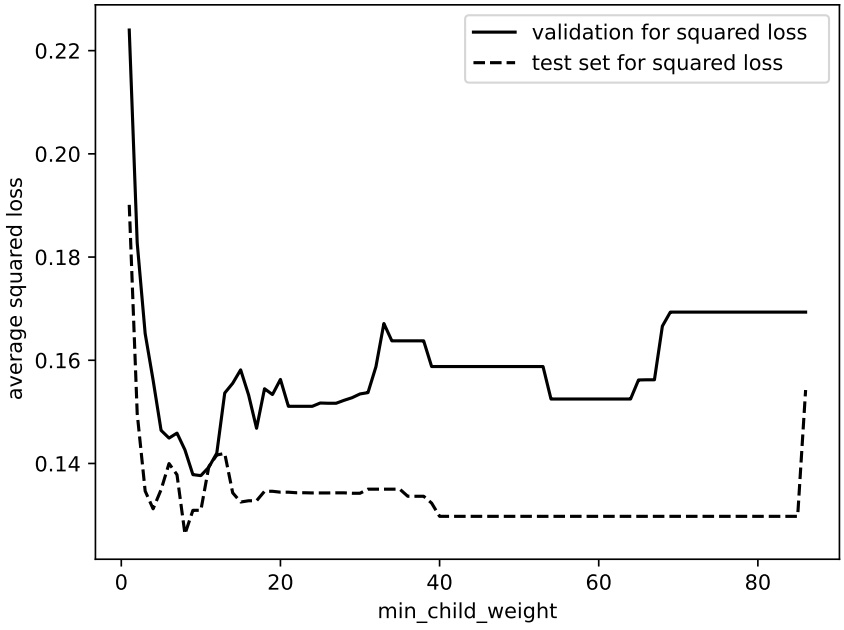

Figure 7.2: plot\_error for SPECT dataset

## 7.6 Linear Regression and Classification

Here is a stochastic gradient descent searcher for linear regression and classification.

```python
from learnProblem import Learner
import random, math

class Linear_learner(Learner):
    def __init__(self, dataset, train=None,
                    learning_rate=0.01, max_init = 0, squashed=True,
                    bias0=None):
        """Creates a gradient descent searcher for a linear classifier.
        The main learning is carried out by learn()

        dataset provides the target and the input features
        train provides a subset of the training data to use
        learning_rate is the gradient descent step size
        max_init is the maximum absolute value of the initial weights (does this matter?)
        squashed specifies whether the output is a squashed linear function
        bias0 is initial bias if not None
        """
```

<!-- page: 177 -->

```python
def learn(self, batch_size=32, num_iter=1000):
    batch_size = min(batch_size, len(self.train))
    d = {feat:0 for feat in self.weights}
    for it in range(num_iter):
        self.display(2,f"prediction= {self}")
        for e in random.sample(self.train, batch_size):
            error = self.predictor(e) - self.target(e)
            for feat in self.weights:
                d[feat] += error*feat(e)

https://aipython.org Version 0.9.18 March 10, 2026
```

## 7.6. Linear Regression and Classification

```python
self.dataset = dataset
    self.target = dataset.target
    if train==None:
        self.train = self.dataset.train
    else:
        self.train = train
    self.learning_rate = learning_rate
    self.squashed = squashed
    self.input_features = [one]+dataset.input_features # one is defined
        below
    self.weights = {feat:random.uniform(-max_init,max_init)
        for feat in self.input_features}
    if bias0 is not None:
        self.weights[one] = bias0
```

predictor predicts the value of an example from the current parameter settings.

```python
def predictor(self,e):
    """returns the prediction of the learner on example e"""
    linpred = sum(w*f(e) for f,w in self.weights.items())
    if self.squashed:
        return sigmoid(linpred)
    else:
        return linpred

def __str__(self, sig_dig=3):
    """returns the doc string for the current prediction function
    sig_dig is the number of significant digits in the numbers"""
    doc = "+".join(str(round(val,sig_dig))+"*"+feat.__doc__
        for feat,val in self.weights.items())
    if self.squashed:
        return "sigmoid("+ doc+"")
    else:
        return doc
```

learn is the main algorithm of the learner. It does num\_iter steps (batches) of stochastic gradient descent, for the given batch size.

<!-- page: 178 -->

```python
for feat in self.weights:
            self.weights[feat] -= self.learning_rate*d[feat]
            d[feat]=0
    return self.predictor
```

one is a function that always returns 1. This is used for one of the input properties.

```python
____ learnLinear.py — (continued) ________________
def one(e):
    "1"
    return 1
```

sigmoid(x) is the function

<div class="docvortex-algorithm" style="white-space: pre-wrap; font-family:monospace;">
$\frac{1}{1 + e^{-x}}$
</div>

The inverse of sigmoid is the logit function

```python
def sigmoid(x):
    return 1/(1+math.exp(-x))

def logit(x):
    return -math.log(1/x-1)

softmax([x0,x2,...]) returns [v0,v2,...] where
    vi = exp(xi)/Σj exp(xj)
```

```python
def softmax(xs, domain=None):
    """xs is a list of values, and
    domain is the domain (a list) or None if the list should be returned
    returns a distribution over the domain (a dict)
    """
    m = max(xs) # use of m prevents overflow (and all values underflowing)
    exps = [math.exp(x-m) for x in xs]
    s = sum(exps)
    if domain:
        return {d:v/s for (d,v) in zip(domain,exps)}
    else:
        return [v/s for v in exps]

def indicator(v, domain):
    return [1 if v==dv else 0 for dv in domain]
```

The following tests the learner on a datasets. Uncomment another dataset for different examples.

<!-- page: 179 -->

```python
from learnProblem import Data_set, Data_from_file, Evaluate
from learnProblem import Evaluate
import matplotlib.pyplot as plt

if __name__ == "__main__":
    data = Data_from_file('data/SPECT.csv', target_index=0)
    # data = Data_from_file('data/mail_reading.csv', target_index=-1)
    # data = Data_from_file('data/carbool.csv', one_hot=True,
        target_index=-1)
    ll = Linear_learner(data)
    ll.learn()
    ll.evaluate()
```

The following plots the errors on the training and validation sets as a function of the number of steps of gradient descent.

```python
def plot_steps(data,
        learner=None,
        criterion=Evaluate.squared_loss,
        step=1,
        num_steps=1000,
        log_scale=True,
        legend_label=""):
    """
    plots the training and validation error for a learner.
    data is the dataset
    learner is the learning algorithm (default is linear learner on the
        data)
    criterion gives the evaluation criterion plotted on the y-axis
    step specifies how many steps are run for each point on the plot
    num_steps is the number of points to plot

    """
    if legend_label != """: legend_label+=" "
    plt.ion()
    fig, ax = plt.subplots()
    ax.set_xlabel("step")
    ax.set_ylabel("Average "+criterion.__doc__)
    if log_scale:
        ax.set_xscale('log') #plt.semilogx() #Makes a log scale
    else:
        ax.set_xscale('linear')
    if learner is None:
        learner = Linear_learner(data)
    train_errors = []
    valid_errors = []
    for i in range(1,num_steps+1,step):
        valid_errors.append(data.evaluate_dataset(data.valid,
            learner.predictor, criterion))
```

<!-- page: 180 -->

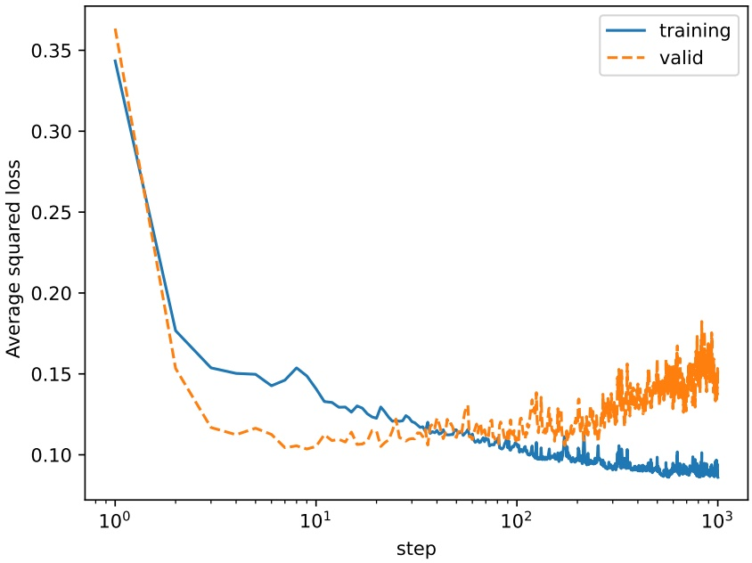

Figure 7.3: plot\_steps for SPECT dataset

```python
train_errors.append(data.evaluate_dataset(data.train,
    learner.predictor, criterion))
learner.display(2, "Train error:",train_errors[-1],
        "Valid error:",valid_errors[-1])
learner.learn(num_iter=step)
ax.plot(range(1,num_steps+1,step),train_errors,ls='--',label=legend_label+"training")
ax.plot(range(1,num_steps+1,step),valid_errors,ls='--',label=legend_label+"validation")
ax.legend()
#plt.draw()
learner.display(1, "Train error:",train_errors[-1],
        "Validation error:",valid_errors[-1])

# This generates the figure
# from learnProblem import Data_set_augmented, prod_feat
# data = Data_from_file('data/SPECT.csv', prob_valid=0.5, target_index=0,
    seed=123)
# dataplus = Data_set_augmented(data, [], [prod_feat])
# plot_steps(data, num_steps=1000)
# plot_steps(dataplus, num_steps=1000) # warning slow
```

Figure 7.3 shows the result of plot\_steps(data, num\_steps=1000) in the code above. What would you expect to happen with the augmented data (with extra features)? Hint: think about underfitting and overfitting.

Exercise 7.12 In Figure 7.3, the log loss is very unstable when there are over 20

<!-- page: 181 -->

steps. Hypothesize why this occurs. [Hint: when does gradient descent become unstable?] Test your hypothesis by running with different hyperparameters.

Exercise 7.13 The squashed learner only makes predictions in the range (0, 1). If the output values are {1, 2, 3, 4} there is no use predicting less than 1 or greater than 4. Change the squashed learner so that it can learn values in the range (1, 4). Test it on the file 'data/car.csv'.

The following plots the prediction as a function of the number of steps of gradient descent. We first define a version of range that allows for real numbers (integers and floats). This is similar to numpy.arange.

```python
def arange(start,stop,step):
    """enumerates values in the range [start,stop) separated by step.
    like range(start,stop,step) but allows for integers and floats.
    Rounding errors are expected with real numbers. (or use numpy.arange)
    """
    while start<stop:
        yield start
        start += step

def plot_prediction(data,
            learner = None,
            minx = 0,
            maxx = 5,
            step_size = 0.01, # for plotting
            label = "function"):
    plt.ion()
    fig,ax = plt.subplots()
    ax.set_xlabel("x")
    ax.set_ylabel("y")
    if learner is None:
        learner = Linear_learner(data, squashed=False)
    learner.learning_rate=0.001
    learner.learn(num_iter=100)
    learner.learning_rate=0.0001
    learner.learn(num_iter=1000)
    learner.learning_rate=0.00001
    learner.learn(num_iter=10000)
    learner.display(1,f"function learned is {learner}. "
           "error=",data.evaluate_dataset(data.train, learner.predictor,
               Evaluate.squared_loss))
    ax.plot([e[0] for e in data.train],[e[-1] for e in
        data.train],"bo",label="data")
    ax.plot(list(arange(minx,maxx,step_size)),
        [learner.predictor([x])
            for x in arange(minx,maxx,step_size)],
        label=label)
    ax.legend(loc='upper left')
```

<!-- page: 182 -->

```python
from learnProblem import Data_set_augmented, power_feat
def plot_polynomials(data,
        learner_class = Linear_learner,
        max_degree = 5,
        minx = 0,
        maxx = 5,
        num_iter = 1000000,
        learning_rate = 0.00001,
        step_size = 0.01, # for plotting
    ):
    plt.ion()
    fig, ax = plt.subplots()
    ax.set_xlabel("x")
    ax.set_ylabel("y")
    ax.plot([e[0] for e in data.train],[e[-1] for e in
        data.train],"ko",label="data")
    x_values = list(arange(minx,maxx,step_size))
    line_styles = ['--','--','-.',':'']
    colors = ['0.5','k','k','k','k']
    for degree in range(max_degree):
        data_aug = Data_set_augmented(data,[power_feat(n) for n in
            range(1,degree+1)],
                include_orig=False)
        learner = learner_class(data_aug,squashed=False)
        learner.learning_rate = learning_rate
        learner.learn(num_iter=num_iter)
        learner.display(1,f"For degree {degree}, "
               f"function learned is {learner}. "
               "error=",data.evaluate_dataset(data.train,
                    learner.predictor, Evaluate.squared_loss))
        ls = line_styles[degree % len(line_styles)]
        col = colors[degree % len(colors)]
        ax.plot(x_values,[learner.predictor([x]) for x in x_values],
            linestyle=ls, color=col,
                label="degree="+str(degree))
        ax.legend(loc='upper left')

# Try:
# data0 = Data_from_file('data/simp_regr.csv', prob_test=0, prob_valid=0,
    one_hot=False, target_index=-1)
# plot_prediction(data0)
# Alternatively:
# plot_polynomials(data0)
# What if the step size was bigger?
#datam = Data_from_file('data/mail_reading.csv', target_index=-1)
#plot_prediction(datam)
```

Exercise 7.14 For each of the polynomial functions learned: What is the pre-diction as x gets larger (x → ∞). What is the prediction as x gets more negative

<!-- page: 183 -->

(x → −∞).

## 7.6.1 Rating Data

Much real-world data does not come in the terms of tables where there is a case for each tuple and one of the columns is a feature to be learned as a function of the other columns. Data typically has to be transformed into such a format. The example we will use data where there is a person-item-rating-timestamp table and an item-properties table.

MovieLens<sup>1</sup>is non-commercial, personalized movie recommendation system, for which a number of datasets are publicly available. The items in are movies and the properties are genres of movies. The aim is to predict the rating of a movie for a user.

These are easy to understand datasets, where students may have even watched some of the movies. This domain is pedagogically interesting because there are multiple learning possibilities. Let’s predict the future from the past; ratings before a timestamp are used for training and those after are used for testing. (This is a more reasonable test of a real application than choosing random splits.) You can learn global predictions (using all of the ratings) or treat each user as a dataset. It is challenging for a number of reasons: The number of training ratings per user ranges from zero to hundreds. The ratings are not selected at random; most people only watch movies they think they might like. Many people do not rate movies of all genres; for example, most people have not rated horror movies, and thus it is difficult to predict whether they will like horror movies. Similar issues arise in many practical datasets.

There are 18 genres for movies, including action, adventure, animation, children, comedy, and crime. Each movie can have multiple genres. For example, Toy Story (1995) has genres animation, children, comedy. The rating is an integer from 1 to 5.

In the Movielens dataset(s), all users had rated at least 20 movies. We have split the rating by time: movies on or before the given timestamp are in the training set, those after are in the test set. (Different datasets are obtained by changing the timestamp; it is even possible to consider predicting the future from the past for all timestamps.) This means that some users have few (or no) movies in the training set. This is more representative of a real application

<small><span class="docvortex-page-footnote" data-block-type="page_footnote" style="color:#6b7280"><sup>1</sup>Movielens [Harper and Konstan, 2015] is a research project by the GroupLens research group at the University of Minnesota. Datasets of various sizes are available from [https://www.grouplens.org/datasets/movielens/](https://www.grouplens.org/datasets/movielens/). To make this accessible to the most students, we used the smallest datasets. The small latest Movielens dataset does not have many users that span a timestamp (have ratings before and after the time) for any of the timestamps we tried, which is why it was not used. Newer datasets have a different format for the movie files. The newer datasets are in csv format, which makes them more standard, so use the Python csv package to read (as many titles contain commas). The newer datasets also contain fractional ratings, such as 3.5 or 0.5), which breaks the code here. If the larger datasets are too big and you want to test extrapolation (predicting the future from the past), we suggest you select the ratings between two timestamps, rather than selecting random users.</span></small>

<!-- page: 184 -->

where many people have few ratings – indeed everyone starts with few ratings, and presumably they need recommendations to keep them on the system.

The following assumes that the older 100k dataset is downloaded from [https://grouplens.org/datasets/movielens/](https://grouplens.org/datasets/movielens/). Unzip ml-100k.zip into the current directory.

```python
import matplotlib.pyplot as plt
import urllib.request
import csv
from statistics import mean
from display import Displayable
from learnProblem import Data_set, Learner, Evaluate
from learnNoInputs import Naive_learner
from learnLinear import Linear_learner

class Data_set_from_ratings(Data_set):
    def __init__(self,
        time_split=891382267, # 90% training
        #time_split=888259984, # 75% training
        #time_split=880845177, # 60% training
        #time_split=882826944, # halfway split
        ratings_file_name="ml-100k/u.data",
        item_file_name="ml-100k/u.item",
        genres_start=5,
        ratings_separator = '\t',
        movie_separator="|"):
    """
    ratings before time_split are training set. Those after are test.
    genres_start is starting position of genres in item file

    This code assumes that the older 100k dataset is downloaded from
    https://grouplens.org/datasets/movielens/
    Unzip ml-100k.zip into the current directory.
    """
    self.genres = ["Action", "Adventure", "Animation", "Children",
        "Comedy", "Crime", "Documentary", "Drama", "Fantasy",
        "Film-Noir", "Horror", "Musical", "Mystery",
        "Romance", "Sci-Fi", "Thriller", "War", "Western"]
    genre2pos = {genre:pos for (pos,genre) in enumerate(self.genres)}
    self.users = set() #set of users

    self.display(1,"Movie Rating Dataset. Reading...")
    with open(ratings_file_name,'r') as ratings_file:
        #all_ratings = csv.reader(ratings_file,
            delimiter=ratings_separator)
        all_ratings = (line.strip().split(ratings_separator) for line
            in ratings_file)
```

<!-- page: 185 -->

```python
# Get rating information:
self.training_data = []
self.test_data = []
self-Reimesteps = []
self.training_stats = {1:0, 2:0, 3:0, 4:0 ,5:0}
self.test_stats = {1:0, 2:0, 3:0, 4:0 ,5:0}
for quadruple in all_ratings:
    (user,item,rating,timestamp) = tuple(int(v) for v in
        quadruple)
    self-Reimesteps.append(timestamp) # useful for picking split
    self.users.add(user)
    if timestamp <= time_split:
        self.training_data.append((user,item,rating))
        self.training_stats[rating] += 1
    else:
        self.test_data.append((user,item,rating))
        self.test_stats[rating] += 1
self.training_mean = (sum(r*n for (r,n) in
    self.training_stats.items())
            /sum(self.training_stats.values()))
# Get movie information:
with open(item_file_name,'r', encoding='ISO-8859-1') as item_file:
    self.item_titles = {}
    self.itemprops = {}
    self.extra_genres = {}
    item_lines = (line.strip().split(movie_separator) for line in
        item_file)
    #item_lines = csv.reader(item_file, delimiter=movie_separator)
    for items in item_lines:
        movieId = int(items[0])
        self.item_titles[movieId] = items[1]
        self.itemprops[movieId] = [int(v) for v in
            items[genres_start:]

# the following is to create pseudo examples (see text)
self.itemprops[-1] = [1 for _ in self.genres] # special movie
self.itemprops[-2] = [0 for _ in self.genres]

Data_set.__init__(self, self.training_data,
        test=self.test_data, prob_valid=0,
                target_index=2, header=self.genres,
                target_type="numeric")
# Create input features:
# input features are properties of the item (e[1]) for rating e
self.input_features = []
for i in range(len(self.header)):
    def feat(e, ind=i):
        return self.itemprops[e[1]][ind]
    feat.type = "boolean"
```

<!-- page: 186 -->

```python
feat.__doc__ = self.header[i]
    self.input_features.append(feat)
    self.show_stats()

def show_stats(self):
    self.display(1, len(self.training_data),"training ratings and",
        len(self.test_data),"test ratings")
    self.tr_users = {user for (user,item,rating) in self.training_data}
    self.test_users = {user for (user,item,rating) in self.test_data}
    self.display(1,"users:",len(self.tr_users),"training,",len(self.test_users),"test,",
        len(self.tr_users & self.test_users),"in common")
    tr_items = {item for (user,item,rating) in self.training_data}
    test_items = {item for (user,item,rating) in self.test_data}
    self.display(1,"items:",len(tr_items),"training,",len(test_items),"test,",
        len(tr_items & test_items),"in common")
    self.display(1,"Rating statistics for training set:
        ",self.training_stats)
    self.display(1,"Mean training rating: ",self.training_mean)
    self.display(1,"Rating statistics for test set: ",self.test_stats)

def test():
    global movielens, naive_learner, naive_predictor, global_learner,
        global_predictor
    movielens = Data_set_from_ratings()
    naive_learner = Naive_learner(movielens)
    naive_predictor = naive_learner.learn()
    naive_learner.evaluate()
    global_learner = Linear_learner(movielens, learning_rate = 0.001,
        squashed=False)
    global_predictor = global_learner.learn(num_iter=10000)
    global_learner.evaluate()

if __name__ == "__main__":
    test()
```

Exercise 7.15 How does the code need to change if the aim is predict whether a person likes a movie, where likes means “rating is grater than 3”, evaluated by log loss?

Exercise 7.16 Look at the weights for the learned linear function. Do negative weights for Comedy and positive weights for Horror imply that people generally don’t like comedy and like horror movies? (Hint: think about who rates the movies. Also consider how genre(s) may be correlated. Depending on the split, the weights may not be like that.)

The preceding code gave global predictions: the same rating for a movie was given for each user. The following code creates a dataset for each user. There are as many datasets as there are users. This only constructs datasets for users with both training and test ratings. The Linear\_learner is hard coded into this to make the code simpler.

<!-- page: 187 -->

```python
class UserDataSets(Displayable):
    def __init__(self, ratings):
        """ ratings is a Data_set_from_ratings
        """
        self.ratings = ratings

    def create_user_datasets(self, pseudo):
        """
        create a dataset for each user.
        pseudo is the number of each of the pseudo examples added (see code document)
        """
        self.pseudo = pseudo
        self.user2train = {} # user to list of training examples dict
        self.user2test = {} # user to list of test examples dict
        self.pseudo_egs = [(-1,-1,self.ratings.training_mean),
                    (-1,-2,self.ratings.training_mean)]* pseudo
        for (user,item,rating) in self.ratings.train:
            if user not in self.user2train:
                self.user2train[user] = self.pseudo_egs.copy()
                self.user2train[user].append((user,item,rating))
        for (user,item,rating) in self.ratings.test:
            if user in self.user2test:
                self.user2test[user].append((user,item,rating))
            else:
                self.user2test[user] = [(user,item,rating)]
        self.user2dataset = {}
        for user in self.user2test:
            if user in self.user2train:
                self.user2dataset[user] = A_users_ratings(self.ratings,
                    self.user2train[user], self.user2test[user])
            return self.user2dataset

    def learn_personalized(self, pseudo=0, ecrit=Evaluate.squared_loss):
        """
        learn personalized ratings for each user.
        this assumes that test() is run to create the naive_learner and global_learner
        """
        self.create_user_datasets(pseudo=pseudo)
        self.learners = {}
        x_values = []
        pers_values = []
        naive_values = []
        global_values = []
        self.display(1,"user \t#train \t#test \tnaive \tglobal \tpersonal")
        total_num_train = 0
        total_num_test = 0
        for user in self.user2dataset:
```

<!-- page: 188 -->

```python
num_train = len(self.user2dataset[user].train)-2*self.pseudo
total_num_train += num_train
if num_train == 0: #no training data
    predictor = naive_predictor
    self.learners[user] = naive_learner
else:
    lnr = Linear_learner(self.user2dataset[user], max_init=0.1,
                        learning_rate = 0.001, squashed=False)
    predictor = lnr.learn(num_iter=1000)
    self.learners[user] = lnr
error =
    self.user2dataset[user].evaluate_dataset(self.user2dataset[user].test,
                        predictor, ecrit)
x_values.append(num_train)
pers_values.append(error)
naive_error =
    self.user2dataset[user].evaluate_dataset(self.user2dataset[user].test,
                        naive_predictor, ecrit)
naive_values.append(naive_error)
global_error =
    self.user2dataset[user].evaluate_dataset(self.user2dataset[user].test,
                        global_predictor, ecrit)
global_values.append(global_error)
total_num_test += len(self.user2dataset[user].test)
self.display(1,f"{user}\t{num_train}\t{len(self.user2dataset[user].test)}\t"
        f"{naive_error:.5f}\t{global_error:.5f}\t{error:.5f}")
self.display(1,f"mean\t{total_num_train/len(self.user2dataset):.1f}\t"
        f"{total_num_test/len(self.user2dataset):.1f}\t{mean(naive_values):.5f}\t"
        f"{mean(global_values):.5f}\t{mean(pers_values):.5f}")
self.display(1,f"{pseudo=}")
plt.ion()
fig, ax = plt.subplots()
# ax.set_xscale('log') # lets you visualize small training datasets
better
ax.set_xlabel("training size")
ax.set_ylabel(ecrit.__doc__)
ax.plot(x_values, pers_values, "o", label=f"personalized {pseudo=}")
ax.plot(x_values, naive_values, "x", label="naive")
ax.plot(x_values, global_values, "+", label="global")
ax.legend()
plt.show()

class A_users_ratings(Data_set):
    def __init__(self, ratings_dataset, training, test):
        self.max_display_level = 0
        Data_set.__init__(self, training, test=test, prob_valid=0,
                    num_properties=ratings_dataset.num_properties,
                    target_index=ratings_dataset.target_index)
        self.input_features = ratings_dataset.input_features
```

<!-- page: 189 -->

```python
if __name__ == "__main__":
    userdatasets = UserDataSets(movielens)
    userdatasets.learn_personalized(pseudo=0)
```

For the following exercises, test whether your answers also hold for other data splits.

Exercise 7.17 The above computes the average error, averaged over users. It is also possible to give the average error averaged over ratings. Which is fairer? Does this change the results? Hint: consider users with few test cases.

Exercise 7.18 What can be done with users with no training ratings? (They are not included in the above code.) Should they act randomly? Or should they make predictions based on population-level statistics? What does the code predict for those with no training data? What is an alternative? Does it work better?

Exercise 7.19 How does the performance of the personalized prediction compared to the global predictions depend on the number of training examples? Look at the results, and suggest a hypothesis. Give evidence (data) to support and/or oppose your hypothesis.

Exercise 7.20 What happen with users with few (or even just 1) training datapoints? (Hint: Think about both the genres of the movies rated and the genres that don’t occur in the movies rated.) Does overfitting occur? Suggest what should happen.

Exercise 7.21 The above code allows the inclusion of pseudo-examples. There are two pseudo-movies (-1 and -2) one of which has all genres and one of which has none. The parameter pseudo specifies how many ratings of each movie to include, where the rating for these is the global average rating. Does having pseudo examples give better predictions? If so, what is the best value for pseudo?

Exercise 7.22 Assume that there are k pseudo instances of the pseudo examples for each batch. How are the parameters updated in each batch? (How do the pseudo examples affect the parameter update for the batch?) How does this update relate to L1 or L2 regularization?

## 7.7 Boosting

The following code implements functional gradient boosting for regression.

A Boosted dataset is created from a base dataset by subtracting the pre-diction of the offset function from each example. This does not save the new dataset, but generates it as needed. The extra space used is constant, independent on the size of the dataset.

```python
learnBoosting.py — Functional Gradient Boosting ____

from learnProblem import Data_set, Learner, Evaluate
from learnNoInputs import Predict
from learnLinear import sigmoid
import statistics
import random
```

<!-- page: 190 -->

```python
class Boosted_dataset(Data_set):
    def __init__(self, base_dataset, offset_fun, subsample=1.0):
        """new dataset which is like base_dataset,
        but offset_fun(e) is subtracted from the target of each example e
        """
        self.base_dataset = base_dataset
        self.offset_fun = offset_fun
        self.train =
            random.sample(base_dataset.train,int(subsample*len(base_dataset.train)))
        self.valid = base_dataset.valid
        #Data_set.__init__(self, base_dataset.train, base_dataset.valid,
        #            base_dataset.prob_valid, base_dataset.target_index)

        #def create_features(self):
            """creates new features - called at end of Data_set.init()
        defines a new target
        """
        self.input_features = self.base_dataset.input_features
        def newout(e):
            return self.base_dataset.target(e) - self.offset_fun(e)
        newout.frange = self.base_dataset.target.frange
        newout.ftype = self.infer_type(newout.frange)
        self.target = newout

    def conditions(self, *args, colsample_bytree=0.5, **nargs):
        conds = self.base_dataset.conditions(*args, **nargs)
        return random.sample(conds, int(colsample_bytree*len(conds)))
```

A boosting learner takes in a dataset and a base learner, and returns a new predictor. The base learner, takes a dataset, and returns a Learner object.

```python
class Boosting_learner(Learner):
    def __init__(self, dataset, base_learner_class, subsample=0.8):
        self.dataset = dataset
        self.base_learner_class = base_learner_class
        self.subsample = subsample
        mean = sum(self.dataset.target(e)
            for e in self.dataset.train)/len(self.dataset.train)
        self.predictor = lambda e:mean # function that returns mean for each example
        self.predictor.__doc__ = "lambda e:"+str(mean)
        self.offsets = [self.predictor] # list of base learners
        self.predictors = [self.predictor] # list of predictors
        self.errors = [data.evaluate_dataset(data.valid, self.predictor, Evaluate.squared_loss)]
        self.display(1,"Mean validation set squared loss=", self.errors[0] )

    def learn(self, num_ensembles=10):
```

<!-- page: 191 -->

```python
"""adds num_ensemble learners to the ensemble.
    returns a new predictor.
    """
    for i in range(num_ensembles):
        train_subset = Boosted_dataset(self.dataset, self.predictor,
            subsample=self.subsample)
        learner = self.base_learner_class(train_subset)
        new_offset = learner.learn()
        self.offsets.append(new_offset)
        def new_pred(e, old_pred=self.predictor, off=new_offset):
            return old_pred(e)+off(e)
        self.predictor = new_pred
        self.predictors.append(new_pred)
        self.errors.append(data.evaluate_dataset(data.valid,
            self.predictor, Evaluate.squared_loss))
        self.display(1,f"Iteration {len(self.offsets)-1},treesize =
            {new_offset.num_leaves}. mean squared
            loss={self.errors[-1]}")
    return self.predictor
```

For testing, sp\_DT\_learner returns a learner that predicts the mean at the leaves and is evaluated using squared loss. It can also take arguments to change the default arguments for the trees.

```python
# Testing

from learnDT import DT_learner
from learnProblem import Data_set, Data_from_file

def sp_DT_learner(split_to_optimize=Evaluate.squared_loss,
                     leaf_prediction=Predict.mean,**nargs):
    """Creates a learner with different default arguments replaced by
        **nargs
    """
    def new_learner(dataset):
        return DT_learner(dataset,split_to_optimize=split_to_optimize,
                       leaf_prediction=leaf_prediction, **nargs)
    return new_learner

#data = Data_from_file('data/car.csv', target_index=-1) regression
#data = Data_from_file('data/SPECT.csv', target_index=0, seed=62) #123)
#data = Data_from_file('data/mail_reading.csv', target_index=-1)
#data = Data_from_file('data/holiday.csv', has_header=True, num_train=19,
       target_index=-1)
#learner10 = Boosting_learner(data,
       sp_DT_learner(split_to_optimize=Evaluate.squared_loss,
       leaf_prediction=Predict.mean, min_child_weight=10))
#learner7 = Boosting_learner(data, sp_DT_learner(0.7))
#learner5 = Boosting_learner(data, sp_DT_learner(0.5))
#predictor9 =learner9.learn(10)
```

<!-- page: 192 -->

```python
#for i in learner9.offsets: print(i.__doc__)
import matplotlib.pyplot as plt

def plot_boosting_trees(data, steps=10, mcws=[30,20,20,10], gammas=
    [100,200,300,500]):
    # to reduce clutter uncomment one of following two lines
    #mcws=[10]
    #gamas=[200]
    learners = [(mcw, gamma, Boosting_learner(data,
        sp_DT_learner(min_child_weight=mcw, gamma=gamma)))
            for gamma in gammas for mcw in mcws
            ]
    plt.ion()
    fig, ax = plt.subplots()
    ax.set_xscale('linear') # change between log and linear scale
    ax.set_xlabel("number of trees")
    ax.set_ylabel("mean squared loss")
    markers = (m+c for c in ['k','g','r','b','m','c','y'] for m in
        ['-','--','-.',':''])
    for (mcw,gamma,learner) in learners:
        data.display(1,f"min_child_weight={mcw}, gamma={gamma}")
        learner.learn(steps)
        ax.plot(range(steps+1), learner.errors, next(markers),
                label=f"min_child_weight={mcw}, gamma={gamma}")
    ax.legend()

# plot_boosting_trees(data,mcws=[20], gammas= [100,200,300,500])
# plot_boosting_trees(data,mcws=[30,20,20,10], gammas= [100])
```

Exercise 7.23 For a particular dataset, suggest good values for min\_child\_weight and gamma. How stable are these to different random choices that are made (e.g., in the training-validation split)? Try to explain why these are good settings.

## 7.7.1 Gradient Tree Boosting

The following implements gradient Boosted trees for classification. If you want to use this gradient tree boosting for a real problem, we recommend using **XGBoost** [Chen and Guestrin, 2016] or **LightGBM** [Ke, Meng, Finley, Wang, Chen, Ma, Ye, and Liu, 2017].

GTB\_learner subclasses DT\_learner. The method learn\_tree is used unchanged. DT\_learner assumes that the value at the leaf is the prediction of the leaf, thus leaf\_value needs to be overridden. It also assumes that all nodes at a leaf have the same prediction, but in GTB the elements of a leaf can have different values, depending on the previous trees. Thus sum\_losses also needs to be overridden.

<!-- page: 193 -->

```python
def __init__(self, dataset, number_trees, lambda_reg=1, gamma=0,
    **dtargs):
    DT_learner.__init__(self, dataset,
        split_to_optimize=Evaluate.log_loss, **dtargs)
    self.number_trees = number_trees
    self.lambda_reg = lambda_reg
    self.gamma = gamma
    self.trees = []

def learn(self):
    for i in range(self.number_trees):
        tree =
            self.learn_tree(self.dataset.conditions(self.max_num_cuts),
            self.train)
        self.trees.append(tree)
        self.display(1,f"""Iteration {i} treesize = {tree.num_leaves}
            train logloss={
            self.dataset.evaluate_dataset(self.dataset.train,
                self.gtb_predictor, Evaluate.log_loss)
            } validation logloss={
            self.dataset.evaluate_dataset(self.dataset.valid,
                self.gtb_predictor, Evaluate.log_loss)}""")
    return self.gtb_predictor

def gtb_predictor(self, example, extra=0):
    """prediction for example,
    extras is an extra contribution for this example being considered
    """
    return sigmoid(sum(t(example) for t in self.trees)+extra)

def leaf_value(self, egs, domain=[0,1]):
    """value at the leaves for examples egs
    domain argument is ignored"""
    pred_acts = [(self.gtb_predictor(e),self.target(e)) for e in egs]
    return sum(a-p for (p,a) in pred_acts) /(sum(p*(1-p) for (p,a) in
        pred_acts)+self.lambda_reg)

def sum_losses(self, data_subset):
    """returns sum of losses for dataset (assuming a leaf is formed
        with no more splits)
    """
    leaf_val = self.leaf_value(data_subset)
    error = sum(Evaluate.log_loss(self.gtb_predictor(e,leaf_val),
        self.target(e))
        for e in data_subset) + self.gamma
    return error
```

Testing

<!-- page: 194 -->

```python
# data = Data_from_file('data/carbool.csv', one_hot=True, target_index=-1,
    seed=123)
# gtb_learner = GTB_learner(data, 10)
# gtb_learner.learn()
```

Exercise 7.24 Find better hyperparameter settings than the default ones. Compare prediction error with other methods for Boolean datasets.

<!-- page: 195 -->

# Neural Networks and Deep Learning

Warning: this is not meant to be an efficient implementation of deep learning. If you want to do serious machine learning on medium-sized or large data, we recommend Keras ([https://keras.io](https://keras.io)) [Chollet, 2021] or PyTorch ([https://pytorch.org](https://pytorch.org)), which are very efficient, particularly on GPUs. They are, however, black boxes. The AIPython neural network code should be seen like a car engine made of glass; you can see exactly how it works, even if it is not fast.

We have followed the naming conventions of Keras for the parameters: any parameters that are the same as in Keras have the same names.

## 8.1 Layers

A neural network is built from layers. In AIPython (unlike Keras and PyTorch), activation functions are treated as separate layers, which makes them more modular and the code more readable.

This provides a modular implementation of layers. Layers can easily be stacked in many configurations. A layer needs to implement a method to compute the output values from the inputs, a method to back-propagate the error, and a method update its parameters (if it has any) for a batch.

```python
learnNN.py — Neural Network Learning
from display import Displayable
from learnProblem import Learner, Data_set, Data_from_file,
    Data_from_files, Evaluate
from learnLinear import sigmoid, one, softmax, indicator
import random, math, time
```

<!-- page: 196 -->

```python
class Layer(Displayable):
    def __init__(self, nn, num_inputs=None, num_outputs=None):
        """Abstract layer class, must be overridden.
        nn is the neural network this layer is part of
        num_outputs is the number of outputs for this layer.
        """
        self.nn = nn
        self.num_inputs = nn.num_outputs if num_inputs is None else
            num_inputs # nn output is layer's input
        if num_outputs:
            self.num_outputs = num_outputs
        else:
            self.num_outputs = self.num_inputs # same as the inputs
        self.outputs= [0]*self.num_outputs
        self.input_errors = [0]*self.num_inputs
        self.weights = []

    def output_values(self, input_values, training=False):
        """Return the outputs for this layer for the given input values.
        input_values is a list (of length self.num_inputs) of the inputs
        returns a list of length self.num_outputs.
        It can act differently when training and when predicting.
        """
        raise NotImplementedError("output_values") # abstract method

    def backprop(self, out_errors):
        """Backpropagate the errors on the outputs
        errors is a list of output errors (of length self.num_outputs).
        Returns list of input errors (of length self.num_inputs).

        This is only called after corresponding output_values(),
            which should remember relevant information
        """
        raise NotImplementedError("backprop") # abstract method

class Optimizer(Displayable):
    def update(self, layer):
        """updates parameters after a batch.
        """
        pass
```

## 8.1.1 Linear Layer

A linear layer maintains an array of weights. self.weights[i][o] is the weight between input i and output o. The bias is treated implicitly as the last input, so the weight of the bias for output o is self.weights[self.num\_inputs][o].

The default initialization is the Glorot uniform initializer [Glorot and Bengio, 2010], which is the default in Keras. An alternative is to provide a limit, in which case the values are selected uniformly in the range [−limit, limit]. As

<!-- page: 197 -->

in Keras, AIpython treats initializes the bias of hidden layers to zero. The output layer is treated separately, with the weights all zero except for the bias for categorical outputs (see following exercise).

```python
class Linear_complete_layer(Layer):
    """a completely connected layer"""
    def __init__(self, nn, num_outputs, limit=None, final_layer=False,
        num_inputs=None):
        """A completely connected linear layer.
        nn is a neural network that the inputs come from
        num_outputs is the number of outputs
        the random initialization of parameters is in range [-limit,limit]
        """
        Layer.__init__(self, nn, num_inputs=num_inputs,
            num_outputs=num_outputs)
        if limit is None:
            limit =math.sqrt(6/(self.num_inputs+self.num_outputs))
        # self.weights[i][o] is the weight between input i and output o
        if final_layer:
            self.weights = [[0 if i < self.num_inputs
                or (nn.output_type != "categorical")
                else 1
                    for o in range(self.num_outputs)]
                    for i in range(self.num_inputs+1)]
            else:
            self.weights = [[random.uniform(-limit, limit)
                if i < self.num_inputs else 0
                    for o in range(self.num_outputs)]
                    for i in range(self.num_inputs+1)]
        # self.weights[i][o] is the accumulated change for a batch.
        self.delta = [[0 for o in range(self.num_outputs)]
            for i in range(self.num_inputs+1)]

    def output_values(self, inputs, training=False):
        """Returns the outputs for the input values.
        It remembers the values for the backprop.
        """
        self.display(3,f"Linear layer inputs: {inputs}")
        self.inputs = inputs
        for out in range(self.num_outputs):
            self.outputs[out] = (sum(self.weights[inp][out]*self.inputs[inp]
                for inp in range(self.num_inputs))
                + self.weights[self.num_inputs][out])
        self.display(3,f"Linear layer inputs: {inputs}")
        return self.outputs

    def backprop(self, errors):
        """Backpropagate errors, update weights, return input error.
        errors is a list of size self.num_outputs
```

<!-- page: 198 -->

```python
Returns errors for layer's inputs of size
    """
    self.display(3,f"Linear Backprop. input: {self.inputs} output
        errors: {errors}")
    for out in range(self.num_outputs):
        for inp in range(self.num_inputs):
            self.input_errors[inp] = self.weights[inp][out] * errors[out]
            self.delta[inp][out] += self.inputs[inp] * errors[out]
        self.delta[self.num_inputs][out] += errors[out]
    self.display(3,f"Linear layer backprop input errors:
        {self.input_errors}")
    return self.input_errors
```

Exercise 8.1 The initialization for the output layer is naive. Suggest an alternative (hopefully better) initialization. Test it.

Exercise 8.2 What happens if the initialization of the hidden layer weights is also zero? Try it. Explain why you get the behavior observed.

## 8.1.2 ReLU Layer

The standard activation function for hidden nodes is the **ReLU**.

```python
class ReLU_layer(Layer):
    """Rectified linear unit (ReLU) f(z) = max(0, z).
    The number of outputs is equal to the number of inputs.
    """
    def __init__(self, nn):
        Layer.__init__(self, nn)

    def output_values(self, input_values, training=False):
        """Returns the outputs for the input values.
        It remembers the input values for the backprop.
        """
        self.input_values = input_values
        for i in range(self.num_inputs):
            self.outputs[i] = max(0,input_values[i])
        return self.outputs

    def backprop(self,out_errors):
        """Returns the derivative of the errors"""
        for i in range(self.num_inputs):
            self.input_errors[i] = out_errors[i] if self.input_values[i]>0
            else 0
        return self.input_errors
```

<!-- page: 199 -->

## 8.1.3 Sigmoid Layer

One of the old standards for the activation function for hidden layers is the sigmoid. It is also used in LSTMs. It is included here to experiment with.

```python
class Sigmoid_layer(Layer):
    """sigmoids of the inputs.
    The number of outputs is equal to the number of inputs.
    Each output is the sigmoid of its corresponding input.
    """
    def __init__(self, nn):
        Layer.__init__(self, nn)

    def output_values(self, input_values, training=False):
        """Returns the outputs for the input values.
        It remembers the output values for the backprop.
        """
        for i in range(self.num_inputs):
            self.outputs[i] = sigmoid(out_errors[i])
        return self.outputs

    def backprop(self,errors):
        """Returns the derivative of the errors"""
        for i in range(self.num_inputs):
            self.input_errors[i] =
                input_values[i]*out_errors[i]*(1-out_errors[i])
        return self.input_errors
```

## 8.2 Feedforward Networks

```python
class NN(Learner):
    def __init__(self, dataset, batch_gen=None, optimizer=None,
        **hyperparms):
        """Creates a neural network for a dataset
        batch_gen is the algorithm used to generate batches (e.g., random,
            streaming)
        optimizer is the optimizer: default is SGD
        hyperparms is the dictionary of hyperparameters for the optimizer
        """
        self.batch_gen = Batch_generator(dataset.train) if batch_gen is
            None else batch_gen
        self.dataset = dataset
        self.optimizer = optimizer if optimizer else SGD
        self.hyperparms = hyperparms
        self.output_type = dataset.target.ftype
        self.input_features = dataset.input_features
```

<!-- page: 200 -->

```python
self.num_outputs = len(self.input_features) # empty NN
    self.layers = []
    self.bn = 0 # number of batches run
    self.printed_heading = False # for tracing, so header printed once

def add_layer(self, layer):
    """add a layer to the network.
    Each layer gets number of inputs from the previous layers outputs.
    """
    self.layers.append(layer)
    #if hasattr(layer, 'weights'):
        layer.optimizer = self.optimizer(layer, **self.hyperparms)
        self.num_outputs = layer.num_outputs

def predictor(self, ex):
    """Predicts the value of the first output for example ex.
    """
    values = [f(ex) for f in self.input_features]
    for layer in self.layers:
        values = layer.output_values(values)
        return sigmoid(values[0]) if self.output_type =="boolean" \
            else softmax(values, self.dataset.target.frange) if
                self.output_type == "categorical" \
            else values[0]
```

The learn method learns the parameters of a network. This is like the learn() method of linear regression (Section 7.6) except that there can be multiple outputs and there can be multiple optimizers.

```python
def learn(self, batch_size=32, num_iter = 100, report_each=10):
    """Learns parameters for a neural network using the chosen optimizer.
    batch_size is the size of each batch
    num_iter is the number of iterations over the batches
    report_each means print errors after each multiple of that number of batches
    """
    self.report_each = report_each
    if not self.printed_heading and num_iter >= report_each:
        self.display(1,"batch\tTraining\tTraining\tValidation\tValidation")
        self.display(1,"\tAccuracy\tLog loss\tAccuracy\tLog loss")
        self.printed_heading = True
        self.trace()
    for i in range(num_iter):
        batch = self.batch_gen.get_batch(batch_size)
            #random.sample(self.dataset.train, batch_size)
        for e in batch:
            # compute all outputs
            values = [f(e) for f in self.input_features]
            for layer in self.layers:
```

<!-- page: 201 -->

```python
values = layer.output_values(values, training=True)
# backpropagate
predicted = [sigmoid(v) for v in values] \
    if self.output_type == "boolean" \
    else softmax(values) \
        if self.output_type == "categorical" \
    else values
actuals = indicator(self.dataset.target(e),
    self.dataset.target.frange) \
    if self.output_type == "categorical"\
    else [self.dataset.target(e)]
errors = [pred-obsd for (obsd,pred) in
    zip(actuals,predicted)]
for layer in reversed(self.layers):
    errors = layer.backprop(errors)
# Update all parameters in batch
for layer in self.layers:
    layer.optimizer.update(layer)
self.bn+=1
if (i+1)%report_each==0:
    self.trace()

def trace(self):
    """print tracing of the batch updates"""
    self.display(1,self.bn,"\t",
    "\t\t".join("{:.4f}".format(
        self.dataset.evaluate_dataset(data, self.predictor,
            criterion))
        for data in [self.dataset.train,
            self.dataset.valid]
        for criterion in [Evaluate.accuracy,
            Evaluate.log_loss]), sep="")
```

## 8.3 Optimizers

The optimizers update the weights of a layer after a batch; they implement update. The layer must have saved the weights. In layers without weights, the weights list is empty, and update does nothing. The backprop method stores in layer.delta the gradient for the most recent batch. An optimizer must zero layer.delta so the new batch can start anew.

## 8.3.1 Stochastic Gradient Descent

Stochastic Gradient Descent (SGD) is the most basic. It has one hyperparameter, the learning rate lr.

<!-- page: 202 -->

```python
Default implementation is to take a random subset of the dataset.
This may not be applicable for streaming data.
"""
def __init__(self, dataset):
    self.dataset = dataset

def get_batch(self, batch_size):
    return random.sample(self.dataset, batch_size)

class SGD(Optimizer):
    """Vanilla SGD"""
    def __init__(self, layer, lr=0.01):
        """layer is a layer, which contains weight and gradient matrices
        Layers without weights have weights=[]
        """
        self.lr = lr

    def update(self, layer):
        """update weights of layer after a batch.
        """
        for inp in range(len(layer.weights)):
            for out in range(len(layer.weights[0])):
                layer.weights[inp][out] -= self.lr*layer.delta[inp][out]
                layer.delta[inp][out] = 0
```

## 8.3.2 Momentum

```python
class Momentum(Optimizer):
    """SGD with momentum"""
    """a completely connected layer"""
    def __init__(self, layer, lr=0.01, momentum=0.9):
        """
        lr is the learning rate
        momentum is the momentum parameter

        """
        self.lr = lr
        self.momentum = momentum
        layer.velocity = [[0 for _ in range((len(layer.weights[0])))]
            for _ in range(len(layer.weights))]
    def update(self, layer):
        """updates parameters after a batch with momentum"""
        for inp in range(len(layer.weights)):
            for out in range(len(layer.weights[0])):
```

<!-- page: 203 -->

## 8.3. Optimizers

```python
layer.velocity[inp][out] =
        self.momentum*layer.velocity[inp][out] -
        self.lr*layer.delta[inp][out]
    layer.weights[inp][out] += layer.velocity[inp][out]
    layer.delta[inp][out] = 0
```

## 8.3.3 RMS-Prop

```python
class RMS_Prop(Optimizer):
    """a completely connected layer"""
    def __init__(self, layer, rho=0.9, epsilon=1e-07, lr=0.01):
        """A completely connected linear layer.
        nn is a neural network that the inputs come from
        num_outputs is the number of outputs
        max_init is the maximum value for random initialization of
        parameters
        """
        # layer.ms[i][o] is running average of squared gradient input i and
        output o
        layer.ms = [[0 for _ in range(len(layer.weights[0 depreciation])
            for _ in range(len(layer.weights))]
        self.rho = rho
        self.epsilon = epsilon
        self.lr = lr

    def update(self, layer):
        """updates parameters after a batch"""
        for inp in range(len(layer.weights)):
            for out in range(len(layer.weights[0]):
                layer.ms[inp][out] = self.rho*layer.ms[inp][out]+
                    (1-self.rho) * layer.delta[inp][out]**2
                layer.weights[inp][out] -= self.lr * layer.delta[inp][out] /
                    (layer.ms[inp][out]+self.epsilon)**0.5
                layer.delta[inp][out] = 0
```

Exercise 8.3 Implement Adam [see Section 8.2.3 of Poole and Mackworth, 2023]. The implementation is slightly more complex than RMS-Prop. Try it first with the parameter settings of Keras, as reported by Poole and Mackworth [2023]. Does it matter if epsilon is inside or outside the square root? How sensitive is the performance to the parameter settings?

Exercise 8.4 Both Goodfellow, Bengio, and Courville [2016] and Poole and Mackworth [2023] find the gradient by dividing self.delta[inp][out] by the batch size, but some of the above code doesn’t. To make code with dividing and without dividing the same, the step sizes need to be different by a factor of the batch size. Find a reasonable step size using an informal hyperparameter tuning; try some orders of magnitude of the step size to see what works best. What happens if the batch size is changed, but the step size is unchanged? (Try orders of magnitude difference is step sizes.) For each of the update method, which works better: dividing by the step size or not?

<!-- page: 204 -->

## 8.4 Dropout

**Dropout** is implemented as a layer.

```python
from utilities import flip
class Dropout_layer(Layer):
    """Dropout layer
    """

    def __init__(self, nn, rate=0):
        """
        rate is fraction of the input units to drop. 0 =< rate < 1
        """
        self.rate = rate
        Layer.__init__(self, nn)
        self.mask = [0]*self.num_inputs

    def output_values(self, input_values, training=False):
        """Returns the outputs for the input values.
        It remembers the input values and mask for the backprop.
        """
        if training:
            scaling = 1/(1-self.rate)
            for i in range(self.num_inputs):
                self.mask[i] = 0 if flip(self.rate) else 1
                input_values[i] = self.mask[i]*input_values[i]*scaling
        return input_values

    def backprop(self, output_errors):
        """Returns the derivative of the errors"""
        for i in range(self.num_inputs):
            self.input_errors[i] = output_errors[i]*self.mask[i]
        return self.input_errors
```

## 8.5 Examples

The following constructs some neural networks.

```python
def main():
    """Sets up some global variables to allow for interaction
    """
    global data, nn3, nn3do
    #data = Data_from_file('data/mail_reading.csv', target_index=-1)
    #data = Data_from_file('data/mail_reading_consis.csv', target_index=-1)
    data = Data_from_file('data/SPECT.csv', target_index=0) #, seed=12345)
```

<!-- page: 205 -->

## 8.5. Examples

```python
#data = Data_from_file('data/carbool.csv', one_hot=True,
    target_index=-1, seed=123)
#data = Data_from_file('data/iris.data', target_index=-1)
#data = Data_from_file('data/if_x_then_y_else_z.csv', num_train=8,
    target_index=-1) # not linearly sep
#data = Data_from_file('data/holiday.csv', target_index=-1) #,
    num_train=19)
#data = Data_from_file('data/processed.cleveland.data', target_index=-1)
#random.seed(None)

# nn3 is has a single hidden layer of width 3
nn3 = NN(data, optimizer=SGD)
nn3.add_layer(Linear_complete_layer(nn3,3))
#nn3.add_layer(Sigmoid_layer(nn3))
nn3.add_layer(ReLU_layer(nn3))
nn3.add_layer(Linear_complete_layer(nn3, 1, final_layer=True)) # when
    output_type="boolean"
print("nn3")
nn3.learn(batch_size=100, num_iter = 1000, report_each=100)

# Print some training examples
#for eg in random.sample(data.train,10): print(eg,nn3.predictor(eg))

# Print some test examples
#for eg in random.sample(data.test,10): print(eg,nn3.predictor(eg))

# To see the weights learned in linear layers
# nn3.layers[0].weights
# nn3.layers[2].weights

# nn3do is like nn3 but with dropout on the hidden layer
nn3do = NN(data, optimizer=SGD)
nn3do.add_layer(Linear_complete_layer(nn3do,3))
#nn3.add_layer(Sigmoid_layer(nn3)) # comment this or the next
nn3do.add_layer(ReLU_layer(nn3do))
nn3do.add_layer(Dropout_layer(nn3do, rate=0.5))
nn3do.add_layer(Linear_complete_layer(nn3do, 1, final_layer=True))
#nn3do.learn(batch_size=100, num_iter = 1000, report_each=100)

if __name__ == "__main__":
    main()
```

```txt
_learnNN.py — (continued)
```

<!-- page: 206 -->

```python
def __init__(self, data, arch, optimizer=SGD, **hyperparms):
    """arch is a list of widths of the hidden layers from bottom up.
    opt is an optimizer (one of: SGD, Momentum, RMS_Prop)
    hyperparms is the parameters of the optimizer
    returns a neural network with ReLU activations on hidden layers
    """
    NN.__init__(self, data, optimizer=optimizer, **hyperparms)
    for width in arch:
        self.add_layer(Linear_complete_layer(self,width))
        self.add_layer(ReLU_layer(self))
    output_size = len(data.target.frange) if data.target.ftype ==
        "categorical" else 1
    self.add_layer(Linear_complete_layer(self,output_size,
        final_layer=True))
    hyperparms_string = ','.join(f"{p}={v}" for p,v in
        hyperparms.items())
    self.name = f"NN({arch},{optimizer.__name__}({hyperparms_string}))"

def __str__(self):
    return self.name

# nn3a = NN_from_arch(data, [3], SGD, lr=0.001)
```

## 8.6 Plotting Performance

You can plot the performance of various algorithms on the training and validation sets.

Figure 8.1 shows the training and validation performance on the SPECT dataset for the architectures given. The legend give the architecture, the optimizer, the options, and the evaluation dataset. The architecture [] is for logistic regression. Notice how, as the network gets larger the better they fit the training data, but can overfit more as the number of steps increases (probably because the probabilities get more extreme). These figures suggest that early stopping after 200-300 steps might provide best test performance.

The plot\_algs method does all combinations of architectures, optimizers and learning rates. It plots both learning and validation errors. The output is only readable if two of these are singletons, and one varies (as in the examples).

The plot\_algs\_opts method is more general as it allows for different combinations of architectures, optimizers and learning rates, which makes more sense if, for example, the learning rate is set depending on the architecture and optimizer. It also allows other hyperparameters to be specified and varied.

```python
learnNN.py — (continued) ________________
from learnLinear import plot_steps
from learnProblem import Evaluate

# To show plots first choose a criterion to use
```

<!-- page: 207 -->

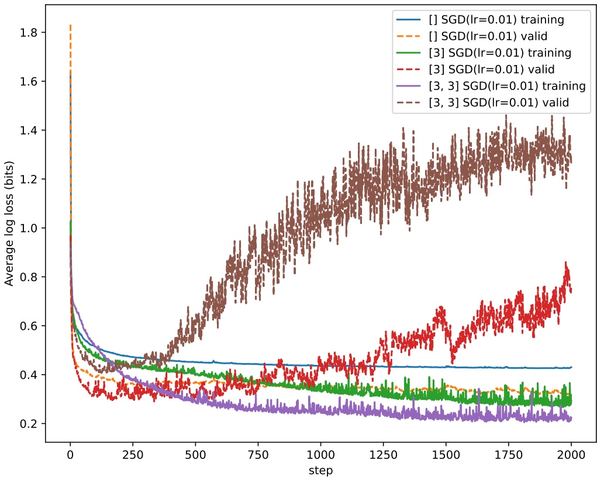

Figure 8.1: Plotting train and validation log loss for various architectures on SPECT dataset. Generated by

plot\_algs(archs=[[],[3],[3,3]], opts=[SGD],lrs=[0.01],num\_steps=2000) Other runs might be different, as the validation set and the algorithm are stochastic.

```python
crit = Evaluate.log_loss # penalizes overconfident predictions (when wrong)
# crit = Evaluate.accuracy # only considers mode
# crit = Evaluate.squared_loss # penalizes overconfident predictions less

def plot_algs(data, archs=[[3]], opts=[SGD], lrs=[0.1, 0.01,0.001,0.0001],
               criterion=crit, num_steps=1000):
    args = []
    for arch in archs:
        for opt in opts:
            for lr in lrs:
                args.append((arch,opt,{"lr':lr}))
    plot_algs_opts(data, args, criterion, num_steps)

def plot_algs_opts(data, args, criterion=crit, num_steps=1000):
    """args is a list of (architecture, optimizer, parameters)
    for each of the corresponding triples it plots the learning rate"""
    for (arch, opt, hyperparms) in args:
        nn = NN_from_arch(data, arch, opt, **hyperparms)
```

<!-- page: 208 -->

```python
plot_steps(data, learner = nn, criterion=crit, num_steps=num_steps,
        log_scale=False, legend_label=str(nn))
```

The following are examples of how to do hyperparameter optimization manually.

```python
434 ## first select good learning rates for each optimizer.
435 # plot_algs(data, archs=[[3]], opts=[SGD], lrs=[0.1, 0.01,0.001,0.0001])
436 # plot_algs(data, archs=[[3]], opts=[Momentum], lrs=[0.1,
       0.01,0.001,0.0001])
437 # plot_algs(data, archs=[[3]], opts=[RMS_Prop], lrs=[0.1,
       0.01,0.001,0.0001])

438
439 ## If they have the same best learning rate, compare the optimizers:
440 # plot_algs(data, archs=[[3]], opts=[SGD,Momentum,RMS_Prop], lrs=[0.01])

441
442 ## With different learning rates, compare the optimizer using:
443 # plot_algs_opts(data, args=[([3],SGD,{'lr':0.01}),
       ([3],Momentum,{'lr':0.1}), ([3],RMS_Prop,{'lr':0.001})])

444
445 # similarly select the best architecture, but the best learning rate might
# depend also on the architecture
```

The following tests are on the MNIST digit dataset. The original files are from [http://yann.lecun.com/exdb/mnist/](http://yann.lecun.com/exdb/mnist/). This code assumes you use the csv files from Joseph Redmon ([https://pjreddie.com/projects/mnist-in-csv/](https://pjreddie.com/projects/mnist-in-csv/) or [https://github.com/pjreddie/mnist-csv-png](https://github.com/pjreddie/mnist-csv-png) or [https://www.kaggle.com/da](https://www.kaggle.com/datasets/oddrationale/mnist-in-csv)tasets/[oddrationale/mnist-in-csv](https://www.kaggle.com/datasets/oddrationale/mnist-in-csv)) and put them in the directory ../MNIST/. Note that this is **very** inefficient; you would be better to use Keras or PyTorch. There are 28 ∗ 28 = 784 input units and 512 hidden units, which makes 401,408 parameters for the lowest linear layer. So don’t be surprised if it takes many hours in AIPython (even if it only takes a few seconds in Keras).

Think about: with 10 classes what is the accuracy, absolute loss, squared loss, log loss (bits) for a naive guess (where the naive guess might depend on the criterion)?

```python
learnNN.py — (continued)

# Simplified version: (approx 6000 training instances)
# data_mnist = Data_from_file('../MNIST/mnist_train.csv', prob_test=0.9,
    target_index=0, target_type="categorical")

# Full version:
# data_mnist = Data_from_files('../MNIST/mnist_train.csv',
    '../MNIST/mnist_test.csv', target_index=0, target_type="categorical")

#nn_mnist = NN_from_arch(data_mnist, [32,10], SGD, lr=0.01})
# one epoch:
```

<!-- page: 209 -->

```python
# start_time = time.perf_counter();nn_mnist.learn(batch_size=128,
    num_iter=len(data_mnist)/128 );end_time =
    time.perf_counter();print("Time:", end_time - start_time,"seconds")
# determine train error:
# data_mnist.evaluate_dataset(data_mnist.train, nn_mnist.predictor,
    Evaluate.accuracy)
# determine test error:
# data_mnist.evaluate_dataset(data_mnist.test, nn_mnist.predictor,
    Evaluate.accuracy)
# Print some random predictions:
# for eg in random.sample(data_mnist.test,10):
    print(data_mnist.target(eg), nn_mnist.predictor(eg),
    nn_mnist.predictor(eg)[data_mnist.target(eg)])
# Plot learning:
# plot_algs(data_mnist,archs=[[32],[32,8]], opts=[RMS_Prop], lrs=[0.01],
    data=data_mnist, num_steps=100)
# plot_algs(data_mnist,archs=[[8],[8,8,8],[8,8,8,8,8,8,8]],
    opts=[RMS_Prop], lrs=[0.01], data=data_mnist, num_steps=100)
```

Exercise 8.5 In the definition of nn3 above, for each of the following, first hypothesize what will happen, then test your hypothesis, then explain whether you testing confirms your hypothesis or not. Test it for more than one data set, and use more than one run for each data set.

(a) Which fits the data better, having a sigmoid layer or a ReLU layer after the first linear layer?

(b) Which is faster to learn, having a sigmoid layer or a ReLU layer after the first linear layer? (Hint: Plot error as a function of steps).

(c) What happens if you have both the sigmoid layer and then a ReLU layer after the first linear layer and before the second linear layer?

(d) What happens if you have a ReLU layer then a sigmoid layer after the first linear layer and before the second linear layer?

(e) What happens if you have neither the sigmoid layer nor a ReLU layer after the first linear layer?

Exercise 8.6 Select one dataset and architecture.

(a) For each optimizer, use the validation set to choose settings for the hyperparameters, including when to stop, and the parameters of the optimizer (including the learning rate). (There is no need to do an exhaustive search, and remember that the runs are stochastic.) For the dataset and architecture chosen, which optimizer works best?

(b) Suggest another architecture which you conjecture would be better than the one used in (a) on the test set (after hyperparameter optimization). Is it better?

<!-- page: 210 -->

## 8.7 Language Tokenizer

Variants of the Byte Pair Encoding Algorithm (BPE) [Sennrich, Haddow, and Birch, 2016; Radford, Wu, Child, Luan, Amodei, and Sutskever, 2019] are the standard method for modern language models. The idea is simple. All of the characters are tokens. A new token is created by finding the most common pair of tokens and making that a new token. For example, of “di” and “ffere” are tokens, they can be joined to form the new token “differe”. A tokenizer can be trained on a subset of the training corpus.

There are three main challenges in using this algorithm:

• Building an efficient encoder which translates raw text (sequence of characters) into a sequence of tokens. It is important that this is efficient, as it will be used to encode the full training corpus. In the code here, we stream the text (using generators) building tokens using a variant of a trie, which branches on the next character, and returns the longest token that fits.

Building the data structures needed to determine which tokens to create next. The problem is counting the number of occurrences of each pair of tokens in the corpus to determine which pair occurs the most often. Here we store a data structure that is counts the number of times a pair of tokens appears (only representing the pairs that appear in the training corpus). For each new token, the pairs data structure is rebuilt by rereading the corpus, which is not be stored, but streamed on demand. This may be reasonable as the number of pairs is much less than the size of the corpus, and this is only done once initially, typically on a much smaller corpus. [To make this more efficient, an “obvious” way is to take the, say, the 10 top pairs to make into tokens. Why might this give something different?]

Decoding, mapping a sequence of tokens to a sequence of characters. This is much simpler than the other two challenges. In the code below, the tokens are represented as the corresponding string. More commonly, tokens are numbered sequentially and there needs to be a mapping from index to token.

The corpus is taken from Project Gutenberg [https://www.gutenberg.org](https://www.gutenberg.org), a library of free, out-of-copyright books. As our corpus, we use the text version of a diverse set of books:

• pg11 “Alice’s Adventures in Wonderland” by Lewis Carroll

• pg45 “Anne of Green Gables” by Lucy Maud Montgomery

• pg74 “The Adventures of Tom Sawyer, Complete” by Mark Twain

<!-- page: 211 -->

## 8.7. Language Tokenizer

• pg84 “Frankenstein; Or, The Modern Prometheus” by Mary Wollstonecraft Shelley

• pg1342 “Pride and Prejudice” by Jane Austen

• pg1661 “The Adventures of Sherlock Holmes” by Arthur Conan Doyle With a total of 2.925 million chars for 3.044 MB, uncompressed.

```python
import random
import pickle # for saving tokenizations
from display import Displayable

train_corpus = ["pg11.txt","pg45.txt", "pg74.txt",
    "pg84.txt","pg1342.txt", "pg1661.txt"]
train_corpus_folder = "corpus/"
"""Training corpus:
    pg11 Alice's Adventures in Wonderland          163916 chars
    pg45 Anne of Green Gables                  580415 chars
    pg74 The Adventures of Tom Sawyer, Complete   412054 chars
    pg84 Frankenstein; Or, The Modern Prometheus  438806 chars
    pg1342 Pride and Prejudice                748126 chars
    pg1661 The Adventures of Sherlock Holmes   581565 chars
"""
```

The following generates the characters from the files in the corpus. It replaces newlines with spaces and makes multiple spaces into a single space. Note that the standard generation (while c in file) generates lines. It is implemented as a pipeline of two generators: file\_to\_chars0 replaces newlines with spaces and file\_to\_chars replaces multiple spaces with a single one.

```python
def file_to_chars0(file_name):
    with open(file_name,'r') as file:
        while c := file.read(1):
            if c == "\n":
                yield " "
            else:
                yield c

def file_to_chars(file_name):
    f2ch = file_to_chars0(file_name)
    try:
        lookahead = next(f2ch)
    except StopIteration:    # for empty files
        return
    for ch in f2ch:
        if lookahead != ' ' or ch !=' ': #reject spaces after space
            yield lookahead
            lookahead = ch
    yield lookahead
```

<!-- page: 212 -->

The following are utilities used by the code below. They are probably in some libraries, but it is simple to write them.

```python
def sequence_generators(*gens):
    """
    Given generators as arguments, generates the values of the generators
        in turn
    """
    for g in gens:
        # yield from g # does not work
        for e in g:
            yield e

class Multiset(object):
    def __init__(self):
        self.bag = {}

    def add(self, elt):
        if elt in self.bag:
            self.bag[elt] += 1
        else:
            self.bag[elt] = 1

    def items(self):
        return self.bag.items()
```

The Tokenizer class builds three data structures:

• A list tokens, so that tokens[k] is the string for token k, where a token is an integer.

token\_trie is a dictionary that maps characters into a pair consisting of a token (or None) and a dictionary of the same form. It is used to map text into tokens. If the sequence of characters that reached a pair is a token, that token is the first element of the pair. If the sequence of characters that reached the pair is not a token, the first element of the pair is None.

• token\_pairs is a multiset of token pairs so that token\_pairs[(t1,t2)] is the number of times token t1 is followed by token t2.

```python
class Tokenizer(Displayable):
    def __init__(self, corpus = train_corpus,
                   corpus_folder = train_corpus_folder,
                   load_from_file = None):
        self.corpus = corpus
        self.corpus_folder = corpus_folder
        if load_from_file is not None:
            self.load(load_from_file)
```

<!-- page: 213 -->

```python
else:
    self.tokens = ["[UNK]", " ", ",", ".",";", "<start>", "<end>"] #
        this could also be populated with characters in order.
    self.token_trie = {c:[t,}] for t,c in enumerate(self.tokens)}
        # char -> [tok, dict] tok is a token or None. dict is a
        token_trie
    self.token_pairs = Multiset() # multiset of pairs of tokens
    for file_name in corpus:
        previous, _ = self.token_trie["<start>"] # start token
        for ch in file_to_chars(corpus_folder+file_name):
            if ch not in self.token_trie:
                token = len(self.tokens)
                self.tokens.append(ch)
                self.token_trie[ch]= [token, {}]
            else:
                token,_ = self.token_trie[ch]
            if self.legal_token_pair(previous, token):
                self.token_pairs.add((previous, token))
            previous = token
            if self.legal_token_pair(previous, token):
                self.token_pairs.add((previous, token))
        self.display(1, f"Corpus has {len(self.tokens)}
            single-character tokens.")
```

If any pair of tokens can form new tokens, it is possible to have "the", " the", "the " (note different placement of a space) all be different tokens. Think about how these pair up with "cat", " cat" or "cat " to form "the cat" (perhaps with spaces at the ends). Not allowing spaces to join to other tokens gives subword tokens, where no tokens contain spaces. If the second of the pair cannot be a space, spaces are only allowed at the start or middle of tokens.

```python
def legal_token_pair(self, previous, token):
    """If there are restrictions on token pairs put them here. Otherwise
    return True
    the sets should probably be constants and only evaluated once.
    """
    #return True # no restrictions

    # if token cannot be a space, it only allows spaces at start and
    middle of tokens:
    return ( token not in {self.token_trie[ch][0] for ch in " ,.;{"})

    #If previous and token cannot both be " ", it only allows subword
    tokens:
    #return (token not in {self.token_trie[ch][0] for ch in " ,.;{"}
    #       or previous not in {self.token_trie[ch][0]
    #                       for ch in " ,.;{"})

def decode(self, token_list):
    res = ""
```

<!-- page: 214 -->

```python
for tok in token_list:
            res += self.tokens[tok]
        return res
```

One complication the code needs to handle is that not all prefixes of tokens are tokens. For example, suppose "ahead" is a token (created by joining "a" and "head"), and none of its prefixes other than "a" are tokens. the string "ahh..." returns the token "a", and "hh" becomes the lookahead string, which the parser should start again with and then use the rest of the text. The lookahead might not be used up by when generating the subsequent token. For example, if "ahead" were a token, the text "ahearne..." would have "ahear" read before it can conclude it is not the token "ahead", which may become the tokens "a"+"he"+"ar".

```python
def corpus_to_tokens(self):
    for file_name in self.corpus:
        char_generator = file_to_chars(self.corpus_folder+file_name)
        yield from self.tokenize(char_generator)

def tokenize(self, string_input):
    """generate tokens from a string.
    """
    gen_input = (c for c in string_input)
    lookahead = []
    unused = []
    ended = False
    while not ended:
        dic = self.token_trie
        unusedlist = list(unused)
        self.display(3,f"start while {lookahead=} {unusedlist=}")
        unused = (e for e in lookahead + unusedlist)
        ended = True
        for next_char in sequence_generators(unused, gen_input):
            if next_char not in self.token_trie:
                next_char = self_tokens[0] # unknown character
            ended = False
            self.display(3,f"{next_char=}")
            if next_char in dic:
                tok,dic = dic[next_char]
                if tok is not None: #dictionary entry is a token
                    self.display(3,f"token={tok=} {self_tokens[tok]}")
                    token=tok
                    lookahead=[]
                else:
                    lookahead.append(next_char)
                    self.display(3,f"tok=None {token=} {self_tokens[token]} {lookahead=}")
            else:
                lookahead.append(next_char)
```

<!-- page: 215 -->

```python
self.display(3,f"in else yielding {token=} {self_tokens[token]} {lookahead=}")
        yield token
        break
    else:
        if not ended:
            self.display(3,f"for ended yielding {token=} {self_tokens[token]} {lookahead=} {ended=}")
            yield token
```

Exercise 8.7 Consider what happens when a token could be created in two different ways, such as “i”+“ng” or “in”+“g”. Before the token is created how would “ing” be tokenized? Would it be tokenized twice? Why or why not?

Given the number of tokens to end up with, create\_tokens creates tokens from the current coprpus. It assumes that there is a current multiset of pairs of tokens, from which it chooses the most common pair. It adds this to the token trie. The new token can be a subword of a current token or could extend the trie. It uses the generated sequence of tokens generated by the current tokens to create a new the multiset of pairs.

```python
def create_tokens(self, num_tokens):
    while len(self_tokens) < num_tokens:
        count, (t0,t1) = max((c,p) for (p,c) in
            self.token_pairs.items())
        new_token = len(self_tokens)
        token_string = self_tokens[t0]+self_tokens[t1] # append tokens
        self.display(0, f'{len(self_tokens)}: Creating token:
            {self_tokens[t0]!r}+{self_tokens[t1]!r}'
                f' -> {token_string!r} {count=}')
        self_tokens.append(token_string)
        self.add_to_trie(token_string, new_token)

        # Rebuild pairs from scratch
        self.token_pairs = Multiset()
        generate_tokens = self.corpus_to_tokens()
        prev = next(generate_tokens)
        for token in generate_tokens:
            if self.legal_token_pair(prev, token):
                self.token_pairs.add((prev, token))
            prev = token

def add_to_trie(self, token_string, new_token):
    """Adds a new token to the current trie
    token_string is the string tham kaes up the token
    new_token is the index into tokens list.
    """
    token_trie = self.token_trie
    for ch in token_string[:-1]:
```

<!-- page: 216 -->

```python
if ch in token_trie:
    (_, token_trie) = token_trie[ch]
else:
    dct = {}
    token_trie[ch] = [None,dct]
    token_trie = dct
    if token_string[-1] in token_trie:
        token_trie[token_string[-1]][0] = new_token
    else:
        token_trie[token_string[-1]] = [new_token,{}]
# Saving and loading computed data structures
def save(self, filename="tokens.pkl"):
    file = open(filename, 'wb')
    pickle.dump((self_tokens,self.token_trie,self.token_pairs), file)
def load(self, filename="tokens.pkl"):
    file = open(filename, 'rb')
    (self_tokens,self.token_trie,self.token_pairs) = pickle.load(file)
    self.display(0, f"Corpus has {len(self_tokens)} tokens.")
if __name__ == "__main__":
    print(""""# Try:
tok = Tokenizer()
tok.create_tokens(200)
# OR
tok = Tokenizer(load_from_file ="tokens_wd_1000.pkl") #"tokens.pkl")
#tok.load()
""")

# 10 most likely pairs:
# sorted((n, (tok_tokens[t1], tok_tokens[t2])) for ((t1,t2),n) in
    tok.token_pairs.items())[-10:]
# what token will be created? create a new token: tok.create_tokens(201)
# how have the 10 most likely pairs changed?
# longest tokens:
# sorted([(len(e),e) for e in tok_tokens])[-20:]
```

Exercise 8.8 Why is “ the” (with a space) created before “the” (without a space), when “the” always appears more often than “ the”? Hint: create 113 tokens and look at the number of pairs with “ t” and “he” (with a space) versus “th” and “e” or “t" and “he" (without a space).

Exercise 8.9 When there are only subword tokens (see legal\_token\_pair), it can be more efficient to implement tokenization by having a word to count dictionary (multiset). Implement this.

Exercise 8.10 If there are only subword tokens, should space be a token? If it was, what is the proportion of tokens that spaces? If not, how can text be generated, when the text requires spaces between some, but not all, tokens?

<!-- page: 217 -->

## 8.8 Bigram with Empirical Probabilities

Except for the restrictions on what can be in a token, the multiset token\_pairs contains enough information to determine the probability distribution of the words given the previous word, which is a bigram model (an n-gram model where n = 2). The model below uses empirical probabilities without regularization. (Regularization could be to use pseudo-counts as in a Dirichlet distribution.) Empirical probabilities are adequate for bigrams when generating text, but not for recognition as they give zero probability for pairs not in the training set. For n-grams for larger n, empirical probabilities can be undefined for word sequences not in the training set, and so are not suitable for generation or recognition.

```python
import random
from display import Displayable
from learnTokenizer import Multiset, Tokenizer

class Bigram(Displayable):
    def __init__(self, tokenizer):
        self.tokenizer = tokenizer
        self.ttc = [[0 for _ in tokenizer.tokens] for _ in
            tokenizer.tokens] # dense
        self.counts=[0 for _ in tokenizer.tokens]
        # ttc[token1][token2] is the number of times token 1 is followed by
            token 2
        generate_tokens = tokenizer.corpus_to_tokens()
        prev = next(generate_tokens)
        self.counts[prev] = 1
        for token in generate_tokens:
            self.ttc[prev][token] += 1
            self.counts[token] += 1
            prev = token

    def generate(self, prompt, length, temp=1):
        res = prompt+"" # copy prompt
        ti = list(self.tokenizer.tokenize(prompt))[-1] # last token
        for i in range(length):
            ti = sample_i(self.ttc[ti], temp=temp)
            res += self.tokenizer.tokens[ti]
        return res

    def dist(self, prompt):
        """returns a sorted list of prob,string
        """
        ti = list(self.tokenizer.tokenize(prompt))[-1] # last token
        unnorm = self.ttc[ti]
        tot = sum(unnorm)
```

<!-- page: 218 -->

```python
return sorted([(n/tot,self.tokenizer.tokens[i]) for (i,n) in enumerate(unnorm) if n>0])

def sample_i(probs, temp=1):
    """Sample from an unnormalized probability distribution.
    probs is a list of nonnegative numbers
    """

    #keys = range(len(probs)) if isinstance(probs,list) else probs.keys()
    if isinstance(probs,list):
        probs = {i:v for (i,v) in enumerate(probs)}
    if temp != 1:
        probs = {k:p**(1/temp) for k,p in probs.items()}
    tot = sum(probs.values())
    sm = 0
    p = random.random()*tot
    for i in probs:
        sm += probs[i]
        if p <= sm:
            return i
    assert False, f"sample_i has error with {probs="}

# tok = Tokenizer(load_from_file ="tokens.pkl") #"tokens_wd_1000.pkl")
    #"tokens.pkl")
# bg = Bigram(tok)
# bg.generate(" this", 30, temp=0.2)
# bg.generate(" she", 30, temp=0.2)

# To get the distribution of the top next words given a text
# bg.dist(" this")[-20:]

# To determine how many instances of each token there are:
# sorted(list(zip(bg.counts,tok.tokens)))
# To determine probability of most likely tokens:
# sorted(list(zip([c/sum(bg.counts) for c in bg.counts],tok.tokens)))[-30:]
```

## 8.9 N-Grams with token embeddings

Going beyond bigrams to arbitrary n-grams (looking n − 1 tokens in the past) using empirical probabilities is problematic as for many sequences of words there is no data. An alternative to using empirical probabilities is to use token features, represented as vectors.

The one-hot layer is an instance of the linear complete layer, designed when one of the inputs is 1 and others are zero, and the inputs are given (not learned) There are two main changes:

• It does not need to multiply by 0 or 1, but selects the input that would be

<!-- page: 219 -->

## 8.9. N-Grams with token embeddings

multiplied by 1.

• Backprop does not need to return an error as the inputs are always observed.

```python
from learnNN import NN, Layer, Linear_complete_layer, Batch_generator,
    RMS_Prop
from learnProblem import Data_set

class One_Hot_Layer(Linear_complete_layer):
    """A complete linear layer where one input is 1 and the others are 0.
    No need to multiple by 1 or 0.
    """
    def __init__(self, nn, num_inputs, num_outputs, limit=None,
        final_layer=False):
        Linear_complete_layer.__init__(self, nn, num_outputs, limit,
            final_layer,
                num_inputs=num_inputs)

    def output_values(self, input, training=False):
        """Returns the outputs for the input values.
        It remembers the input for the backprop.
        """
        self.display(3,f"One-hot layer inputs: {input}")
        self.input=input
        for out in range(self.num_outputs):
            self.outputs[out] = (self.weights[input][out]
                    + self.weights[self.num_inputs][out])
        self.display(3,f"One-hot layer {input=}, {self.outputs=}")
        return self.outputs

    def backprop(self, errors):
        """Backpropagate errors, update weights, return input error.
        errors is a list of size self.num_outputs
        No need to return errors for layer's input as input is always data
        """
        self.display(3,f"One-hot Backprop. input: {self.input} output
            errors: {errors}")
        for out in range(self.num_outputs):
            inp=self.input
            #self.input_errors[inp] = self.weights[inp][out] * errors[out]
            self.delta[inp][out] += self.input * errors[out]
            self.delta[self.num_inputs][out] += errors[out]
        #self.display(3,f"One-hot layer backprop input errors:
            {self.input_errors}")
        #return self.input_errors

class Concat_Layers(Layer):
    """A layer created by concatenating a list of layers.
```

<!-- page: 220 -->

```python
Each layer has a single input value;
        the input of the concatenation is list of these values
Output of the concatenation is the concatenation of the outputs
"""
def __init__(self, nn, layers):
    num_outputs = sum(lay.num_outputs for lay in layers)
    self.display(3, f"Concat_Layers {layers=} {num_outputs=}")
    Layer.__init__(self, nn, num_outputs)
    self.layers = layers

def output_values(self, input_values, training=False):
    ov = []
    for lay,inp in zip(self.layers, input_values):
        ov += lay.output_values(inp)
    return ov

def backprop(self, out_errors):
    # need to unpack the array of outputs to the output of each layer
    res=[]
    for lay in self.layers:
        res.append(lay.backprop(out_errors[:lay.num_outputs]))
        out_errors = out_errors[lay.num_outputs:]
    return res

class N_gram_dataset(Data_set):
    """creates dataset from slices of the token stream of length n
    """
    def __init__(self, n, tokenizer):
        self.n = n
        self.tokenizer = tokenizer
        self.input_features = [lambda e, iv=i: e[iv] for i in range(n-1)]
        self.target = lambda e:e[n-1]
        self.target.ftype = "categorical"
        self.target.frange = list(range(len(tokenizer_tokens)))
        self.train = [] # don't print anything for training set
        self.valid = []

class NGram_Batch_Generator(Batch_generator):
    def __init__(self, tokenizer, n):
        self.tokenizer = tokenizer
        self.n = n
        self.ngrams = self.Ngram_generator() # data generator

    def Ngram_generator(self):
        while True: # keep going through the corpus
            token_gen = self.tokenizer.corpus_to_tokens()
            self.context = [next(token_gen) for i in range(self.n)]
            for token in token_gen:
                yield self.context
                self.context = self.context[1:]+[token]
```

<!-- page: 221 -->

```python
def get_batch(self, batch_size):
        return [next(self.ngrams) for i in range(batch_size)]

#Test:
# b = NGram_Batch_Generator orders, 5)
# b.get_batch(10)

class N_gram(NN):
    def __init__(self, n, tokenizer, hidden_size, optimizer=None,
            **hyperparms):
        self.n = n
        self.tokenizer = tokenizer
        dataset = N_gram_dataset(n, tokenizer)
        NN.__init__(self, dataset,
            batch_gen=NGram_Batch_Generator(tokenizer, n),
                    optimizer=optimizer, **hyperparms)
        self.add_layer(
            Concat_Layers(self,
                [One_Hot_Layer(self,
                    len(dataset.tokenizer.tokens),hidden_size) for i in
                    range(n-1)]))
        # add hidden layers here
        self.add_layer(Linear_complete_layer(self, len(tokenizer.tokens)))

    def generate(self, prompt, length, temp=1):
        res = prompt+"" # copy prompt (to include prompt in result)
        toks = list(self.tokenizer.tokenize(prompt))
        if len(toks) >= self.n-1:
            context = toks[-self.n+1:]
        else:
            blank_token = self.tokenizer.token_trie[' '][0]
            context = [blank_token]*(self.n-1-len(prompt)) + toks
        for i in range(length):
            ti = sample_i(self.predictor(context), temp=temp)
            self.display(3,f"generate: {context=} {ti=} {self.tokenizer.tokens[ti]=}")
            res += self.tokenizer.tokens[ti]
            context = context[1:]+[ti]
        return res

# tok = Tokenizer()
# tok.create_tokens(200)
# fiveg = N_gram(5, tok, 20, optimizer= RMS_Prop)
# fiveg.learn(batch_size=100, num_iter = 10000, report_each=10000000)
# import time
# st=time.perf_counter(); fiveg.learn(batch_size=100, num_iter = 10000,
    report_each=10000000); et=time.perf_counter()
# fiveg.generate("the cat smiled and said ", 20)
```

<!-- page: 222 -->

```coffeescript
# show distribution:
# sorted([(p,tok_tokens[t]) for (t,p) in
    fiveg.predictor(list(tok.tokenize("the cat smiled and
    said"))[-4:]).items()])[-20:]
# sorted([(p,tok_tokens[t]) for (t,p) in
    fiveg.predictor(list(tok.tokenize("the cat smiled and said
    "))[-4:]).items()])[-20:] #space after s
# what is the context:
# tok.decode(list(tok.tokenize("the cat smiled and said")))[-4:])
# tok.decode(list(tok.tokenize("and said")))
```

The above code is very slow. The neural network code is interpreted and run sequentially. It was not written to be efficient. For example, it appends the bias to the output of a layer to gets the next input. Modern neural network toolkits are orders of magnitude faster. They compile to a form so that at run time the code is only doing the appropriate arithmetic functions, such as addition and multiplication, and is run on parallel hardware that is specialized to these forms expressions.

Kereas is a front end for many efficient back ends. It is available from Python distributions such as [https://anaconda.org/channels/conda-forge/packages/keras/overview](https://anaconda.org/channels/conda-forge/packages/keras/overview). See [https://keras.io/getting\_started/](https://keras.io/getting_started/). Chollet and Watson [2025] provides a good introduction to Keras.

For the following code to work, you need to download the test files, and create and save a tokenization.

```python
11 ### learn n-gram with embeddings using Keras
12
13 import keras
14 import tensorflow as tf
15 import numpy as np
16 import random
17 from learnTokenizer import Tokenizer, Multiset, file_to_chars
18 import matplotlib.pyplot as plt
19
20 context_size = 20
21 embedding_size = 500
22
23 # load tokenizer that is already saved:
24 tok = Tokenizer(load_from_file ="tokens_wd_1000.pkl") #"tokens.pkl")
25 #otherwise:
26 #tok = Tokenizer()
27 # tok.create_tokens(1000)
28
29 # Get these books and put them in folder corpus_test/
30 # https://www.gutenberg.org/cache/epub/12/pg12.txt Through the Looking-Glass
31 # https://www.gutenberg.org/cache/epub/76/pg76.txt Adventures of Huckleberry Finn
32 # https://www.gutenberg.org/cache/epub/2701/pg2701.txt Moby Dick
```

<!-- page: 223 -->

## 8.9. N-Grams with token embeddings

```python
# https://www.gutenberg.org/cache/epub/35461/pg35461.txt A Short History
    of the World
# (Which of these are similar to training books?)

test_corpus = ["pg12","pg76", "pg2701", "pg35461"]
test_corpus_folder = "corpus_test/"
test_seqs =
    [np.array(list(tok.tokenize(file_to_chars(test_corpus_folder+fn+".txt"))))
        for fn in test_corpus]

token_seq = np.array(list(tok.corpus_to_tokens()))
unigram_inputs = np.array([ [] for _ in tok.corpus_to_tokens()])

def dataset_from_file(tokenizer, filename, context_size=context_size):
    file_tokens =
        np.array(list(tokenizer.tokenize(file_to_chars(filename))))
    dataset = keras.utils.timeseries_dataset_from_array(
        data = file_tokens[:-context_size],
        targets = file_tokens[context_size:], 
        sequence_length = context_size
    )
    return dataset

class Unigram(object):
    def __init__(self):
        inputs = keras.Input(shape=(0,), dtype="int32")
        embedding = keras.layers.Embedding(
            input_dim = 0,
            output_dim = len(tok_tokens)
        )
        output = keras.layers.Softmax()(embedding(inputs))
        self.model = keras.Model(inputs, output, name=f"Unigram")
        self.model.compile(optimizer="adam", #"rmsprop",
            loss="sparse_categorical_crossentropy",
            metrics=["sparse_categorical_accuracy"])
        self.model.summary()

#unigram = Unigram()
#unigram.model.fit(unigram_inputs, token_seq, epochs=2)
```

The following implements an embedding based N-gram model. Each word has an embedding. The embedding for the context\_size previous words are concatenated, and a fully connected layer predicts the next word.

```python
____ learnNgramKeras.py — (continued) ________________
optimizer = "adam" #"rmsprop" #

class NGram(object):
    def __init__(self,
        context_size = context_size,
        embedding_size = embedding_size,

https://aipython.org          Version 0.9.18                  March 10, 2026
```

<!-- page: 224 -->

```python
dataset = None
):
self.context_size = context_size
self.embedding_size = embedding_size
if dataset is None:
    self.dataset = keras.utils.timeseries_dataset_from_array(
        data = token_seq[:-self.context_size],
        targets = token_seq[self.context_size:], 
        sequence_length = self.context_size,
        shuffle=True
    )
else:
    self.dataset = dataset
inputs = keras.Input(shape=(self.context_size,), dtype="int32")
embedding = keras.layers.Embedding(
    input_dim = len(tok_tokens),
    output_dim = self.embedding_size
    #,mask_zero=True
)
emb = embedding(inputs)
con = keras.layers.Flatten()(emb)
output = keras.layers.Dense(len(tok_tokens),
        activation="softmax")(con)
self.model = keras.Model(inputs, output,
        name=f"NGram_{context_size}_{embedding_size}")

self.model.compile(optimizer=optimizer,
    loss="sparse_categorical_crossentropy",#keras.losses.SparseCategoricalCrossentropy(),
        #from_logits=False),
        metrics=["sparse_categorical_accuracy"])
print(f"NGram({context_size=}, {embedding_size=})")
self.model.summary()  # get statistics

def generate(self, prompt, max_length=158):
    """generates a completion of prompt up to max_length tokens.
filler is used so a prompt less than the context_size does not give
    an error
"""
filler = [random.randint(0,len(tok_tokens)-1) for _ in
    range(self.context_size)]
tokens = filler + list(tok.tokenize(prompt))
#print(f"{tokens=}")
prompt_length = len(tokens)
for _ in range(max_length+context_size - prompt_length):
    prediction =
        self.model(keras.ops.convert_to_numpy([tokens[-self.context_size:]]))
    tokens.append(np.argmax(prediction).item())
#print(f"{tokens=}")
return "".join(tok_tokens[t] for t in tokens[self.context_size:])
```

<!-- page: 225 -->

```python
#ngram = NGram(context_size = 20, embedding_size = 500)
#ngram.model.fit(ngram.dataset, epochs=100)

# generate("the monster said to Alice")
# 'the monster said to Alice, jumped up and down in an agony of terror.
    "Oh, there goes his _precious_ nose!" as an unusually large saucepan
    flew close by it, and'

# generate(" I dare not expect such success, Alice") # " I dare not expect
    such success, " from Frankenstein
# ' I dare not expect such success, Alice, in pictures, making it the
    trust you, and making them the very politeness to sitting for a
    moment, silence, she said, very stiffly, to Elizabeth,-- "I hope you
    are well, Miss Bennet'

# Testing:
# test1 =dataset_from_file(tok, 'corpus_test/pg12.txt')
# ngram.model.evaluate(test1)

def plot_errors(context_sizes = [4],
            embedding_sizes = [10],
            epochs = 10,
            repeat_epochs = 1 # must be > 0
        ):
    """
    exactly one of repeat_epochs, len(context_sizes), len(embedding_sizes)
        should be greater than one.
    That becomes the x-axis in the plot.
    The others must be 1.
    if repeat_epochs>1, normally epochs=1 (so it plots each epoch)
    """
    global fig, axs, train_results, test_results # so they can be checked
    later
    error_name = ['loss', 'accuracy']
    train_results = []
    test_results = [[] for _ in test_corpus]
    plt.ion()
    fig, axs = plt.subplots(1,2)
    #ax.set_xscale('log') # change between log and linear scale
    if repeat_epochs > 1:
        xlabel = "Epochs"
        xvalues = list(range(epochs,repeat_epochs*epochs+epochs,epochs))
        title = f"context_size={context_sizes[0]},
            embedding_size={embedding_sizes[0]}, {optimizer=}"
    if len(context_sizes) > 1:
        xlabel = "Context size"
        xvalues = context_sizes
        title = f"epochs={epochs}, embedding_size={embedding_sizes[0]},
```

<!-- page: 226 -->

```python
{optimizer=}"
if len(embedding_sizes) > 1:
    xlabel = "Embedding size"
    xvalues = embedding_sizes
    title = f"epochs={epochs}, context_size={context_sizes[0]},
        {optimizer=}"
for err in range(2):
    axs,err].set_xlabel(xlabel)
    axs(err].set_ylabel(error_name[err])
fig.suptitle(title)
for context_size in context_sizes:
    dataset = keras.utils.timeseries_dataset_from_array(
        data = token_seq[:-context_size],
        targets = token_seq)...context_size:[,
        sequence_length = context_size,
        shuffle=True
    )
    test_datasets =[keras.utils.timeseries_dataset_from_array(
        data = test_seq[:-context_size],
        targets = test_seq)...context_size:[,
        sequence_length = context_size,
        shuffle=True
    ) for test_seq in test_seqs]
    for embedding_size in embedding_sizes:
        ngram = NGram(context_size = context_size,
            embedding_size = embedding_size,
            dataset=dataset)
        for ep in range(repeat_epochs):
            print(f"Training: ({context_size}), {embedding_size=},
                repeat# {ep+1})")
            hist = ngram.model.fit(dataset, epochs=epochs)
            train_results.append(ngram.model.evaluate(dataset))
            print("Test:")
            for i in range(len(test_corpus)):
                test_results[i].append(ngram.model.evaluate(test_datasets[i]))
    for err in range(2):
        axs,err].plot(xvalues, [res[err] for res in train_results],
            label="training")
        for i in range(len(test_corpus)):
            axs,err].plot(xvalues, [res[err] for res in test_results[i]],
                label=test_corpus[i])
        axs[err].legend()
# plot_errors([10],[20],1,100)
# plot_errors([10],list(range(1,202,10)),10,1)
# plot_errors(list(range(1,52,5)),[20],10,1)
```

<!-- page: 227 -->

# Reasoning with Uncertainty

## 9.1 Representing Probabilistic Models

A probabilistic model uses the same definition of a variable as a CSP (Section 4.1.1, page 69). A variable consists of a name, a domain and an optional (x,y) position (for displaying). The domain of a variable is a list or a tuple, as the ordering matters for some representation of factors.

## 9.2 Representing Factors

A **factor** is, mathematically, a function from variables into a number; that is, given a value for each of its variable, it gives a number. Factors are used for conditional probabilities, utilities in the next chapter, and are explicitly constructed by some algorithms (in particular, variable elimination).

A variable assignment, or just an **assignment**, is represented as a {variable : value} dictionary. A factor can be evaluated when all of its variables are assigned. This is implemented in the can\_evaluate method which can be overridden for representations that don’t require all variable be assigned (such as decision trees). The method get\_value evaluates the factor for an assignment. The assignment can include extra variables not in the factor. This method needs to be defined for every subclass.

```python
from display import Displayable
import math

class Factor(Displayable):
    nextid=0 # each factor has a unique identifier; for printing
```

<!-- page: 228 -->

```python
def __init__(self, variables, name=None):
    self.variables = variables # list of variables
    if name:
        self.name = name
    else:
        self.name = f"f{Factor.nextid}"
        Factor.nextid += 1

def can_evaluate(self,assignment):
    """True when the factor can be evaluated in the assignment
    assignment is a {variable:value} dict
    """
    return all(v in assignment for v in self.variables)

def get_value(self,assignment):
    """Returns the value of the factor given the assignment of values to variables.
    Needs to be defined for each subclass.
    """
    assert self.can_evaluate(assignment)
    raise NotImplementedError("get_value") # abstract method
```

The method \_\_str\_\_ returns a brief definition (like “f7(X,Y,Z)”).The method to\_table returns string representations of a table showing all of the assignments of values to variables, and the corresponding value.

```python
def __str__(self):
    """returns a string representing a summary of the factor"""
    return f"{self.name}({'','.join(str(var) for var in
        self.variables))")

def to_table(self, variables=None, given={}): 
    """returns a string representation of the factor.
    Allows for an arbitrary variable ordering.
    variables is a list of the variables in the factor
    (can contain other variables)"""
    if variables==None:
        variables = [v for v in self.variables if v not in given]
    else: #enforce ordering and allow for extra variables in ordering
        variables = [v for v in variables if v in self.variables and v
            not in given]
    head = "\t".join(str(v) for v in variables)+"\t"+self.name
    return head+"\n"+self.ass_to_str(variables, given, variables)

def ass_to_str(self, vars, asst, allvars):
    #print(f"ass_to_str({vars}, {asst}, {allvars})")
    if vars:
        return "\n".join(self.ass_to_str(vars[1:], {*asst,
            vars[0]:val}, allvars)
            for val in vars[0].domain)
```

[https://aipython.org](https://aipython.org)

<!-- page: 229 -->

```python
else:
    val = self.get_value(asst)
    val_st = Mumbai6f".format(val) if isinstance(val,float) else
        str(val)
    return("\t".join(str(asst[var]) for var in allvars)
        + "\t"+val_st)

__repr__ = __str__
```

## 9.3 Conditional Probability Distributions

A **conditional probability distribution (CPD)** is a factor that represents a conditional probability. A CPD representing $P(X \mid Y_1 \dots Y_k)$ is a factor, which given values for X and each Y<sub>i</sub> returns a number.

```python
class CPD(Factor):
    def __init__(self, child, parents):
        """represents P(variable | parents)
        """
        self.parents = parents
        self.child = child
        Factor.__init__(self, parents+[child], name=f"Probability")

    def __str__(self):
        """A brief description of a factor using in tracing"""
        if self.parents:
            return f"P({self.child}|{','.join(str(p) for p in
                self.parents))}"
        else:
            return f"P({self.child}")

    __repr__ = __str__
```

A constant CPD has no parents, and has probability 1 when the variable has the value specified, and 0 when the variable has a different value.

```python
class ConstantCPD(CPD):
    def __init__(self, variable, value):
        CPD.__init__(self, variable, [])
        self.value = value
    def get_value(self, assignment):
        return 1 if self.value==assignment[self.child] else 0
```

<!-- page: 230 -->

## 9.3.1 Logistic Regression

A **logistic regression** CPD, for Boolean variable X represents $P(X = \text{True} \mid Y_1 \dots Y_k)$ using $k + 1$ real-valued weights so

$$
P (X = \text {True} \mid Y _ {1} \dots Y _ {k}) = \text {sigmoid} (w _ {0} + \sum_ {i} w _ {i} Y _ {i})
$$

where for Boolean $Y_{i}$ True is represented as 1 and False as 0.

```python
from learnLinear import sigmoid, logit

class LogisticRegression(CPD):
    def __init__(self, child, parents, weights):
        """A logistic regression representation of a conditional probability.
        child is the Boolean (or 0/1) variable whose CPD is being defined
        parents is the list of parents
        weights is list of parameters, such that weights[i+1] is the weight for parents[i]
        weights[0] is the bias.
        """
        assert len(weights) == 1+len(parents)
        CPD.__init__(self, child, parents)
        self.weights = weights

    def get_value(self,assignment):
        assert self.can_evaluate(assignment)
        prob = sigmoid(self.weights[0]
            + sum(self.weights[i+1]*assignment[self.parents[i]]
                for i in range(len(self.parents))))
        if assignment[self.child]: #child is true
            return prob
    else:
        return (1-prob)
```

## 9.3.2 Noisy-or

A **noisy-or**, for Boolean variable X with Boolean parents $Y_{1}\ldots Y_{k}$ is parametrized by $k + 1$ parameters $p_0, p_1, \ldots, p_k.$ , where each $0\leq p_{i}\leq 1$ . The semantics is defined as though there are $k + 1$ hidden variables $Z_{0}, Z_{1} \ldots Z_{k},$ where $P(Z_0) = p_0$ and $P(Z_{i}\mid Y_{i}) = p_{i}$ for $i \geq 1$ , and where X is true if and only if $Z_{0}\lor Z_{1}\lor\cdots\lor Z_{k}$ (where ∨ is "or") Thus X is false if all of the $Z_{i}$ are false. Intuitively, $Z_{0}$ is the probability of X when all $Y_{i}$ are false and each $Z_{i}$ is a noisy (probabilistic) measure that $Y_{i}$ makes X true, and X only needs one to make it true.

```python
--------------------------probFactors.py — (continued) -----------------------------------------------
class NoisyOR(CPD):
    def __init__(self, child, parents, weights):
```

<!-- page: 231 -->

```python
"""A noisy representation of a conditional probability.
    variable is the Boolean (or 0/1) child variable whose CPD is being defined
    parents is the list of Boolean (or 0/1) parents
    weights is list of parameters, such that weights[i+1] is the weight for parents[i]
    """
    assert len(weights) == 1+len(parents)
    CPD.__init__(self, child, parents)
    self.weights = weights

def get_value(self,assignment):
    assert self.can_evaluate(assignment)
    probfalse = (1-self.weights[0])*math.prod(1-self.weights[i+1]
                          for i in range(len(self.parents))
                          if assignment[self.parents[i]])
    if assignment[self.child]: # child is assigned True in assignment return 1-probfalse
    else:
        return probfalse
```

## 9.3.3 Tabular Factors and Prob

A **tabular factor** is a factor that represents each assignment of values to variables separately. It is represented by a Python array (or Python dict). If the variables are $V_{1}, V_{2}, \ldots, V_{k}$ , the value of $f(V_{1} = v_{1},V_{2} = v_{1},\dots ,V_{k} = v_{k})$ is stored in $f[v_{1}][v_{2}]\dots [v_{k}]$

If the domain of $V_{i}$ is $[0,\dots ,n_{i} - 1]$ it can be represented as an array. Otherwise it can use a dictionary. Python is nice in that it doesn’t care, whether an array or dict is used **except when enumerating the values**; enumerating a dict gives the keys (the variables) but enumerating an array gives the values. So we had to be careful not to enumerate the values.

```python
class TabFactor(Factor):

    def __init__(self, variables, values, name=None):
        Factor.__init__(self, variables, name=name)
        self.values = values

    def get_value(self, assignment):
        return self.get_val_rec(self.values, self.variables, assignment)

    def get_val_rec(self, value, variables, assignment):
        if variables == []:
            return value
        else:
            return self.get_val_rec(value[assignment[variables[0]]],
                             variables[1:], assignment)
```

<!-- page: 232 -->

Prob is a factor that represents a conditional probability by enumerating all of the values.

```python
class Prob(CPD,TabFactor):
    """A factor defined by a conditional probability table"""
    def __init__(self, var, pars, cpt, name=None):
        """Creates a factor from a conditional probability table, cpt
        The cpt values are assumed to be for the ordering par+[var]
        """
        TabFactor.__init__(self, pars+[var], cpt, name)
        self.child = var
        self.parents = pars
```

## 9.3.4 Decision Tree Representations of Factors

A decision tree representation of a conditional probability of a child variable is either:

• IFeq(var, val, true\_cond, false\_cond) where true\_cond and false\_cond are decision trees. true\_cond is used if variable var has value val in an assignment; false\_cond is used if var has a different value

• a deterministic functions that has probability 1 if a parent has the same value as the child (using SameAs(parent))

• a distribution over the child variable (using Dist(dict)).

Note that not all parents need to be assigned to evaluate the decision tree; it only needs a branch down the tree that gives the distribution.

```python
class ProbDT(CPD):
    def __init__(self, child, parents, dt):
        CPD.__init__(self, child, parents)
        self.dt = dt

    def get_value(self, assignment):
        return self.dt.get_value(assignment, self.child)

    def can_evaluate(self, assignment):
        return self.child in assignment and self.dt.can_evaluate(assignment)
```

```python
class IFeq:
    def __init__(self, var, val, true_cond, false_cond):
        self.var = var
```

<!-- page: 233 -->

## 9.3. Conditional Probability Distributions

```python
self.val = val
    self.true_cond = true_cond
    self.false_cond = false_cond

def get_value(self, assignment, child):
    """ IFeq(var, val, true_cond, false_cond)
    value of true_cond is used if var has value val in assignment,
    value of false_cond is used if var has a different value
    """
    if assignment[self.var] == self.val:
        return self.true_cond.get_value(assignment, child)
    else:
        return self.false_cond.get_value(assignment, child)

def can_evaluate(self, assignment):
    if self.var not in assignment:
        return False
    elif assignment[self.var] == self.val:
        return self.true_cond.can_evaluate(assignment)
    else:
        return self.false_cond.can_evaluate(assignment)
```

The following is a deterministic function that is true if the parent has the same value as the child. This is used for deterministic conditional probabilities (as is common for causal models, as described in Chapter 11).

```python
class SameAs:
    def __init__(self, parent):
        """1 when child has same value as parent, otherwise 0"""
        self.parent = parent

    def get_value(self, assignment, child):
        return 1 if assignment[child]==assignment[self.parent] else 0

    def can_evaluate(self, assignment):
        return self.parent in assignment

At the leaves are distributions over the child variable.
```

```python
class Dist:
    def __init__(self, dist):
        """Dist is an array or dictionary indexed by value of current
            child"""
        self.dist = dist

    def get_value(self, assignment, child):
        return self.dist[assignment[child]]

    def can_evaluate(self, assignment):
        return True
```

<!-- page: 234 -->

The following shows a decision representation of the Example 9.18 of Poole and Mackworth [2023]. When the Action is to go out, the probability is a function of rain; otherwise it is a function of full.

```python
###### A decision tree representation Example 9.18 of AIFCA 3e
from variable import Variable

boolean = [False, True]

action = Variable('Action', ['go_out', 'get_coffee'], position=(0.5,0.8))
rain = Variable('Rain', boolean, position=(0.2,0.8))
full = Variable('Cup Full', boolean, position=(0.8,0.8))

wet = Variable('Wet', boolean, position=(0.5,0.2))
p_wet = ProbDT(wet,[action,rain,full],
                   IFeq(action, 'go_out',
                           IFeq(rain, True, Dist([0.2,0.8]), Dist([0.9,0.1])), 
                           IFeq(full, True, Dist([0.4,0.6]), Dist([0.7,0.3]))))

# See probRC for wetBN which expands this example to a complete network
```

## 9.4 Graphical Models

A graphical model consists of a title, a set of variables, and a set of factors.

```python
from display import Displayable
from variable import Variable
from probFactors import CPD, Prob
import matplotlib.pyplot as plt

class GraphicalModel(Displayable):
    """The class of graphical models.
    A graphical model consists of a title, a set of variables and a set of factors.

    vars is a set of variables
    factors is a set of factors
    """
    def __init__(self, title, variables=None, factors=None):
        self.title = title
        self.variables = variables
        self.factors = factors
```

A **belief network** (also known as a **Bayesian network**) is a graphical model where all of the factors are conditional probabilities, and every variable has a conditional probability of it given its parents. This checks the first condi-

<!-- page: 235 -->

tion (that all factors are conditional probabilities), and builds some useful data structures.

```python
class BeliefNetwork(GraphicalModel):
    """The class of belief networks."""

    def __init__(self, title, variables, factors):
        """vars is a set of variables
        factors is a set of factors. All of the factors are instances of CPD (e.g., Prob).
        """
        GraphicalModel.__init__(self, title, variables, factors)
        assert all(isinstance(f,CPD) for f in factors), factors
        self.var2cpt = {f.child:f for f in factors}
        self.var2parents = {f.child:f.parents for f in factors}
        self.children = {n:[] for n in self.variables}
        for v in self.var2parents:
            for par in self.var2parents[v]:
                self.children[par].append(v)
        self.topological_sort_saved = None
```

The following creates a topological sort of the nodes, where the parents of a node come before the node in the resulting order. This is based on Kahn’s algorithm from 1962.

```python
def topological_sort(self):
    """creates a topological ordering of variables such that the
    parents of
    a node are before the node.
    """
    if self.topological_sort_saved:
        return self.topological_sort_saved
    next_vars = {n for n in self.var2parents if not self.var2parents[n]
    }
    self.display(3,'topological_sort: next_vars',next_vars)
    top_order=[]
    while next_vars:
        var = next_vars.pop()
        self.display(3,'select variable',var)
        top_order.append(var)
        next_vars |= {ch for ch in self.children[var]
            if all(p in top_order for p in
                self.var2parents[ch])}
        self.display(3,'var_with_no_parents_left',next_vars)
    self.display(3,"top_order",top_order)
    assert
        set(top_order)==set(self.var2parents),(top_order,self.var2parents)
    self.topologicalsort_saved=top_order
    return top_order
```

<!-- page: 236 -->

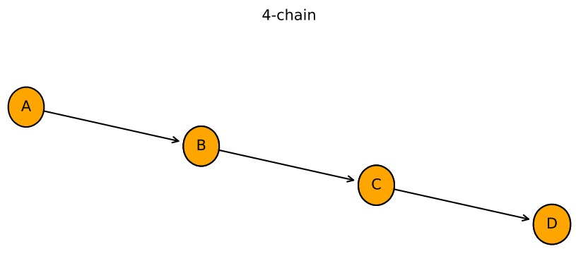

Figure 9.1: bn\_4ch.show()

## 9.4.1 Showing Belief Networks

The **show** method uses matplotlib to show the graphical structure of a belief network.

```python
def show(self, fontsize=10, facecolor='orange'):
    plt.ion() # interactive
    fig, ax = plt.subplots()
    ax.set_axis_off()
    ax.set_title(self.title, fontsize=fontsize)
    bbox =
        dict(boxstyle="round4,pad=1.0,rounding_size=0.5",facecolor=facecolor)
    for var in self.variables: #reversed(self.topological_sort()):
        for par in self.var2parents[var]:
            ax.annotate(var.name, par.position, xytext=var.position,
                    arrowprops={'arrowstyle':'<-'},bbox=bbox,
                    ha='center', va='center',
                    fontsize=fontsize)
    for var in self.variables:
        x,y = var.position
        ax.text(x,y,var.name,bbox=bbox,ha='center', va='center',
                fontsize=fontsize)
```

## 9.4.2 Example Belief Networks

## A Chain of 4 Variables

The first example belief network is a simple chain $A\longrightarrow B\longrightarrow C\longrightarrow D,$ shown in Figure 9.1.

Please do not change this, as it is the example used for testing.

<!-- page: 237 -->

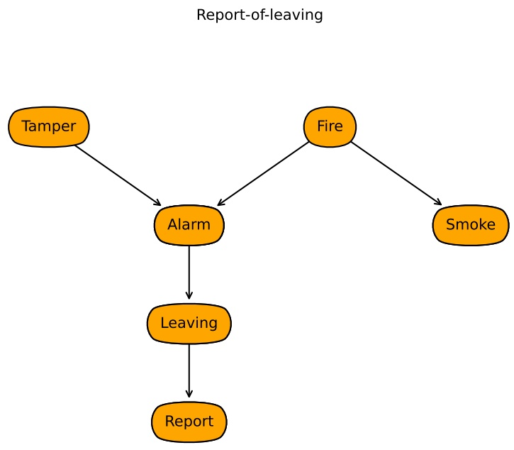

Figure 9.2: The report-of-leaving belief network

```julia
boolean = [False, True]
A = Variable("A", boolean, position=(0,0.8))
B = Variable("B", boolean, position=(0.333,0.7))
C = Variable("C", boolean, position=(0.666,0.6))
D = Variable("D", boolean, position=(1,0.5))

f_a = Prob(A,[],[0.4,0.6])
f_b = Prob(B,[A],[[0.9,0.1],[0.2,0.8]])
f_c = Prob(C,[B],[[0.6,0.4],[0.3,0.7]])
f_d = Prob(D,[C],[[0.1,0.9],[0.75,0.25]])

bn_4ch = BeliefNetwork("4-chain", {A,B,C,D}, {f_a,f_b,f_c,f_d})
```

## Report-of-Leaving Example

The second belief network, bn\_report, is Example 9.13 of Poole and Mackworth [2023] ([http://artint.info](http://artint.info)). The output of bn\_report.show() is shown in Figure 9.2 of this document.

```python
probExamples.py — Example belief networks ________________
from variable import Variable
from probFactors import CPD, Prob, LogisticRegression, NoisyOR, ConstantCPD
from probGraphicalModels import BeliefNetwork
```

<!-- page: 238 -->

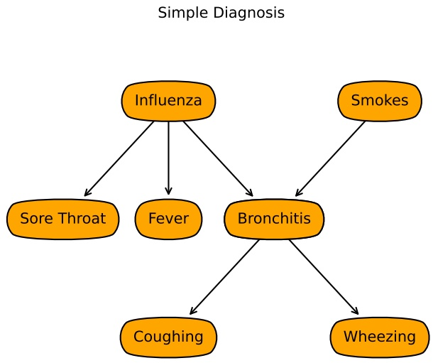

Figure 9.3: Simple diagnosis example; simple\_diagnosis.show()

```txt
# Belief network report-of-leaving example (Example 9.13 shown in Figure
    9.3) of
# Poole and Mackworth, Artificial Intelligence, 2023 http://artint.info
boolean = [False, True]

Alarm = Variable("Alarm", boolean, position=(0.366,0.5))
Fire = Variable("Fire", boolean, position=(0.633,0.75))
Leaving = Variable("Leaving", boolean, position=(0.366,0.25))
Report = Variable("Report", boolean, position=(0.366,0.0))
Smoke = Variable("Smoke", boolean, position=(0.9,0.5))
Tamper = Variable("Tamper", boolean, position=(0.1,0.75))

f_ta = Prob(Tamper,[],[0.98,0.02])
f_fi = Prob(Fire,[],[0.99,0.01])
f_sm = Prob(Smoke,[Fire],[[0.99,0.01],[0.1,0.9]])
f_al = Prob(Alarm,[Fire,Tamper],[[[0.9999, 0.0001], [0.15, 0.85]], [[0.01,
    0.99], [0.5, 0.5]]])
f_lv = Prob(Leaving,[Alarm],[[0.999, 0.001], [0.12, 0.88]])
f_re = Prob(Report,[Leaving],[[0.99, 0.01], [0.25, 0.75]])

bn_report = BeliefNetwork("Report-of-leaving",
    {Tamper, Fire, Smoke, Alarm, Leaving, Report},
        {f_ta,f_fi,f_sm,f_al,f_lv,f_re})
```

## Simple Diagnostic Example

This is the “simple diagnostic example” of Exercise 9.1 of Poole and Mackworth [2023], reproduced here as Figure 9.3

```python
_probExamples.py — (continued)
```

<!-- page: 239 -->

## 9.4. Graphical Models

```julia
# Belief network simple-diagnostic example (Exercise 9.3 shown in Figure 9.39) of
# Poole and Mackworth, Artificial Intelligence, 2023 http://artint.info

Influenza = Variable("Influenza", boolean, position=(0.4,0.8))
Smokes =    Variable("Smokes", boolean, position=(0.8,0.8))
SoreThroat = Variable("Sore Throat", boolean, position=(0.2,0.5))
HasFever =      Variable("Fever", boolean, position=(0.4,0.5))
Bronchitis = Variable("Bronchitis", boolean, position=(0.6,0.5))
Coughing =   Variable("Coughing", boolean, position=(0.4,0.2))
Wheezing =   Variable("Wheezing", boolean, position=(0.8,0.2))

p_infl =   Prob(Influenza,[],[0.95,0.05])
p_smokes = Prob(Smokes,[],[0.8,0.2])
p_sth =   Prob(SoreThroat,[Influenza],[[0.999,0.001],[0.7,0.3]])
p_fever = Prob(HasFever,[Influenza],[[0.99,0.05],[0.9,0.1]])
p_bronc = Prob(Bronchitis,[Influenza,Smokes],[[[0.9999, 0.0001], [0.3, 0.7]], [[0.1, 0.9], [0.01, 0.99]]])
p_cough = Prob(Coughing,[Bronchitis],[[0.93,0.07],[0.2,0.8]])
p_wheeze = Prob(Wheezing,[Bronchitis],[[0.999,0.001],[0.4,0.6]])

simple_diagnosis = BeliefNetwork("Simple Diagnosis",
                      {Influenza, Smokes, SoreThroat, HasFever, Bronchitis,
                       Coughing, Wheezing},
                      {p_infl, p_smokes, p_sth, p_fever, p_bronc, p_cough,
                       p_wheeze})
```

## Sprinkler Example

The third belief network is the sprinkler example from Pearl [2009]. The output of bn\_sprinkler.show() is shown in Figure 9.4 of this document.

```python
probExamples.py — (continued) ________________
Season = Variable("Season", ["dry_season","wet_season"],
    position=(0.5,0.9))
Sprinkler = Variable("Sprinkler", ["on","off"], position=(0.9,0.6))
Rained = Variable("Rained", boolean, position=(0.1,0.6))
Grass_wet = Variable("Grass wet", boolean, position=(0.5,0.3))
Grass_shiny = Variable("Grass shiny", boolean, position=(0.1,0))
Shoes_wet = Variable("Shoes wet", boolean, position=(0.9,0))

f_season = Prob(Season,[],{'dry_season':0.5, 'wet_season':0.5})
f_sprinkler = Prob(Sprinkler,[Season],{'dry_season":{"on':0.4,'off':0.6},
                          'wet_season":{"on':0.01,'off':0.99}})
f_rained = Prob(Rained,[Season],{'dry_season":[0.9,0.1], 'wet_season':
     [0.2,0.8]})
f_wet = Prob(Grass_wet,[Sprinkler,Rained], {'on': [[0.1,0.9],[0.01,0.99]],
                      'off':[[0.99,0.01],[0.3,0.7]]})
f_shiny = Prob(Grass_shiny, [Grass_wet], [[0.95,0.05], [0.3,0.7]])
f_shoes = Prob(Shoes_wet, [Grass_wet], [[0.98,0.02], [0.35,0.65]])
```

<!-- page: 240 -->

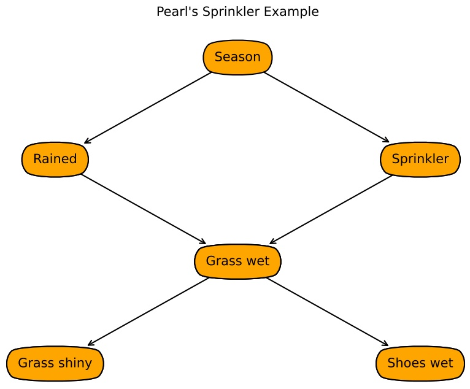

Figure 9.4: The sprinkler belief network

```erlang
bn_sprinkler = BeliefNetwork("Pearl's Sprinkler Example",
                      {Season, Sprinkler, Rained, Grass_wet, Grass_shiny,
                   Shoes_wet},
                      {f_season, f_sprinkler, f_rained, f_wet, f_shiny,
                   f_shoes})
```

## Bipartite Diagnostic Model with Noisy-or

The belief network bn\_no1 is a bipartite diagnostic model, with independent diseases, and the symptoms depend on the diseases, where the CPDs are defined using noisy-or. Bipartite means it is in two parts; the diseases are only connected to the symptoms and the symptoms are only connected to the diseases. The output of bn\_no1.show() is shown in Figure 9.5 of this document.

```julia
probExamples.py — (continued) ________________
#### Bipartite Diagnostic Network ###
Cough = Variable("Cough", boolean, (0.1,0.1))
Fever = Variable("Fever", boolean, (0.5,0.1))
Sneeze = Variable("Sneeze", boolean, (0.9,0.1))
Cold = Variable("Cold",boolean, (0.1,0.9))
Flu = Variable("Flu",boolean, (0.5,0.9))
```

<!-- page: 241 -->

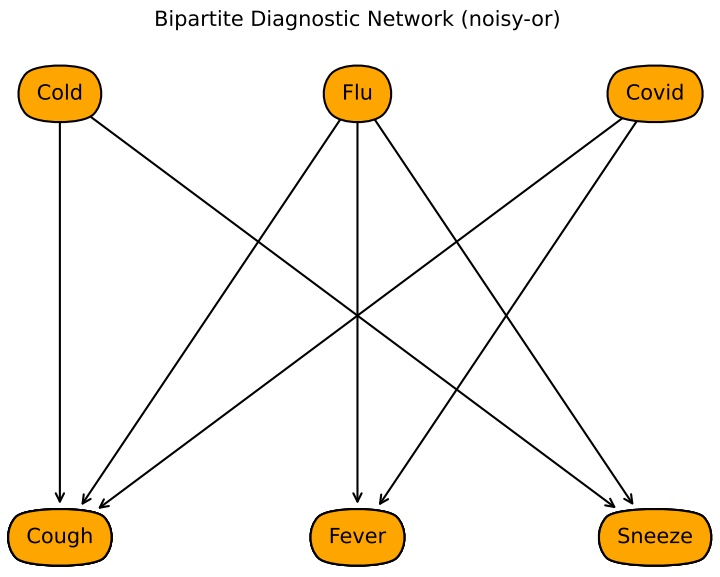

Figure 9.5: A bipartite diagnostic network

```julia
Covid = Variable("Covid",boolean, (0.9,0.9))

p_cold_no = Prob(Cold,[],[0.9,0.1])
p_flu_no = Prob(Flu,[],[0.95,0.05])
p_covid_no = Prob(Covid,[],[0.99,0.01])

p_cough_no = NoisyOR(Cough, [Cold,Flu,Covid], [0.1, 0.3, 0.2, 0.7])
p_fever_no = NoisyOR(Fever, [    Flu,Covid], [0.01,    0.6, 0.7])
p_sneeze_no = NoisyOR(Sneeze, [Cold,Flu ], [0.05, 0.5, 0.2 ])

bn_no1 = BeliefNetwork("Bipartite Diagnostic Network (noisy-or)",
                      {Cough, Fever, Sneeze, Cold, Flu, Covid},
                      {p_cold_no, p_flu_no, p_covid_no, p_cough_no,
                   p_fever_no, p_sneeze_no})

# to see the conditional probability of Noisy-or do:
# print(p_cough_no.to_table())

# example from box "Noisy-or compared to logistic regression"
# X = Variable("X",boolean)
# w0 = 0.01
# print(NoisyOR(X,[A,B,C,D],[w0, 1-(1-0.05)/(1-w0), 1-(1-0.1)/(1-w0),
     1-(1-0.2)/(1-w0), 1-(1-0.2)/(1-w0), ]).to_table(given={X:True}))
```

<!-- page: 242 -->

## Bipartite Diagnostic Model with Logistic Regression

The belief network bn\_lr1 is a bipartite diagnostic model, with independent diseases, and the symptoms depend on the diseases, where the CPDs are defined using logistic regression. It has the same graphical structure as the pre-vious example (see Figure 9.5). This has the (approximately) the same conditional probabilities as the previous example when zero or one diseases are present. Note that sigmoid(−2.2) ≈ 0.1

```txt
probExamples.py — (continued)

p_cold_lr = Prob(Cold,[],[0.9,0.1])
p_flu_lr = Prob(Flu,[],[0.95,0.05])
p_covid_lr = Prob(Covid,[],[0.99,0.01])

p_cough_lr = LogisticRegression(Cough, [Cold,Flu,Covid], [-2.2, 1.67, 1.26, 3.19])
p_fever_lr = LogisticRegression(Fever, [ Flu,Covid], [-4.6, 5.02, 5.46])
p_sneeze_lr = LogisticRegression(Sneeze, [Cold,Flu ], [-2.94, 3.04, 1.79])

bn_lr1 = BeliefNetwork("Bipartite Diagnostic Network - logistic regression",
                      {Cough, Fever, Sneeze, Cold, Flu, Covid},
                      {p_cold_lr, p_flu_lr, p_covid_lr, p_cough_lr,
                       p_fever_lr, p_sneeze_lr})

# to see the conditional probability of Noisy-or do:
#print(p_cough_lr.to_table())

# example from box "Noisy-or compared to logistic regression"
# from learnLinear import sigmoid, logit
# w0=logit(0.01)
# X = Variable("X",boolean)
# print(LogisticRegression(X,[A,B,C,D],[w0, logit(0.05)-w0, logit(0.1)-w0,
    logit(0.2)-w0, logit(0.2)-w0]).to_table(given={X:True}))
# try to predict what would happen (and then test) if we had
# w0=logit(0.01)
```

## 9.5 Inference Methods

Each of the inference methods implements the query method that computes the posterior probability of a variable given a dictionary of {variable : value} observations. The methods are Displayable because they implement the display method which is text-based unless overridden.

<!-- page: 243 -->

## 9.5. Inference Methods

```python
from display import Displayable

class InferenceMethod(Displayable):
    """The abstract class of graphical model inference methods"""
    method_name = "unnamed" # each method should have a method name

    def __init__(self,gm=None):
        self.gm = gm

    def query(self, qvar, obs={}): 
        """returns a {value:prob} dictionary for the query variable"""
        raise NotImplementedError("InferenceMethod query") # abstract method
```

We use bn\_4ch as the test case, in particular P(B | D = true). This needs an error threshold, particularly for the approximate methods, where the default threshold is much too accurate.

```python
def testIM(self, threshold=0.0000000001):
    solver = self(bn_4ch)
    res = solver.query(B,{D:True})
    correct_answer = 0.429632380245
    assert correct_answer-threshold < res[True] <
        correct_answer+threshold, \
            f"value {res[True]} not in desired range for
                {self.method_name}"
    print(f"Unit test passed for {self.method_name}.")
```

## 9.5.1 Showing Posterior Distributions

The show\_post method draws the posterior distribution of all variables. Figure 9.6 shows the result of bn\_reportRC.show\_post({Report:True}) when run after loading probRC.py (see below).

```python
def show_post(self, obs={}, num_format="{{3f}", fontsize=10,
    facecolor='orange'):
    """draws the graphical model conditioned on observations obs
        num_format is number format (allows for more or less precision)
        fontsize gives size of the text
        facecolor gives the color of the nodes
    """
    plt.ion()  # interactive
    fig, ax = plt.subplots()
    ax.set_axis_off()
    ax.set_title(self.gm.title+" observed: "+str(obs),
        fontsize=fontsize)
    self.show_post_graph(fig, ax, obs=obs, num_format=num_format,
        fontsize=fontsize, facecolor=facecolor)
```

<!-- page: 244 -->

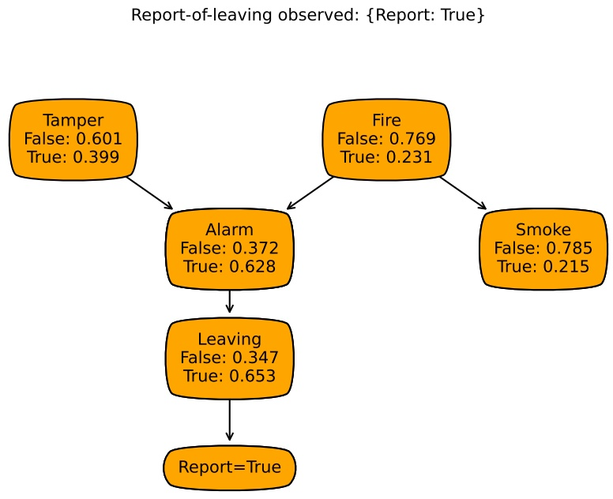

Figure 9.6: The report-of-leaving belief network with posterior distributions

```python
def show_post_graph(self, fig, ax, obs={}, num_format="{{3f}",
    fontsize=10, facecolor='orange'):
    bbox = dict(boxstyle="round4,pad=1.0,rounding_size=0.5",
        facecolor=facecolor)
    vartext = {} # variable:text dictionary
    self.nodes = {} # node:variable dictionary (used in probGUI)
    for var in self.gm.variables: #reversed(self.gm.topological_sort()):
        if var in obs:
            text = var.name + "=" + str(obs[var])
        else:
            distn = self.query(var, obs=obs)

            text = var.name + "\n" + "\n".join(str(d)+":
                "+num_format.format(v) for (d,v) in distn.items())
        vartext[var] = text
        # Draw arcs
        for par in self.gm.var2parents[var]:
            ax.annotate(text, par.position, xytext=var.position,
                    arrowprops={'arrowstyle':'<-'},bbox=bbox,
                    ha='center', va='center',
                    fontsize=fontsize)
    for var in self.gm.variables:
        x,y = var.position
```

<!-- page: 245 -->

```python
node = ax.text(x,y,vartext[var], bbox=bbox, ha='center',
    va='center', fontsize=fontsize)
self.nodes[node] = var
```

## 9.6 Naive Search

An instance of a ProbSearch object takes in a graphical model. The query method uses naive search to compute the probability of a query variable given observations on other variables. See Figure 9.9 of Poole and Mackworth [2023].

```python
import math
from probGraphicalModels import GraphicalModel, InferenceMethod
from probFactors import Factor

class ProbSearch(InferenceMethod):
    """The class that queries graphical models using search

    gm is graphical model to query
    """
    method_name = "naive search"

    def __init__(self,gm=None):
        InferenceMethod.__init__(self, gm)
        ## self.max_display_level = 3

    def query(self, qvar, obs={}, split_order=None):
        """computes P(qvar | obs) where
        qvar is the query variable
        obs is a variable:value dictionary
        split_order is a list of the non-observed non-query variables in gm
        """

        if qvar in obs:
            return {val:(1 if val == obs[qvar] else 0)
                for val in qvar.domain}
        else:
            if split_order == None:
                split_order = [v for v in self.gm.variables
                    if (v not in obs) and v != qvar]
            unnorm = [self.prob_search({qvar:val}|obs, self.gm Lapfactors,
                split_order)
                    for val in qvar.domain]
        p_obs = sum(unnorm)
        return {val:pr/p_obs for val,pr in zip(qvar.domain, unnorm)}
```

The following is the naive search-based algorithm. It is exponential in the number of variables, so is not very useful. However, it is simple, and helpful to understand before looking at the more complicated algorithm used in the subclass.

<!-- page: 246 -->

```python
def prob_search(self, context, factors, split_order):
    """simple search algorithm
    context: a variable:value dictionary
    factors: a set of factors
    split_order: list of variables not assigned in context
    returns sum over variable assignments to variables in split order
        of product of factors """
    self.display(2,"calling prob_search,",(context,factors,split_order))
    if not factors:
        return 1
    elif to_eval := {fac for fac in factors
        if fac.can_evaluate(context)}:
        # evaluate factors when all variables are assigned
        self.display(3,"prob_search evaluating factors",to_eval)
        val = math.prod(fac.get_value(context) for fac in to_eval)
        return val * self.prob_search(context, factors-to_eval,
            split_order)
    else:
        total = 0
        var = split_order[0]
        self.display(3, "prob_search branching on", var)
        for val in var.domain:
            total += self.prob_search({var:val}|context, factors,
                split_order[1:])
        self.display(3, "prob_search branching on", var,"returning",
            total)
        return total
```

## 9.7 Recursive Conditioning

The **recursive conditioning (RC)** algorithm adds forgetting and caching and recognizing disconnected components to the naive search. We do this by adding a cache and redefining the recursive search algorithm. It inherits the query method. See Figure 9.12 of Poole and Mackworth [2023].

The cache is initialized with the empty context and empty factors has probability 1. This means that checking the cache can act as the base case when the context is empty.

```python
class ProbRC(ProbSearch):
    method_name = "recursive conditioning"

    def __init__(self,gm=None):
        self.cache = {(frozenset(), frozenset():1}
        ProbSearch.__init__(self,gm)

    def prob_search(self, context, factors, split_order):
```

<!-- page: 247 -->

```python
""" returns sum_{split_order} prod_{factors} given assignment in context
context is a variable:value dictionary
factors is a set of factors
split_order: list of variables in factors that are not in context """
"""
self.display(3,"calling rc,",(context,factors))
ce = (frozenset(context.items()), frozenset(factors)) # key for the cache entry
if ce in self.cache:
    self.display(3,"rc cache lookup",(context,factors))
    return self.cache[ce]
elif vars_not_in_factors := {var for var in context
        if not any(var in fac.variables
            for fac in factors)}:
    # forget variables not in any factor
    self.display(3,"rc forgetting variables", vars_not_in_factors)
    return self.prob_search({key:val for (key,val) in context.items()
        if key not in vars_not_in_factors},
            factors, split_order)
elif to_eval := {fac for fac in factors
        if fac.can_evaluate(context)}:
    # evaluate factors when all variables are assigned
    self.display(3,"rc evaluating factors",to_eval)
    val = math.prod(fac.get_value(context) for fac in to_eval)
    if val == 0:
        return 0
    else:
        return val * self.prob_search(context,
            {fac for fac in factors
                if fac not in to_eval},
                    split_order)
elif len(comp := connected_components(context, factors, split_order)) > 1:
    # there are disconnected components
    self.display(3,"splitting into connected components",comp,"in context",context)
    return(math.prod(self.prob_search(context,f,eo) for (f,eo) in comp))
else:
    assert split_order, "split_order should not be empty to get here"
    total = 0
    var = split_order[0]
    self.display(3, "rc branching on", var)
    for val in var.domain:
        total += self.prob_search({var:val}|context, factors, split_order[1:])
    self.cache[ce] = total
```

<!-- page: 248 -->

```python
self.display(2, "rc branching on", var,"returning", total)
        return total
```

connected\_components returns a list of connected components, where a connected component is a set of factors and a set of variables, where the graph that connects variables and factors that involve them is connected. The connected components are built one at a time; with a current connected component. At all times factors is partitioned into 3 disjoint sets:

component\_factors containing factors in the current connected component where all factors that share a variable are already in the component

• factors\_to\_check containing factors in the current connected component where potentially some factors that share a variable are not in the component; these need to be checked

• other\_factors the other factors that are not (yet) in the connected component

```python
def connected_components(context, factors, split_order):
    """returns a list of (f,e) where f is a subset of factors and e is a subset of split_order
    such that each element shares the same variables that are disjoint from other elements.
    """
    other_factors = set(factors) #copies factors
    factors_to_check = {other_factors.pop()} # factors in connected component still to be checked
    component_factors = set() # factors in first connected component already checked
    component_variables = set() # variables in first connected component while factors_to_check:
        next_fac = factors_to_check.pop()
        component_factors.add(next_fac)
        new_vars = set(next_fac.variables) - component_variables - context.keys()
        component_variables |= new_vars
        for var in new_vars:
            factors_to_check |= {f for f in other_factors if var in f.variables}
            other_factors -= factors_to_check # set difference
    if other_factors:
        return ( [(component_factors,[e for e in split_order if e in component_variables]) ]
            + connected_components(context, other_factors,
                [e for e in split_order if e not in component_variables]) )
    else:
        return [(component_factors, split_order)]
```

<!-- page: 249 -->

Testing:

```python
from probGraphicalModels import bn_4ch, A,B,C,D,f_a,f_b,f_c,f_d
bn_4chv = ProbRC(bn_4ch)
## bn_4chv.query(A,{})
## bn_4chv.query(D,{})
## InferenceMethod.max_display_level = 3 # show more detail in displaying
## InferenceMethod.max_display_level = 1 # show less detail in displaying
## bn_4chv.query(A,{D:True},{C,B})
## bn_4chv.query(B,{A:True,D:False})

from probExamples import bn_report,Alarm,Fire,Leaving,Report,Smoke,Tamper
bn_reportRC = ProbRC(bn_report) # answers queries using recursive
conditioning
## bn_reportRC.query(Tamper,{})
## InferenceMethod.max_display_level = 0 # show no detail in displaying
## bn_reportRC.query(Leaving,{})
## bn_reportRC.query(Tamper,{},
    split_order=[Smoke,Fire,Alarm,Leaving,Report])
## bn_reportRC.query(Tamper,{Report:True})
## bn_reportRC.query(Tamper,{Report:True,Smoke:False})

## To display resulting posteriors try:
# bn_reportRC.show_post({})
# bn_reportRC.show_post({Smoke:False})
# bn_reportRC.show_post({Report:True})
# bn_reportRC.show_post({Report:True, Smoke:False})

## Note what happens to the cache when these are called in turn:
## bn_reportRC.query(Tamper,{Report:True},
    split_order=[Smoke,Fire,Alarm,Leaving])
## bn_reportRC.query(Smoke,{Report:True},
    split_order=[Tamper, Fire, Alarm, Leaving])

from probExamples import bn_sprinkler, Season, Sprinkler, Rained,
    Grass_wet, Grass_shiny, Shoes_wet
bn_sprinklerv = ProbRC(bn_sprinkler)
## bn_sprinklerv.query(Shoes_wet,{})
## bn_sprinklerv.query(Shoes_wet,{Rained:True})
## bn_sprinklerv.query(Shoes_wet,{Grass_shiny:True})
## bn_sprinklerv.query(Shoes_wet,{Grass_shiny:False,Rained:True})

from probExamples import bn_no1, bn_lr1, Cough, Fever, Sneeze, Cold, Flu,
    Covid
bn_no1v = ProbRC(bn_no1)
bn_lr1v = ProbRC(bn_lr1)
## bn_no1v.query(Flu, {Fever:1, Sneeze:1})
## bn_lr1v.query(Flu, {Fever:1, Sneeze:1})
## bn_lr1v.query(Cough,{})
## bn_lr1v.query(Cold,{Cough:1,Sneeze:0,Fever:1})
```

[https://aipython.org](https://aipython.org)

<!-- page: 250 -->

```python
## bn_lr1v.query(Flu,{Cough:0,Sneeze:1,Fever:1})
## bn_lr1v.query(Covid,{Cough:1,Sneeze:0,Fever:1})
## bn_lr1v.query(Covid,{Cough:1,Sneeze:0,Fever:1,Flu:0})
## bn_lr1v.query(Covid,{Cough:1,Sneeze:0,Fever:1,Flu:1})

if __name__ == "__main__":
    InferenceMethod.testIM(ProbSearch)
    InferenceMethod.testIM(ProbRC)
```

The following example uses the decision tree representation of Section 9.3.4 (page 234).

```python
from probFactors import Prob, action, rain, full, wet, p_wet
from probGraphicalModels import BeliefNetwork
p_action = Prob(action,[],{'go_out':0.3, 'get_coffee':0.7})
p_rain = Prob(rain,[],[0.4,0.6])
p_full = Prob(full,[],[0.1,0.9])

wetBN = BeliefNetwork("Wet (decision tree CPD)", {action, rain, full, wet},
                      {p_action, p_rain, p_full, p_wet})
wetRC = ProbRC(wetBN)
# wetRC.query(wet, {action:'go_out', rain:True})
# wetRC.show_post({action:'go_out', rain:True})
# wetRC.show_post({action:'go_out', wet:True})
```

Exercise 9.1 Does recursive conditioning split on variable full for the query commented out above? Does it need to? Fix the code so that decision tree representations of conditional probabilities can be evaluated as soon as possible.

Exercise 9.2 This code adds to the cache only after splitting. Implement a variant that caches after forgetting. (What can the cache start with?) Which version works better? Compare some measure of the search tree and the space used. Try other alternatives of what to cache; which method works best?

## 9.8 Variable Elimination

An instance of a VE object takes in a graphical model. The query method uses variable elimination to compute the probability of a variable given observations on some other variables.

```python
from probFactors import Factor, FactorObserved, FactorSum, factor_times
from probGraphicalModels import GraphicalModel, InferenceMethod

class VE(InferenceMethod):
    """The class that queries Graphical Models using variable elimination.

    gm is graphical model to query
    """
```

<!-- page: 251 -->

```python
_probFactors.py — (continued)
```

## 9.8. Variable Elimination

```python
method_name = "variable elimination"

def __init__(self,gm=None):
    InferenceMethod.__init__(self, gm)

def query(self,var,obs={},elim_order=None):
    """computes P(var|obs) where
    var is a variable
    obs is a {variable:value} dictionary"""
    if var in obs:
        return {var:1 if val == obs[var] else 0 for val in var.domain}
    else:
        if elim_order == None:
            elim_order = self.gm.variables
        projFactors = [self.project_observations(fact,obs)
                for fact in self.gm.factors]
        for v in elim_order:
            if v != var and v not in obs:
                projFactors = self.eliminate_var(projFactors,v)
        unnorm = factor_times(var,projFactors)
        p_obs=sum(unnorm)
        self.display(1,"Unnormalized probs:",unnorm,"Prob obs:",p_obs)
        return {val:pr/p_obs for val,pr in zip(var.domain, unnorm)}
```

A FactorObserved is a factor that is the result of some observations on another factor. We don’t store the values in a list; we just look them up as needed. The observations can include variables that are not in the list, but should have some intersection with the variables in the factor.

<div class="docvortex-algorithm" style="white-space: pre-wrap; font-family:monospace;">
class FactorObserved(Factor):
    def __init__(self, factor, obs):
        Factor.__init__(self, [v for v in factor.variables if v not in obs])
        self.observed = obs
        self.orig_factor = factor

    def get_value(self, assignment):
        return self.orig_factor.get_value(assignment|self.observed)

A FactorSum is a factor that is the result of summing out a variable from the product of other factors. I.e., it constructs a representation of:
    $\sum_{var} \prod_{f \in factors} f(var)$.

We store the values in a list in a lazy manner; if they are already computed, we used the stored values. If they are not already computed we can compute and store them.
</div>

<!-- page: 252 -->

```python
def __init__(self,var,factors):
    self.var_summed_out = var
    self.factors = factors
    vars = list({v for fac in factors
        for v in fac.variables if v is not var})
    #for fac in factors:
    #   for v in fac.variables:
    #       if v is not var and v not in vars:
    #          vars.append(v)
    Factor.__init__(self,vars)
    self.values = {}

def get_value(self,assignment):
    """lazy implementation: if not saved, compute it. Return saved value"""
    asst = frozenset(assignment.items())
    if asst in self.values:
        return self.values[asst]
    else:
        total = 0
        new_asst = assignment.copy()
        for val in self.var_summed_out.domain:
            new_asst[self.var_summed_out] = val
            total += math.prod(fac.get_value(new_asst) for fac in self.factors)
        self.values[asst] = total
        return total
```

The method factor\_times multiplies a set of factors that are all factors on the same variable (or on no variables). This is the last step in variable elimination before normalizing. It returns an array giving the product for each value of variable.

```python
def factor_times(variable, factors):
    """when factors are factors just on variable (or on no variables)"""
    prods = []
    facs = [f for f in factors if variable in f.variables]
    for val in variable.domain:
        ast = {variable:val}
        prods.append(math.prod(f.get_value(ast) for f in facs))
    return prods
```

To project observations onto a factor, for each variable that is observed in the factor, we construct a new factor that is the factor projected onto that variable. Factor\_observed creates a new factor that is the result is assigning a value to a single variable.

```python
__________________________probVE.py — (continued) _________________________
    def project_observations(self, factor, obs):
        """Returns the resulting factor after observing obs
```

<!-- page: 253 -->

```python
obs is a dictionary of {variable:value} pairs.
    """
    if any((var in obs) for var in factor.variables):
        # a variable in factor is observed
        return FactorObserved(factor,obs)
    else:
        return factor

    def eliminate_var(self,factors,var):
        """Eliminate a variable var from a list of factors.
        Returns a new set of factors that has var summed out.
        """
        self.display(2,"eliminating ",str(var))
        contains_var = []
        not_contains_var = []
        for fac in factors:
            if var in fac.variables:
                contains_var.append(fac)
            else:
                not_contains_var.append(fac)
        if contains_var == []:
            return factors
        else:
            newFactor = FactorSum(var,contains_var)
            self.display(2,"Multiplying:",[str(f) for f in contains_var])
            self.display(2,"Creating factor:", newFactor)
            self.display(3, newFactor.to_table()) # factor in detail
            not_contains_var.append(newFactor)
            return not_contains_var

from probGraphicalModels import bn_4ch, A,B,C,D
bn_4chv = VE(bn_4ch)
## bn_4chv.query(A,{})
## bn_4chv.query(D,{})
## InferenceMethod.max_display_level = 3 # show more detail in displaying
## InferenceMethod.max_display_level = 1 # show less detail in displaying
## bn_4chv.query(A,{D:True})
## bn_4chv.query(B,{A:True,D:False})

from probExamples import bn_report,Alarm,Fire,Leaving,Report,Smoke,Tamper
bn_reportv = VE(bn_report) # answers queries using variable elimination
## bn_reportv.query(Tamper,{})
## InferenceMethod.max_display_level = 0 # show no detail in displaying
## bn_reportv.query(Leaving,{})
## bn_reportv.query(Tamper,{},elim_order=[Smoke,Report,Leaving,Alarm,Fire])
## bn_reportv.query(Tamper,{Report:True})
## bn_reportv.query(Tamper,{Report:True,Smoke:False})

from probExamples import bn_sprinkler, Season, Sprinkler, Rained,
```

<!-- page: 254 -->

```python
Grass_wet, Grass_shiny, Shoes_wet
bn_sprinklerv = VE(bn_sprinkler)
## bn_sprinklerv.query(Shoes_wet,{})
## bn_sprinklerv.query(Shoes_wet,{Rained:True})
## bn_sprinklerv.query(Shoes_wet,{Grass_shiny:True})
## bn_sprinklerv.query(Shoes_wet,{Grass_shiny:False,Rained:True})

from probExamples import bn_lr1, Cough, Fever, Sneeze, Cold, Flu, Covid
vediag = VE(bn_lr1)
## vediag.query(Cough,{})
## vediag.query(Cold,{Cough:1,Sneeze:0,Fever:1})
## vediag.query(Flu,{Cough:0,Sneeze:1,Fever:1})
## vediag.query(Covid,{Cough:1,Sneeze:0,Fever:1})
## vediag.query(Covid,{Cough:1,Sneeze:0,Fever:1,Flu:0})
## vediag.query(Covid,{Cough:1,Sneeze:0,Fever:1,Flu:1})

if __name__ == "__main__":
    InferenceMethod.testIM(VE)
```

## 9.9 Stochastic Simulation

## 9.9.1 Sampling from a discrete distribution

The method sample\_one generates a single sample from a (possibly unnormalized) distribution. dist is a {value : weight} dictionary, where weight ≥ 0. This returns a value with probability in proportion to its weight.

```python
import random
from probGraphicalModels import InferenceMethod

def sample_one(dist):
    """returns the index of a single sample from normalized distribution
        dist."""
    rand = random.random()*sum(dist.values())
    cum = 0    # cumulative weights
    for v in dist:
        cum += dist[v]
        if cum > rand:
            return v
```

If we want to generate multiple samples, repeatedly calling sample\_one may not be efficient. If we want to generate multiple samples, and the distribution is over m values, it searches through the m values of the distribution for each sample.

The method sample\_multiple generates multiple samples from a distribution defined by dist, where dist is a {value : weight} dictionary, where we ight ≥ 0 and

<!-- page: 255 -->

the weights are not all zero. This returns a list of values, of length num\_samples, where each sample is selected with a probability proportional to its weight.

The method generates all of the random numbers, sorts them, and then goes through the distribution once, saving the selected samples.

```python
def sample_multiple(dist, num_samples):
    """returns a list of num_samples values selected using distribution
    dist.
    dist is a {value:weight} dictionary that does not need to be normalized
    """
    total = sum(dist.values())
    rands = sorted(random.random()*total for i in range(num_samples))
    result = []
    dist_items = list(dist.items())
    cum = dist_items[0][1] # cumulative sum
    index = 0
    for r in rands:
        while r>cum:
            index += 1
            cum += dist_items[index][1]
        result.append(dist_items[index][0])
    return result
```

## Exercise 9.3

What is the time and space complexity of the following 4 methods to generate n samples, where m is the length of dist:

(a) n calls to sample\_one

(b) sample\_multiple

(c) Create the cumulative distribution (choose how this is represented) and, for each random number, do a binary search to determine the sample associated with the random number.

(d) Choose a random number in the range [i/n, (i + 1)/n) for each i ∈ range(n), where n is the number of samples. Use these as the random numbers to select the particles. (Does this give random samples?)

For each method suggest when it might be the best method.

The test\_sampling method can be used to generate the statistics from a number of samples. It is useful to see the variability as a function of the number of samples. Try it for a few samples and also for many samples.

```python
def test_sampling(dist, num_samples):
    """Given a distribution, dist, draw num_samples samples
    and return the resulting counts
    """
    result = {v:0 for v in dist}
    for v in sample_multiple(dist, num_samples):
```

<!-- page: 256 -->

```python
result[v] += 1
    return result

# try the following queries a number of times each:
# test_sampling({1:1,2:2,3:3,4:4}, 100)
# test_sampling({1:1,2:2,3:3,4:4}, 100000)
```

## 9.9.2 Sampling Methods for Belief Network Inference

A SamplingInferenceMethod is an InferenceMethod, but the query method also takes arguments for the number of samples and the sample-order (which is an ordering of factors). The first methods assume a belief network (and not an undirected graphical model).

```python
class SamplingInferenceMethod(InferenceMethod):
    """The abstract class of sampling-based belief network inference methods"""
    def __init__(self, gm=None):
        InferenceMethod.__init__(self, gm)

    def query(self, qvar, obs={}, number_samples=1000, sample_order=None):
        raise NotImplementedError("SamplingInferenceMethod query") # abstract
```

## 9.9.3 Rejection Sampling

```python
class RejectionSampling(SamplingInferenceMethod):
    """The class that queries Graphical Models using Rejection Sampling.

    gm is a belief network to query
    """
    method_name = "rejection sampling"

    def __init__(self, gm=None):
        SamplingInferenceMethod.__init__(self, gm)

    def query(self, qvar, obs={}, number_samples=1000, sample_order=None):
        """computes P(qvar | obs) where
        qvar is a variable.
        obs is a {variable:value} dictionary.
        sample_order is a list of variables where the parents
            come before the variable.
        """

        if sample_order is None:
            sample_order = self.gm.topological_sort()
```

<!-- page: 257 -->

```python
self.display(2,*sample_order,sep="\t")
    counts = {val:0 for val in qvar.domain}
    for i in range(number_samples):
        rejected = False
        sample = {}
        for nvar in sample_order:
            fac = self.gm.var2cpt[nvar]  #factor with nvar as child
            val = sample_one({v:fac.get_value({**sample, nvar:v}) for v
                in nvar.domain})
            self.display(2,val,end="\t")
            if nvar in obs and obs[nvar] != val:
                rejected = True
                self.display(2,"Rejected")
                break
            sample[nvar] = val
        if not rejected:
            counts[sample[qvar]] += 1
            self.display(2,"Accepted")
    tot = sum(counts.values())
    # As well as the distribution we also include raw counts
    dist = {c:v/tot if tot>0 else 1/len(qvar.domain) for (c,v) in
        counts.items()}
    dist["raw_counts"] = counts
    return dist
```

## 9.9.4 Likelihood Weighting

Likelihood weighting includes a weight for each sample. Instead of rejecting samples based on observations, likelihood weighting changes the weights of the sample in proportion with the probability of the observation. The weight then becomes the probability that the variable would have been rejected.

```python
class LikelihoodWeighting(SamplingInferenceMethod):
    """The class that queries Graphical Models using Likelihood weighting.

    gm is a belief network to query
    """
    method_name = "likelihood weighting"

    def __init__(self, gm=None):
        SamplingInferenceMethod.__init__(self, gm)

    def query(self,qvar,obs={},number_samples=1000,sample_order=None):
        """computes P(qvar | obs) where
        qvar is a variable.
        obs is a {variable:value} dictionary.
        sample_order is a list of factors where factors defining the parents
            come before the factors for the child.
        """
        if sample_order is None:
```

[https://aipython.org](https://aipython.org)

<!-- page: 258 -->

```python
sample_order = self.gm.topological_sort()
self.display(2,*[v for v in sample_order
        if v not in obs],sep="\t")
counts = {val:0 for val in qvar.domain}
for i in range(number_samples):
    sample = {}
    weight = 1.0
    for nvar in sample_order:
        fac = self.gm.var2cpt[nvar]
        if nvar in obs:
            sample[nvar] = obs[nvar]
            weight *= fac.get_value(sample)
        else:
            val = sample_one({v:fac.get_value({**sample,nvar:v}) for
                v in nvar.domain})
            self.display(2,val,end="\t")
            sample[nvar] = val
    counts[sample[qvar]] += weight
    self.display(2,weight)
tot = sum(counts.values())
# as well as the distribution we also include the raw counts
dist = {c:v/tot for (c,v) in counts.items()}
dist["raw_counts"] = counts
return dist
```

Exercise 9.4 Change this algorithm so that it does **importance sampling** using a proposal distribution that may be different from the prior. It needs sample\_one using a different distribution and then adjust the weight of the current sample. For testing, use a proposal distribution that only differs from the prior for a subset of the variables. For which variables does the different proposal distribution make the most difference?

## 9.9.5 Particle Filtering

In this implementation, a particle is a {variable : value} dictionary. Because adding a new value to dictionary involves a side effect, the dictionaries are copied during resampling.

```python
class ParticleFiltering(SamplingInferenceMethod):
    """The class that queries Graphical Models using Particle Filtering.

    gm is a belief network to query
    """
    method_name = "particle filtering"

    def __init__(self, gm=None):
        SamplingInferenceMethod.__init__(self, gm)

    def query(self, qvar, obs={}, number_samples=1000, sample_order=None):
```

<!-- page: 259 -->

```python
"""computes P(qvar | obs) where
qvar is a variable.
obs is a {variable:value} dictionary.
sample_order is a list of factors where factors defining the parents
    come before the factors for the child.
"""
if sample_order is None:
    sample_order = self.gm.topological_sort()
self.display(2,*[v for v in sample_order
        if v not in obs],sep="\t")
particles = [{} for i in range(number_samples)]
for nvar in sample_order:
    fac = self.gm.var2cpt[nvar]
    if nvar in obs:
        weights = [fac.get_value({**part, nvar:obs[nvar]})
            for part in particles]
        particles = [{**p, nvar:obs[nvar]}
            for p in resample(particles, weights,
                number_samples)]
    else:
        for part in particles:
            part[nvar] = sample_one({v:fac.get_value({**part,
                nvar:v})
                    for v in nvar.domain})
        self.display(2,part[nvar],end="\t")
counts = {val:0 for val in qvar.domain}
for part in particles:
    counts[part[qvar]] += 1
tot = sum(counts.values())
# as well as the distribution we also include the raw counts
dist = {c:v/tot for (c,v) in counts.items()}
dist["raw_counts"] = counts
return dist
```

## Resampling

Resample is based on sample\_multiple but works with an array of particles. (Aside: Python doesn’t let us use sample\_multiple directly as it uses a dictionary and particles, represented as dictionaries can’t be the key of dictionaries).

```python
def resample(particles, weights, num_samples):
    """returns num_samples copies of particles resampled according to weights.
    particles is a list of particles
    weights is a list of positive numbers, of same length as particles
    num_samples is n integer
    """
    total = sum(weights)
    rands = sorted(random.random()*total for i in range(num_samples))
```

<!-- page: 260 -->

```python
result = []
    cum = weights[0]  # cumulative sum
    index = 0
    for r in rands:
        while r>cum:
            index += 1
            cum += weights[index]
        result.append(particles[index])
    return result
```

## 9.9.6 Examples

```python
from probGraphicalModels import bn_4ch, A,B,C,D
bn_4chr = RejectionSampling(bn_4ch)
bn_4chL = LikelihoodWeighting(bn_4ch)
## InferenceMethod.max_display_level = 2 # detailed tracing for all inference methods
## bn_4chr.query(A,{})
## bn_4chr.query(C,{})
## bn_4chr.query(A,{C:True})
## bn_4chr.query(B,{A:True,C:False})

from probExamples import bn_report,Alarm,Fire,Leaving,Report,Smoke,Tamper
bn_reportr = RejectionSampling(bn_report) # answers queries using rejection sampling
bn_reportL = LikelihoodWeighting(bn_report) # answers queries using likelihood weighting
bn_reportp = ParticleFiltering(bn_report) # answers queries using particle filtering
## bn_reportr.query(Tamper,{})
## bn_reportr.query(Tamper,{})
## bn_reportr.query(Tamper,{Report:True})
## InferenceMethod.max_display_level = 0 # no detailed tracing for all inference methods
## bn_reportr.query(Tamper,{Report:True},number_samples=100000)
## bn_reportr.query(Tamper,{Report:True,Smoke:False})
## bn_reportr.query(Tamper,{Report:True,Smoke:False},number_samples=100)

## bn_reportL.query(Tamper,{Report:True,Smoke:False},number_samples=100)
## bn_reportL.query(Tamper,{Report:True,Smoke:False},number_samples=100)

from probExamples import bn_sprinkler,Season, Sprinkler
from probExamples import Rained, Grass_wet, Grass_shiny, Shoes_wet
bn_sprinklerr = RejectionSampling(bn_sprinkler) # answers queries using rejection sampling
bn_sprinklerL = LikelihoodWeighting(bn_sprinkler) # answers queries using rejection sampling
```

<!-- page: 261 -->

## 9.9. Stochastic Simulation

```python
bn_sprinklerp = ParticleFiltering(bn_sprinkler) # answers queries using
    particle filtering
#bn_sprinklerr.query(Shoes_wet,{Grass_shiny:True,Rained:True})
#bn_sprinklerL.query(Shoes_wet,{Grass_shiny:True,Rained:True})
#bn_sprinklerp.query(Shoes_wet,{Grass_shiny:True,Rained:True})

if __name__ == "__main__":
    InferenceMethod.testIM(RejectionSampling, threshold=0.1)
    InferenceMethod.testIM(LikelihoodWeighting, threshold=0.1)
    InferenceMethod.testIM(ParticleFiltering, threshold=0.1)
```

## 9.9.7 Gibbs Sampling

The following implements **Gibbs sampling**, a form of **Markov Chain Monte Carlo** MCMC.

```python
#import random
#from probGraphicalModels import InferenceMethod

#from probStochSim import sample_one, SamplingInferenceMethod

class GibbsSampling(SamplingInferenceMethod):
    """The class that queries Graphical Models using Gibbs Sampling.

    bn is a graphical model (e.g., a belief network) to query
    """
    method_name = "Gibbs sampling"

    def __init__(self, gm=None):
        SamplingInferenceMethod.__init__(self, gm)
        self.gm = gm

    def query(self, qvar, obs={}, number_samples=1000, burn_in=100,
        sample_order=None):
        """computes P(qvar | obs) where
        qvar is a variable.
        obs is a {variable:value} dictionary.
        sample_order is a list of non-observed variables in order, or
        if sample_order None, an arbitrary ordering is used
        """

        counts = {val:0 for val in qvar.domain}
        if sample_order is not None:
            variables = sample_order
        else:
            variables = [v for v in self.gm.variables if v not in obs]
            random.shuffle(variables)
        var_to_factors = {v:set() for v in self.gm.variables}
        for fac in self.gm Laplace:
            for var in fac Laplace:
                var_to_factors[var].add(fac)
```

<!-- page: 262 -->

```python
sample = {var:random.choice(var.domain) for var in variables}
self.display(3,"Sample:",sample)
sample.update(obs)
for i in range(burn_in + number_samples):
    for var in variables:
        # get unnormalized probability distribution of var given its
            neighbors
        vardist = {val:1 for val in var.domain}
        for val in var.domain:
            sample[var] = val
            for fac in var_to_factors[var]: # Markov blanket
                vardist[val] *= fac.get_value(sample)
            sample[var] = sample_one(vardist)
        if i >= burn_in:
            counts[sample[qvar]] +=1
            self.display(3,"      ",sample)
tot = sum(counts.values())
# as well as the computed distribution, we also include raw counts
dist = {c:v/tot for (c,v) in counts.items()}
dist["raw_counts"] = counts
self.display(2, f"Gibbs sampling P({qvar}|{obs}) = {dist}")
return dist

#from probGraphicalModels import bn_4ch, A,B,C,D
bn_4chg = GibbsSampling(bn_4ch)
## InferenceMethod.max_display_level = 2 # detailed tracing for all
    inference methods
bn_4chg.query(A,{})
## bn_4chg.query(D,{})
## bn_4chg.query(B,{D:True})
## bn_4chg.query(B,{A:True,C:False})

from probExamples import bn_report,Alarm,Fire,Leaving,Report,Smoke,Tamper
bn_reportg = GibbsSampling(bn_report)
## bn_reportg.query(Tamper,{Report:True},number_samples=1000)

if __name__ == "__main__":
    InferenceMethod.testIM(GibbsSampling, threshold=0.1)
```

Exercise 9.5 Change the code so that it can have multiple query variables. Make the list of query variable be an input to the algorithm, so that the default value is the list of all non-observed variables.

Exercise 9.6 In this algorithm, explain where it computes the probability of a variable given its Markov blanket. Instead of returning the average of the samples for the query variable, it is possible to return the average estimate of the probability of the query variable given its Markov blanket. Does this converge to the same answer as the given code? Does it converge faster, slower, or the same?

<!-- page: 263 -->

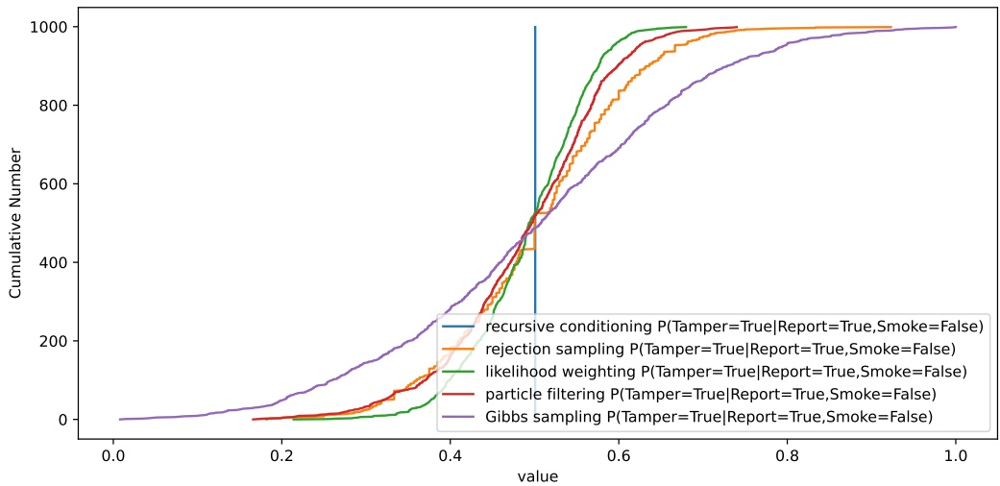

Figure 9.7: Cumulative distribution of the prediction of various models for P(Tamper=True | report ∧ ¬smoke)

## 9.9.8 Plotting Behavior of Stochastic Simulators

The stochastic simulation runs can give different answers each time they are run. For the algorithms that give the same answer in the limit as the number of samples approaches infinity (as do all of these algorithms), the algorithms can be compared by comparing the accuracy for multiple runs. Summary statistics like the variance may provide some information, but the assumptions behind the variance being appropriate (namely that the distribution is approximately Gaussian) may not hold for cases where the predictions are bounded and often skewed.

It is more appropriate to plot the distribution of predictions over multiple runs. The plot\_stats method plots the prediction of a particular variable (or for the partition function) for a number of runs of the same algorithm. On the xaxis, is the prediction of the algorithm. On the y-axis is the number of runs with prediction less than or equal to the x value. Thus this is like a cumulative distribution over the predictions, but with counts on the y-axis.

Note that for runs where there are no samples that are consistent with the observations (as can happen with rejection sampling), the prediction of probability is 1.0 (as a convention for 0/0).

That variable what contains the query variable, or if what is “prob\_ev”, the probability of evidence.

Figure 9.7 shows the distribution of various models. This figure is generated using the first plot\_mult example below. Recursive conditioning gives the exact answer, and so is a vertical line. The others provide the cumulative prediction for 1000 runs for each method. This graph shows that for this graph and query, likelihood weighting is closest to the exact answer.

<!-- page: 264 -->

```python
import matplotlib.pyplot as plt

def plot_stats(method, qvar, qval, obs, number_runs=1000, **queryargs):
    """Plots a cumulative distribution of the prediction of the model.
    method is a InferenceMethod (that implements appropriate query(.))
    plots P(qvar=qval | obs)
    qvar is the query variable, qval is corresponding value
    obs is the {variable:value} dictionary representing the observations
    number_iterations is the number of runs that are plotted
    **queryargs is the arguments to query (often number_samples for sampling methods)
    """
    plt.ion()
    # ax is global
    ax.set_xlabel("value")
    ax.set_ylabel("Cumulative Number")
    method.max_display_level, prev_mdl = 0, method.max_display_level #no display
    answers = [method.query(qvar,obs,**queryargs)
        for i in range(number_runs)]
    values = [ans[qval] for ans in answers]
    label = f"""{method.method_name}
        P({qvar}={qval}|{','.join(f'{var}={val}'
            for (var,val) in obs.items())})"""
    values.sort()
    ax.plot(values,range(number_runs),label=label)
    ax.legend() #loc="upper left")
    plt.show()
    method.max_display_level = prev_mdl # restore display level

if __name__ == "__main__":
    fig, ax = plt.subplots()

# Try:
# plot_stats(bn_reportr,Tamper,True,{Report:True,Smoke:True},
       number_samples=1000, number_runs=1000)
# plot_stats(bn_reportL,Tamper,True,{Report:True,Smoke:True},
       number_samples=1000, number_runs=1000)
# plot_stats(bn_reportp,Tamper,True,{Report:True,Smoke:True},
       number_samples=1000, number_runs=1000)
# plot_stats(bn_reportr,Tamper,True,{Report:True,Smoke:True},
       number_samples=100, number_runs=1000)
# plot_stats(bn_reportL,Tamper,True,{Report:True,Smoke:True},
       number_samples=100, number_runs=1000)
# plot_stats(bn_reportg,Tamper,True,{Report:True,Smoke:True},
       number_samples=1000, number_runs=1000)

def plot_mult(methods, example, qvar, qval, obs, number_samples=1000,
```

<!-- page: 265 -->

```python
number_runs=1000):
    for method in methods:
        solver = method(example)
        if isinstance(method,SamplingInferenceMethod):
            plot_stats(solver, qvar, qval, obs,
                number_samples=number_samples, number_runs=number_runs)
        else:
            plot_stats(solver, qvar, qval, obs, number_runs=number_runs)

from probRC import ProbRC
# Try following (but it takes a while..)
methods = [ProbRC, RejectionSampling, LikelihoodWeighting,
    ParticleFiltering, GibbsSampling]
#plot_mult(methods,bn_report,Tamper,True,{Report:True,Smoke:False},
    number_samples=100, number_runs=1000)
# plot_mult(methods,bn_report,Tamper,True,{Report:False,Smoke:True},
    number_samples=100, number_runs=1000)

# Sprinkler Example:
# plot_stats(bn_sprinklerr,Shoes_wet,True,{Grass_shiny:True,Rained:True},
    number_samples=1000)
# plot_stats(bn_sprinklerL,Shoes_wet,True,{Grass_shiny:True,Rained:True},
    number_samples=1000)
```

## 9.10 Hidden Markov Models

This code for hidden Markov models (HMMs) is independent of the graphical models code, to keep it simple. Section 9.11 gives code that models hidden Markov models, and more generally, dynamic belief networks, using the graphical models code.

This HMM code assumes there are multiple Boolean observation variables that depend on the current state and are independent of each other given the state.

```python
import random
from probStochSim import sample_one, sample_multiple

class HMM(object):
    def __init__(self, states, obsvars, pobs, trans, indist):
        """A hidden Markov model.
        states - set of states
        obsvars - set of observation variables
        pobs - probability of observations, pobs[i][s] is P(Obs_i=True | State=s)
        trans - transition probability - trans[i][j] gives P(State=j | State=i)
        indist - initial distribution - indist[s] is P(State_0 = s)
```

<!-- page: 266 -->

```python
""""
    self.states = states
    self.obsvars = obsvars
    self.pobs = pobs
    self.trans = trans
    self.indist = indist
```

Consider the following example. Suppose you want to unobtrusively keep track of an animal in a triangular enclosure using sound. Suppose you have 3 microphones that provide unreliable (noisy) binary information at each time step. The animal is either close to one of the 3 points of the triangle or in the middle of the triangle.

```python
probHMM.py — (continued) _________________
# state
#       0=middle, 1,2,3 are corners
states1 = {'middle', 'c1', 'c2', 'c3'} # states
obs1 = {'m1','m2','m3'} # microphones
```

The observation model is as follows. If the animal is in a corner, it will be detected by the microphone at that corner with probability 0.6, and will be independently detected by each of the other microphones with a probability of 0.1. If the animal is in the middle, it will be detected by each microphone with a probability of 0.4.

```javascript
probHMM.py — (continued)
# pobs gives the observation model:
#pobs[mi][state] is P(mi=on | state)
closeMic=0.6; farMic=0.1; midMic=0.4
pobs1 = {'m1":{"middle":midMic, 'c1':closeMic, 'c2':farMic, 'c3':farMic},
    # mic 1
        'm2":{"middle":midMic, 'c1':farMic, 'c2':closeMic, 'c3':farMic}, #
            mic 2
        'm3":{"middle":midMic, 'c1':farMic, 'c2':farMic, 'c3':closeMic}} #
            mic 3
```

The transition model is as follows: If the animal is in a corner it stays in the same corner with probability 0.80, goes to the middle with probability 0.1 or goes to one of the other corners with probability 0.05 each. If it is in the middle, it stays in the middle with probability 0.7, otherwise it moves to one the corners, each with probability 0.1.

```matlab
probHMM.py — (continued)
# trans specifies the dynamics
# trans[i] is the distribution over states resulting from state i
# trans[i][j] gives P(S=j | S=i)
sm=0.7; mmc=0.1          # transition probabilities when in middle
sc=0.8; mcm=0.1; mcc=0.05   # transition probabilities when in a corner
trans1 = {'middle}:{'middle':sm, 'c1':mmc, 'c2':mmc, 'c3':mmc}, # was in
    middle
```

<!-- page: 267 -->

```python
'c1":{"middle":mcm, 'c1':sc, 'c2':mcc, 'c3':mcc}, # was in corner
        1
    'c2":{"middle":mcm, 'c1':mcc, 'c2':sc, 'c3':mcc}, # was in corner
        2
    'c3":{"middle":mcm, 'c1':mcc, 'c2':mcc, 'c3':sc}} # was in corner
        3
```

Initially the animal is in one of the four states, with equal probability.

```python
probHMM.py — (continued) ________________
# initially we have a uniform distribution over the animal's state
indist1 = {st:1.0/len(states1) for st in states1}

hmm1 = HMM(states1, obs1, pobs1, trans1, indist1)
```

## 9.10.1 Exact Filtering for HMMs

A HMMVEfilter has a current state distribution which can be updated by observing or by advancing to the next time.

```python
from display import Displayable

class HMMVEfilter(Displayable):
    def __init__(self,hmm):
        self.hmm = hmm
        self.state_dist = hmm.indist

    def filter(self, obsseq):
        """updates and returns the state distribution following the
        sequence of
        observations in obsseq using variable elimination.

        Note that it first advances time.
        This is what is required if it is called sequentially.
        If that is not what is wanted initially, do an observe first.
        """
        for obs in obsseq:
            self.advance()   # advance time
            self.observe(obs) # observe
        return self.state_dist

    def observe(self, obs):
        """updates state conditioned on observations.
        obs is a list of values for each observation variable"""
        for i in self.hmm.obsvars:
            self.state_dist = {st:self.state_dist[st]*(self.hmm.pobs[i][st]
                    if obs[i] else
                        (1-self.hmm.pobs[i][st]))
                for st in self.hmm.states}
```

<!-- page: 268 -->

```python
norm = sum(self.state_dist.values()) # normalizing constant
self.state_dist = {st:self.state_dist[st]/norm for st in
    self.hmm.states}
self.display(2,"After observing",obs,"state
    distribution:",self.state_dist)

def advance(self):
    """advance to the next time"""
    nextstate = {st:0.0 for st in self.hmm.states} # distribution over
    next states
    for j in self.hmm.states:      # j ranges over next states
        for i in self.hmm.states: # i ranges over previous states
            nextstate[j] += self.hmm.trans[i][j]*self.state_dist[i]
    self.state_dist = nextstate
    self.display(2,"After advancing state
        distribution:",self.state_dist)
```

The following are some queries for hmm1.

```python
hmm1f1 = HMMVEfilter(hmm1)
# hmm1f1.filter([{'m1':0, 'm2':1, 'm3':1}, {'m1':1, 'm2':0, 'm3':1}]
## HMMVEfilter.max_display_level = 2 # show more detail in displaying
# hmm1f2 = HMMVEfilter(hmm1)
# hmm1f2.filter([{'m1':1, 'm2':0, 'm3':0}, {'m1':0, 'm2':1, 'm3':0},
        {'m1':1, 'm2':0, 'm3':0},
#          {'m1':0, 'm2':0, 'm3':0}, {'m1':0, 'm2':0, 'm3':0},
        {'m1':0, 'm2':0, 'm3':0},
#          {'m1':0, 'm2':0, 'm3':0}, {'m1':0, 'm2':0, 'm3':1},
        {'m1':0, 'm2':0, 'm3':1},
#          {'m1':0, 'm2':0, 'm3':1}]
# hmm1f3 = HMMVEfilter(hmm1)
# hmm1f3.filter([{'m1':1, 'm2':0, 'm3':0}, {'m1':0, 'm2':0, 'm3':0},
        {'m1':1, 'm2':0, 'm3':0}, {'m1':1, 'm2':0, 'm3':1}]])

# How do the following differ in the resulting state distribution?
# Note they start the same, but have different initial observations.
## HMMVEfilter.max_display_level = 1 # show less detail in displaying
# for i in range(100): hmm1f1.advance()
# hmm1f1.state_dist
# for i in range(100): hmm1f3.advance()
# hmm1f3.state_dist
```

Exercise 9.7 The representation assumes that there are a list of Boolean observations. Extend the representation so that the each observation variable can have multiple discrete values. You need to choose a representation for the model, and change the algorithm.

<!-- page: 269 -->

## 9.10.2 Localization

The localization example in the book is a controlled HMM, where there is a given action at each time and the transition depends on the action.

```python
from probHMM import HMMVEfilter, HMM
from display import Displayable
import matplotlib.pyplot as plt
from matplotlib.widgets import Button, CheckButtons

class HMM_Controlled(HMM):
    """A controlled HMM, where the transition probability depends on the action.
    Instead of the transition probability, it has a function act2trans from action to transition probability.
    Any algorithms need to select the transition probability according to the action.
    """
    def __init__(self, states, obsvars, pobs, act2trans, indist):
        self.act2trans = act2trans
        HMM.__init__(self, states, obsvars, pobs, None, indist)

local_states = list(range(16))
door_positions = {2,4,7,11}
def prob_door(loc): return 0.8 if loc in door_positions else 0.1
local_obs = {'door':[prob_door(i) for i in range(16)]}
act2trans = {'right': [[0.1 if next == current
            else 0.8 if next == (current+1)%16
            else 0.074 if next == (current+2)%16
            else 0.002 for next in range(16)]
            for current in range(16)],
        'left': [[0.1 if next == current
            else 0.8 if next == (current-1)%16
            else 0.074 if next == (current-2)%16
            else 0.002 for next in range(16)]
            for current in range(16)]}
hmm_16pos = HMM_Controlled(local_states, {'door'}, local_obs,
                    act2trans, [1/16 for i in range(16)])
```

To change the VE localization code to allow for controlled HMMs, notice that the action selects which transition probability to us.

```python
class HMM_Local(HMMVEfilter):
    """VE filter for controlled HMMs
    """
    def __init__(self, hmm):
        HMMVEfilter.__init__(self, hmm)
```

<!-- page: 270 -->

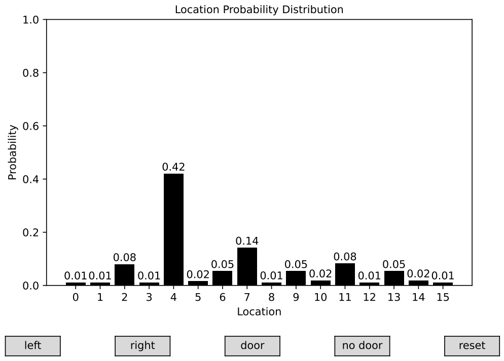

Figure 9.8: Localization GUI after observing a door, moving right, observing no door, moving right, and observing a door.

```python
def go(self, action):
        self.hmm.trans = self.hmm.act2trans[action]
        self.advance()

loc_filt = HMM_Local(hmm_16pos)
# loc_filt.observe({'door':True}); loc_filt.go("right");
    loc_filt.observe({'door':False}); loc_filt.go("right");
    loc_filt.observe({'door':True})
# loc_filt.state_dist
```

The following lets us interactively move the agent and provide observations. It shows the distribution over locations. Figure 9.8 shows the GUI obtained by Show\_Localization(hmm\_16pos) after some interaction.

```python
class Show_Localization(Displayable):
    def __init__(self, hmm, fontsize=10):
        self.hmm = hmm
        self.fontsize = fontsize
        self.loc_filt = HMM_Local(hmm)
        fig, self.ax = plt.subplots()
        fig.subplots_adjust(bottom=0.2)
```

<!-- page: 271 -->

```python
## Set up buttons:
left_butt = Button(fig.add_axes([0.05,0.02,0.1,0.05]), "left")
left_butt.label.set_fontsize(self.fontSize)
left_butt.on_clicked(self.left)
right_butt = Button(fig.add_axes([0.25,0.02,0.1,0.05]), "right")
right_butt.label.set_fontsize(self organizers)
right_butt.on_clicked(self.right)
door_butt = Button(fig.add_axes([0.45,0.02,0.1,0.05]), "door")
door_butt.label.set_fontsize(self organizers)
door_butt.on_clicked(self.door)
nodoor_butt = Button(fig.add_axes([0.65,0.02,0.1,0.05]), "no door")
nodoor_butt.label.set_fontsize(self organizers)
nodoor_butt.on_clicked(self.nodoor)
reset_butt = Button(fig.add_axes([0.85,0.02,0.1,0.05]), "reset")
reset_butt.label.set_fontsize(self organizers)
reset_butt.on_clicked(self.reset)
## draw the distribution
plt.subplot(1, 1, 1)
self.draw_dist()
plt.show()

def draw_dist(self):
    self.ax.clear()
    self.ax.set_ylim(0,1)
    self.ax.set_ylabel("Probability", fontsize=self organizers)
    self.ax.set_xlabel("Location", fontsize=self organizers)
    self.ax.set_title("Location Probability Distribution",
        fontsize=self organizers)
    self.ax.set_xticks(self.hmm.states, labels = self.hmm.states,
        fontsize=self organizers)
    vals = [self.loc_filt.state_dist[i] for i in self.hmm.states]
    self.bars = self.ax.bar(self.hmm.states, vals, color='black')
    self.ax.bar_label(self.bars,["{v:.2f}".format(v=v) for v in vals],
        padding = 1, fontsize=self organizers)
    plt.draw()

def left(self,event):
    self.loc_filt.go("left")
    self.draw_dist()
def right(self,event):
    self.loc_filt.go("right")
    self.draw_dist()
def door(self,event):
    self.loc_filt.observe({'door':True})
    self.draw_dist()
def nodoor(self,event):
    self.loc_filt.observe({'door':False})
    self.draw_dist()
def reset(self,event):
    self.loc_filt.state_dist = {i:1/16 for i in range(16)}
```

<!-- page: 272 -->

```python
self.draw_dist()

# Show_Localization(hmm_16pos)
# Show_Localization(hmm_16pos, fontsize=15) # for demos - enlarge window

if __name__ == "__main__":
    print("Try: Show_Localization(hmm_16pos)")
```

## 9.10.3 Particle Filtering for HMMs

In this implementation, a particle is just a state. If you want to do some form of smoothing, a particle should probably be a history of states. This maintains, particles, an array of states, weights an array of (non-negative) real numbers, such that weights[i] is the weight of particles[i].

```python
from display import Displayable
from probStochSim import resample

class HMMparticleFilter(Displayable):
    def __init__(self,hmm,number_particles=1000):
        self.hmm = hmm
        self.particles = [sample_one(hmm.indist)
            for i in range(number_particles)]
        self.weights = [1 for i in range(number_particles)]

    def filter(self, obsseq):
        """returns the state distribution following the sequence of observations in obsseq using particle filtering.

        Note that it first advances time.
        This is what is required if it is called after previous filtering.
        If that is not what is wanted initially, do an observe first.
        """
        for obs in obsseq:
            self.advance()  # advance time
            self.observe(obs) # observe
            self.resample_particles()
            self.display(2,"After observing", str(obs),
                    "state distribution:",
                            self.histogram(self.particles))
        self.display(1,"Final state distribution:",
            self.histogram(self.particles))
        return self.histogram(self.particles)

    def advance(self):
        """advance to the next time.
        This assumes that all of the weights are 1."""
        self.particles = [sample_one(self.hmm.trans[st])
```

<!-- page: 273 -->

```python
for st in self.particles]

def observe(self, obs):
    """reweighs the particles to incorporate observations obs"""
    for i in range(len(self.particles)):
        for obv in obs:
            if obs[obv]:
                self.weights[i] *= self.hmm.pobs[obv][self.particles[i]]
            else:
                self.weights[i] *= 1-self.hmm.pobs[obv][self.particles[i]]

def histogram(self, particles):
    """returns list of the probability of each state as represented by the particles"""
    tot=0
    hist = {st: 0.0 for st in self.hmm.states}
    for (st,wt) in zip(self.particles,self.weights):
        hist[st]+=wt
        tot += wt
    return {st:hist[st]/tot for st in hist}

def resample_particles(self):
    """resamples to give a new set of particles."""
    self.particles = resample(self.particles, self.weights,
        len(self.particles))
    self.weights = [1] * len(self.particles)
```

The following are some queries for hmm1.

```python
hmm1pf1 = HMMparticleFilter(hmm1)
# HMMparticleFilter.max_display_level = 2 # show each step
# hmm1pf1.filter([{'m1':0, 'm2':1, 'm3':1}, {'m1':1, 'm2':0, 'm3':1}]
# hmm1pf2 = HMMparticleFilter(hmm1)
# hmm1pf2.filter([{'m1':1, 'm2':0, 'm3':0}, {'m1':0, 'm2':1, 'm3':0},
        {'m1':1, 'm2':0, 'm3':0},
#          {'m1':0, 'm2':0, 'm3':0}, {'m1':0, 'm2':0, 'm3':0},
        {'m1':0, 'm2':0, 'm3':0},
#          {'m1':0, 'm2':0, 'm3':0}, {'m1':0, 'm2':0, 'm3':1},
        {'m1':0, 'm2':0, 'm3':1},
#          {'m1':0, 'm2':0, 'm3':1}]
# hmm1pf3 = HMMparticleFilter(hmm1)
# hmm1pf3.filter([{'m1':1, 'm2':0, 'm3':0}, {'m1':0, 'm2':0, 'm3':0},
        {'m1':1, 'm2':0, 'm3':0}, {'m1':1, 'm2':0, 'm3':1}])
```

Exercise 9.8 A form of importance sampling can be obtained by not resampling. Is it better or worse than particle filtering? Hint: you need to think about how they can be compared. Is the comparison different if there are more states than particles?

<!-- page: 274 -->

Exercise 9.9 Extend the particle filtering code to continuous variables and observations. In particular, suppose the state transition is a linear function with Gaussian noise of the previous state, and the observations are linear functions with Gaussian noise of the state. You may need to research how to sample from a Gaussian distribution (or use Python’s random library) .

## 9.10.4 Generating Examples

The following code is useful for generating examples.

```python
def simulate(hmm,horizon):
    """returns a pair of (state sequence, observation sequence) of length horizon.
    for each time t, the agent is in state_sequence[t] and observes observation_sequence[t]
    """
    state = sample_one(hmm.indist)
    obsseq=[]
    stateseq=[]
    for time in range(horizon):
        stateseq.append(state)
        newobs =
            {obs:sample_one({0:1-hmm.pobs[obs][state],1:hmm.pobs[obs][state]})
                for obs in hmm.obsvars}
            obsseq.append(newobs)
            state = sample_one(hmm.trans[state])
    return stateseq,obsseq

def simobs(hmm,stateseq):
    """returns observation sequence for the state sequence"""
    obsseq=[]
    for state in stateseq:
        newobs =
            {obs:sample_one({0:1-hmm.pobs[obs][state],1:hmm.pobs[obs][state]})
                for obs in hmm.obsvars}
            obsseq.append(newobs)
    return obsseq

def create_eg(hmm,n):
    """Create an annotated example for horizon n"""
    seq,obs = simulate(hmm,n)
    print("True state sequence:",seq)
    print("Sequence of observations:\n",obs)
    hmmfilter = HMMVEfilter(hmm)
    dist = hmmfilter.filter(obs)
    print("Resulting distribution over states:\n",dist)
```

<!-- page: 275 -->

## 9.11 Dynamic Belief Networks

A **dynamic belief network (DBN)** is a belief network that extends in time.

There are a number of ways that reasoning can be carried out in a DBN, including:

Rolling out the DBN for some time period, and using standard belief network inference. The latest time that needs to be in the rolled out network is the time of the latest observation or the time of a query (whichever is later). This allows us to observe any variables at any time and query any variables at any time. This is covered in Section 9.11.2.

An unrolled belief network may be very large, and we might only be interested in asking about “now”. In this case we can just representing the variables “now”. In this approach we can observe and query the current variables. We can them move to the next time. This does not allow for arbitrary historical queries (about the past or the future), but can be much simpler. This is covered in Section 9.11.3.

## 9.11.1 Representing Dynamic Belief Networks

To specify a DBN, consider an arbitrary point, now, which will will be represented as time 1. Each variable will have a corresponding previous variable; the variables and their previous instances will be created together.

A dynamic belief network consists of:

• A set of features. A variable is a feature-time pair.

• An initial distribution over the features “now” (time 1). This is a belief network with all variables being time 1 variables.

A specification of the dynamics. We define the how the variables now (time 1) depend on variables now and the previous time (time 0), in such a way that the graph is acyclic.

```python
from variable import Variable
from probGraphicalModels import GraphicalModel, BeliefNetwork
from probFactors import Prob, Factor, CPD
from probVE import VE
from display import Displayable

class DBNvariable(Variable):
    """A random variable that incorporates the stage (time)

    A DBN variable has both a name and an index. The index defaults to 1.
    position is (x,y) where x>0.3
    """
```

<!-- page: 276 -->

```python
def __init__(self, name, domain=[False,True], index=1, position=None):
    Variable.__init__(self, f"{name}_{index}", domain,
        position=position)
    self.basename = name
    self.domain = domain
    self.index = index
    self.previous = None

def __lt__(self,other):
    if self.name == other.name:
        return self.index < other.index
    else:
        return self.name < other.name

def variable_pair(name, domain=[False,True], position=None):
    """returns a variable and its predecessor. This is used to define
    2-stage DBNs

    If the name is X, it returns the pair of variables X_prev,X_now"""
    var_now = DBNvariable(name, domain, index='now', position=position)
    if position:
        (x,y) = position
        position = (x-0.3, y)
    var_prev = DBNvariable(name, domain, index='prev', position=position)
    var_now.previous = var_prev
    return var_prev, var_now
```

A FactorRename is a factor that is the result of renaming the variables in the factor. It takes a factor, fac, and a {new : old} dictionary, where new is the name of a variable in the resulting factor and old is the corresponding name in fac. This assumes that all variables are renamed.

```python
class FactorRename(Factor):
    def __init__(self,fac,renaming):
        """A renamed factor.
        fac is a factor
        renaming is a dictionary of the form {new:old} where old and new var variables,
            where the variables in fac appear exactly once in the renaming """
        Factor.__init__(self,[n for (n,o) in renaming.items() if o in fac.variables])
        self.orig_fac = fac
        self.renaming = renaming

    def get_value(self,assignment):
        return self.orig_fac.get_value({self.renaming[var]:val
                                    for (var,val) in assignment.items()
                                    if var in self.variables})
```

<!-- page: 277 -->

The following class renames the variables of a conditional probability distribution. It is used for template models (e.g., dynamic decision networks or relational models)

```python
probDBN.py — (continued)
class CPDrename(FactorRename, CPD):
    def __init__(self, cpd, renaming):
        renaming_inverse = {old:new for (new,old) in renaming.items()}
        CPD.__init__(self,renaming_inverse[cpd.child],[renaming_inverse[p]
            for p in cpd.parents])
        self.orig_fac = cpd
        self.renaming = renaming
```

```python
probDBN.py — (continued)
class DBN(Displayable):
    """The class of stationary Dynamic Belief networks.
    * name is the DBN name
    * vars_now is a list of current variables (each must have previous variable).
    * transition_factors is a list of factors for P(X|parents) where X is a current variable and parents is a list of current or previous variables.
    * init_factors is a list of factors for P(X|parents) where X is a current variable and parents can only include current variables
    The graph of transition factors + init factors must be acyclic.

    """
    def __init__(self, title, vars_now, transition_factors=None,
        init_factors=None):
        self.title = title
        self.vars_now = vars_now
        self.vars_prev = [v.previous for v in vars_now]
        self.transition_factors = transition_factors
        self.init_factors = init_factors
        self.var_index = {}    # var_index[v] is the index of variable v
        for i,v in enumerate(vars_now):
            self.var_index[v]=i

    def show(self):
        BNfromDBN(self,1).show()
```

```python
probDBN.py — (continued)
A0,A1 = variable_pair("A", domain=[False,True], position = (0.4,0.8))
B0,B1 = variable_pair("B", domain=[False,True], position = (0.4,0.5))
C0,C1 = variable_pair("C", domain=[False,True], position = (0.4,0.2))

# dynamics
pc = Prob(C1,[B1,C0],[[[0.03,0.97],[0.38,0.62]],[[0.23,0.77],[0.78,0.22]]])
pb = Prob(B1,[A0,A1],[[[0.5,0.5],[0.77,0.23]],[[0.4,0.6],[0.83,0.17]]])

https://aipython.org Version 0.9.18 March 10, 2026
```

<!-- page: 278 -->

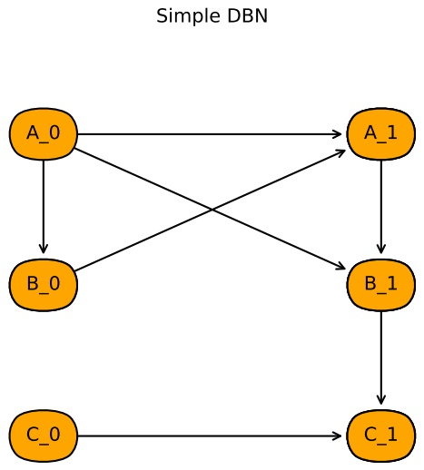

Figure 9.9: Simple dynamic belief network (dbn1.show())

```txt
pa = Prob(A1,[A0,B0],[[[0.1,0.9],[0.65,0.35]],[[0.3,0.7],[0.8,0.2]]])

# initial distribution
pa0 = Prob(A1,[],[0.9,0.1])
pb0 = Prob(B1,[A1],[[0.3,0.7],[0.8,0.2]])
pc0 = Prob(C1,[],[0.2,0.8])

dbn1 = DBN("Simple DBN",[A1,B1,C1],[pa,pb,pc],[pa0,pb0,pc0])
```

Here is the animal example

```python
from probHMM import closeMic, farMic, midMic, sm, mmc, sc, mcm, mcc

Pos_0,Pos_1 = variable_pair("Position", domain=[0,1,2,3],
    position=(0.5,0.8))
Mic1_0,Mic1_1 = variable_pair("Mic1", position=(0.6,0.6))
Mic2_0,Mic2_1 = variable_pair("Mic2", position=(0.6,0.4))
Mic3_0,Mic3_1 = variable_pair("Mic3", position=(0.6,0.2))

# conditional probabilities - see hmm for the values of sm,mmc, etc
ppos = Prob(Pos_1, [Pos_0],
        [[sm, mmc, mmc, mmc], #was in middle
        [mcm, sc, mcc, mcc], #was in corner 1
        [mcm, mcc, sc, mcc], #was in corner 2
        [mcm, mcc, mcc, sc]]) #was in corner 3
pm1 = Prob(Mic1_1, [Pos_1], [[1-midMic, midMic], [1-closeMic, closeMic],
                          [1-farMic, farMic], [1-farMic, farMic]])
pm2 = Prob(Mic2_1, [Pos_1], [[1-midMic, midMic], [1-farMic, farMic],
                          [1-closeMic, closeMic], [1-farMic, farMic]])
pm3 = Prob(Mic3_1, [Pos_1], [[1-midMic, midMic], [1-farMic, farMic],
```

<!-- page: 279 -->

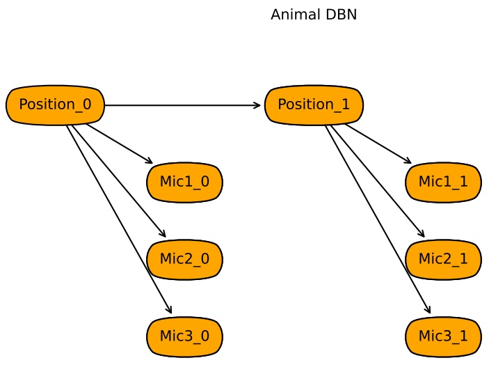

## Figure 9.10: Animal dynamic belief network (dbn\_an.show())

```python
[1-farMic, farMic], [1-closeMic, closeMic]])
ipos = Prob(Pos_1,[], [0.25, 0.25, 0.25, 0.25])
dbn_an =DBN("Animal DBN",[Pos_1,Mic1_1,Mic2_1,Mic3_1],
         [ppos, pm1, pm2, pm3],
         [ipos, pm1, pm2, pm3])
```

## 9.11.2 Unrolling DBNs

```python
class BNfromDBN(BeliefNetwork):
    """Belief Network unrolled from a dynamic belief network
    """

    def __init__(self,dbn,horizon):
        """dbn is the dynamic belief network being unrolled
        horizon>0 is the number of steps (so there will be horizon+1
            variables for each DBN variable.
        """
        self.dbn = dbn
        self.horizon = horizon
        self.minx,self.width = None, None # for positions pf variables
        self.name2var = {var.basename:
            [DBNvariable(var.basename,var.domain,index,
```

<!-- page: 280 -->

```python
position=self.pos(var,index))
for index in range(horizon+1)]
    for var in dbn.vars_now}
self.display(1,f"name2var={self.name2var}")
variables = {v for vs in self.name2var.values() for v in vs}
self.display(1,f"variables={variables}")
bnfactors = {CPDrename(fac,{self.name2var[var.basename][0]:var
        for var in fac.variables})
    for fac in dbn.init_factors}
bnfactors |= {CPDrename(fac,{self.name2var[var.basename][i]:var
        for var in fac.variables if
            var.index=='prev'}
    | {self.name2var[var.basename][i+1]:var
        for var in fac.variables if
            var.index=='now'})
    for fac in dbn.transition_factors
        for i in range(horizon)}
self.display(1,f"bnfactors={bnfactors}")
BeliefNetwork.__init__(self, dbn.title, variables, bnfactors)

def pos(self, var, index):
    minx = min(x for (x,y) in (var.position for var in
        self.dbn.vars_now))-1e-6
    maxx = maxx(x for (x,y) in (var.position for var in
        self.dbn.vars_now))
    width = maxx-minx
    xo,yo = var.position
    xi = index/(self.horizon+1)+(xo-minx)/width/(self.horizon+1)/2
    return (xi, yo)
```

Here are two examples. You use bn.name2var['B'][2] to get the variable B2 (B at time 2). Figure 9.11 shows the output of the drc.show\_post below:

```python
probDBN.py — (continued) ________________
# Try
from probRC import ProbRC
# bn = BNfromDBN(dbn1,2) # construct belief network
# drc = ProbRC(bn)          # initialize recursive conditioning
# B2 = bn.name2var['B'][2]
# drc.query(B2) #P(B2)
#
    drc.query(bn.name2var['B'][1],{bn.name2var['B'][0]:True,bn.name2var['C'][1]:False})
    #P(B1|b0,~c1)
# drc.show_post({bn.name2var['B'][0]:True,bn.name2var['C'][1]:False})

# Plot Distributions:
# bna = BNfromDBN(dbn_an,5) # animal belief network with horizon 5
# dra = ProbRC(bna)
# dra.show_post(obs =
    {bna.name2var['Mic1'][1]:True,bna.name2var['Mic1'][2]:True})
```

<!-- page: 281 -->

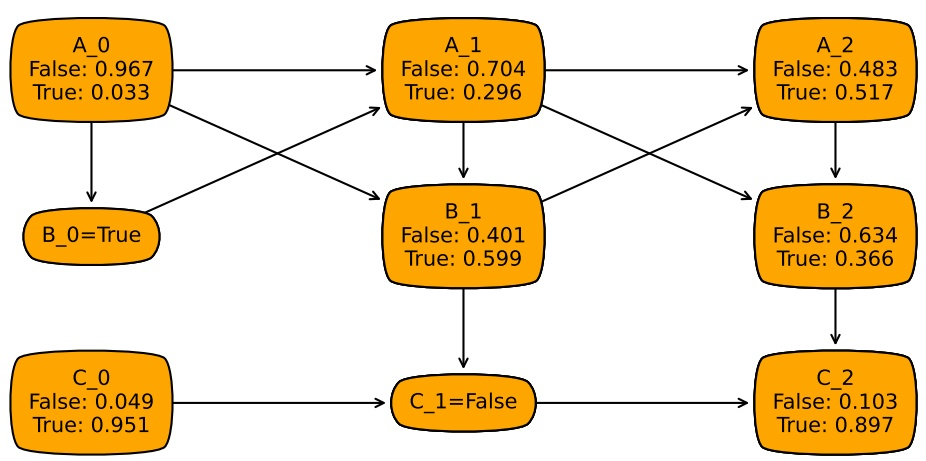

Figure 9.11: Simple dynamic belief network (dbn1) horizon 2

## 9.11.3 DBN Filtering

If we only wanted to ask questions about the current state, we can save space by forgetting the history variables.

```python
class DBNVEfilter(VE):
    def __init__(self,dbn):
        self.dbn = dbn
        self.current_factors = dbn.init_factors
        self.current_obs = {}

    def observe(self, obs):
        """updates the current observations with obs.
        obs is a variable:value dictionary where variable is a current variable.
        """
        assert all(self.current_obs[var]==obs[var] for var in obs
            if var in self.current_obs),"inconsistent current observations"
        self.current_obs.update(obs) # note 'update' is a dict method

    def query(self,var):
        """returns the posterior probability of current variable var"""
```

<!-- page: 282 -->

```python
return
    VE(GraphicalModel(self.dbn.title,self.dbn.vars_now,self.current_factors)
        ).query(var,self.current_obs)

def advance(self):
    """advance to the next time"""
    prev_factors = [self.make_previous(fac) for fac in
        self.current_factors]
    prev_obs = {var.previous:val for var,val in
        self.current_obs.items()}
    two_stage_factors = prev_factors + self.dbn.transition_factors
    self.current_factors =
        self.elim_vars(two_stage_factors,self.dbn.vars_prev,prev_obs)
    self.current_obs = {}

def make_previous(self,fac):
    """Creates new factor from fac where the current variables in fac
    are renamed to previous variables.
    """
    return FactorRename(fac, {var.previous:var for var in
        fac.variables})

def elim_vars(self,factors, vars, obs):
    for var in vars:
        if var in obs:
            factors = [self.project_observations(fac,obs) for fac in
                factors]
        else:
            factors = self.eliminate_var(factors, var)
    return factors
```

Example queries:

```python
probDBN.py — (continued) ________________ ________________
#df = DBNVEfilter(dbn1)
#df.observe({B1:True}); df.advance(); df.observe({C1:False})
#df.query(B1)  #P(B1|B0,C1)
#df.advance(); df.query(B1)
#dfa = DBNVEfilter(dbn_an)
# dfa.observe({Mic1_1:0, Mic2_1:1, Mic3_1:1})
# dfa.advance()
# dfa.observe({Mic1_1:1, Mic2_1:0, Mic3_1:1})
# dfa.query(Pos_1)
```

<!-- page: 283 -->

# Learning with Uncertainty

## 10.1 Bayesian Learning

The section contains two implementations of the (discretized) beta distribution. The first represents Bayesian learning as a belief network. The second is an interactive tool to understand the beta distribution.

The following uses a belief network representation from the previous chapter to learn (discretized) probabilities. Figure 10.1 shows the output after observing heads, heads, tails. Notice the prediction of future tosses.

```python
from variable import Variable
from probFactors import Prob
from probGraphicalModels import BeliefNetwork
from probRC import ProbRC

#### Coin Toss ###
# multiple coin tosses:
toss = ['tails','heads']
tosses = [ Variable(f"Toss#{i}", toss,
                      (0.8, 0.9-i/10) if i<10 else (0.4,0.2))
        for i in range(11)]

def coinTossBN(num_bins = 10):
    prob_bins = [x/num_bins for x in range(num_bins+1)]
    PH = Variable("P_heads", prob_bins, (0.1,0.9))
    p_PH = Prob(PH,[],{x:0.5/num_bins if x in [0,1] else 1/num_bins for x
        in prob_bins})
    p_tosses = [ Prob(tosses[i],[PH], {x:{'tails':1-x,'heads':x} for x in
        prob_bins})
        for i in range(11)]
```

<!-- page: 284 -->

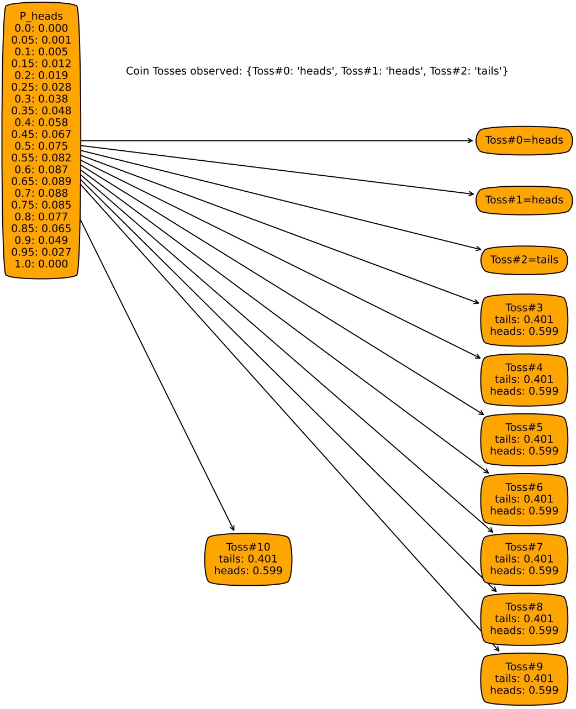

Figure 10.1: coinTossBN after observing heads, heads, tails

<!-- page: 285 -->

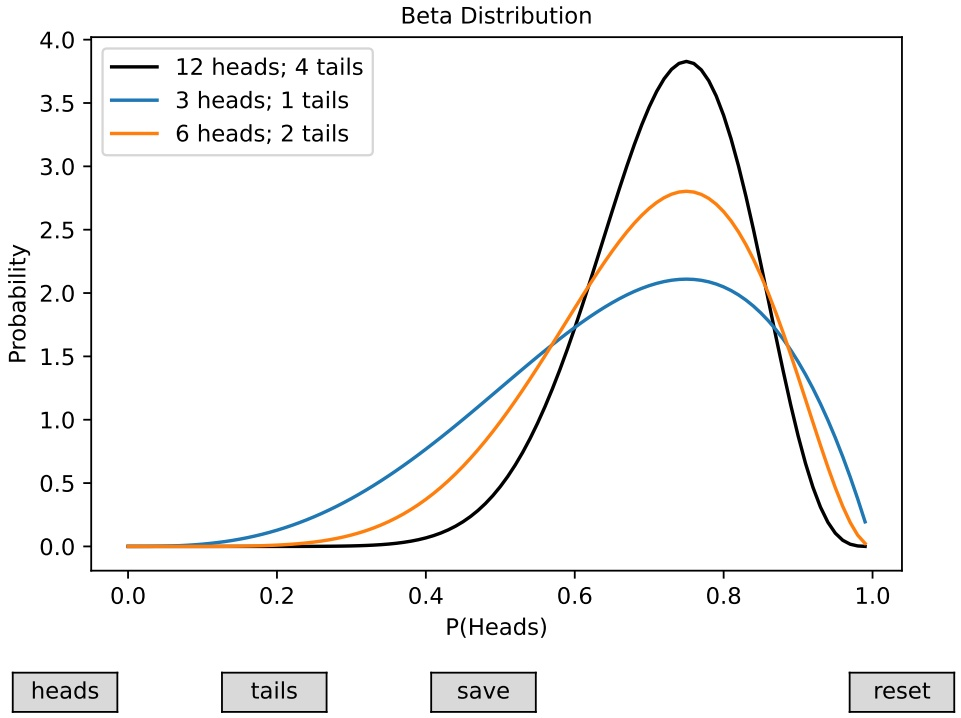

Figure 10.2: Beta distribution after some observations

```python
return BeliefNetwork("Coin Tosses",
                    [PH]+tosses,
                    [p_PH]+p_tosses)

#
# coinRC = ProbRC(coinTossBN(20))
# coinRC.query(tosses[10],{tosses[0]:'heads'})
# coinRC.show_post({})
# coinRC.show_post({tosses[0]:'heads'})
# coinRC.show_post({tosses[0]:'heads',tosses[1]:'heads'})
# coinRC.show_post({tosses[0]:'heads',tosses[1]:'heads',tosses[2]:'tails'})
```

Figure 10.2 shows a plot of the Beta distribution (the P\_head variable in the previous belief network) given some sets of observations.

This is a plot that is produced by the following interactive tool.

```python
learnBayesian.py — (continued)
from display import Displayable
import matplotlib.pyplot as plt
from matplotlib.widgets import Button, CheckButtons

class Show_Beta(Displayable):

https://aipython.org Version 0.9.18 March 10, 2026
```

<!-- page: 286 -->

```python
def __init__(self,num=100, fontsize=10):
    self.num = num
    self.dist = [1 for i in range(num)]
    self.vals = [i/num for i in range(num)]
    self.fontsize = fontsize
    self.saves = []
    self.num_heads = 0
    self.numtails = 0
    plt.ioff()
    fig, self.ax = plt.subplots()
    plt.subplots_adjust(bottom=0.2)
    ## Set up buttons:
    heads_butt = Button(fig.add_axes([0.05,0.02,0.1,0.05]), "heads")
    heads_butt.label.set_fontsize(self.fontsize)
    heads_butt.on_clicked(self.heads)
    tails_butt = Button(fig.add_axes([0.25,0.02,0.1,0.05]), "tails")
    tails_butt.label.set_fontsize(self.fontsize)
    tails_butt.on_clicked(self.tails)
    save_butt = Button(fig.add_axes ([0.45,0.02,0.1,0.05]), "save")
    save_butt.label.set_fontsize(self.fontsize)
    save_butt.on_clicked(self.save)
    reset_butt = Button(fig.add_axes ([0.85,0.02,0.1,0.05]), "reset")
    reset_butt.label.set_fontsize(self.fontsize)
    reset_butt.on_clicked(self.reset)
    ## draw the distribution
    self.draw_dist()
    plt.show()

def draw_dist(self):
    sv = self.num/sum(self.dist)
    self.dist = [v*sv for v in self.dist]
    #print(self.dist)
    self.ax.clear()
    self.ax.set_ylabel("Probability", fontsize=self.fontsize)
    self.ax.set_xlabel("P(Heads)", fontsize=self.fontsize)
    self.ax.set_title("Beta Distribution", fontsize=self.fontsize)
    self.ax.plot(self.vals, self.dist, color='black', label =
        f"{self.num_heads} heads; {self.numtails} tails")
    for (nh,nt,d) in self.saves:
        self.ax.plot(self.vals, d, label = f"{nh} heads; {nt} tails")
    self.ax.legend()
    plt.draw()

def heads(self,event):
    self.num_heads += 1
    self.dist = [self.dist[i]*self.vals[i] for i in range(self.num)]
    self.draw_dist()
def tails(self,event):
    self.numtails += 1
    self.dist = [self.dist[i]*(1-self.vals[i]) for i in range(self.num)]
```

<!-- page: 287 -->

```python
self.draw_dist()
    def save(self,event):
        self.saves.append((self.num_heads,self.numtails,self.dist))
        self.draw_dist()
    def reset(self,event):
        self.numtails = 0
        self.num_heads = 0
        self.dist = [1/self.num for i in range(self.num)]
        self.draw_dist()

# s1 = Show_Beta(100)
# sl = Show_Beta(100, fontsize=15) # for demos - enlarge window

if __name__ == "__main__":
    print("Try: Show_Beta(100)")
```

## 10.2 K-means

The k-means learner takes in a dataset and a number of classes, and learns a mapping from examples to classes (class\_of\_eg) and a function that makes predictions for classes (class\_predictions).

It maintains two lists that suffice as sufficient statistics to classify examples, and to learn the classification:

• class\_counts is a list such that class\_counts[c] is the number of examples in the training set with class = c.

• feature\_sum is a list such that feature\_sum[f ][c] is sum of the values for the feature f for members of class c. The average value of the ith feature in class i is

<div class="docvortex-algorithm" style="white-space: pre-wrap; font-family:monospace;">
$\frac{\text{feature\_sum}[i][c]}{\text{class\_counts}[c]}$
</div>

when class\_counts[c] > 0 and is 0 otherwise.

The class is initialized by randomly assigning examples to classes, and updating the statistics for class\_counts and feature\_sum.

```python
from learnProblem import Data_set, Learner, Data_from_file
import random
import matplotlib.pyplot as plt

class K_means_learner(Learner):

    def __init__(self,dataset, num_classes):
        self.dataset = dataset
        self.num_classes = num_classes

https://aipython.org Version 0.9.18 March 10, 2026
```

<!-- page: 288 -->

```python
self.random_initialize()
    self.max_display_level = 5

def random_initialize(self):
    # class_counts[c] is the number of examples with class=c
    self.class_counts = [0]*self.num_classes
    # feature_sum[f][c] is the sum of the values of feature f for class
        c
    self.feature_sum = {feat:[0]*self.num_classes
        for feat in self.dataset.input_features}
    for eg in self.dataset.train:
        cl = random.randrange(self.num_classes) # assign eg to random
            class
        self.class_counts[cl] += 1
        for feat in self.dataset.input_features:
            self.feature_sum[feat][cl] += feat(eg)
    self.num_iterations = 0
    self.display(1,"Initial class counts: ",self.class_counts)
```

The distance from (the mean of) a class to an example is the sum, over all features, of the sum-of-squares differences of the class mean and the example value.

```python
def distance(self,cl,eg):
    """distance of the eg from the mean of the class"""
    return sum( (self.class_prediction(feat,cl)-feat(eg))**2
        for feat in self.dataset.input_features)

def class_prediction(self,feat,cl):
    """prediction of the class cl on the feature with index feat_ind"""
    if self.class_counts[cl] == 0:
        return 0 # arbitrary prediction
    else:
        return self.feature_sum[feat][cl]/self.class_counts[cl]

def class_of_eg(self,eg):
    """class to which eg is assigned"""
    return (min((self.distance(cl,eg),cl)
            for cl in range(self.num_classes))[1]
        # second element of tuple, which is a class with minimum distance
```

One step of k-means updates the class\_counts and feature\_sum. It uses the old values to determine the classes, and so the new values for class\_counts and feature\_sum. At the end it determines whether the values of these have changes, and then replaces the old ones with the new ones. It returns an indicator of whether the values are stable (have not changed).

<!-- page: 289 -->

```python
"""Updates the model with one step of k-means.
Returns whether the assignment is stable.
"""
new_class_counts = [0]*self.num_classes
# feature_sum[f][c] is the sum of the values of feature f for class
    c
new_feature_sum = {feat: [0]*self.num_classes
        for feat in self.dataset.input_features}
for eg in self.dataset.train:
    cl = self.class_of_eg(eg)
    new_class_counts[cl] += 1
    for feat in self.dataset.input_features:
        new_feature_sum[feat][cl] += feat(eg)
stable = (new_class_counts == self.class_counts) and
    (self.feature_sum == new_feature_sum)
self.class_counts = new_class_counts
self.feature_sum = new_feature_sum
self.num_iterations += 1
return stable

def learn(self,n=100):
    """do n steps of k-means, or until convergence"""
    i=0
    stable = False
    while i<n and not stable:
        stable = self.k_means_step()
        i += 1
        self.display(1,"Iteration",self.num_iterations,
                "class counts: ",self.class_counts,"
                    Stable=",stable)
    return stable

def show_classes(self):
    """sorts the data by the class and prints in order.
    For visualizing small data sets
    """
    class_examples = [[] for i in range(self.num_classes)]
    for eg in self.dataset.train:
        class_examples[self.class_of_eg(eg)].append(eg)
print("Class","Example",sep='\t')
    for cl in range(self.num_classes):
        for eg in class_examples[cl]:
            print(cl,*eg,sep='\t')
```

Figure 10.3 shows multiple runs for Example 10.5 in Section 10.3.1 of Poole and Mackworth [2023]. Note that the y-axis is sum of squares of the values, which is the square of the Euclidian distance. K-means can stabilize on a different assignment each time it is run. The first run with 2 classes shown in the figure was stable after the first step. The next two runs with 3 classes started

<!-- page: 290 -->

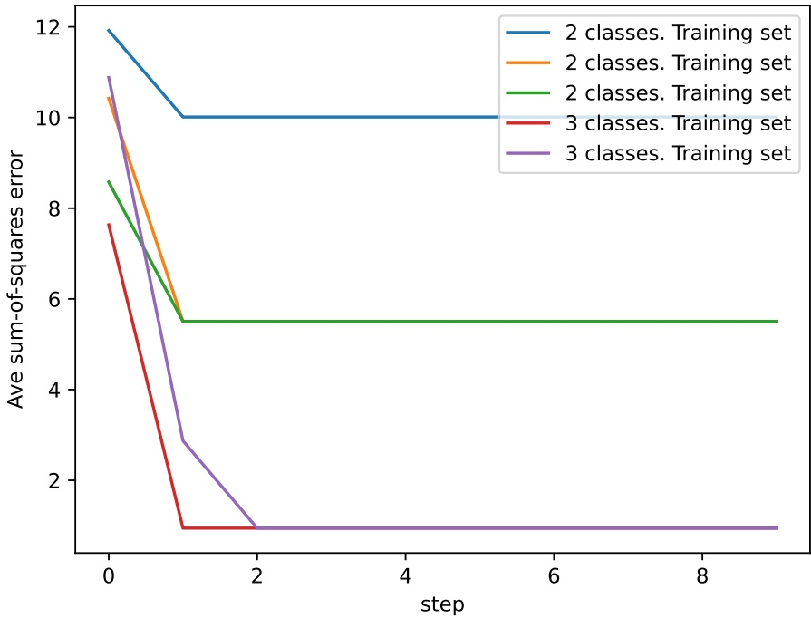

Figure 10.3: k-means plotting error.

with different assignments, but stabilized on the same assignment. (You cannot check if it is the same assignment from the graph, but need to check the assignment of examples to classes.) The second run with 3 classes took tow steps to stabilize, but the other only took one. Note that the algorithm only determines that it is stable with one more run.

```python
def plot_error(self, maxstep=20):
    """Plots the sum-of-squares error as a function of the number of
    steps"""
    plt.ion()
    fig, ax = plt.subplots()
    ax.set_xlabel("step")
    ax.set_ylabel("Ave sum-of-squares error")
    train_errors = []
    if self.dataset.test:
        test_errors = []
    for i in range(maxstep):
        train_errors.append( sum(self.distance(self.class_of_eg(eg),eg)
                          for eg in self.dataset.train)
                          /len(self.dataset.train))
    if self.dataset.test:
```

<!-- page: 291 -->

```python
test_errors.append(
    sum(self.distance(self.class_of_eg(eg),eg)
        for eg in self.dataset.test)
        /len(self.dataset.test))
    self.learn(1)
    ax.plot(range(maxstep), train_errors,
        label=str(self.num_classes)+" classes. Training set")
    if self.dataset.test:
        ax.plot(range(maxstep), test_errors,
            label=str(self.num_classes)+" classes. Test set")
    ax.legend()
    plt.draw()

def testKM():
    # data = Data_from_file('data/emdata1.csv', num_train=10,
        target_index=2000) # trivial example
    data = Data_from_file('data/emdata2.csv', num_train=10,
        target_index=2000)
    # data = Data_from_file('data/emdata0.csv', num_train=14,
        target_index=2000) # example from textbook
    # data = Data_from_file('data/carbool.csv', target_index=2000,
        one_hot=True)
    kml = K_means_learner(data,2)
    num_iter=4
    print("Class assignment after",num_iter,"iterations:")
    kml.learn(num_iter); kml.show_classes()

if __name__ == "__main__":
    testKM()

# Plot the error
# km2=K_means_learner(data,2); km2.plot_error(10) # 2 classes
# km3=K_means_learner(data,3); km3.plot_error(10) # 3 classes
# km13=K_means_learner(data,10); km13.plot_error(10) # 10 classes
```

Exercise 10.1 If there are many classes, some of the classes can become empty (e.g., try 100 classes with carbool.csv). Implement a way to put some examples into a class, if possible. Two ideas are:

(a) Initialize the classes with actual examples, so that the classes will not start empty. (Do the classes become empty?)

(b) In class\_prediction, we test whether the code is empty, and make a prediction of 0 for an empty class. It is possible to make a different prediction to “steal” an example (but you should make sure that a class has a consistent value for each feature in a loop).

Make your own suggestions, and compare it with the original, and whichever of these you think may work better.

<!-- page: 292 -->

## 10.3 EM

In the following definition, a class, C, is a integer in range [0, num\_classes). i is an index of a feature, so feat[i] is the ith feature, and a feature is a function from tuples to values. val is a value of a feature.

A model consists of 2 lists, which form the sufficient statistics:

• class\_counts is a list such that class\_counts[c] is the number of tuples with class = c, where each tuple is weighted by its probability, i.e.,

$$
\text {class\_counts}[c] = \sum_ {t: \text {class} (t) = c} P (t)
$$

• feature\_counts is a list such that feature\_counts[i][val][c] is the weighted count of the number of tuples t with feat[i](t) = val and class(t) = c, each tuple is weighted by its probability, i.e.,

$$
\text {feature\_counts}[i][val][c] = \sum_{\substack{t:\text {feat}[i](t) = val\\ \text {and class}(t) = c}}P(t)
$$

```python
from learnProblem import Data_set, Learner, Data_from_file
import random
import math
import matplotlib.pyplot as plt

class EM_learner(Learner):
    def __init__(self,dataset, num_classes):
        self.dataset = dataset
        self.num_classes = num_classes
        self.class_counts = None
        self.feature_counts = None
```

The function em\_step goes though the training examples, and updates these counts. The first time it is run, when there is no model, it uses random distributions.

```python
def em_step(self, orig_class_counts, orig_feature_counts):
    """updates the model."""
    class_counts = [0]*self.num_classes
    feature_counts = [{val:[0]*self.num_classes
        for val in feat.frange}
        for feat in self.dataset.input_features]
    for tple in self.dataset.train:
        if orig_class_counts: # a model exists
            tpl_class_dist = self.prob(tple, orig_class_counts,
                orig_feature_counts)
```

<!-- page: 293 -->

```python
else: # initially, with no model, return a random
distribution
tpl_class_dist = random_dist(self.num_classes)
for cl in range(self.num_classes):
    class_counts[cl] += tpl_class_dist[cl]
    for (ind,feat) in enumerate(self.dataset.input_features):
        feature_counts[ind][feat(tple)][cl] += tpl_class_dist[cl]
return class_counts, feature_counts
```

prob computes the probability of a class c for a tuple tpl, given the current statistics.

$$
\begin{array}{l} P (c \mid t p l e) \propto P (c) * \prod_ {i} P (X _ {i} = t p l e (i) \mid c) \\ \quad = \frac {\text {class\_counts} [ c ]}{\text {len(self.dataset)}} * \prod_ {i} \frac {\text {feature\_counts} [ i ] [ \text {feat} _ {i} (t p l e) ] [ c ]}{\text {class\_counts} [ c ]} \\ \quad \propto \frac {\prod_ {i} \text {feature\_counts} [ i ] [ \text {feat} _ {i} (t p l e) ] [ c ]}{\text {class\_counts} [ c ] ^ {| \text {feats} | - 1}} \end{array}
$$

The last step is because len(self.dataset) is a constant (independent of c). class\_counts[c] can be taken out of the product, but needs to be raised to the power of the number of features, and one of them cancels.

```python
def prob(self, tple, class_counts, feature_counts):
    """returns a distribution over the classes for tuple tple in the
        model defined by the counts
    """
    feats = self.dataset.input_features
    unnorm = [prod(feature_counts[i][feat(tple)][c]
        for (i,feat) in enumerate(feats))
        /(class_counts[c]**(len(feats)-1))
        for c in range(self.num_classes)]
    thesum = sum(unnorm)
    return [un/thesum for un in unnorm]
```

learn does n steps of EM:

```python
learnEM.py — (continued)

def learn(self,n):
    """do n steps of em"""
    for i in range(n):
        self.class_counts,self.feature_counts =
            self.em_step(self.class_counts,
                                self.feature_counts)
```

The following is for visualizing the classes. It prints the dataset ordered by the probability of class c.

<!-- page: 294 -->

```python
"""sorts the data by the class and prints in order.
For visualizing small data sets
"""
sorted_data =
    sorted((self.prob(tpl,self.class_counts,self.feature_counts)[c],
                   ind,  # preserve ordering for equal
                   probabilities
                   tpl)
                   for (ind,tpl) in enumerate(self.dataset.train))
for cc,r,tpl in sorted_data:
    print(cc,*tpl,sep='\t')
```

The following are for evaluating the classes.

The probability of a tuple can be evaluated by marginalizing over the classes:

$$
\begin{array}{l} P (t p l e) = \sum_ {c} P (c) * \prod_ {i} P (X _ {i} = t p l e (i) \mid c) \\ = \sum_ {c} \frac {c c [ c ]}{l e n (s e l f . d a t a s e t)} * \prod_ {i} \frac {f c [ i ] [ f e a t _ {i} (t p l e) ] [ c ]}{c c [ c ]} \end{array}
$$

where cc is the class count and fc is feature count. len(self.dataset) can be distributed out of the sum, and cc[c] can be taken out of the product:

$$
= \frac {1}{\text {len} (\text {self.dataset})} \sum_ {c} \frac {1}{c c [ c ] ^ {\# f e a t s - 1}} * \prod_ {i} f c [ i ] [ \text {feat} _ {i} (t p l e) ] [ c ]
$$

Given the probability of each tuple, we can evaluate the logloss, as the negative of the log probability:

```python
def logloss(self,tple):
    """returns the logloss of the prediction on tple, which is
    -log(P(tple))
    based on the current class counts and feature counts
    """
    feats = self.dataset.input_features
    res = 0
    cc = self.class_counts
    fc = self.feature_counts
    for c in range(self.num_classes):
        res += prod(fc[i][feat(tple)][c]
            for (i,feat) in
                enumerate(feats))/(cc[c]**(len(feats)-1))
    if res>0:
        return -math.log2(res/len(self.dataset.train))
    else:
        return float("inf") #infinity
```

Figure 10.4 shows the training and test error for various numbers of classes for the carbool dataset (calls commented out at the end of the code).

<!-- page: 295 -->

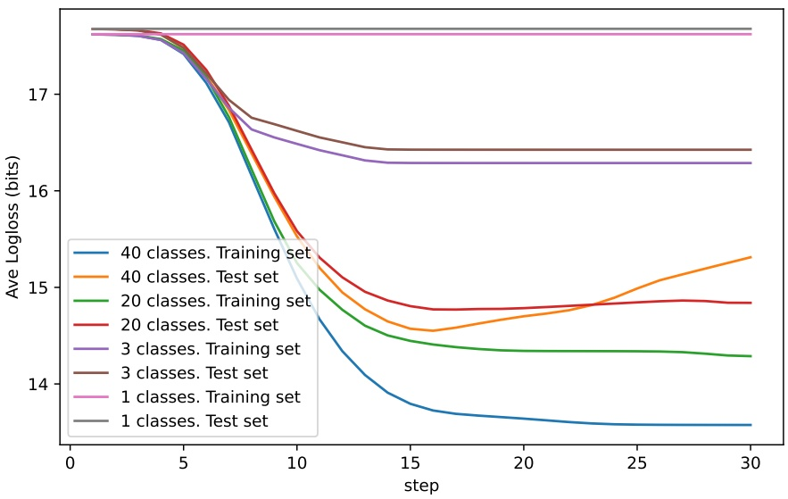

Figure 10.4: EM plotting error.

```python
def plot_error(self, maxstep=20):
    """Plots the logloss error as a function of the number of steps"""
    plt.ion()
    ax.set_xlabel("step")
    ax.set_ylabel("Ave Logloss (bits)")
    train_errors = []
    if self.dataset.test:
        test_errors = []
    for i in range(maxstep):
        self.learn(1)
        train_errors.append( sum(self.logloss(tple) for tple in
            self.dataset.train)
                /len(self.dataset.train))
        if self.dataset.test:
            test_errors.append( sum(self.logloss(tple) for tple in
                self.dataset.test)
                    /len(self.dataset.test))
    ax.plot(range(1,maxstep+1),train_errors,
        label=str(self.num_classes)+" classes. Training set")
    if self.dataset.test:
        ax.plot(range(1,maxstep+1),test_errors,
            label=str(self.num_classes)+" classes. Test set")
    ax.legend()
    plt.show()

# global variables so the plots can share axes.
```

<!-- page: 296 -->

```python
fig, ax = plt.subplots()

def prod(L):
    """returns the product of the elements of L"""
    res = 1
    for e in L:
        res *= e
    return res

def random_dist(k):
    """generate k random numbers that sum to 1"""
    res = [random.random() for i in range(k)]
    s = sum(res)
    return [v/s for v in res]

def testEM():
    print("testing EM")
    global data, eml
    data = Data_from_file('data/emdata2.csv', num_train=10,
        target_index=2000)
    # data = Data_from_file('data/carbool.csv', target_index=2000,
        one_hot=True)
    eml = EM_learner(data,2)
    num_iter=2
    print("Class assignment after",num_iter,"iterations:")
    eml.learn(num_iter); eml.show_class(0)

if __name__ == "__main__":
    testEM()

# Plot the error
# em1=EM_learner(data,1); em1.plot_error(30) # 1 class (predict mean)
# em2=EM_learner(data,2); em2.plot_error(40) # 2 classes
# em3=EM_learner(data,3); em3.plot_error(40) # 3 classes
# em10=EM_learner(data,10); em10.plot_error(40) # 10 classes
# em13=EM_learner(data,13); em13.plot_error(40) # 13 classes

# show the values for the variables
# [f.frange for f in data.input_features]
```

Exercise 10.2 For data where there are naturally 2 classes, does EM with 3 classes do better on the training set after a while than 2 classes? Is is better on a test set. Explain why. Hint: look what the 3 classes are. Use "eml.show\_class(i)" for each of the classes i ∈ [0, 3).

Exercise 10.3 Write code to plot the logloss as a function of the number of classes (from 1 to, say, 30) for a fixed number of iterations. (From the experience with the existing code, think about how many iterations are appropriate.

Exercise 10.4 Repeat the previous exercise, but use cross validation to select the number of iterations as a function of the number of classes and other features of

<!-- page: 297 -->

<!-- page: 298 -->

<!-- page: 299 -->

```txt
_probDo.py — (continued)
```

## Causality

## 11.1 Do Questions

A causal model can answer “do” questions.

The intervene function takes a belief network and a variable : value dictionary specifying what to “do”, and returns a belief network resulting from intervening to set each variable in the dictionary to its value specified. It replaces the conditional probability distribution, CPD, (Section 9.3) of each intervened variable with an constant CPD.

```python
from probGraphicalModels import InferenceMethod, BeliefNetwork
from probFactors import CPD, ConstantCPD

def intervene(bn, do={}): 
    assert isinstance(bn, BeliefNetwork), f"Do only applies to belief networks ({bn.title})"
    if do=={::
        return bn
    else:
        newfacs = ({f for (ch,f) in bn.var2cpt.items() if ch not in do} | {ConstantCPD(v,c) for (v,c) in do.items()})
        return BeliefNetwork(f"{bn.title}(do={do})", bn.variables, newfacs)
```

The following adds the queryDo method to the InferenceMethod class, so it can be used with any inference method. It replaces the graphical model with the modified one, runs the inference algorithm, and restores the initial belief network.

<small><span class="docvortex-page-footnote" data-block-type="page_footnote" style="color:#6b7280">def queryDo(self, qvar, obs={}, do={}):</span></small>

<!-- page: 300 -->

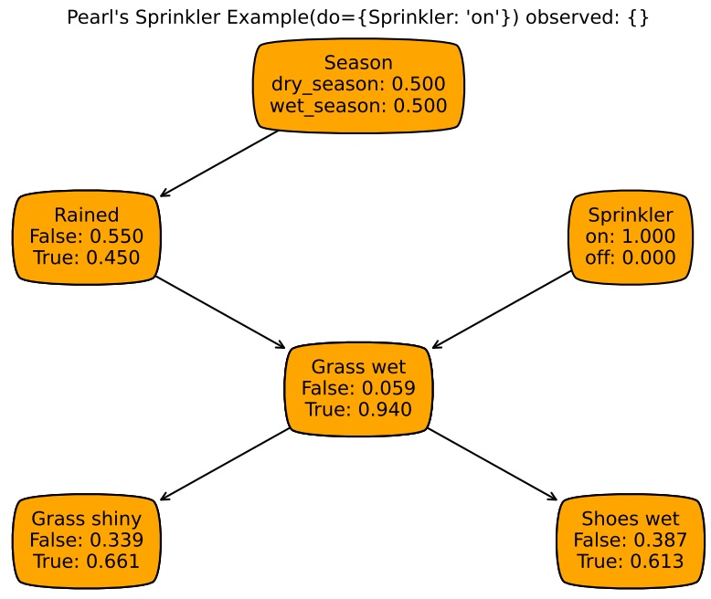

Figure 11.1: The sprinkler belief network with do={Sprinkler:"on"}.

```python
"""Extends query method to also allow for interventions.
    """
    oldBN, self.gm = self.gm, intervene(self.gm, do)
    result = self.query(qvar, obs)
    self.gm = oldBN # restore original
    return result

# make queryDo available for all inference methods
InferenceMethod.queryDo = queryDo
```

The following example is based on the sprinkler belief network of Section 9.4.2 shown in Figure 9.4. The network with the intervention of putting the sprinkler on is shown in Figure 11.1.

```python
from probRC import ProbRC

from probExamples import bn_sprinkler, Season, Sprinkler, Rained,
    Grass_wet, Grass_shiny, Shoes_wet
bn_sprinklerv = ProbRC(bn_sprinkler)
## bn_sprinklerv.queryDo(Shoes_wet)
## bn_sprinklerv.queryDo(Shoes_wet,obs={Sprinkler:"on"})
## bn_sprinklerv.queryDo(Shoes_wet,do={Sprinkler:"on"})
## bn_sprinklerv.queryDo(Season, obs={Sprinkler:"on"})
## bn_sprinklerv.queryDo(Season, do={Sprinkler:"on")]

https://aipython.org Version 0.9.18 March 10, 2026
```

<!-- page: 301 -->

Gateway Drug? observed: {}

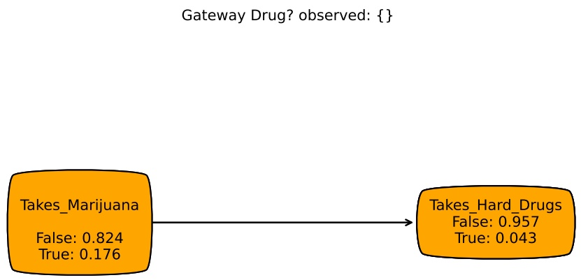

Figure 11.2: Does taking marijuana lead to hard drugs: observable variables

```python
### Showing posterior distributions:
# bn_sprinklerv.show_post({})
# bn_sprinklerv.show_post({Sprinkler:"on"})
# spon = intervene(bn_sprinkler, do={Sprinkler:"on"})
# ProbRC(spon).show_post({})
```

The following is a representation of a possible model where marijuana is a gateway drug to harder drugs (or not). Before reading the code, try the commentedout queries at the end. Figure 11.2 shows the network with the observable variables, Takes\_Marijuana and Takes\_Hard\_Drugs.

```python
from variable import Variable
from probFactors import Prob
from probGraphicalModels import BeliefNetwork
boolean = [False, True]

Drug_Prone = Variable("Drug_Prone", boolean, position=(0.1,0.5)) #
    (0.5,0.9))
Side_Effects = Variable("Side_Effects", boolean, position=(0.1,0.5)) #
    (0.5,0.1))
Takes_Marijuana = Variable("\nTakes_Marijuana\n", boolean,
    position=(0.1,0.5))
Takes_Hard_Drugs = Variable("Takes_Hard_Drugs", boolean,
    position=(0.9,0.5))

p_dp = Prob(Drug_Prone, [], [0.8, 0.2])
p_be = Prob(Side_Effects, [Takes_Marijuana], [[1, 0], [0.4, 0.6]])
p_tm = Prob(Takes_Marijuana, [Drug_Prone], [[0.98, 0.02], [0.2, 0.8]])
p_thd = Prob(Takes_Hard_Drugs, [Side_Effects, Drug_Prone],
        # Drug_Prone=False Drug_Prone=True
        [[[0.999, 0.001], [0.6, 0.4]], # Side_Effects=False
        [[0.99999, 0.00001], [0.995, 0.005]]]) # Side_Effects=True
```

<!-- page: 302 -->

```python
drugs = BeliefNetwork("Gateway Drug?",
            [Drug_Prone, Side_Effects, Takes_Marijuana,
                Takes_Hard_Drugs],
            [p_tm, p_dp, p_be, p_thd])

drugsq = ProbRC(drugs)
# drugsq.queryDo(Takes_Hard_Drugs)
# drugsq.queryDo(Takes_Hard_Drugs, obs = {Takes_Marijuana: True})
# drugsq.queryDo(Takes_Hard_Drugs, obs = {Takes_Marijuana: False})
# drugsq.queryDo(Takes_Hard_Drugs, do = {Takes_Marijuana: True})
# drugsq.queryDo(Takes_Hard_Drugs, do = {Takes_Marijuana: False})

# ProbRC(drugs).show_post({})
# ProbRC(drugs).show_post({Takes_Marijuana: True})
# ProbRC(drugs).show_post({Takes_Marijuana: False})
# ProbRC(intervene(drugs, do={Takes_Marijuana: True})).show_post({})
# ProbRC(intervene(drugs, do={Takes_Marijuana: False})).show_post({})
# Why was that? Try the following then repeat:
# Drug_Prone.position=(0.5,0.7); Side_Effects.position=(0.5,0.3)
```

## 11.2 Counterfactual Reasoning

The following provides two examples of counterfactual reasoning. In the following code, the user has to provide the deterministic system with noise. As we will see, there are multiple deterministic systems with noise that can produce the same causal probabilities.

```python
__probCounterfactual.py — Counterfactual Query Example ________________
from variable import Variable
from probFactors import Prob, ProbDT, IFeq, SameAs, Dist
from probGraphicalModels import BeliefNetwork
from probRC import ProbRC
from probDo import queryDo

boolean = [False, True]
```

## 11.2.1 Choosing Deterministic System

This section presents an example to encourage you to think about what deterministic system to use.

Consider the following example (thanks to Sophie Song). Suppose Bob went on a date with Alice. Bob was either on time or not (variable B is true when Bob is on time). Alice, who is fastidious about punctuality chooses whether to go on a second date (variable A is true when Alice agrees to a second date). Whether Bob is late depends on which cab company he called (variable C). Suppose Bob calls one of the cab companies, he was late, and Alice doesn’t ask for a second date. Bob wonders “what if I had called the other

<!-- page: 303 -->

CBA Counterfactual Example

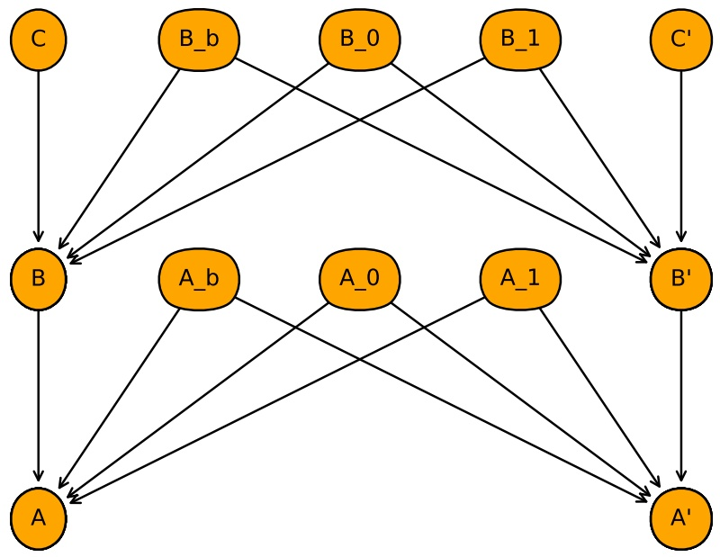

Figure 11.3: $C\rightarrow B\rightarrow A$ belief network for “what if C" Figure generated by by cbaCounter.show()

cab company”. Suppose all variables are Boolean. C causally depends on B, and not directly on C, and B depends on C, so the appropriate causal model is $C\rightarrow B\rightarrow A.$

Assume the following probabilities obtained from observations (where the lower case c represents $C = true,$ and similarly for other variables):

$P(c)=0.5$

$P(b\mid c) = P(b\mid \neg c) = 0.7$ (the cab companies are equally reliable)

$(a \mid b) = 0.4, (a \mid \neg b) = 0.2.$

Consider “what if C was True” or “what if C was False”. For example, suppose $A =$ false and C=false is observed and you want the probability of A if C were false.

Figure 11.3 shows the paired network for “what if C" . The primed variables represent the situation where C is counterfactually True or False. In this network, Cprime should be conditioned on. Conditioning on Cprime should not affect the non-primed variables. (You should check this).

<!-- page: 304 -->

```txt
probCounterfactual.py — (continued) ____

# as a deterministic system with independent noise
C = Variable("C", boolean, position=(0.1,0.8))
B = Variable("B", boolean, position=(0.1,0.4))
A = Variable("A", boolean, position=(0.1,0.0))
Cprime = Variable("C"', boolean, position=(0.9,0.8))
Bprime = Variable("B"', boolean, position=(0.9,0.4))
Aprime = Variable("A"', boolean, position=(0.9,0.0))
B_b = Variable("B_b", boolean, position=(0.3,0.8))
B_0 = Variable("B_0", boolean, position=(0.5,0.8))
B_1 = Variable("B_1", boolean, position=(0.7,0.8))
A_b = Variable("A_b", boolean, position=(0.3,0.4))
A_0 = Variable("A_0", boolean, position=(0.5,0.4))
A_1 = Variable("A_1", boolean, position=(0.7,0.4))
```

The conditional probability $P(A\mid B)$ is represented using three noise parameters, $A_{b}, A_{0}$ and $A_{1}$ with the equivalence:

$$
a \equiv a _ {b} \vee (\neg b \wedge a _ {0}) \vee (b \wedge a _ {1})
$$

Thus $a_{b}$ is the background cause of $a, a_{0}$ is the cause used when B=false and $a_{1}$ is the cause used when B=false . Note that this is over parametrized with respect the belief network, using three parameters whereas arbitrary conditional probability can be represented using two parameters.

The running example where $(a\mid b) = 0.4$ and $(a\mid \neg b) = 0.2$ can be represented using

$$
P (a _ {b}) = 0, P (a _ {0}) = 0. 2, P (a _ {1}) = 0. 4
$$

or

$$
P (a _ {b}) = 0. 2, P (a _ {0}) = 0, P (a _ {1}) = 0. 2 5
$$

(and infinitely many others between these). These cannot be distinguished by observations or by interventions. As you can see if you play with the code, these have different counterfactual conclusions.

P(B | C) is represented similarly, using variables $B_{b}, B_{0}$ and $B_{1}$

The following code uses the decision tree representation of conditional probabilities of Section 9.3.4.

```python
probCounterfactual.py — (continued) ________________
p_C = Prob(C, [], [0.5,0.5])
p_B = ProbDT(B, [C, B_b, B_0, B_1], IFeq(B_b,True,Dist([0,1]),
                                     IFeq(C,True,SameAs(B_1),SameAs(B_0))))
p_A = ProbDT(A, [B, A_b, A_0, A_1], IFeq(A_b,True,Dist([0,1]),
                                     IFeq(B,True,SameAs(A_1),SameAs(A_0))))
p_Cprime = Prob(Cprime,[], [0.5,0.5])
p_Bprime = ProbDT(Bprime, [Cprime, B_b, B_0, B_1],
                                     IFeq(B_b,True,Dist([0,1]),
```

<!-- page: 305 -->

## 11.2. Counterfactual Reasoning

```julia
IFeq(Cprime,True,SameAs(B_1),SameAs(B_0))))
p_Aprime = ProbDT(Aprime, [Bprime, A_b, A_0, A_1],
                    IFeq(A_b,True,Dist([0,1]),
                    IFeq(Bprime,True,SameAs(A_1),SameAs(A_0))))
p_b_b = Prob(B_b, [], [1,0])
p_b_0 = Prob(B_0, [], [0.3,0.7])
p_b_1 = Prob(B_1, [], [0.3,0.7])

p_a_b = Prob(A_b, [], [1,0])
p_a_0 = Prob(A_0, [], [0.8,0.2])
p_a_1 = Prob(A_1, [], [0.6,0.4])

p_b_np = Prob(B, [], [0.3,0.7]) # for AB network
p_Bprime_np = Prob(Bprime, [], [0.3,0.7]) # for AB network
ab_Counter = BeliefNetwork("AB Counterfactual Example",
                   [A,B,Aprime,Bprime, A_b,A_0,A_1],
                   [p_A, p_b_np, p_Aprime, p_Bprime_np, p_a_b, p_a_0,
                   p_a_1])

cbaCounter = BeliefNetwork("CBA Counterfactual Example",
                   [A,B,C, Aprime,Bprime,Cprime, B_b,B_0,B_1, A_b,A_0,A_1],
                   [p_A, p_B, p_C, p_Aprime, p_Bprime, p_Cprime,
                   p_b_b, p_b_0, p_b_1, p_a_b, p_a_0, p_a_1])
```

Here are some queries you might like to try. The show\_post queries might be most useful if you have the space to show multiple queries.

```python
__probCounterfactual.py — (continued) __

cbaq = ProbRC(cbaCounter)
# cbaq.queryDo(Aprime, obs = {C:True, Cprime:False})
# cbaq.queryDo(Aprime, obs = {C:False, Cprime:True})
# cbaq.queryDo(Aprime, obs = {A:True, C:True, Cprime:False})
# cbaq.queryDo(Aprime, obs = {A:False, C:True, Cprime:False})
# cbaq.queryDo(Aprime, obs = {A:False, C:True, Cprime:False})
# cbaq.queryDo(A_1, obs = {C:True,Aprime:False})
# cbaq.queryDo(A_0, obs = {C:True,Aprime:False})

# cbaq.show_post(obs = {})
# cbaq.show_post(obs = {C:True, Cprime:False})
# cbaq.show_post(obs = {A:False, C:True, Cprime:False})
# cbaq.show_post(obs = {A:True, C:True, Cprime:False})
```

Exercise 11.1 Consider the scenario “Bob called the first cab (C = true), was late and Alice agrees to a second date”. What would you expect from the scenario “what if Bob called the other cab?”. What does the network predict? Design probabilities for the noise variables that fits the conditional probability and also fits your expectation.

Exercise 11.2 How would you expect the counterfactual conclusion to change given the following two scenarios that fit the story:

<!-- page: 306 -->

Firing squad observed: {}

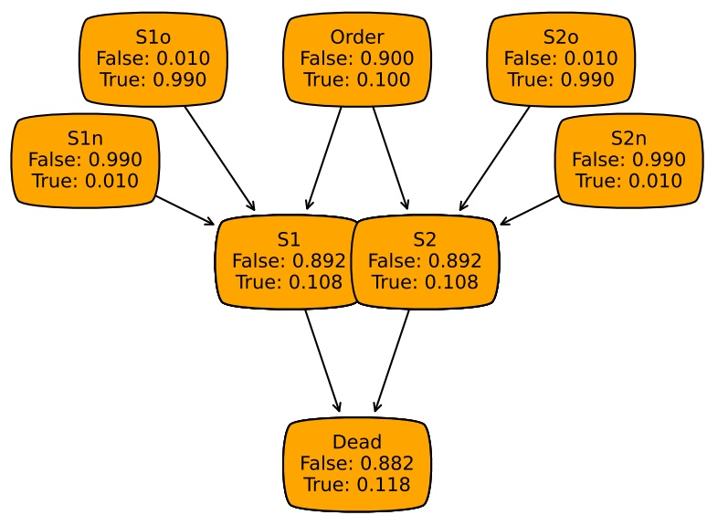

Figure 11.4: Firing squad belief network (figure obtained from fsq.show\_post({})

• The cabs are both very reliable and start at the same location (and so face the same traffic).

• The cabs are each 90% reliable and start from opposite directions.

(a) How would you expect the predictions to differ in these two cases?

(b) How can you fit the conditional probabilities above and represent each of these by changing the probabilities of the noise variables?

(c) How can these be learned from data? (Hint: consider learning a correlation between the taxi arrivals). Is your approach always applicable? If not, for which cases is it applicable or not.

Exercise 11.3 Choose two assignments to values to each of $a_{b}, a_{0}$ and $a_{1}$ using $a \equiv a_{b} \vee (\neg b \wedge a_{0}) \vee (b \wedge a_{1})$ , and a counterfactual query such that (a) the two assignments cannot be distinguished by observations or by interventions, and (b) the predictions for the query differ by an arbitrarluy large amount (differ by $1-\epsilon$ for a small value of $\epsilon,$ such as ϵ = 0.1).

## 11.2.2 Firing Squad Example

The following is the firing squad example of Pearl [2009] as a deterministic system. See Figure 11.4.

<!-- page: 307 -->

## 11.2. Counterfactual Reasoning

```julia
Order = Variable("Order", boolean, position=(0.4,0.8))
S1 = Variable("S1", boolean, position=(0.3,0.4))
S1o = Variable("S1o", boolean, position=(0.1,0.8))
S1n = Variable("S1n", boolean, position=(0.0,0.6))
S2 = Variable("S2", boolean, position=(0.5,0.4))
S2o = Variable("S2o", boolean, position=(0.7,0.8))
S2n = Variable("S2n", boolean, position=(0.8,0.6))
Dead = Variable("Dead", boolean, position=(0.4,0.0))
```

Instead of the tabular representation of the if-then-else structure used for the A → B → C network above, the following uses the decision tree representation of conditional probabilities of Section 9.3.4.

```txt
probCounterfactual.py — (continued) ____

p_S1 = ProbDT(S1, [Order, S1o, S1n],
                      IFeq(Order,True, SameAs(S1o), SameAs(S1n)))
p_S2 = ProbDT(S2, [Order, S2o, S2n],
                      IFeq(Order,True, SameAs(S2o), SameAs(S2n)))
p_dead = Prob(Dead, [S1,S2], [[[1,0],[0,1]],[[0,1],[0,1]]])
            #IFeq(S1,True,True,SameAs(S2)))
p_order = Prob(Order, [], [0.9, 0.1])
p_s1o = Prob(S1o, [], [0.01, 0.99])
p_s1n = Prob(S1n, [], [0.99, 0.01])
p_s2o = Prob(S2o, [], [0.01, 0.99])
p_s2n = Prob(S2n, [], [0.99, 0.01])

firing_squad = BeliefNetwork("Firing squad",
                   [Order, S1, S1o, S1n, S2, S2o, S2n, Dead],
                   [p_order, p_dead, p_S1, p_s1o, p_s1n, p_S2, p_s2o,
                   p_s2n])
fsq = ProbRC(firing_squad)
# fsq.queryDo(Dead)
# fsq.queryDo(Order, obs={Dead:True})
# fsq.queryDo(Dead, obs={Order:True})
# fsq.show_post({})
# fsq.show_post({Dead:True})
# fsq.show_post({S2:True})
```

Exercise 11.4 Create the network for “what if shooter 2 did or did not shoot”. Give the probabilities of the following counterfactuals:

(a) The prisoner is dead; what is the probability that the prisoner would be dead if shooter 2 did not shoot?

(b) Shooter 2 shot; what is the probability that the prisoner would be dead if shooter 2 did not shoot?

(c) No order was given, but the prisoner is dead; what is the probability that the prisoner would be dead if shooter 2 did not shoot?

Exercise 11.5 Create the network for “what if the order was or was not given”. Give the probabilities of the following counterfactuals:

<!-- page: 308 -->

(a) The prisoner is dead; what is the probability that the prisoner would be dead if the order was not given?

(b) The prisoner is not dead; what is the probability that the prisoner would be dead if the order was not given? (Is this different from the prior that the prisoner is dead, or the posterior that the prisoner was dead given the order was not given).

(c) Shooter 2 shot; what is the probability that the prisoner would be dead if the order was not given?

(d) Shooter 2 did not shoot; what is the probability that the prisoner would be dead if the order was given? (Is this different from the probability that the the prisoner would be dead if the order was given without the counterfactual observation)?

<!-- page: 309 -->

# Planning with Uncertainty

## 12.1 Decision Networks

The decision network code builds on the representation for belief networks of Chapter 9.

First, define factors that define the utility. Here the **utility** is a function of the variables in vars. In a **utility table** the utility is defined in terms of a tabular factor – a list that enumerates the values – as in Section 9.3.3. Another representations for factors (Section 9.2) could able be used.

```python
from probGraphicalModels import GraphicalModel, BeliefNetwork
from probFactors import Factor, CPD, TabFactor, factor_times, Prob
from variable import Variable
import matplotlib.pyplot as plt

class Utility(Factor):
    """A factor defining a utility"""
    pass

class UtilityTable(TabFactor, Utility):
    """A factor defining a utility using a table"""
    def __init__(self, vars, table, position=None):
        """Creates a factor on vars from the table.
        The table is ordered according to vars.
        """
        TabFactor.__init__(self,vars,table, name="Utility")
        self.position = position
```

A **decision variable** is like a random variable with a string name, and a domain, which is a list of possible values. The decision variable also includes the

<!-- page: 310 -->

parents, a list of the variables whose value will be known when the decision is made. It also includes a position, which is used for plotting.

```python
class DecisionVariable(Variable):
    def __init__(self, name, domain, parents, position=None):
        Variable.__init__(self, name, domain, position)
        self.parents = parents
        self.all_vars = set(parents) | {self}
```

A decision network is a graphical model where the variables can be random variables or decision variables. Among the factors we assume there is one utility factor. Note that this is an instance of BeliefNetwork but overrides \_\_init\_\_.

```python
class DecisionNetwork(BeliefNetwork):
    def __init__(self, title, vars, factors):
        """title is a string
        vars is a list of variables (random and decision)
        factors is a list of factors (instances of CPD and Utility)
        """
        GraphicalModel.__init__(self, title, vars, factors)
            # not BeliefNetwork.__init__
        self.var2parents = ({v : v.parents for v in vars
                if isinstance(v,DecisionVariable)}
            | {f.child:f.parents for f in factors
                if isinstance(f,CPD)})
        self.children = {nː[] for n in self.variables}
        for v in self.var2parents:
            for par in self.var2parents[v]:
                self.children[par].append(v)
        self.utility_factor = [f for f in factors
                if isinstance(f,Utility)][0]
        self.topological_sort_saved = None

    def __str__(self):
        return self.title
```

The split order ensures that the parents of a decision node are split before the decision node, and no other variables (if that is possible).

```python
def split_order(self):
    so = []
    tops = self.topological_sort()
    for v in tops:
        if isinstance(v,DecisionVariable):
            so += [p for p in v.parents if p not in so]
            so.append(v)
    so += [v for v in tops if v not in so]
    return so
https://aipython.org Version 0.9.18 March 10, 2026
```

<!-- page: 311 -->

```python
def show(self, fontsize=10,
    colors={'utility':'red', 'decision':'lime', 'random':'orange'):
    plt.ion() # interactive
    fig, ax = plt.subplots()
    ax.set_axis_off()
    ax.set_title(self.title, fontsize=fontsize)
    for par in self.utility_factor.variables:
        ax.annotate("Utility", par.position,
            xytext=self.utility_factor.position,
            arrowprops={'arrowstyle':'<-'},
            bbox=dict(boxstyle="sawtooth,pad=1.0",
                facecolor=colors['utility']),
            ha='center', va='center', fontsize=fontsize)
    for var in reversed(self.topological_sort()):
        if isinstance(var,DecisionVariable):
            bbox = dict(boxstyle="square,pad=1.0",
                facecolor=colors['decision'])
        else:
            bbox = dict(boxstyle="round4,pad=1.0,rounding_size=0.5",
                facecolor=colors['random'])
        if self.var2parents[var]:
            for par in self.var2parents[var]:
                ax.annotate(var.name, par.position, xytext=var.position,
                    arrowprops={'arrowstyle':'<-'},bbox=bbox,
                    ha='center', va='center',
                    fontsize=fontsize)
    else:
        x,y = var.position
        ax.text(x,y,var.name,bbox=bbox,ha='center', va='center',
            fontsize=fontsize)
```

## 12.1.1 Example Decision Networks

## Umbrella Decision Network

Here is a simple "umbrella" decision network. The output of umbrella\_dn.show() is shown in Figure 12.1.

```python
defcnNetworks.py — (continued) ________________
Weather = Variable("Weather", ["NoRain", "Rain"],
                    position=(0.5,0.8))
Forecast = Variable("Forecast", ["Sunny", "Cloudy", "Rainy"],
                    position=(0,0.4))
# Each variant uses one of the following:
Umbrella = DecisionVariable("Umbrella", ["Take", "Leave"], {Forecast},
                            position=(0.5,0))

p_weather = Prob(Weather, [], {"NoRain":0.7, "Rain":0.3})
p_forecast = Prob(Forecast, [Weather],
```

<!-- page: 312 -->

Umbrella Decision Network

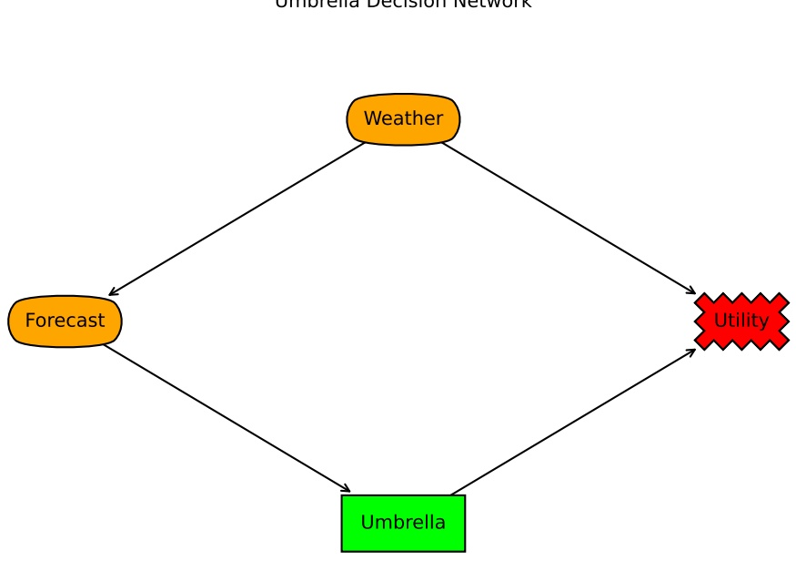

```txt
Figure 12.1: The umbrella decision network. Figure generated by umbrella_dn.show()
```

```python
{"NoRain":{"Sunny":0.7, "Cloudy":0.2, "Rainy":0.1},
"Rain":{"Sunny":0.15, "Cloudy":0.25, "Rainy":0.6}})
umb_utility = UtilityTable([Weather, Umbrella],
{"NoRain":{"Take":20, "Leave":100},
"Rain":{"Take":70, "Leave":0}}, position=(1,0.4))

umbrella_dn = DecisionNetwork("Umbrella Decision Network",
{Weather, Forecast, Umbrella},
{p_weather, p_forecast, umb_utility})

# umbrella_dn.show()
# umbrella_dn.show(fontsize=15)
```

The following is a variant with the umbrella decision having 2 parents; nothing else has changed. This is interesting because one of the parents is not needed; if the agent knows the weather, it can ignore the forecast.

```python
decnNetworks.py — (continued)
Umbrella2p = DecisionVariable("Umbrella", ["Take", "Leave"],
                      {Forecast, Weather}, position=(0.5,0))
umb_utility2p = UtilityTable([Weather, Umbrella2p],
                       {"NoRain":{"Take":20, "Leave":100},
                       "Rain":{"Take":70, "Leave":0}},
                       position=(1,0.4))
```

[https://aipython.org](https://aipython.org)

<!-- page: 313 -->

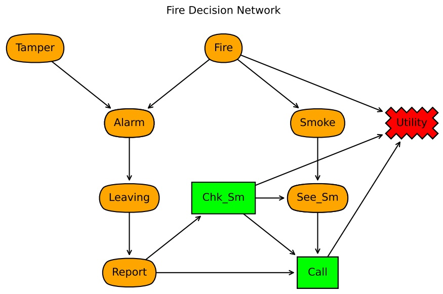

## Figure 12.2: Fire Decision Network. Figure generated by fire\_dn.show()

```python
umbrella_dn2p = DecisionNetwork("Umbrella Decision Network (extra arc)",
                      {Weather, Forecast, Umbrella2p},
                      {p_weather, p_forecast, umb_utility2p})

# umbrella_dn2p.show()
# umbrella_dn2p.show(fontsize=15)
```

## Fire Decision Network

The fire decision network of Figure 12.2 (showing the result of fire\_dn.show()) is represented as:

```julia
decnNetworks.py — (continued) ____

boolean = [False, True]
Alarm = Variable("Alarm", boolean, position=(0.25,0.633))
Fire = Variable("Fire", boolean, position=(0.5,0.9))
Leaving = Variable("Leaving", boolean, position=(0.25,0.366))
Report = Variable("Report", boolean, position=(0.25,0.1))
Smoke = Variable("Smoke", boolean, position=(0.75,0.633))
Tamper = Variable("Tamper", boolean, position=(0,0.9))

See_Sm = Variable("See_Sm", boolean, position=(0.75,0.366) )
Chk_Sm = DecisionVariable("Chk_Sm", boolean, {Report},
```

<!-- page: 314 -->

```python
position=(0.5, 0.366))
Call = DecisionVariable("Call", boolean,{See_Sm,Chk_Sm,Report},
    position=(0.75,0.1))

f_ta = Prob(Tamper,[],[0.98,0.02])
f_fi = Prob(Fire,[],[0.99,0.01])
f_sm = Prob(Smoke,[Fire],[[0.99,0.01],[0.1,0.9]])
f_al = Prob(Alarm,[Fire,Tamper],[[[0.9999, 0.0001], [0.15, 0.85]],
        [[0.01, 0.99], [0.5, 0.5]]])
f_lv = Prob(Leaving,[Alarm],[[0.999, 0.001], [0.12, 0.88]])
f_re = Prob(Report,[Leaving],[[0.99, 0.01], [0.25, 0.75]])
f_ss = Prob(See_Sm,[Chk_Sm,Smoke],[[[1,0],[1,0]],[[1,0],[0,1]]])

ut = UtilityTable([Chk_Sm,Fire,Call],
            [[[0,-200],[-5000,-200]],[[-20,-220],[-5020,-220]]],
            position=(1,0.633))

fire_dn = DecisionNetwork("Fire Decision Network",
            {Tamper,Fire,Alarm,Leaving,Smoke,Call,See_Sm,Chk_Sm,Report},
            {f_ta,f_fi,f_sm,f_al,f_lv,f_re,f_ss,ut})

# print(ut.to_table())
# fire_dn.show()
# fire_dn.show(fontsize=15)
```

## Cheating Decision Network

The following is the representation of the cheating decision shown in Figure 12.3. Someone has to decide whether to cheat at two different times. Cheating can improve grades. However, someone is watching for cheating, and if caught, results in punishment. The utility is a combination of final grade and the punishment. The decision maker finds out whether they were caught the first time when they have to decide whether to cheat the second time.

```python
decnNetworks.py — (continued) ________________
169 grades = ['A','B','C','F']
170 Watched = Variable("Watched", boolean, position=(0,0.9))
171 Caught1 = Variable("Caught1", boolean, position=(0.2,0.7))
172 Caught2 = Variable("Caught2", boolean, position=(0.6,0.7))
173 Punish = Variable("Punish", ["None","Suspension","Recorded"],
174          position=(0.8,0.9))
175 Grade_1 = Variable("Grade_1", grades, position=(0.2,0.3))
176 Grade_2 = Variable("Grade_2", grades, position=(0.6,0.3))
177 Fin_Grd = Variable("Fin_Grd", grades, position=(0.8,0.1))
178 Cheat_1 = DecisionVariable("Cheat_1", boolean, set(), position=(0,0.5))
179 Cheat_2 = DecisionVariable("Cheat_2", boolean, {Cheat_1,Caught1},
180          position=(0.4,0.5))

181
182 p_wa = Prob(Watched,[],[0.7, 0.3])

https://aipython.org Version 0.9.18 March 10, 2026
```

<!-- page: 315 -->

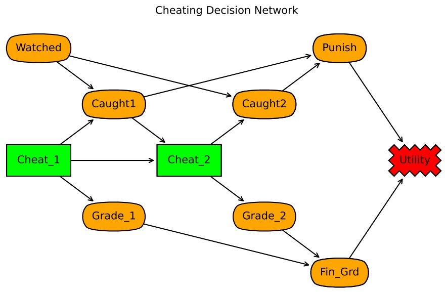

Figure 12.3: Cheating Decision Network (cheating\_dn.show())

```python
p_cc1 = Prob(Caught1,[Watched,Cheat_1],[[[1.0, 0.0], [0.9, 0.1]],
        [[1.0, 0.0], [0.5, 0.5]]])
p_cc2 = Prob(Caught2,[Watched,Cheat_2],[[[1.0, 0.0], [0.9, 0.1]],
        [[1.0, 0.0], [0.5, 0.5]]])
p_pun = Prob(Punish,[Caught1,Caught2],
            [[{"None":0,"Suspension":0,"Recorded":0},
            {"None":0.5,"Suspension":0.4,"Recorded":0.1}],
            [{"None":0.6,"Suspension":0.2,"Recorded":0.2},
            {"None":0.2,"Suspension":0.3,"Recorded":0.3}]]])
p_gr1 = Prob(Grade_1,[Cheat_1], [{'A':0.2, 'B':0.3, 'C':0.3, 'F': 0.2},
            {'A':0.5, 'B':0.3, 'C':0.2, 'F':0.0}]
p_gr2 = Prob(Grade_2,[Cheat_2], [{'A':0.2, 'B':0.3, 'C':0.3, 'F': 0.2},
            {'A':0.5, 'B':0.3, 'C':0.2, 'F':0.0}]
p_fg = Prob(Fin_Grd,[Grade_1,Grade_2],
    {'A":{"A":{"A':1.0, 'B':0.0, 'C': 0.0, 'F':0.0},
        'B': {'A':0.5, 'B':0.5, 'C': 0.0, 'F':0.0},
        'C":{"A':0.25, 'B':0.5, 'C': 0.25, 'F':0.0},
        'F":{"A':0.25, 'B':0.25, 'C': 0.25, 'F':0.25}},
        'B":{"A":{"A':0.5, 'B':0.5, 'C': 0.0, 'F':0.0},
        'B': {'A':0.0, 'B':1, 'C': 0.0, 'F':0.0},
        'C":{"A':0.0, 'B':0.5, 'C': 0.5, 'F':0.0},
        'F":{"A':0.0, 'B':0.25, 'C': 0.5, 'F':0.25}},
        'C":{"A":{"A':0.25, 'B':0.5, 'C': 0.25, 'F':0.0},
        'B': {'A':0.0, 'B':0.5, 'C': 0.5, 'F':0.0},
```

<!-- page: 316 -->

```python
'C":{"A':0.0, 'B':0.0, 'C': 1, 'F':0.0},
'F":{"A':0.0, 'B':0.0, 'C': 0.5, 'F':0.5}},
'F":{"A":{"A':0.25, 'B':0.25, 'C': 0.25, 'F':0.25},
'B': {'A':0.0, 'B':0.25, 'C': 0.5, 'F':0.25},
'C":{"A':0.0, 'B':0.0, 'C': 0.5, 'F':0.5},
'F":{"A':0.0, 'B':0.0, 'C': 0, 'F':1.0}}})

utc = UtilityTable([Punish,Fin_Grd],
            {'None":{"A':100, 'B':90, 'C': 70, 'F':50},
            'Suspension":{"A':40, 'B':20, 'C': 10, 'F':0},
            'Recorded":{"A':70, 'B':60, 'C': 40, 'F':20}},
            position=(1,0.5))

cheating_dn = DecisionNetwork("Cheating Decision Network",
            {Punish,Caught2,Watched,Fin_Grd,Grade_2,Grade_1,Cheat_2,Caught1,Cheat_1},
            {p_wa, p_cc1, p_cc2, p_pun, p_gr1, p_gr2,p_fg,utc})

# cheating_dn.show()
# cheating_dn.show(fontsize=15)
```

## Chain of 3 decisions

The following decision network represents a finite-stage fully-observable Markov decision process with a single reward (utility) at the end. It is interesting because the parents do not include all the predecessors. The methods we use will work without change on this, even though the agent does not condition on all of its previous observations and actions. The output of ch3.show() is shown in Figure 12.4.

```txt
S0 = Variable('S0', boolean, position=(0,0.5))
D0 = DecisionVariable('D0', boolean, {S0}, position=(1/7,0.1))
S1 = Variable('S1', boolean, position=(2/7,0.5))
D1 = DecisionVariable('D1', boolean, {S1}, position=(3/7,0.1))
S2 = Variable('S2', boolean, position=(4/7,0.5))
D2 = DecisionVariable('D2', boolean, {S2}, position=(5/7,0.1))
S3 = Variable('S3', boolean, position=(6/7,0.5))

p_s0 = Prob(S0, [], [0.5,0.5])
tr = [[[0.1, 0.9], [0.9, 0.1]], [[0.2, 0.8], [0.8, 0.2]]] # 0 is flip, 1
    is keep value
p_s1 = Prob(S1, [D0,S0], tr)
p_s2 = Prob(S2, [D1,S1], tr)
p_s3 = Prob(S3, [D2,S2], tr)

ch3U = UtilityTable([S3],[0,1], position=(7/7,0.9))

ch3 = DecisionNetwork("3-chain",
    {S0,D0,S1,D1,S2,D2,S3},{p_s0,p_s1,p_s2,p_s3,ch3U})
```

<!-- page: 317 -->

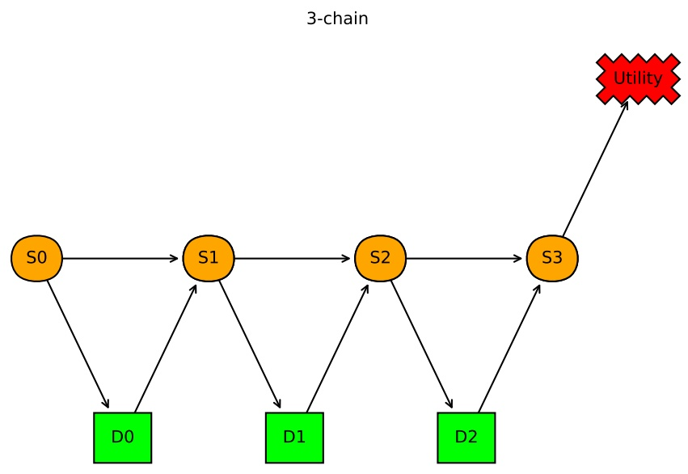

Figure 12.4: A decision network that is a chain of 3 decisions (ch3.show())

```txt
# ch3.show()
# ch3.show(fontsize=15)
```

## 12.1.2 Decision Functions

The output of an optimization function is an optimal policy and its expected value. A policy is a list of decision functions. A decision function is the action for each decision variable as a function of its parents.

Let’s represent the factor for a decision function as a dictionary.

```python
class DictFactor(Factor):
    """A factor that represents its values using a dictionary"""
    def __init__(self, *pargs, **kwargs):
        self.values = {}
        Factor.__init__(self, *pargs, **kwargs)

    def assign(self, assignment, value):
        self.values[frozenset(assignment.items())] = value

    def get_value(self, assignment):
        ass = frozenset(assignment.items())
```

<!-- page: 318 -->

```python
assert ass in self.values, f"assignment {assignment} cannot be evaluated"
    return self.values[ass]

class DecisionFunction(DictFactor):
    def __init__(self, decision, parents):
        """ A decision function
        decision is a decision variable
        parents is a set of variables
        """
        self.decision = decision
        self.parent = parents
        DictFactor.__init__(self, parents, name=decision.name)
```

## 12.1.3 Recursive Conditioning for Decision Networks

An instance of a RC\_DN object takes in a decision network. The query method uses recursive conditioning to compute the expected utility of the optimal policy. When it is finished, self.opt\_policy is the optimal policy.

```python
import math
from display import Displayable
from probGraphicalModels import GraphicalModel
from probFactors import Factor
from probRC import connected_components

class RC_DN(Displayable):
    """The class that finds the optimal policy for a decision network.

    dn is graphical model to query
    """

    def __init__(self, dn):
        self.dn = dn
        self.cache = {(frozenset(), frozenset)):1}
        ## self.max_display_level = 3

    def optimize(self, split_order=None, algorithm=None):
        """computes expected utility, and creates optimal decision functions, where
        elim_order is a list of the non-observed non-query variables in dn
        algorithm is the (search algorithm to use). Default is self.rc
        """
        if algorithm is None:
            algorithm = self.rc
        if split_order == None:
            split_order = self.dn.split_order()
        self.opt_policy = {v:DecisionFunction(v, v.parents)
            for v in self.dn.variables
```

<!-- page: 319 -->

```python
if isinstance(v,DecisionVariable)}
    return algorithm({}, self.dn.factors, split_order)

def show_policy(self):
    print('\n'.join(df.to_table() for df in self.opt_policy.values()))
```

The following is the simplest search-based algorithm. It is exponential in the number of variables, so is not very useful. However, it is simple, and helpful to understand before looking at the more complicated algorithm. Note that the above code does not call rc0; you will need to change the self.rc to self.rc0 in above code to use it.

```python
def rc0(self, context, factors, split_order):
    """simplest search algorithm
    context is a variable:value dictionary
    factors is a set of factors
    split_order is a list of variables in factors that are not in
        context
    """
    self.display(3,"calling rc0,",(context,factors),"with
        SO",split_order)
    if not factors:
        return 1
    elif to_eval := {fac for fac in factors if
        fac.can_evaluate(context)}:
        self.display(3,"rc0 evaluating factors",to_eval)
        val = math.prod(fac.get_value(context) for fac in to_eval)
        return val * self.rc0(context, factors-to_eval, split_order)
    else:
        var = split_order[0]
        self.display(3, "rc0 branching on", var)
        if isinstance(var,DecisionVariable):
            assert set(context) <= set(var.parents), f"cannot optimize
                {var} in context {context}"
            maxres = -math.inf
            for val in var.domain:
                self.display(3,"In rc0, branching on",var,"=",val)
                newres = self.rc0({var:val}|context, factors,
                    split_order[1:])
                if newres > maxres:
                    maxres = newres
                    theval = val
        self.opt_policy[var].assign(context,theval)
        return maxres
    else:
        total = 0
        for val in var.domain:
            total += self.rc0({var:val}|context, factors,
                split_order[1:])
        self.display(3, "rc0 branching on", var,"returning", total)
```

<!-- page: 320 -->

We can combine the optimization for decision networks above, with the improvements of recursive conditioning used for graphical models (Section 9.7, page 246).

```python
def rc(self, context, factors, split_order):
    """ returns the number sum_{split_order} prod_{factors} given
       assignments in context
context is a variable:value dictionary
factors is a set of factors
split_order is a list of variables in factors that are not in
context
"""
self.display(3,"calling rc,",(context,factors))
ce = (frozenset(context.items()), frozenset(factors)) # key for the
        cache entry
if ce in self.cache:
    self.display(2,"rc cache lookup",(context,factors))
    return self.cache[ce]
#     if not factors: # no factors; needed if you don't have forgetting
and caching
#     return 1
elif vars_not_in_factors := {var for var in context
                   if not any(var in fac.variables for
                   fac in factors)}:
    # forget variables not in any factor
    self.display(3,"rc forgetting variables", vars_not_in_factors)
    return self.rc({key:val for (key,val) in context.items()
           if key not in vars_not_in_factors},
                   factors, split_order)
elif to_eval := {fac for fac in factors if
    fac.can_evaluate(context)}:
    # evaluate factors when all variables are assigned
    self.display(3,"rc evaluating factors",to_eval)
    val = math.prod(fac.get_value(context) for fac in to_eval)
    if val == 0:
        return 0
    else:
        return val * self.rc(context, {fac for fac in factors if fac
            not in to_eval}, split_order)
elif len(comp := connected_components(context, factors,
    split_order)) > 1:
    # there are disconnected components
    self.display(2,"splitting into connected components",comp)
    return(math.prod(self.rc(context,f,eo) for (f,eo) in comp))
else:
    assert split_order, f"split_order empty rc({context},{factors}")
    var = split_order[0]
    self.display(3, "rc branching on", var)
```

<!-- page: 321 -->

```python
if isinstance(var,DecisionVariable):
    assert set(context) <= set(var.parents), f"cannot optimize
        {var} in context {context}"
    maxres = -math.inf
    for val in var.domain:
        self.display(3,"In rc, branching on",var,"=",val)
        newres = self.rc({var:val}|context, factors,
            split_order[1:])
        if newres > maxres:
            maxres = newres
            theval = val
    self.opt_policy[var].assign(context,theval)
    self.cache[ce] = maxres
    return maxres
else:
    total = 0
    for val in var.domain:
        total += self.rc({var:val}|context, factors,
            split_order[1:])
    self.display(3, "rc branching on", var,"returning", total)
    self.cache[ce] = total
    return total
```

Here is how to run the optimizer on the example decision networks:

```txt
# Umbrella decision network
#urc = RC_DN(umbrella_dn)
#urc.optimize(algorithm=urc.rc0) #RC0
#urc.optimize()  #RC
#urc.show_policy()

#rc_fire = RC_DN(fire_dn)
#rc_fire.optimize()
#rc_fire.show_policy()

#rc_cheat = RC_DN(cheating_dn)
#rc_cheat.optimize()
#rc_cheat.show_policy()

#rc_ch3 = RC_DN(ch3)
#rc_ch3.optimize()
#rc_ch3.show_policy()
# rc_ch3.optimize(algorithm=rc_ch3.rc0) # why does that happen?
```

## 12.1.4 Variable elimination for decision networks

VE\_DN is variable elimination for decision networks. The method optimize is used to optimize all the decisions. Note that optimize requires a legal elimination ordering of the random and decision variables, otherwise it will give an

<!-- page: 322 -->

exception. (A decision node can only be maximized if the variables that are not its parents have already been eliminated.)

```python
from probVE import VE

class VE_DN(VE):
    """Variable Elimination for Decision Networks"""
    def __init__(self,dn=None):
        """dn is a decision network"""
        VE.__init__(self,dn)
        self.dn = dn

    def optimize(self,elim_order=None,obs={}): 
        if elim_order == None:
            elim_order = reversed(self.dn.split_order())
        self.opt_policy = {}
        proj_factors = [self.project_observations(fact,obs)
                for fact in self.dn.factors]
        for v in elim_order:
            if isinstance(v,DecisionVariable):
                to_max = [fac for fac in proj_factors
                    if v in fac.variables and set(fac.variables) <= v.all_vars]
                assert len(to_max)==1, "illegal variable order "+str(elim_order)+" at "+str(v)
                newFac = FactorMax(v, to_max[0])
                self.opt_policy[v]=newFac.decision_fun
                proj_factors = [fac for fac in proj_factors if fac is not to_max[0]]+[newFac]
                self.display(2,"maximizing",v )
                self.display(3,newFac)
            else:
                proj_factors = self.eliminate_var(proj_factors, v)
    assert len(proj_factors)==1,"Should there be only one element of proj_factors?"
    return proj_factors[0].get_value({})
    def show_policy(self):
        print('\n'.join(df.to_table() for df in self.opt_policy.values()))
```

```python
class FactorMax(TabFactor):
    """A factor obtained by maximizing a variable in a factor.
    Also builds a decision_function. This is based on FactorSum.
    """
    def __init__(self, dvar, factor):
        """dvar is a decision variable.
        factor is a factor that contains dvar and only parents of dvar
https://aipython.org Version 0.9.18 March 10, 2026
```

<!-- page: 323 -->

```python
"""
    self.dvar = dvar
    self.factor = factor
    vars = [v for v in factor.variables if v is not dvar]
    Factor.__init__(self,vars)
    self.values = {}
    self.decision_fun = DecisionFunction(dvar, dvar.parents)

def get_value(self,assignment):
    """lazy implementation: if saved, return saved value, else compute it"""
    new_asst = {x:v for (x,v) in assignment.items() if x in self.variables}
    asst = frozenset(new_asst.items())
    if asst in self.values:
        return self.values[asst]
    else:
        max_val = float("-inf") # -infinity
        for elt in self.dvar.domain:
            fac_val = self.factor.get_value(assignment|{self.dvar:elt})
            if fac_val>max_val:
                max_val = fac_val
                best_elt = elt
        self.values[asst] = max_val
        self.decision_fun.assign(assignment, best_elt)
        return max_val
```

Here are some example queries:

```python
# Example queries:
# vf = VE_DN(fire_dn)
# vf.optimize()
# vf.show_policy()

# VE_DN.max_display_level = 3 # if you want to show lots of detail
# vc = VE_DN(cheating_dn)
# vc.optimize()
# vc.show_policy()

def test(dn):
    rc0dn = RC_DN(dn)
    rc0v = rc0dn.optimize(algorithm=rc0dn.rc0)
    rcdn = RC_DN(dn)
    rcv = rcdn.optimize()
    assert abs(rc0v-rcv)<1e-10, f"rc0 produces {rc0v}; rc produces {rcv}"
    vedn = VE_DN(dn)
    vev = vedn.optimize()
    assert abs(vev-rcv)<1e-10, f"VE_DN produces {vev}; RC produces {rcv}"
    print(f"passed unit test. rc0, rc and VE gave same result for {dn}")
```

<!-- page: 324 -->

```python
if __name__ == "__main__":
    test(fire_dn)
```

## 12.2 Markov Decision Processes

The following represent a **Markov decision process** (**MDP**) directly, rather than using the recursive conditioning or variable elimination code.

```python
import random
from display import Displayable
from utilities import argmaxd

class MDP(Displayable):
    """A Markov Decision Process. Must define:
    title a string that gives the title of the MDP
    states the set (or list) of states
    actions the set (or list) of actions
    discount a real-valued discount
    """

    def __init__(self, title, states, actions, discount, init=0):
        self.title = title
        self.states = states
        self.actions = actions
        self.discount = discount
        self.initv = self.V = {s:init for s in self.states}
        self.initq = self.Q = {s: {a: init for a in self.actions} for s in
            self.states}

    def P(self,s,a):
        """Transition probability function
        returns a dictionary of {s1:p1} such that P(s1 | s,a)=p1,
                and other probabilities are zero.
        """
        raise NotImplementedError("P") # abstract method

    def R(self,s,a):
        """Reward function R(s,a)
        returns the expected reward for doing a in state s.
        """
        raise NotImplementedError("R") # abstract method
```

Two state partying example (Example 12.29 in Poole and Mackworth [2023]):

```python
______mdpExamples.py — MDP Examples ____
from mdpProblem import MDP, ProblemDomain, distribution
from mdpGUI import GridDomain
```

<!-- page: 325 -->

```python
import matplotlib.pyplot as plt

class partyMDP(MDP):
    """Simple 2-state, 2-Action Partying MDP Example"""
    def __init__(self, discount=0.9):
        states = {'healthy','sick'}
        actions = {'relax', 'party'}
        MDP.__init__(self, "party MDP", states, actions, discount)

    def R(self,s,a):
        "R(s,a)"
        return { 'healthy': {'relax': 7, 'party': 10},
            'sick': {'relax': 0, 'party': 2 }}[s][a]

    def P(self,s,a):
        "returns a dictionary of {s1:p1} such that P(s1 | s,a)=p1. Other probabilities are zero."
        phealthy = { # P('healthy' | s, a)
            'healthy': {'relax': 0.95, 'party': 0.7},
            'sick': {'relax': 0.5, 'party': 0.1 }}[s][a]
        return {'healthy':phealthy, 'sick':1-phealthy}
```

The distribution class is used to represent distributions as they are being created. Probability distributions are represented as item : value dictionaries. When being constructed, adding an item : value to the dictionary has to act differently when the item is already in the dictionary and when it isn’t. The add\_prob method works whether the item is in the dictionary or not.

## 12.2.1 Problem Domains

An MDP does not contain enough information to simulate a domain, because

<!-- page: 326 -->

(a) the rewards and resulting state can be correlated (e.g., in the grid domains below, crashing into a wall results in both a negative reward and the agent not moving), and

(b) it represents the expected reward (e.g., a reward of 1 is has the same expected value as a reward of 100 with probability 1/100 and 0 otherwise, but these are different in a simulation).

A problem domain represents a problem as a function result from states and actions into a distribution of (state, reward) pairs. This can be a subclass of MDP because it implements R and P. A problem domain also specifies an initial state and coordinate information used by the graphical user interfaces.

```python
class ProblemDomain(MDP):
    """A ProblemDomain implements
    self.result(state, action) -> {(reward, state):probability}.
    Other pairs have probability are zero.
    The probabilities must sum to 1.
    """
    def __init__(self, title, states, actions, discount,
                   initial_state=None, x_dim=0, y_dim = 0,
                   vinit=0, offsets={}):
        """A problem domain
        * title is list of titles
        * states is the list of states
        * actions is the list of actions
        * discount is the discount factor
        * initial_state is the state the agent starts at (for simulation)
            if known
        * x_dim and y_dim are the dimensions used by the GUI to show the
            states in 2-dimensions
        * vinit is the initial value
        * offsets is a {action:(x,y)} map which specifies how actions are
            displayed in GUI
        """
    MDP.__init__(self, title, states, actions, discount)
    if initial_state is not None:
        self.state = initial_state
    else:
        self.state = random.choice(states)
    self.vinit = vinit # value to reset v,q to
    # The following are for the GUI:
    self.x_dim = x_dim
    self.y_dim = y_dim
    self.offsets = offsets

    def state2pos(self,state):
        """When displaying as a grid, this specifies how the state is
            mapped to (x,y) position.
        The default is for domains where the (x,y) position is the state
```

<!-- page: 327 -->

```python
"""
return state

def state2goal(self,state):
    """When displaying as a grid, this specifies how the state is mapped to goal position.
    The default is for domains where there is no goal
    """
    return None

def pos2state(self,pos):
    """When displaying as a grid, this specifies how the state is mapped to (x,y) position.
    The default is for domains where the (x,y) position is the state """
    return pos

def P(self, state, action):
    """Transition probability function
    returns a dictionary of {s1:p1} such that P(s1 | state,action)=p1.
    Other probabilities are zero.
    """
    res = self.result(state, action)
    acc = 1e-6 # accuracy for test of equality
    assert 1-acc<sum(res.values())<1+acc, f"result({state},{action})
        not a distribution, sum={sum(res.values())}"
    dist = distribution({})
    for ((r,s),p) in res.items():
        dist.add_prob(s,p)
    return dist

def R(self, state, action):
    """Reward function R(s,a)
    returns the expected reward for doing a in state s.
    """
    return sum(r*p for ((r,s),p) in self.result(state, action).items())
```

## Tiny Game

The next example is the tiny game from Example 13.1 and Figure 13.1 of Poole and Mackworth [2023], shown here as Figure 12.5. There are 6 states and 4 actions. The state is represented as (x, y) where x counts from zero from the left, and y counts from zero upwards, so the state (0, 0) is on the bottom-left. The actions are upC for up-careful, upR for up-risky, left, and right. Going left from (0, 2) results in a reward of 10 and ending up in state (0, 0); going left from (0, 1) results in a reward of −100 and staying there. Up-risky goes up but with a chance of going left or right. Up careful goes up, but has a reward of −1. Left and right are deterministic. Crashing into a wall results in a reward of −1 and staying still.

<!-- page: 328 -->

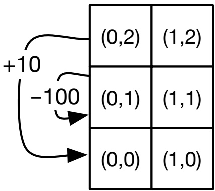

Figure 12.5: Tiny game

(Note that GridDomain means that it can be shown with the MDP GUI in Section 12.2.3).

```python
class MDPtiny(ProblemDomain, GridDomain):
    def __init__(self, discount=0.9):
        x_dim = 2  # x-dimension
        y_dim = 3
        ProblemDomain.__init__(self,
            "Tiny MDP", # title
            [(x,y) for x in range(x_dim) for y in range(y_dim)], #states
            ['right', 'upC', 'left', 'upR'], #actions
            discount,
            x_dim=x_dim, y_dim = y_dim,
            offsets = {'right':(0.25,0), 'upC':(0,-0.25), 'left':(-0.25,0),
                'upR':(0,0.25)}
        )

    def result(self, state, action):
        """return a dictionary of {(r,s):p} where p is the probability of
        reward r, state s
        a state is an (x,y) pair
        """
        (x,y) = state
        right = (-x,(1,y)) # reward is -1 if x was 1
        left = (0,(0,y)) if x==1 else [(-1,(0,0)), (-100,(0,1)),
            (10,(0,0))][y]
        up = (0,(x,y+1)) if y<2 else (-1,(x,y))
        if action == 'right':
            return {right:1}
        elif action == 'upC':
            (r,s) = up
```

<!-- page: 329 -->

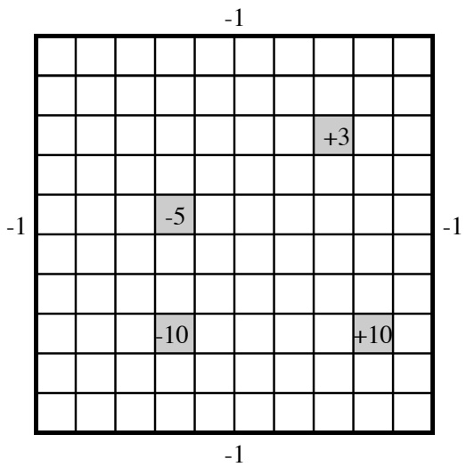

Figure 12.6: Grid world

```python
return {(r-1,s):1}
elif action == 'left':
    return {left:1}
elif action == 'upR':
    return distribution({left:
        0.1}).add_prob(right,0.1).add_prob(up,0.8)
    # Exercise: what is wrong with return {left: 0.1, right:0.1,
        up:0.8}

# To show GUI do
# MDPtiny().viGUI()
```

## Grid World

Here is the domain of Example 12.30 of Poole and Mackworth [2023], shown here in Figure 12.6. A state is represented as (x, y) where x counts from zero from the left, and y counts from zero upwards, so the state (0, 0) is on the bottom-left.

```python
_mdpExamples.py — (continued) ________________
class grid(ProblemDomain, GridDomain):
    """ x_dim * y_dim grid with rewarding states"""
    def __init__(self, discount=0.9, x_dim=10, y_dim=10):
        ProblemDomain.__init__(self,
            "Grid World",
            [(x,y) for x in range(y_dim) for y in range(y_dim)], #states
            ['up', 'down', 'right', 'left'], #actions
            discount,
            x_dim = x_dim, y_dim = y_dim,
https://aipython.org Version 0.9.18 March 10, 2026
```

<!-- page: 330 -->

```python
offsets = {'right':(0.25,0), 'up':(0,0.25), 'left':(-0.25,0),
        'down':(0,-0.25)})
    self.rewarding_states = {(3,2):-10, (3,5):-5, (8,2):10, (7,7):3 }
    self.fling_states = {(8,2), (7,7)} # assumed a subset of
        rewarding_states

def intended_next(self,s,a):
    """returns the (reward, state) in the direction a.
    This is where the agent will end up if to goes in its
        intended_direction
        (which it does with probability 0.7).
    """
    (x,y) = s
    if a=='up':
        return (0, (x,y+1)) if y+1 < self.y_dim else (-1, (x,y))
    if a=='down':
        return (0, (x,y-1)) if y > 0 else (-1, (x,y))
    if a=='right':
        return (0, (x+1,y)) if x+1 < self.x_dim else (-1, (x,y))
    if a=='left':
        return (0, (x-1,y)) if x > 0 else (-1, (x,y))

def result(self,s,a):
    """return a dictionary of {(r,s):p} where p is the probability of
        reward r, state s.
    a state is an (x,y) pair
    """
    r0 = self.rewarding_states[s] if s in self.rewarding_states else 0
    if s in self.fling_states:
        return {(r0,(0,0)): 0.25, (r0,(self.x_dim-1,0)):0.25,
            (r0,(0,self.y_dim-1)):0.25,
            (r0,(self.x_dim-1,self.y_dim-1)):0.25}
    dist = distribution({})
    for a1 in self.actions:
        (r1,s1) = self.intended_next(s,a1)
        rs = (r1+r0, s1)
        p = 0.7 if a1==a else 0.1
        dist.add_prob(rs,p)
    return dist
```

Figure 12.7 shows the immediate expected reward for each of the 100 states. This was generated using grid().viGUI() and carrying out one step.

## Monster Game

This is for the game depicted in Figure 12.8 (Example 13.2 of Poole and Mackworth [2023]). There are 25 locations where the agent can be, there can be no prize or there can be a prize in one of the corners $(P_{1}\dots P_{4})$ The agent only gets a positive reward when gets to the prize. The agent can be damaged or undamaged. There are possible monsters at the locations marked with M. If

<!-- page: 331 -->


Figure 12.7: Grid world GUI: grid().viGUI()

the agent lands on a monster when it is undamaged, it gets damaged. If the agent lands on a monster when it is damaged, it gets a negative reward. It can get undamaged by going to the location marked with R. It gets a negative reward by crashing into a wall. There are 25 ∗ 5 ∗ 2 = 250 states. There are 4 actions, up, down, left, and right; the agent generally goes in the direction of the action, but has a chance of going in one of the other directions.

```python
class Monster_game(ProblemDomain, GridDomain):

    vwalls = [(0,3), (0,4), (1,4)] # vertical walls right of these locations
    crash_reward = -1

    prize_locs = [(0,0), (0,4), (4,0), (4,4)]
    prize_apears_prob = 0.3
    prize_reward = 10

    monster_locs = [(0,1), (1,1), (2,3), (3,1), (4,2)]
    monster_appears_prob = 0.4
    monster_reward_when_damaged = -10
    repair_stations = [(1,4)]

https://aipython.org Version 0.9.18 March 10, 2026
```

<!-- page: 332 -->


Figure 12.8: Monster game

```python
def __init__(self, discount=0.9):
    x_dim = 5
    y_dim = 5
        # which damaged and prize to show
    ProblemDomain.__init__(self,
        "Monster Game",
        [(x,y,damaged,prize)
            for x in range(x_dim)
            for y in range(y_dim)
            for damaged in [False,True]
            for prize in [None]+self.prize_locs], #states
        ['up', 'down', 'right', 'left'], #actions
        discount,
        x_dim = x_dim, y_dim = y_dim,
        offsets = {'right':(0.25,0), 'up':(0,0.25), 'left':(-0.25,0),
            'down':(0,-0.25)})
    self.state = (2,2,False,None)

def intended_next(self,xy,a):
    """returns the (reward, (x,y)) in the direction a.
    This is where the agent will end up if to goes in its
        intended_direction
        (which it does with probability 0.7).
    """
    (x,y) = xy # original x-y position
    if a=='up':
        return (0, (x,y+1)) if y+1 < self.y_dim else
            (self.crash_reward, (x,y))
    if a=='down':
        return (0, (x,y-1)) if y > 0 else (self.crash_reward, (x,y))
```

<!-- page: 333 -->

```python
if a=='right':
    if (x,y) in self.vwalls or x+1==self.x_dim: # hit wall
        return (self.crash_reward, (x,y))
    else:
        return (0, (x+1,y))
if a=='left':
    if (x-1,y) in self.vwalls or x==0: # hit wall
        return (self.crash_reward, (x,y))
    else:
        return (0, (x-1,y))

def result(self,s,a):
    """return a dictionary of {(r,s):p} where p is the probability of
    reward r, state s.
a state is an (x,y) pair
    """
    (x,y,damaged,prize) = s
dist = distribution({})
for a1 in self.actions: # possible results
    mp = 0.7 if a1==a else 0.1
    mr,(xn,yn) = self.intended_next((x,y),a1)
    if (xn,yn) in self.monster_locs:
        if damaged:
            dist.add_prob((mr+self.monster_reward_when_damaged,(xn,yn,True,prize))
                mp*self.monster_appears_prob)
            dist.add_prob((mr,(xn,yn,True,prize)),
                mp*(1-self.monster_appears_prob))
        else:
            dist.add_prob((mr,(xn,yn,True,prize)),
                mp*self.monster_appears_prob)
            dist.add_prob((mr,(xn,yn,False,prize)),
                mp*(1-self.monster_appears_prob))
    elif (xn,yn) == prize:
        dist.add_prob((mr+self.prize_reward,(xn,yn,damaged,None)),
            mp)
    elif (xn,yn) in self.repair_stations:
        dist.add_prob((mr,(xn,yn,False,prize)), mp)
    else:
        dist.add_prob((mr,(xn,yn,damaged,prize)), mp)
if prize is None:
    res = distribution({})
    for (r,(x2,y2,d,p2)),p in dist.items():
        res.add_prob((r,(x2,y2,d,None)),
            p*(1-self.prize_apears_prob))
        for pz in self.prize_locs:
            res.add_prob((r,(x2,y2,d,pz)),
                p*self.prize_apears_prob/len(self.prize_locs))
    return res
else:
    return dist
```

<!-- page: 334 -->

```python
def state2pos(self, state):
    """When displaying as a grid, this specifies how the state is mapped to (x,y) position.
    The default is for domains where the (x,y) position is the state
    """
    (x,y,d,p) = state
    return (x,y)

def pos2state(self, pos):
    """When displaying as a grid, this specifies how the state is mapped to (x,y) position.
    """
    (x,y) = pos
    (xs, ys, damaged, prize) = self.state
    return (x, y, damaged, prize)

def state2goal(self,state):
    """the (x,y) position for the goal
    """
    (x, y, damaged, prize) = state
    return prize

# value iteration GUI for Monster game:
# mg = Monster_game()
# mg.viGUI() # then run vi a few times
# to see other states, exit the GUI
# mg.state = (2,2,True,(4,4)) # or other damaged/prize states
# mg.viGUI()
```

## 12.2.2 Value Iteration

The following implements value iteration for Markov decision processes.

A Q function is represented as a dictionary so Q[s][a] is the value for doing action a in state s. The value function is represented as a dictionary so V[s] is the value of state s. Policy π is represented as a dictionary where pi[s], where s is a state, returns the action.

Note that the following defines vi to be a method in MDP.

```python
def vi(self, n):
    """carries out n iterations of value iteration, updating value function self.V
    Returns a Q-function, value function, policy
    """
    self.display(3,f"calling vi({n}")
    for i in range(n):
        self.Q = {s: {a: self.R(s,a)
            +self.discount*sum(p1*self.V[s1]
```

<!-- page: 335 -->

```python
for (s1,p1) in
        self.P(s,a).items())
    for a in self.actions}
    for s in self.states}
    self.V = {s: max(self.Q[s][a] for a in self.actions)
        for s in self.states}
    self.pi = {s: argmaxd(self.Q[s])
        for s in self.states}
    return self.Q, self.V, self.pi

MDP.vi = vi
```

The following shows how this can be used.

```python
____mdpExamples.py — (continued) ________________
## Testing value iteration
# Try the following:
# pt = partyMDP(discount=0.9)
# pt.vi(1)
# pt.vi(100)
# partyMDP(discount=0.99).vi(100)
# partyMDP(discount=0.4).vi(100)

# gr = grid(discount=0.9)
# gr.viGUI()
# q,v,pi = gr.vi(100)
# q[(7,2)]
```

## 12.2.3 Value Iteration GUI for Grid Domains

A GridDomain is a domain where the states can be mapped into (x, y) positions, and the actions can be mapped into up-down-left-right. They are special because the viGUI() method to interact with them. It requires the following values/methods be defined:

• self.x\_dim and self.y\_dim define the dimensions of the grid (so the states are (x,y), where $0 \leq x <$ self.x\_dim and $0 \leq y < \text{self.y\_dim}$

• self.state2pos(state)] gives the (x,y) position of state. The default is that that states are already (x,y) positions.

• self.state2goal(state)] gives the (x,y) position of the goal in state. The default is None.

self.pos2state(pos)] where pos is an (x,y) pair, gives the state that is shown at position (x,y). When the state contain more information than the (x,y) pair, the extra information is taken from self.state.

• self.offsets[a] defines where to display action a, as (x, y) offset for action a when displaying Q-values.

<!-- page: 336 -->

```python
import matplotlib.pyplot as plt
from matplotlib.widgets import Button, CheckButtons, TextBox
from mdpProblem import MDP

class GridDomain(object):

    def viGUI(self):
        fig,self.ax = plt.subplots()
        plt.subplots_adjust(bottom=0.2)
        stepB = Button(fig.add_axes([0.8,0.05,0.1,0.075]), "step")
        stepB.on_clicked(self.on_step)
        resetB = Button(fig.add_axes([0.65,0.05,0.1,0.075]), "reset")
        resetB.on_clicked(self.on_reset)
        self.qcheck = CheckButtons(fig.add_axes([0.2,0.05,0.35,0.075]),
                          ["show Q-values","show policy"])
        self.qcheck.on_clicked(self.show_vals)
        self.font_box = TextBox(fig.add_axes([0.1,0.05,0.05,0.075]),
                          "Font:", textalignment="center")
        self.font_box.on_submit(self.set_font_size)
        self.font_box.set_val(str(plt.rcParams['font.size'])) )
        self.show_vals(None)
        plt.show()

    def set_font_size(self, s):
        plt.rcParams.update({'font.size': eval(s)})
        plt.draw()

    def show_vals(self,event):
        self.ax.cla() # clear the axes

        array = [[self.V[self.pos2state((x,y))] for x in range(self.x_dim)]
                             for y in range(self.y_dim)]
        self.ax.pcolormesh([x-0.5 for x in range(self.x_dim+1)],
               [y-0.5 for y in range(self.y_dim+1)],
               array, edgecolors='black',cmap='summer')
            # for cmap see
                https://matplotlib.org/stable/tutorials/colors/colormaps.html
        if self.qcheck.get_status()[1]: # "show policy"
            for x in range(self.x_dim):
                for y in range(self.y_dim):
                    state = self.pos2state((x,y))
                    maxv = max(self.Q[state][a] for a in self.actions)
                    for a in self.actions:
                        if self.Q[state][a] == maxv:
                            # draw arrow in appropriate direction
                            xoff, yoff = self.offsets[a]
                            self.ax.arrow(x,y,xoff*2,yoff*2,
                           color='red',width=0.05, head_width=0.2,
                           length_includes_head=True)
```

<!-- page: 337 -->

```python
if self.qcheck.get_status()[0]: # "show q-values"
        self.show_q(event)
    else:
        self.show_v(event)
    self.ax.set_xticks(range(self.x_dim))
    self.ax.set_xticklabels(range(self.x_dim))
    self.ax.set_yticks(range(self.y_dim))
    self.ax.set_yticklabels(range(self.y_dim))
    plt.draw()

    def on_step(self,event):
        self.step()
        self.show_vals(event)

    def step(self):
        """The default step is one step of value iteration"""
        self.vi(1)

    def show_v(self,event):
        """show values"""
        for x in range(self.x_dim):
            for y in range(self.y_dim):
                state = self.pos2state((x,y))
                self.ax.text(x,y,"{val:.2f}".format(val=self.V[state]),ha='center')

    def show_q(self,event):
        """show q-values"""
        for x in range(self.x_dim):
            for y in range(self.y_dim):
                state = self.pos2state((x,y))
                for a in self.actions:
                    xoff, yoff = self.offsets[a]
                    self.ax.text(x+xoff,y+yoff,
                            "{val:.2f}".format(val=self.Q[state][a]),ha='center')

    def on_reset(self,event):
        self.V = {s:self.vinit for s in self.states}
        self.Q = {s: {a: self.vinit for a in self.actions} for s in
            self.states}
        self.show_vals(event)

# to use the GUI do some of:
import mdpExamples
# mdpExamples.MDPtiny(discount=0.9).viGUI()
# mdpExamples.grid(discount=0.9).viGUI()
# mdpExamples.Monster_game(discount=0.9).viGUI() # see mdpExamples.py

if __name__ == "__main__":
    print("Try: mdpExamples.MDPtiny(discount=0.9).viGUI()")

Figure 12.9 shows the user interface for the tiny domain, which can be ob-
```

<!-- page: 338 -->


Figure 12.9: Interface for tiny example, after a number of steps. Each rectangle represents a state. In each rectangle are the 4 Q-values for the state. The leftmost number is for the left action; the rightmost number is for the right action; the uppermost is for the upR (up-risky) action and the lowest number is for the upC action. The arrow points to the action(s) with the maximum Q-value. Use MDPtiny().viGUI() after loading mdpExamples.py

tained using

MDPtiny(discount=0.9).viGUI()

resizing it, checking “show q-values” and “show policy”, and clicking “step” a few times.

```txt
To run the demo in class do:
% python -i mdpExamples.py
MDPtiny(discount=0.9).viGUI()
```

Figure 12.10 shows the user interface for the grid domain, which can be obtained using grid(discount=0.9).viGUI()

<!-- page: 339 -->

resizing it, checking “show q-values” and “show policy”, and clicking “step” a few times.

Figure 12.11 shows the optimal policy and Q-values after convergence (clicking “step” more does not change the Q-values) for the states where the agent is damaged and the goal is in the top-right. The are 10 times as many states as positions, so we can’t show them all. See the commented out lines at the end of the Monster game code to reproduce this figure.

Exercise 12.1 Computing q before v may seem like a waste of space because we don’t need to store q in order to compute the value function or the policy. Change the algorithm so that it loops through the states and actions once per iteration, and only stores the value function and the policy. Note that to get the same results as before, you would need to make sure that you use the previous value of v in the computation not the current value of v. Does using the current value of v hurt the algorithm or make it better (in approaching the actual value function)?

## 12.2.4 Asynchronous Value Iteration

This implements asynchronous value iteration, storing Q.

A Q function is represented using Q[s][a] as the value for doing action with a in state s.

```python
def avi(self,n):
    states = list(self.states)
    actions = list(self.actions)
    for i in range(n):
        s = random.choice(states)
        a = random.choice(actions)
        self.Q[s][a] = (self.R(s,a) + self.discount *
            sum(p1 * max(self.Q[s1][a1]
                for a1 in self.actions)
                    for (s1,p1) in self.P(s,a).items()))
    return self.Q

# make this a method for the MPD class:
MDP.avi = avi
```

The following shows how avi can be used.

```python
mdpExamples.py — (continued) ________________
## Testing asynchronous value iteration
# Try the following:
# pt = partyMDP(discount=0.9)
# pt.avi(10)
# pt.vi(1000)

# gr = grid(discount=0.9)
# q = gr.avi(100000)
# q[(7,2)]

https://aipython.org Version 0.9.18 March 10, 2026
```

<!-- page: 340 -->


Figure 12.10: Interface for grid example, after a number of steps. Each rectangle represents a state. In each rectangle are the 4 Q-values for the state. The leftmost number is for the left action; the rightmost number is for the right action; the uppermost is for the up action and the lowest number is for the down action. The arrow points to the action(s) with the maximum Q-value. From grid(discount=0.9).viGUI()

<!-- page: 341 -->


Figure 12.11: Q-values and optimal policy for the monster game, for the states where the agent is damaged and the goal is in the top-right.

```python
def test_MDP(mdp, discount=0.9, eps=0.01):
    """tests vi and avi give the same answer for a MDP class mdp
    """
    mdp1 = mdp(discount=discount)
    q1,v1,pi1 = mdp1.vi(100)
    mdp2 = mdp(discount=discount)
    q2 = mdp2.avi(1000)
    same = all(abs(q1[s][a]-q2[s][a]) < eps
        for s in mdp1.states
        for a in mdp1.actions)
    assert same, "vi and avi are different:\n{q1}\n{q2}"
    print(f"passed unit test. vi and avi gave same result for {mdp1.title}")

if __name__ == "__main__":
    test_MDP(partyMDP)
```

<!-- page: 342 -->

Exercise 12.2 Implement value iteration that stores the V-values rather than the Q-values. Does it work better than storing Q? (What might “better” mean?)

Exercise 12.3 In asynchronous value iteration, try a number of different ways to choose the states and actions to update (e.g., sweeping through the state-action pairs, choosing them at random). Note that the best way may be to determine which states have had their Q-values changed the most, and then update the pre-vious ones, but that is not so straightforward to implement, because you need to find those previous states.

<!-- page: 343 -->

# Reinforcement Learning

## 13.1 Representing Agents and Environments

The reinforcement learning agents and environments are instances of the general agent architecture of Section 2.1, where the percepts are (reward, state) pairs. The state here is the state of the environment, not the state of the agent. Thus this is assuming that the environment if **fully observable**.

Agents are told what actions are available to it to use, but don’t initially know anything about the possible states.

An agent implements the method select\_action takes a (reward, state) returns the next action (and updates the state of the agent).

• An environment implements the method do that takes an action and returns a (reward, state) pair.

These are alternated to simulate the system. The simulation starts with the agent choosing the initial action given the state, using the method initial\_action(state), which typically remembers the state and returns a random action.

## 13.1.1 Environments

RL environments have names to make tracing easier. An environment also has a list of all of the actions that can be carried out in the environment. It is initialized with the initial state.

```python
____rlProblem.py — Representations for Reinforcement Learning ________________
import random
import math
from display import Displayable
```

<!-- page: 344 -->

```python
def select_action(self, reward, state):
    """
    Select the action given the reward and state
    Remember the action in self.action
    This implements "Act randomly" and should be overridden!
    """
```

```python
from agents import Agent, Environment
from utilities import select_from_dist, argmaxe, argmaxd, flip

class RL_env(Environment):
    def __init__(self, name, actions, state):
        """creates an environment given name, list of actions, and initial state"""
        self.name = name      # the name of the environment
        self.actions = actions # list of all actions
        self.state = state     # initial state
        self.reward = None     # last reward

    # must implement do(action)->(reward,state)
```

## 13.1.2 Agents

An agent initially knows what actions it can carry out (its abilities). The interactions is started by calling initial\_action, which tells the agent what the initial state is. An agent typically remembers the state and returns an action. It has no reason to prefer one action over another, so it chooses an action at random.

```python
class RL_agent(Agent):
    """An RL_Agent
    has percepts (s, r) for some state s and real reward r
    """
    def __init__(self, actions):
        self.actions = actions

    def initial_action(self, env_state):
        """return the initial action, and remember the state and action
        Act randomly initially
        Could be overridden to initialize data structures (as the agent now knows about one state)
        """
        self.state = env_state
        self.action = random.choice(self.actions)
        return self.action
```

At each time step, an agent selects its next action action given the reward it received and the environment.

<!-- page: 345 -->

## 13.1. Representing Agents and Environments

```python
self.reward = reward
    self.action = random.choice(self.actions)
    return self.action

def v(self, state):
    """estimate of the value of doing a best action in state.
    """
    return max(self.q(state,a) for a in self.actions)

def q(self, state, action):
    """estimate of value of doing action in state. Should be overridden to be useful.
    """
    return 0
```

## 13.1.3 Simulating an Environment-Agent Interaction

The interaction between an agent and an environment is mediated by a simulator that calls the agent and the environment in turn. Simulate in this section is similar to Simulate of Section 2.1, except it is initialized by agent.initial\_action(state), and the rewards are accumulated.

```python
import matplotlib.pyplot as plt

class Simulate(Displayable):
    """simulate the interaction between the agent and the environment
    for n time steps.
    Returns a pair of the agent state and the environment state.
    """
    def __init__(self, agent, environment):
        self.agent = agent
        self.env = environment
        self.reward_history = [] # for plotting
        self.step = 0
        self.sum_rewards = 0

    def start(self):
        self.action = self.agent.initial_action(self.env.state)
        return self

    def go(self, n):
        for i in range(n):
            self.step += 1
            (reward,state) = self.env.do(self.action)
            self.display(2,f"step={self.step} reward={reward},
                state={state}")
            self.sum_rewards += reward
            self.reward_history.append(reward)
```

<!-- page: 346 -->


Figure 13.1: Plotting the performance of some algorithms for the monster game

```python
self.action = self.agent.select_action(reward,state)
        self.display(2,f"    action={self.action}")
    return self
```

The following plots the sum of rewards as a function of the step in a simulation. Figure 13.1 shows the performance of three algorithms for the Monster Game (Sections 12.2.1 and 13.1.6). One the x-axis is the number of actions. On the y-axis is the cumulative reward. The algorithm corresponding to the blue line has not learned very well; the plot keeps going down (but less than it did initially). The learner represented by the green line starts getting positive performance after about 20,000 steps. It took about 55,000 steps for it to have gained back the cost of exploration (when it crosses y = 0). The learner represented by the orange line seems to have learned quicker, but is more erratic. Each algorithm should be run multiple times, because the performance can vary a lot, even for the same problem, algorithm, and parameter settings. This graph can be reproduced (but the lines will be different) using code at the bottom of RLQlearner.py.

```python
def plot(self, label=None, step_size=None, xscale='linear'):
    """
    plots the rewards history in the simulation
    label is the label for the plot
    step_size is the number of steps between each point plotted
```

<!-- page: 347 -->

## 13.1. Representing Agents and Environments

```python
xscale is 'log' or 'linear'

    returns sum of rewards
    """
    if step_size is None: #for long simulations (> 999), only plot some points
        step_size = max(1,len(self.reward_history)//500)
    if label is None:
        label = self.agent.name
    plt.ion()
    fig, ax = plt.subplots()
    ax.set_xscale(xscale)
    ax.set_title(self.env.name)
    ax.set_xlabel("step")
    ax.set_ylabel("Sum of rewards")
    sum_history, sum_rewards = acc_rews(self.reward_history, step_size)
    ax.plot(range(0,len(self.reward_history),step_size), sum_history, label=label)
    ax.legend()
    plt.draw()
    return sum_rewards

def acc_rews(rews,step_size):
    """returns the rolling sum of the values, sampled each step_size, and the sum
    """
    acc = []
    sumr = 0; i=0
    for e in rews:
        sumr += e
        i += 1
        if (i%step_size == 0): acc.append(sumr)
    return acc, sumr
```

## 13.1.4 Party Environment

Here is the definition of the simple 2-state, 2-action decision about whether to party or relax (Example 12.29 in Poole and Mackworth [2023]). (Compare to the MDP representation of page 324)

```python
from rlProblem import RL_env
class Party_env(RL_env):
    def __init__(self):
        RL_env.__init__(self, "Party Decision", ["party", "relax"],
            "healthy")

    def do(self, action):
        """updates the state based on the agent doing action.
        returns reward,state
```

<!-- page: 348 -->

```python
"""
if self.state=="healthy":
    if action=="party":
        self.state = "healthy" if flip(0.7) else "sick"
        self.reward = 10
    else: # action=="relax"
        self.state = "healthy" if flip(0.95) else "sick"
        self.reward = 7
else: # self.state=="sick"
    if action=="party":
        self.state = "healthy" if flip(0.1) else "sick"
        self.reward = 2
    else:
        self.state = "healthy" if flip(0.5) else "sick"
        self.reward = 0
return self.reward, self.state
```

## 13.1.5 Environment from a Problem Domain

Env\_fom\_ProblemDomain takes a ProblemDomain (page 325) and constructs an environment that can be used for reinforcement learners.

As explained in Section 12.2.1, the representation of an MDP does not contain enough information to simulate a system, because it loses any dependency between the rewards and the resulting state (e.g., hitting the wall and having a negative reward may be correlated), and only represents the expected value of rewards, not how they are distributed. The ProblemDomain class defines the result method to map states and actions into distributions over (reward, state) pairs.

```python
class Env_from_ProblemDomain(RL_env):
    def __init__(self, prob_dom):
        RL_env.__init__(self, prob_dom.title, prob_dom.actions,
            prob_dom.state)
        self.problem_domain = prob_dom
        self.state = prob_dom.state
        self.x_dim = prob_dom.x_dim
        self.y_dim = prob_dom.y_dim
        self.offsets = prob_dom.offsets
        self.state2pos = self.problem_domain.state2pos
        self.state2goal = self.problem_domain.state2goal
        self.pos2state = self.problem_domain.pos2state

    def do(self, action):
        """updates the state based on the agent doing action.
        returns state,reward
        """
```

<!-- page: 349 -->


Figure 13.2: Monster game

```python
(self.reward, self.state) =
            select_from_dist(self.problem_domain.result(self.state, action))
        self.problem_domain.state = self.state
        self.display(2,f"do({action} -> ({self.reward}, {self.state})")
        return (self.reward,self.state)
```

## 13.1.6 Monster Game Environment

This is for the game depicted in Figure 13.2 (Example 13.2 of Poole and Mackworth [2023]). This is an alternative representation to that of Section 12.2.1, which defined the distribution over reward-state pairs. This directly builds a simulator, which might be easier to understand and easier adapt to new environments.

There are 25 ∗ 5 ∗ 2 = 250 states. The agent does not know anything about how the environment works; it just knows what actions are available to it and what state it is in. It has to learn what to do.

```python
import random
from utilities import flip
from rlProblem import RL_env

class Monster_game_env(RL_env):
    x_dim = 5
    y_dim = 5

    vwalls = [(0,3), (0,4), (1,4)] # vertical walls right of these locations
    hwalls = [] # not implemented
    crashed_reward = -1

https://aipython.org Version 0.9.18 March 10, 2026
```

<!-- page: 350 -->

```python
prize_locs = [(0,0), (0,4), (4,0), (4,4)]
prize_apears_prob = 0.3
prize_reward = 10

monster_locs = [(0,1), (1,1), (2,3), (3,1), (4,2)]
monster_appears_prob = 0.4
monster_reward_when_damaged = -10
repair_stations = [(1,4)]

actions = ["up","down","left","right"]

def __init__(self):
    # State:
        self.x = 2
        self.y = 2
        self.damaged = False
        self.prize = None
        # Statistics
        self.number_steps = 0
        selfaccumulated_rewards = 0 # sum of rewards received
        self.min_accumulated_rewards = 0
        self.min_step = 0
        self.zero_crossing = 0
        RL_env.__init__(self, "Monster Game", self.actions, (self.x,
           self.y, self.damaged, self.prize))
        self.display(2,"","Step","Tot Rew","Ave Rew",sep="\t")

def do(self,action):
    """updates the state based on the agent doing action.
    returns reward,state
    """
    assert action in self.actions, f"Monster game, unknown action:
        {action}"
    self.reward = 0.0
    # A prize can appear:
        if self.prize is None and flip(self.prize_apears_prob):
            self.prize = random.choice(self.prize_locs)
        # Actions can be noisy
        if flip(0.4):
            actual_direction = random.choice(self.actions)
    else:
        actual_direction = action
    # Modeling the actions given the actual direction
    if actual_direction == "right":
        if self.x==self.x_dim-1 or (self.x,self.y) in self.vwalls:
            self.reward += self.crashed_reward
        else:
            self.x += 1
    elif actual_direction == "left":
```

<!-- page: 351 -->

```txt
_rlExamples.py — (continued)
```

## 13.1. Representing Agents and Environments

```python
if self.x==0 or (self.x-1,self.y) in self.vwalls:
    self.reward += self.crashed_reward
else:
    self.x += -1
elif actual_direction == "up":
    if self.y==self.y_dim-1:
        self.reward += self.crashed_reward
    else:
        self.y += 1
elif actual_direction == "down":
    if self.y==0:
        self.reward += self.crashed_reward
    else:
        self.y += -1
else:
    raise RuntimeError(f"unknown_direction: {actual_direction}")

# Monsters
if (self.x,self.y) in self.monster_locs and
    flip(self.monster_appears_prob):
    if self.damaged:
        self.reward += self.monster_reward_when_damaged
    else:
        self.damaged = True
if (self.x,self.y) in self.repair_stations:
    self.damaged = False

# Prizes
if (self.x,self.y) == self.prize:
    self.reward += self.prize_reward
    self.prize = None

# Statistics
self.number_steps += 1
selfaccumulated_rewards += self.reward
if selfaccumulated_rewards < self.min_accumulated_rewards:
    self.min_accumulated_rewards = selfaccumulated_rewards
    self.min_step = self.number_steps
if selfaccumulated_rewards>0 and
    self.reward>selfaccumulated_rewards:
    self.zero_crossing = self.number_steps
self.display(2,"",self.number_steps,selfaccumulated_rewards,
            selfaccumulated_rewards/self.number_steps,sep="\t")

return self.reward, (self.x, self.y, self.damaged, self.prize)
The following methods are used by the GUI (Section 13.7, page 371) so that the states can be shown.
```

<!-- page: 352 -->

```python
def state2pos(self,state):
    """the (x,y) position for the state
    """
    (x, y, damaged, prize) = state
    return (x,y)

def state2goal(self,state):
    """the (x,y) position for the goal
    """
    (x, y, damaged, prize) = state
    return prize

def pos2state(self,pos):
    """the state corresponding to the (x,y) position.
    The damages and prize are not shown in the GUI
    """
    (x,y) = pos
    return (x, y, self.damaged, self.prize)
```

## 13.2 Q Learning

```txt
To run the Q-learning demo, in folder "aipython", load "rlQLearner.py", and copy and paste the example queries at the bottom of that file.
```

```python
rlQLearner.py — Q Learning
import random
import math
from display import Displayable
from utilities import argmaxe, argmaxd, flip
from rlProblem import RL_agent, epsilon_greedy, ucb

class Q_learner(RL_agent):
    """A Q-learning agent has
    belief-state consisting of
        state is the previous state (initialized by RL_agent
        q is a {(state,action):value} dict
        visits is a {(state,action):n} dict. n is how many times action was
            done in state
        acc_rewards is the accumulated reward
    """
```

<!-- page: 353 -->

```python
name is string representation of the agent
actions is the set of actions the agent can do
discount is the discount factor
exploration_strategy is the exploration function, default
    "epsilon_greedy"
es_kwargs is extra arguments of exploration_strategy
alpha_fun is a function that computes alpha from the number of
    visits
Qinit is the initial q-value
"""
RL_agent.__init__(self, actions)
self.name = name
self.discount = discount
self.exploration_strategy = exploration_strategy
self.es_kwargs = es_kwargs
self.alpha_fun = alpha_fun
self.Qinit = Qinit
self.acc_rewards = 0
self.Q = {}
self.visits = {}
```

The initial action is a random action. It remembers the state, and initializes the data structures.

```python
def initial_action(self, state):
    """ Returns the initial action; selected at random
    Initialize Data Structures
    """
    self.state = state
    self.Q[state] = {act:self.Qinit for act in self.actions}
    self.visits[state] = {act:0 for act in self.actions}
    self.action = self.exploration_strategy(state, self.Q[state],
                             self.visits[state],**self.es_kwargs)
    self.display(2, f"Initial State: {state} Action {self.action}")
    self.display(2,"s\ta\tr\ts'\tQ")
        # display looks best if states and actions are < 8 characters
    return self.action

def select_action(self, reward, next_state):
    """give reward and next state, select next action to be carried out"""
    if next_state not in self.visits: # next_state not seen before self.Q[next_state] = {act:self.Qinit for act in self.actions}
        self.visits[next_state] = {act:0 for act in self.actions}
    self.visits[self.state][self.action] +=1
    alpha = self.alpha_fun(self.visits[self.state][self.action])
    self.Q[self.state][self.action] += alpha*(reward + self.discount * max(self.Q[next_state].values())
 - self.Q[self.state][self.action])
```

<!-- page: 354 -->

```python
self.display(2,self.state, self.action, reward, next_state,
            self.Q[self.state][self.action], sep='\t')
    self.action = self.exploration_strategy(next_state,
        self.Q[next_state],
                self.visits[next_state],**self.es_kwargs)
    self.state = next_state
    self.display(3,f"Agent {self.name} doing {self.action} in state
        {self.state}")
    return self.action
```

The GUI requires the q(s, a) functions:

```python
rlQLearner.py — (continued)
    def q(self,s,a):
        if s in self.Q and a in self.Q[s]:
            return self.Q[s][a]
        else:
            return self.Qinit
```

**SARSA** is the same as Q-learning except in the action selection. SARSA changes 3 lines:

```python
class SARSA(Q_learner):
    def __init__(self,*args, **nargs):
        Q_learner.__init__(self,*args, **nargs)

    def select_action(self, reward, next_state):
        """give reward and next state, select next action to be carried out"""
        if next_state not in self.visits: # next state not seen before self.Q[next_state] = {act:self.Qinit for act in self.actions}
            self.visits[next_state] = {act:0 for act in self.actions}
        self.visits[self.state][self.action] +=1
        alpha = self.alpha_fun(self.visits[self.state][self.action])
        next_action = self.exploration_strategy(next_state,
            self.Q[next_state],
                    self.visits[next_state],**self.es_kwargs)
        self.Q[self.state][self.action] += alpha*(reward + self.discount * self.Q[next_state][next_action] - self.Q[self.state][self.action])
        self.display(2,self.state, self.action, reward, next_state,
            self.Q[self.state][self.action], sep='\t')
        self.state = next_state
        self.action = next_action
        self.display(3,f"Agent {self.name} doing {self.action} in state {self.state}")
        return self.action
```

<!-- page: 355 -->

## 13.2.1 Exploration Strategies

Two explorations strategies are defined: epsilon-greedy and upper confidence bound (UCB).

In general an exploration strategy takes two arguments, and some optional arguments depending on the strategy.

• State is the state that action is chosen for

• Qs is a {action : q\_value} dictionary for the state

• visits is a {action : n} dictionary for the current state; where n is the number of times that the action has been carried out in the current state.

```python
def epsilon_greedy(state, Qs, visits={}, epsilon=0.2):
    """select action given epsilon greedy
    Qs is the {action:Q-value} dictionary for current state
    visits is ignored
    epsilon is the probability of acting randomly
    """
    if flip(epsilon):
        return random.choice(list(Qs.keys())) # act randomly
    else:
        return argmaxd(Qs) # pick an action with max Q

def ucb(state, Qs, visits, c=1.4):
    """select action given upper-confidence bound
    Qs is the {action:Q-value} dictionary for current state
    visits is the {action:n} dictionary for current state

    0.01 is to prevent divide-by zero when visits[a]==0
    """
    Ns = sum(visits.values())
    ucb1 = {a:Qs[a]+c*math.sqrt(Ns/(0.01+visits[a]))
        for a in Qs.keys()}
    action = argmaxd(ucb1)
    return action
```

Exercise 13.1 Implement a soft-max action selection. Choose a temperature that works well for the domain. Explain how you picked this temperature. Compare the epsilon-greedy, ucb, soft-max and optimism in the face of uncertainty for various parameter settings.

## 13.2.2 Testing Q-learning

The unit tests are for the 2-action 2-state decision about whether to relax or party (Example 12.29 of Poole and Mackworth [2023].

<!-- page: 356 -->

Note that simulating the same agent multiple times does not restart the agent; it keeps learning. Try the plotting some of the other methods; make sure to try multiple agents with the same parameter values before deciding whether a method with particular parameter settings is good or not. To do this, make sure you construct a new agent.

```python
lrQLearner.py — (continued)

####### TEST CASES ###
from rlProblem import Simulate,epsilon_greedy, ucb, Env_from_ProblemDomain
from rlExamples import Party_env, Monster_game_env
from rlQLearner import Q_learner
from mdpExamples import MDPtiny, partyMDP

def test_RL(learnerClass, mdp=partyMDP, env=Party_env(), discount=0.9,
    eps=5, rl_steps=100000, **lkwargs):
    """tests whether RL on env has the same (within eps) Q-values as vi on
    mdp.
    eps=5 is reasonable for partyMDP (with 100000 steps) but may not be for
    other environments """
    mdp1 = mdp(discount=discount)
    q1,v1,pi1 = mdp1.vi(1000)
    ag = learnerClass(learnerClass.__name__, env.actions, discount,
        **lkwargs)
    sim = Simulate(ag,env).start()
    sim.go(rl_steps)
    same = all(abs(ag.q(s,a)-q1[s][a]) < eps
        for s in mdp1.states
        for a in mdp1.actions)
    assert same, (f"""Unit test failed for {env.name}, in {ag.name} Q=""
        +str({(s,a):ag.q(s,a) for s in mdp1.states
            for a in mdp1.actions})
            +f""" in vi Q={q1}"""
    print(f"Unit test passed. For {env.name}, {ag.name} has same Q-value as
    value iteration")
if __name__ == "__main__":
    test_RL(Q_learner, alpha_fun=lambda k:10/(9+k))
    #test_RL(SARSA) # should this pass? Why or why not?
```

The following are some calls you can play with. Run the commented-out code. Try other agents, including agents with the same settings.

```python
rlQLearner.py — (continued) ________________
#env = Party_env()
env = Env_from_ProblemDomain(MDPtiny())
# Some RL agents with different parameters:
ag = Q_learner("eps (0.1) greedy", env.actions, 0.7)
ag_ucb = Q_learner("ucb", env.actions, 0.7, exploration_strategy = ucb,
       es_kwargs={'c':0.1})
ag_opt = Q_learner("optimistic", env.actions, 0.7, Qinit=100,
       es_kwargs={'epsilon':0})

https://aipython.org          Version 0.9.18                  March 10, 2026
```

<!-- page: 357 -->

## 13.3. Q-leaning with Experience Replay

```python
ag_exp_m = Q_learner("more explore", env.actions, 0.7,
        es_kwargs={'epsilon':0.5})
ag_greedy = Q_learner("disc 0.1", env.actions, 0.1, Qinit=100)
sa = SARSA("SARSA", env.actions, 0.9)
sucb = SARSA("SARSA ucb", env.actions, 0.9, exploration_strategy = ucb,
        es_kwargs={'c':1})

sim_ag = Simulate(ag,env).start()

# sim_ag.go(1000)
# ag.Q    # get the learned Q-values
# sim_ag.plot()
# sim_ucb = Simulate(ag_ucb,env).start(); sim_ucb.go(1000); sim_ucb.plot()
# Simulate(ag_opt,env).start().go(1000).plot()
# Simulate(ag_exp_m,env).start().go(1000).plot()
# Simulate(ag_greedy,env).start().go(1000).plot()
# Simulate(sa,env).start().go(1000).plot()
# Simulate(sucb,env).start().go(1000).plot()

from mdpExamples import MDPtiny
envt = Env_from_ProblemDomain(MDPtiny())
agt = Q_learner("Q alpha=0.8", envt.actions, 0.8)
#Simulate(agt, envt).start().go(1000).plot()

##### Monster Game ###
mon_env = Monster_game_env()
mag1 = Q_learner("Q alpha=0.2", mon_env.actions, 0.9)
#Simulate(mag1,mon_env).start().go(100000).plot()
mag_ucb = Q_learner("UCB(0.1),alpha=0.2", mon_env.actions, 0.9,
                exploration_strategy = ucb, es_kwargs={'c':0.1})
#Simulate(mag_ucb,mon_env).start().go(100000).plot()

mag2 = Q_learner("Q alpha=1/k", mon_env.actions, 0.9,
              alpha_fun=lambda k:1/k)
#Simulate(mag2,mon_env).start().go(100000).plot()
mag3 = Q_learner("alpha=10/(9+k)", mon_env.actions, 0.9,
              alpha_fun=lambda k:10/(9+k))
#Simulate(mag3,mon_env).start().go(100000).plot()

mag4 = Q_learner("ucb & alpha=10/(9+k)", mon_env.actions, 0.9,
              alpha_fun=lambda k:10/(9+k),
              exploration_strategy = ucb, es_kwargs={'c':0.1})
#Simulate(mag4,mon_env).start().go(100000).plot()
```

## 13.3 Q-leaning with Experience Replay

A bounded buffer remembers values up to size buffer\_size. Random values can be obtained using get. Once the bounded buffer is full, all old experiences have the same chance of being in the buffer.

<!-- page: 358 -->

```python
from rlQLearner import Q_learner
from utilities import flip
import random

class BoundedBuffer(object):
    def __init__(self, buffer_size=1000):
        self.buffer_size = buffer_size
        self.buffer = [0]*buffer_size
        self.number_added = 0

    def add(self, new_value):
        if self.number_added < self.buffer_size:
            self.buffer[self.number_added] = new_value
        else:
            if flip(self.buffer_size/self.number_added):
                position = random.randrange(self.buffer_size)
                self.buffer[position] = new_value
        self.number_added += 1

    def get(self):
        return self.buffer[random.randrange(min(self.number_added,
            self.buffer_size))]
```

A Q\_ER\_Learner does Q-leaning with experience replay. It only uses action replay after burn\_in number of steps.

```python
class Q_ER_learner(Q_learner):
    def __init__(self, name, actions, discount,
                    max_buffer_size=10000,
                    num_updates_per_action=10, burn_in=100, **q_kwargs):
        """Q-learner with experience replay
        name is the name of the agent (e.g., in a game)
        actions is the set of actions the agent can do
        discount is the discount factor
        max_buffer_size is the maximum number of past experiences that is
            remembered
        burn_in is the number of steps before using old experiences
        num_updates_per_action is the number of q-updates for past
            experiences per action
        q_kwargs are any extra parameters for Q_learner
        """
        Q_learner.__init__(self, name, actions, discount, **q_kwargs)
        self.experience_buffer = BoundedBuffer(max_buffer_size)
        self.num_updates_per_action = num_updates_per_action
        self.burn_in = burn_in

    def select_action(self, reward, next_state):
        """give reward and new state, select next action to be carried
        out"""
```

<!-- page: 359 -->

```python
self.experience_buffer.add((self.state,self.action,reward,next_state))
    #remember experience
if next_state not in self.visits: # next_state not seen before
    self.Q[next_state] = {act:self.Qinit for act in self.actions}
    self.visits[next_state] = {act:0 for act in self.actions}
self.visits[self.state][self.action] +=1
alpha = self.alpha_fun(self.visits[self.state][self.action])
self.Q[self.state][self.action] += alpha*(reward + self.discount * max(self.Q[next_state].values())
- self.Q[self.state][self.action])
self.display(2,self.state, self.action, reward, next_state,
    self.Q[self.state][self.action], sep='\t')
# do some updates from experience buffer
if self.experience_buffer.number_added > self.burn_in:
    for i in range(self.num_updates_per_action):
        (s,a,r,ns) = self.experience_buffer.get()
        self.visits[s][a] +=1 # is this correct?
        alpha = self.alpha_fun(self.visits[s][a])
        self.Q[s][a] += alpha * (r + self.discount* max(self.Q[ns][na] for na in self.actions) -self.Q[s][a] )
### CHOOSE NEXT ACTION ###
self.action = self.exploration_strategy(next_state,
    self.Q[next_state],
            self.visits[next_state],**self.es_kwargs)
self.state = next_state
self.display(3,f"Agent {self.name} doing {self.action} in state {self.state}")
return self.action
```

The following code plots the performance. The experience replay learner performance cannot be directly compared to Q-learning as it does more updates per action.

```python
from rlProblem import Simulate
from rlExamples import Monster_game_env
from rlQLearner import mag1, mag2, mag3

mon_env = Monster_game_env()
mag1ar = Q_ER_learner("Q_ER", mon_env.actions,0.9,
                      num_updates_per_action=5, burn_in=100)
# Simulate(mag1ar,mon_env).start().go(100000).plot()

mag3ar = Q_ER_learner("Q_ER alpha=10/(9+k)", mon_env.actions, 0.9,
                      num_updates_per_action=50, burn_in=1000,
                      alpha_fun=lambda k:10/(9+k))
# Simulate(mag3ar,mon_env).start().go(100000).plot()
```

<!-- page: 360 -->

```python
from rlQLearner import test_RL
if __name__ == "__main__":
    test_RL(Q_ER_learner, alpha_fun=lambda k:10/(9+k))
```

Exercise 13.2 Why does this have a burn-in? What problem might this solve? How much does the burn-in affect the result?

Exercise 13.3 What is a fair way to compare the learning rate of Q\_ER\_learner and Q\_learner, or Q\_ER\_learners with different values of num\_updates\_per\_action? (Would this matter if the environment is a simulation versus in the real world?) Implement a comparison that counts the number of updates, rather than the number of actions. How much does num\_updates\_per\_action matter?

## 13.4 Stochastic Policy Learning Agent

The following agent is like a Q-learning agent but maintains a stochastic policy. The policy is represented as unnormalized counts for each action in a state (as in a Dirichlet distribution). This is the code described in Section 14.7.2 and Figure 14.10 of Poole and Mackworth [2023].

```python
from display import Displayable
import utilities # argmaxall for (element,value) pairs
import matplotlib.pyplot as plt
import random
from rlQLearner import Q_learner

class StochasticPIAgent(Q_learner):
    """This agent maintains the Q-function for each state.
    Chooses the best action using empirical distribution over actions
    """
    def __init__(self, name, actions, discount=0, pi_init=1, **nargs):
        """
        name is the name of the agent (e.g., in a game)
        actions is the set of actions the agent can do.
        discount is the discount factor (0 is appropriate if there is a single state)
        pi_init gives the prior counts (Dirichlet prior) for the policy (must be >0)
        """
        #self.max_display_level = 3
        Q_learner.__init__(self, name, actions, discount,
                             exploration_strategy=self.action_from_stochastic_policy,
                             **nargs)
        self.pi_init = pi_init
        self.pi = {}

    def initial_action(self, state):
        """ update policy pi then do initial action from Q_learner
```

<!-- page: 361 -->

## 13.4. Stochastic Policy Learning Agent

```python
"""
    self.pi[state] = {act:self.pi_init for act in self.actions}
    return Q_learner.initial_action(self, state)

    def action_from_stochastic_policy(self, next_state, qs, vs):
        a_best = utilities.argmaxd(self.Q[self.state])
        self.pi[self.state][a_best] +=1
        if next_state not in self.pi:
            self.pi[next_state] = {act:self.pi_init for act in
                self.actions}
        return select_from_dist(self.pi[next_state])

def normalize(dist):
    """dict is a {value:number} dictionary, where the numbers are all
    non-negative
    returns dict where the numbers sum to one
    """
    tot = sum(dist.values())
    return {var:val/tot for (var,val) in dist.items()]

def select_from_dist(dist):
    rand = random.random()
    for (act,prob) in normalize(dist).items():
        rand -= prob
        if rand < 0:
            return act
```

The agent can be tested on the reinforcement learning benchmarks:

```python
rlStochasticPolicy.py — (continued)

#### Testing on RL benchmarks ######
from rlProblem import Simulate
import rlExamples
mon_env = rlExamples.Monster_game_env()
magspi =StochasticPIAgent(mon_env.name, mon_env.actions,0.9)
#Simulate(magspi,mon_env).start().go(100000).plot()
magspi10 = StochasticPIAgent("stoch 10/(9+k)", mon_env.actions,0.9,
    alpha_fun=lambda k:10/(9+k))
#Simulate(magspi10,mon_env).start().go(100000).plot()

from rlQLearner import test_RL
if __name__ == "__main__":
    test_RL(StochasticPIAgent, alpha_fun=lambda k:10/(9+k))
```

Exercise 13.4 Test some other ways to determine the probabilities for the stochastic policy in StochasticPIAgent. (It currently can be seen as using a Dirichlet where the probability represents the proportion of times each action is best plus pseudo-counts).

Replace self.pi[self.state][a\_best] +=1 with something like self.pi[self.state][a\_best] \*= c for some c > 1. E.g., c = 1.1 so it chooses that action 10% more, independently of the number of times tried. (Try to change the

<!-- page: 362 -->

<small><span class="docvortex-page-footnote" data-block-type="page_footnote" style="color:#6b7280">14 from utilities import argmaxe, flip</span></small>

code as little as possible; make it so that either the original or different values of c can be run without changing your code. Warning: watch out for overflow.)

(a) Try for multiple c; which one works best for the Monster game?

(b) Suggest an alternative way to update the probabilities in the policy (e.g., adding δ to policy that is then normalized or some other methods). How well does it work?

## 13.5 Model-based Reinforcement Learner

```txt
To run the demo, in folder "aipython", load "rlModelLearner.py", and copy and paste the example queries at the bottom of that file. This assumes Python 3.
```

A model-based reinforcement learner builds a Markov decision process model of the domain, simultaneously learns the model and plans with that model.

The model-based reinforcement learner uses the following data structures:

Q[s][a] is dictionary that, given state s and action a returns the Q-value, the estimate of the future (discounted) value of being in state s and doing action a. (Note that Q is the list but q is the function.)

• R[s][a] is dictionary that, given a (s, a) state s and action a is the average reward received from doing a in state s.

• T[s][a][s′] is dictionary that, given states s and s′ and action a returns the number of times a was done in state s and the result was state s′. Note that s′is only a key if it has been the result of doing a in s; there are no zero counts recorded.

• visits[s][a] is dictionary that, given state s and action a returns the number of times action a was carried out in state s. This is the C of Figure 13.6 of Poole and Mackworth [2023].

Note that visits[s][a] = ∑s′ T[s][a][s′] but is stored separately to keep the code more readable.

The main difference to Figure 13.6 of Poole and Mackworth [2023] is the code below does a fixed number of asynchronous value iteration updates per step.

<small><span class="docvortex-page-footnote" data-block-type="page_footnote" style="color:#6b7280">12 from rlProblem import RL\_agent, Simulate, epsilon\_greedy, ucb</span></small>

<small><span class="docvortex-page-footnote" data-block-type="page_footnote" style="color:#6b7280">13 from display import Displayable</span></small>

<!-- page: 363 -->

```python
"""
def __init__(self, name, actions, discount,
           exploration_strategy=epsilon_greedy, es_kwargs={},
           Qinit=0,
           updates_per_step=10):
    """name is the name of the agent (e.g., in a game)
    actions is the list of actions the agent can do
    discount is the discount factor
    explore is the proportion of time the agent will explore
    Qinit is the initial value of the Q's
    updates_per_step is the number of AVI updates per action
    label is the label for plotting
    """
    RL_agent.__init__(self, actions)
    self.name = name
    self.actions = actions
    self.discount = discount
    self.exploration_strategy = exploration_strategy
    self.es_kwargs = es_kwargs
    self.Qinit = Qinit
    self.updates_per_step = updates_per_step
```

```python
def initial_action(self, state):
    """ Returns the initial action; selected at random
    Initialize Data Structures

    """
    self.action = RL_agent.initial_action(self, state)
    self.T = {self.state: {a: {} for a in self.actions}}
    self.visits = {self.state: {a: 0 for a in self.actions}}
    self.Q = {self.state: {a: self.Qinit for a in self.actions}}
    self.R = {self.state: {a: 0 for a in self.actions}}
    self.states_list = [self.state] # list of states encountered
    self.display(2, f"Initial State: {state} Action {self.action}")
    self.display(2,"s\ta\tr\ts'\tQ")
    return self.action
```

```python
def select_action(self, reward, next_state):
    """do num_steps of interaction with the environment
    for each action, do updates_per_step iterations of asynchronous
        value iteration
    """
    if next_state not in self.visits: # has not been encountered before
        self.states_list.append(next_state)
        self.visits[next_state] = {a:0 for a in self.actions}
        self.T[next_state] = {a:{} for a in self.actions}
        self.Q[next_state] = {a:self.Qinit for a in self.actions}
```

<!-- page: 364 -->

```python
self.R[next_state] = {a:0 for a in self.actions}
    if next_state in self.T[self.state][self.action]:
        self.T[self.state][self.action][next_state] += 1
    else:
        self.T[self.state][self.action][next_state] = 1
    self.visits[self.state][self.action] += 1
    self.R[self.state][self.action] +=
        (reward-self.R[self.state][self.action])/self.visits[self.state][self.action]
    st,act = self.state,self.action #initial state-action pair for AVI
    for update in range(self.updates_per_step):
        self.Q[st][act] = self.R[st][act]+self.discount*(sum(self.T[st][act][nst]/self.visits[st][act]*self.v(nst)
            for nst in self.T[st][act].keys()))
        st = random.choice(self.states_list)
        act = random.choice(self.actions)
    self.state = next_state
    self.action = self.exploration_strategy(next_state,
        self.Q[next_state],
            self.visits[next_state],**self.es_kwargs)
    return self.action

def q(self, state, action):
    if state in self.Q and action in self.Q[state]:
        return self.Q[state][action]
    else:
        return self.Qinit
```

```python
from rlExamples import Monster_game_env
mon_env = Monster_game_env()
mbl1 = Model_based_reinforcement_learner("model-based(1)",
    mon_env.actions, 0.9, updates_per_step=1)
# Simulate(mbl1,mon_env).start().go(100000).plot()
mbl10 = Model_based_reinforcement_learner("model-based(10)",
    mon_env.actions, 0.9, updates_per_step=10)
# Simulate(mbl10,mon_env).start().go(100000).plot()

from rlGUI import rlGUI
#gui = rlGUI(mon_env, mbl1)

from rlQLearner import test_RL
if __name__ == "__main__":
    test_RL(Model_based_reinforcement_learner)
```

Exercise 13.5 If there were only one update per step, the algorithm could be made simpler and use less space. Explain how. Does it make it more efficient? Is it worthwhile having more than one update per step for the games implemented here?

Exercise 13.6 It is possible to implement the model-based reinforcement learner by replacing Q, R, T, visits, res\_states with a single dictionary that, given a state

<!-- page: 365 -->

and action returns a tuple corresponding to these data structures. Does this make the algorithm easier to understand? Does this make the algorithm more efficient?

Exercise 13.7 If the states and the actions were mapped into integers, the dictionaries could be implemented perhaps more efficiently as arrays. How would the code need to change? Implement this for the monster game. Is it more efficient?

Exercise 13.8 In random\_choice in the updates of select\_action, all state-action pairs have the same chance of being chosen. Does selecting state-action pairs proportionally to the number of times visited work better than what is implemented? Provide evidence for your answer.

## 13.6 Reinforcement Learning with Features

```txt
To run the demo, in folder "aipython", load "rlFeatures.py", and copy and paste the example queries at the bottom of that file. This assumes Python 3.
```

This section covers Q-learning with features, where the Q-function is a linear function of feature values.

## 13.6.1 Representing Features

A feature is a real-valued function from state and action. For an environment, you construct a function that takes a state and an action and returns a list (vector) of real numbers.

This code only does feature engineering: the feature set is redesigned for each problem. Deep RL uses deep learning to learn features, turns out to be trickier to get to work than is generally assumed.

party\_features3 and party\_features4 return lists of feature values for the party decision. party\_features4 has one extra feature.

```python
from rlExamples import Monster_game_env
from rlProblem import RL_env

def party_features3(state,action):
    return [1, state=="sick", action=="party"]

def party_features4(state,action):
    return [1, state=="sick", action=="party", state=="sick" and
        action=="party"]
```

Exercise 13.9 With party\_features3 what policies can be discovered? What policies cannot be represented as

The monster\_features defines the vector of feature values for the given state and action.

[https://aipython.org](https://aipython.org)

<!-- page: 366 -->

```python
def monster_features(state,action):
    """returns the list of feature values for the state-action pair
    """
    assert action in Monster_game_env.actions, f"Monster game, unknown
        action: {action}"
    (x,y,d,p) = state
    # f1: would go to a monster
    f1 = monster_ahead(x,y,action)
    # f2: would crash into wall
    f2 = wall_ahead(x,y,action)
    # f3: action is towards a prize
    f3 = towards_prize(x,y,action,p)
    # f4: damaged and action is toward repair station
    f4 = towards_repair(x,y,action) if d else 0
    # f5: damaged and towards monster
    f5 = 1 if d and f1 else 0
    # f6: damaged
    f6 = 1 if d else 0
    # f7: not damaged
    f7 = 1-f6
    # f8: damaged and prize ahead
    f8 = 1 if d and f3 else 0
    # f9: not damaged and prize ahead
    f9 = 1 if not d and f3 else 0
    features = [1,f1,f2,f3,f4,f5,f6,f7,f8,f9]
    # the next 20 features are for 5 prize locations
    # and 4 distances from outside in all directions
    for pr in Monster_game_env.prize_locs+[None]:
        if p==pr:
            features += [x, 4-x, y, 4-y]
        else:
            features += [0, 0, 0, 0]
    # fp04 feature for y when prize is at 0,4
    # this knows about the wall to the right of the prize
    if p==(0,4):
        if x==0:
            fp04 = y
        elif y<3:
            fp04 = y
        else:
            fp04 = 4-y
    else:
        fp04 = 0
    features.append(fp04)
    return features

def monster_ahead(x,y,action):
    """returns 1 if the location expected to get to by doing
    action from (x,y) can contain a monster.
```

<!-- page: 367 -->

## 13.6. Reinforcement Learning with Features

```python
""""
if action == "right" and (x+1,y) in Monster_game_env.monster_locs:
    return 1
elif action == "left" and (x-1,y) in Monster_game_env.monster_locs:
    return 1
elif action == "up" and (x,y+1) in Monster_game_env.monster_locs:
    return 1
elif action == "down" and (x,y-1) in Monster_game_env.monster_locs:
    return 1
else:
    return 0

def wall_ahead(x,y,action):
    """returns 1 if there is a wall in the direction of action from (x,y).
    This is complicated by the internal walls.
    """
    if action == "right" and (x==Monster_game_env.x_dim-1 or (x,y) in
        Monster_game_env.vwalls):
        return 1
    elif action == "left" and (x==0 or (x-1,y) in Monster_game_env.vwalls):
        return 1
    elif action == "up" and y==Monster_game_env.y_dim-1:
        return 1
    elif action == "down" and y==0:
        return 1
    else:
        return 0

def towards_prize(x,y,action,p):
    """action goes in the direction of the prize from (x,y)"""
    if p is None:
        return 0
    elif p==(0,4): # take into account the wall near the top-left prize
        if action == "left" and (x>1 or x==1 and y<3):
            return 1
        elif action == "down" and (x>0 and y>2):
            return 1
        elif action == "up" and (x==0 or y<2):
            return 1
        else:
            return 0
    else:
        px,py = p
        if p==(4,4) and x==0:
            if (action=="right" and y<3) or (action=="down" and y>2) or
                (action=="up" and y<2):
                    return 1
                else:
                    return 0
    if (action == "up" and y<py) or (action == "down" and py<y):
```

<!-- page: 368 -->

```python
return 1
elif (action == "left" and px<x) or (action == "right" and x<px):
    return 1
else:
    return 0

def towards_repair(x,y,action):
    """returns 1 if action is towards the repair station.
    """
    if action == "up" and (x>0 and y<4 or x==0 and y<2):
        return 1
    elif action == "left" and x>1:
        return 1
    elif action == "right" and x==0 and y<3:
        return 1
    elif action == "down" and x==0 and y>2:
        return 1
    else:
        return 0
```

The following uses a simpler set of features. In particular, it only considers whether the action will most likely result in a monster position or a wall, and whether the action moves towards the current prize.

```python
def simp_features(state,action):
    """returns a list of feature values for the state-action pair
    """
    assert action in Monster_game_env.actions
    (x,y,d,p) = state
    # f1: would go to a monster
    f1 = monster_ahead(x,y,action)
    # f2: would crash into wall
    f2 = wall_ahead(x,y,action)
    # f3: action is towards a prize
    f3 = towards_prize(x,y,action,p)
    return [1,f1,f2,f3]
```

## 13.6.2 Feature-based RL learner

This learns a linear function approximation of the Q-values. It requires the function get\_features that given a state and an action returns a list of values for all of the features. Each environment requires this function to be provided.

```python
rlFeatures.py — Feature-based Reinforcement Learner
import random
from rlProblem import RL_agent, epsilon_greedy, ucb
from display import Displayable
from utilities import argmaxe, flip
import rlGameFeature
```

<!-- page: 369 -->

```python
def q(self, state, action):
    """returns Q-value of the state and action for current weights
    """
    return dot_product(self.weights, self.get_features(state, action))
```

```python
class SARSA_LFA_learner(RL_agent):
    """A SARSA with linear function approximation (LFA) learning agent has
    """
    def __init__(self, name, actions, discount,
        get_features=rlGameFeature.party_features4,
            exploration_strategy=epsilon_greedy, es_kwargs={},
            step_size=0.01, winit=0):
        """name is the name of the agent (e.g., in a game)
        actions is the set of actions the agent can do
        discount is the discount factor
        get_features is a function get_features(state,action) -> list of
        feature values
        exploration_strategy is the exploration function, default
        "epsilon_greedy"
        es_kwargs is extra keyword arguments of the exploration_strategy
        step_size is gradient descent step size
        winit is the initial value of the weights
        """
        RL_agent.__init__(self, actions)
        self.name = name
        self.discount = discount
        self.exploration_strategy = exploration_strategy
        self.es_kwargs = es_kwargs
        self.get_features = get_features
        self.step_size = step_size
        self.winit = winit
```

The initial action is a random action. It remembers the state, and initializes the data structures.

```python
def initial_action(self, state):
    """ Returns the initial action; selected at random
    Initialize Data Structures
    """
    self.action = RL_agent.initial_action(self, state)
    self.features = self.get_features(state, self.action)
    self.weights = [self.winit for f in self.features]
    self.display(2, f"Initial State: {state} Action {self.action}")
    self.display(2,"s\ta\tr\ts'\tQ")
    return self.action

do takes in the number of steps.
```

<!-- page: 370 -->

```python
def select_action(self, reward, next_state):
    """do num_steps of interaction with the environment"""
    feature_values = self.get_features(self.state,self.action)
    oldQ = self.q(self.state,self.action)
    next_action = self.exploration_strategy(next_state,
        {a:self.q(next_state,a)
            for a in self.actions}, {}
    nextQ = self.q(next_state,next_action)
    delta = reward + self.discount * nextQ - oldQ
    for i in range(len(self.weights)):
        self.weights[i] += self.step_size * delta * feature_values[i]
        self.display(2,self.state, self.action, reward, next_state,
                self.q(self.state,self.action), delta, sep='\t')
        self.state = next_state
        self.action = next_action
        return self.action

def show_actions(self,state=None):
    """prints the value for each action in a state.
    This may be useful for debugging.
    """
    if state is None:
        state = self.state
    for next_act in self.actions:
        print(next_act,dot_product(self.weights,
            self.get_features(state,next_act)))

def dot_product(l1,l2):
    return sum(e1*e2 for (e1,e2) in zip(l1,l2))
```

Test code:

```python
from rlProblem import Simulate
from rlExamples import Party_env, Monster_game_env
import rlGameFeature
from rlGUI import rlGUI

party = Party_env()
pa3 = SARSA_LFA_learner(party.name, party.actions, 0.9,
    rlGameFeature.party_features3)
# Simulate(pa3,party).start().go(300).plot()
pa4 = SARSA_LFA_learner(party.name, party.actions, 0.9,
    rlGameFeature.party_features4)
# Simulate(pa4,party).start().go(300).plot()

mon_env = Monster_game_env()
fa1 = SARSA_LFA_learner("LFA", mon_env.actions, 0.9,
    rlGameFeature.monster_features)
# Simulate(fa1,mon_env).start().go(100000).plot()
```

<!-- page: 371 -->

```python
fas1 = SARSA_LFA_learner("LFA (simp features)", mon_env.actions, 0.9,
    rlGameFeature.simp_features)
#Simulate(fas1,mon_env).start().go(100000).plot()
# rlGUI(mon_env, SARSA_LFA_learner(mon_env.name, mon_env.actions, 0.9,
    rlGameFeature.monster_features))

from rlQLearner import test_RL
if __name__ == "__main__":
    test_RL(SARSA_LFA_learner, es_kwargs={'epsilon':1}) # random exploration
```

Exercise 13.10 How does the step-size affect performance? Try different step sizes (e.g., 0.1, 0.001, other sizes in-between). Explain the behavior you observe. Which step size works best for this example. Explain what evidence you are basing your prediction on.

Exercise 13.11 Does having extra features always help? Does it sometime help? Does whether it helps depend on the step size? Give evidence for your claims.

Exercise 13.12 For each of the following first predict, then plot, then explain the behavior you observed:

(a) SARSA\_LFA, Model-based learning (with 1 update per step) and Q-learning for 10,000 steps 20% exploring followed by 10,000 steps 100% exploiting

(b) SARSA\_LFA, model-based learning and Q-learning for

i) 100,000 steps 20% exploring followed by 100,000 steps 100% exploit ii) 10,000 steps 20% exploring followed by 190,000 steps 100% exploit

(c) Suppose your goal was to have the best accumulated reward after 200,000 steps. You are allowed to change the exploration rate at a fixed number of steps. For each of the methods, which is the best position to start exploiting more? Which method is better? What if you wanted to have the best reward after 10,000 or 1,000 steps?

Based on this evidence, explain when it is preferable to use SARSA\_LFA, Modelbased learner, or Q-learning.

Important: you need to run each algorithm more than once. Your explanation should include the variability as well as the typical behavior.

Exercise 13.13 In the call to self.exploration\_strategy, what should the counts be? (The code above will fail for ucb, for example.) Think about the case where there are too many states. Suppose we are just learning for a neighborhood of a current state (e.g., a fixed number of steps away the from the current state); how could the algorithm be modifies to make sure it has at least explored the close neighborhood of the current state?

## 13.7 GUI for RL

This implements an an interactive graphical user interface for reinforcement learners. It lets the uses choose the actions and visualize the value function and/or the Q-function. It works by taking over the exploration strategy; when

<!-- page: 372 -->


Figure 13.3: Graphical User Interface for tiny game

the agent needs to get an action, it asks the GUI. When the user requests multiple steps, it calls the original exploration strategy.

Figure 13.3 shows the GUI for the tiny game (see commented out code at the end of the file) after a 18 actions by the user. The 6 states are shown in a grid; each rectangle is a state. Within each state are 4 numbers, corresponding to the 4 actions, that give the Q-value for that state and action. The red arrows correspond to the actions with maximal Q-value for each state. The 4 yellow buttons are arranged in the same order as the Q-values. The white ellipse shows the current position of the agent. The user can simulate the agent by clicking on one of these actions. They can also click on “steps” to simulate 100 steps (in this case). The check-boxes are used to show the q-values, the policy (the red arrows) and the visits – the number of times each action has been carried out in each state (when q-values is not checked). When neither q-values or visits is checked the value for the state is shown.

Figure 13.4 shows the GUI for the monster game after 1000 steps. From the top line, you can see the agent is at location (4, 2) – shown by the white dot – is damaged and the goal is at (0, 4) – shown by the green dot. It is instructive to try to control the agent by clicking on the actions on the bottom right: it only does what is expected 70% of the time.

<!-- page: 373 -->


Figure 13.4: Graphical User Interface for Monster game

```python
import matplotlib.pyplot as plt
from matplotlib.widgets import Button, CheckButtons, TextBox
from rlProblem import Simulate

class rlGUI(object):
    def __init__(self, env, agent):
        """
        """
        self.env = env
        self.agent = agent
        self.state = self.env.state
        self.x_dim = env.x_dim
        self.y_dim = env.y_dim
        if 'offsets' in vars(env): # 'offsets' is defined in environment
            self.offsets = env.offsets
        else: # should be more general
            self.offsets = {'right':(0.25,0), 'up':(0,0.25),
                'left':(-0.25,0), 'down':(0,-0.25)}
        # replace the exploration strategy with GUI
        self.orig_exp_strategy = self.agent.exploration_strategy
        self.agent.exploration_strategy = self.actionFromGUI
```

<!-- page: 374 -->

```python
self.do_steps = 0
    self.quitting = False
    self.action = None

def go(self):
    self.q = self.agent.q
    self.v = self.agent.v
    try:
        self.fig,self.ax = plt.subplots()
        plt.subplots_adjust(bottom=0.2)
        self.actButtons =
            {self.fig.text(0.8+self.offsets[a][0]*0.4,0.1+self.offsets[a][1]*0.1,a,
                    bbox={'boxstyle':'square','color':'yellow','ec':'black'},
                    picker=True):a #, fontsize=fontsize):a
            for a in self.env.actions}
        self.fig.canvas.mpl_connect('pick_event', self.sel_action)
        self.fig.canvas.mpl_connect('close_event', self.window_closed)
        self.sim = Simulate(self.agent, self.env)
        self.show()
        self.sim.start()
        self.sim.go(1000000000000) # go forever
    except ExitToPython:
        print("Window closed")

def show(self):
    self.qcheck = CheckButtons(plt.axes([0.2,0.05,0.25,0.075]),
                          ["show q-values","show policy","show visits"])
    self.qcheck.on_clicked(self.show_vals)
    self.font_box = TextBox(plt.axes([0.125,0.05,0.05,0.05],"Font:",
           textalignment="center")
    self.font_box.on_submit(self.set_font_size)
    self.font_box.set_val(str(plt.rcParams['font.size'])) )
    self.step_box = TextBox(plt.axes([0.5,0.05,0.1,0.05]),",",
           textalignment="center")
    self.step_box.set_val("100")
    self.stepsButton = Button(plt.axes([0.6,0.05,0.075,0.05]), "steps",
           color='yellow')
    self.stepsButton.on_clicked(self.steps)
    #self.exitButton = Button(plt.axes([0.0,0.05,0.05,0.05]), "exit",
           color='yellow')
    #self.exitButton.on_clicked(self.exit)
    self.show_vals(None)

def set_font_size(self, s):
    plt.rcParams.update({'font.size': eval(s)})
    plt.draw()

def window_closed(self, s):
    self.quitting = True
```

<!-- page: 375 -->

```python
def show_vals(self,event):
    self.ax.cla()
    self.ax.set_title(f"{self.sim.step}: State: {self.state} Reward:
        {self.env.reward} Sum rewards: {self.sim.sum_rewards}")
    array = [[self.v(self.env.pos2state((x,y))) for x in
        range(self.x_dim)]
            for y in range(self.y_dim)]
    self.ax.pcolormesh([x-0.5 for x in range(self.x_dim+1)],
                    [x-0.5 for x in range(self.y_dim+1)],
                    array, edgecolors='black',cmap='summer')
        # for cmap see
            https://matplotlib.org/stable/tutorials/colors/colormaps.html
    if self.qcheck.get_status()[1]: # "show policy"
        for x in range(self.x_dim):
            for y in range(self.y_dim):
                state = self.env.pos2state((x,y))
                maxv = max(self.agent.q(state,a) for a in
                    self.env.actions)
                for a in self.env.actions:
                    xoff, yoff = self.offsets[a]
                    if self.agent.q(state,a) == maxv:
                        # draw arrow in appropriate direction
                        self.ax.arrow(x,y,xoff*2,yoff*2,
                            color='red',width=0.05, head_width=0.2,
                            length_includes_head=True)

    if goal := self.env.state2goal(self.state):
        self.ax.add_patch(plt.Circle(goal, 0.1, color='lime'))
    self.ax.add_patch(plt.Circle(self.env.state2pos(self.state), 0.1,
                            color='w'))
    if self.qcheck.get_status()[0]: # "show q-values"
        self.show_q(event)
    elif self.qcheck.get_status()[2] and 'visits' in vars(self.agent):
        # "show visits"
        self.show_visits(event)
    else:
        self.show_v(event)
    self.ax.set_xticks(range(self.x_dim))
    self.ax.set_xticklabels(range(self.x_dim))
    self.ax.set_yticks(range(self.y_dim))
    self.ax.set_yticklabels(range(self.y_dim))
    plt.draw()

def sel_action(self,event):
    self.action = self.actButtons[event.artist]

def show_v(self,event):
    """show values"""
    for x in range(self.x_dim):
```

<!-- page: 376 -->

```python
for y in range(self.y_dim):
        state = self.env.pos2state((x,y))
        self.ax.text(x,y,"{val:.2f}".format(val=self.agent.v(state)),ha='center')

def show_q(self,event):
    """show q-values"""
    for x in range(self.x_dim):
        for y in range(self.y_dim):
            state = self.env.pos2state((x,y))
            for a in self.env.actions:
                xoff, yoff = self.offsets[a]
                self.ax.text(x+xoff,y+yoff,
                    "{val:.2f}".format(val=self.agent.q(state,a)),ha='center')

def show_visits(self,event):
    """show q-values"""
    for x in range(self.x_dim):
        for y in range(self.y_dim):
            state = self.env.pos2state((x,y))
            for a in self.env.actions:
                xoff, yoff = self.offsets[a]
                if state in self.agent.visits and a in
                    self.agent.visits[state]:
                    num_visits = self.agent.visits[state][a]
                else:
                    num_visits = 0
                self.ax.text(x+xoff,y+yoff,
                    str(num_visits),ha='center')

def steps(self,event):
    "do the steps given in step box"
    num_steps = int(self.step_box.text)
    if num_steps > 0:
        self.do_steps = num_steps-1
        self.action = self.action_from_orig_exp_strategy()

def action_from_orig_exp_strategy(self):
    """returns the action from the original explorations strategy"""
    visits = self.agent.visits[self.state] if 'visits' in
        vars(self.agent) else {}
    return
        self.orig_exp_strategy(self.state,{a:self.agent.q(self.state,a)
        for a in self.agent.actions},
            visits,**self.agent.es_kwargs)

def actionFromGUI(self, state, *args, **kwargs):
    """called as the exploration strategy by the RL agent.
    returns an action, either from the GUI or the original exploration
        strategy
    """
```

<!-- page: 377 -->

```python
self.state = state
    if self.do_steps > 0: # use the original
        self.do_steps -= 1
        return self.action_from_orig_exp_strategy()
    else: # get action from the user
        self.show_vals(None)
        while self.action == None and not self.quitting: #wait for user
            action
            plt.pause(0.05) # controls reaction time of GUI
        if self.quitting:
            raise ExitToPython()
        act = self.action
        self.action = None
        return act

class ExitToPython(Exception):
    """Thrown when window closes.
    """
    pass

from rlExamples import Monster_game_env
from mdpExamples import MDPtiny, Monster_game
from rlQLearner import Q_learner, SARSA
from rlStochasticPolicy import StochasticPIAgent
from rlProblem import Env_from_ProblemDomain, epsilon_greedy, ucb

# Choose an Environment
env = Env_from_ProblemDomain(MDPtiny())
# env = Env_from_ProblemDomain(Monster_game())
# env = Monster_game_env()

# Choose an algorithm
# gui = rlGUI(env, Q_learner("Q", env.actions, 0.9)); gui.go()
# gui = rlGUI(env, SARSA("SARSA", env.actions, 0.9)); gui.go()
# gui = rlGUI(env, SARSA("SARSA alpha(k)=k:10/(9+k))", env.actions, 0.9,
    alpha_fun=lambda k:10/(9+k))); gui.go()
# gui = rlGUI(env, SARSA("SARSA-UCB", env.actions, 0.9,
    exploration_strategy = ucb, es_kwargs={'c':0.1})); gui.go()
# gui = rlGUI(env, StochasticPIAgent("Q", env.actions, 0.9,
    alpha_fun=lambda k:10/(9+k))); gui.go()

if __name__ == "__main__":
    print("Try: rlGUI(env, Q_learner('Q', env.actions, 0.9)).go()")
```

<!-- page: 378 -->

<!-- page: 379 -->

# Multiagent Systems

This chapter considers searching game trees and reinforcement learning for games.

## 14.1 Minimax

The following code implements search for two-player, zero-sum, perfect-information (fully-observable) games. One player only wins when another player loses. Such games can be modeled with

• a single value (utility) which one agent (the maximizing agent) is trying maximize and the other agent (the minimizing agent) is trying to minimize

• a game tree where the nodes correspond to state of the game (or the history of moves)

• each node is labelled by the player who controls the next move (the maximizing player or the minimizing player)

• the children of non-terminal node correspond to all of the actions by the agent controlling the node

• nodes at the end of the game have no children and are labeled with the value of the node (e.g., +1 for win, 0 for tie, −1 for loss).

The aim of the minimax searcher is, given a state, to find the optimal (maximizing or minimizing depending on the agent) move.

<!-- page: 380 -->

## 14.1.1 Creating a two-player game

```python
from display import Displayable

class Node(Displayable):
    """A node in a search tree. It has a name a string
    isMax is True if it is a maximizing node, otherwise it is minimizing node
    children is the list of children
    value is what the node evaluates to if it is a leaf.
    """
    def __init__(self, name, isMax, value, children):
        self.name = name
        self.isMax = isMax
        self.value = value
        self.allchildren = children

    def isLeaf(self):
        """returns true of this is a leaf node"""
        return self.allchildren is None

    def children(self):
        """returns the list of all children."""
        return self.allchildren

    def evaluate(self):
        """returns the evaluation for this node if it is a leaf"""
        return self.value

    def __repr__(self):
        return self.name
```

The following gives the tree of Figure 14.1 (Figure 11.5 of Poole and Mackworth [2023]); only the leaf nodes are part of the true; the other values are described Poole and Mackworth [2023, Section 14.3.1]. 888 is used as a value for those nodes without a value in the tree. (If you look at the trace of alpha-beta pruning, 888 never appears).

```python
fig10_5 = Node("a",True,None, [
        Node("b",False,None, [
            Node("d",True,None, [
                Node("h",False,None, [
                    Node("h1",True,7,None),
                    Node("h2",True,9,None)]),
                Node("i",False,None, [
                    Node("i1",True,6,None),
                    Node("i2",True,888,None)])),
```

<!-- page: 381 -->


Figure 14.1: Example search tree

```julia
Node("e",True,None, [
    Node("j",False,None, [
        Node("j1",True,11,None),
        Node("j2",True,12,None)]),
    Node("k",False,None, [
        Node("k1",True,888,None),
        Node("k2",True,888,None)]))]),
Node("c",False,None, [
    Node("f",True,None, [
        Node("l",False,None, [
            Node("l1",True,5,None),
            Node("l2",True,888,None)]),
        Node("m",False,None, [
            Node("m1",True,4,None),
            Node("m2",True,888,None)]))],
    Node("g",True,None, [
        Node("n",False,None, [
            Node("n1",True,888,None),
            Node("n2",True,888,None)]),
        Node("o",False,None, [
            Node("o1",True,888,None),
            Node("o2",True,888,None)]))])])
```

The following is a representation of a **magic-sum game**, where players take turns picking a number in the range [1, 9], and the first player to have 3 numbers that sum to 15 wins. Note that this is a syntactic variant of **tic-tac-toe** or **naughts and crosses**. To see this, consider the numbers on a **magic square** (Figure 14.2); 3 numbers that add to 15 correspond exactly to the winning positions of tic-tac-toe played on the magic square.

```txt
_masProblem.py — (continued)
```

<!-- page: 382 -->


Figure 14.2: Magic Square

```python
def __init__(self, xmove=True, last_move=None,
        available=[1,2,3,4,5,6,7,8,9], x=[], o=[]):
    """This is a node in the search for the magic-sum game.
    xmove is True if the next move belongs to X.
    last_move is the number selected in the last move
    available is the list of numbers that are available to be chosen
    x is the list of numbers already chosen by x
    o is the list of numbers already chosen by o
    """
    self.isMax = self.xmove = xmove
    self.last_move = last_move
    self.available = available
    self.x = x
    self.o = o
    self.allchildren = None #computed on demand
    lm = str(last_move)
    self.name = "start" if not last_move else "o="+lm if xmove else
        "x="+lm

def children(self):
    if self.allchildren is None:
        if self.xmove:
            self.allchildren = [
                Magic_sum(xmove = not self.xmove,
                    last_move = sel,
                    available = [e for e in self.available if e is
                        not sel],
                    x = self.x+[sel],
                    o = self.o)
                    for sel in self.available]
        else:
            self.allchildren = [
                Magic_sum(xmove = not self.xmove,
                    last_move = sel,
                    available = [e for e in self.available if e is
                        not sel],
                    x = self.x,
                    o = self.o+[sel])
                    for sel in self.available]
    return self.allchildren

def isLeaf(self):
    """A leaf has no numbers available or is a win for one of the
```

<!-- page: 383 -->

```python
players.
We only need to check for a win for o if it is currently x's turn,
and only check for a win for x if it is o's turn (otherwise it would
have been a win earlier).
"""
return (self.available == [] or
(sum_to_15(self.last_move,self.o)
if self.xmove
else sum_to_15(self.last_move,self.x)))

def evaluate(self):
    if self.xmove and sum_to_15(self.last_move,self.o):
        return -1
    elif not self.xmove and sum_to_15(self.last_move,self.x):
        return 1
    else:
        return 0

ef sum_to_15(last,selected):
    """is true if last, together with two other elements of selected sum to
    15.
"""
return any(last+a+b == 15
        for a in selected if a != last
        for b in selected if b != last and b != a)
```

## 14.1.2 Minimax and α-β Pruning

This is a naive depth-first **minimax algorithm** that searches the whole tree:

```python
def minimax(node,depth):
    """returns the value of node, and a best path for the agents
    """
    if node.isLeaf():
        return node.evaluate(),None
    elif node.isMax:
        max_score = float("-inf")
        max_path = None
        for C in node.children():
            score,path = minimax(C,depth+1)
            if score > max_score:
                max_score = score
                max_path = C.name,path
        return max_score,max_path
    else:
        min_score = float("inf")
        min_path = None
        for C in node.children():
            score,path = minimax(C,depth+1)
            if score < min_score:
```

<!-- page: 384 -->

```txt
min_score = score
min_path = C.name,path
return min_score,min_path
```

The following is a depth-first minimax with α-β **pruning**. It returns the value for a node as well as a best path for the agents.

```python
def minimax_alpha_beta(node, alpha, beta, depth=0):
    """node is a Node,
      alpha and beta are cutoffs
      depth is the depth on node (for indentation in printing)
    returns value, path
    where path is a sequence of nodes that results in the value
    """
    node.display(2," "*depth, f"minimax_alpha_beta({node.name}, {alpha},
        {beta})")
    best=None    # only used if it will be pruned
    if node.isLeaf():
        node.display(2," "*depth, f"{node} leaf value {node.evaluate()}")
        return node.evaluate(), None
    elif node.isMax:
        for C in node.children():
            score,path = minimax_alpha_beta(C,alpha,beta,depth+1)
            if score >= beta:  # beta pruning
                node.display(2," "*depth, f"{node} pruned {beta=', {C=}")
                return score, None
            if score > alpha:
                alpha = score
                best = C.name, path
    node.display(2," "*depth, f"{node} returning max {alpha=', {best=}")
    return alpha,best
else:
    for C in node.children():
        score,path = minimax_alpha_beta(C,alpha,beta,depth+1)
        if score <= alpha:  # alpha pruning
            node.display(2," "*depth, f"{node} pruned {alpha=', {C=}")
            return score, None
        if score < beta:
            beta=score
            best = C.name,path
    node.display(2," "*depth, f"{node} returning min {beta=', {best=}")
    return beta,best
```

Testing:

```python
masMiniMax.py — (continued) ____

from masProblem import fig10_5, Magic_sum, Node

# Node.max_display_level=2 # print detailed trace
# minimax_alpha_beta(fig10_5, -9999, 9999,0)
# minimax_alpha_beta(Magic_sum(), -9999, 9999,0)
```

<!-- page: 385 -->

## 14.2. Multiagent Learning

```python
#To test much time alpha-beta pruning can save over minimax:
## import timeit
## timeit.Timer("minimax(Magic_sum(),0)",setup="from __main__ import
    minimax, Magic_sum").timeit(number=1)
## timeit.Timer("minimax_alpha_beta(Magic_sum(), -9999, 9999,0)",
    setup="from __main__ import minimax_alpha_beta,
    Magic_sum").timeit(number=1)
```

Exercise 14.1 In the magic-sum game, a state is represented as lists of moves. The same state could be reached by more than one sequence of moves. Change the representation of the game and/or the search procedures to recognize when the value of a state has already been computed. How much does this improve the search?

Exercise 14.2 There are symmetries in tic-tac toe, such as rotation and reflection. How can the representation and/or the algorithm be changed to recognize symmetries? How much difference does it make?

## 14.2 Multiagent Learning

The next code is for multiple agents that learn when interacting with other agents. The main difference from the simulator of the last chapter is that the games take actions from all the agents and provide a separate reward to each agent. Any of the reinforcement learning agents from the last chapter can be used.

## 14.2.1 Simulating Multiagent Interaction with an Environment

A game has a name, a list of player roles (which are strings for printing), a list of lists of actions (actions[i][j] is the jth action for agent i), a list of states, and an initial state. The default is to have a single state, and the initial state is a randomly selected state.

```python
import random
from display import Displayable
import matplotlib.pyplot as plt
from rlProblem import RL_agent

class Game(Displayable):
    def __init__(self, name, players, actions, states=['s0'],
        initial_state=None):
        self.name = name
        self.payers = players # list of roles (strings) of the players
        self.num_payers = len(players)
        self.actions = actions # action[i] is list of actions for agent i
```

<!-- page: 386 -->

The simulation for a game passes the joint action from all the agents to the environment, which returns a tuple of rewards – one for each agent – and the next state.

```python
def sim(self, ag_types, discount=0):
    """returns a simulation using default values for agent types
        (This is a simple interface to SimulateGame)
        ag_types is a list of agent functions (one for each player in the game)
        The default is for one-off games where discount=0
    """
    return SimulateGame(self,
                    [ag_types[i](ag_types[i].__name__,
                    self.actions[i], discount)
                    for i in range(self.num_players)]

class SimulateGame(Displayable):
    """A simulation of a game.
    (This is not subclass of a game, as a game can have multiple games.)
    """
    def __init__(self, game, agents):
        """ Simulates game
        agents is a list of agents, one for each player in the game
        """
        #self.max_display_level = 3
        self.game = game
        self.agents = agents
        # Collect Statistics:
        self.action_counts = [{act:0 for act in game.actions[i]} for i in range(game.num_players)]
        self.reward_sum = [0 for i in range(game.num_players)]
        self.dist = {}
        self.dist_history = []
        self.actions = tuple(ag.initial_action(game.initial_state) for ag in self.agents)
        self.num_steps = 0

    def go(self, steps):
        for i in range(steps):
            self.num_steps += 1
            (rewards, state) = self.game.play(self.actions)
            self.display(3, f"In go {rewards=}, {state=}")
```

<!-- page: 387 -->


Figure 14.3: Dynamics of three runs of SoccerGame

```python
self.reward_sum = [self.reward_sum[i]+rewards[i] for i in
    range(len(rewards))]
self.actions = tuple(agent.select_action(reward, state)
        for (agent,reward) in
            zip(self.agents,rewards))
for i in range(self.game.num_players):
    self.action_counts[i][self.actions[i]] += 1
self.dist_history.append([{a:i/self.num_steps for (a,i) in
    elt.items()}
        for elt in self.action_counts])
self.display(1,"Scores:", ' '.join(
f"{self.agents[i].name} average
    reward={self.reward_sum[i]/self.num_steps}"
        for i in range(self.game.num_players)))
self.display(1,"Distributions:",
    ' '.join(str({a:self.dist_history[-1][i][a]
        /sum(self.dist_history[-1][i].values())
        for a in self.game.actions[i]})
        for i in range(self.game.num_players)))
```

The plot shows how the empirical distributions of two actions by two agents changes as the learning continues.

Figure 14.3 shows the plot of 3 runs. The first (blue) run, where both agents are running stochastic policy iteration, starts with the goalkeeper going left

<!-- page: 388 -->

and the kicker going right; it ends with both probabilities around 0.35. The second (orange) run, where both agents are doing Q-learning, starts with the goalkeeper going right and the kicker going left; it ends with empirical probabilities of 0.24 for the goalkeeper going right and 0.36 for the kicker going right. The third (green) run, where the goalkeeper is doing Q-learning and the kicker is doing stochastic policy iteration, starts both players going left; it ends with empirical probabilities of 0.41 for the goalkeeper going right and 0.46 for the kicker going right. (You can tell the start as the empirical distribution starts with 0 or 1 probabilities, and moves quickly initially.) This figure is generated using the commented out code at the end of masLearn.py.

```python
def plot_dynamics(self, x_ag=0, y_ag=1, x_action=0, y_action=0):
    """ plot how the empirical probabilities vary
    x_ag index of the agent on the x-axis
    y_ag index of the agent on the y-axis
    x_action index of the action plotted for x_ag
    y_action index of the action plotted for y_ag
    """
    plt.ion() # make it interactive
    ax.set_title(self.game.name)
    x_act = self.game.actions[x_ag][x_action]
    y_act = self.game.actions[y_ag][y_action]
    ax.set_xlabel(f"Probability {self.game.—players[x_ag]} does "
        f"{self.agents[x_ag].actions[x_action]}")
    ax.set_ylabel(f"Probability {self.game.—players[y_ag]} does "
        f"{self.agents[y_ag].actions[y_action]}")
    ax.plot([self.dist_history[i][x_ag][x_act]
        for i in range(len(self.dist_history))],
        [self.dist_history[i][y_ag][y_act]
        for i in range(len(self.dist_history))],
        label = f"({self.agents[x_ag].name},
            {self.agents[y_ag].name})")
    ax.legend()
    plt.show()

fig, ax = plt.subplots()
```

## 14.2.2 Example Games

The following are games from Poole and Mackworth [2023].

```python
masLearn.py — (continued)
class ShoppingGame(Game):
    def __init__(self):
        Game.__init__(self, "Shopping Game",
                ['football-preferrer', 'shopping-preferrer'], #players
                [["shopping', 'football']]*2 # actions
            )
```

<!-- page: 389 -->

```python
def play(self, actions):
    """Given (action1,action2) returns (resulting_state, (reward1,
        reward2))
    """
    return ({{'football', 'football'): (2, 1),
        ('football', 'shopping'): (0, 0),
        ('shopping', 'football'): (0, 0),
        ('shopping', 'shopping'): (1, 2)
        }[actions], 's')

class SoccerGame(Game):
    def __init__(self):
        Game.__init__(self, "Soccer Gaol Kick Game",
            ['goalkeeper', 'kicker'], # players
            [["right', 'left']]*2 # actions
        )

    def play(self, actions):
        """Given (action1,action2) returns (resulting_state, (reward1,
        reward2))
        resulting state is 's'
        """
        return ({{'left', 'left'): (0.6, 0.4),
            ('left', 'right'): (0.3, 0.7),
            ('right', 'left'): (0.2, 0.8),
            ('right', 'right'): (0.9,0.1)
        }[actions], 's')

class GameShow(Game):
    def __init__(self):
        Game.__init__(self, "Game Show (prisoners dilemma)",
            ['Agent 1', 'Agent 2'], # players
            [["takes', 'gives']]*2 # actions
        )

    def play(self, actions):
        return ({{'takes', 'takes'): (1, 1),
            ('takes', 'gives'): (11, 0),
            ('gives', 'takes'): (0, 11),
            ('gives', 'gives'): (10, 10)
        }[actions], 's')

class UniqueNEGameExample(Game):
    def __init__(self):
        Game.__init__(self, "3x3 Unique NE Game Example",
            ['agent 1', 'agent 2'], # players
            [["a1', 'b1', 'c1'],['d2', 'e2', 'f2']]
        )
```

<!-- page: 390 -->

```python
def play(self, actions):
        return ({{'a1', 'd2'): (3, 5),
            ('a1', 'e2'): (5, 1),
            ('a1', 'f2'): (1, 2),
            ('b1', 'd2'): (1, 1),
            ('b1', 'e2'): (2, 9),
            ('b1', 'f2'): (6, 4),
            ('c1', 'd2'): (2, 6),
            ('c1', 'e2'): (4, 7),
            ('c1', 'f2'): (0, 8)
            }[actions], 's')
```

## 14.2.3 Testing Games and Environments

```python
masLearn.py — (continued)

# Choose a game:
# gm = ShoppingGame()
# gm = SoccerGame()
# gm = GameShow()
# gm = UniqueNEGameExample()

from rlQLearner import Q_learner
from rlProblem import RL_agent
from rlStochasticPolicy import StochasticPIAgent
# Choose one of the combinations of learners:
# sm = gm.sim([StochasticPIAgent, StochasticPIAgent]); sm.go(10000)
# sm = gm.sim([Q_learner, Q_learner]); sm.go(10000)
# sm = gm.sim([Q_learner, StochasticPIAgent]); sm.go(10000)
# sm = gm.sim([StochasticPIAgent, Q_learner]); sm.go(10000)

# sm.plot_dynamics()
```

Exercise 14.3 Consider a pair of controllers for a games (try multiple controllers and games, including the soccer game). Does the empirical distribution represent a Nash equilibrium? Would either agent be better off if they played a Nash equilibrium instead of the empirical distribution? [10000 steps might not be enough for the algorithm to converge.]

Exercise 14.4 Try the Game Show (prisoner’s dilemma) with two StochasticPIAgent agents and alpha\_fun=lambda k:0.1, and also with other values of k, including 0.01. Do different values of k work qualitatively differently? Explain why. Is one better? Try other games and other algorithms.

Exercise 14.5 Consider the alternative ways to implement stochastic policy iteration of Exercise 13.4.

(a) What value(s) of c converge for the soccer game? Explain your results.

(b) Suggest another method that works well for the soccer game, the other games and other RL environments.

<!-- page: 391 -->

Exercise 14.6 For the soccer game, how can a Q\_learner be regularly beaten? Assume that the random number generator is secret. (Hint: can you predict what it will do?) What happens when it is played against an adversary that knows how it learns? What happens if two of these agents are played against each other? Can a StochasticPIAgent be defeated in the same way?

<!-- page: 392 -->

<!-- page: 393 -->

# Individuals and Relations

Here we implement top-down proofs for Datalog and logic programming. This is much less efficient than Prolog, which is typically implemented by compiling to an abstract machine. If you want to do serious work, we suggest using Prolog; SWI Prolog ([https://www.swi-prolog.org](https://www.swi-prolog.org)) is good.

## 15.1 Representing Datalog and Logic Programs

The following extends the knowledge bases of Chapter 5 to include logical variables. In that chapter, atoms did not have structure and were represented as strings. Here atoms can have arguments including variables (defined below) and constants (represented by strings).

Function symbols have the same representation as atoms. To make unification simpler and to allow treating clauses as data, Func is defined as an abbreviation for Atom.

```python
from display import Displayable
import logicProblem

class Var(Displayable):
    """A logical variable"""
    def __init__(self, name):
        """name"""
        self.name = name

    def __str__(self):
        return self.name
```

<!-- page: 394 -->

```python
__repr__ = __str_

    def __eq__(self, other):
        return isinstance(other,Var) and self.name == other.name
    def __hash__(self):
        return hash(self.name)

class Atom(object):
    """An atom"""
    def __init__(self, name, args):
        self.name = name
        self.args = args

    def __str__(self):
        return f"{self.name}({'', '.join(str(a) for a in self.args))}"
    __repr__ = __str_

Func = Atom # same syntax is used for function symbols
```

The following extends Clause of Section 5.1 to include also a set of logical variables in the clause. It also allows for atoms that are strings (as in Chapter 5) and makes them into atoms.

```python
class Clause(logicProblem.Clause):
    next_index=0
    def __init__(self, head, *args, **nargs):
        if not isinstance(head, Atom):
            head = Atom(head)
        logicProblem.Clause.__init__(self, head, *args, **nargs)
        self.logical_variables = log_vars([self.head,self.body],set())

    def rename(self):
        """create a unique copy of the clause"""
        if self.logical_variables:
            sub = {v:Var(f"{v.name}_{Clause.next_index}") for v in
                self.logical_variables}
            Clause.next_index += 1
            return Clause(apply(self.head,sub),apply(self.body,sub))
        else:
            return self

def log_vars(exp, vs):
    """the union the logical variables in exp and the set vs"""
    if isinstance(exp,Var):
        return {exp}|vs
    elif isinstance(exp,Atom):
        return log_vars(exp.name, log_vars(exp.args, vs))
    elif isinstance(exp,(list,tuple)):
        for e in exp:
            vs = log_vars(e, vs)
```

<!-- page: 395 -->

## 15.2 Unification

The unification algorithm is very close to the pseudocode of Section 15.5.3 of Poole and Mackworth [2023].

```python
unifdisp = Var(None) # for display

def unify(t1,t2):
    e = [(t1,t2)]
    s = {} # empty dictionary
    while e:
        (a,b) = e.pop()
        unifdisp.display(2,f"unifying{(a,b)}, e={e},s={s}")
        if a != b:
            if isinstance(a,Var):
                e = apply(e,{a:b})
                s = apply(s,{a:b})
                s[a]=b
            elif isinstance(b,Var):
                e = apply(e,{b:a})
                s = apply(s,{b:a})
                s[b]=a
            elif isinstance(a,Atom) and isinstance(b,Atom) and
                a.name==b.name and len(a.args)==len(b.args):
                e += zip(a.args,b.args)
            elif isinstance(a,(list,tuple)) and isinstance(b,(list,tuple))
                and len(a)==len(b ):
                e += zip(a,b)
            else:
                return False
    return s

def apply(e,sub):
    """e is an expression
    sub is a {var:val} dictionary
    returns e with all occurrence of var replaces with val"""
    if isinstance(e,Var) and e in sub:
        return sub[e]
    if isinstance(e,Atom):
        return Atom(e.name, apply(e.args,sub))
    if isinstance(e,list):
        return [apply(a,sub) for a in e]
    if isinstance(e,tuple):
        return tuple(apply(a,sub) for a in e)
    if isinstance(e,dict):
        return {k:apply(v,sub) for (k,v) in e.items()}

https://aipython.org Version 0.9.18 March 10, 2026
```

<!-- page: 396 -->

```python
else:
        return e
```

Test cases:

```python
111 ### Test cases:
112 # unifdisp.max_display_level = 2 # show trace
113 e1 = Atom('p',[Var('X'),Var('Y'),Var('Y')]
114 e2 = Atom('p',['a',Var('Z'),'b'])
115 # apply(e1,{Var('Y':'b'})
116 # unify(e1,e2)
117 e3 = Atom('p',['a',Var('Y'),Var('Y')]
118 e4 = Atom('p',[Var('Z'),Var('Z'),'b'])
119 # unify(e3,e4)
```

## 15.3 Knowledge Bases

The following modifies KB of Section 5.1 so that clause indexing is only on the predicate symbol of the head of clauses.

```python
class KB(logicProblem.KB):
    """A first-order knowledge base.
    only the indexing is changed to index on name of the head."""

    def add_clause(self, c):
        """Add clause c to clause dictionary"""
        if c.head.name in self.atom_to_clauses:
            self.atom_to_clauses[c.head.name].append(c)
        else:
            self.atom_to_clauses[c.head.name] = [c]
```

simp\_KB is the simple knowledge base of Figure 15.1 of Poole and Mackworth [2023].

```python
from logicRelation import Var, Atom, Clause, KB

simp_KB = KB([
    Clause(Atom('in','kim','r123 [
        Clause(Atom('part_of','r123','cs_building '[ ]
        Clause(Atom('in',[Var('X'),Var('Y')]),
            [Atom('part_of',[Var('Z'),Var('Y')]),
            Atom('in',[Var('X'),Var('Z')]])
])
]
```

elect\_KB is the relational version of the knowledge base for the electrical system of a house, as described in Example 15.11 of Poole and Mackworth [2023].

<!-- page: 397 -->

```python
# define abbreviations to make the clauses more readable:
def lit(x): return Atom('lit',[x])
def light(x): return Atom('light',[x])
def ok(x): return Atom('ok',[x])
def live(x): return Atom('live',[x])
def connected_to(x,y): return Atom('connected_to',[x,y])
def up(x): return Atom('up',[x])
def down(x): return Atom('down',[x])

L = Var('L')
W = Var('W')
W1 = Var('W1')

elect_KB = KB([
    # lit(L) is true if light L is lit.
    Clause(lit(L),
        [light(L),
        ok(L),
        live(L)]),

    # live(W) is true if W is live (i.e., current will flow through it)
    Clause(live(W),
        [connected_to(W,W1),
        live(W1)]),

    Clause(live('outside')),

    # light(L) is true if L is a light
    Clause(light('l1')),
    Clause(light('l2')),

    # connected_to(W0,W1) is true if W0 is connected to W1 such that
    # current will flow from W1 to W0.

    Clause(connected_to('l1','w0')),
    Clause(connected_to('w0','w1'),
        [ up('s2'), ok('s2')]),
    Clause(connected_to('w0','w2'),
        [ down('s2'), ok('s2')]),
    Clause(connected_to('w1','w3'),
        [ up('s1'), ok('s1')]),
    Clause(connected_to('w2','w3'),
        [ down('s1'), ok('s1')]),
    Clause(connected_to('l2','w4')),
    Clause(connected_to('w4','w3'),
        [ up('s3'), ok('s3')]),
    Clause(connected_to('p1','w3')),
    Clause(connected_to('w3','w5'),
        [ ok('cb1')]),
```

<!-- page: 398 -->

```txt
Clause(connected_to('p2','w6')),
Clause(connected_to('w6','w5'),
            [ ok('cb2')],
Clause(connected_to('w5','outside'),
            [ ok('outside_connection')]),
# up(S) is true if switch S is up
# down(S) is true if switch S is down
Clause(down('s1')),
Clause(up('s2')),
Clause(up('s3')),
# ok(L) is true if K is working. Everything is ok:
Clause(ok(L)),
])
```

## 15.4 Top-down Proof Procedure

The top-down proof procedure is the one defined in Section 15.5.4 of Poole and Mackworth [2023] and shown in Figure 15.5. It is like prove defined in Section 5.3. It implements the iterator interface so that answers can be generated one at a time (or put in a list), and returns answers. To implement “choose” it loops over all alternatives and yields (returns one element at a time) the successful proofs.

```python
def ask(self, query):
    """self is the current KB
    query is a list of atoms to be proved
    generates {variable:value} dictionary"""
    qvars = list(log_vars(query, set()))
    for ans in self.prove(qvars, query):
        yield {x:v for (x,v) in zip(qvars,ans)}

def ask_all(self, query):
    """returns a list of all answers to the query given kb"""
    return list(self.ask(query))

def ask_one(self, query):
    """returns an answer to the query given kb or None of there are no answers"""
    for ans in self.ask(query):
        return ans

def prove(self, ans, ans_body, indent=""):
    """enumerates the proofs for ans_body
    ans_body is a list of atoms to be proved
```

<!-- page: 399 -->

## 15.4. Top-down Proof Procedure

```python
ans is the list of values of the query variables
"""
self.display(2,indent,f"(yes({ans}) <-"," & ".join(str(a) for a in
    ans_body))
if ans_body==[:]
    yield ans
else:
    selected, remaining = self.select_atom(ans_body)
    if self.built_in(selected):
        yield from self.eval_built_in(ans, selected, remaining,
            indent)
    else:
        for chosen_clause in self.atom_to_clauses[selected.name]:
            clause = chosen_clause.rename() # rename variables
            sub = unify(selected, clause.head)
            if sub is not False:
                self.display(3,indent,"KB.prove: selected=",
                    selected, "clause=",clause,"sub=",sub)
                resans = apply(ans,sub)
                new_ans_body = apply(clause.body+remaining, sub)
                yield from self.prove(resans, new_ans_body, indent+"")
def select_atom(self,lst):
    """given list of atoms, return (selected atom, remaining atoms)
    """
    return lst[0],lst[1:]

def built_in(self,atom):
    return atom.name in ['lt','triple']

def eval_built_in(self,ans, selected, remaining, indent):
    if selected.name == 'lt': # less than
        [a1,a2] = selected.args
        if a1 < a2:
            yield from self.prove(ans, remaining, indent+" ")
    if selected.name == 'triple': # use triple store (AIFCA Ch 16)
        yield from self.eval_triple(ans, selected, remaining, indent)

The unit test run when loading is the query in(A,B), from simp_KB. It should have two answers.
```

```python
reInExamples.py — (continued) ________________
# Example Queries:
# simp_KB.max_display_level = 2 # show trace
# ask_all(simp_KB, [Atom('in',[Var('A'),Var('B')])])

A = Var('A')
B = Var('B')

def test_ask_all(kb=simp_KB,
```

<!-- page: 400 -->

```python
query=[Atom('in',[A,B)]],
res=[{ A:'kim',B:'r123'}, {A:'kim',B: 'cs_building'}]):
ans= kb.ask_all(query)
assert ans == res, f"ask_all({query}) gave answer {ans}"
print("ask_all: Passed unit test")

if __name__ == "__main__":
    test_ask_all()

# elect_KB.max_display_level = 2 # show trace
# elect_KB.ask_all([light('l1')])
# elect_KB.ask_all([light('l6')])
# elect_KB.ask_all([up(Var('X'))])
# elect_KB.ask_all([connected_to('w0',W)])
# elect_KB.ask_all([connected_to('w1',W)])
# elect_KB.ask_all([connected_to(W,'w3')])
# elect_KB.ask_all([connected_to(W1,W)])
# elect_KB.ask_all([live('w6')])
# elect_KB.ask_all([live('p1')])
# elect_KB.ask_all([Atom('lit',[L])])
# elect_KB.ask_all([Atom('lit','l2]), live('p1')])
# elect_KB.ask_all([live(L)])
```

Exercise 15.1 Implement ask-the-user similar to Section 5.3. Augment this by allowing the user to specify which instances satisfy an atom. For example, by asking the user "for what X is w1 connected to X?"; or perhaps in a more user friendly way.

## 15.5 Logic Program Example

The following is an append program and the query of Example 15.30 of Poole and Mackworth [2023].

```prolog
append(nil,W,W).
append(c(A,X),Y,c(A,Z)) <-
    append(X,Y,Z).

The term c(A,X) is represented using Atom
  In Prolog syntax:

append(nil,W,W).
append([A|X],Y,[A|Z]) :-
    append(X,Y,Z).

The value if lst is [l,i,s,t]. The query is
? append(F,[L],[l,i,s,t]).

We first define some constants and functions to make it more readable.

https://aipython.org          Version 0.9.18                  March 10, 2026
```

<!-- page: 401 -->

```python
logicRelation.py — (continued)
A = Var('A')
F = Var('F')
L =Var('L')
W = Var('W')
X = Var('X')
Y = Var('Y')
Z = Var('Z')
def cons(h,t): return Atom('cons',[h,t])
def append(a,b,c): return Atom('append',[a,b,c])

app_KB = KB([
    Clause(append('nil',W,W)),
    Clause(append(cons(A,X), Y,cons(A,Z)),
                   [append(X,Y,Z)])
])

lst = cons('l',cons('i',cons('s',cons('t','nil'))))
# app_KB.max_display_level = 2 #show derivation
#app_KB.ask_all([append(F,cons(A,'nil'), lst)])
# Think about the expected answer before trying:
#app_KB.ask_all([append(X, Y, lst)])
#app_KB.ask_all([append(lst, lst, L), append(X, cons('s',Y), L)])
```

<!-- page: 402 -->

<!-- page: 403 -->

# Knowledge Graphs and Ontologies

## 16.1 Triple Store

A triple store provides efficient indexing for triples. For any combination of the subject-verb-object being provided or not, it can efficiently retrieve the corresponding triples. This should be comparable in speed to commercial inmemory triple stores,. It handles fewer triples, as it is not optimized for space, and only has in-memory starage. It also have fewer bells and whistles (e.g., ways to visualize triples and traverse the graph).

A triple store implements an index that covers all cases of where the subject, verb, or object are provided or not. The unspecified parts are given using Q (with value ’?’). Thus, for example, index[(Q,vrb,Q)] is the list of triples with verb vrb. index[(sub,Q,obj) is the list of triples with subject sub and object obj.

```python
from display import Displayable

class TripleStore(Displayable):
    Q = '?' # query position

    def __init__(self):
        self.index = {}

    def add(self, triple):
        (sb,vb,ob) = triple
        Q = self.Q    # make it easier to read
        add_to_index(self.index, (Q,Q,Q), triple)
```

<!-- page: 404 -->

```python
add_to_index(self.index, (Q,Q,ob), triple)
add_to_index(self.index, (Q,vb,Q), triple)
add_to_index(self.index, (Q,vb,ob), triple)
add_to_index(self.index, (sb,Q,Q), triple)
add_to_index(self.index, (sb,Q,ob), triple)
add_to_index(self.index, (sb,vb,Q), triple)
add_to_index(self.index, triple, triple)

def __len__(self):
    """number of triples in the triple store"""
    return len(self.index[(Q,Q,Q)])
```

The lookup method returns a list of triples that match a pattern. The pattern is a triple of the form (i, j, k) where each of i, j, and k is either “Q” or a given value; specifying whether the subject, verb, and object are provided in the query or not. lookup((Q,Q,Q)) returns all triples. lookup((s,v,o)) can be used to check whether the triple (s,v,o) is in the triple store; it returns [] if the triple is not in the knowledge graph, and [(s,v,o)] if it is.

```python
def lookup(self, query):
    """pattern is a triple of the form (i,j,k) where
        each i, j, k is either Q or a value for the
        subject, verb and object respectively.
    returns all triples with the specified non-Q vars in corresponding
        position
    """
    if query in self.index:
        return self.index[query]
    else:
        return []

def add_to_index(dict, key, value):
    if key in dict:
        dict[key].append(value)
    else:
        dict[key] = [value]
```

```txt
# test cases:
sts = TripleStore() # simple triple store
Q = TripleStore.Q # makes it easier to read
sts.add('/entity/Q262802','http://schema.org/name','Christine Sinclair'))
sts.add('/entity/Q262802', '/prop/direct/P27','/entity/Q16'))
sts.add('/entity/Q16', 'http://schema.org/name', "Canada"))

# sts.lookup('/entity/Q262802',Q,Q))
```

<!-- page: 405 -->

## 16.1. Triple Store

```python
# sts.lookup((Q,'http://schema.org/name',Q))
# sts.lookup((Q,'http://schema.org/name','Canada"))
# sts.lookup('/entity/Q16', 'http://schema.org/name', "Canada"))
# sts.lookup('/entity/Q262802', 'http://schema.org/name', "Canada"))
# sts.lookup((Q,Q,Q))

def test_kg(kg=sts, q=('/entity/Q262802',Q,Q),
    res=[('/entity/Q262802','http://schema.org/name','Christine
    Sinclair'), ('/entity/Q262802', '/prop/direct/P27','/entity/Q16')]):
    """Knowledge graph unit test"""
    ans = kg.lookup(q)
    assert res==ans, f"test_kg answer {ans}"
    print("knowledge graph unit test passed")

if __name__ == "__main__":
    test_kg()
```

To read rdf files, you can use rdflib ([https://rdflib.readthedocs.io/en/stable/](https://rdflib.readthedocs.io/en/stable/)).

The default in load\_file is to include only English names; multiple languages can be included in the list. If the language restriction is None, all tuples are included. Converting to strings, as done here, loses information, e.g., the language associated with the literals. If you don’t want to lose information, you can use rdflib objects, by omitting str in the call to ts.add.

```python
# before using do:
# pip install rdflib

def load_file(ts, filename, language_restriction=['en]):
    import rdflib
    g = rdflib.Graph()
    g.parse(filename)
    for (s,v,o) in g:
        if language_restriction and isinstance(o,rdflib.term.Literal) and
            o._language and o._language not in language_restriction:
            pass
        else:
            ts.add((str(s),str(v),str(o)))
    print(f"{len(g)} triples read. Triple store has {len(ts)} triples.")

TripleStore.load_file = load_file

#### Test cases ###
ts = TripleStore()
#ts.load_file('http://www.wikidata.org/wiki/Special:EntityData/Q262802.nt')
q262802 ='http://www.wikidata.org/entity/Q262802'
#res=ts.lookup((q262802, 'http://www.wikidata.org/prop/P27',Q)) # country
    of citizenship
# The attributes of the object in the first answer to the above query:
```

<!-- page: 406 -->

```txt
#ts.lookup((res[0][2],Q,Q))
#ts.lookup((q262802, 'http://www.wikidata.org/prop/P54',Q)) # member of sports team
#ts.lookup((q262802,'http://schema.org/name',Q))
```

## 16.2 Integrating Datalog and Triple Store

The following extends the definite clause reasoner in the previous chapter to include a built-in “triple” predicate (an atom with name “triple” and three arguments). The instances of this predicate are retrieved from the triple store. This is a simplified version of what can be done with the semweb library of SWI Prolog ([https://www.swi-prolog.org/pldoc/doc\_for?object=section(%27packag](https://www.swi-prolog.org/pldoc/doc_for?object=section%28%27packages/semweb.html%27%29)es/[semweb.html%27)](https://www.swi-prolog.org/pldoc/doc_for?object=section%28%27packages/semweb.html%27%29). For anything serious, we suggest you use that. Note that the semweb library uses “rdf” as the predicate name, and Poole and Mackworth [2023] uses “prop” in Section 16.1.3 for the same predicate as “triple”.

```python
from logicRelation import Var, Atom, Clause, KB, unify, apply
from knowledgeGraph import TripleStore, sts
import random

class KBT(KB):
    def __init__(self, triplestore, statements=[]):
        self.triplestore = triplestore
        KB.__init__(self, statements)

    def eval_triple(self, ans, selected, remaining, indent):
        query = selected.args
        Q = self.triplestore.Q
        pattern = tuple(Q if isinstance(e,Var) else e for e in query)
        retrieved = self.triplestore.lookup(pattern)
        self.display(3,indent,"eval_triple:
            query=",query,"pattern=",pattern,"retrieved=",retrieved)
        for tr in random.sample(retrieved,len(retrieved)):
            sub = unify(tr, query)
            self.display(3,indent,"KB.prove:
                selected=",selected,"triple=",tr,"sub=",sub)
            if sub is not False:
                yield from self.prove(apply(ans,sub), apply(remaining,sub),
                    indent+" ")
# simple test case:
kbt = KBT(sts) # sts is simple triplestore from knowledgeGraph.py
# kbt.ask_all([Atom('triple','http://www.wikidata.org/entity/Q262802',
    Var('P'),Var('O'))])
```

The following are some larger examples from Wikidata. You must run load\_file to load the triples related to Christine Sinclair (Q262802). Otherwise the queries won’t work.

<!-- page: 407 -->

The first query is how Christine Sinclair (Q262802) is related to Portland Thorns (Q1446672) with two hops in the knowledge graph. It is asking for a P, O and P1 such that

<div class="docvortex-algorithm" style="white-space: pre-wrap; font-family:monospace;">
$(Q262802,P,O)\&amp; (0,P1,Q1446672)$
</div>

```python
knowledgeReasoning.py — (continued)
0 = Var('0'); 01 = Var('01')
P = Var('P')
P1 = Var('P1')
T = Var('T')
N = Var('N')
def triple(s,v,o): return Atom('triple',[s,v,o])
def lt(a,b): return Atom('lt',[a,b])

ts = TripleStore()
kbts = KBT(ts)
#ts.load_file('http://www.wikidata.org/wiki/Special:EntityData/Q262802.nt')
q262802 ='http://www.wikidata.org/entity/Q262802'
# How is Christine Sinclair (Q262802) related to Portland Thorns
    (Q1446672) with 2 hops:
# kbts.ask_all([triple(q262802, P, O), triple(0, P1,
    'http://www.wikidata.org/entity/Q1446672') ])
```

The second is asking for the name of a team that Christine Sinclair (Q262802) played for. It is asking for a O, T and N, where O is the reified object that gives the relationship, T is the team and N is the name of the team. Informally (with variables staring with uppercase and constants in lower case) this is

<div class="docvortex-algorithm" style="white-space: pre-wrap; font-family:monospace;">
$(q262802,p54,O)\&amp; (O,p54,T)\&amp; (T,name,N)$
</div>

Notice how the reified relation ’P54’ (member of sports team) is represented:

```txt
# What is the name of a team that Christine Sinclair played for:
# kbts.ask_one([triple(q262802, 'http://www.wikidata.org/prop/P54',O),
    triple(0,'http://www.wikidata.org/prop/statement/P54',T),
    triple(T,'http://schema.org/name',N)])
```

The third asks for the name of a team that Christine Sinclair (Q262802) played for at two different start times. It is asking for a N, D1 and D2, N is the name of the team and D1 and D2 are the start dates. In Wikidata, P54 is “member of sports team” and P580 is “start time”.

```python
knowledgeReasoning.py — (continued) ____

# The name of a team that Christine Sinclair played for at two different times, and the dates
def playedtwice(s,n,d0,d1): return Atom('playedtwice',[s,n,d0,d1])
S = Var('S')
N = Var('N')

https://aipython.org Version 0.9.18 March 10, 2026
```

<!-- page: 408 -->

```python
D0 = Var('D0')
D1 = Var('D2')

kbts.add_clause(Clause(playedtwice(S,N,D0,D1), [
    triple(S, 'http://www.wikidata.org/prop/P54', 0),
    triple(0, 'http://www.wikidata.org/prop/statement/P54', T),
    triple(S, 'http://www.wikidata.org/prop/P54', 01),
    triple(01,'http://www.wikidata.org/prop/statement/P54', T),
    lt(0,01), # ensure different and only generated once
    triple(T, 'http://schema.org/name', N),
    triple(0, 'http://www.wikidata.org/prop/qualifier/P580', D0),
    triple(01, 'http://www.wikidata.org/prop/qualifier/P580', D1)
]))

# kbts.ask_all([playedtwice(q262802,N,D0,D1)])
```

<!-- page: 409 -->

# Relational Learning

## 17.1 Collaborative Filtering

The code here is based on the gradient descent algorithm for matrix factorization of Koren, Bell, and Volinsky [2009].

A rating set consists of training and test data, each a list of (user, item, rating) tuples.

```python
import random
import matplotlib.pyplot as plt
import urllib.request
from learnProblem import Learner
from display import Displayable

class Rating_set(Displayable):
    """A rating contains:
    training_data: list of (user, item, rating) triples
    test_data: list of (user, item, rating) triples
    """
    def __init__(self, training_data, test_data):
        self.training_data = training_data
        self.test_data = test_data
```

The following is a representation of Examples 17.5-17.7 of Poole and Mackworth [2023]. This is a much smaller dataset than one would expect to work well.

```python
relnCollFilt.py — (continued) ________________
grades_rs = Rating_set( # 3='A', 2='B', 1='C'
       [('s1','c1',3),  # training data
        ('s2','c1',1),
```

<!-- page: 410 -->

```python
('s1','c2',2),
        ('s2','c3',2),
        ('s3','c2',2),
        ('s4','c3',2)],
        [('s3','c4',3),  # test data
            ('s4','c4',1)])
```

A CF\_learner does stochastic gradient descent to make a predictor of ratings for user-item pairs.

```python
class CF_learner(Learner):
    def __init__(self,
        rating_set,          # a Rating_set
        step_size = 0.01,   # gradient descent step size
        regularization = 1.0, # L2 regularization for full dataset
        num_properties = 10, # number of hidden properties
        property_range = 0.02 # properties are initialized to be between
            # -property_range and property_range
    ):
        self.rating_set = rating_set
        self.training_data = rating_set.training_data
        self.test_data = self.rating_set.test_data
        self.step_size = step_size
        self.regularization = regularization
        self.num_properties = num_properties
        self.num_ratings = len(self.training_data)
        self.ave_rating = (sum(r for (u,i,r) in self.training_data)/self.num_ratings)
        self.users = {u for (u,i,r) in self.training_data}
        self.items = {i for (u,i,r) in self.training_data}
        self.user_bias = {u:0 for u in self.users}
        self.item_bias = {i:0 for i in self.items}
        self.user_prop = {u:[random.uniform(-property_range,property_range) for p in range(num_properties)]
            for u in self.users}
        self.item_prop = {i:[random.uniform(-property_range,property_range) for p in range(num_properties)]
            for i in self.items}
        # the _delta variables are the changes internal to a batch:
        self.user_bias_delta = {u:0 for u in self.users}
        self.item_bias_delta = {i:0 for i in self.items}
        self.user_prop_delta = {u:[0 for p in range(num_properties)] for u in self.users}
        self.item_prop_delta = {i:[0 for p in range(num_properties)] for i in self.items}
        # zeros is used for users and items not in the training set
        self.zeros = [0 for p in range(num_properties)]
        self.epoch = 0
        self.display(1, "Predict mean:" "(Ave Abs,AveSumSq)",
```

<!-- page: 411 -->

```python
"training =",self.eval2string(self.training_data,
    useMean=True),
    "test =",self.eval2string(self.test_data, useMean=True))
prediction returns the current prediction of a user on an item.
```

```python
def prediction(self,user,item):
    """Returns prediction for this user on this item.
    The use of .get() is to handle users or items in test set but not
        in the training set.
    """
    if user in self.user_bias: # user in training set
        if item in self.item_bias: # item in training set
            return (self.ave_rating
                + self.user_bias[user]
                + self.item_bias[item]
                + sum([self.user_prop[user][p]*self.item_prop[item][p]
                for p in range(self.num_properties年前))
        else: # training set contains user but not item
            return (self.ave_rating + self.user_bias[user])
    elif item in self.item_bias: # training set contains item but not
        user
        return self.ave_rating + self.item_bias[item]
    else:
        return self.ave_rating
```

learn carries out num\_epochs epochs of stochastic gradient descent with batch\_size giving the number of training examples in a batch. The number of epochs is approximately the average number of times each training data point is used. It is approximate because it processes the integral number of the batch size.

```python
def learn(self, num_epochs = 50, batch_size=1000):
    """ do (approximately) num_epochs iterations through the dataset
    batch_size is the size of each batch of stochastic gradient
        gradient descent.
    """
    batch_size = min(batch_size, len(self.training_data))
    batch_per_epoch = len(self.training_data) // batch_size #
        approximate
    num_iter = batch_per_epoch*num_epochs
    reglz =
        self.step_size*self.regularization*batch_size/len(self.training_data)
        #regularization per batch

    for i in range(num_iter):
        if i % batch_per_epoch == 0:
            self.epoch += 1
            self.display(1,"Epoch", self.epoch, "(Ave Abs,AveSumSq)",
```

<!-- page: 412 -->

```python
"training =",self.eval2string(self.training_data),
"test =",self.eval2string(self.test_data))
# determine errors for a batch
for (user,item,rating) in random.sample(self.training_data,
    batch_size):
    error = self.prediction(user,item) - rating
    self.user_bias_delta[user] += error
    self.item_bias_delta[item] += error
    for p in range(self.num_properties):
        self.user_prop_delta[user][p] +=
            error*self.item_prop[item][p]
        self.item_prop_delta[item][p] +=
            error*self.user_prop[user][p]
# Update all parameters
for user in self.users:
    self.user_bias[user] ==
        (self.step_size*self.user_bias_delta[user]
                                    +reglz*self.user_bias[user])
    self.user_bias_delta[user] = 0
    for p in range(self.num_properties):
        self.user_prop[user][p] ==
            (self.step_size*self.user_prop_delta[user][p]
                                        + reglz*self.user_prop[user][p])
        self.user_prop_delta[user][p] = 0
for item in self.items:
    self.item_bias[item] ==
        (self.step_size*self.item_bias_delta[item]
                                    + reglz*self.item_bias[item])
    self.item_bias_delta[item] = 0
    for p in range(self.num_properties):
        self.item_prop[item][p] ==
            (self.step_size*self.item_prop_delta[item][p]
                                        + reglz*self.item_prop[item][p])
        self.item_prop_delta[item][p] = 0
```

The evaluate method evaluates current predictions on the rating set:

```python
def evaluate(self, ratings, useMean=False):
    """returns (average_absolute_error, average_sum_squares_error) for
        ratings
    """
    abs_error = 0
    sumsq_error = 0
    if not ratings: return (0,0)
    for (user,item,rating) in ratings:
        prediction = self.ave_rating if useMean else
            self.prediction(user,item)
        error = prediction - rating
        abs_error += abs(error)
        sumsq_error += error * error
```

<!-- page: 413 -->

```python
return abs_error/len(ratings), sumsq_error/len(ratings)

def eval2string(self, *args, **nargs):
    """returns a string form of evaluate, with fewer digits
    """
    (abs,ssq) = self.evaluate(*args, **nargs)
    return f"({abs:.4f}, {ssq:.4f})"
```

Let’s test the code on the grades rating set:

```python
reInCollFilt.py — (continued) ________________
    #lg = CF_learner(grades_rs,step_size = 0.1, regularization = 0.01,
        num_properties = 1)
    #lg.learn(num_epochs = 500)
    # lg.item_bias
    # lg.user_bias
    # lg.plot_property(0,plot_all=True) # can you explain why?
```

Exercise 17.1 In using CF\_learner with grades\_rs, does it work better with 0 properties? Is it overfitting to the data? How can overfitting be adjusted?

Exercise 17.2 Modify the code so that self.ave\_rating is also learned. It should start as the average rating. Should it be regularized? Does it change from the initialized value? Does it work better or worse?

Exercise 17.3 With the Movielens 100K dataset and the batch size being the whole training set, what happens to the error? How can this be fixed?

Exercise 17.4 Can the regularization avoid iterating through the parameters for all users and items after a batch? Consider items that are in many batches versus those in a few or even no batches. (Warning: This is challenging to get right.)

## 17.1.1 Plotting

The plot\_predictions method plots the cumulative distributions for each ground truth. Figure 17.1 shows a plot for the Movielens 100K dataset. Consider the rating = 1 line. The value for x is the proportion of the predictions with pre-dicted value ≤ x when the ground truth has a rating of 1. Similarly for the other lines.

Figure 17.1 is for one run on the training data. What would you expected the test data to look like?

```python
def plot_predictions(self, examples="test"):
    """
    examples is either "test" or "training" or the actual examples
    """
    if examples == "test":
        theexamples = self.test_data
    elif examples == "training":
        theexamples = self.training_data

https://aipython.org Version 0.9.18 March 10, 2026
```

<!-- page: 414 -->


Figure 17.1: learner1.plot\_predictions(examples = "training")

```python
else:
    theexamples = examples
plt.ion()
if not hasattr(self,'ax'):
    fig, self.ax = plt.subplots()
self.ax.set_xlabel("prediction")
self.ax.set_ylabel("cumulative proportion")
self.actuals = [[] for r in range(0,6)]
for (user,item,rating) in theexamples:
    self.actuals[rating].append(self.prediction(user,item))
for rating in range(1,6):
    self.actuals[rating].sort()
    numrat=len(self.actuals[rating])
    yvals = [i/numrat for i in range(numrat)]
    self.ax.plot(self.actuals[rating], yvals, label=f"{examples}
        rating={rating}")
self.ax.legend()
plt.draw()
```

The plot\_property method plots a single latent property; see Figure 17.2. Each (user, item, rating) is plotted where the x-value is the value of the property for the user, the y-value is the value of the property for the item, and the rating is plotted at this (x, y) position. That is, rating is plotted at the (x, y) position (p(user), p(item)).

<!-- page: 415 -->


Figure 17.2: learner1.plot\_property(0) with 200 random ratings plotted. Rating (u, i, r) has r plotted a position $(p(u), p(i))$ where p is the selected latent property.

Because there are too many ratings to show, plot\_property selects a random number of points. It is difficult to see what is going on; the create\_top\_subset method was created to show the most rated items and the users who rated the most of these. This should help visualize how the latent property helps.

```python
def plot_property(self,
            p,          # property
            plot_all=False, # true if all points should be plotted
            num_points=200 # number of random points plotted if not
            all
        ):
            """plot some of the user-movie ratings,
            if plot_all is true
            num_points is the number of points selected at random plotted.

            the plot has the users on the x-axis sorted by their value on
            property p and
            with the items on the y-axis sorted by their value on property p and
            the ratings plotted at the corresponding x-y position.
            """
            plt.ion()
```

<!-- page: 416 -->

```python
fig, ax = plt.subplots()
ax.set_xlabel("users")
ax.set_ylabel("items")
user_vals = [self.user_prop[u][p]
        for u in self.users]
item_vals = [self.item_prop[i][p]
        for i in self.items]
ax.axis([min(user_vals)-0.02,
        max(user_vals)+0.05,
        min(item_vals)-0.02,
        max(item_vals)+0.05])
if plot_all:
    for (u,i,r) in self.training_data:
        ax.text(self.user_prop[u][p],
            self.item_prop[i][p],
            str(r))
else:
    for i in range(num_points):
        (u,i,r) = random.choice(self.training_data)
        ax.text(self.user_prop[u][p],
            self.item_prop[i][p],
            str(r))
plt.show()
```

## 17.1.2 Loading Rating Sets from Files and Websites

This assumes the form of the Movielens datasets Harper and Konstan [2015], available from [http://grouplens.org/datasets/movielens/](http://grouplens.org/datasets/movielens/).

The Movielens datasets consist of (user, movie, rating, timestamp) tuples. The aim here is to predict the future from the past. Tuples with a timestamp before data\_split form the training set, and those with a timestamp after form the test set.

A rating set can be read from the Internet or read from a local file. The default is to read the Movielens 100K dataset from the Internet. It would be more efficient to save the dataset as a local file, and then set local\_file = True, as then it will not need to download the dataset every time the program is run.

```python
class Rating_set_from_file(Rating_set):
    def __init__(self,
        date_split=892000000,
        local_file=False,
        url="http://files.grouplens.org/datasets/movielens/ml-100k/u.data",
        file_name="u.data"):
        self.display(1,"Collaborative Filtering Dataset. Reading...")
        if local_file:
            lines = open(file_name,'r')
        else:
```

<!-- page: 417 -->

```python
lines = (line.decode('utf-8') for line in
    urllib.request.urlopen(url))
all_ratings = (tuple(int(e) for e in line.strip().split('\t'))
        for line in lines)
self.training_data = []
self.training_stats = {1:0, 2:0, 3:0, 4:0 ,5:0}
self.test_data = []
self.test_stats = {1:0, 2:0, 3:0, 4:0 ,5:0}
for (user,item,rating,timestamp) in all_ratings:
    if timestamp < date_split: # rate[3] is timestamp
        self.training_data.append((user,item,rating))
        self.training_stats[rating] += 1
    else:
        self.test_data.append((user,item,rating))
        self.test_stats[rating] += 1
self.display(1,"...read:", len(self.training_data),"training
    ratings and",
        len(self.test_data),"test ratings")
tr_users = {user for (user,item,rating) in self.training_data}
test_users = {user for (user,item,rating) in self.test_data}
self.display(1,"users:",len(tr_users),"training,",len(test_users),"testしており,
        len(tr_users & test_users),"in common")
tr_items = {item for (user,item,rating) in self.training_data}
test_items = {item for (user,item,rating) in self.test_data}
self.display(1,"items:",len(tr_items),"training,",len(test_items),"testしており,
        len(tr_items & test_items),"in common")
self.display(1,"Rating statistics for training set:
",self.training_stats)
self.display(1,"Rating statistics for test set: ",self.test_stats)
```

## 17.1.3 Ratings of top items and users

Sometimes it is useful to plot a property for all (user, item, rating) triples. There are too many such triples in the data set. The method create\_top\_subset creates a much smaller dataset where this makes sense. It picks the most rated items, then picks the users who have the most ratings on these items. It is designed for depicting the meaning of properties, and may not be useful for other purposes. A resulting plot is shown in Figure 17.3. Different runs will give different answers as the set of users and movies is slece randomly.

```python
reInCollFilt.py — (continued) ________________
class Rating_set_top_subset(Rating_set):

    def __init__(self, rating_set, num_items = (20,40), num_users = (20,24)):
        """Returns a subset of the ratings by picking the most rated items, and then the users that have most ratings on these, and then all of the
        ratings that involve these users and items.
```

<!-- page: 418 -->


Figure 17.3: learner1.plot\_property(0) for 20 most rated items and 20 users with most ratings on these. Users and items with similar property values overwrite each other.

```python
num_items is (ni,si) which selects ni users at random from the top
    si users
num_users is (nu,su) which selects nu items at random from the top
    su items
"""
(ni, si) = num_items
(nu, su) = num_users
items = {item for (user,item,rating) in rating_set.training_data}
item_counts = {i:0 for i in items}
for (user,item,rating) in rating_set.training_data:
    item_counts[item] += 1

items_sorted = sorted((item_counts[i],i) for i in items)
top_items = random.sample([item for (count, item) in
    items_sorted[-si:], ni)
set_top_items = set(top_items)

users = {user for (user,item,rating) in rating_set.training_data}
user_counts = {u:0 for u in users}
for (user,item,rating) in rating_set.training_data:
    if item in set_top_items:
        user_counts[user] += 1
```

<!-- page: 419 -->

```python
users_sorted = sorted((user_counts[u],u) for u in users)
top_users = random.sample([user for (count, user) in
    users_sorted[-su:], nu)
set_top_users = set(top_users)

self.training_data = [ (user,item,rating)
        for (user,item,rating) in rating_set.training_data
        if user in set_top_users and item in set_top_items]
self.test_data = []

def show_top_ratings():
    movielens = Rating_set_from_file()
    movielens_subset = Rating_set_top_subset(movielens,num_items = (20,40),
        num_users = (20,40))
    learner_s = CF_learner(movielens_subset, num_properties=1)
    learner_s.learn(100)
    learner_s.plot_property(0,plot_all=True)
```

Testing.

```python
def test(num_properties = 1):
    global learner1 # allows for more queries of model
    movielens = Rating_set_from_file()
    learner1 = CF_learner(movielens, num_properties = num_properties)
    learner1.learn(50)
    learner1.plot_predictions(examples = "training")
    learner1.plot_predictions(examples = "test")
    # learner1.plot_property(0)
    # movielens_subset = Rating_set_top_subset(movielens,num_items =
        (20,40), num_users = (20,40))
    # learner_s = CF_learner(movielens_subset, num_properties=1)
    # learner_s.learn(1000)
    # learner_s.plot_property(0,plot_all=True)

if __name__ == "__main__":
    test()
```

## 17.2 Relational Probabilistic Models

The following implements relational belief networks – belief networks with plates. Plates correspond to logical variables.

```python
________________ relnProbModels.py — Relational Probabilistic Models: belief networks with plates
from display import Displayable
from probGraphicalModels import BeliefNetwork
from variable import Variable
from probRC import ProbRC
```

<!-- page: 420 -->

```txt
from probFactors import Prob
import random

boolean = [False, True]
```

A ParVar is a parametrized random variable, which consists of the name, a list of logical variables (plates), a domain, and a position. For each assignment of an entity to each logical variable, there is a random variable in a grounding.

```python
class ParVar(object):
    """Parametrized random variable"""
    def __init__(self, name, log_vars, domain, position=None):
        self.name = name # string
        self.log_vars = log_vars
        self.domain = domain # list of values
        self.position = position if position else (random.random(),
            random.random())
        self.size = len(domain)
```

The class RBN is of relational belief networks. A relational belief network consists of a title, a set of parvariables, and a set of parfactors.

```python
class RBN(Displayable):
    def __init__(self, title, parvars, parfactors):
        self.title = title
        self.parvars = parvars
        self.parfactors = parfactors
        self.log_vars = {V for PV in parvars for V in PV.log_vars}
```

The grounding of a belief network with a population for each logical variable is a belief network, for which any of the belief network inference algorithms work.

```python
def ground(self, populations, offsets=None):
    """Ground the belief network with the populations of the logical variables.
    populations is a dictionary that maps each logical variable to the list of individuals.
    Returns a belief network representation of the grounding.
    """
    assert all(lv in populations for lv in self.log_vars), f"{[lv for lv in self.log_vars if lv not in populations]} have no population"
    self.cps = []  # conditional probabilities in the grounding
    self.var_dict = {}  # ground variables created
    for pp in self.parfactors:
        self.ground_parfactor(pp, list(self.log_vars), populations, {}, offsets)
```

<!-- page: 421 -->

```python
return BeliefNetwork(self.title+_grounded",
    self.var_dict.values(), self.cps)

def ground_parfactor(self, parfactor, lvs, populations, context,
    offsets):
    """
    parfactor is the parfactor to get instances of
    lvs is a list of the logical variables in parfactor not assigned in
    context
    populations is {logical_variable: population} dictionary
    context is a {logical_variable:value} dictionary for
        logical_variable in parfactor
    offsets a {loc_var:(x_offset,y_offset)} dictionary or None
    """
    if lvs == []:
        if isinstance(parfactor, Prob):
            self.cps.append(Prob(self.ground_pvr(parfactor.child,context,offsets)
                [self.ground_pvr(p,context,offsets)
                    for p in parfactor.parents],
                    parfactor.values))
        else:
            print("Parfactor not implemented for",parfactor,"of
                type",type(parfactor))
    else:
        for val in populations[lvs[0]]:
            self.ground_parfactor(parfactor, lvs[1:], populations,
                {lvs[0]:val}|context, offsets)

def ground_pvr(self, prv, context, offsets):
    """grounds a parametrized random variable with respect to a context
    prv is a parametrized random variable
    context is a logical_variable:value dictionary that assigns all
        logical variables in prv
    offsets a {loc_var:(x_offset,y_offset)} dictionary or None
    """
    if isinstance(prv,ParVar):
        args = tuple(context[lv] for lv in prv.log_vars)
        if (prv,args) in self.var_dict:
            return self.var_dict[(prv,args)]
        else:
            new_gv = GrVar(prv, args, offsets)
            self.var_dict[(prv,args)] = new_gv
            return new_gv
    else: # allows for non-parametrized random variables
        return prv
```

A GrVar is a variable constructed by grounding a parametrized random variable with respect to a tuple of values for the logical variables.

```txt
_relnProbModels.py — (continued)
```

<!-- page: 422 -->

```python
"""Grounded Variable"""
def __init__(self, parvar, args, offsets = None):
    """A grounded variable
    parvar is the parametrized variable
    args is a tuple of a value for each random variable
    offsets is a map between the value and the (x,y) offsets
    """
    if offsets:
        pos = sum_positions([parvar.position]+[offsets[a] for a in
            args])
    else:
        pos = sum_positions([parvar.position,
            (random.uniform(-0.2,0.2),random.uniform(-0.2,0.2))])
    Variable.__init__(self,parvar.name+"("+",".join(args)+")",
        parvar.domain, pos)
    self.parvar= parvar
    self.args = tuple(args)
    self.hash_value = None

def __hash__(self):
    if self.hash_value is None: # only hash once
        self.hash_value = hash((self.parvar, self.args))
    return self.hash_value

def __eq__(self, other):
    return isinstance(other,GrVar) and self.parvar == other.parvar and
        self.args == other.args

def sum_positions(poslist):
    (x,y) = (0,0)
    for (xo,yo) in poslist:
        x += xo
        y += yo
    return (x,y)
```

The following is a representation of Examples 17.5-17.7 of Poole and Mackworth [2023]. The plate model – represented here using grades – is shown in Figure 17.4. The observation in obs corresponds to the dataset of Figure 17.3. The grounding in grades\_gr corresponds to Figure 17.5, but also includes the Grade variables not needed to answer the query (see exercise below).

Try the commented out queries to the Python shell:

```python
Int = ParVar("Intelligent", ["St"], boolean, position=(0.0,0.7))
Grade = ParVar("Grade", ["St","Co"], ["A", "B", "C"], position=(0.2,0.6))
Diff = ParVar("Difficult", ["Co"], boolean, position=(0.3,0.9))

pg = Prob(Grade, [Int, Diff],
        [[{"A": 0.1, "B":0.4, "C":0.5},
            {"A": 0.01, "B":0.09, "C":0.9}],
        [{"A": 0.9, "B":0.09, "C":0.01},
```

<!-- page: 423 -->

```python
{"A": 0.5, "B":0.4, "C":0.1}])
pi = Prob( Int, [], [0.5, 0.5])
pd = Prob( Diff, [], [0.5, 0.5])
grades = RBN("Grades RBN", {Int, Grade, Diff}, {pg,pi,pd})

students = ["s1", "s2", "s3", "s4"]
st_offsets = {st:(0,-0.2*i) for (i,st) in enumerate(students)}
courses = ["c1", "c2", "c3", "c4"]
co_offsets = {co:(0.2*i,0) for (i,co) in enumerate(courses)}
grades_gr = grades.ground({"St": students, "Co": courses},
            offsets= stlimits | colimits)

obs = {GrVar(Grade,["s1","c1"]):"A", GrVar(Grade,["s2","c1"]):"C",
        GrVar(Grade,["s1","c2"]):"B",
        GrVar(Grade,["s2","c3"]):"B", GrVar(Grade,["s3","c2"]):"B",
        GrVar(Grade,["s4","c3"]):"B"}

# grades_rc = ProbRC(grades_gr)
# grades_rc.show_post({GrVar(Grade,["s1","c1"]):"A"},fontsize=10)
#
    grades_rc.show_post({GrVar(Grade,["s1","c1"]):"A",GrVar(Grade,["s2","c1"]):"C"})
#
    grades_rc.show_post({GrVar(Grade,["s1","c1"]):"A",GrVar(Grade,["s2","c1"]):"C",
        GrVar(Grade,["s1","c2"]):"B"})
# grades_rc.show_post(obs,fontsize=10)
# grades_rc.query(GrVar(Grade,["s3","c4"]), obs)
# grades_rc.query(GrVar(Grade,["s4","c4"]), obs)
# grades_rc.query(GrVar(Int,["s3"]), obs)
# grades_rc.query(GrVar(Int,["s4"]), obs)
```

Figure 17.4 shows the distribution over ground variables after the 3rd show\_post in the code above (with 3 grades observed).

Exercise 17.5 What are advantages and disadvantages of using this formulation over using CF\_learner with grades\_rs? Think about overfitting, and where the parameters come from.

Exercise 17.6 The grounding above creates a random variable for each element for each possible combination of individuals in the populations. Change it so that it only creates as many random variables as needed to answer a query. For example, for the observations and queries above, only the variables in Figure 17.5 in Poole and Mackworth [2023] need to be created.

<!-- page: 424 -->

Grades RBN\_grounded observed: {Grade(s1,c1): 'A', Grade(s2,c1): 'C', Grade(s1,c2): 'B'}


Figure 17.4: Grounded network with three observations

<!-- page: 425 -->

## Version History

• 2026-03-08 Version 0.9.18. Many small changes. New: movie ratings for supervised learning (with lots of exercises), langauge model tokenizer.

• 2025-07-07 Version 0.9.17. Made it more compatible with Jupyter Notebooks by not running anything if the file is imported, and using objectoriented interface in Matplotlib. (Thanks to Jason Miller for feedback).

• 2025-04-23 Version 0.9.16. Learning and neural networks more modular. Still a candidate release for Version 1.0.

• 2024-12-19 Version 0.9.15. GUIs made more consistent and robust (with closing working).

• 2024-12-09 Version 0.9.14. Code simplified, user manual has more explanation. This is a candidate release for Version 1.0.

• 2024-04-30 Version 0.9.13: Minor changes including counterfactual reasoning.

• 2023-12-06 Version 0.9.12: Top-down proof for Datalog (ch 15) and triple store (ch 16)

• 2023-11-21 Version 0.9.11 updated and simplified relational learning, show relational belief networks

• 2023-11-07 Version 0.9.10 Improved GUIs and test cases for decision-theoretic planning (MDPs) and reinforcement learning.

• 2023-10-6 Version 0.9.8 GUIS for search, Bayesian learning, causality and many smaller changes.

<!-- page: 426 -->

• 2023-07-31 Version 0.9.7 includes relational probabilistic models and smaller changes

• 2023-06-06 Version 0.9.6 controllers are more consistent. Many smaller changes.

• 2022-08-13 Version 0.9.5 major revisions including extra code for causality and deep learning

• 2021-07-08 Version 0.9.1 updated the CSP code to have the same representation of variables as used by the probability code

• 2021-05-13 Version 0.9.0 Major revisions to chapters 8 and 9. Introduced recursive conditioning, simplified much code. New section on multiagent reinforcement learning.

• 2020-11-04 Version 0.8.6 simplified value iteration for MDPs.

• 2020-10-20 Version 0.8.4 planning simplified and fixed arc costs.

• 2020-07-21 Version 0.8.2 added positions and string to constraints

• 2019-09-17 Version 0.8.0 represented blocks world (Section 6.1.2) due to bug found by Donato Meoli.

<!-- page: 427 -->

## Bibliography

Chen, T. and Guestrin, C. (2016), Xgboost: A scalable tree boosting system. In KDD ’16: 22nd ACM SIGKDD International Conference on Knowledge Discovery and Data Mining, pages 785–794, URL [https://doi.org/10.1145/2939672.2939785](https://doi.org/10.1145/2939672.2939785). 192

Chollet, F. (2021), Deeep Learning with Python. Manning. 195

Chollet, F. and Watson, M. (2025), Deep Learning with Python. Manning, 3rd edition, URL [https://deeplearningwithpython.io](https://deeplearningwithpython.io). 222

Dua, D. and Graff, C. (2017), UCI machine learning repository. URL [https://archive.ics.uci.edu/ml](https://archive.ics.uci.edu/ml). 149

Glorot, X. and Bengio, Y. (2010), Understanding the difficulty of training deep feedforward neural networks. In Thirteenth International Conference on Artificial Intelligence and Statistics, pages 249–256, URL [https://proceedings.mlr.press/v9/glorot10a.html](https://proceedings.mlr.press/v9/glorot10a.html). 196

Goodfellow, I., Bengio, Y., and Courville, A. (2016), Deep Learning. MIT Press, URL [https://www.deeplearningbook.org](https://www.deeplearningbook.org). 203

Harper, F. M. and Konstan, J. A. (2015), The MovieLens datasets: History and context. ACM Transactions on Interactive Intelligent Systems, 5(4). 183, 416

Ke, G., Meng, Q., Finley, T., Wang, T., Chen, W., Ma, W., Ye, Q., and Liu, T.- Y. (2017), LightGBM: A highly efficient gradient boosting decision tree. In Advances in Neural Information Processing Systems 30. 192

Koren, Y., Bell, R., and Volinsky, C. (2009), Matrix factorization techniques for recommender systems. IEEE Computer, 42(8):30–37. 409

<!-- page: 428 -->

Lichman, M. (2013), UCI machine learning repository. URL [https://archive.ics.uci.edu/ml](https://archive.ics.uci.edu/ml). 149

Pearl, J. (2009), Causality: Models, Reasoning and Inference. Cambridge University Press, 2nd edition. 239, 306

Pérez, F. and Granger, B. E. (2007), IPython: a system for interactive scientific computing. Computing in Science and Engineering, 9(3):21–29, URL [https://ipython.org](https://ipython.org). 10

Poole, D. L. and Mackworth, A. K. (2023), Artificial Intelligence: foundations of computational agents. Cambridge University Press, 3rd edition, URL [https://artint.info](https://artint.info). 9, 25, 27, 39, 40, 48, 50, 51, 75, 114, 123, 173, 203, 234, 237, 238, 245, 246, 289, 324, 327, 329, 330, 347, 349, 355, 360, 362, 380, 388, 395, 396, 398, 400, 406, 409, 422, 423

Radford, A., Wu, J., Child, R., Luan, D., Amodei, D., and Sutskever, I. (2019), Language models are unsupervised multitask learners. URL [https://cdn.openai.com/better-language-models/language\_models\_are\_unsupervised\_multitask\_learners.pdf](https://cdn.openai.com/better-language-models/language_models_are_unsupervised_multitask_learners.pdf). 210

Sennrich, R., Haddow, B., and Birch, A. (2016), Neural machine translation of rare words with subword units. In Erk, K. and Smith, N. A. (Eds.), Proceedings of the 54th Annual Meeting of the Association for Computational Linguistics (Volume 1: Long Papers), pages 1715–1725, Association for Computational Linguistics, Berlin, Germany, URL [https://aclanthology.org/P16-1162/](https://aclanthology.org/P16-1162/). 210

<!-- page: 429 -->

α-β pruning, 384

A∗search, 54 A∗ Search, 61 action, 125 agent, 25, 343 argmax, 19 assignment, 70, 227 assumable, 119 asynchronous value iteration, 339 augmented feature, 161

Bayesian network, 234 belief network, 234 blocks world, 128 Boolean feature, 150 botton-up proof, 112 branch-and-bound search, 65

class Action\_instance, 142 Agent, 26 Arc, 42 Askable, 109 Assumable, 119 BNfromDBN, 279 BeliefNetwork, 235

Boosted\_dataset, 189 Boosting\_learner, 190 Branch\_and\_bound, 107 CF\_learner, 409 CPD, 229 CPDrename, 277 CSP, 71 CSP\_from\_STRIPS, 138 Clause, 109, 394 Con\_solver, 87 ConstantCPD, 229 Constraint, 70 DBN, 277 DBNVEfilter, 281 DBNvariable, 275 DF\_Branch\_and\_bound, 65 DT\_learner, 168 Data\_from\_file, 158 Data\_from\_files, 159 Data\_set, 151 Data\_set\_augmented, 161 DecisionFunction, 317 DecisionNetwork, 310 DecisionVariable, 310 Displayable, 18 Dist, 233

<!-- page: 430 -->

Dropout\_layer, 204 EM\_learner, 292 Env\_from\_MDP, 348 Environment, 26 Evaluate, 156 Factor, 227 FactorMax, 322 FactorObserved, 251 FactorRename, 276 FactorSum, 251 Forward\_STRIPS, 131 FrontierPQ, 60 GTB\_learner, 192 GibbsSampling, 261 GrVar, 421 GraphicalModel, 234 GridDomain, 336 HMM, 265 HMMVEfilter, 267 HMM\_Controlled, 269 HMM\_Local, 269 HMMparticleFilter, 272 IFeq, 232 InferenceMethod, 242, 299 KB, 110, 396 KBA, 119 KBT, 406 K\_fold\_dataset, 173 K\_means\_learner, 287 Layer, 195 Learner, 163 LikelihoodWeighting, 257 Linear\_complete\_layer, 197 Linear\_complete\_layer\_RMS\_Prop, 203 Linear\_learner, 176 LogisticRegression, 230 MDP, 324 MDPtiny, 328 Magic\_sum, 381 Model\_based\_reinforcement\_learner, 362 Momentum, 202 Monster\_game\_env, 331, 349 NN, 199

Naive\_learner, 166 Node, 380 NoisyOR, 230 POP\_node, 143 POP\_search\_from\_STRIPS, 144 ParVar, 420 ParticleFiltering, 258 Party nv, 347 Path, 45 Planning\_problem, 126 Plot\_env, 36 Plot\_prices, 29 Predict, 165 Prob, 232 ProbDT, 232 ProbRC, 246 ProbSearch, 245 Q\_learner, 352 RBN, 420 RC\_DN, 318 RL\_agent, 344 RL\_env, 343 Rating\_set, 416 ReLU\_layer, 198 Regression\_STRIPS, 135 RejectionSampling, 256 Rob\_body, 31 Rob\_env, 35 Rob\_middle\_layer, 33 Rob\_top\_layer, 35 Runtime\_distribution, 103 SARSA, 354 SARSA\_LFA\_learner, 368 SGD, 201 SLSearcher, 96 STRIPS\_domain, 126 SameAs, 233 SamplingInferenceMethod, 256 Search\_from\_CSP, 83, 85 Search\_problem, 41 Search\_problem\_from\_explicit\_graph, 43 Search\_with\_AC\_from\_CSP, 94 Searcher, 54 SearcherGUI, 56

<!-- page: 431 -->

SearcherMPP, 63 Show\_Localization, 270 Sigmoid\_layer, 199 SoftConstraint, 105 State, 131 Strips, 125 Subgoal, 135 TP\_agent, 28 TP\_env, 27 TabFactor, 231 TripleStore, 403 Updatable\_priority\_queue, 101 Utility, 309 UtilityTable, 309 VE, 250 VE\_DN, 322 Variable, 69 clause, 109 collaborative filtering, 409 comprehensions, 12 condition, 70 conditional probability distribution (CPD), 229 consistency algorithms, 87 constraint, 70 constraint satisfaction problem, 69 CPD (conditional probability distribution), 229 cross validation, 173 CSP, 69 consistency, 87 domain splitting, 89, 94 search, 85 stochastic local search, 96 currying, 74 datalog, 393 dataset, 150 DBN filtering, 281 unrolling, 279 DBN (dynamic belief network), 275 debugging, 115 decision network, 309 decision tree learning, 168 [https://aipython.org](https://aipython.org) Versi decision tree factors, 232 decision variable, 309 deep learning, 195 display, 19 Displayable, 18 domain splitting, 89, 94 Dropout, 204 dynamic belief network (DBN), 275 representation, 275 EM, 292 environment, 25, 26, 343 error, 155 example, 150 explanation, 115 explicit graph, 43 factor, 227, 231 factor\_times, 252 feature, 150, 152 feature engineering, 149 file agentBuying.py, 27 agentEnv.py, 31 agentFollowTarget.py, 39 agentMiddle.py, 33 agentTop.py, 35 agents.py, 26 cspConsistency.py, 87 cspConsistencyGUI.py, 91 cspDFS.py, 83 cspExamples.py, 74 cspProblem.py, 70 cspSLS.py, 96 cspSearch.py, 85 cspSoft.py, 105 decnNetworks.py, 309 display.py, 18 knowledgeGraph.py, 403 knowledgeReasoning.py, 406 learnBayesian.py, 283 learnBoosting.py, 189 learnCrossValidation.py, 173 learnDT.py, 168 learnEM.py, 292

<!-- page: 432 -->

learnKMeans.py, 287 learnLinear.py, 176 learnNN.py, 195 learnNgram.py, 217 learnNgramKeras.py, 222 learnNoInputs.py, 165 learnProblem.py, 150 learnRatings.py, 184 learnTokenizer.py, 211 logicAssumables.py, 119 logicBottomUp.py, 112 logicExplain.py, 115 logicNegation.py, 122 logicProblem.py, 109 logicRelation.py, 393 logicTopDown.py, 114 masLearn.py, 385 masMiniMax.py, 383 masProblem.py, 380 mdpExamples.py, 324 mdpGUI.py, 336 mdpProblem.py, 324 probCounterfactual.py, 302 probDBN.py, 275 probDo.py, 299 probExamples.py, 237 probFactors.py, 227 probGraphicalModels.py, 234 probHMM.py, 265 probLocalization.py, 269 probRC.py, 245 probStochSim.py, 254 probVE.py, 250 pythonDemo.py, 13 relnCollFilt.py, 409 relnExamples.py, 396 relnProbModels.py, 419 rlExamples.py, 347 rlFeatures.py, 368 rlGUI.py, 372 rlGameFeature.py, 365 rlModelLearner.py, 362 rlProblem.py, 343 rlQExperienceReplay.py, 357 rlQLearner.py, 352

rlStochasticPolicy.py, 360 searchBranchAndBound.py, 65 searchExample.py, 47 searchGUI.py, 56 searchGeneric.py, 54 searchGrid.py, 64 searchMPP.py, 63 searchProblem.py, 41 searchTest.py, 67 stripsCSPPlanner.py, 138 stripsForwardPlanner.py, 131 stripsHeuristic.py, 133 stripsPOP.py, 142 stripsProblem.py, 125 stripsRegressionPlanner.py, 135 utilities.py, 19 variable.py, 69 filtering, 267, 272 DBN, 281 flip, 20 forward planning, 130 frange, 152 ftype, 152 fully observable, 343

game, 379 Gibbs sampling, 261 graphical model, 234 heuristic planning, 133, 137 hidden Markov model, 265 hierarchical controller, 31 HMM exact filtering, 267 particle filtering, 272 HMM (hidden Markov models), 265 importance sampling, 258 interact proofs, 116 ipython, 10 k-means, 287 kernel, 161 knowledge base, 110 knowledge graph, 403

<!-- page: 433 -->

learner, 163 learning, 149–209, 283–297, 343–377, 409–419 cross validation, 173 decision tree, 168 deep, 195–209 deep learning, 195 EM, 292 k-means, 287 linear regression, 176 linear classification, 176 neural network, 195 no inputs, 164 reinforcement, 343–377 relational, 409 supervised, 149–194 with uncertainty, 283–297 LightGBM, 192 likelihood weighting, 257 linear regression, 176 linear classification, 176 localization, 269 logic program, 393 logistic regression, 230 logit, 178 loss, 155 magic square, 381 magic-sum game, 381 Markov Chain Monte Carlo, 261 Markov decision process, 324 max\_display\_level, 19 MCMC, 261 MDP, 324, 348 GUI, 336 method consistent, 72 holds, 71 maxh, 133 zero, 131 minimax, 379 minimax algorithm, 383 minsets, 120 model-based reinforcement learner, 362 [https://aipython.org](https://aipython.org) ers multiagent system, 379 multiple path pruning, 63 n-queens problem, 82 naive search probabilistic inference, 245 naughts and crosses, 381 neural network, 195 noisy-or, 230 NotImplementedError, 26 partial-order planner, 142 particle filtering, 258 HMMs, 272 planning, 125–148, 309–342 CSP, 138 decision network, 309 forward, 130 MDP, 324 partial order, 142 regression, 135 with certainty, 125–148 with learning, 362 with uncertainty, 309–342 plotting agents in time, 29 reinforcement learning, 346 robot environment, 36 run-time distribution, 103 stochastic simulation, 263 predictor, 155 Prob, 232 probabilistic inference methods, 242 probability, 227 proof bottom-up, 112 explanation, 115 top-down, 114, 398 proposition, 109 Python, 9 Q learning, 352 query, 242 queryD0, 299 RC, 246, 318

<!-- page: 434 -->

recursive conditioning (RC), 246 recursive conditioning for decision networks, 318 regression planning, 135 reinforcement learning, 343–377 environment, 343 feature-based, 365 model-based, 362 Q-learning, 352 rejection sampling, 256 relational learning, 409 relations, 393 ReLU, 198 resampling, 259 robot body, 31 middle layer, 33 plotting, 36 top layer, 35 world, 35 robot delivery domain, 126 run time, 16 runtime distribution, 103

sampling, 254 importance sampling, 258 belief networks, 256 likelihood weighting, 257 particle filtering, 258 rejection, 256 SARSA, 354 scope, 70 search, 41 A∗, 54 branch-and-bound, 65 multiple path pruning, 63 search\_with\_any\_conflict, 98 search\_with\_var\_pq, 99 show, 72, 236 sigmoid, 178 softmax, 178 stochastic local search, 96 any-conflict, 98 two-stage choice, 99 stochastic simulation, 254

[https://aipython.org](https://aipython.org)tabular factor, 231 test SLS, 104 tic-tac-toe, 381 top-down proof, 114, 398 triple store, 403, 406 uncertainty, 227 unification, 395, 396 unit test, 21, 61, 83, 113, 114, 116 unrolling DBN, 279 updatable priority queue, 101 utility, 309 utility table, 309 value iteration, 334 variable, 69 variable elimination (VE), 250 variable elimination for decision networks, 321 VE, 250 XGBoost, 192 yield, 13
