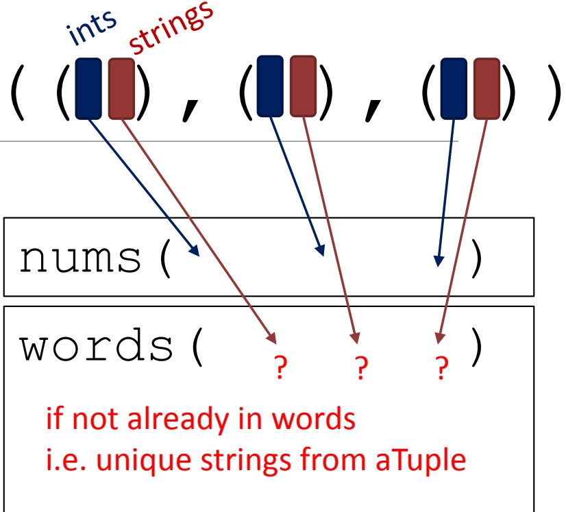
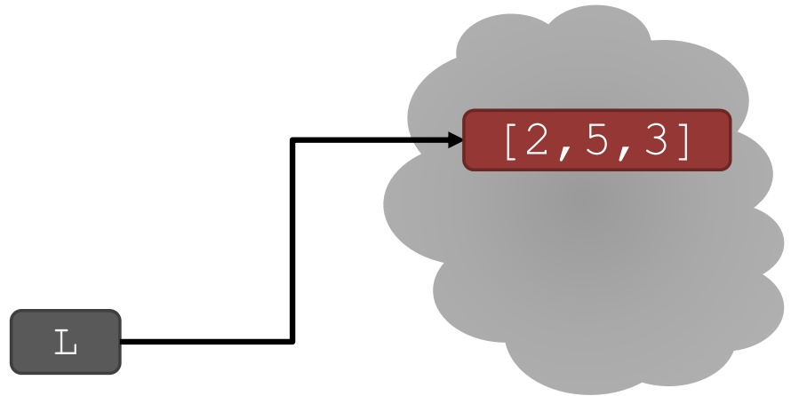
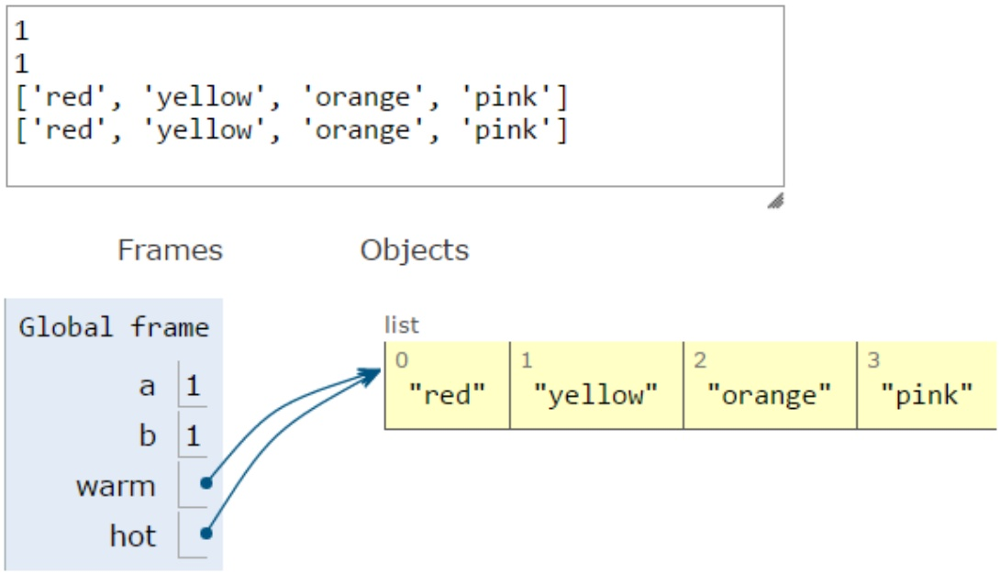
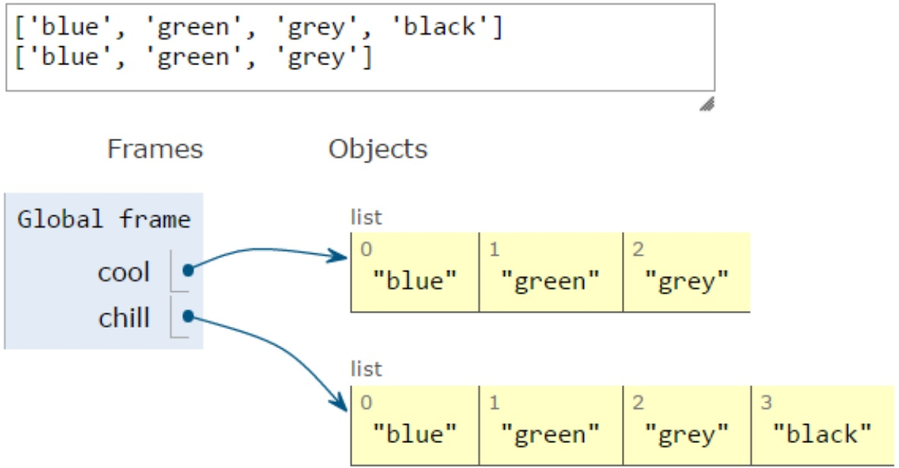
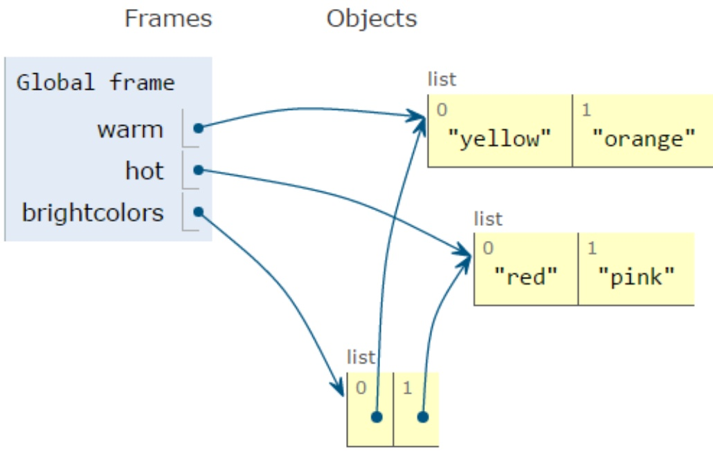

<!-- page: 1 -->

## TUPLES, LISTS, ALIASING, MUTABILITY, CLONING

<u>(download slides and .py files and follow along!)</u>

6.0001 LECTU RE 5

<!-- page: 2 -->

## LAST TIME

functions

decomposition – create structure

abstraction – suppress details

from now on will be using functions a lot

<!-- page: 3 -->

## TODAY

have seen variable types: int, float, bool,string

introduce new **compound data types**

• tuples

• lists

idea of aliasing

idea of mutability

idea of cloning

<!-- page: 4 -->

```txt
■ represented with parentheses
    te = ( ) empty tuple
    t = (2,"mit",3)
    t[0] → evaluates to 2
    (2,"mit",3) + (5,6) → evaluates to (2,"mit",3,5,6)
    t[1:2] → slice tuple, evaluates to ("mit",)
    t[1:3] → slice tuple, evaluates to ("mit",3)
    len(t) → evaluates to 3
    t[1] = 4 → gives error, can't modify object
```

## TUPLES

an ordered sequence of elements, can mix element types

cannot change element values, **immutable**

<!-- page: 5 -->


## TUPLES

conveniently used to **swap** variable values

$$
\mathrm{x} = \mathrm{y}
$$

```txt
temp = x
```

$$
(\mathrm{x}, \mathrm{y}) = (\mathrm{y}, \mathrm{x})
$$

$$
\mathrm{y} = \mathrm{x}
$$


$$
\mathrm{x} = \mathrm{y}
$$

$$
\mathrm{y} = \mathrm{temp}
$$

used to **return more than one value** from a function

def quotient\_and\_remainder (x, y)

$$
\mathrm{q} = \mathrm{x} \boxed {/ /} \mathrm{y}
$$

$$
\mathrm{r} = \mathrm{x}\% \mathrm{y}
$$

$$
\text {return} (q, r)
$$

```txt
(quot, rem) = quotient_and_remainder(4,5)
```

<!-- page: 6 -->

```python
aTuple: ( ( ), ( ), ( )) )
■ can iterate over tuples
def get_data(aTuple):
    nums = ()
    words = ()
    for t in aTuple:
        nums = nums + (t[0],)
        if t[1] not in words:
            words = words + (t[1],)
        min_n = min(nums)
        max_n = max(nums)
        unique_words = len(words)
        return (min_n, max_n, unique_words)
```

## MANIPULATING TUPLES



<!-- page: 7 -->

## LISTS

**ordered sequence** of information, accessible by index

a list is denoted by **square brackets**, []

a list contains **elements**

• usually homogeneous (ie, all integers)

• can contain mixed types (not common)

list elements can be changed so a list is **mutable**

<!-- page: 8 -->

## INDICES AND ORDERING

```txt
a_list = []
empty list
L = [2, 'a', 4, [1,2]]
len(L) → evaluates to 4
L[0] → evaluates to 2
L[2]+1 → evaluates to 5
L[3] → evaluates to [1,2], another list!
L[4] → gives an error
i = 2
L[i-1] → evaluates to 'a' since L[1]='a' above
```

<!-- page: 9 -->

## CHANGING ELEMENTS

lists are **mutable**!

assigning to an element at an index changes the value

$$
\mathsf {L} = [ 2, 1, 3 ]
$$

$$
L [ 1 ] = 5
$$

L is now [2, 5, 3], note this is the **same object** L



<!-- page: 10 -->

## ITERATING OVER A LIST

compute the **sum of elements** of a list

common pattern, iterate over list elements

```python
total = 0
    for i in range(len(L)):
        total += L[i]
    print total
```

## notice

• list elements are indexed 0 to len (L) - 1

• range (n) goes from 0 to n-1

<!-- page: 11 -->

## OPERATIONS ON LISTS - ADD

**add** elements to end of list with L.append(element)

## mutates the list!

```javascript
L = [2, 1, 3]
L.append(5) → L is now [2, 1, 3, 5]
```

## what is the dot?

• lists are Python objects, everything in Python is an object

• objects have data

• objects have methods and functions

• access this information by object\_name.do\_something()

• will learn more about these later

<!-- page: 12 -->

```python
L1 = [2, 1, 3]
L2 = [4, 5, 6]
L3 = L1 + L2
L1.extend([0, 6])
→ L3 is [2, 1, 3, 4, 5, 6]
L1, L2 unchanged
→ mutated L1 to [2, 1, 3, 0, 6]
```

## OPERATIONS ON LISTS - ADD

to combine lists together use **concatenation**, + operator, to give you a new list

**mutate** list with L.extend(some\_list)

<!-- page: 13 -->

## OPERATIONS ON LISTS - REMOVE

delete element at a **specific index** with del(L[index])

remove element at **end of list** with L.pop(), returns the removed element

remove a **specific element** with L.remove(element)

• looks for the element and removes it

• if element occurs multiple times, removes first occurrence

• if element not in list, gives an error

Il these anceration mutate the list

```txt
L = [2,1,3,6,3,7,0] # do below in order
L.remove(2) → mutates L = [1,3,6,3,7,0]
L.remove(3) → mutates L = [1,6,3,7,0]
del(L[1]) → mutates L = [1,3,7,0]
L.pop() → returns 0 and mutates L = [1,3,7]
```

<!-- page: 14 -->

# CONVERT LISTS TO STRINGS AND BACK

convert **string to list** with list(s), returns a list with every character from s an element in L

can use s.split(), to **split a string on a character** parameter, splits on spaces if called without a parameter

use ''.join(L) to turn a **list of characters into a string**, can give a character in quotes to add char between every element

```python
s = "I<3 cs"          → s is a string
list(s)                  → returns ['I', '<', '3', ' ', 'c', 's']
s.split('<')           → returns ['I', '3 cs']
L = ['a','b','c']  → L is a list
''.join(L)               → returns "abc"
''.join(L)               → returns "a_b_c"
```

<!-- page: 15 -->

## OTHER LIST OPERATIONS

sort() and sorted()

reverse()

and many more! [https://docs.python.org/3/tutorial/datastructures.html](https://docs.python.org/3/tutorial/datastructures.html)

```python
L=[9, 6, 0, 3]
sorted(L)          → returns sorted list, does not mutate L
L.sort()           → mutates L=[0, 3, 6, 9]
L.reverse()      → mutates L=[9, 6, 3, 0]
```

<!-- page: 16 -->

## MUTATION, ALIASING, CLONING

IMPORTANT and TRICKY!

**Again, Python Tutor is your best friend to help sort this out!**

[http://www.pythontutor.com/](http://www.pythontutor.com/)

<!-- page: 17 -->

## LISTS IN MEMORY

lists are **mutable**

behave differently than immutable types

is an object in memory

variable name points to object

any variable pointing to that object is affected

key phrase to keep in mind when working with lists is **side effects**

<!-- page: 18 -->

## AN ANALOGY

attributes of a person

◦ singer, rich

he is known by many names

all nicknames point to the **same person**

• add new attribute to **one nickname** …

Justin Bieber <u>singer</u> rich <u>troublemaker</u>

• … **all his nicknames** refer to old attributes AND all new ones

The Bieb

<u>singer</u>

rich

<u>troublemaker</u>

JBeebs

<u>singer</u>

rich

<u>troublemaker</u>

<!-- page: 19 -->

## ALIASES

hot is an **alias** for warm – changing one changes the other!

append() has a side effect

```python
a = 1
b = a
print(a)
print(b)

warm = ['red', 'yellow', 'orange']
hot = warm
hot.append('pink')
print(hot)
print(warm)
```



<!-- page: 20 -->

## CLONING A LIST

## create a new list and copy every element using chill = cool[:]

```lua
cool = ['blue', 'green', 'grey']
chill = cool[:]
chill.append('black')
print(chill)
print(cool)
```



<!-- page: 21 -->

```csv
Global frame
warm
sortedwarm
cool
sortedcool
None
list
0
"orange"
1
"red"
2
"yellow"
list
0
"grey"
1
"green"
2
"blue"
list
0
"blue"
1
"green"
2
"grey"
```

## SORTING LISTS

calling sort() **mutates** the list, returns nothing

calling sorted() **does not mutate** list, must assign result to a variable

```txt
['orange', 'red', 'yellow']
None
['grey', 'green', 'blue']
['blue', 'green', 'grey']
```

```python
warm = ['red', 'yellow', 'orange']
sortedwarm = warm.sort()
print(warm)
print(sortedwarm)

cool = ['grey', 'green', 'blue']
sortedcool = sorted(cool)
print(cool)
print(sortedcool)
```

<!-- page: 22 -->

## LISTS OF LISTS OF LISTS OF….

## can have nested lists

## side effects still possible after mutation

```python
warm = ['yellow', 'orange']
hot = ['red']
brightcolors = [warm]
brightcolors.append(hot)
print(brightcolors)
hot.append('pink')
print(hot)
print(brightcolors)
```

```txt
[['yellow', 'orange'], ['red']]
['red', 'pink']
[['yellow', 'orange'], ['red', 'pink']]
```



<!-- page: 23 -->

# MUTATION AND ITERATION Try this in Python Tutor!

**avoid** mutating a list as you are iterating over it


```python
def remove_dups(L1, L2):
    for e in L1:
        if e in L2:
            L1.remove(e)
```

```txt
L1 = [1, 2, 3, 4]
L2 = [1, 2, 5, 6]
remove_dups(L1, L2)
```


```python
def remove_dups(L1, L2):
    L1_copy = L1[:]
    for e in L1_copy:
        if e in L2:
            L1.remove(e)
```

```txt
■ L1 is [2, 3, 4] not [3, 4] Why?
```

$$
\begin{array}{l} \text {clone list first, note} \\ \text {that L1\_copy = L1} \\ \text {does NOT clone} \end{array}
$$

• Python uses an internal counter to keep track of index it is in the loop

• mutating changes the list length but Python doesn’t update the counter

• loop never sees element 2

<!-- page: 24 -->

6.0001 Introduction to Computer Science and Programming in Python Fall 2016

For information about citing these materials or our Terms of Use, visit: [https://ocw.mit.edu/terms](https://ocw.mit.edu/terms).
