<!-- page: 1 -->

## Lecture 4: Stochastic Thinking and Random Walks

<!-- page: 2 -->

## Relevant Reading

Pages 235-238

Chapter 14

<!-- page: 3 -->

## The World is Hard to Understand

Uncertainty is uncomfortable

But certainty is usually unjustified

<!-- page: 4 -->

## Newtonian Mechanics

Every effect has a cause

The world can be understood causally

<!-- page: 5 -->

## Copenhagen Doctrine

Copenhagen Doctrine (Bohr and Heisenberg) of causal nondeterminism

◦ At its most fundamental level, the behavior of the physical world cannot be predicted.

◦ Fine to make statements of the form “x is highly likely to

◦ occur,” but not of the form “x is certain to occur.”

Einstein and Schrödinger objected

◦ “God does not play dice.” -- Albert Einstein

<!-- page: 6 -->

## Does It Really Matter

Did the flips yield

2 heads

2 tails

1 head and 1 tail?

<!-- page: 7 -->

## The Moral

The world may or may not be inherently unpredictable

But our lack of knowledge does not allow us to make accurate predictions

Therefore we might as well treat the world as inherently unpredictable

Predictive nondeterminism

<!-- page: 8 -->

## Stochastic Processes

An ongoing process where the next state might depend on both the previous states and some random element

```python
def rollDie():
    """ returns an int between 1 and 6"""
```

def rollDie(): """ returns a randomly chosen int between 1 and 6"""

<!-- page: 9 -->

```python
def rollDie():
    """returns a random int between 1 and 6"""
    return random.choice([1,2,3,4,5,6])

def testRoll(n = 10):
    result = ''
    for i in range(n):
        result = result + str(rollDie())
    print(result)
```

## Implementing a Random Process

import random

<!-- page: 10 -->

## Probability of Various Results

Consider testRoll(5)

How probable is the output 11111?

<!-- page: 11 -->

## Probability Is About Counting

Count the number of possible events

Count the number of events that have the property of interest

Divide one by the other

Probability of 11111? ◦ 11111, 11112, 11113, /, 11121, 11122, /, 66666 ◦ 1/(6\*\*5) ◦ \~0.0001286

<!-- page: 12 -->

## Three Basic Facts About Probability

Probabilities are always in the range 0 to 1. 0 if impossible, and 1 if guaranteed.

If the probability of an event occurring is p, the probability of it not occurring must be

When events are [independent](http://en.wikipedia.org/wiki/Independence_%28probability_theory%29) of each other, the probability of all of the events occurring is equal to a product of the probabilities of each of the events occurring.

<!-- page: 13 -->

## Independence

Two events are independent if the outcome of one event has no influence on the outcome of the other

Independence should not be taken for granted

<!-- page: 14 -->

## Will One of the Patriots and Broncos Lose?

Patriots have winning percentage of 7/8, Broncos of 6/8

Probability of both winning next Sunday is 7/8 \* 6/8 = 42/64

Probability of at least one losing is $1 - 42 / 64 = 22 / 64$

What about Sunday, December 18

◦ Outcomes are not independent

◦ Probability of one of them losing is much closer to 1 than to 22/64!

<!-- page: 15 -->

## A Simulation of Die Rolling

```python
def runSim(goal, numTrials, txt):
    total = 0
    for i in range(numTrials):
        result = ''
        for j in range(len(goal)):
            result += str(rollDie())
        if result == goal:
            total += 1
    print('Actual probability of', txt, '=', round(1/(6**len(goal)), 8))
    estProbability = round(total/numTrials, 8)
    print('Estimated Probability of', txt, '=', round(estProbability, 8))

runSim('11111', 1000, '11111')
```

<!-- page: 16 -->

## Output of Simulation

Actual probability = 0.0001286

Estimated Probability = 0.0

Actual probability = 0.0001286

Estimated Probability = 0.0

How did I know that this is what would get printed?

Why did simulation give me the wrong answer?

<u>Let’s try 1,000,000 trials</u>

<!-- page: 17 -->

## Morals

Moral 1: It takes a lot of trials to get a good estimate of the frequency of occurrence of a rare event. We’ll talk lots more in later lectures about how to know when we have enough trials.

Moral 2: One should not confuse the sample probability with the actual probability

Moral 3: There was really no need to do this by simulation, since there is a perfectly good closed form answer. We will see many examples where this is not true.

But simulations are often useful.

<!-- page: 18 -->

## The Birthday Problem

What’s the probability of at least two people in a group having the same birthday

If there are 367 people in the group?

What about smaller numbers?

If we assume that each birthdate is equally likely $1 - \frac{366!}{366^{N}*(366 - N)!}$

Without this assumption, VERY complicated

shoutkey.com/niece

<!-- page: 19 -->

## Approximating Using a Simulation

```python
def sameDate(numPeople, numSame):
    possibleDates = range(366)
    birthdays = [0]*366
    for p in range(numPeople):
        birthDate = random.choice(possibleDates)
        birthdays[birthDate] += 1
    return max(birthdays) >= numSame
```

<!-- page: 20 -->

## Approximating Using a Simulation

```python
def birthdayProb(numPeople, numSame, numTrials):
    numHits = 0
    for t in range(numTrials):
        if sameDate(numPeople, numSame):
            numHits += 1
    return numHits/numTrials

for numPeople in [10, 20, 40, 100]:
    print('For', numPeople,
        'est. prob. of a shared birthday is',
        birthdayProb(numPeople, 2, 10000))
    numerator = math.factorial(366)
    denom = (366**numPeople)*math.factorial(366-numPeople)
    print('Actual prob. for N = 100 =',
        1 - numerator/denom)

Suppose we want the probability of 3 people sharing
```

<!-- page: 21 -->

## Why 3 Is Much Harder Mathematically

For 2 the complementary problem is “all birthdays distinct”

For 3 people, the complementary problem is a complicated disjunct

◦ All birthdays distinct or

◦ One pair and rest distinct or

◦ Two pairs and rest distinct or

◦ /

But changing the simulation is dead easy

<!-- page: 22 -->

## But All Dates Are Not Equally Likely

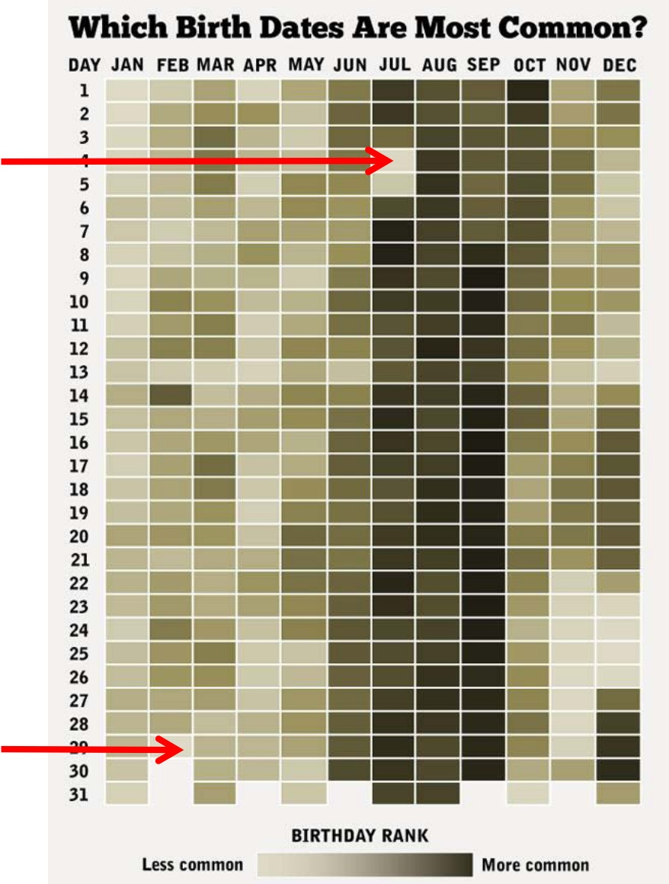

Are you exceptional?

Chart © Matt Stiles / The Daily Viz. All rights reserved. This content is excluded from our Creative Commons license. For more information, see [https://ocw.mit.edu/help/faq-fair-use/](https://ocw.mit.edu/help/faq-fair-use/).

<!-- page: 23 -->

## Another Win for Simulation

Adjusting analytic model a pain

Adjusting simulation model easy

```python
def_sameDate(numPeople, numSame):
    possibleDates = 4*list(range(0, 57)) + [58]\
        + 4*list(range(59, 366))\
        + 4*list(range(180, 270))
    birthdays = [0]*366
    for p in range(numPeople):
        birthDate = random.choice(possibleDates)
        birthdays[birthDate] += 1
    return max(birthdays) >= numSame
```

<!-- page: 24 -->

## Simulation Models

A description of computations that provide useful information about the possible behaviors of the system being modeled

Descriptive, not prescriptive

Only an approximation to reality

“All models are wrong, but some are useful.” – George Box

<!-- page: 25 -->

## Simulations Are Used a Lot

To model systems that are mathematically intractable

To extract useful intermediate results

Lend themselves to development by successive refinement and “what if” questions

Start by simulating random walks

<!-- page: 26 -->

## Why Random Walks?

Random walks are important in many domains

◦ Understanding the stock market (maybe)

◦ Modeling diffusion processes

◦ Etc.

Good illustration of how to use simulations to understand things

Excuse to cover some important programming topics

◦ Practice with classes

◦ More about plotting

OVER 1.5 MILLION COPIES SOLD

ARANDOM WALK DOWN Wall Street


The Time-Tested Strategy for Successful Investing

BURTON G.MALKIEL

COMPLETELY REVISED ORd UPDATED

<!-- page: 27 -->

## Brownian Motion Is a Random Walk

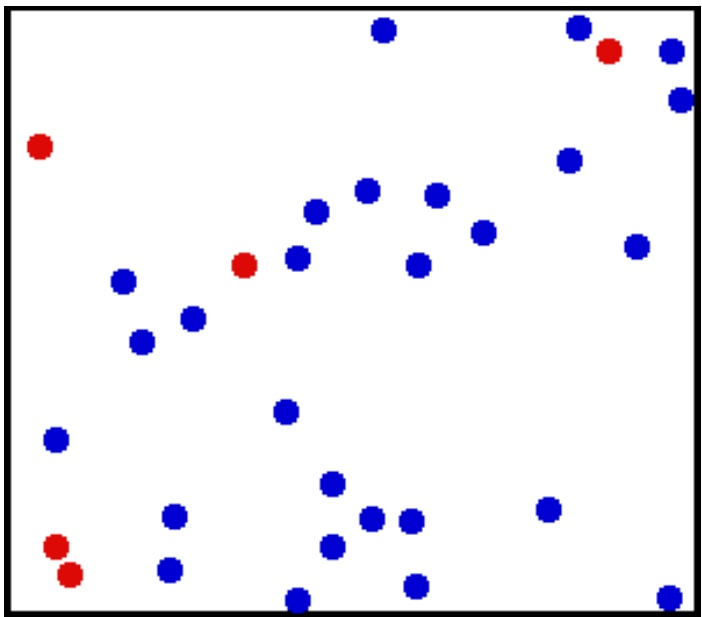

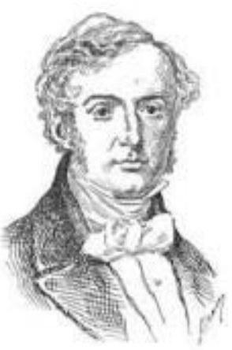

Robert Brown 1827

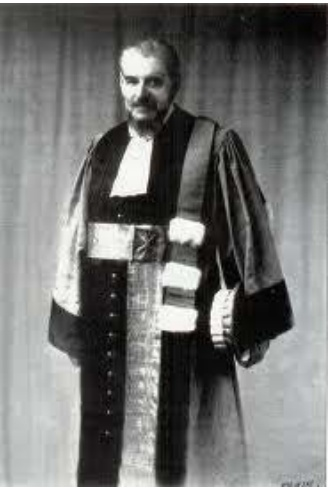

Louis Bachelier 1900

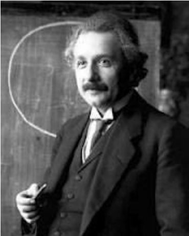

Albert Einstein 1905

Images of Robert Brown and Albert Einstein are in the public domain. Image of Louis Bachelier © unknown. All rights reserved. This content is excluded from our Creative Commons license. For more information, see [https://ocw.mit.edu/help/faq-fair-use/](https://ocw.mit.edu/help/faq-fair-use/).

<!-- page: 28 -->

## Drunkard’s Walk

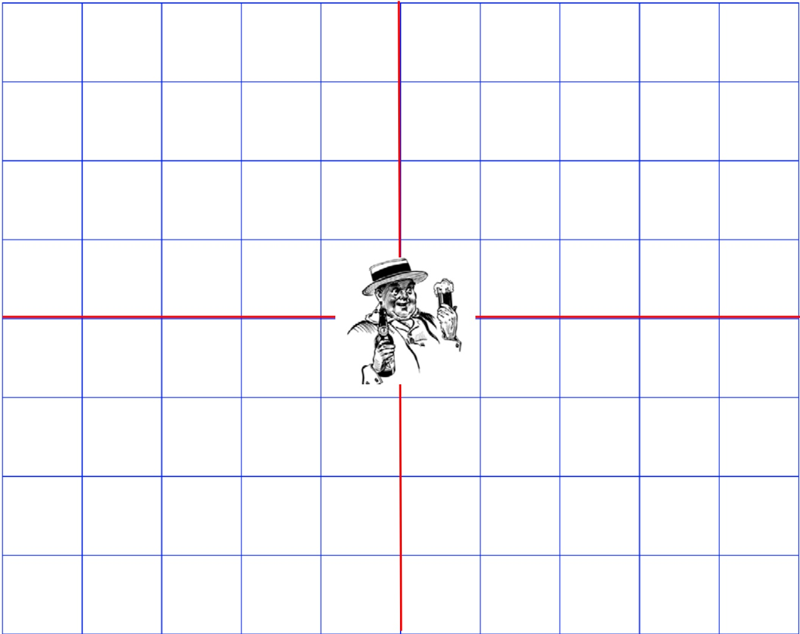

<!-- page: 29 -->

## One Possible First Step

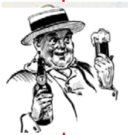

<!-- page: 30 -->

## Another Possible First Step

<table><tr><td></td><td></td><td></td><td></td><td></td><td></td><td></td><td></td><td></td><td></td></tr><tr><td></td><td></td><td></td><td></td><td></td><td></td><td></td><td></td><td></td><td></td></tr><tr><td></td><td></td><td></td><td></td><td></td><td></td><td></td><td></td><td></td><td></td></tr><tr><td></td><td></td><td></td><td rowspan="2" colspan="2">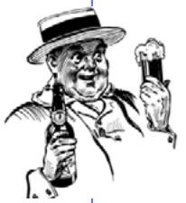</td><td></td><td></td><td></td><td></td><td></td></tr><tr><td></td><td></td><td></td><td></td><td></td><td></td><td></td><td></td></tr><tr><td></td><td></td><td></td><td></td><td></td><td></td><td></td><td></td><td></td><td></td></tr><tr><td></td><td></td><td></td><td></td><td></td><td></td><td></td><td></td><td></td><td></td></tr><tr><td></td><td></td><td></td><td></td><td></td><td></td><td></td><td></td><td></td><td></td></tr></table>

<!-- page: 31 -->

## Yet Another Possible First Step

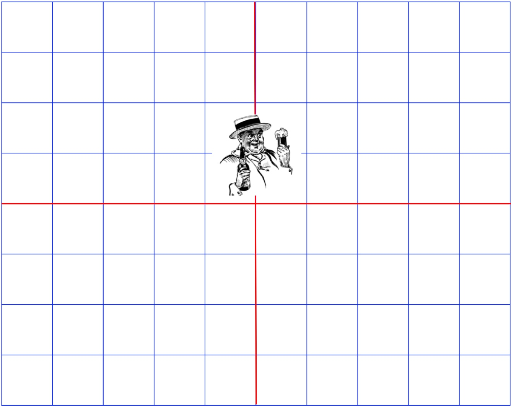

<!-- page: 32 -->

## Last Possible First Step

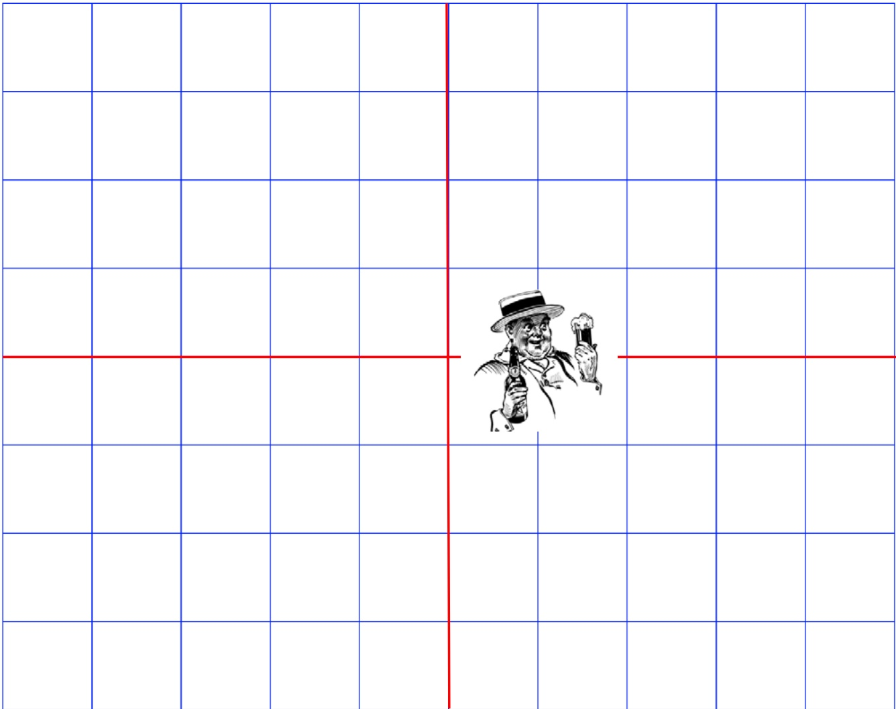

<!-- page: 33 -->

## Possible Distances After Two Steps

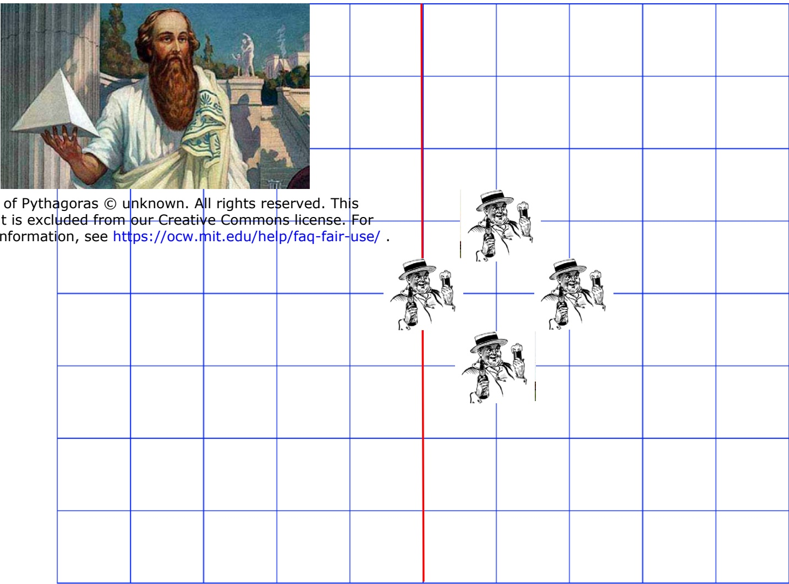

<!-- page: 34 -->

## Expected Distance After 100,000 Steps?

Need a different approach to problem

Will use simulation

But not until the next lecture

<!-- page: 35 -->

6.0002 Introduction to Computational Thinking and Data Science Fall 2016

For information about citing these materials or our Terms of Use, visit: [https://ocw.mit.edu/terms](https://ocw.mit.edu/terms).
