<!-- page: 1 -->

## Lecture	 	 5:	Random Walks

<!-- page: 2 -->

## Relevant Reading

§Chapter 11

§Chapter 14

<!-- page: 3 -->

## Why 	 	 Random Walks?

§Random walks are important in many domains

◦ Understanding the stock market (maybe)

◦ Modeling diffusion processes

◦ Etc.

§Good illustration of how to use simulations	to understand things

§Excuse to cover some important programming topics

◦ Practice with classes

◦ Practice with plotting

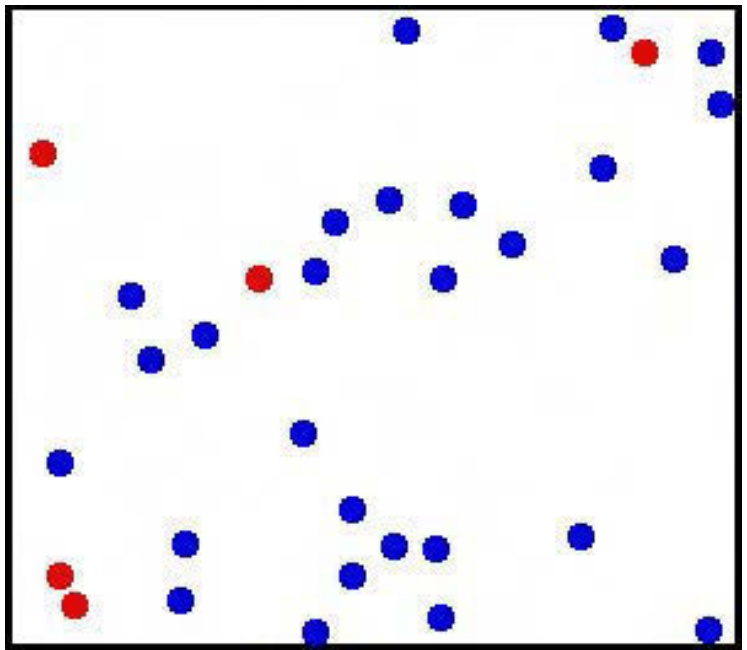

<!-- page: 4 -->

## Drunkard’s Walk

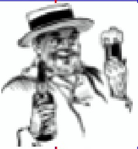

<!-- page: 5 -->

## One 	 	 	 Possible First Step

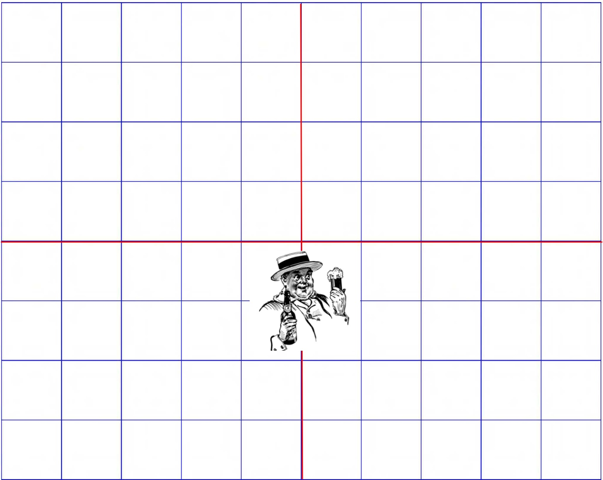

<!-- page: 6 -->

## Another 	 	 	 Possible First Step

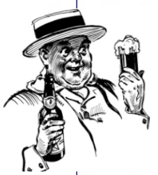

<!-- page: 7 -->

## Yet 	 	 	 	 Another Possible First Step

<table><tr><td></td><td></td><td></td><td></td><td></td><td></td><td></td><td></td><td></td><td></td></tr><tr><td></td><td></td><td></td><td></td><td></td><td></td><td></td><td></td><td></td><td></td></tr><tr><td></td><td></td><td></td><td></td><td rowspan="2">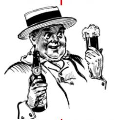</td><td></td><td></td><td></td><td></td><td></td></tr><tr><td></td><td></td><td></td><td></td><td></td><td></td><td></td><td></td><td></td></tr><tr><td></td><td></td><td></td><td></td><td></td><td></td><td></td><td></td><td></td><td></td></tr><tr><td></td><td></td><td></td><td></td><td></td><td></td><td></td><td></td><td></td><td></td></tr><tr><td></td><td></td><td></td><td></td><td></td><td></td><td></td><td></td><td></td><td></td></tr><tr><td></td><td></td><td></td><td></td><td></td><td></td><td></td><td></td><td></td><td></td></tr></table>

<!-- page: 8 -->

<table><tr><td></td><td></td><td></td><td></td><td></td><td></td><td></td><td></td><td></td><td></td></tr><tr><td></td><td></td><td></td><td></td><td></td><td></td><td></td><td></td><td></td><td></td></tr><tr><td></td><td></td><td></td><td></td><td></td><td></td><td></td><td></td><td></td><td></td></tr><tr><td></td><td></td><td></td><td></td><td></td><td colspan="2">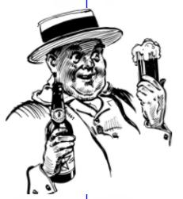</td><td></td><td></td><td></td></tr><tr><td></td><td></td><td></td><td></td><td></td><td></td><td></td><td></td><td></td><td></td></tr><tr><td></td><td></td><td></td><td></td><td></td><td></td><td></td><td></td><td></td><td></td></tr><tr><td></td><td></td><td></td><td></td><td></td><td></td><td></td><td></td><td></td><td></td></tr><tr><td></td><td></td><td></td><td></td><td></td><td></td><td></td><td></td><td></td><td></td></tr></table>

## Last	 	 	 Possible First Step

<!-- page: 9 -->

## Possible 	 	 	 	 Distances After Two Steps

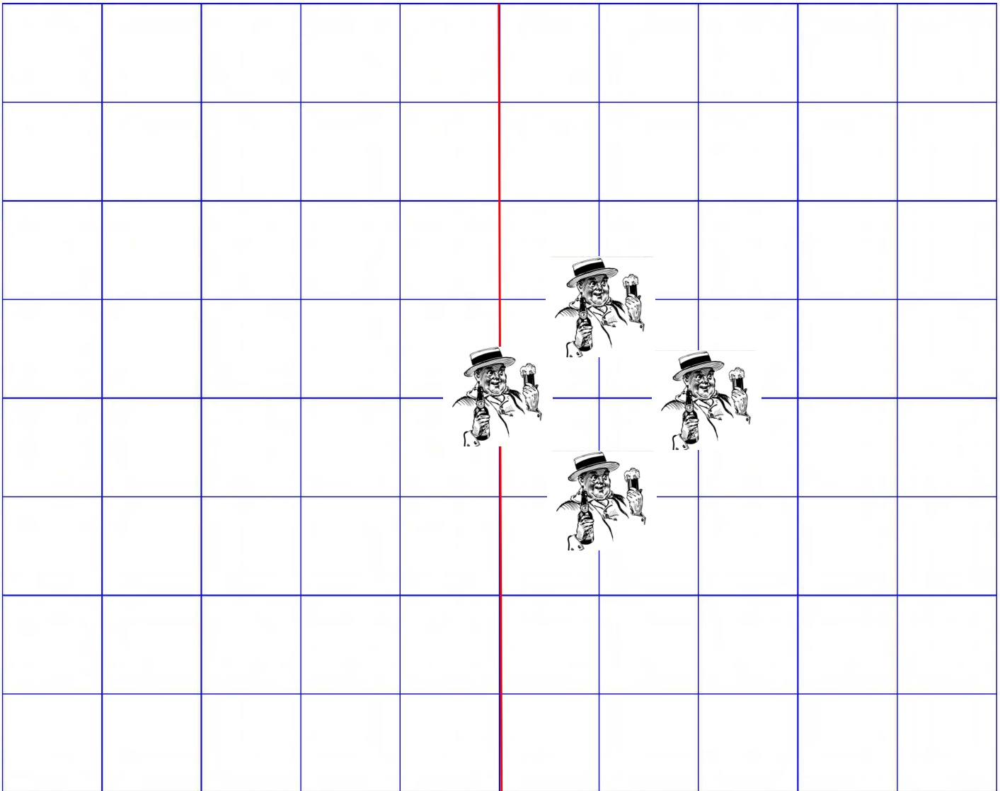

<!-- page: 10 -->

## Expected	 	 Distance After 100,000	 Steps?

§Need a different approach to problem

§Will use simulation

<!-- page: 11 -->

## Structure 	 	 of Simulation

§Simulate one walks of k	steps

§Simulate n such walks

§Report average distance from origin

<!-- page: 12 -->

## First, 	 	 	 Some Useful Abstractions

§Location—a place

§Field—a collection of places and drunks

§Drunk—somebody who wanders from place to place in a field

<!-- page: 13 -->

## Class 	 	 	 Location, part 1

```python
class Location(object):
    def __init__(self, x, y):
        """x and y are floats"""
        self.x = x
        self.y = y

    def move(self, deltaX, deltaY):
        """deltaX and deltaY are floats"""
        return Location(self.x + deltaX,
                             self.y + deltaY)
    def getX(self):
        return self.x
    def getY(self):
        return self.y
```

<!-- page: 14 -->

## Class 	 	 Location, continued

```python
def distFrom(self, other):
    xDist = self.x - other.getX()
    yDist = self.y - other.getY()
    return (xDist**2 + yDist**2)**0.5
```

```python
def __str__(self):
    return '<' + str(self.x) + ', '\n    + str(self.y) + '>'
    return '<' + str(self.x) + ', '\n    + str(self.y) + '>'
```

<!-- page: 15 -->

## Class Drunk

```python
class Drunk(object):
    def __init__(self, name = None):
        """Assumes name is a str"""
        self.name = name

    def __str__(self):
        if self != None:
            return self.name
        return 'Anonymous'

Not intended to be useful on its own
A base class to be inherited
```

<!-- page: 16 -->

## Two 	 	 	 Subclasses of Drunk

§The “usual” drunk,	who wanders around at random

§The “masochistic”	drunk,	who tries to move northward

<!-- page: 17 -->

## Two Kinds of Drunks

```python
import random

class UsualDrunk(Drunk):
    def takeStep(self):
        stepChoices = [(0,1), (0,-1), (1, 0), (-1, 0)]
        return random.choice(stepChoices)

class MasochistDrunk(Drunk):
    def takeStep(self):
        stepChoices = [(0.0,1.1), (0.0,-0.9),
                      (1.0, 0.0), (-1.0, 0.0)]
        return random.choice(stepChoices)
```

Immutable or not?

<!-- page: 18 -->

## Class 	 	 	 Field, part 1

```python
class Field(object):
    def __init__(self):
        self.drunks = {}

    def addDrunk(self, drunk, loc):
        if drunk in self.drunks:
            raise ValueError('Duplicate drunk')
        else:
            self.drunks[drunk] = loc

    def getLoc(self, drunk):
        if drunk not in self.drunks:
            raise ValueError('Drunk not in field')
        return self.drunks[drunk]
```

<!-- page: 19 -->

## Class Field, continued

```python
def moveDrunk(self, drunk):
    if drunk not in self.drunks:
        raise ValueError('Drunk not in field')
    xDist, yDist = drunk.takeStep()
    #use move method of Location to get new location
    self.drunks[drunk] =\
        self.drunks[drunk].move(xDist, yDist)
```

Immutable or not?

<!-- page: 20 -->

## Simulating 	 	 	 a Single Walk

```python
def walk(f, d, numSteps):
    """Assumes: f a Field, d a Drunk in f, and
    numSteps an int >= 0.
    Moves d numSteps times; returns the distance
    between the final location and the location
    at the start of the walk."""
    start = f.getLoc(d)
    for s in range(numSteps):
        f.moveDrunk(d)
    return start.distFrom(f.getLoc(d))
```

<!-- page: 21 -->

## Simulating 	 	 Multiple Walks

```python
def simWalks(numSteps, numTrials, dClass):
    """Assumes numSteps an int >= 0, numTrials an
        int > 0, dClass a subclass of Drunk
        Simulates numTrials walks of numSteps steps
        each. Returns a list of the final distances
        for each trial"""
    Homer = dClass()
origin = Location(0, 0)
distances = []
for t in range(numTrials):
    f = Field()
    f.addDrunk(Homer, origin)
    distances.append(round(walk(f, Homer,
                                numTrials), 1))
return distances
```

<!-- page: 22 -->

## Putting 	 	 	 It All Together

```python
def drunkTest(walkLengths, numTrials, dClass):
    """Assumes walkLengths a sequence of ints >= 0
        numTrials an int > 0,
        dClass a subclass of Drunk
    For each number of steps in walkLengths,
        runs simWalks with numTrials walks and
        prints results"""
    for numSteps in walkLengths:
        distances = simWalks(numSteps, numTrials,
                                    dClass)
        print(dClass.__name__, 'random walk of',
            numSteps, 'steps')
        print(' Mean =',
            round(sum(distances)/len(distances), 4))
        print(' Max =', max(distances),
            'Min =', min(distances))
```

<!-- page: 23 -->

## Let’s 	 	 Try It

```txt
drunkTest((10, 100, 1000, 10000), 100,
UsualDrunk)

UsualDrunk random walk of 10 steps
Mean = 8.634
Max = 21.6 Min = 1.4
UsualDrunk random walk of 100 steps
Mean = 8.57
Max = 22.0 Min = 0.0
UsualDrunk random walk of 1000 steps
Mean = 9.206
Max = 21.6 Min = 1.4
UsualDrunk random walk of 10000 steps
Mean = 8.727
Max = 23.5 Min = 1.4 Plausible?
```

<!-- page: 24 -->

## Let’s 	 	 	 	 Try a Sanity Check

§Try on cases where we think we know the answer ◦ A	very important precaution!

<!-- page: 25 -->

## Sanity Check

```txt
drunkTest((0, 1, 2) 100, UsualDrunk)

UsualDrunk random walk of 0 steps
Mean = 8.634
Max = 21.6 Min = 1.4
UsualDrunk random walk of 1 steps
Mean = 8.57
Max = 22.0 Min = 0.0
UsualDrunk random walk of 2 steps
Mean = 9.206
Max = 21.6 Min = 1.4

distances.append(round(walk(f, Homer,
numTrials), 1))
```

<!-- page: 26 -->

## Let’s 	 	 Try It

```python
drunkTest((10, 100, 1000, 10000), 100,
    UsualDrunk)

UsualDrunk random walk of 10 steps
Mean = 2.863
Max = 7.2 Min = 0.0
UsualDrunk random walk of 100 steps
Mean = 8.296
Max = 21.6 Min = 1.4
UsualDrunk random walk of 1000 steps
Mean = 27.297
Max = 66.3 Min = 4.2
UsualDrunk random walk of 10000 steps
Mean = 89.241
Max = 226.5 Min = 10.0
```

<!-- page: 27 -->

## And 	 	 	 the Masochistic Drunk?

```txt
random.seed(0)
simAll((UsualDrunk, MasochistDrunk),
        (1000, 10000), 100)
UsualDrunk random walk of 1000 steps
Mean = 26.828
Max = 66.3 Min = 4.2
UsualDrunk random walk of 10000 steps
Mean = 90.073
Max = 210.6 Min = 7.2
MasochistDrunk random walk of 1000 steps
Mean = 58.425
Max = 133.3 Min = 6.7
MasochistDrunk random walk of 10000 steps
Mean = 515.575
Max = 694.6 Min = 377.7
```

<!-- page: 28 -->

## Visualizing 	 	 the Trend

§Simulate walks of multiple lengths for each kind of drunk

§Plot distance at end of each length walk for each kind of drunk

<!-- page: 29 -->

## Pylab

§NumPy adds vectors,	matrices,	and many high-level mathematical functions

§SciPy adds mathematical	classes and functions useful to scientists

§MatPlotLib adds an object-oriented API for plotting

§PyLab combines the other libraries to provide a MATLAB- like interface

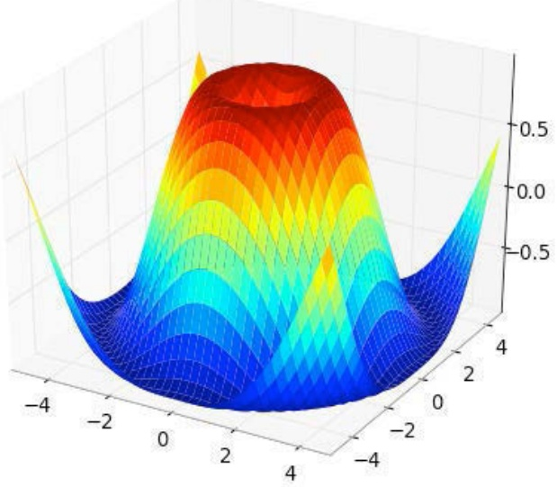

<!-- page: 30 -->

## plot

§The first two arguments to pylab.plot must be sequences of the same length.

§First argument gives x-coordinates.

§Second argument gives y-coordinates.

§Many optional arguments

§Points plotted in order. In default style, as each point is plotted, a line is drawn connecting it to the previous point.

<!-- page: 31 -->

## Example

```python
import pylab

xVals = [1, 2, 3, 4]
yVals1 = [1, 2, 3, 4]
pylab.plot(xVals, yVals1, 'b-', label = 'first')
yVals2 = [1, 7, 3, 5]
pylab.plot(xVals, yVals2, 'r--', label = 'second')
pylab.legend()
```

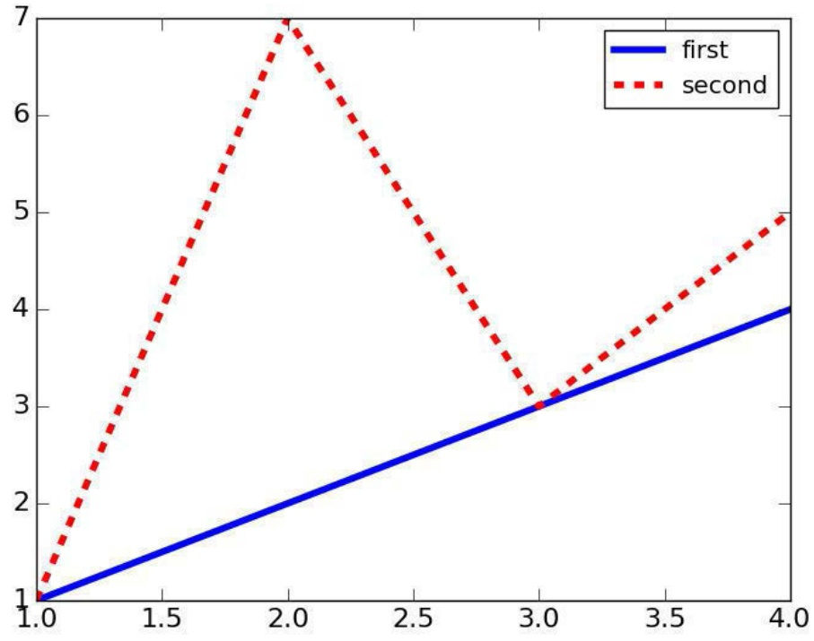

<!-- page: 32 -->

## Details and Many More Examples

§Assigned reading

§Video of Prof. Grimson’s lecture from 6.00x.1

§Code for this lecture

§matplotlib.org/api/pyplot\_summary.html

§www.scipy.org/Plotting\_Tutorial

You should learn how to produce the plots that	I will show you

<!-- page: 33 -->

## Distance Trends

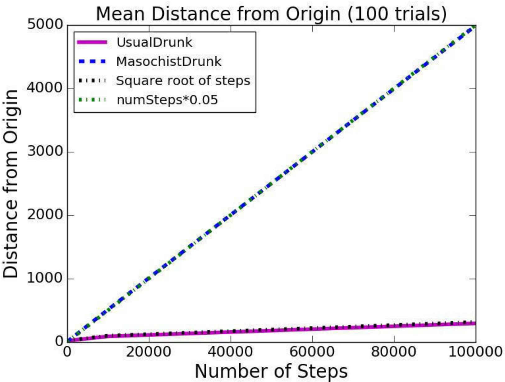

<!-- page: 34 -->

## Ending Locations

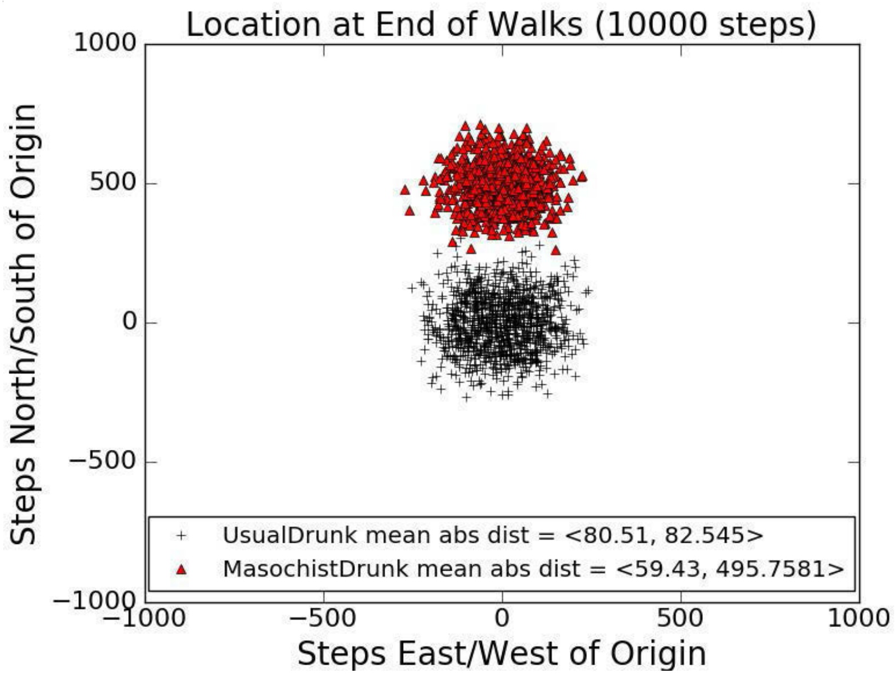

<!-- page: 35 -->

## Fields 	 	 with Wormholes

<!-- page: 36 -->

## A	 Subclass 	 	 	 	 of Field, part 1

```python
class OddField(Field):
    def __init__(self, numHoles = 1000,
                      xRange = 100, yRange = 100):
        Field.__init__(self)
        self.wormholes = {}
        for w in range(numHoles):
            x = random.randint(-xRange, xRange)
            y = random.randint(-yRange, yRange)
            newX = random.randint(-xRange, xRange)
            newY = random.randint(-yRange, yRange)
            newLoc = Location(newX, newY)
            self.wormholes[(x, y)] = newLoc
```

<!-- page: 37 -->

## A	 Subclass 	 	 	 	 of Field, part 2

```python
def moveDrunk(self, drunk):
    Field.moveDrunk(self, drunk)
    x = self.drunks[drunk].getX()
    y = self.drunks[drunk].getY()
    if (x, y) in self.wormholes:
        self.drunks[drunk] = self.wormholes[(x, y)]
```

<!-- page: 38 -->

## Spots 	 	 	 	 Reached During One Walk

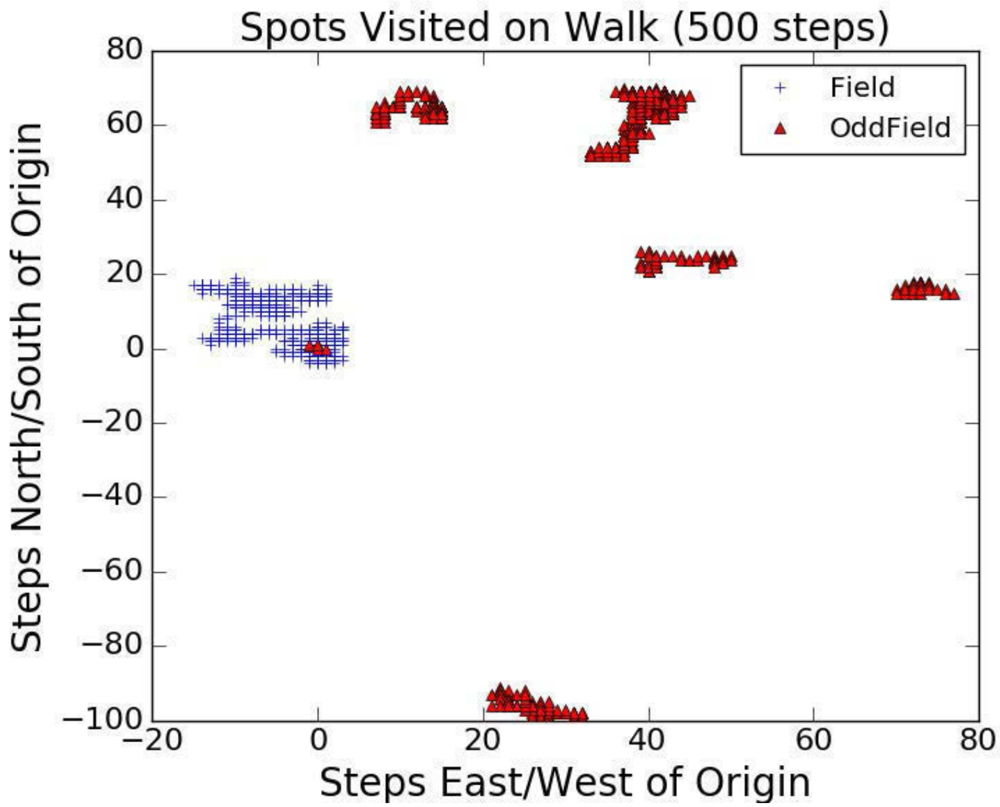

<!-- page: 39 -->

## Summary

§Point is not the simulations themselves, but how we built them

§Started by defining classes

§Built functions corresponding to

◦ One trial, multiple trials, result reporting

§Made	series	of incremental changes	to simulation so that	we could investigate different	questions

◦ Get simple version working	first

◦ Did a sanity check!

◦ Elaborate a step at a time

§Showed how to use plots to get insights

<!-- page: 40 -->

6.0002 Introduction to Computational Thinking and Data Science Fall 2016

For information about citing these materials or our Terms of Use, visit: [https://ocw.mit.edu/terms](https://ocw.mit.edu/terms).
