<!-- page: 1 -->

## Lecture:	 	 	 Sampling and Standard Error

<!-- page: 2 -->

## Announcements

§Relevant reading: Chapter 17

§No lecture Wednesday of next week!

<!-- page: 3 -->

## Recall 	 	 Inferential Statistics

§Inferential statistics: making inferences about a populations by examining one or more random samples	drawn	from that population

§With Monte Carlo simulation we can generate lots of random samples, and use them to compute confidence intervals

§But suppose we can’t create samples by simulation? ◦ “According to the most recent poll Clinton leads Trump by 3.2	percentage points in	swing states. The registered voter sample is 835 with with a margin of error of plus or minus 4 percentage	points.” – October 2016

<!-- page: 4 -->

## Probability Sampling

§Each member of the population has a nonzero probability of being included	in	a sample

§Simple random sampling:	each	member	has	an	equal chance of	being chosen

§Not always appropriate

◦ Are MIT undergraduates nerds?

◦ Consider a random sample of 100	students

<!-- page: 5 -->

## Stratified Sampling

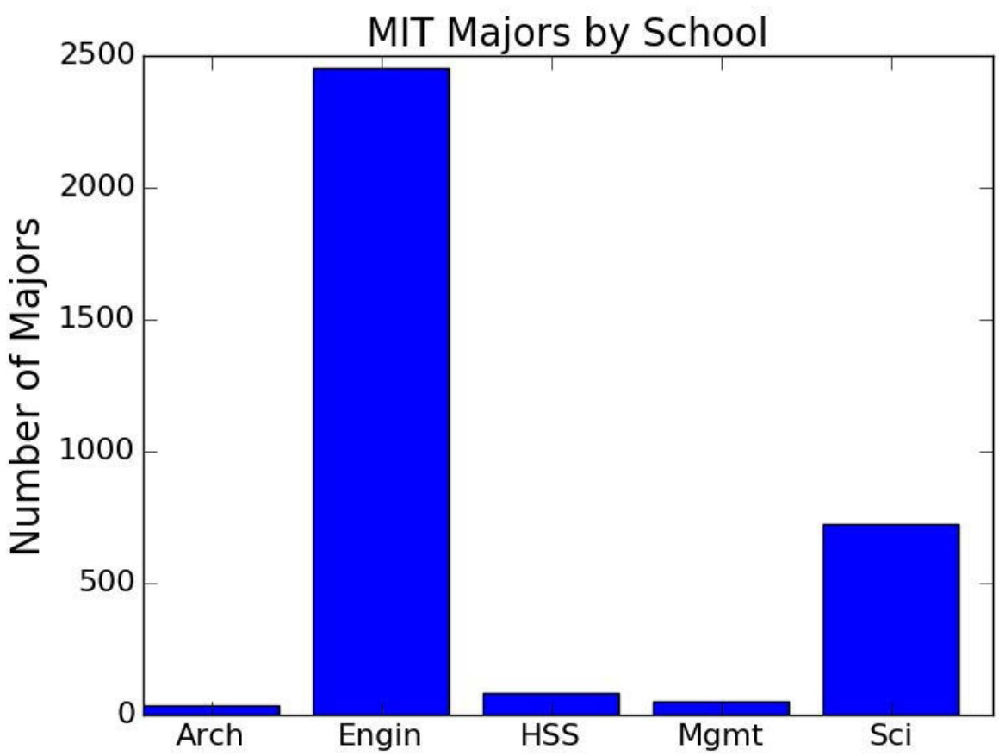

## §Stratified sampling

◦ Partition population into subgroups

◦ Take a simple random sample from each subgroup

<!-- page: 6 -->

## Stratified Sampling

§When there are small subgroups that should be represented

§When it is important that subgroups be represented proportionally to their size in	the population

§Can be used to reduced the needed size of sample ◦ Variability of subgroups less than of entire population

§Requires care to do properly

§Well stick to simple random samples

<!-- page: 7 -->

## Data

## §From U.S. National Centers for Environmental Information (NCEI)

§Daily high	and	low temperatures for

◦ 21	different US cities

◦ ALBUQUERQUE, BALTIMORE, BOSTON, CHARLOTTE, CHICAGO, DALLAS, DETROIT, LAS VEGAS, LOS ANGELES, MIAMI, NEW ORLEANS, NEW YORK,	PHILADELPHIA,	PHOENIX,	PORTLAND,	SAN	DIEGO,	SAN FRANCISCO, SAN JUAN, SEATTLE, ST LOUIS, TAMPA

◦ 1961	– 2015

◦ 421,848	data points	(examples)

§Let’s use some code to look at the data

<!-- page: 8 -->

## New in	Code

§numpy.std is function in the numpy module that returns the standard deviation

§random.sample(population, sampleSize) returns a list containing sampleSize randomly chosen distinct elements of population ◦ Sampling without replacement

<!-- page: 9 -->

## Histogram 	 	 of Entire	 Population

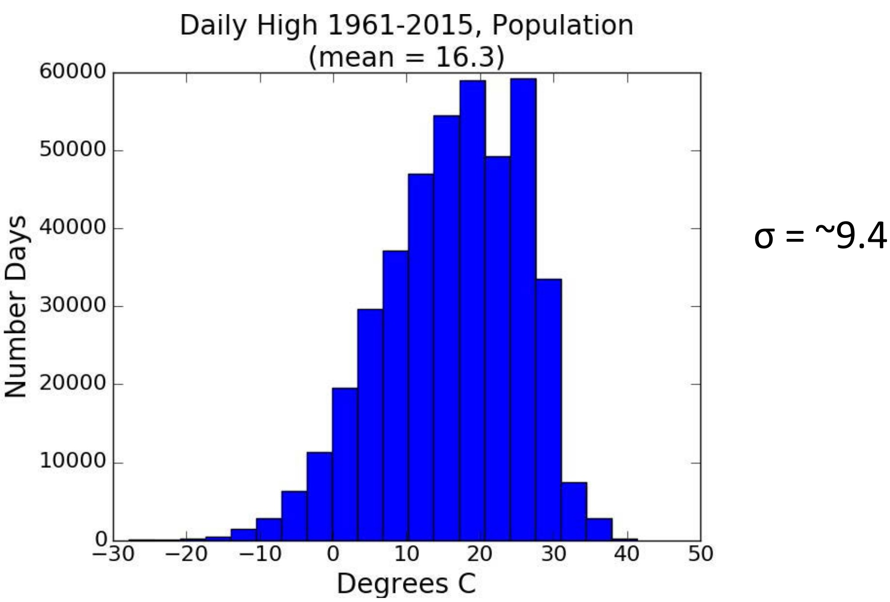

<!-- page: 10 -->

## Histogram 	 	 of Random 	Sample	of	Size 100

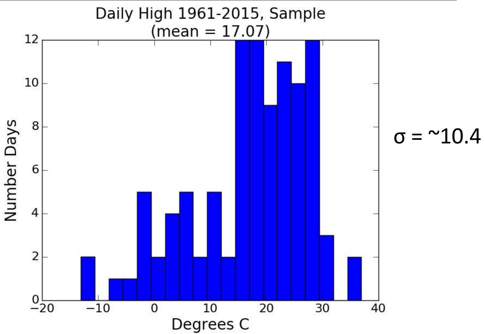

<!-- page: 11 -->

## Means	 and 	 	 Standard Deviations

§Population mean = 16.3

§Sample mean = 17.1

§Standard deviation of population = 9.44

§Standard deviation	of sample = 10.4

§A	happy accident, or something we should expect?

§Let’s try	it 1000 times and plot the results

<!-- page: 12 -->

## New in	Code

§pylab.axvline(x = popMean,	color	= 'r')	draws a red vertical line at popMean on the x-axis

§There’s also a pylab.axhline function

<!-- page: 13 -->

## Try 	 	 	 It 1000 Times

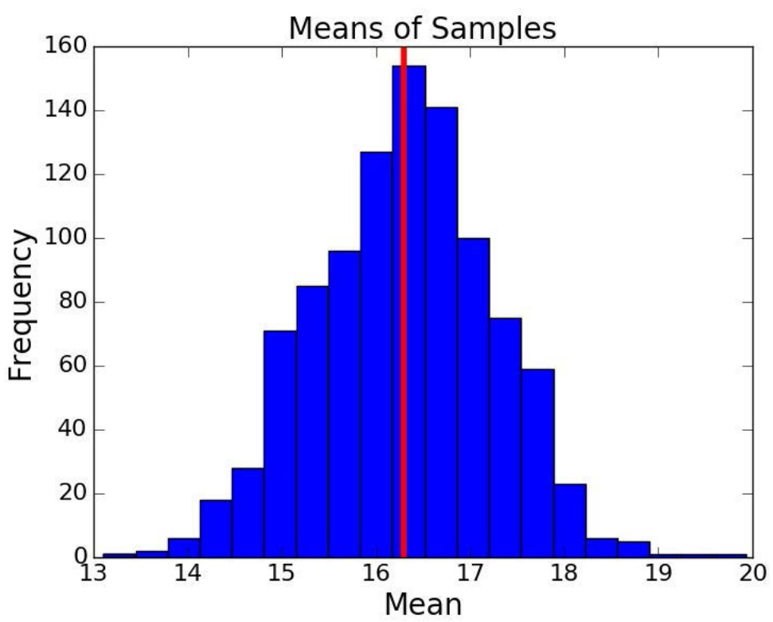

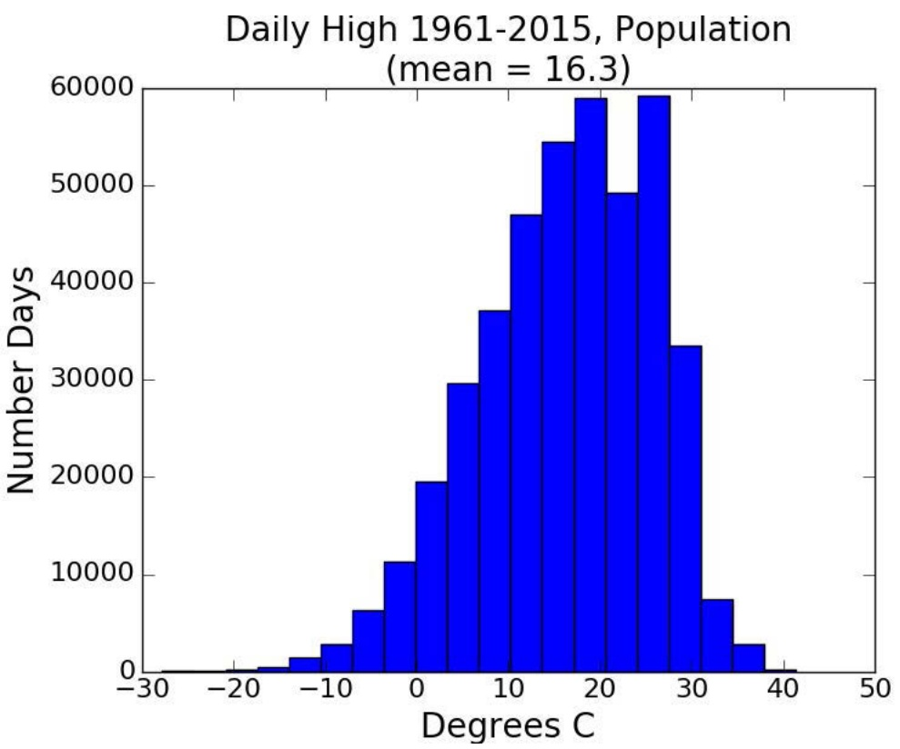

<!-- page: 14 -->

Mean of sample Means = 16.3 Standard deviation of sample means = 0.94

## Try It 1000 Times

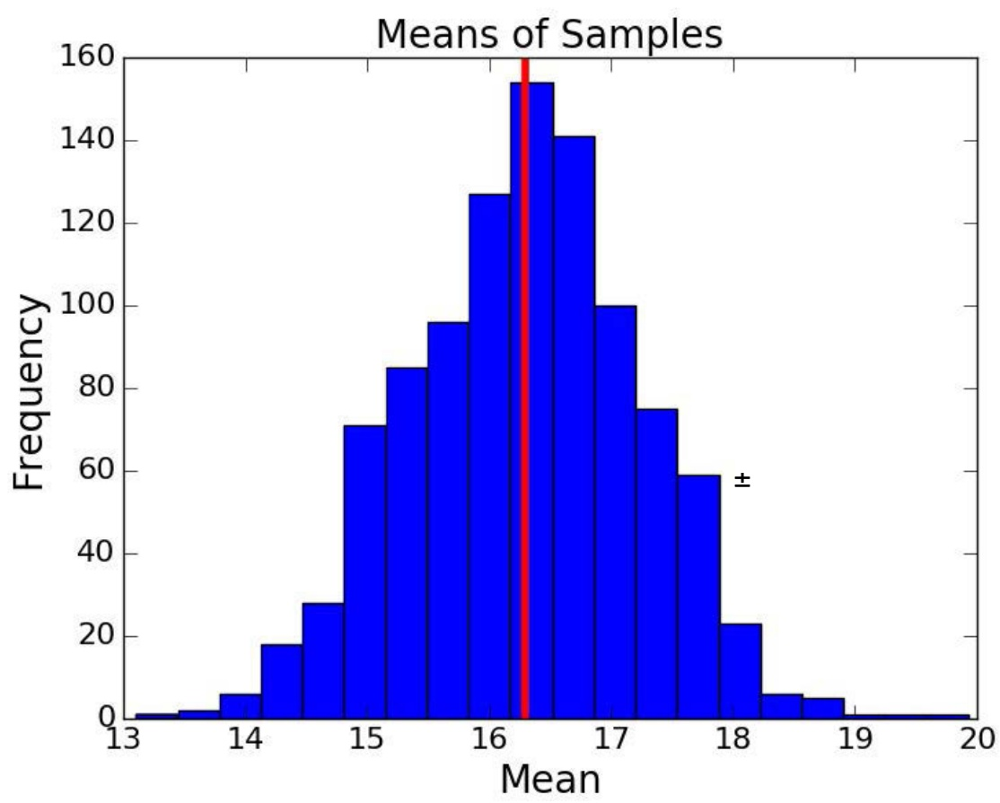

What’s	the 95% confidence interval?

Suppose we want a tighter bound?

$$
\begin{array}{l} 1 6. 2 8 + - 1. 9 6 ^ {*} 0. 9 4 \\ 1 4. 5 - 1 8. 1 \end{array}
$$

Includes population mean, but pretty wide

<!-- page: 15 -->

## Getting	 	 a	Tighter Bound

§Will drawing more samples help?

◦ Let’s try	increasing from 1000 to 2000

◦ Standard deviation goes from 0.943 to 0.946

§How about larger samples?

◦ Let’s try	increasing sample size from 100 to 200

◦ Standard deviation goes from 0.943 to 0.662

<!-- page: 16 -->

## Error Bars, a Digression

§Graphical representation of the variability of data

§Way to visualize uncertainty

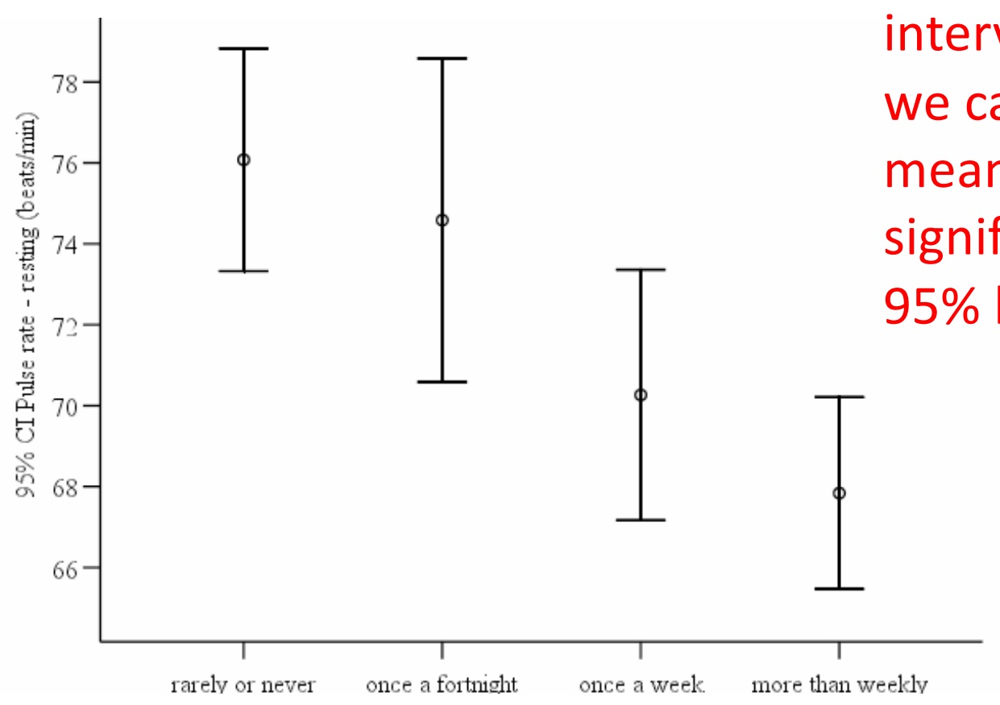

When confidence intervals don’t	overlap, we can conclude that means are	statistically significantly different at 95% level.

[https://upload.wikimedia.org/wikipedia/commons/1/1d/Pulse\_Rate\_Error\_Bar\_By\_Exercise\_Level.png](https://upload.wikimedia.org/wikipedia/commons/1/1d/Pulse_Rate_Error_Bar_By_Exercise_Level.png)

<!-- page: 17 -->

## Let’s	 	 	 	 	 Look at	Error Bars for Temperatures

```txt
pylab.errorbar(xVals, sizeMeans,
yerr = 1.96*pylab.array(sizeSDs),
fmt = 'o',
label = '95% Confidence Interval')
```

<!-- page: 18 -->

## Sample 	 	 	 	 Size and Standard Deviation

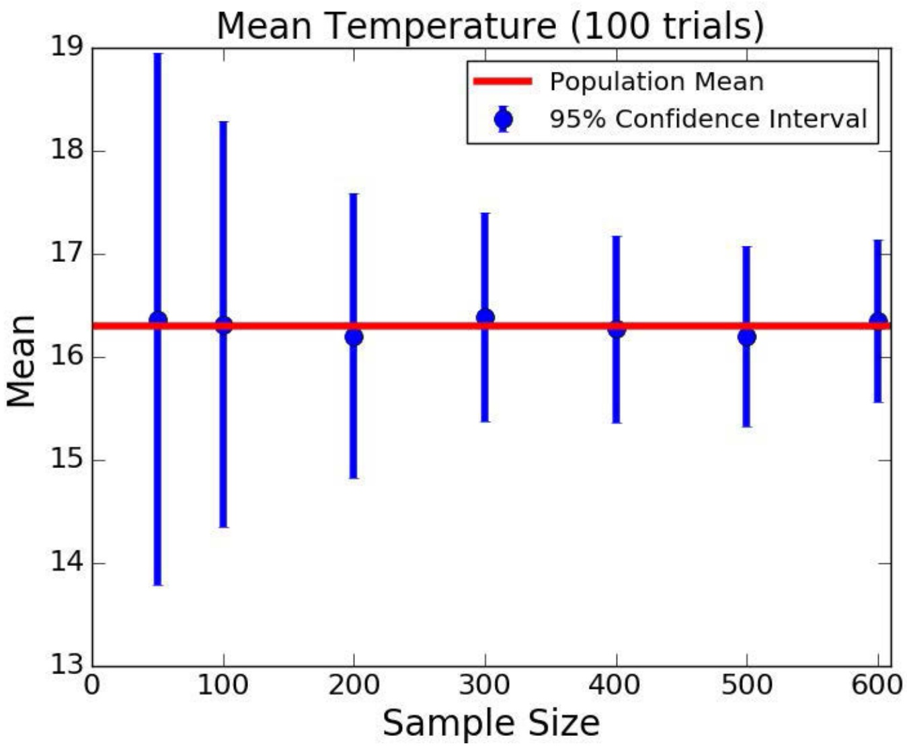

<!-- page: 19 -->

## Larger	 	 	 	 Samples Seem	to Be Better

§Going from a	sample size of	50 to 600	reduced the confidence interval from about 1.2C to about 0.34C.

§But we are now looking at 600\*100	=	600k examples ◦ What has sampling bought us?

◦ Absolutely Nothing!

◦ Entire population contained \~422k	samples

<!-- page: 20 -->

## What	Can	 We 	 	 	 Conclude from	1 Sample?

§More than you might think

§Thanks to the Central Limit Theorem

<!-- page: 21 -->

## Recall 	 	 	 Central Limit Theorem

§Given a sufficiently large sample:

◦1) The means	of the samples	in a set of samples	(the sample means) will be approximately normally distributed,

◦2) This	normal distribution will have a mean close to the mean	the	population, and

◦3) The variance of the sample means	will be close to the variance of the population divided by the sample size.

§Time to use the 3<sup>rd</sup> feature

§Compute standard error of the mean (SEM or SE)

<!-- page: 22 -->

## Standard 	 	 	 Error	 of the Mean

$$
S E = \frac {\sigma}{\sqrt {n}}
$$

def sem(popSD, sampleSize): return popSD/sampleSize\*\*0.5

§Does it work?

<!-- page: 23 -->

## Testing 	 	 the SEM

```python
sampleSizes = (25, 50, 100, 200, 300, 400, 500, 600)
numTrials = 50
population = getHighs()
popSD = numpy.std(population)
sems = []
sampleSDs = []
for size in sampleSizes:
    sems.append(sem(popSD, size))
    means = []
    for t in range(numTrials):
        sample = random.sample(population, size)
        means.append(sum(sample)/len(sample))
    sampleSDs.append(numpy.std(means))
pylab.plot(sampleSizes, sampleSDs,
            label = 'Std of ' + str(numTrials) + ' means')
pylab.plot(sampleSizes, sems, 'r--', label = 'SEM')
pylab.xlabel('Sample Size')
pylab.ylabel('Std and SEM')
pylab.title('SD for ' + str(numTrials) + ' Means and SEM')
pylab.legend()
```

<!-- page: 24 -->

## Standard Error	 of the Mean

$$
S E = \frac {\sigma}{\sqrt {n}}
$$

But, we don’t know	standard deviation	of population

How might we approximate it?

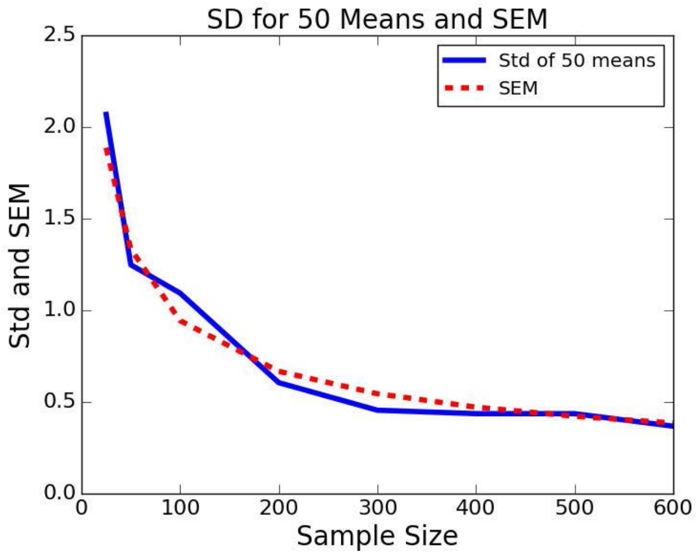

<!-- page: 25 -->

## Sample 	 	 SD vs.	 Population SD

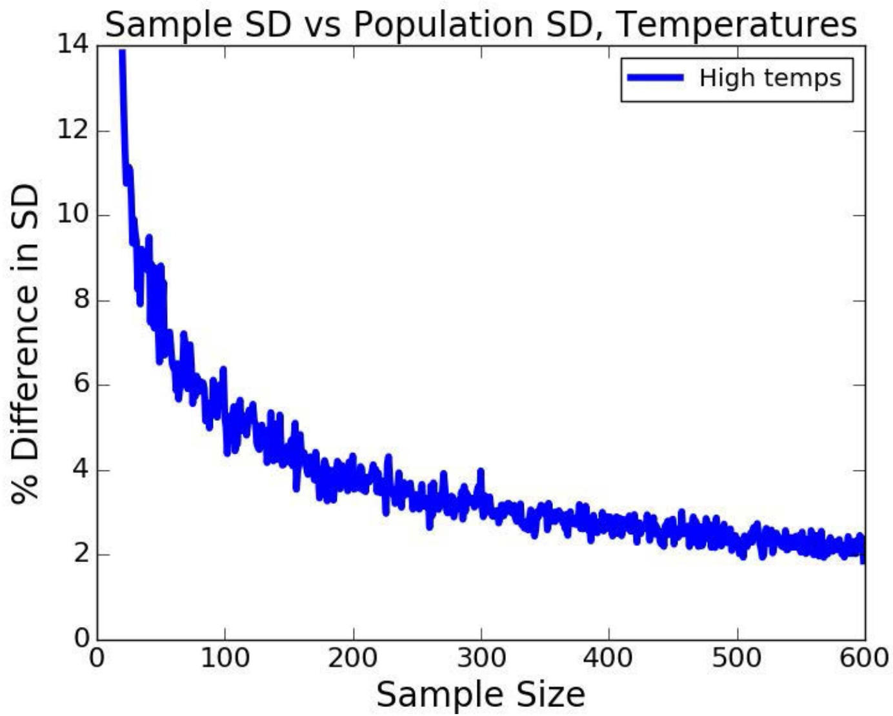

<!-- page: 26 -->

## The	Point

§Once sample reaches a reasonable size, sample standard deviation is a pretty good approximation to population	standard	deviation

§True only for this example?

◦ Distribution	of population?

◦ Size of population?

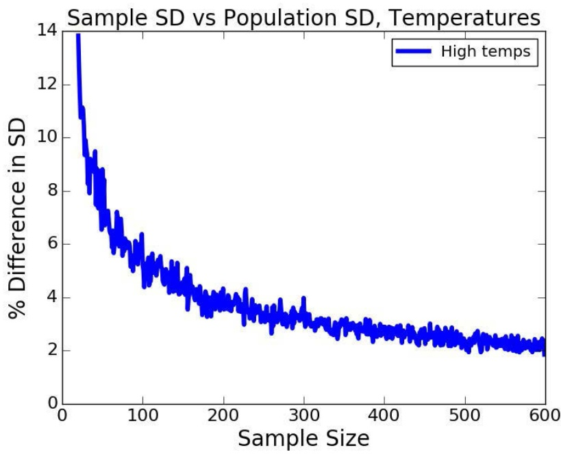

<!-- page: 27 -->

## Looking at	Distributions

```python
def plotDistributions():
    uniform, normal, exp = [], [], []
    for i in range(100000):
        uniform.append(random.random())
        normal.append(random.gauss(0, 1))
        exp.append(random.expovariate(0.5))
    makeHist(uniform, 'Uniform', 'Value', 'Frequency')
    pylab.figure()
    makeHist(normal, 'Gaussian', 'Value', 'Frequency')
    pylab.figure()
    makeHist(exp, 'Exponential', 'Value', 'Frequency')
```

<!-- page: 28 -->

## Three	Different 	Distributions

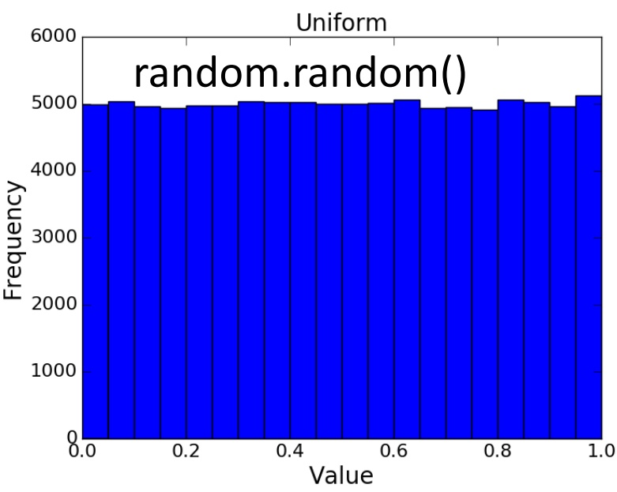

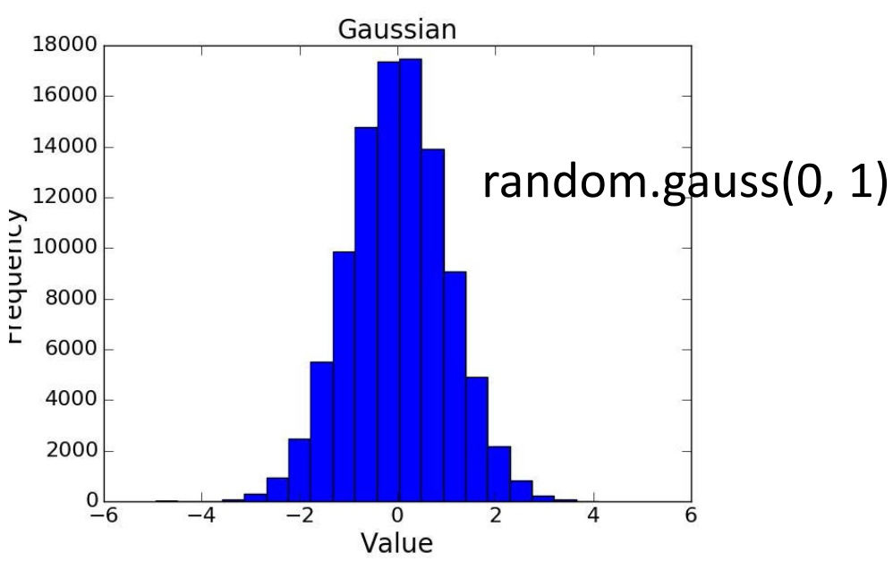

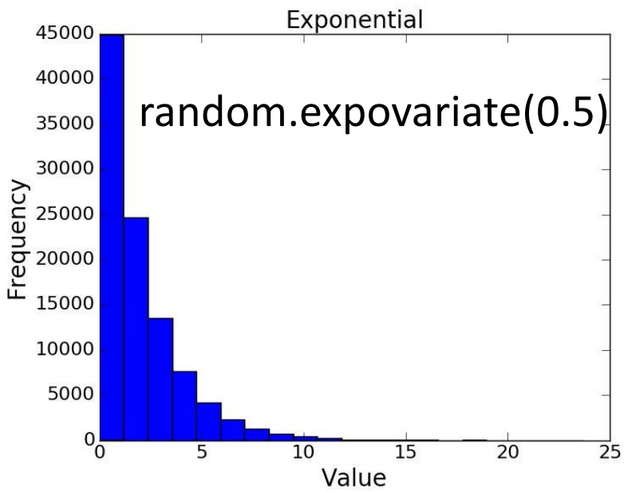

<!-- page: 29 -->

## Does Distribution	Matter?

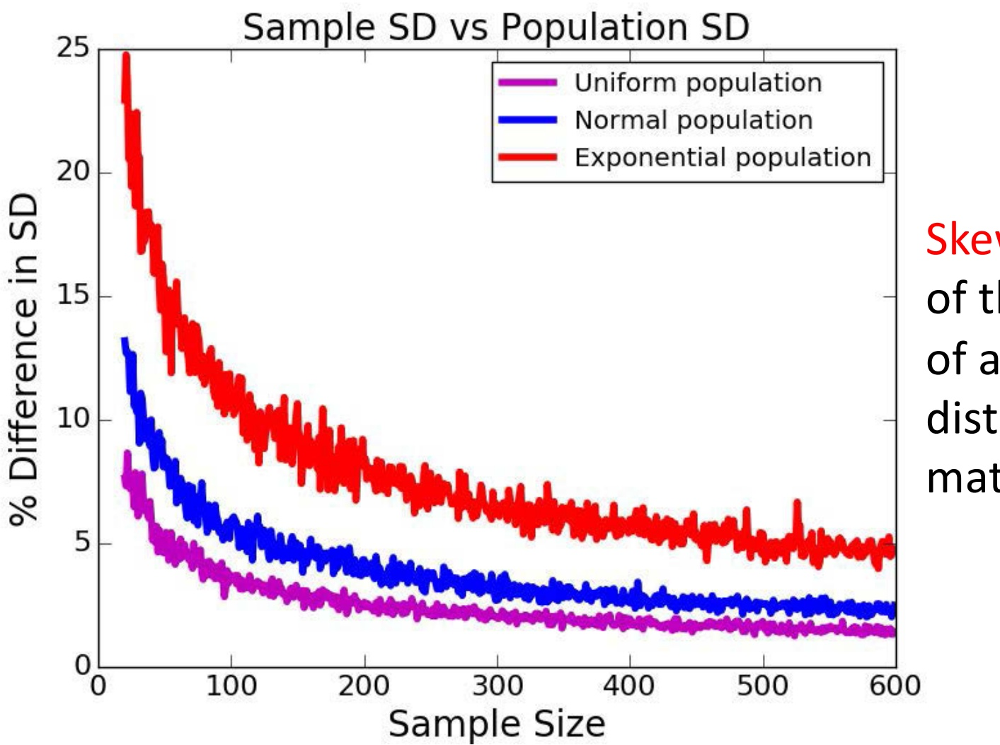

Skew, a	measure of	the asymmetry of	a probability distribution, matters

<!-- page: 30 -->

## Does Population	Size Matter?

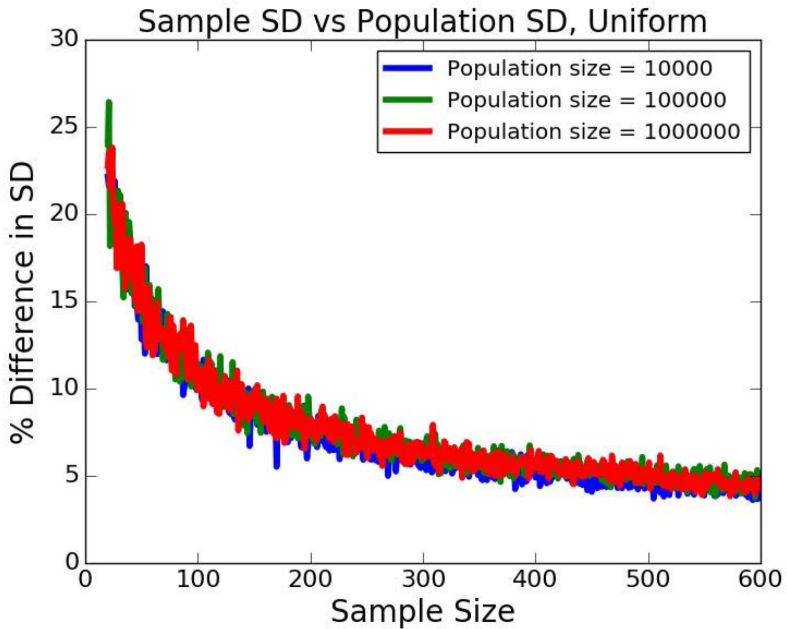

<!-- page: 31 -->

## To Estimate Mean from a Single Sample

§1) Choose	sample	size	based on estimate	of skew in population

§2) Chose	a random sample	from the	population

§3)	Compute the mean and standard deviation of that sample

§4)	Use the standard deviation of that sample to estimate	the	SE

§5)	Use the estimated SE to generate confidence intervals around the sample mean

Works great when we choose independent random samples.

Not always so easy to do, as political pollsters keep	learning.

<!-- page: 32 -->

## Are	200 	Samples	Enough?

```python
numBad = 0
for t in range(numTrials):
    sample = random.sample(temps, sampleSize)
    sampleMean = sum(sample)/sampleSize
    se = numpy.std(sample)/sampleSize**0.5
    if abs(popMean - sampleMean) > 1.96*se:
        numBad += 1
print('Fraction outside 95% confidence interval =',
    numBad/numTrials)
```

Fraction outside 95% confidence interval = 0.0511

<!-- page: 33 -->

6.0002 Introduction to Computational Thinking and Data Science Fall 2016

For information about citing these materials or our Terms of Use, visit: [https://ocw.mit.edu/terms](https://ocw.mit.edu/terms).
