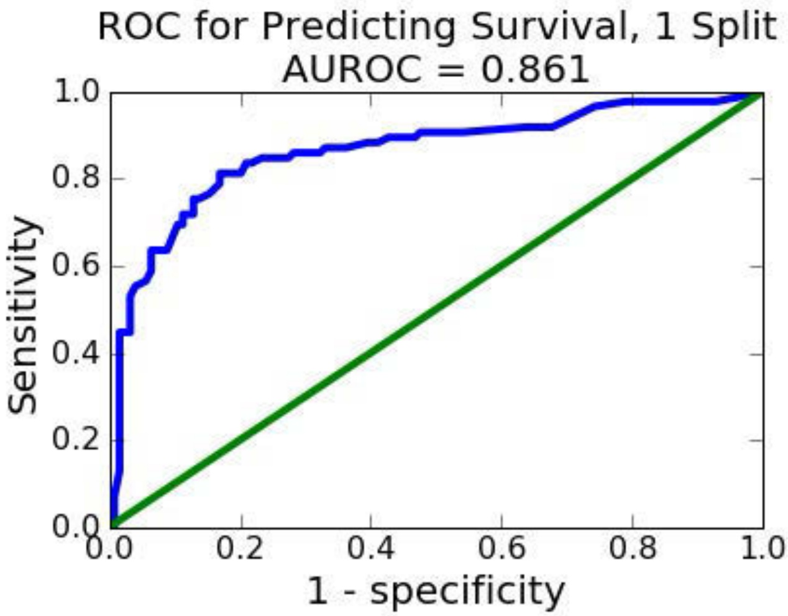
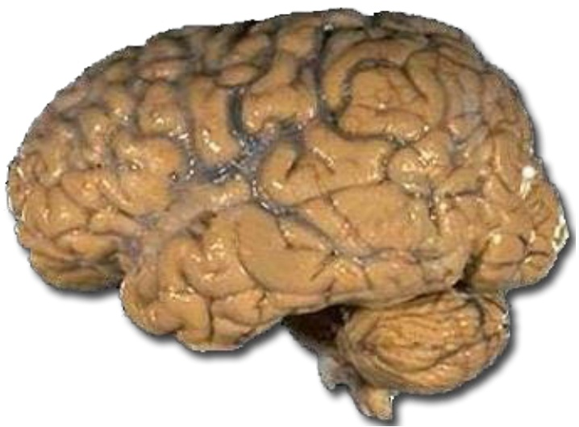
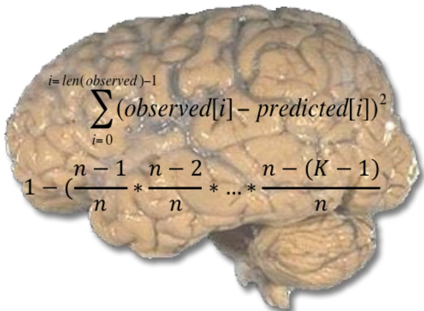
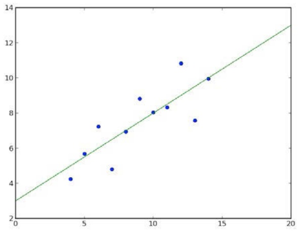
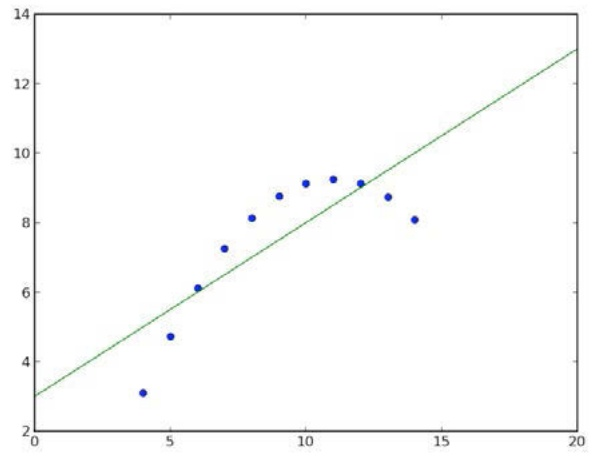
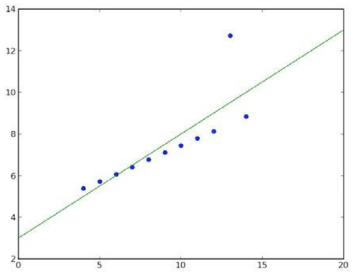
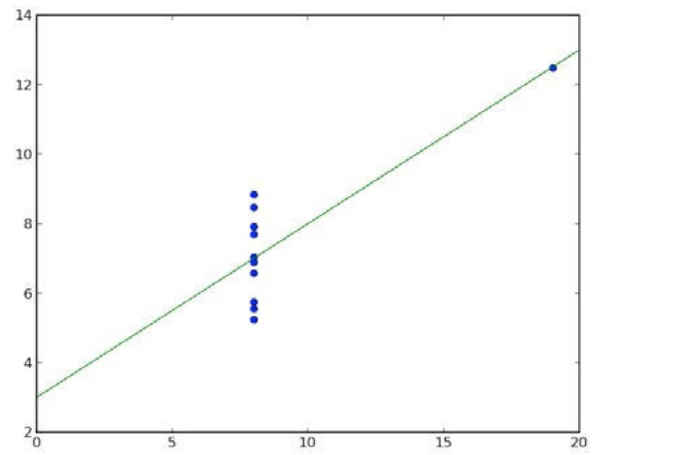
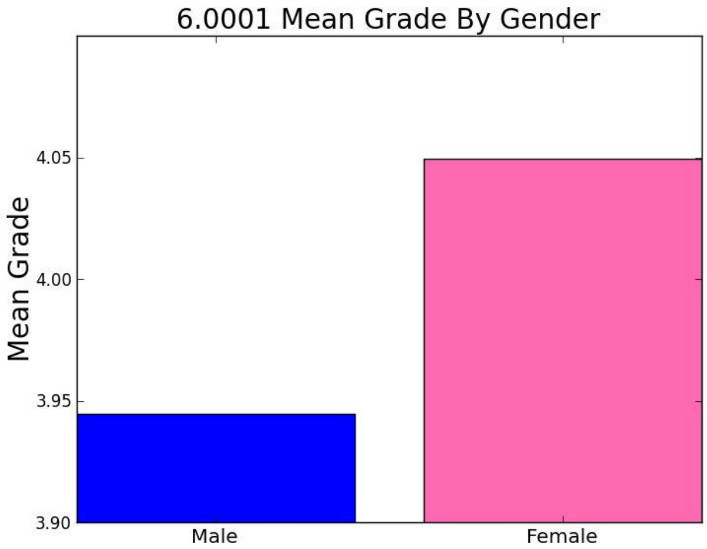
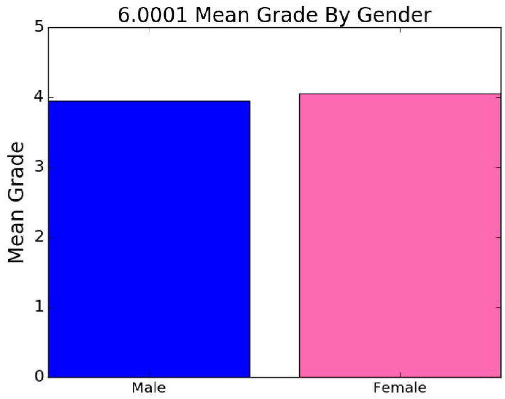

<!-- page: 1 -->

## Lecture	14: Classification, Statistical Sins

<!-- page: 2 -->

## Announcements

§Reading

◦ Chapter	21

§Course	evaluations

◦ Online evaluation now through noon on Friday, December	16

§Will	be	making	study	code	for	final	exam	available	later today

<!-- page: 3 -->

## Compare	to	KNN 	Results	(from 	Monday)

```txt
Average of 10 80/20 splits using KNN (k=3) Average of 10 80/20 splits LR
Accuracy = 0.744 Accuracy = 0.804
Sensitivity = 0.629 Sensitivity = 0.719
Specificity = 0.829 Specificity = 0.859
Pos. Pred. Val. = 0.728 Pos. Pred. Val. = 0.767
Average of LOO testing using KNN (k=3) Average of LOO testing using LR
Accuracy = 0.769 Accuracy = 0.786
Sensitivity = 0.663 Sensitivity = 0.705
Specificity = 0.842 Specificity = 0.842
Pos. Pred. Val. = 0.743 Pos. Pred. Val. = 0.754
```

## Performance	not	much	difference Logistic	regression	slightly	better

Logistic	regression	provides	insight	about	variables

<!-- page: 4 -->

## Looking at	F eature Weights

```txt
model.classes_ = ['Died' 'Survived']
For label Survived
    C1 = 1.66761946545
    C2 = 0.460354552452
    C3 = -0.50338282535
    age = -0.0314481062387
    male gender = -2.39514860929
```

L1 regression tends to drive one variable to zero

L2 (default) regression spreads weights across variables

<!-- page: 5 -->

## Correlated 	Features,	a n 	Example

```python
■c1 + c2 + c3 = 1
    - l.e., values are not independent
    - Is being in 1st class good, or being in the other classes bad?

■Suppose we eliminate c1?

    def __init__(self, pClass, age, gender, survived, name):
        self.name = name
        if pClass == 2:
            self.featureVec = [1, 0, age, gender]
        elif pClass == 3:
            self.featureVec = [0, 1, age, gender]
        else:
            self.featureVec = [0, 0, age, gender]
        self.label = survived
        self.cabinClass = pClass
```

<!-- page: 6 -->

## Comparative	Results

```txt
Original Features
Average of 20 80/20 splits LR
Accuracy = 0.778
Sensitivity = 0.687
Specificity = 0.842
Pos. Pred. Val. = 0.755
model.classes_ = ['Died' 'Survived']
For label Survived
C1 = 1.68864047459
C2 = 0.390605976351
C3 = -0.46270349333
age = -0.0307090135358
male gender = -2.41191131088
Modified Features
Average of 20 80/20 splits LR
Accuracy = 0.779
Sensitivity = 0.674
Specificity = 0.853
Pos. Pred. Val. = 0.765
model.classes_ = ['Died' 'Survived']
For label Survived
C2 = -1.08356816806
C3 = -1.92251427055
age = -0.026056041377
male gender = -2.36239279331
```

<!-- page: 7 -->

## Changing	the	Cu toff

```txt
random.seed(0)
trainingSet, testSet = split80_20(examples)
model = buildModel(trainingSet, False)
print('Try p = 0.1')
truePos, falsePos, trueNeg, falseNeg =\
applyModel(model, testSet, 'Survived', 0.1)
getStats(truePos, falsePos, trueNeg, falseNeg)
print('Try p = 0.9')
truePos, falsePos, trueNeg, falseNeg =\
applyModel(model, testSet, 'Survived', 0.9)
getStats(truePos, falsePos, trueNeg, falseNeg)

Try p = 0.1
Accuracy = 0.493
Sensitivity = 0.976
Specificity = 0.161
Pos. Pred. Val. = 0.444

Try p = 0.9
Accuracy = 0.656
Sensitivity = 0.176
Specificity = 0.984
Pos. Pred. Val. = 0.882
```

<!-- page: 8 -->

## ROC 	 	 	 (Receiver Operating Characteristic)

```python
def buildROC(trainingSet, testSet, title, plot = True):
    model = buildModel(trainingSet, True)
    xVals, yVals = [], []
    p = 0.0
    while p <= 1.0:
        truePos, falsePos, trueNeg, falseNeg =\
            applyModel(model, testSet,
                'Survived', p)
        xVals.append(1.0 - specificity(trueNeg, falsePos))
        yVals.append(sensitivity(truePos, falseNeg))
        p += 0.01
    auroc = sklearn.metrics.auc(xVals, yVals, True)
    if plot:
        ...|
    return auroc
```

<!-- page: 9 -->

## Output



<!-- page: 10 -->

## There	a re	Th ree	Ki nds	of	L ies

## LIES DAMNED LIES and STATISTICS

<!-- page: 11 -->

## Humans	 	 and Statistics

Human	Mind



Image of brain © source unknown. All rights reserved. This content is excluded from our Creative Commons license. For more information, see [https://ocw.mit.edu/help/faq-fair-use/](https://ocw.mit.edu/help/faq-fair-use/).

## Statistics

$$
\sum_ {i = 0} ^ {i = \text {len(observed)} - 1} (\text {observed}[i ] - \text {predicted}[i ]) ^ {2}
$$

$$
1 - (\frac {n - 1}{n} * \frac {n - 2}{n} * \dots * \frac {n - (K - 1)}{n}
$$

<!-- page: 12 -->

## Humans and Statistics

“If you can't prove what you want to prove, demonstrate something else and	pretend	they are the	same	thing.	In	the	daze	that	follows	the	collision of statistics with the human mind,	hardly anyone will notice the difference.” – Darrell Huff



Image of brain © source unknown. All rights reserved. This content is excluded from our Creative Commons license. For more information, see [https://ocw.mit.edu/help/faq-fair-use/](https://ocw.mit.edu/help/faq-fair-use/).

<!-- page: 13 -->

## Anscombe’s Quartet

## §Four	groups	each	containing	11	x,	y	pairs

| x | y | x | y | x | y | x | y |
| --- | --- | --- | --- | --- | --- | --- | --- |
| 10.0 | 8.04 | 10.0 | 9.14 | 10.0 | 7.46 | 8.0 | 6.58 |
| 8.0 | 6.95 | 8.0 | 8.14 | 8.0 | 6.77 | 8.0 | 5.76 |
| 13.0 | 7.58 | 13.0 | 8.74 | 13.0 | 12.74 | 8.0 | 7.71 |
| 9.0 | 8.81 | 9.0 | 8.77 | 9.0 | 7.11 | 8.0 | 8.84 |
| 11.0 | 8.33 | 11.0 | 9.26 | 11.0 | 7.81 | 8.0 | 8.47 |
| 14.0 | 9.96 | 14.0 | 8.10 | 14.0 | 8.84 | 8.0 | 7.04 |
| 6.0 | 7.24 | 6.0 | 6.13 | 6.0 | 6.08 | 8.0 | 5.25 |
| 4.0 | 4.26 | 4.0 | 3.10 | 4.0 | 5.39 | 19.0 | 12.50 |
| 12.0 | 10.84 | 12.0 | 9.13 | 12.0 | 8.15 | 8.0 | 5.56 |
| 7.0 | 4.82 | 7.0 | 7.26 | 7.0 | 6.42 | 8.0 | 7.91 |
| 5.0 | 5.68 | 5.0 | 4.74 | 5.0 | 5.73 | 8.0 | 6.89 |

<!-- page: 14 -->

## Summary Statistics

§Summary	statistics	for	groups	identical

◦ Mean x = 9.0

◦ Mean y = 7.5

◦ Variance of x = 10.0

◦ Variance of y = 3.75

◦ Linear	regression model: $y = 0.5x + 3$

§Are	four	data	sets	really	similar?

<!-- page: 15 -->

## Let’s Plot	the Data









**Moral:	Statistics about the data is not the same as the data Moral:	Use visualization tools to look at the data itself**

<!-- page: 16 -->

## Lying 	 	 with Pictures



<!-- page: 17 -->

## Telling the Truth with Pictures



Moral:	Look carefully	at the axes labels and scales

<!-- page: 18 -->

## Lying with Pictures


## Moral:	Ask whether the things being	compared are actually comparable

Screenshot of Fox News © 20th / 21st Century Fox. All rights reserved. This content is excluded from our Creative Commons license. For more information, see [https://ocw.mit.edu/help/faq-fair-use/](https://ocw.mit.edu/help/faq-fair-use/).

<!-- page: 19 -->

## Garbage In, Garbage Out

“On	two	occasions I	have	been	asked	[by members	of	Parliament],	‘Pray,	Mr.	Babbage, if	you	put	into	the	machine	wrong	figures, will	the	right	answers	come	out?’	I	am	not able	rightly	to	apprehend	the	kind	of confusion	of	ideas	that	could	provoke	such a question.” – Charles	Babbage	(1791-1871)

<!-- page: 20 -->

## Calhoun’s	R esponse	t o	Errors	i n 	Data

“there were so many errors they balanced one another,	and led to the same conclusion as if they were all correct.”

Was it the case that the measurement errors are unbiased and independent of each of other,	and therefore almost identically distributed on either	side of the mean?

No,	later	analysis showed that the errors were not random but systematic.

“it	was the census that	was insane and not	the colored people.”— James Freeman Clarke

**Moral:	Analysis of bad	data can	lead	to dangerous conclusions.**

<!-- page: 21 -->

## Sampling

§All	statistical	techniques	are	based	upon	the assumption	that	by	sampling a	subset	of a	population we	can	infer	things	about	the	population	as a	whole

§As	we	have	seen,	if	random	sampling	is	used,	one	can make	meaningful	mathematical	statements	about	the expected	relation	of	the	sample	to	the	entire population

§Easy	to	get	random	samples	in	simulations

§Not	so	easy	in	the	field,	where	some	examples	are more	convenient	to	acquire	than	others

<!-- page: 22 -->

## Non-representative Sampling

§“Convenience	sampling”	not	usually	random,	e.g., ◦ Survivor	bias,	e.g.,	course evaluations at end of course or grading	final	exam	in 6.0002	on a strict curve

◦ Non-response bias,	e.g.,	opinion polls conducted by mail or	online

§When	samples	not	random	and	independent,	we	can still	do	things	like	computer	means	and	standard deviations,	but **we should	not draw	conclusions	from them** using	things	like	the	empirical	rule	and central limit	theorem.

§Moral:	Understand	how	data	was	collected,	and whether	assumptions	used	in	the	analysis	are	satisfied. If	not,	be	wary.

<!-- page: 23 -->

6.0002 Introduction to Computational Thinking and Data Science Fall 2016

For information about citing these materials or our Terms of Use, visit: [https://ocw.mit.edu/terms](https://ocw.mit.edu/terms).
