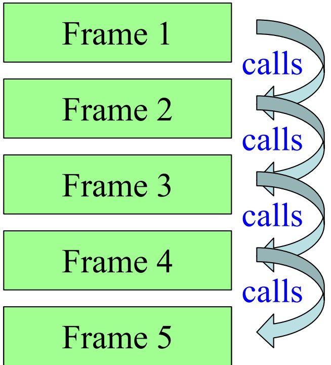
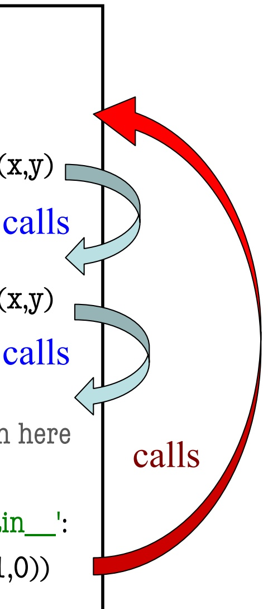
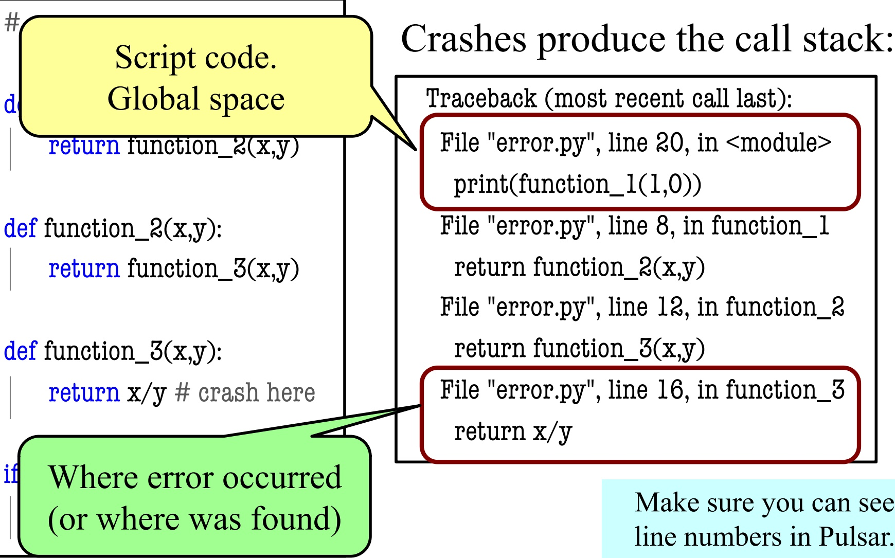
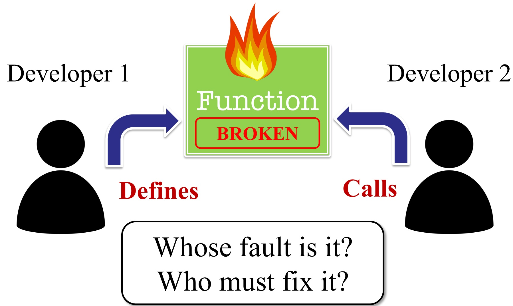
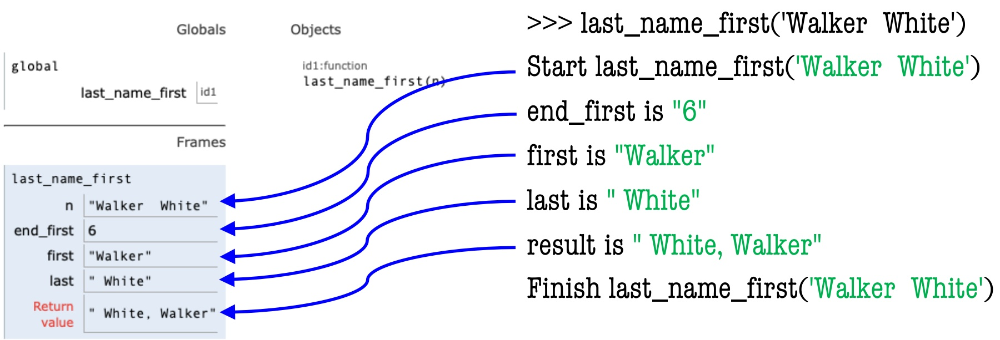

<!-- page: 1 -->

## Lecture 11

## Asserts and Debugging

<!-- page: 2 -->

## Announcements for Today

## (Optional) Videos

• **Lesson 13, 14** for today

• **Videos 15.1-15.7** next time

• **Prelim, Oct 15**<strong><sup>th</sup></strong> **7:30-9:00**

§ Material up October 1st

§ Study guide is now posted

• **Conflict with Prelim time?**

Submit to Prelim 1 Conflict form sent by Corey

§ Do not submit if no conflict

## Assignments

• A2 graded by Sunday

§ Still taking late submits

§ Also fill out survey

• A3 is now posted

§ Due Fri October 9th

§ Just before Fall Break

§ Graded when get back

§ Material is on exam

<!-- page: 3 -->

## Using Color Objects in A3

• New classes in introcs

§ RGB, CMYK, and HSL

• Each has its own attributes

§ **RGB**: red, blue, green

**CMYK**: cyan, magenta, yellow, black

1 **HSL**: hue, saturation, lightness

• Attributes have invariants

§ Limits the attribute values

§ Example: red is int in 0..255

§ Get an error if you violate

c

**id1**

**id1**

**RGB**

r

128

red

128

green

0

blue

0

>>> import introcs

$$
> > > \mathrm{c} = \text {introcs.RGB(128,0,0)}
$$

$$
> > > \mathrm{r=c.red}
$$

>>> c.red = 500 # out of range

AssertionError: 500 outside [0,255]

<!-- page: 4 -->

## Using Color Objects in A3

• New classes in introcs

§ RGB, CMYK, and HSL

• Each has its own attributes

§ **RGB**: red, blue, green

**CMYK**: cyan, magenta, yellow, black

**HSL**: hue, saturation, lightness

• Attributes have invariants

§ Limits the attribute values

§ Example: red is int in 0..255

§ Get an error if you violates

Constructor f~~unctio~~n. To make a **ne**<s><strong>w</strong></s> ~~colo~~r.

>>> import introcs

$$
> > > \mathrm{c} = \text {introcs.} \mathrm{RGB} (1 2 8, 0, 0)
$$

$$
> > > \mathrm{r=c.red}
$$

$$
> > > \text {c.red} = 5 0 0 \#
$$

AssertionError: 500 of rangeAccessing utside [0,25Attribute

<!-- page: 5 -->

## Recall: The Call Stack

## • Functions are stacked

§ Cannot remove one above w/o removing one below

§ Sometimes draw bottom up (better fits the metaphor)

• Stack represents memory as a **high water mark**

§ Must have enough to keep the **entire stack in memory**

§ Error if cannot hold stack

Frame 1

Frame 2



Frame 3

Frame 4

Frame 6  5

<!-- page: 6 -->

## Error Messages

## Not An Error Message

ZeroDivisionError: division by zero

Everything starting with the Traceback

## An Error Message

Traceback (most recent call last): File "error.py", line 41, in &lt;module&gt; print(function\_1(1,0)) File "error.py", line 16, in function\_1 return function\_2(x,y) File "error.py", line 26, in function\_2 return function\_3(x,y) File "error.py", line 36, in function\_3 return x/y ZeroDivisionError: division by zero

<!-- page: 7 -->

## Errors and the Call Stack

\# error.py

def function\_1(x,y): return function\_2(x,y)

def function\_2(x,y): return function\_3(x,y)

calls

calls

def function\_3(x,y): return x/y # crash here

if \_\_name\_\_ == '\_\_main\_\_': print(function\_1(1,0))



calls

<!-- page: 8 -->

```python
def function_3(x,y):
    return x/y # crash here
```

```txt
File "error.py", line 20, in <module>
    print(function_1(1,0))
```

## Errors and the Call Stack

\# error.py

def function\_1(x,y): return function\_2(x,y)

```python
def function_2(x,y):
    return function_3(x,y)
```

if \_\_name\_\_ == '\_\_main\_ print(function\_1(1,0))

Crashes produce the call stack:

Traceback (most recent call last):

File "error.py", line 8, in function\_1 return function\_2(x,y)

File "error.py", line 12, in function\_2 return function\_3(x,y)

File "error.py", line 16, in function\_3 return x/y

Make sure you can see line numbers in Pulsar.

<!-- page: 9 -->

## Errors and the Call Stack

Script code. ion\_1(x,y):Global space



def function\_2(x,y): return function\_3(x,y)

def function\_3(x,y): return x/y # crash here

\_name\_\_ == '\_\_main\_\_':Where error occurred print function\_1(1,0)(or where was found)

Crashes produce the call stack:

T<u>raceback (most recent call last):</u>

File "error.py", line 20, in &lt;module&gt; print(function\_1(1,0))

File "error.py", line 8, in function\_1 return function\_2(x,y) File "error.py", line 12, in function\_2 return function\_3(x,y)

File "error.py", line 16, in function\_3 return x/y

Make sure you can see line numbers in Pulsar.

<!-- page: 10 -->

## Recall: Assigning Responsibility

Developer 1

Developer 2

**Defines**



**Calls**

Whose fault is it? Who must fix it?

<!-- page: 11 -->

## Determining Responsibility

def function\_1(x,y): """Returns: result of function\_2

Precondition: x, y numbers""" return function\_2(x,y)

def function\_2(x,y): """Returns: x divided by y

Precondition: x, y numbers""" return x/y

print(function\_1(1,0))

Traceback (most recent call last):

File "error1.py", line 32, print(function\_1(1,0))

&lt;module&gt;

File "error1.py", line 18, in function\_1 return function\_2(x,y)

File "error1.py", line 28, in function\_2 return x/y

ZeroDivisionE

Where is the error?

<!-- page: 12 -->

## Approaching the Error Message

• Start from the top

• Look at function call

§ Examine arguments

§ (Print if you have to)

§ Verify preconditions

• Violation? Error found

§ Else go to next call

§ Continue until bottom

Traceback (most recent call last):

<u>File "error1.py", line 32, i</u>n &lt;module&gt; print(function\_1(1,0))

<u>File "error1.py", line 18, i</u>n function\_1 return function\_2(x,y)

<u>File "error1.py", line 28, i</u>n function\_2 return x/y

ZeroDivisionError: division by zero

<!-- page: 13 -->

## Determining Responsibility

def function\_1(x,y): """Returns: result of function\_2

Precondition: x, y numbers""" return function\_2(x,y)

def function\_2(x,y): """Returns: x divided by y

Precondition: x, y numbers""" return x/y

print(function\_1(1,0))

Traceback (most recent call last):

File "error1.py", line 32, print(function\_1(1,0))

File "error1.py", line 18, function\_1B return function\_2(x,y)

File "error1.py", line 28, in function\_2C return x/y

ZeroDivisionE

Where is the error?

<!-- page: 14 -->

## Determining Responsibility

def function\_1(x,y): """Returns: result of function\_2

Precondition: x, y numbers""" return function\_2(x,y)

def function\_2(x,y): """Returns: x divided by y

Precondition: x, y numbers""" return x/y

print(function\_1(1,0))

Traceback (most recent call last):

File "error1.py", line 32, in &lt;module&gt; print(function\_1(1,0))

File "error1.py", line 18, in function\_1 return function\_2(x,y)

<u>File "error1.py", line 28, i</u>n function\_2

return x/y

Error!

ZeroDivisionError: division by zero

<!-- page: 15 -->

## Determining Responsibility

def function\_1(x,y):

"""Returns: result of function\_2

Precondition: x, y numbers"""

return function\_2(x,y)

def function\_2(x,y):

"""Returns: x divided by y

Precondition: x, y numbs, y > 0"""r

return x/y

print(function\_1(1,0))

Traceback (most recent call last):

File "error1.py", line 32, in <modu print(function\_1(1,0))

return function\_2(x,y)

File "error1.py", line 28, in function\_2C

ZeroDivisionError: d

Where is the error?

<!-- page: 16 -->

## Determining Responsibility

def function\_1(x,y): """Returns: result of function\_2

Precondition: x, y numbers""" return function\_2(x,y)

def function\_2(x,y): """Returns: x divided by y

Precondition: x, y numbs, y > 0""" return x/y

print(function\_1(1,0))

Traceback (most recent call last):

File "error1.py", line 32, in &lt;module&gt; print(function\_1(1,0))

<u>File "error1.py", line 18, i</u>n fu<u>nction\_1</u>

return function\_2(x,y)

Error!

File "error1.py", line 28, in function\_2 return x/y

ZeroDivisionError: division by zero

<!-- page: 17 -->

## Determining Responsibility

def function\_1(x,y):

"""Returns: result of function\_2

Precondition: x, y numbs, y > 0""" return function\_2(x,y)

def function\_2(x,y):

"""Returns: x divided by y

Precondition: x, y numbs, y > 0""" return x/y

print(function\_1(1,0))

Traceback (most recent call last):

<u>File "error1.py", line 32, i</u>n &lt;module&gt;

print(function\_1(1,0))

Error!

File "error1.py", line 18, in function\_1 return function\_2(x,y)

File "error1.py", line 28, in function\_2 return x/y

ZeroDivisionError: division by zero

<!-- page: 18 -->

## This Makes Debugging Tricky

• Place error is detected != place error occurred

§ It can be further up in the call stack

§ It can even happen earlier in the code

§ Error messages are not enough to debug

• Debugging requires “**stepping-through**” code

§ You execute each line of code in your mind

§ You determine what Python does at that step

§ You verify that the two match (if not, bug)

<!-- page: 19 -->

## Debugging Requires Visualization

## Can Use Special Tools

<table><tr><td colspan="2">Globals</td></tr><tr><td colspan="2">global</td></tr><tr><td>last_name_first</td><td>id1</td></tr><tr><td colspan="2">Frames</td></tr><tr><td colspan="2">last_name_first</td></tr><tr><td>n</td><td>&quot;Walker White&quot;</td></tr><tr><td>end_first</td><td>6</td></tr><tr><td>first</td><td>&quot;Walker&quot;</td></tr><tr><td>last</td><td>&quot; White&quot;</td></tr><tr><td>Return value</td><td>&quot; White, Walker&quot;</td></tr></table>

' White, Walker'

id1:function last\_name\_first(n)

## Can Use print

>>> last\_name\_first('Walker White') Start last\_name\_first('Walker White') end\_first is "6" first is "Walker" last is " White" result is " White, Walker" Finish last\_name\_first('Walker White')

<!-- page: 20 -->

## Debugging Requires Visualization

## Can Use Special Tools

## Can Use print



' White, Walker'

<!-- page: 21 -->

## Case Study: Romanize

• Roman Numerals use letters instead of numbers

§ $\mathrm{I} = 1, \mathrm{V} = 5, \mathrm{X} = 10, \mathrm{L} = 50$ 0, and $\mathrm{C} = 100$

§ Can go higher, but will stop there for now

• Create other numbers by concatenation

§ II = 2, III = 3

§ $\mathrm{LV} = 55, \mathrm{LVIII} = 53$

• If a smaller number comes first, we subtract

§ IV = 4, IX = 9

■ VL = 40, XCVL = 94

<!-- page: 22 -->

## Case Study: Romanize

```python
def romanize(n):
    """
    Returns the Roman numeral for n

Examples:
    romanize(14) returns 'XIV'
    romanize(75) returns 'LXXV'
    romanize(75) returns 'LXXV'

Precond: 0 < n < 100 is an int
"""
...
9/29/26
Asserts & Debugging
```

<!-- page: 23 -->

## Running the Tests: Bug #1

```python
>>> romanize(14)
More than 10
numeralX: n = 1
choiceX = 'X'
tens = ''
romanizelto9: n = 4
Less than 5
romanizelto4: n = 4
choiceI = 'IV'
ones = 'IV'
'IV'
9/29/26
Asserts & Debugging
```

<!-- page: 24 -->

## Running the Tests: Bug #1

```python
>>> romanize(14)
More than 10
numeralX: n = 1
choiceX = 'X'
tens = ''
romanizelto9: n = 4
Less than 5
romanizelto4: n = 4
choiceI = 'IV'
ones = 'IV'
'IV' Problem here
```

<!-- page: 25 -->

```python
>>> romanize(14)
More than 10
numeralX: n = 1
choiceX = 'X'
tens = ""
Romanize1to9: n = 4
Less than 5
romanizelto4: n = 4
choiceI = 'IV'
ones = 'IV'
'IV'
But also here
Problem here
```

## Running the Tests: Bug #1

<!-- page: 26 -->

## Running the Tests: Bug #1

```python
>>> romanize(14)
More than 10
numeralX: n = 1
choiceX = 'X'
tens = ''
romanizelto9: n = 4
Less than 5
romanizelto4: n = 4
choiceI = 'IV'
ones = 'IV'
'IV'
```

```python
if n >= 50:
    print('More than 50')
    tens = numeralL(n//10)
elif n >= 10:
    print('More than 10')
    tems = numeralX(n//10)
print('tens = '+repr(tens))
```

<!-- page: 27 -->

## Running the Tests: Bug #1

```python
>>> romanize(14)
More than 10
numeralX: n = 1
choiceX = 'X'
tens = ''
romanizelto9: n = 4
Less than 5
romanizelto4: n = 4
choiceI = 'IV'
ones = 'IV'
'IV'
9/29/26
```

```python
if n >= 50:
    print('More than 50')
    tens = numeralL(n//10)
elif n >= 10:
    print('More than 10')
    tems = numeralX(n//10)
print('tens = '+repr(tens))
```

<!-- page: 28 -->

```txt
>>> romanize(75)
Expected:'LXXV'
More than 50
numeralL: n = 7
Less than 90
numeralX: n = 2
choiceX = 'XX'
tens = 'LXX'
romanizelto9: n = 5
Between 5 and 8
romanizelto4: n = 0
```

## Running the Tests: Bug #2

<!-- page: 29 -->

## Running the Tests: Bug #2

```txt
>>> romanize(75)
Expected:'LXXV'
More than 50
numeralL: n = 7
Less than 90
numeralX: n = 2
choiceX = 'XX'
tens = 'LXX'
romanizelto9: n = 5
Between 5 and 8
romanizelto4: n = 0
```

```txt
choiceI = 'IV'
```

$$
\textbf{ones} = \text{'VIV'}
$$

```txt
'LXXVIV'
```

Obvious Problem

<!-- page: 30 -->

## Running the Tests: Bug #2

```txt
>>> romanize(75)
Expected:'LXXV'
More than 50
numeralL: n = 7
Less than 90
numeralX: n = 2
choiceX = 'XX'
tens = 'LXX'
romanizelto9: n = 5
Between 5 and 8
romanizelto4: n = 0
```

Obvious Problem

<!-- page: 31 -->

## Running the Tests: Bug #2

```txt
>>> romanize(75)
Expected:'LXXV'
More than 50
numeralL: n = 7
Less than 90
numeralX: n = 2
choiceX = 'XX'
tens = 'LXX'
romanizelto9: n = 5
Between 5 and 8
romanizelto4: n = 0
```

```txt
choiceI = 'IV'
ones = 'VIV'
'LXXVIV'
```

def romanize1to4(n):

Returns Rom

Precondition Violation!

Ex: romanize

```python
Precond: 0 < n < 5 is an int
"""
```

```txt
print('romanizelto4: n = '+repr(n))
```

<!-- page: 32 -->

## Running the Tests: Bug #2

```python
>>> romanize(75)
Expected:'LXXV'
More than 50
numeralL: n = 7
Less than 90
numeralX: n = 2
choiceX = 'XX'
tens = 'LXX'
romanizelto9: n = 5
Between 5 and 8
romanizelto4: n = 0

choiceI = 'IV'
ones = 'VIV'
'LXXVIV'

if n < 5:
    print('Less than 5')
    return romanizelto4(n)
elif n < 9:
    print('Between 5 and 8')
    return 'V'+romanizelto4(n-5)
else:
    print('Equal to 9')
    return 'IX'

9/29/26
Asserts & Debugging
```

<!-- page: 33 -->

## Running the Tests: Bug #3

```python
>>> romanize(60)
More than 50
numeralL: n = 6
Less than 90
numeralX: n = 1
choiceX = 'X'
tens = 'LX'
romanizelto9: n = 0
Less than 5
romanizelto4: n = 0
choiceI = 'IV'
ones = 'IV'
'LXIV'
Precondition
Violation
bugging
```

<!-- page: 34 -->

## Running the Tests: Bug #3

```python
>>> romanize(60)
More than 50
numeralL: n = 6
Less than 90
numeralX: n = 1
choiceX = 'X'
tens = 'LX'
romanizelto9: n = 0
Less than 5
romanizelto4: n = 0
choiceI = 'IV'
ones = 'IV'
'LXIV'
def romanizelto9(n):
"'"
Returns the Roman numeral for n
Ex: romanize(5) returns V
romanize(9) returns IX
Precond: 0 < n < 10 is an int
"'"
print('romanizelto9: n = '+repr(n))
bugging
```

<!-- page: 35 -->

## Running the Tests: Bug #3

```python
>>> romanize(60)
More than 50
numeralL: n = 6
Less than 90
numeralX: n = 1
choiceX = 'X'
tens = 'LX'
romanizelto9: n = 0
Less than 5
romanizelto4: n = 0
choiceI = 'IV'
ones = 'IV'
'LXIV'
if n >= 50:
    print('More than 50')
    tens = numeralL(n//10)
elif n >= 10:
    print('More than 10')
    tems = numeralX(n//10)
    print('tens = '+repr(tens))
ones = romanizelto9(n % 10)
print('ones = '+repr(ones))
return tens+ones
9/29/26
Asserts & Debugging
```

<!-- page: 36 -->

## Last Example Was a Nested Error

• Calling romanize1to4(0) is a bug

§ But it was caused by a call to romanize1to9(0)

§ Making changes to romanize1to9 would be **bad**

• This type of error causes “**Doom Loops**”

§ You ask AI to fix a bug in your program

§ It finds an immediate bug, but not the source

§ Makes changes at the bug it found

§ This breaks specification, making code worse

§ You now have **more bugs**; repeat the process

<!-- page: 37 -->

## Challenges With Our Approach

• This worked because the code was **simple**

§ We could read and understand it all

§ We could step through each line

• What do we do about **larger files**?

§ Assignment 7 will be > 500 lines of code

§ Cannot possibly step through it all

§ Too many print statements is hard to follow

• **Solution**: Dynamic Search

§ Adjust print statements until you find error

<!-- page: 38 -->

## Dynamic Bug Search

• Start with a small number of print statement

§ Put them in the area you think error is

§ Leave large sections of code between prints

• Find the first print statement that is “wrong”

§ Error is must be before it (and after last print?)

§ Add more print statements in this area

§ Repeat this process as needed

• Problem is when cannot find anything wrong

§ Pick an area that was hard and add more prints

<!-- page: 39 -->

## Aiding the Search Process

• In practice, searching is hard

§ Errors can go a long time until we catch them

§ Errors often seen by user, not developer

• Would be easier if errors just crashed

§ A crash always gives a stack trace

§ The user can just email that to you

• We do this with **assert statements**

§ Crash the program when an error is seen

<!-- page: 40 -->

## Assert Statements

## • Form 1: assert &lt;boolean&gt;

§ Does nothing if boolean is True

§ Creates an error is boolean is False

• **Form 2:** assert &lt;boolean&gt;, &lt;string&gt;

§ Very much like form 2

§ But error message includes the string

• Statement to **verify a fact is true**

§ Similar to assert\_equals used in unit tests

§ But more versatile with complete **stack trace**

<!-- page: 41 -->

## Why Do This?

• Enforce preconditions!

§ Put precondition as assert.

§ If violate precondition, the program crashes

• Provided code in A3 uses asserts heavily

§ First slide of lecture!

assert &lt;boolean&gt;

assert &lt;boolean&gt;, &lt;string&gt;

```python
def exchange(from_c, to_c, amt)
    """Returns: amt from exchange
        Precondition: amt a float..."
    assert type(amt) == float
...
```

## Will do yourself in A4.

\# Creates error if &lt;boolean&gt; false

\# As above, but displays &lt;String&gt;

<!-- page: 42 -->

## Example: Anglicizing an Integer

## def anglicize(n):

```python
"'""Returns: the anglicization of int n.
Precondition: n an int, 0 < n < 1,000,000"""
assert type(n) == int, repr(n)+' is not an int'
assert 0 < n and n < 1000000, repr(n)+' is out of range'
# Implement method here...
```

<!-- page: 43 -->

## Example: Anglicizing an Integer

## def anglicize(n):

"""Returns: the anglicization of int n.

```python
Precondition: n an int, 0 < n < 1,000,000"""
```

```python
assert type(n) == int, repr(n)+' is not an int'
```

assert <u>0 < n and n < 1000000</u>, <u>repr(n)+' is out of range'</u>

\# Implement method here…

Check (part of) the precondition

Error message when violated

<!-- page: 44 -->

## Aside: Using repr Instead of str

```txt
>>> msg = str(var)+' is invalid'
```

```txt
>>> print(msg)
```

2 is invalid

• <u>Looking at this outp</u>ut, what is the type of var?

A: **int**

B: **float**

C: **str**

<u>D: Impossible to tell</u>

<!-- page: 45 -->

## Aside: Using repr Instead of str

```txt
>>> msg = str(var)+' is invalid'
```

```txt
>>> print(msg)
```

2 is invalid

• <u>Looking at this outp</u>ut, what is the type of var?

A: **int**

B: **float**

C: **str**

<u>D: Impossible to tell</u>

## CORRECT

<!-- page: 46 -->

## Aside: Using repr Instead of str

```txt
>>> msg = str(var)+' is invalid'
```

```txt
>>> print(msg)
```

2 is invalid

```txt
>>> msg = repr(var)+' is invalid'
```

>>> print(msg)

'2' is invalid

Clear that var is really a string

<!-- page: 47 -->

## Enforcing Preconditions is Tricky!

## def lookup\_netid(nid):

"""Returns: name of student with netid nid.

Precondition: nid is a string, which consists of 2 or 3 letters and a number"""

assert ?????

Assert use expressions only. Cannot use if-statements. Each one must fit on one line.

Sometimes we will only enforce part of the precondition

<!-- page: 48 -->

## Enforcing Preconditions is Tricky!

## def lookup\_netid(nid):

"""Returns: name of student with netid nid.

```python
Precondition: nid is a string, which consists of 2 or 3 letters and a number""""
```

assert type(nid) == str, repr(nid) + ' is not a string assert nid.isalnum(), nid+' is not just letters/digits

Returns True if s contains only letters, numbers.

Does this catch all violations?

<!-- page: 49 -->

```python
exchange(src, dst, amt):
    """Returns: amount of src received.
Precondition: src is a valid currency code
Precondition: dst is a valid currency code
Precondition: amt is a float"""
assert ??????, repr(src) + ' not valid'
assert ??????, repr(dst) + ' not valid'
assert type(amt)==float, repr(amt)+' not a float'
```

## Using Functions to Enforce Preconditions

<!-- page: 50 -->

## Using Functions to Enforce Preconditions

## def exchange(src, dst, amt):

```python
"""Returns: amount of src received.
Precondition: src is a valid currency code
Precondition: dst is a valid currency code
Precondition: amt is a float"""
assert is_currency(src), repr(src) + ' not valid'
assert is_currency(dst), repr(dst) + ' not valid'
assert type(amt)==float, repr(amt)+' not a float'
```
