<!-- page: 1 -->

Lecture 15

## Recursion

<!-- page: 2 -->

## Announcements for Today

## Prelim 1

• **Tonight** at 7:30 pm

• Go to the right room

§ **A-O** in Statler Aud

§ **P-Z** in Uris G01

§ **SDS** should have email

• Graded by Sun evening

§ Just in type for drop or S/U

§ Open OH all day **Monday**

## Other Announcements

• **Videos:** Lesson 17

• Assignment 3 now graded

§ **Mean** 95, **Median** 99

§ **Time**: 7.3 hr, **StdDev**: 3.8 hr

§ From 488 responses

• Assignment 4 posted Friday

§ Parts 1-3: Can do already

§ Part 4: material from today

§ Due 2 weeks from today

<!-- page: 3 -->

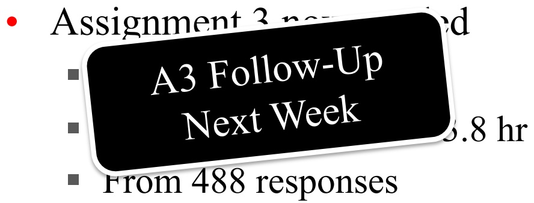

## Announcements for Today

## Prelim 1

• **Tonight** at 7:30 pm

• Go to the right room

§ **A-O** in Statler Aud

§ **P-Z** in Uris G01

§ **SDS** should have email

• Graded by Sun evening

§ Just in type for drop or S/U

§ Open OH all day **Monday**

## Other Announcements

• **Videos:** Lesson 17

§ From 488 responses

• Assignment 4 posted Friday

§ Parts 1-3: Can do already

§ Part 4: material from today

§ Due 2 weeks from today

<!-- page: 4 -->

## Support Sessions Monday

• What if your grade is **lower** than expected?

§ What can you do to **improve**?

§ Should you still stay in the course?

§ That is the purpose of our **support sessions**!

• Can meet with **other students** on Monday

§ Sometimes their experience is best

§ Will announce times and rooms on Ed

• I will hold them (mostly) all day Monday

§ 451 Gates 9:30-11:30am, 1-3:30pm

<!-- page: 5 -->

## Recursion

• **Recursive Definition**:

A definition that is defined in terms of itself

• **Recursive Function**:

A function that calls itself (directly or indirectly)

**PIP** stands for “**PIP** Installs Packages”

<!-- page: 6 -->

## A Mathematical Example: Factorial

• Non-recursive definition:

$$
\begin{array}{r l} & \mathrm{n! = n \times n - 1 \times \dots \times 2 \times 1} \\ & \quad = \mathrm{n(n-1\times \dots \times 2 \times 1)} \end{array}
$$

• Recursive definition:

$$
\mathrm{n! = n(n - 1)!}
$$

$$
\text {for} n > 0
$$

$$
0! = 1
$$

**Recursive case**

**Base case**

What happens if there is no base case ?

<!-- page: 7 -->

## Factorial as a Recursive Function

## def factorial(n):

"""Returns: factorial of n.

Pre: $n \geq 0$ an int"""

return 1

<strong><u>Base case(s)</u></strong>

$$
\begin{array}{l} \bullet \quad \mathrm{n! = n(n-1)!} \\ \bullet \quad 0! = 1 \end{array}
$$

return $\mathbf{n}^*$ factorial(n-1)

<strong><u>Recursive case</u></strong>

What happens if there is no base case ?

<!-- page: 8 -->

## Example: Fibonnaci Sequence

• Sequence of numbers: 1, 1, 2, 3, 5, 8, 13,

$$
a _ {0} a _ {1} a _ {2} a _ {3} a _ {4} a _ {5} a _ {6}
$$

§ Get the next num<u>ber by adding previous two</u>

§ What is $a_{8}$?

$$
\begin{array}{l} \text {A: $a_{8}=21$} \\ \text {B: $a_{8}=29$} \\ \text {C: $a_{8}=34$} \\ \text {D: None of these.} \end{array}
$$

<!-- page: 9 -->

## Example: Fibonnaci Sequence

• Sequence of numbers: 1, 1, 2, 3, 5, 8, 13,

$$
a _ {0} a _ {1} a _ {2} a _ {3} a _ {4} a _ {5} a _ {6}
$$

§ Get the next num<u>ber by adding previous two</u>

§ What is $a_{8}$?

$$
\begin{array}{l} \text {A:} a _ {8} = 2 1 \\ \text {B:} a _ {8} = 2 9 \\ \text {C:} a _ {8} = 3 4 \quad \text {correct} \\ \text {D: None of these.} \end{array}
$$

<!-- page: 10 -->

## Example: Fibonnaci Sequence

• Sequence of numbers: 1, 1, 2, 3, 5, 8, 13,

$$
a _ {0} a _ {1} a _ {2} a _ {3} a _ {4} a _ {5} a _ {6}
$$

§ Get the next number by adding previous two

§ What is $a_{8}$?

• Recursive definition:

§ $a_{n} = a_{n - 1} + a_{n - 2}$

§ $a_{0}=1$

**Recursive Case**

$a_{1}=1$

**Base Case**

**(another) Base Case**

Why did we need two base cases this time?

<!-- page: 11 -->

## Fibonacci as a Recursive Function

<div class="docvortex-algorithm" style="white-space: pre-wrap; font-family:monospace;">
def fibonacci(n):
    """Returns: Fibonacci no. $a_n$
    Precondition: n ≥ 0 an int"""
    if n &lt;= 1:
        return 1
    return (fibonacci(n-1)+
        fibonacci(n-2))
    Base case(s)
    Recursive case
</div>

Note difference with base case conditional.

<!-- page: 12 -->

## Fibonacci as a Recursive Function

## def fibonacci(n):

<div class="docvortex-algorithm" style="white-space: pre-wrap; font-family:monospace;">
"""Returns: Fibonacci no. $a_n$
Precondition: n ≥ 0 an int"""
if n &lt;= 1:
    return 1
</div>

```lisp
return (fibonacci(n-1)+
    fibonacci(n-2))
```

## • Function that calls itself

§ Each call is new frame

§ Frames require memory

§ ∞ calls = ∞ memory

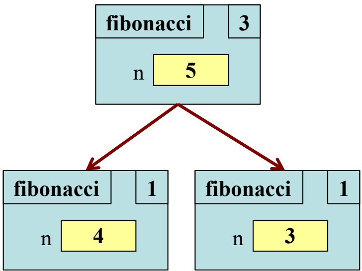

<!-- page: 13 -->

## Fibonacci: # of Frames vs. # of Calls

• Fibonacci is very inefficient.

§ fib(n) has a stack that is always ≤ n

§ But fib(n) makes a lot of red<u>undan</u>t calls

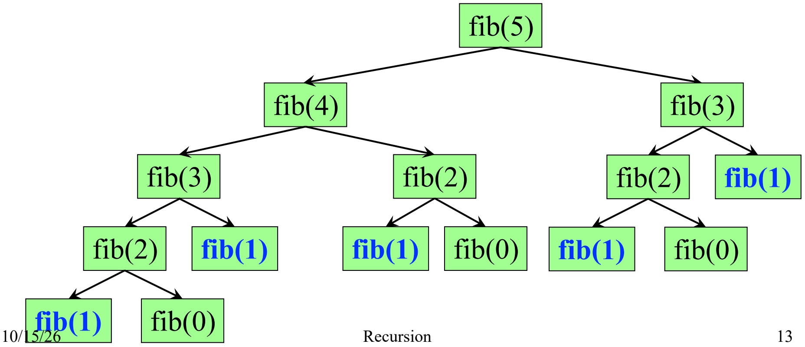

<!-- page: 14 -->

## Fibonacci: # of Frames vs. # of Calls

• Fibonacci is very inefficient.

§ fib(n) has a stack that is always ≤ n

§ But fib(n) makes a lot of red<u>undan</u>t calls

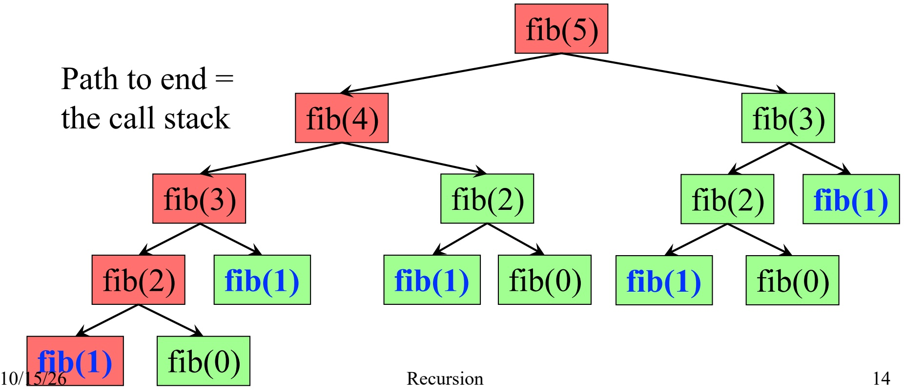

<!-- page: 15 -->

## Recursion vs Iteration

• **Recursion** is **provably equivalent** to **iteration**

§ Iteration includes **for-loop** and **while-loop** (later)

§ Anything can do in one, can do in the other

• But some things are easier with recursion

§ And some things are easier with iteration

• Will **not** teach you when to choose recursion

§ This is a topic for more advanced classes

• We just want you to **understand the technique**

<!-- page: 16 -->

## Recursion is best for Divide and Conquer

**Goal**: Solve problem P on a piece of data

**data**

<!-- page: 17 -->

## Recursion is best for Divide and Conquer

**Goal**: Solve problem P on a piece of data

## data

**Idea**: Split data into two parts and solve problem

**data 1**

**data 2**

Solve Problem P

Solve Problem P

<!-- page: 18 -->

## Recursion is best for Divide and Conquer

**Goal**: Solve problem P on a piece of data

## data

**Idea**: Split data into two parts and solve problem

**data 1**

**data 2**

Solve Problem P

Solve Problem P

**Combine Answer!**

<!-- page: 19 -->

## Divide and Conquer Example

Count the number of 'e's in a string:

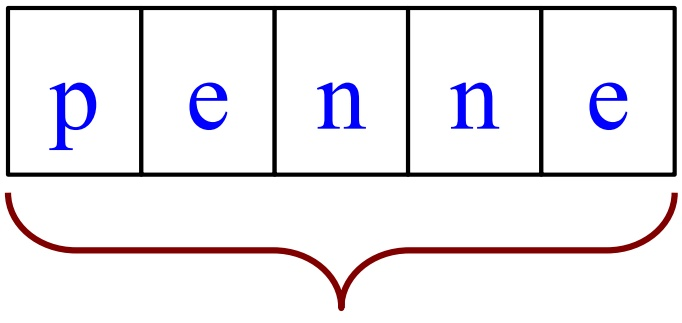

Two 'e's

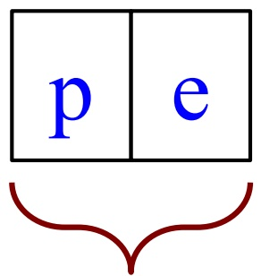

One 'e'


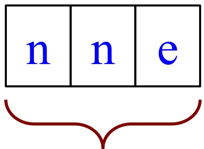

One 'e'

<!-- page: 20 -->

## Divide and Conquer Example

Count the number of 'e's in a string:

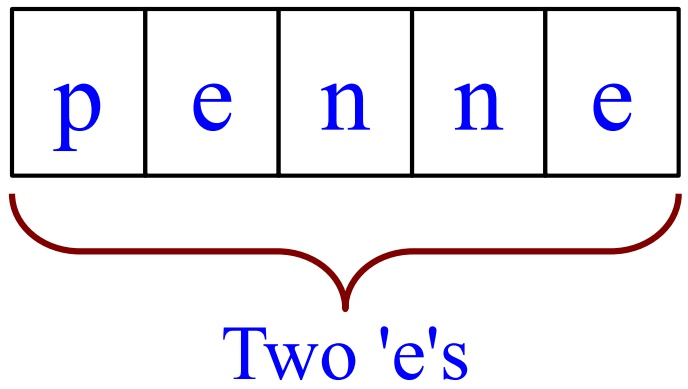

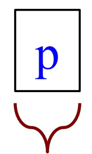

Zero 'e's


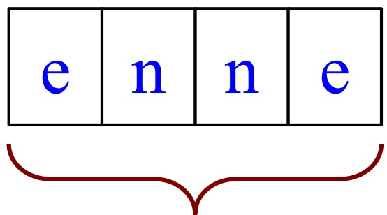

Two 'e's

<!-- page: 21 -->

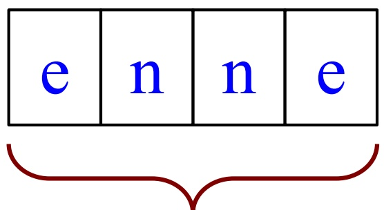

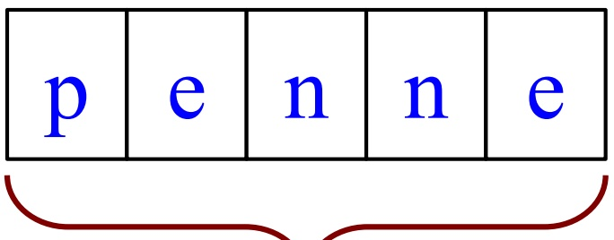

## Divide and Conquer Example

Count the number of 'e's in a string:

Two 'e'sWill talk about **how** to break-up later

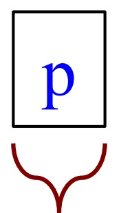

Zero 'e's


Two 'e's

<!-- page: 22 -->

## Three Steps for Divide and Conquer

1. Decide what to do on “small” data

§ Some data cannot be broken up

§ Have to compute this answer directly

2. Decide how to break up your data

§ Both “halves” should be smaller than whole

§ Often no wrong way to do this (next lecture)

3. Decide how to combine your answers

§ Assume the smaller answers are correct

§ Combining them should give bigger answer

<!-- page: 23 -->

## Divide and Conquer Example

```python
def num_es(s):
    """Returns: # of 'e's in s"""
    # 1. Handle small data
    if s == ":
        return 0
    elif len(s) == 1:
        return 1 if s[0] == 'e' else 0
```

```python
# 2. Break into two parts
left = num_es(s[0])
right = num_es(s[1:])
```

```txt
# 3. Combine the result
return left+right
```

```python
"Short-cut" for
    if s[0] == 'e':
        return 1
    else:
        return 0
```

| e | n | n | e |
| --- | --- | --- | --- |

$$
0 + 2
$$

<!-- page: 24 -->

```txt
s[0]
```

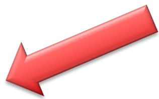

## Divide and Conquer Example

```python
def num_es(s):
    """Returns: # of 'e's in s"""
    # 1. Handle small data
    if s == ":
        return 0
    elif len(s) == 1:
        return 1 if s[0] == 'e' else 0
```

```python
# 2. Break into two parts
left = num_es(s[0])
right = num_es(s[1:])
```

```txt
# 3. Combine the result return left+right
```

```python
"Short-cut" for
    if s[0] == 'e':
        return 1
    else:
        return 0
```

s[1:]

| e | n | n | e |
| --- | --- | --- | --- |

$$
0 + 2
$$

<!-- page: 25 -->

## Divide and Conquer Example

```python
def num_es(s):
    """Returns: # of 'e's in s"""
    # 1. Handle small data
    if s == ":
        return 0
    elif len(s) == 1:
        return 1 if s[0] == 'e' else 0
```

```python
"Short-cut" for
    if s[0] == 'e':
        return 1
    else:
        return 0
```

## # 2. Break into two parts

```python
left = num_es(s[0])
right = num_es(s[1:])
```

```txt
# 3. Combine the result return left+right
```

s[1:]

| e | n | n | e |
| --- | --- | --- | --- |

$$
0 + 2
$$

<!-- page: 26 -->

## Divide and Conquer Example

```python
def num_es(s):
    """Returns: # of 'e's in s"""
    # 1. Handle small data
    if s == ":
        return 0
    elif len(s) == 1:
        return 1 if s[0] == 'e' else 0
```

```python
"Short-cut" for
    if s[0] == 'e':
        return 1
    else:
        return 0
```

```python
left = num_es(s[0])
right = num_es(s[1:])
```

```txt
s[0]
```

s[1:]

| e | n | n | e |
| --- | --- | --- | --- |

## # 3. Combine the result

return left+right

$$
0 + 2
$$

<!-- page: 27 -->

## Divide and Conquer Example

```python
def num_es(s):
    """Returns: # of 'e's in s"""
    # 1. Handle small data
    if s == ":
        return 0
    elif len(s) == 1:
        return 1 if s[0] == 'e' else 0

    # 2. Break into two parts
    left = num_es(s[0])
    right = num_es(s[1:]) 
    # 3. Combine the result
    return left+right

Base Case
Recursive Case
10/15/26
Recursion
```

<!-- page: 28 -->

## Exercise: Remove Blanks from a String

```python
def deblank(s):
    """Returns: s but with its blanks removed"""
```

## 1. Decide what to do on “small” data

§ If it is the **empty string**, nothing to do if s == '': return s

§ If it is a **single character**, delete it if a blank

```python
if s == '':    # There is a space here
| return "  # Empty string
else:
| return s
        Recursion
```

<!-- page: 29 -->

## Exercise: Remove Blanks from a String

```python
def deblank(s):
    """Returns: s but with its blanks removed"""
```

## 2. Decide how to break it up

```python
left = deblank(s[0])    # A string with no blanks
right = deblank(s[1:])   # A string with no blanks
```

3. Decide how to combine the answer return left+right # String concatenation

<!-- page: 30 -->

## Putting it All Together

```python
def deblank(s):
    """Returns: s w/o blanks"""
    if s == '":
        return s
    elif len(s) == 1:
        return '' if s[0] == '' else s

    left = deblank(s[0])
    right = deblank(s[1:])

    return left+right

    Handle small data
    Break up the data
    Combine answers
```

<!-- page: 31 -->

## Putting it All Together

```python
def deblank(s):
    """Returns: s w/o blanks"""
    if s == ":
        return s
    elif len(s) == 1:
        return '' if s[0] == '' else s

    left = deblank(s[0])
    right = deblank(s[1:])
    return left+right
```

<!-- page: 32 -->

## Minor Optimization

```python
def deblank(s):
    """Returns: s w/o blanks"""
    if s == ":
        return s
    elif len(s) == 1:
        return '' if s[0] == '' else s

    left = deblank(s[0])
    right = deblank(s[1:])

    return left+right
```

Needed second base case to handle s[0]

<!-- page: 33 -->

## Minor Optimization

```python
def deblank(s):
    """Returns: s w/o blanks"""
    if s == ':
        return s

    left = s[0]
    if s[0] == '':
        left = ''
    right = deblank(s[1:])
```

<!-- page: 34 -->

## Following the Recursion

deblank

|  | a |  | b |  | c |
| --- | --- | --- | --- | --- | --- |

<!-- page: 35 -->

## Following the Recursion

deblank

|  | a |  | b |  | c |
| --- | --- | --- | --- | --- | --- |

$$
\boxed {\quad} \text {deblank} \quad \boxed {a} \quad \boxed {b} \quad \boxed {c}
$$

<!-- page: 36 -->

## Following the Recursion

$$
\text {deblank} \boxed {\quad} \begin{array}{c c c c c} & \text {a} & & \text {b} & \\ \hline \end{array} \begin{array}{c c c c c} & \text {c} \end{array}
$$

$$
\boxed {\quad} \text {deblank} \boxed {a} \boxed {b} \boxed {c}
$$

$$
\boxed {a} \quad \text {deblank} \quad \boxed {b} \quad \boxed {c}
$$

<!-- page: 37 -->

## Following the Recursion

$$
\text {deblank} \boxed {\quad} \begin{array}{c c c c c} & \text {a} & & \text {b} & \\ \hline \end{array} \begin{array}{c c c c c} & \text {c} \end{array}
$$

$$
\boxed {\quad} \text {deblank} \boxed {a} \boxed {b} \boxed {c}
$$

$$
\boxed {a} \quad \text {deblank} \quad \boxed {b} \quad \boxed {c}
$$

$$
\boxed {\quad} \quad \text {deblank} \boxed {b} \boxed {c}
$$

<!-- page: 38 -->

## Following the Recursion

$$
\text {deblank} \boxed {\quad} \begin{array}{c c c c c} & \text {a} & & \text {b} & \\ \hline \end{array} \begin{array}{c c c c c} & \text {c} \end{array}
$$

$$
\boxed {\quad} \text {deblank} \boxed {a} \boxed {b} \boxed {c}
$$

$$
\boxed {a} \quad \text {deblank} \quad \boxed {b} \quad \boxed {c}
$$

$$
\boxed {\quad} \quad \text {deblank} \boxed {b} \boxed {c}
$$

$$
\boxed {b} \quad \text {deblank} \quad \boxed {c}
$$

<!-- page: 39 -->

## Following the Recursion

deblank a b c

$$
\boxed {\quad} \text {deblank} \boxed {a} \boxed {b} \boxed {c}
$$

$$
\boxed {a} \quad \text {deblank} \quad \boxed {b} \quad \boxed {c}
$$

deblank b c

b deblank c

□

deblank c

<!-- page: 40 -->

## Following the Recursion

deblank a b c

deblank a b c

$$
\boxed {a} \quad \text {deblank} \quad \boxed {b} \quad \boxed {c}
$$

deblank b c

b deblank c

deblank c

<!-- page: 41 -->

## Following the Recursion

deblank a b c

$$
\boxed {\quad} \text {deblank} \quad \boxed {a} \quad \boxed {b} \quad \boxed {c}
$$

$$
\boxed {a} \quad \text {deblank} \quad \boxed {b} \quad \boxed {c}
$$

□ deblank b c

$$
^ b
$$

deblank

$$
\boxed { \begin{array}{c c} \hline & \text {C} \\ \hline \end{array} }
$$

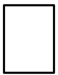

deblank c

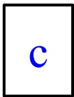


Recursion

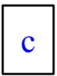

<!-- page: 42 -->

## Following the Recursion

deblank a b c

deblank a b c

a deblank b c

□ deblank b c


$$
\boxed { \begin{array}{c c} \hline & \text {C} \\ \hline \end{array} }
$$


deblank c


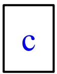


Recursion


<!-- page: 43 -->

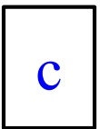

## Following the Recursion

deblank a b c

deblank a b c

a deblank b c

deblank b c

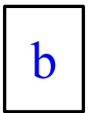

$$
\boxed { \begin{array}{c c} \hline & \text {C} \\ \hline \end{array} }
$$


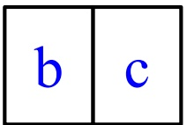

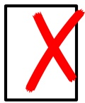

deblank c

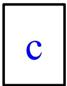


Recursion


<!-- page: 44 -->

## Following the Recursion

deblank a b c

deblank a b c


a deblank b c

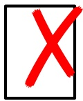

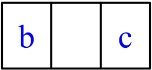


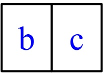


deblank

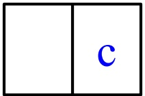


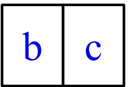


## deblank c


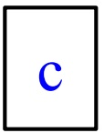

Recursion


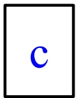

<!-- page: 45 -->

## Following the Recursion

$$
\text {deblank} \boxed {\quad} \begin{array}{c c c c c} & \text {a} & & \text {b} & \\ \hline \end{array} \boxed {\quad} \begin{array}{c c c c c} & \text {c} \end{array}
$$

$$
\boxed {\quad} \text {deblank} \quad \boxed {a} \quad \boxed {b} \quad \boxed {c}
$$


$$
\boxed {a} \quad \text {deblank} \quad \boxed {b} \quad \boxed {c}
$$

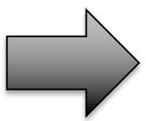

$$
\boxed { \begin{array}{c c c} \hline a & b & c \\ \hline \end{array} }
$$


$$
\text {deblank} \boxed {b} \boxed {c}
$$

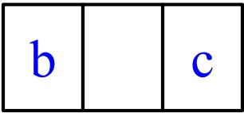


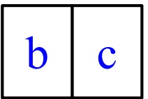

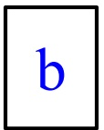

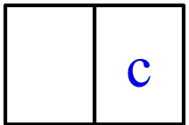

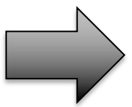


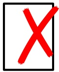

## deblank c


Recursion


<!-- page: 46 -->

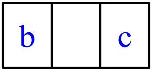

## Following the Recursion

| deblank |  | a |  | b |  | c |
| --- | --- | --- | --- | --- | --- | --- |

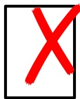

deblank

$$
\boxed { \begin{array}{c c c c c} \hline a & & b & & c \\ \hline \end{array} }
$$

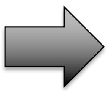

$$
\boxed { \begin{array}{c c c} \hline a & b & c \\ \hline \end{array} }
$$

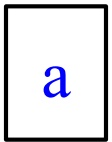

a deblank b c


$$
\boxed { \begin{array}{c c c} \hline a & b & c \\ \hline \end{array} }
$$


$$
\text {deblank} \boxed {\mathrm{b}} \boxed {\mathrm{c}}
$$


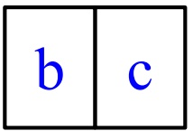

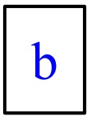

deblank C

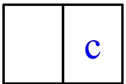

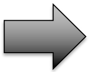

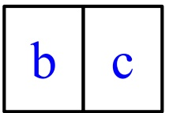


deblank c


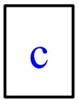


Recursion


<!-- page: 47 -->

## Following the Recursion

$$
\text {deblank} \boxed {\quad} \begin{array}{c c c c c} & \text {a} & & \text {b} & \\ \hline \end{array} \boxed {\quad} \begin{array}{c c c c c} & \text {c} \end{array}
$$


$$
\boxed { \begin{array}{c c c} \hline a & b & c \\ \hline \end{array} }
$$

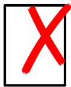

X deblank a b c


$$
\boxed { \begin{array}{c c c} \hline a & b & c \\ \hline \end{array} }
$$

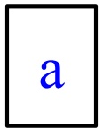

a deblank b c

$$
\boxed { \begin{array}{c c c} \hline a & b & c \\ \hline \end{array} }
$$


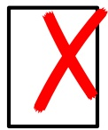

deblank b c

deblank c


deblank c


Recursion


<!-- page: 48 -->

## Final Modification

```python
def deblank(s):
    """Returns: s w/o blanks"""
    if s == '':
        return s
    left = s[0]
    if s[0] == '':
        left = ''
    right = deblank(s[1:])
```

<!-- page: 49 -->

## Final Modification

```python
ef deblank(s):
    """Returns: s w/o blanks"""
    if s == ":
        return s
    left = s
    if s[0] in string.whitespace
        left = ""
    right = deblank(s[1:])
```

<!-- page: 50 -->

## Next Time: Breaking Up Recursion
