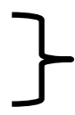
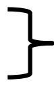
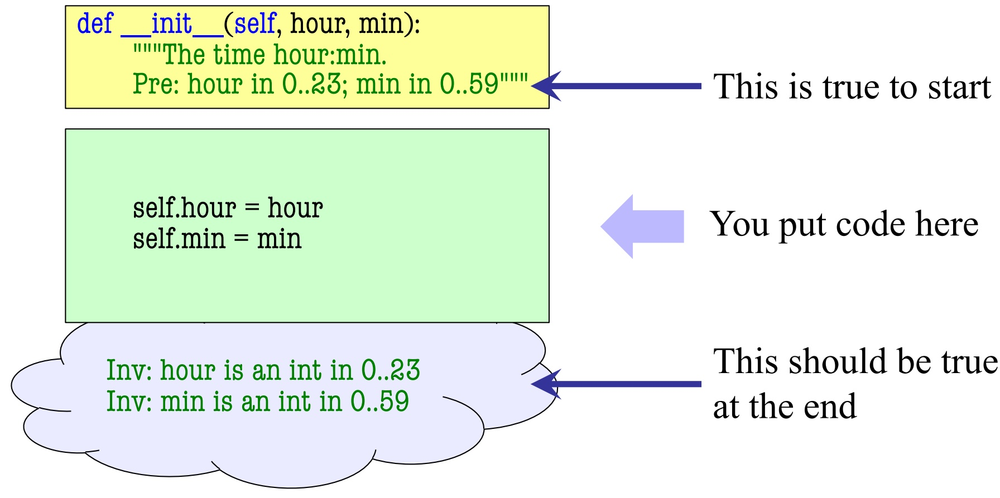
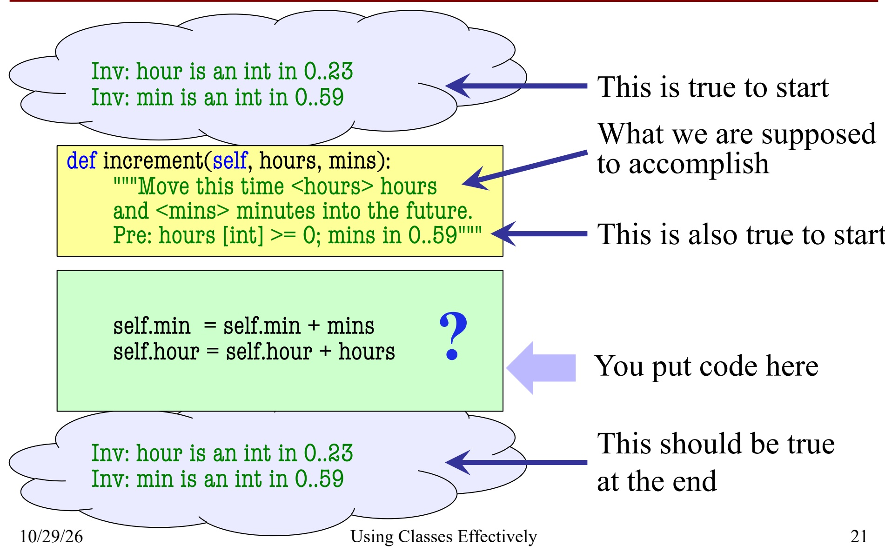
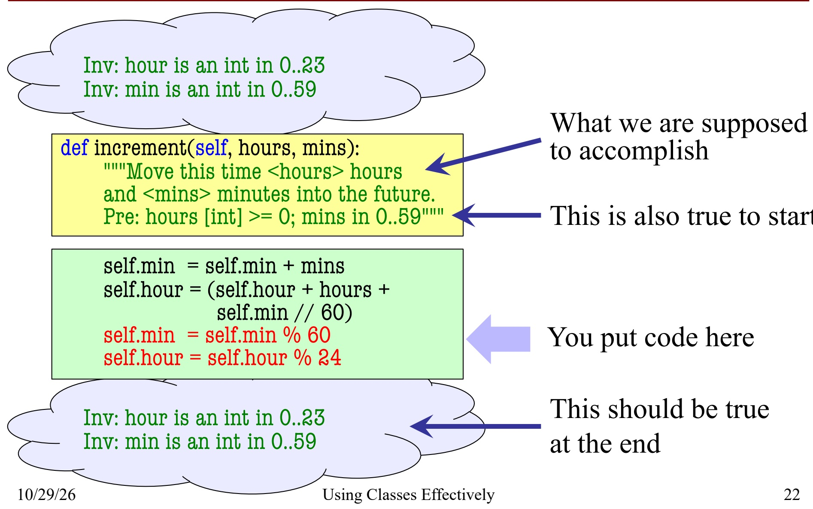

<!-- page: 1 -->

Lecture 19

## Using Classes Effectively

<!-- page: 2 -->

## Announcements for Today

## Assignments

• A4 is due **tonight**

§ The survey is still open

• A5 to be posted **tomorrow**

§ Short written assignment

§ Due next Thursday

• A6 also posted **tomorrow**

§ Due November 15th

§ **Follow the microdeadlines!**

§ Get started on it **first**

## Optional Videos

• **Videos 20.9-20.10** today

• Also **Lesson 21** for today

• **Lesson 22** for next time


<!-- page: 3 -->

## Recall: The \_\_init\_\_ Method

```python
two underscores
w - worker( Obama', 1234, None)

def __init__(self, n, s, b):
    """Initializer: creates a Worker

    Has last name n, SSN s, and boss b

    Precondition: n a string,
    s an int in range 0..999999999,
    b either a Worker or None.  """
    self.lname = n
    self.ssn = s
    self.boss = b
```

Called by the constructor

## id8

'White'

1234

boss

<!-- page: 4 -->

## Recall: The \_\_init\_\_ Method

```python
two underscores
w - worker( Obama', 1234, None)

def __init__(self, n, s, b):
    """Initializer: creates a Worker

    Has last name n, SSN s, and boss b

    Precondition: n a string,
    s an int in range 0..999999999,
    b either a Worker or None.  """
    self.lname = n
    self.ssn = s
    self.boss = b
```

Are there other special methods that we can use?

<!-- page: 5 -->

## Example: Converting Values to Strings

## str() Function

• **Usage**: str(&lt;expression&gt;)

§ Evaluates the expression

§ Converts it into a string

• How does it convert?

§ str(2) → '2'

§ str(True) → 'True'

§ str('True') → 'True'

§ str(Point3()) → '(0.0,0.0,0.0)'

## repr() Function

• **Usage**: repr(&lt;expression&gt;)

§ Evaluates the expression

§ Converts it into a string

• How does it convert?

§ repr(2) → '2'

§ repr(True) → 'True'

§ repr('True') → "'True'"

§ repr(Point3()) → "&lt;class 'Point3'&gt; (0.0,0.0,0.0)"

<!-- page: 6 -->

## Example: Converting Values to Strings

## str() Function

• **Usage**: str(&lt;expression&gt;)

§ Evaluates the expression

§ Converts it into a string

• How does it conve

§ str(2) → '2' rt?What type is this value?

§ str(True) → 'True'

§ str('True') → 'True'

§ str(Point3()) → '(0.0,0.0,0.0)'

## repr() Function

: repr(<expresrepr() is for

aluates the expreunambigious

onverts it into a strrepresentation

How does it co

§ repr(2) → '2'

The value’s type is clear § repr(True)

§ repr('True') → "'True'"

§ repr(Point3()) → "&lt;class 'Point3'&gt; (0.0,0.0,0.0)"

<!-- page: 7 -->

## What Does str() Do On Objects?

## • Does NOT display contents

>>> p = Point3(1,2,3)

>>> str(p)

'&lt;Point3 object at 0x1007a90&gt;'

• Must add a special method

§ \_\_str\_\_ for str()

§ \_\_repr\_\_ for repr()

• Could get away with just one

§ repr() requires \_\_repr\_\_

§ str() can use \_\_repr\_\_ (if \_\_str\_\_ is not there)

## class Point3(object):

"""Class for points in 3d space"""

```python
def __str__(self):
```

"""Returns: string with contents"""

return '('+str(self.x) + ',' +

str(self.y) + ',' +

str(self.z) + ')'

```python
def __repr__(self):
```

"""Returns: unambiguous string"""

return str(self.\_\_class\_\_)+

str(self)

<!-- page: 8 -->

## What Does str() Do On Objects?

• Does **NOT** display contents

>>> p = Point3(1,2,3)

>>> str(p)

'&lt;Point3 object at 0x1007a90&gt;'

• Must add a special method

§ \_\_str\_\_ for str()

§ \_\_repr\_\_ for repr()

• Could get away with just one

§ repr() requires \_\_repr\_\_

§ str() can use \_\_repr\_\_ (if \_\_str\_\_ is not there)

## class Point3(object):

"""Class for points in 3d space"""

def \_\_str\_\_(self):

"""Returns: string with contents"""

return '('+str(self.x) + ',' +

str(self.y) + ',' +

str(self.z) + ')'

def \_\_repr\_\_(self):

Gives the class name """Returns: unambigu

us string"

return str(self.\_\_class\_\_)+

str(self)

repr\_\_ using 8str\_\_ as helper

<!-- page: 9 -->

## Exercise: str and repr

```python
class Example(object):
    """A simple class"""
    def __init__(self,x):
        self.x = x
    def __str__(self):
        return 'Value'+str(self.x)
    def __repr__(self):
        return 'Example['+str(x)+']'
>>> a = Example(3)
>>> str(a) # a.__str()__
What is the result?
A: '3'
B: 'Value 3'
C: 'Example[3]'
D: Error
E: I don't know
```

<!-- page: 10 -->

## Exercise: str and repr

```python
class Example(object):
    """A simple class"""
    def __init__(self,x):
        self.x = x
    def __str__(self):
        return 'Value'+str(self.x)
    def __repr__(self):
        return 'Example['+str(x)+']'
>>> a = Example(3)
>>> str(a)
What is the result?
A: '3'
B: 'Value 3'
C: 'Example[3]'
D: Error
E: I don't know
```

<!-- page: 11 -->

## Exercise: str and repr

```python
class Example(object):
    """A simple class"""
    def __init__(self,x):
        self.x = x
    def __str__(self):
        return 'Value'+str(self.x)
    def __repr__(self):
        return 'Example['+str(x)+']'
>>> a = Example(3)
>>> repr(a)
What is the result?
A: '3'
B: 'Value 3'
C: 'Example[3]'
D: Error
E: I don't know
```

<!-- page: 12 -->

## Exercise: str and repr

```python
class Example(object):
    """A simple class"""
    def __init__(self,x):
        self.x = x
    def __str__(self):
        return 'Value'+str(self.x)
    def __repr__(self):
        return 'Example['+str(x)+']
No self
>>> a = Example(3)
>>> repr(a)
What is the result?
A: '3'
B: 'Value 3'
C: 'Example[3]'
D: Error
E: I don't know
```

<!-- page: 13 -->

## Designing Types

From first day of class!

• **Type**: set of values and the operations on them

§ int: (**set**: integers; **ops**: +, -, \*, //, ...)

§ Time (**set**: times of day; **ops**: time span, before/after, …)

§ Worker (**set**: all possible workers; **ops**: hire,pay,promote,…)

§ Rectangle (**set**: all axis-aligned rectangles in 2D;

**ops**: contains, intersect, …)

• To define a class, think of a real type you want to make

§ Python gives you the tools, but does not do it for you

§ Physically, any object can take on any value

§ Discipline is required to get what you want

<!-- page: 14 -->

## Making a Class into a Type

1. Think about what values you want in the set

§ What are the attributes? What values can they have?

2. Think about what operations you want

§ This often influences the previous question

• To make (1) precise: write a class invariant

§ Statement we promise to keep true **after every method call**

• To make (2) precise: write method specifications

§ Statement of what method does/what it expects (preconditions)

• Write your code to make these statements true!

<!-- page: 15 -->



## Planning out a Class

## class Time(object):

"""Class to represent times of day.

Inv: hour is an int in 0..23 Inv: min is an int in 0..59"""

def \_\_init\_\_(self, hour, min): """The time hour:min. Pre: hour in 0..23; min in 0..59"""

def increment(self, hours, mins): """Move time hours and mins into the future.

Pre: hours int >= 0; mins in 0..59"""

def isPM(self): """Returns: True if noon or later."""

## Class Invariant

States what attributes are present and what values they can have.

A statement that will always be true of any Time instance.

## Method Specification

States what the method does.

Gives preconditions stating what is assumed true of the arguments.

<!-- page: 16 -->

```python
def __init__(self, t, l, b, r):
    """The rectangle [l, r] x [t, b]
    Pre: args are floats; l <= r; b <= t"""
```



## Planning out a Class

## class Rectangle(object):

"""Class to represent rectangular region

Inv: t (top edge) is a float

Inv: l (left edge) is a float

Inv: b (bottom edge) is a float

Inv: r (right edge) is a float

Additional Inv: l <= r and b <= t."""

## def area(self):

"""Return: area of the rectangle. """

## def intersection(self, other):

"""Return: new Rectangle describing intersection of self with other. """

## Class Invariant

States what attributes are present and what values they can have.

A statement that will always be true of any Rectangle instance.

## Method Specification

States what the method does.

Gives preconditions stating what is assumed true of the arguments.

<!-- page: 17 -->

## Planning out a Class

## class Rectangle(object):

"""Class to represent rectangular region

Inv: t (top edge) is a float

Inv: l (left edge) is a float

Inv: b (bottom edge) is a float

Inv: r (right edge) is a float

Additional Inv: l <= r and b <= t."""

def \_\_init\_\_(self, t, l, b, r):

"""The rectangle [l, r] x [t, b]

Pre: args are floats; l <= r;

## def area(self):

def intersection(self, other):

"""Return: area of the rectangle."""

## Class Invariant

""" Return: new Rectangle describing intersection of self with other. """

States what attributes are present and what values they can have.

"""attributes to each other

Special invariant **relating**

A statement that will always be <u>true of any Rectan</u>gle instance.

## Method Specification

States what the method does.

Gives preconditions stating what

is assumed true of the arguments.

<!-- page: 18 -->

## Planning out a Class

## class Hand(object):

"""Instances represent a hand in cards.

Inv: cards is a list of Card objects. This list is sorted according to the ordering defined by the Card class. """

def \_\_init\_\_(self, deck, n): """Draw a hand of n cards. Pre: deck is a list of >= n cards"""

## def isFullHouse(self):

"""Return: True if this hand is a full house; False otherwise"""

def discard(self, k): """Discard the k-th card."""

## Class Invariant

States what attributes are present and what values they can have.

A statement that will always be true of any Rectangle instance.

## Method Specification

States what the method does.

Gives preconditions stating what is assumed true of the arguments.

<!-- page: 19 -->

## Implementing a Class

• All that remains is to fill in the methods. (All?!)

• When **implementing methods**:

1. Assume preconditions are true

2. Assume class invariant is true to start

3. Ensure method specification is fulfilled

4. Ensure class invariant is true when done

• Later, when **using the class**:

§ When calling methods, ensure preconditions are true

§ If attributes are altered, ensure class invariant is true

<!-- page: 20 -->

## Implementing an Initializer



This is true to start

You put code here

This should be true at the end

<!-- page: 21 -->

## Implementing a Method

Inv: hour is an int in 0..23 Inv: min is an int in 0..59

def increment(self, hours, mins): """Move this time &lt;hours&gt; hours and &lt;mins&gt; minutes into the future. Pre: hours [int] >= 0; mins in 0..59""



self.min = self.min + mins self.hour = self.hour + hours

Inv: hour is an int in 0..23 Inv: min is an int in 0..59

This is true to start What we are supposed to accomplish

This is also true to start

You put code here

This should be true at the end

<!-- page: 22 -->

## Implementing a Method



Inv: hour is an int in 0..23 Inv: min is an int in 0..59

def increment(self, hours, mins): """Move this time &lt;hours&gt; hours and &lt;mins&gt; minutes into the future. Pre: hours [int] >= 0; mins in 0..59"""

self.min = self.min + mins self.hour = (self.hour + hours + self.min // 60) self.min = self.min % 60 self.hour = self.hour % 24

Inv: hour is an int in 0..23 Inv: min is an int in 0..59

What we are supposed to accomplish

This is also true to start

You put code here

This should be true at the end

<!-- page: 23 -->

## Object Oriented Design

## Interface

• How the code fits together

§ interface btw programmers

§ interface btw parts of an app

• Given by **specifications**

§ Class spec and invariants

§ Method specs and preconds

§ Interface is **ALL of these**

## Implementation

• What the code actually does

§ when create an object

§ when call a method

• Given by method **definitions**

§ Must meet specifications

§ Must not violate invariants

§ But otherwise flexible

## Important concept for making large software systems

<!-- page: 24 -->

## Implementing a Class

• All that remains is to fill in the methods. (All?!)

• When **implementing methods**:

1. Assume preconditions are true

2. Assume class invariant is true to start

3. Ensure method specification is fulfilled

4. Ensure class invariant is true when done

• Later, when **using the class**:

§ When calling methods, ensure preconditions are true

§ If attributes are altered, ensure class invariant is true

<!-- page: 25 -->

```python
assert type(n) == int, str(n)+' is not an int'
```

## Recall: Enforce Preconditions with assert

## def anglicize(n):

"""Returns: the anglicization of int n.

```python
Precondition: n an int, 0 < n < 1,000,000"""
```

assert 0 < n and n < 1000000, repr(n)+' is out of range'

\# Implement method here…

Check (part of) the precondition (Optional) Error message when precondition violated

<!-- page: 26 -->


## Enforce Method Preconditions with assert

```python
class Time(object):
    """Class to represent times of day."""
    def __init__(self, hour, min):
        """The time hour:min.
        Pre: hour in 0..23; min in 0..59"""
        assert type(hour) == int
        assert 0 <= hour and hour < 24
        assert type(min) == int
        assert 0 <= min and min < 60

    def increment(self, hours, mins):
        """Move this time <hours> hours
        and <mins> minutes into the future.
        Pre: hours is int >= 0; mins in 0..59"""
        assert type(hour) == int
        assert type (min) == int
        assert hour >= 0
        assert 0 <= min and min < 60

    Inv: hour is an int in 0..23
    Inv: min is an int in 0..59"""
    Initializer creates/initializes all
    of the instance attributes.
    Asserts in initializer guarantee the
    initial values satisfy the invariant.

    Asserts in other methods enforce
    the method preconditions.
```

<!-- page: 27 -->

## Hiding Methods From Access

## • Hidden methods

§ start with an **underscore**

§ do not show up in help()

§ are meant to be **internal** (e.g. helper methods)

## • But they are not restricted

§ You can still access them

§ But this is bad practice!

§ Like a precond violation

## • Can do same for attributes

§ Underscore makes it hidden

§ Only used inside of methods

## class Time(object):

"""Class to represent times of day.

```python
Inv: hour is an int in 0..23
Inv: min is an int in 0..59"""
```

```python
def _is_minute(self,m):
    """Return: True if m valid minute"""
    return (type(m) == int and
        m >= 0 and m < 60)
```

```python
def __init__(self, hour, min):
    """The time hour:min.
    Pre: hour in 0..23; min in 0..59"""
    assert self._is_minute(m)
```

Helper

<!-- page: 28 -->

```python
def _is_minute(self,m):
    """Return: True if m valid minute"""
    return (type(m) == int and
        m >= 0 and m < 60)
```

## Hiding Methods From Access

## • Hidden methods

§ start with an **underscore**

§ do not show up in help()

§ are meant to be **internal** (e.g. helper methods)

## • But they are not restricted

§ You can still access them

§ But this is bad practice!

§ Like a precond violation

## • Can do same for attributes

Will come back to this

## class Time(object):

```python
def __init__(self, hour, min):
    """The time hour:min.
    Pre: hour in 0..23; min in 0..59"""
    assert self._is_minute(m)
```

<!-- page: 29 -->

```python
• Example:
    def getHour(self):
        """Returns: the hour"""
        return self.hour
```

## Enforcing Invariants

## class Time(object):

"""Class to repr times of day.

Inv: hour is an int in 0..23 Inv: <u>min is an int in 0..59</u> """

**Invariants**: Properties that <u>are always true.</u>

These are just comments! >>> t = Time(2,30) >>> t.hour = 'Hello

• How do we prevent this?

• **Idea**: Restrict direct access

§ Only access via methods

§ Use asserts to enforce them

```python
def setHour (self,value):
    """Sets hour to value"""
    assert type(value) == int
    assert value >= 0 and value < 24
    self.numerator = value
```

<!-- page: 30 -->

## Data Encapsulation

• **Idea**: Force the user to only use methods

• Do not allow direct access of attributes

## Setter Method

• Used to change an attribute

• Replaces all assignment statements to the attribute

• **Bad**:

>>> t.hour = 5

• **Good**:

>>> t.setHour(5)

## Getter Method

• Used to access an attribute

• Replaces all usage of attribute in an expression

• **Bad**:

>>> x = 3\*t.hour

• **Good**:

>>> x = 3\*t.getHour()

<!-- page: 31 -->

## Data Encapsulation

class Time(object): """Class to repr times of day. """

## Getter

## def getHour (self):

## Setter

"""Returns: hour attribute""" return self.\_hour

def setHour(self, h):

""" Sets hour to h Pre: h is an int in 0..23""" assert type(h) == int assert 0 <= h and h < 24 self.\_hour = d

## NO ATTRIBUTES

in class specification

**Method specifications**

describe the attributes

**Setter precondition** is same as the **invariant**

<!-- page: 32 -->

## Data Encapsulation

class Time(object): """Class to repr times of day. """

in class specification

**NO ATTRIBUTES**

**Getter**

def getHour (self): """Returns: hour attribute""" return self.\_hour

**Method specifications**

describe the attributes

**Setter**

def setHour(

""" Sets ho

h):Hidden attribute user o Setter should **NOT** know about

Pre: h is an

assert type(h) == int

assert 0 <= h and h < 24

same as recondition is the **invariant**

self.\_hour = d

<!-- page: 33 -->

## Encapsulation and Specifications

## class Time(object):

"""Class to represent times of day.

\### Hidden attributes # Att \_hour: hour of the day # Inv: \_hour is an int in 0..23 # Att \_min: minute of the hour # Inv: \_min is an int in 0..59

These comments do not go in help()

No attributes <u>in class spec</u>

These comments make it part of the **class invariant** but not part of the (public) **interface**

<!-- page: 34 -->

## Class Invariant vs Interface

## Class Invariant

• List attributes that are present

§ Both hidden AND unhidden

§ Lists the invariants of each

• For the **implementer**

§ Guide for the initialization

§ Guide for method definitions

## Interface

• Describes what is accessible

§ Unhidden methods/attribs

§ What is visible in help()

• For user/**other programmers**

§ Enough to create an object

§ Enough to call the methods

## Early years of CS1110 confused these two topics

<!-- page: 35 -->

## Mutable vs. Immutable Attributes

## Mutable

• Can change value directly

§ If class invariant met

§ **Example:** turtle.color

• Has both getters and setters

§ Setters allow you to change

§ Enforce invariants w/ asserts

## Immutable

• Can’t change value directly

§ May change “behind scenes”

§ **Example:** turtle.x

• Has only a getter

§ No setter means no change

§ Getter allows limited access

## May ask you to differentiate on the exam

<!-- page: 36 -->

## Mutable vs. Immutable Attributes

## Mutable

• Can change value directly

§ If class invariant met

**Example:** turtle.color

• Has both getters and setters

§ Setters allow

§ Enforce invari

to change**Where?**

ants w/ asserts<u>Next Thursday</u>

## Immutable

• Can’t change value directly

§ May change “behind scenes”

**Example:** turtle.x

• Has only a getter

§ No setter means no change

§ Getter allows limited access

May ask you to differentiate on the exam
