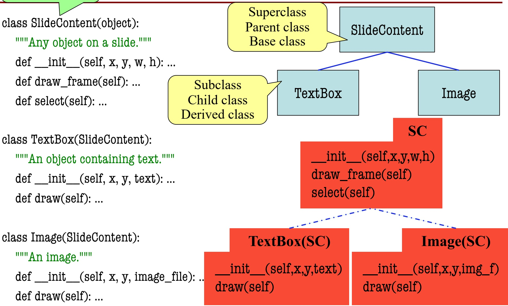
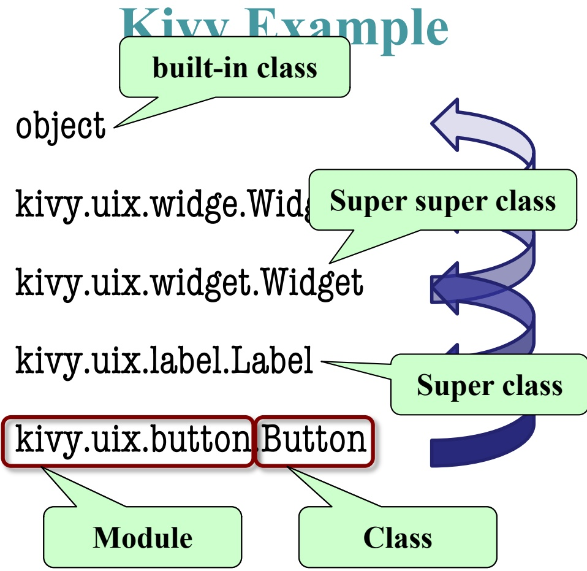
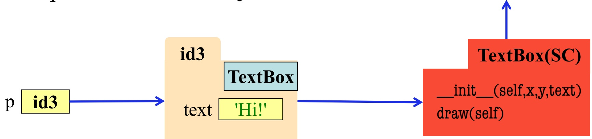
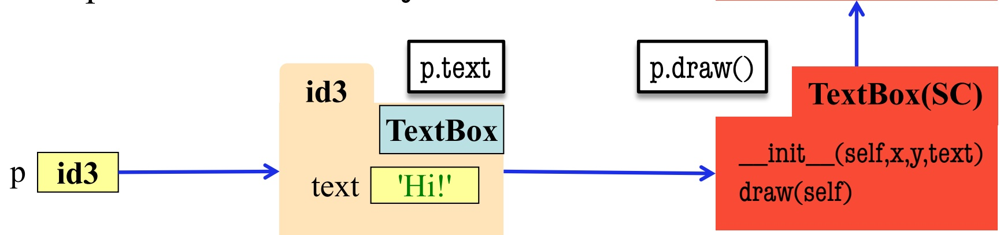
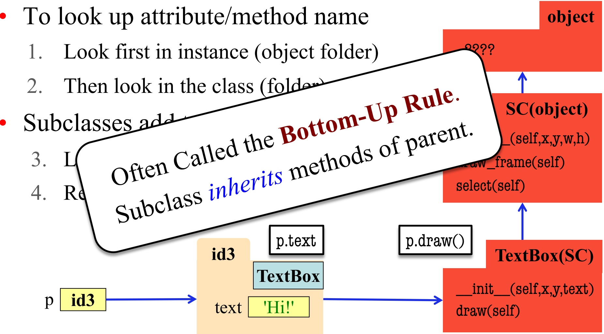
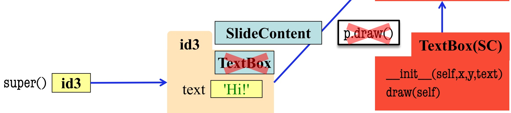
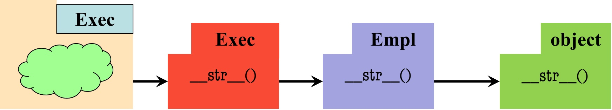
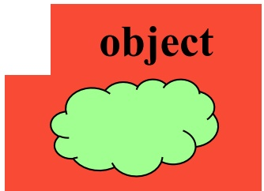

<!-- page: 1 -->

Lecture 20

## Subclasses & Inheritance

<!-- page: 2 -->

## Announcements for Today

## Assignments

• A4 to be graded **next week**

§ Survey is still open

• A5 was posted **Friday**

§ Shorter written assignment

§ Due Friday at Midnight

• A6 also posted **Friday**

§ Due **Sun, November 15**

§ Designed to take 2 weeks

§ Follow **micro-deadlines!**

## Prelim 2

• **Prelim, Nov 17**<strong><sup>th</sup></strong> **at 7:30**

§ See webpage for rooms

§ Review Session **TBA**

## • Material up to Thursday

§ Recursion + Loops + Classes

§ Study guide is now posted

§ See structure of prev exams

• **Conflict with Prelim?**

§ Corey has sent out form

<!-- page: 3 -->

## Announcements for Today

## Assignments

• A4 to be graded **next week**

## Prelim 2

§ Survey is st

• A5 was posted

§ Shorter wri

§ Due Friday

• A6 also posted

• **Prelim, Nov 17**<strong><sup>th</sup></strong> **at 7:30**

**Video Lessons**

• **Lesson 22** for today

• **Videos 23.1-23.7** for Thurs

e for rooms

sion TBA

to Thursday

Loops + Classes

is now posted

§ Due **Sun, November 15**

§ Designed to take 2 weeks

§ Follow **micro-deadlines!**

§ See structure of prev exams

• **Conflict with Prelim?**

§ Corey has sent out form

<!-- page: 4 -->

## Quick Announcement on A6

• We ask you to use isinstance instead of type

§ In paragraph on enforcing preconditions

§ What do we mean by this?

• **Recall:** Type-based preconditions

§ **Precondition:** x is a list

§ assert type(x) == list

§ assert isinstance(x,list)

• More on that this lecture

This is almost the same

<!-- page: 5 -->

## An Application

• **Goal**: Presentation program (e.g. PowerPoint)

• **Problem**: There are many types of content

**Examples**: text box, rectangle, image, etc.

§ Have to write code to display each one

• **Solution**: Use object oriented features

§ Define class for every type of content

§ Make sure each has a draw method:

for x in slide[i].contents: x.draw(window)

<!-- page: 6 -->

## Sharing Work

• These classes will have a lot in common

§ Drawing handles for selection

§ Background and foreground color

§ Current size and position

§ And more (see the formatting bar in PowerPoint)

• **Result**: A lot of repetitive code

• **Solution**: Create one class with shared code

§ All content are subclasses of the parent class

<!-- page: 7 -->

Abbreviate as SC to right

## Defining a Subclass

class SlideContent(object): """Any object on a slide."""

def \_\_init\_\_(self, x, y, w, h): … def draw\_frame(self): … def select(self): …

class TextBox(SlideContent): """An object containing text.""" def \_\_init\_\_(self, x, y, text): … def draw(self): …



class Image(SlideContent): """An image.""" def \_\_init\_\_(self, x, y, image\_file): def draw(self): …

<!-- page: 8 -->

## Class Definition: Revisited

## class &lt;name&gt;(&lt;superclass&gt;):

"""Class specification"""

getters and setters

initializer (\_\_init\_\_)

definition of operators

definition of methods

anything else

Class type to extend (may need module name)

• Every class must extend something

• Previous classes all extended object

<!-- page: 9 -->

## object and the Subclass Hierarcy

## • Subclassing creates a hierarchy of classes

§ Each class has its own super class or parent

§ Until object at the “top”

## • object has many features

§ Special built-in fields: \_class\_\_, \_\_dict\_\_

§ Special built-in methods: \_str\_\_, \_\_repr\_\_

## Kivy Example

## object

kivy.uix.widge.WidgetBase

kivy.uix.widget.Widget

kivy.uix.label.Label


<u>kivy.uix.button</u>.<u>Button</u>

**Module**

**Class**

<!-- page: 10 -->

## object and the Subclass Hierarcy

## • Subclassing creates a hierarchy of classes

§ Each class has its own super class or parent

§ Until object at the “top”

## • object has many features

§ Special built-in fields: \_class\_\_, \_\_dict\_\_

§ Special built-in methods: \_str\_\_, \_\_repr\_\_



<!-- page: 11 -->

## Name Resolution Revisited

• To look up attribute/method name

1. Look first in instance (object folder)

2. Then look in the class (folder)

• Subclasses add two more rules:

3. Look in the superclass

4. Repeat 3. until reach object



<!-- page: 12 -->

## Name Resolution Revisited

• To look up attribute/method name

1. Look first in instance (object folder)

2. Then look in the class (folder)

• Subclasses add two more rules:

3. Look in the superclass

4. Repeat 3. until reach object

init\_\_(self,x,y,w,h) draw\_frame(self) select(self)



<!-- page: 13 -->

## Name Resolution Revisited

• To look up attribute/method name

1. Look first in instance (object folder)

2. Then look in the class (folder)

• Subclasses add

3. Lo



<!-- page: 14 -->

## A Simpler Example

## class Employee(object):

"""Instance is salaried worker"""

\# INSTANCE ATTRIBUTES:

\# \_name: full name, a string

\# \_start: first year hired,

\# an int ≥ -1, -1 if unknown

\# \_salary: yearly wage, a float

## class Executive(Employee):

"""An Employee with a bonus"""

\# INSTANCE ATTRIBUTES:

#\_bonus: annual bonus, a float

## object

init\_\_(self)

\_\_str\_\_(self)

\_\_repr\_\_(self)

## Employee

init\_\_(self,n,d,s)

\_str\_\_(self)

\_repr\_\_(self)

## Executive

init\_\_(self,n,d,b)

str\_\_(self)

\_repr\_\_(self)

<!-- page: 15 -->

## A Simpler Example

## class Employee(object):

"""Instance is salaried worker""" # INSTANCE ATTRIBUTES: # \_name: full name, a string # \_start: first year hired, # an int ≥ -1, -1 if unknown # \_salary: yearly wage, a float

## class Executive(Employee):

"""An Employee with a bonus"""

\# INSTANCE ATTRIBUTES:

#\_bonus: annual bonus, a float

## object

init\_\_(self) str\_\_(self) \_repr\_\_(self

All double underscore methods are in class object

**Employee**

init\_\_(self,n,d,s) str\_\_(self) \_repr\_\_(self)

## Executive

\_init\_\_(self,n,d,b)

str\_\_(self)

\_repr\_\_(self)

<!-- page: 16 -->

## Method Overriding

• Which \_\_str\_\_ do we use?

§ Start at bottom class folder

§ Find first method with name

§ Use that definition

## • New method definitions override those of parent

§ Access to old version is **lost**

§ New version used instead

§ **Example**: \_\_init\_\_

**object**

init\_\_(self)

\_\_str\_\_(self)

\_\_repr\_\_(self)

**Employee**

init\_\_(self,n,d,s)

\_str\_\_(self)

\_\_repr\_\_(self)

**Executive**

\_\_init\_\_(self,n,d,b)

\_\_str\_\_(self)

\_repr\_\_(self)

<!-- page: 17 -->

## Accessing the “Previous” Method

• What if you want to use the original version method?

§ New method = original+more

§ Do not want to repeat code from the original version

• Use the function super()

§ “Converts” type to parent class

§ Now methods go to the class

• **Example**:

super().\_\_str\_\_()

**In Python 2** <strong><u>self goes here</u></strong>

## object

\_\_init\_\_(self)

\_\_str\_\_(self)

\_\_eq\_\_(self)

**Employee**

init\_\_(self,n,d,s)

\_str\_\_(self)

\_\_eq\_\_(self)

## Executive

\_\_init\_\_(self,n,d,b)

\_\_str\_\_(self)

\_\_eq\_\_(self)

<!-- page: 18 -->

## Accessing the “Previous” Method

• What if you want to use the original version method?

§ New method = original+more

§ Do not want to repeat code from the original version

• Use the function super()

§ “Converts” type to parent class

§ Now methods go to the class

• **Example**:

super().\_\_str\_\_() **self is implied**

```python
class Employee(object):
    """An Employee with a salary"""
    ...
    def __str__(self):
        return (self._name +
            ',year ' + str(self._start) +
            ',salary ' + str(self._salary))
```

class Executive(Employee):

```python
def __str__(self):
    return (super().__str__()
        + ', bonus ' + str(self._bonus))
```

<!-- page: 19 -->

## What is super()?

• Like object with class “removed”

§ Still gives a reference to self

§ But bottom-up rule **skips** first class

• But cannot use it everywhere

§ Only allowed in **method definitions**

**id3**

<u>p.select()</u>

<u>p.draw()</u>

**SlideContent**

TextB

**object**

????

'Hi!'



**SC(object)**

init\_\_(self,x,y,w,h) draw\_frame(self) select(self)

p.draw(

**TextBox(SC)**

init\_\_(self,x,y,text) draw(self)

<!-- page: 20 -->

## What is super()?

• super() is very limited

§ Can only go one level

§ **BAD**: super().super()

p **id2**

• Need arguments for more

§ super(class,self)

The **subclass**

Object in <u>the method</u>

**id2**

**Exec**



**Exec** str\_\_()

p.\_\_str\_\_()

**Empl** str\_\_()

**object** \_str\_\_()

<!-- page: 21 -->

## What is super()?

• super() is very limited

§ Can only go one level

§ **BAD**: super().super()

p **id2**

• Need arguments for more

§ super(class,self)

The **subclass**

Object in <u>the method</u>

**id2**

**Exec**


**Exec** str\_\_()

p.\_\_str\_\_()

**Empl** str\_\_()

**object** \_str\_\_()

<!-- page: 22 -->

## What is super()?

• super() is very limited

§ Can only go one level

§ **BAD**: super().super()

p **id2**

• Need arguments for more

§ super(class,self)

The **subclass**

Object in <u>the method</u>

**id2**

**Exec**

**Exec** str\_\_()

p.\_\_str\_\_()

super(Exec,self).\_\_str\_\_()

**Empl** str\_\_()

super().\_\_str\_\_()

**object** \_str\_\_()

<!-- page: 23 -->

## What is super()?

• super() is very limited

§ Can only go one level

§ **BAD**: super().super()

• Need arguments for more

p **id2**

§ super(class,self)

The **subclass**

Object in <u>the method</u>

**id2**

**Exec**

super(Exec,self).\_\_str\_\_()

**Exec**

\_str\_\_()

**Empl**

**object**

\_str\_\_()

\_\_str\_\_()

p.\_\_str\_\_()

super().\_\_str\_\_()super(Empl,self).\_\_str\_\_()

<!-- page: 24 -->

## Primary Application: Initializers

class Employee(object):

```python
def __init__(self,n,d,s=50000.0):
    self._name = n
    self._start = d
    self._salary = s
```

```python
class Executive(Employee):
    ...
    def __init__(self,n,d,b=0.0):
        super().__init__(n,d)
        self._bonus = b
```

## object

```python
__init__(self)
__str__(self)
__repr__(self)
```

## Employee

```txt
__init__(self,n,d,s)
__str__(self)
__repr__(self)
```

## Executive

```python
__init__(self,n,d,b)
```

str\_\_(self)

\_repr\_\_(self)

<!-- page: 25 -->

## Instance Attributes are (Often) Inherited

class Employee(object):

```python
def __init__(self,n,d,s=50000.0):
    self._name = n
    self._start = d
    self._salary = s
```

```python
class Executive(Employee):
    ...
    def __init__(self,n,d,b=0.0):
        super().__init__(n,d)
        self._bonus = b
```

**id4**

<strong><u>Executive</u></strong>

Created in **Employee** initializer

\_bonus

0.0

Created in **Executive** initializer

<!-- page: 26 -->

## Also Works With Class Attributes

## Class Attribute: Assigned outside of any method definition

class Employee(object):

"""Instance is salaried worker"""

\# Class Attribute

STD\_SALARY = 50000.0

## class Executive(Employee):

"""An Employee with a bonus. ""”

\# Class Attribute

STD\_BONUS = 10000.0

**object**

**Employee**

STD\_SALARY

50000.0

**Executive**

STD\_BONUS

10000.0

<!-- page: 27 -->

## Name Resolution and Inheritance

```python
class A(object):
    x = 3 # Class Attribute
    y = 5 # Class Attribute
    def f(self):
        return self.g()
    def g(self):
        return 10

class B(A):
    y = 4   # Class Attribute
    z = 42  # Class Attribute
    def g(self):
        return 14
    def h(self):
        return 18
```

• Execute the following:

• What is value of a.f()?

```txt
A: 10  
B: 14  
C: 5  
D: ERROR  
E: I don't know
```

<!-- page: 28 -->

## Name Resolution and Inheritance

```python
class A(object):
    x = 3 # Class Attribute
    y = 5 # Class Attribute
    def f(self):
        return self.g()
    def g(self):
        return 10

class B(A):
    y = 4   # Class Attribute
    z = 42  # Class Attribute
    def g(self):
        return 14
    def h(self):
        return 18
```

• Execute the following:

• What is value of a.f()?

```txt
A: 10 CORRECT  
B: 14  
C: 5  
D: ERROR  
E: I don't know
```

<!-- page: 29 -->

## Name Resolution and Inheritance

```python
class A(object):
    x = 3 # Class Attribute
    y = 5 # Class Attribute
    def f(self):
        return self.g()
    def g(self):
        return 10

class B(A):
    y = 4   # Class Attribute
    z = 42  # Class Attribute
    def g(self):
        return 14
    def h(self):
        return 18
```

• Execute the following:

• What is value of b.f()?

```txt
A: 10  
B: 14  
C: 5  
D: ERROR  
E: I don't know
```

<!-- page: 30 -->

## Name Resolution and Inheritance

```python
class A(object):
    x = 3 # Class Attribute
    y = 5 # Class Attribute
    def f(self):
        return self.g()
    def g(self):
        return 10

class B(A):
    y = 4   # Class Attribute
    z = 42  # Class Attribute
    def g(self):
        return 14
    def h(self):
        return 18
```

• Execute the following:

• What is value of b.f()?

```txt
A: 10  
B: 14 CORRECT  
C: 5  
D: ERROR  
E: I don't know
```

<!-- page: 31 -->

## Name Resolution and Inheritance

```python
class A(object):
    x = 3 # Class Attribute
    y = 5 # Class Attribute
    def f(self):
        return self.g()
    def g(self):
        return 10

class B(A):
    y = 4   # Class Attribute
    z = 42  # Class Attribute
    def g(self):
        return 14
    def h(self):
        return 18
```

• Execute the following:

• What is value of b.x?

```txt
A: 4  
B: 3  
C: 42  
D: ERROR  
E: I don't know
```

<!-- page: 32 -->

## Name Resolution and Inheritance

```python
class A(object):
    x = 3 # Class Attribute
    y = 5 # Class Attribute
    def f(self):
        return self.g()
    def g(self):
        return 10

class B(A):
    y = 4   # Class Attribute
    z = 42  # Class Attribute
    def g(self):
        return 14
    def h(self):
        return 18
```

• Execute the following:

• What is value of b.x?

```txt
A: 4  
B: 3 CORRECT  
C: 42  
D: ERROR  
E: I don't know
```

<!-- page: 33 -->

## Name Resolution and Inheritance

```python
class A(object):
    x = 3 # Class Attribute
    y = 5 # Class Attribute
    def f(self):
        return self.g()
    def g(self):
        return 10

class B(A):
    y = 4   # Class Attribute
    z = 42  # Class Attribute
    def g(self):
        return 14
    def h(self):
        return 18
```

• Execute the following:

• What is value of a.z?

```txt
A: 4  
B: 3  
C: 42  
D: ERROR  
E: I don't know
```

<!-- page: 34 -->

## Name Resolution and Inheritance

```python
class A(object):
    x = 3 # Class Attribute
    y = 5 # Class Attribute
    def f(self):
        return self.g()
    def g(self):
        return 10

class B(A):
    y = 4   # Class Attribute
    z = 42  # Class Attribute
    def g(self):
        return 14
    def h(self):
        return 18
```

• Execute the following:

• What is value of a.z?

```txt
A: 4  
B: 3  
C: 42  
D: ERROR CORRECT  
E: I don't know
```

<!-- page: 35 -->

## The isinstance Function

## • isinstance(&lt;obj&gt;,&lt;class&gt;)

§ True if &lt;obj&gt;’s class is same as or a subclass of &lt;class&gt;

§ False otherwise

## Example:

§ isinstance(e,Executive) is True

§ isinstance(e,Employee) is True

§ isinstance(e,object) is True

§ isinstance(e,str) is False

## • Generally preferable to type

§ Works with base types too!

e

**id4**

**id4**

<strong><u>Executive</u></strong>

name

'Fred'

\_start

2012

\_salary

0.0

bonus

0.0



**object**

**Employee**


**Executive**


