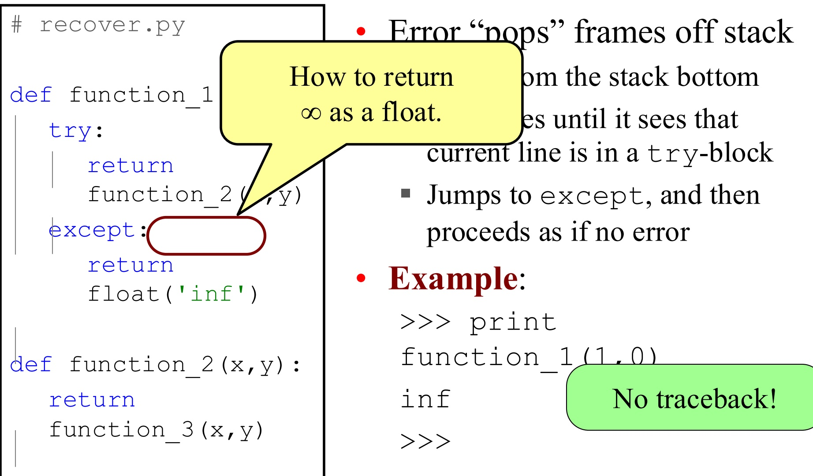
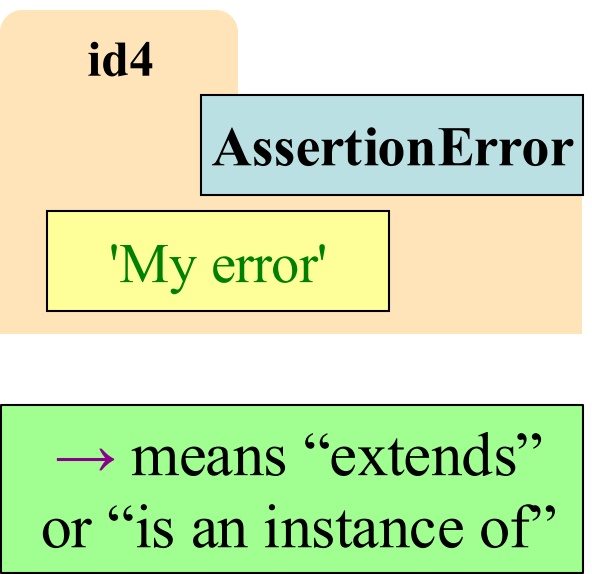
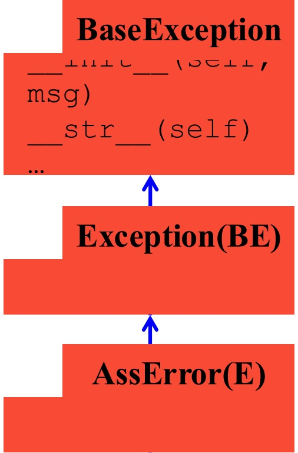

<!-- page: 1 -->

Lecture 25

## Error Handling

<!-- page: 2 -->

## Announcements for This Lecture

## Assignments

• **A6** is on hold right now

▪ Will be graded after break

▪ Quiz is also after break

• Should be working on **A7**

▪ OH available this Sun/Mon

▪ Lab hours on Tuesday

▪ OH resume Mon after break

▪ **Need to get Target moving**

▪ Due **December 7th/10th**

## Course Material

• Only two **topics** remain

▪ One is covered today

▪ Other is next two lectures

• Only two real **labs** remain

▪ Today’s topic this week

▪ Next topic after break

• **All videos** are now posted

▪ Today: **Videos 25-27**

▪ Next Time: **Video 28**

<!-- page: 3 -->

## Recovering from Errors

```python
• Suppose we have this code:
    result = input('Number: ')          # get
    number from user
    x = float(result)                  #
    convert string to float
    print('The next number is '+str(x+1))
• What if user mistypes?
    Number: 12a
    Traceback (most recent call last):
        File "prompt.py", line 13, in
    <module>
9/30/25                      Asserts & Error Handling
       x = float(result)
```

<!-- page: 4 -->

## Ideally Would Handle with Conditional

```python
result = input('Number: ')
get number from user
if isfloat(red)
    Does not Exist
    x = float(result)
# convert to float
    print('The next number is
'+str(x+1))
else:
    print('That is not a
```

<!-- page: 5 -->

## Using Try-Except

```python
try:
    result = input('Number: ')
# get number
    x = float(result)
# convert to float
    print('The next number is +str(x+1))
exce
Similar to if-else
■ But always does the try block
■ Might not do all of the try block
```

<!-- page: 6 -->

## Using Try-Except

```python
try:
    result = input('N'
# get number
    x = float(result)
    # convert to flow
    print('The next number is
+str(x+1))
except
Conversion
may crash!
Execute if crashes
Similar to if-else
■ But always does the try block
■ Might not do all of the try block
```

<!-- page: 7 -->

## Try-Except is Very Versatile

```python
def isfloat(s):
    """Returns: True
    if string s
    represents a
    float"""
    try:
        x = float(s)
    return True
    except:
        return False
```

<!-- page: 8 -->

## Try-Except and the Call Stack

```python
# recover.py
def function_1(x,y):
    try:
        return
        function_2(x,y)
    except:
        return
        float('inf')
def function_2(x,y):
    return
    function_3(x,y)
```


Asserts & Error Handling

<!-- page: 9 -->

## Try-Except and the Call Stack



No traceback!

$$
_ 3 (x, y)
$$

<!-- page: 10 -->

## Tracing Control Flow

```python
def first(x):
    print('Starting first.')
    try:
        second(x)
    except:
        print('Caught at first')
    print('Ending first')

def second(x):
    print('Starting second.')
    try:
        third(x)
    except:
        print('Caught at second')

def third(x):
    print('Starting third.')
    assert x < 1
    print('Ending third.)

What is the output of first(2)?
```

<!-- page: 11 -->

## Tracing Control Flow

```python
def first(x):
    print('Starting first.')
    try:
        second(x)
    except:
        print('Caught at first')
    print('Ending first')

def second(x):
    print('Starting second.')
    try:
        third(x)
    except:
        print('Caught at second')
print('Ending second')
```

<!-- page: 12 -->

```python
def first(x):
    print('Starting first.')
    try:
        second(x)
    except:
        print('Caught at first')
    print('Ending first')

def second(x):
    print('Starting second.')
    try:
        third(x)
    except:
        print('Caught at second')

def third(x):
    print('Starting third.')
    assert x < 1
    print('Ending third.)

What is the output of first(0)?
```

## Tracing Control Flow

<!-- page: 13 -->

## Tracing Control Flow

```python
def first(x):
    print('Starting first.')
    try:
        second(x)
    except:
        print('Caught at first')
    print('Ending first')

def second(x):
    print('Starting second.')
    try:
        third(x)
    except:
        print('Caught at second')

def third(x):
    print('Starting third.')
    assert x < 1
    print('Ending third')

What is the output of first(0)?
'Starting first.'
'Starting second.'
'Starting third.'
'Ending third'
'Ending third'
'Ending second'
'Ending first'

9/30/25 Asserts & Error Handling 13
```

<!-- page: 14 -->

## Error Types in Python

```python
def foo():
    assert 1 == 2,
    'My error'
    ...
>>> foo()
AssertionError: My
error
Class Names
def foo():
    x = 5 / 0
    ...
>>> foo()
ZeroDivisionError:
integer division
or modulo by zero
```

<!-- page: 15 -->

## Error Types in Python

```python
def foo():
    assert 1 == 2,
    'My error'
    ...
>>> foo()
AssertionError: My
error
Class Names
>>> foo()
ZeroDivisionError:
integer division
or modulo by zero
Information about an error
is stored inside an object.
The error type is the class
of the error object.
```

<!-- page: 16 -->



## Error Types in Python

• All errors are instances of class BaseException

• This allows us to organize them in a hierarchy



$$
\begin{array}{c} \text {BaseException} \\ \text {Exception} \\ \text {AssertionError} \\ \text {r} \end{array}
$$

→ means “extends” or “is an instance of”

<!-- page: 17 -->

## Error Types in Python

• All errors are instances of class BaseException

• This allows us to organize them in a hierarchy

**BaseException**

**Exception(BE)**

**AssError(E)**

BaseException个

All of these are Exceptionactually empty! **Why?**

AssertionErro r

**id4**

**AssertionError**

'My error'

→ means “extends” or “is an instance of”

<!-- page: 18 -->

## Python Error Type Hierarchy

BaseException

SystemExit

Exception

~~Argument has~~ wrong **type** (e.g. float([1])

~~Argument has~~ wrong **value** (e.g. float('a')

AssertionError

AttributeError

ArithmeticError

IOError

TypeError

ValueError

ZeroDivisionError

OverflowError

http://docs.python.org/Why so many error types? library/exceptions.html

<!-- page: 19 -->

## Handling Errors by Type

• try-except blocks can be restricted to **specific** errors

▪ Do except if error is **an instance** of that type

▪ If error not an instance, do not recover

```python
• Example:
try:
    val = input()          # get number from
    user
    x = float(val)         # convert string
    to float
    print('The next number is '+str(x+1)).'
except ValueError:
print('Hey! That is not a number!')
May have
KeyboardInterrupt
May have ValueError
Only recovers ValueError.
Other errors ignored.
11/18/25
```

<!-- page: 20 -->

## Handling Errors by Type

• try-except blocks can be restricted to **specific** errors

▪ Doe except if error is **an instance** of that type

▪ If error not an instance, do not recover

```txt
• Example:
try:
    val = input()          # get number from
    user
    x = float(val)         # convert string
    to float
    print('The next number is '+str(x+1)')
except KeyboardInterrupt:
print('Check your keyboard!')
May have
KeyboardInterrupt
May have ValueError
Only recovers
KeyboardInterrupt.
Other errors ignored.
20
```

<!-- page: 21 -->

## Handling Errors by Type

• try-except can put the error in a variable

## • Example:

```python
try:
    val = input()          # get number from
    user
    x = float(val)         # convert string
    to float
    print('The next number i
except ValueError as e:
    print(e.args[0])
    print('Hey! That is not a number!')
```

<!-- page: 22 -->

## Creating Errors in Python

## • Create errors with raise

▪ **Usage**: raise &lt;exp&gt;

▪ exp evaluates to an object

▪ An instance of Exception

• Tailor your error types

▪ **ValueError**: Bad value

▪ **TypeError**: Bad type

• Still prefer **asserts** for preconditions, however

▪ Compact and easy to read

```python
def foo(x):
    assert x < 2,
    'My error'
    ...
    Identical
def foo(x):
    if x >= 2:
        m = 'My
error'
        err =
```

AssertionError(m)Advanced Error Handling

<!-- page: 23 -->

```txt
def foo(x):
```

## Creating Errors in Python

## • Create errors with raise

▪ **Usage**: raise &lt;exp&gt;

▪ exp evaluates to an object

▪ An instance of Exception

• Tailor your error types

▪ **ValueError**: Bad value

▪ **TypeError**: Bad type

• Still prefer **asserts** for preconditions, however

▪ Compact and easy to read

```python
assert x < 2,
    'My error'
    ...
    Identical
def foo(x):
    if x >= 2:
        m = 'My
error'
        err =
```

ValueError(m)Advanced Error Handling

<!-- page: 24 -->

## Raising and Try-Except

```python
def foo():
    x = 0
    try:
        raise
Exception()
        x = 2
    except Exception:
        x = 3
    return x
```

<!-- page: 25 -->

## Raising and Try-Except

```python
def foo():
    x = 0
    try:
        raise
Exception()
        x = 2
    except Exception:
        x = 3
    return x
```

<!-- page: 26 -->

```txt
• The value of
foo( ) ?
A: 0
B: 2
C: 3
D: No value. It stops!
E: I don’t know
```

## Raising and Try-Except

```python
def foo():
    x = 0
    try:
        raise
Exception()
        x = 2
    except
BaseException:
```

$$
\mathrm{x} = 3
$$

```txt
return x
```

<!-- page: 27 -->

## Raising and Try-Except

```python
def foo():
    x = 0
    try:
        raise
Exception()
        x = 2
    except
BaseException:
```

$$
\mathrm{x} = 3
$$

```txt
return x
```

• The value of foo()?

<!-- page: 28 -->

```python
def foo():
    x = 0
    try:
        raise
Exception()
        x = 2
    except
AssertionError:
```

## Raising and Try-Except

$$
\mathrm{x} = 3
$$

```txt
return x
```

```txt
• The value of
foo( ) ?
A: 0
B: 2
C: 3
D: No value. It stops!
E: I don’t know
```

<!-- page: 29 -->

```txt
• The value of
foo( ) ?
A: 0
B: 2
C: 3
D: No value. Correct
E: I don’t know
```

## Raising and Try-Except

```python
def foo():
    x = 0
    try:
        raise
Exception()
        x = 2
    except
AssertionError:
```

$$
\mathrm{x} = 3
$$

```txt
return x
```

Python uses isinstance <u>to match Error types</u>

<!-- page: 30 -->

## Creating Your Own Exceptions

## class CustomError(Exception):

"""An instance is a cust pass

## This is all you need!

▪ No extra attributes

▪ No extra methods

▪ No constructors

Inherit everything

Only issues is choice of parent error class. Use Exception if you are unsure what.

<!-- page: 31 -->

## Case Study: Files

• Can read the contents of any file with open()

▪ Returns a file object with method read()

▪ Method read() returns contents as a string

▪ Remember to close() file when done

• There are **SO** many errors that can happen

▪ FileNotFoundError: File does not exit

▪ PermissionError: You are not allowed to read it

▪ Other errors possible when processing data

Advanced Error Handling

<!-- page: 32 -->

## Recall: JSON Files

```json
{
    "wind" : {
        "speed" : 13.0,
        "crosswind" : 5.0
    },
    "sky" : [
        {
            "cover" : "clouds",
            "type" : "broken",
            "height" : 1200.0
        },
        {
            "type" : "overcast",
            "height" : 1800.0
        }
    ]
}
```

• Look like a nested dict

▪ But read in as a string

▪ You have to **convert** it

• Python module json

▪ Function loads() Converts str -> dict

▪ Function dumps() Convert dict -> str

• Conversion is sensitive

▪ Stray commas crash it

<!-- page: 33 -->

## Reading a JSON File

def read\_json(fn

try:

file =

open(fname)

file.read()

Close file when done ame):Open file with name

file.close() result = json.loads(data)

return result

except

FileNotFoundE<u>rror:</u>

print +' not found')11/18/25 Note that we can chain excepts like an if-elif statement

nameIf failed Could not find file

JSON contents are not valid

Advanced Error Handling

<!-- page: 34 -->

## Reading a File in General

```python
def read_foo(fname):
    try:
        file =
open(fname)
        data =
file.read()
        file.close()
        result =
convert(data)
        return result
except
FileNotFoundError:
    print(fname
not found')
```

All the work is in conversion step

Custom helper for this file type

Error specific to the file format

<!-- page: 35 -->

## Aside: Pathnames

• Files obey the same rule as other modules

▪ To read a file, it must be in the same folder

▪ Otherwise, you must use a pathname for file

• **Relative path**: directions from <u>current folder</u>

▪ **macOS**: '.../.../lec22/f

▪ **Windows**: '...\...\lec22\

le.txt'Like navigating ile.txt'command shell

• **Absolute path**: directions that work anywhere

▪ **macOS**:

$$
t'
$$

Advanced Error Handling

<!-- page: 36 -->

## Aside: Pathnames

• Files obey the same rule as other modules

▪ To read a file, it must be in the same folder

▪ Otherwise, you mus

t use a pathnaNote the change

me for file

in slash direction

• **Relative path**: direction~~s from~~ <s><u>c</u></s><u>urrent folder</u>

▪ **macOS**: '.../.../lec22/f ile.txt'Like navigating Like navigating

▪ **Windows**: '...\...\lec22\

ile.txt'command shell

• **Absolute path**: directions that work anywhere

**macOS**:

'/Users/white/cs1110/lect22/file.tx

$$
t'
$$

Advanced Error Handling

<!-- page: 37 -->

## Pathnames are OS Specific

• This makes reading files harder

▪ May work on Windows but crash on macOS!

▪ Yet another error message we need to handle

• **Solution**: Use the module os.path

▪ Builds a pathname string for current os

• **Example**: os.path('..', 'cs1110', 'lec22', 'file.txt')

▪ **macOS**: '../cs1110/lec22/file.txt'

▪ **Windows**: '..\cs1110\lec22\file.txt’

• Absolute paths are a little trickier, but similar 11/18/25 Advanced Error Handling

<!-- page: 38 -->

## Final Word on Error Handling

• Versions of try-except exist in most languages

▪ Java, C++, C#, Objective-C all have it

• But those languages try to **minimize** its use

▪ Give application a way to crash “nicely”

▪ Because processing a try-except it quite slow

• Python has a very **different** philosophy

▪ Python is sort-of slow; exceptions are not slower

▪ It is okay to use try-except all the time

11/18/25▪ Encourages its use as much as Advanced Error Handling <sup>if</sup>-<sup>s</sup>tatements

<!-- page: 39 -->

## Final Word on Error Handling

• Versions of try-except exist in most languages

▪ Java, C++, C#, Objective-C all have it

• But those languages try to **minimize** its use

▪ Give application a way to crash “nicely”

▪ Because

• Python has

▪ Python is

▪ It is okay t

Developers refer to coding styles unique to python as **pythonic** programming

te slow

phy

not slower

11/18/25▪ Encourages its use as much as Advanced Error Handling <sup>if</sup>-<sup>s</sup>tatements
