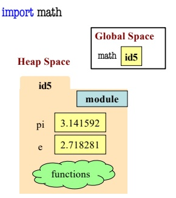
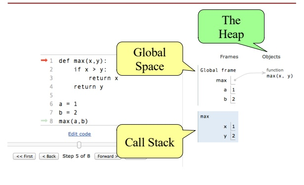
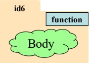
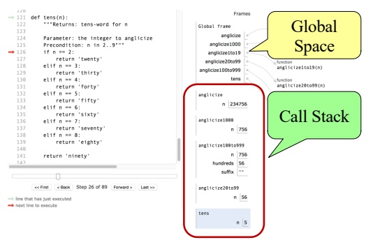

<!-- page: 1 -->

## The Three “Areas” of Memory

## The Call Stack

• The area **where call frames live**

§ Call frames are created on a function call

§ May be several frames (functions call functions)

§ Each frame deleted as the call completes

• Area of volatile, temporary memory

§ Less permanent than global space

§ Think of as “scratch” space

| incr_x | 2 |
| --- | --- |
| q | id2 |

• Primary focus of Assignment 2

## Global Space

• This is the **area you “start with”**

§ First memory area you learned to visualize

§ A place to store “global variables”

§ Lasts until you quit Python

• What are **global variables**?

§ **Any assignment not in a function definition**

§ Also **modules & functions!**

§ Will see more on this in a bit

## Heap Space or “The Heap”

• **Where the “folders” live**

§ Stores only folders

• Can only **access indirectly**

§ Must have a variable with identifier

§ Can be in global space, call stack

• MUST have **variable with id**

§ If no variable has id, it is forgotten

| id2 |  |
| --- | --- |
|  | Point3 |
| x | 0.0 |
| y | 0.0 |
| z | 0.0 |

§ Disappears in Tutor immediately

§ But not necessarily in practice

§ Role of the garbage collector

## Modules and Global Space

• Importing a module:

## import math

§ Creates a global variable (same name as module)

**Heap Space**

math **id5**

§ Puts contents in a **folder**

**id5**

• Module variables

**module**

• Module functions

3.141592

§ Puts folder id in variable

• **from** keyword dumps contents to global space

## Functions and Global Space

• A function **definition**…

## def to\_centigrade(x):

§ Creates a global variable (same name as function)

Body

return 5\*(x-32)/9.0

§ Creates a **folder** for body

**Global Space**

§ Puts folder id in variable

to\_centigrade **id6**

• Variable vs. Call

**Heap Space**

>>> to\_centigrade

&lt;fun to_centigrade at 0x100498de8&gt;

0.0

>>> to\_centigrade (32)

**id6**

**function**

<!-- page: 2 -->

## Recall: Call Frames

1. Draw a frame for the call

**Call**: to\_centigrade(50.0)

2. Assign the argument value to the parameter (in frame)

**to\_centigrade**

3. Execute the function body <u>Look for variables in the f</u>rame If not there, look for global <u>variables with that name</u>

x 50.0

4. Erase the frame for the call

<strong><u>What is happening here?</u></strong>

**def** to\_centigrade(x):

return 5\*(x-32)/9.0

## Frames and Helper Functions

Not done. Do not erase!

1. def last\_name\_first(s):

2.

Call: last\_

"""**Precond**: s in the form

3.

last\_name\_first 4

'first-name last-name' """

4.

s

'Walker White'

<u>first = first\_name(s</u>)

5.

last = last\_name(s)

6.

return last + ',' + first

7.

first\_name

**10**

8. def first\_name(s):

9. """**Precond**: see above"""

s

'Walker White'

10. end = s.find(' ')

11. return s[0:end]

## The Call Stack

• Functions are **stacked**

§ Cannot remove one above w/o removing one below

§ Sometimes draw bottom up (better fits the metaphor)

Frame 1

• Stack represents memory

Frame 2

as a **high water mark**

Frame 3

§ Must have enough to keep the **entire stack in memory**

Frame 4

§ Error if cannot hold stack

Frame 6  5

## Function Access to Global Space

• All function definitions are in some module

• Call can access global space for **that module**

**Global Space** (for globals.py) a 4

§ math.cos: global for math

**change\_a**

§ temperature.to\_centigrade uses global for temperature

\# globals.py

• But **cannot** change values

"""Show how globals work"""

§ Makes a new local variable!

a = 4 # global space

§ Why we limit to constants

**def** change\_a():

a = 3.5 # local variable

## Frames and Helper Functions

1. def last\_name\_first(s):

2.

**Call:** last\_name\_first('Walker White'):

"""**Precond**: s in the form

5

3.

last\_name\_first

'first-name last-name' """

4.

first = first\_name(s)

s 'Walker White'

5.

<u>last = last\_name(s)</u>

first

'Walker'

6.

return last + ',' + first

last\_name

**15**

13. def last\_name(s):

14.

s

"""**Precond**: see above"""

15.

'Walker White'

16.

end = s.rfind(' ')

return s[end+1:]

## Anglicize Example

Call Stack
