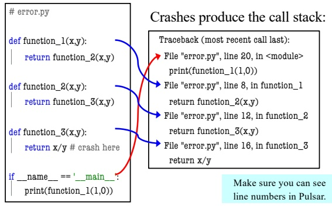

<!-- page: 1 -->

## Using Color Objects in A3

• New classes in introcs

§ RGB, CMYK, and HSL

• Each has its own attributes

c **id1**

§ **RGB**: red, blue, green

| id1 | RGB |
| --- | --- |
| red | 128 |
| green | 0 |
| blue | 0 |

r 128

§ **CMYK**: cyan, magenta, yellow, black

§ **HSL**: hue, saturation, lightness

>>> import introcs

• Attributes have invariants

>>> c = introcs.RGB(128,0,0)

§ Limits the attribute values

>>> r = c.red

§ Example: red is int in 0..255

§ Get an error if you violate

>>> c.red = 500 # out of range

AssertionError: 500 outside [0,255]

## Errors and the Call Stack

\# error.py

Crashes produce the call stack:

def function\_1(x,y): return function\_2(x,y)

Traceback (most recent call last):

def function\_2(x,y): return function\_3(x,y)

File "error.py", line 20, in &lt;module&gt; print(function\_1(1,0))

File "error.py", line 8, in function\_1 return function\_2(x,y)

File "error.py", line 12, in function\_2 return function\_3(x,y)

if \_\_name\_\_ == '\_\_main\_\_': print(function\_1(1,0))

File "error.py", line 16, in function\_3 return x/y

Make sure you can see line numbers in Pulsar.

## Determining Responsibility

## def function\_1(x,y):

"""Returns: result of function\_2

Precondition: x, y numbers""" return function\_2(x,y)

## Traceback (most recent call last):

File "error1.py", line 32, print(function\_1(1,0))

def function\_2(x,y):

n &lt;module&gt;

"""Returns: x divided by y

n function\_1

File "error1.py", line 18, return function\_2(x,y)

Precondition: x, y numbers"""

return x/y

File "error1.py", line 28, in function\_2 <u>return x/y</u>

print(function\_1(1,0))

ZeroDivisionE

ror Where is the error? : division by zero

## Debugging Requires Visualization

## Can Use Special Tools

global last\_name\_firstid1

## Can Use print

last\_name\_first(n)

>>> last\_name\_first('Walker White')

last\_name\_first n "Walker White" end\_first 6 first "Walker" last White" White, Walker"

Start last\_name\_first('Walker White')

end\_first is "6"

first is "Walker"

last is " White"

result is " White, Walker"

Finish last\_name\_first('Walker White')

' White, Walker'

## This Makes Debugging Tricky

• Place error is detected != place error occurred

§ It can be further up in the call stack

§ It can even happen earlier in the code

§ Error messages are not enough to debug

• Debugging requires “**stepping-through**” code

§ You execute each line of code in your mind

§ You determine what Python does at that step

§ You verify that the two match (if not, bug)

## Case Study: Romanize

• Roman Numerals use letters instead of numbers

§ I = 1, V = 5, X = 10, L = 50, and C = 100

§ Can go higher, but will stop there for now

• Create other numbers by concatenation

§ II = 2, III = 3

§ LV = 55, LVIII = 53

• If a smaller number comes first, we subtract

§ IV = 4, IX = 9

§ VL = 40, XCVL = 94

<!-- page: 2 -->

## Dynamic Bug Search

• Start with a small number of print statement

§ Put them in the area you think error is

§ Leave large sections of code between prints

• Find the first print statement that is “wrong”

§ Error is must be before it (and after last print?)

§ Add more print statements in this area

§ Repeat this process as needed

• Problem is when cannot find anything wrong

§ Pick an area that was hard and add more prints

## Aiding the Search Process

• In practice, searching is hard

§ Errors can go a long time until we catch them

§ Errors often seen by user, not developer

• Would be easier if errors just crashed

§ A crash always gives a stack trace

§ The user can just email that to you

• We do this with **assert statements**

§ Crash the program when an error is seen

Asserts & Debugging

## Assert Statements

• **Form 1:** assert &lt;boolean&gt;

§ Does nothing if boolean is True

§ Creates an error is boolean is False

• **Form 2:** assert &lt;boolean&gt;, &lt;string&gt;

§ Very much like form 2

§ But error message includes the string

• Statement to **verify a fact is true**

§ Similar to assert\_equals used in unit tests

§ But more versatile with complete **stack trace**

## Example: Anglicizing an Integer

## def anglicize(n):

"""Returns: the anglicization of int n.

Precondition: n an int, 0 < n < 1,000,000"""

assert <u>type(n) == int, repr(n)</u>+' is not an int'

assert <u>0 < n and n < 1000000</u>, <u>repr(n)+' is out of range'</u>

\# Implement method here…

Check (part of)

the precondition

Error message

when violated

## Enforcing Preconditions is Tricky!

## def lookup\_netid(nid):

"""Returns: name of student with netid nid.

Precondition: nid is a string, which consists of

2 or 3 letters and a number"""

assert type(nid) == str, repr(nid) + ' is not a string'

assert nid.isalnum(), repr(nid)+' is not letters/digits

Returns True if s contains

Does this catch

only letters, numbers.

all violations?

## Using Function to Enforce Preconditions

def exchange(curr\_from, curr\_to, amt\_from):

"""Returns: amount of curr\_to received.

Precondition: curr\_from is a valid currency code

Precondition: curr\_to is a valid currency code

Precondition: amt\_from is a float"""

assert **??????**, repr(curr\_from) + ' not valid

assert **??????**, repr(curr\_from) + ' not valid'

assert type(amt\_from)==float, repr(amt\_from)+' not a float
