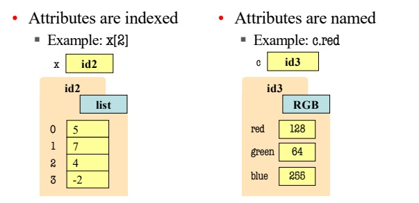
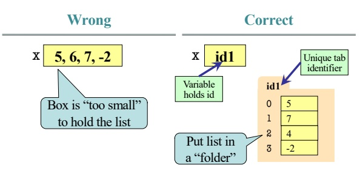
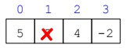
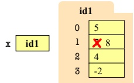
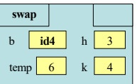
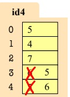
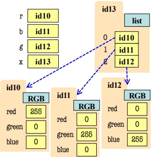

<!-- page: 1 -->

## Sequences: Lists of Values

**String**

**List**

• s = 'abc d'

• x = [5, 6, 5, 9, 15, 23] 0 1 2 3 4 5 <u>5 6 5 9 15</u>23

• Put characters in quotes

• Put values inside [ ]

§ Use \' for quote character

§ Separate by commas

• Access characters with [] § s[0] is 'a'

§ s[5] causes an error • Access **values** with [] § x[0] is 5

§ s[0:2] is 'ab' (excludes c)

§ s[2:] is 'c d'

§ x[6] causes an error

§ x[0:2] is [5, 6] (excludes 2nd 5)

§ x[3:] is [9, 15, 23]

## Lists Have Methods Similar to String

## x = [5, 6, 5, 9, 15, 23]

• index(value)

§ Return position of the value

**ERROR** if value is not there

But you get length of a list with a regular function, not method: len(x)

§ x.index(9) evaluates to 3

• count(value)

§ Returns number of times value appears in list

§ x.count(5) evaluates to 2

## Representing Lists

**Wrong**

x **5, 6, 7, -2**

**Correct**

Box is “too small” to hold the list

Variable holds id

Put list in <u>a “folder”</u>

$$
\mathbf {x} = [ 5, 7, 4, - 2 ]
$$

**List**

## Lists vs. Class Objects

• Attributes are indexed

**RGB**

§ Example: x[2]

• Attributes are named

§ Example: c.red c **id3** id3 RGB red 128 green 64 blue 255

| Type | Container? | Mutable? |
| --- | --- | --- |
| int | No | No |
| float | No | No |
| str | Yes* | No |
| Point | Yes | Yes |
| RGB | Yes | Yes |
| list | Yes | Yes |

## When Do We Need to Draw a Folder?

§ This is essentially want we mean by ‘object

• When the value **contains** other values

• When the value is **mutable**

## Lists are Mutable

• **List assignment**:

&lt;var&gt;[&lt;index&gt;] = &lt;value&gt;

\- $\mathbf{x} = [5, 7, 4, -2]$

§ Reassign at index

§ Affects folder contents

§ Variable is unchanged

• Strings cannot do this

• x[1] = 8

§ s = 'Hello World!'

§ s[0] = 'J' **ERROR**

§ String are **immutable**

x **id1**

<!-- page: 2 -->

<table><tr><td rowspan="4">id10</td><td colspan="2">RGB</td></tr><tr><td>red</td><td>255</td></tr><tr><td>green</td><td>0</td></tr><tr><td>blue</td><td>0</td></tr><tr><td rowspan="4">id11</td><td colspan="2">RGB</td></tr><tr><td>red</td><td>0</td></tr><tr><td>green</td><td>255</td></tr><tr><td>blue</td><td>0</td></tr><tr><td rowspan="4">id12</td><td colspan="2">RGB</td></tr><tr><td>red</td><td>0</td></tr><tr><td>green</td><td>0</td></tr><tr><td>blue</td><td>255</td></tr></table>

## List Methods Can Alter the List

## x = [5, 6, 5, 9]

• append(value)

§ A **procedure method**, not a fruitful method

§ Adds a new value to the end of list

§ x.append(-1) changes the list to [5, 6, 5, 9, -1]

• insert(index, value)

§ Put the value into list at index; shift rest of list right

§ x.insert(2,-1) changes the list to [5, 6, -1, 5, 9,]

• sort()

## List Slices Make Copies

x = [5, 6, 5, 9]

y = x[1:3]

x **id5**

y **id6**

**id6**

## copy = new folder

2. """ Swaps b[h] and b[k] in b

## Lists and Functions: Swap

## Lists and Expressions

1. def swap(b, h, k):

3. **Precond**: b is a mutable list,

[3, 7, 11]

4. h, k are valid positions"""

5. temp= b[h]

6. b[h]= b[k]

Swaps b[h] and b[k], because parameter b contains name of list.

7. b[k]= temp

## Exercise Time

>>> a = [1+2,3+4,5+6]

x **id4**

## swap(x, 3, 4)

• Execute the following: >>> x = [5, 6, 5, 9, 10] >>> x[3] = -1 >>> x.insert(1,2)

A: 10

• Execute the following: >>> x = [5, 6, 5, 9, 10] >>> y = x[1:] >>> y[0] = 7

B: 9

D: **ERROR**

• What is x[4]?

• Execute the following:

• What is x[1]?

<u>E: I don’t know</u>

A: 7

D: **ERROR**

B: 5

>>> a

C: 6

B: 12

D: **ERROR**

<u>E: I don’t know</u>

<u>E: I don’t know</u>

C: 57

• Example:

• List brackets [] can contain expressions

• This is a list **expression**

§ Python must evaluate it

>>> b = 7

>>> x = [a, b, a+b]

§ Evaluates each expression

§ Puts the value in the list

• What is x[2]?

A: 'a+b'

## Lists of Objects

• List positions are variables

§ Can store base types

§ But cannot store folders

§ Can store folder identifiers

• Folders linking to folders § Top folder for the list

§ Other folders for contents

• E l xamp e:

>>> r = introcs.RGB(255,0,0) >>> g = introcs.RGB(0,255,0) >>> b = introcs.RGB(0,0,255) >>> x = [r,g,b]

b **id11**

g **id12**

x **id13**

