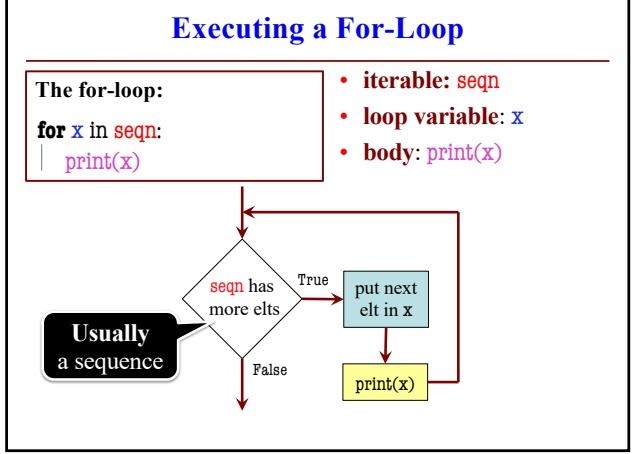
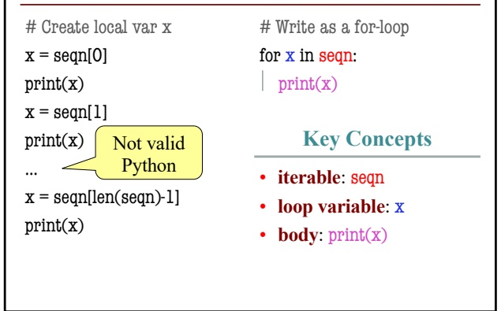
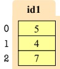

<!-- page: 1 -->

## Example: Summing the Elements of a List

def sum(thelist):

"""Returns: the sum of all elements in thelist Precondition: thelist is a list of all numbers (either floats or ints)"""

result = 0

result = result + thelist[0]

result = result + <u>thelist[1]</u>

return result

<u>problem here</u>

## The For-Loop

\# Write as a for-loop for x in seqn: print(x)

**Key Concepts**

• **iterable**: seqn

• **loop variable**: x

• **body**: print(x)

## Example: Summing the Elements of a List

def sum(thelist):

"""Returns: the sum of all elements in thelist Precondition: thelist is a list of all numbers (either floats or ints)"""

result = 0

**Accumulator** variable

for x in thelist:

**iterable:** thelist

result = result + x

• **loop variable**: x

return result

<u>•</u> <strong><u>body</u></strong><u>: result=result+x</u>

## Working with Sequences

• Sequences are potentially **unbounded**

§ Number of elements inside them is not fixed

§ Functions must handle sequences of different lengths

§ **Example**: sum([1,2,3]) vs. sum([4,5,6,7,8,9,10])

• Cannot process with **fixed** number of lines

§ Each line of code can handle at most one element

§ What if # of elements > # of lines of code?

• We need a new **control structure**

## Executing a For-Loop

• **iterable:** seqn

• **loop variable**: x

• **body**: print(x)

## Example: String-Based Accumulator

def despace(s):

"""Returns: s but with its spaces removed

Precondition: s is a string"""

result = ''

for x in s:

if x != '':

<u>result = result+x</u>

**Body**

return result

<!-- page: 2 -->

## Modifying the Contents of a List

## def add\_one(thelist):

"""(Procedure) Adds 1 to every element in the list Precondition: thelist is a list of all numbers (either floats or ints)"""

for x in thelist:

$$
\mathbf {x} = \mathbf {x} + 1
$$

**DOES NOT WORK!**

\# procedure; no return

## How Can We Modify A List?

• **Never** modify loop var!

• This is an infinite loop:

• Need a second sequence

• How about the positions?

for x in thelist:

thelist = [5, 2, 7, 1]

thelist.append(1)

thepos = [0, 1, 2, 3]

Try in Python Tutor

to see what happens

for x in thepos:

thelist[x] = x + 1

## The Range Iterator

• range(x)

§ Creates an iterator

• Very versatile tool

§ Stores [0,1,…,x-1]

• Great for <u>processing int</u>s

§ **But not a list!**

§ But try list(range(x))

**Accumulator**

$$
\text {total} = 0
$$

• range(a,b)

§ Stores [a,…,b-1] # add the squares of ints # in range 2..200 to total

• range(a,b,n)

§ Stores [a,a+n,…,b-1] for x in range(2,201): total = total + x\*x

## On The Other Hand

def copy\_add\_one(thelist):

"""Returns: copy with 1 added to every element

Precondition: thelist is a list of all numbers

(either floats or ints)"""

mycopy = [] # accumulator

for x in thelist:

Accumulator keeps

$$
\mathbf {x} = \mathbf {x} + 1
$$

result from being lost

return mycopy

mycopy.append(x) # add to end of accumulator

## This is the Motivation for Iterables

• **Iterables** are objects

§ Contain data like a list

seq **id1**

§ **But cannot slice them**

• Have list-like properties

§ Can use then in a for-loop

§ Can convert them to lists

§ mylist = list(myiterable)

• **Example**: Files

§ Use open() to create object

§ Makes iterable for reading

alt **id2**

**id2**

## Modifying the Contents of a List

## def add\_one(thelist):

"""(Procedure) Adds 1 to every element in the list Precondition: thelist is a list of all numbers (either floats or ints)"""

size = len(thelist)

Iterator of list

for k in range(size):

**positions** (safe)

thelist[k] = thelist[k]+1

**WORKS!**

\# procedure; no return
