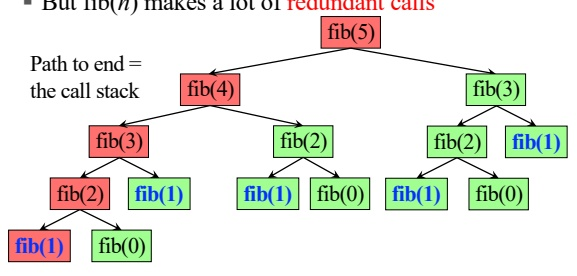
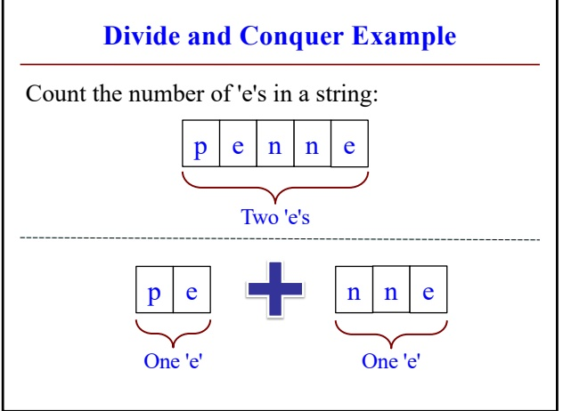
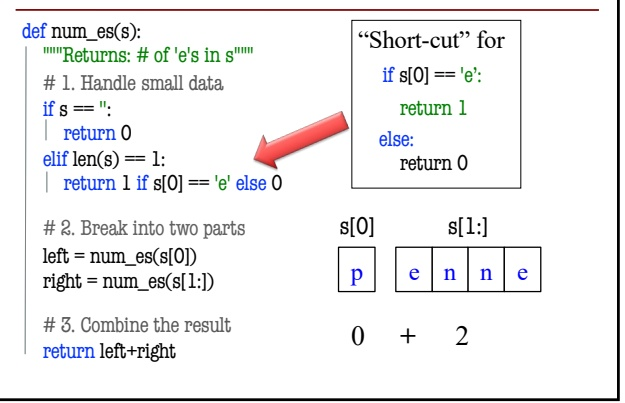
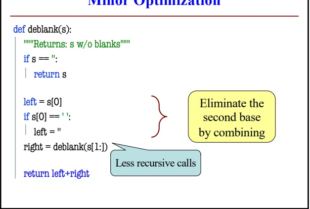
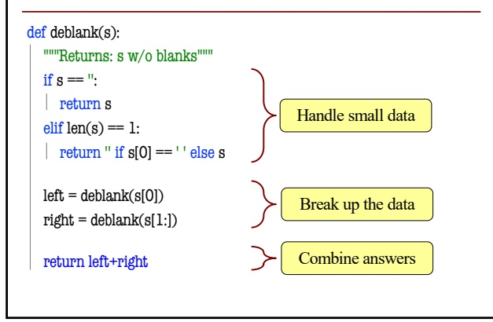
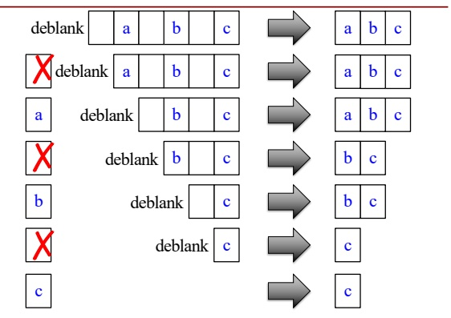

<!-- page: 1 -->

## A Mathematical Example: Factorial

• Non-recursive definition:

$n!=n \times n-1 \times \ldots \times 2 \times 1$

$$
= \mathrm{n} (\mathrm{n-1} \times \dots \times 2 \times 1)
$$

• Recursive definition:

$n!=n(n-1)!$  for  $n\geq0$

**Recursive case**

$0! = 1$

**Base case**

What happens if there is no base case?

## Example: Fibonnaci Sequence

• Sequence of numbers: 1, 1, 2, 3, 5, 8, 13, ... a0 a1 a2 a3 a4 a5 a6

§ Get the next number by adding previous two

§ What is a8?

• Recursive definition:

$a_{n}=a_{n-1}+a_{n-2}$

**Recursive Case**

§ a0 = 1

**Base Case**

§ a1 = 1

**(another) Base Case**

Why did we need two base cases this time?

## Factorial as a Recursive Function

def factorial(n):

"""Returns: factorial of n.

Pre: n ≥ 0 an int"""

$$
\begin{array}{l} \bullet \mathrm{n! = n(n - 1)!} \\ \bullet 0! = 1 \end{array}
$$

$$
\text {if} \mathrm{n} = = 0:
$$

return 1

<strong><u>Base case(s)</u></strong>

return n\*factorial(n-1)

§ fib(n) has a stack that is always ≤ n

<strong><u>Recursive case</u></strong>

§ But fib(n) makes a lot of redundant calls

• Fibonacci is very inefficient.

What happens if there is no base case?

## Fibonacci as a Recursive Function

• Function that calls itself

def fibonacci(n):

"""Returns: Fibonacci no. an

Precondition: n ≥ 0 an int"""

§ Each call is new frame

if n <= 1:

§ Frames require memory

§ ∞ calls = ∞ memory

return 1

return (fibonacci(n-1)+ fibonacci(n-2))

fibonacci 3 n 5

fibonacci 1 <strong><u>fibonacci</u></strong> n 4 n 3

## Fibonacci: # of Frames vs. # of Calls

## Recursion is best for Divide and Conquer

**Goal**: Solve problem P on a piece of data

**data**

**Idea**: Split data into two parts and solve problem

**data 1**

Solve Problem P Solve Problem P

**Combine Answer!**

<!-- page: 2 -->

## Divide and Conquer Example

Count the number of 'e's in a string:

## Three Steps for Divide and Conquer

1. Decide what to do on “small” data

§ Some data cannot be broken up

§ Have to compute this answer directly

2. Decide how to break up your data

§ Both “halves” should be smaller than whole

§ Often no wrong way to do this (next lecture)

3. Decide how to combine your answers

§ Assume the smaller answers are correct

§ Combining them should give bigger answer

## Divide and Conquer Example

“Short-cut” for if s[0] == 'e’: return 1 else: return 0

## Minor Optimization

## Exercise: Remove Blanks from a String

Handle small data

Break up the data

Combine answers

## Following the Recursion

