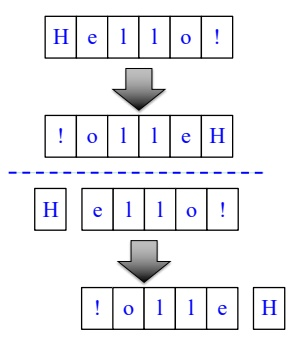
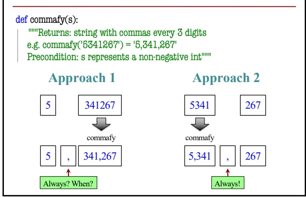
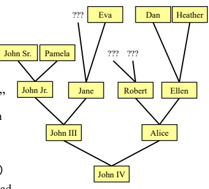
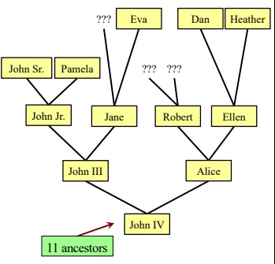
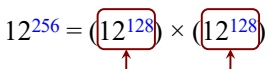
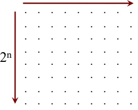

<!-- page: 1 -->

"""Returns: string with commas every 3 digits e.g. commafy('5341267') = '5,341,267' Precondition: s represents a non-negative int""" # 1. Handle small data. if len(s) <= 3: return s # 2. Break into two parts left = commafy(s[:-3]) right = s[-3:] # Small part on RIGHT # 3. Combine the result return left + ',' + right

## Example: Reversing a String

def reverse(s): """Returns: reverse of s Precondition: s a string""" # 1. Handle small data if len(s) <= 1: return s # 2. Break into two parts left = s[0] right = reverse(s[1:]) # 3. Combine the result return right+left

## How to Break Up a Recursive Function?

Base Case

Recursive Case

## How to Break Up a Recursive Function?

## Complex Combination Steps

Nothing in nums

All negative

All positive

## Complex Combination Steps

## def separate(nums):

"""Returns: A tuple separating nums into neg and non-neg parts""" # small data

… # break up the list left = separate(nums[:1]) rght = separate(nums[1:])

Breaking up is simple

\# combine the answers neg = left[0]+right[0] pos = left[1]+right[1] return (neg,pos)

Combining is not so simple

## Recursion and Objects

• Class Person (person.py)

§ Objects have 3 attributes

§ name: String

§ mom: Person (or None)

§ dad: Person (or None)

• Represents the “family tree”

§ Goes as far back as known

§ Attributes mom and dad are None if not known

• **Constructor**: Person(n,m,d)

• Or Person(n) if no mom, dad

<!-- page: 2 -->

## Recursion and Objects

## def num\_ancestors(p):

"""Returns: num of known ancestors

Pre:  is a Person""" re: p is

\# 1. Handle small data.

if p.mom == None and p.dad == None: return 0

\# 2. Break into two parts moms = 0

John Sr. Pamela

if not p.mom == None:

moms = 1+num\_ancestors(p.mom)

dads = 0

if not p.dad== None:

dads = 1+num\_ancestors(p.dad)

\# 3. Combine the result

## Example: Palindromes

• String with ≥ 2 characters is a palindrome if:

§ its first and last characters are equal, and

§ the rest of the characters form a palindrome

def ispalindrome(s):

"""Returns: True if s is a palindrome"""

if len(s) < 2:

Recursive Definition

return True

**Base case**

\# Halves not the same; not divide and conquer

ends = s[0] == s[-1]

middle = ispalindrome(s[1:-1])

<strong><u>Recursive case</u></strong>

return ends and middle

## Example: Palindromes

• String with ≥ 2 characters is a palindrome if:

$$
\mathsf {b} ^ {\mathrm{c}} = \mathsf {b} \times (\mathsf {b} ^ {\mathrm{c-1}})
$$

§ its first and last characters are equal, and

§ the rest of the characters form a palindrome

## Recursive Functions and Helpers

• **Example:**

A

def ispalindrome2(s):

have to be the same

Use helper functions!

"""Returns: True if s is a palindrome

has to be a palindrome

• **Function to Implement:**

def ispalindrome(s):

**Case of characters is ignored**."""

**Recursive Recursive**

"""Returns: True if s is a palindrome"""

if len(s) < 2:

• Keeps your code simple and easy to follow

$$
1 2 ^ {2 5 6} = 1 2 \times (1 2 ^ {2 5 5})
$$

return True

\# Halv<u>es not the same; not divide and</u>

ends = <u>equals\_ignore\_case(s[0], s[-1])</u>

return ends and middle

def equals\_ignore\_case(a, b):

**Approach 2**

middle = ispalindrome(s[1:-1])

"""Returns: True if a and b are same ignoring case"""

**Recursive**

return a.upper() == b.upper()

**Approach 1**

## Implicit Recursive Definitions

def exp(b, c)

$\mathsf{b}^{\mathrm{c}} = (\mathsf{b}\times \mathsf{b})^{\mathrm{c / 2}}$ if c even

"""Returns: bc

Precondition: b a float, c ≥ 0 an int"""

## Hilbert’s Space Filling Curve

2n

2n

Hilbert(1):

Hilbert(2):

Hilbert(n):

$$
\begin{array}{c} \text {I}\\ \hline \text {I}\\ \hline \text {I} \end{array}
$$

H(n-1) down

H(n-1) down
