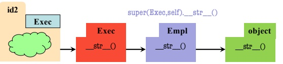

<!-- page: 1 -->

## An Application

• **Goal**: Presentation program (e.g. PowerPoint)

• **Problem**: There are many types of content

§ **Examples**: text box, rectangle, image, etc.

§ Have to write code to display each one

• **Solution**: Use object oriented features

§ Define class for every type of content

§ Ma<u>ke sure each has a draw m</u>ethod:

for x in slide[i].contents:

x.draw(window)

## Abbreviate as SC to right

## Defining a Subclass

class SlideContent(object): """Any object on a slide.""" def \_\_init\_\_(self, x, y, w, h): def draw\_frame(self): … def select(self): …

class TextBox(SlideContent): """An object containing text."""

Subclass Child class <u>Derived class</u>

def \_\_init\_\_(self, x, y, text): … def draw(self): …

## class Image(SlideContent):

"""An image."""

Superclass Parent class Base class

def \_\_init\_\_(self, x, y, image\_file): … def draw(self): …

TextBox

**TextBox(SC)**

\_\_init\_\_(self,x,y,w,h) draw\_frame(self) select(self)

\_init\_\_(self,x,y,text) draw(self)

Image

**SC**

**Image(SC)**

\_init\_\_(self,x,y,img\_f) draw(self)

## Class Definition: Revisited

## class &lt;name&gt;(&lt;superclass&gt;):

"""Class specification"""

getters and setters

initializer (\_\_init\_\_)

Class type to extend (may need module name)

definition of operators

definition of methods

• Every class must

anything else

extend something • Previous classes all extended object

## object and the Subclass Hierarcy

• Subclassing creates a **hierarchy** of classes

**Kivy Example**

§ Each class has its own super class or parent

object

§ Until object at the “top”

• object has many features

kivy.uix.widge.WidgetBase

§ Special built-in fields: \_\_class\_\_, \_\_dict\_\_

§ Default operators: \_\_str\_\_, \_\_repr\_\_ kivy.uix.widget.Widget

kivy.uix.label.Label

<u>kivy.uix.button</u>.<u>Button</u>

**Module**

**Class**

## Name Resolution Revisited

• To look up attribute/method name

**object**

1. Look first in instance (object folder)

????

2. Then look in the class (folder)

<u>p.select()</u>

• Subclasses add two more rules:

**SC(object)**

3. Look in the superclass

4. Repeat 3. until reach object

\_init\_\_(self,x,y,w,h) draw\_frame(self) select(self)

<u>p.text</u>

**id3**

<u>p.draw()</u>

p **id3**

**TextBox(SC)**

text 'Hi!' \_\_init\_\_(self,x,y,text) draw(self)

## A Simpler Example

## class Employee(object):

"""Instance is salaried worker"""

\# INSTANCE ATTRIBUTES:

**object**

\# \_name: full name, a string

\_init\_\_(self) \_str\_\_(self) \_eq\_\_(self)

\# \_start: first year hired,

\# an int ≥ -1, -1 if unknown

**Employee**

\# \_salary: yearly wage, a float

\_init\_\_(self,n,d,s) \_str\_\_(self) \_eq\_\_(self)

## class Executive(Employee):

"""An Employee with a bonus"""

**Executive**

\# INSTANCE ATTRIBUTES:

#\_bonus: annual bonus, a float \_init\_\_(self,n,d,b) \_str\_\_(self) \_\_eq\_\_(self)

<!-- page: 2 -->

## Method Overriding

• Which \_\_str\_\_ do we use?

**object**

§ Start at bottom class folder

\_init\_\_(self) \_str\_\_(self) \_eq\_\_(self)

§ Find first method with name

§ Use that definition

**Employee**

• New method definitions **override** those of parent

\_init\_\_(self,n,d,s) \_str\_\_(self) \_eq\_\_(self)

§ Access to old version is **lost**

**Executive**

§ New version used instead

§ **Example**: \_\_init\_\_

\_\_init\_\_(self,n,d,b)

\_str\_\_(self)

\_eq\_\_(self)

## About super()

• super() is very limited

• Need arguments for more

§ Can only go one level

§ super(class,self)

§ **BAD**: super().super()

p **id2**

The **subclass**

Object in <u>the method</u>

**id2**

**Exec**

super(Exec,self).\_\_str\_\_()

p.\_\_str\_\_() super().\_\_str\_\_() super(Empl,self).\_\_str\_\_()

## Instance Attributes are (Often) Inherited

## Accessing the “Previous” Method

• What if you want to use the original version method?

class Employee(object):

"""An Employee with a salary"""

§ New method = original+more

def \_\_str\_\_(self):

self.\_bonus = b

return (self.\_name +

', year ' + str(self.\_start) +

', salary ' + str(self.\_salary))

def \_\_init\_\_(self,n,d,b=0.0):

§ Do not want to repeat code from the original version

class Employee(object):

• Use the function super()

**object**

super().\_\_init\_\_(n,d)

def \_\_init\_\_(self,n,d,s=50000.0): self.\_name = n self.\_start = d self.\_salary = s

class Executive(Employee):

§ “Converts” type to parent class

Created in **Executive** initializer

## Primary Application: Initializers

\_init\_\_(self)

\_bonus 0.0

class Executive(Employee):

§ Now methods go to the class

"""An Employee with a bonus."""

\_str\_\_(self)

Created in **Employee** initializer \_eq\_\_(self)

class Employee(object):

**Employee**

name 'Fred'

def \_\_init\_\_(self,n,d,s=50000.0):

\_init\_\_(self,n,d,s)

\_start 2012

\_str\_\_(self)

• **Example**: super().\_\_str\_\_()

self.\_name = n

self.\_salary = s

\_salary 50000.0

self.\_start = d

**In Python 2** <strong><u>self goes here</u></strong> def \_\_str\_\_(self):

\_eq\_\_(self)

return (super().\_\_str\_\_()

\+ ', bonus ' + str(self.\_bonus) )

class Executive(Employee):

def \_\_init\_\_(self,n,d,b=0.0): super().\_\_init\_\_(n,d) self.\_bonus = b

**Executive**

\_init\_\_(self,n,d,b) \_str\_\_(self) \_eq\_\_(self)

**id4**

**Executive**

## Also Works With Class Attributes

**Class Attribute**: Assigned outside of any method definition

class Employee(object): """Instance is salaried worker""" # Class Attribute STD\_SALARY = 50000.0

**object**

**Employee**

class Executive(Employee):

STD\_SALARY 50000.0

"""An Employee with a bonus.""”

\# Class Attribute

**Executive**

STD\_BONUS = 10000.0

STD\_BONUS 10000.0
