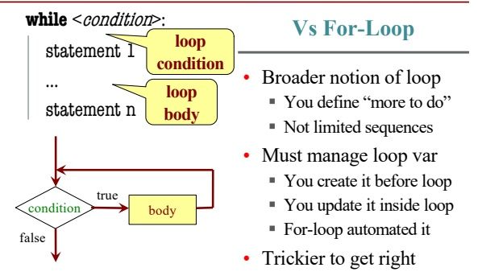

<!-- page: 1 -->



## Beyond Sequences: The while-loop

**while** &lt;condition&gt;:

statement 1

**Vs For-Loop**

• Broader notion of loop

§ You define “more to do”

§ Not limited sequences

• Must manage loop var

§ You create it before loop

§ You update it inside loop

§ For-loop automated it

• Trickier to get right

## Tracing While-Loops

print('Before while')

total = 0

Output:

Important

x = 0

Before while

while x < n:

Start loop 0

print('Start loop '+str(x))

End loop

total = total + x\*x

Start loop 1

x = x + 1

End loop

print('End loop ')

Start loop 2

print('After while')

End loop

Important

After while

## Replacing the Range Iterable

**range(a,b)**

i = a

**range(c,d+1)**

**while** i < b:

i= c

• Many of the same rules from for-loops

## How to Design While-Loops

**while** i <= d:

count = 0

§ Loop body adds to this accumulator

§ Typically **do not have iterable**

process integer i

3. Boolean tracking variable

§ Often have an **accumulator variable**

i = i + 1

2. Explicit goal condition

process integer i

1. Replacement to range()

i = 0

• Breaks up into three **design patterns**

i= i + 1

\# store in count # of '/'s in String s

• Differences are loop variable and iterable

\# 1/1 + 1/2 + …+ 1/n

\# Store in double var. v the sum

i= i +1

<u># v= 1/1 + 1/2 + …+ 1/n</u>

<u># count is # of '/'s in s[0..s.length()-1]</u>

v = 0; # call this 1/0 for today

while i <= n:

while i < len(s):

## while Versus for

if s[i] == '/':

count= count + 1

v = v + 1.0 / i

**For-Loop**

i = 1

**While-Loop**

total = 0

for x in range(n):

x = 0

i= i +1

Must remember to increment

## Using the Goal as a Condition

def prompt(prompt,valid):

"""Returns: the choice from a given prompt.

Preconditions: prompt is a string, valid is a tuple of strings"""

response = input(prompt)

\# Continue to ask while the response is not valid.

while not (response in valid):

print('Invalid response. Answer must be one of ')+str(valid)

response = input(prompt)

return response

<!-- page: 2 -->

## Using a Boolean Variable

```python
def roll_past(goal):
    """Returns: The score from rolling a die until passing goal."""
    loop = True # Keep looping until this is false
    score = 0
    while loop:
        roll = random.randint(1,6)
        if roll == 1:
            score = 0; loop = False
        else:
            score = score + roll; loop = score < goal
    return score
```

## Difficulties with while

Be careful when you **modify** the loop variable

```python
def rem3(lst):
    """Remove all 3's from lst"""
    i = 0
    while i < len(lst):
        # no 3's in lst[0..i-1]
        if lst[i] == 3:
            del lst[i]
        else:
            i = i+1
```

"""Remove all 3's from lst""" **while** 3 in lst:

lst.remove(3)

The stopping condition is not a numerical counter this time. Simplifies code a lot.

## The Final Result

```python
def sqrt(c,err=1e-6):
    """Returns: sqrt of c with given margin of error.
    Preconditions: c and err are numbers > 0"""
    x = c/2.0

    while abs(x*x-c) > err:
        # Get x_{n+1} from x_n
        x = x/2.0+c/(2.0*x)

    return x
```

## Advantages of while vs for

\# table of squares to N

\# table of squares to N

$$
\mathrm{seq} = [ ]
$$

$$
\text {seq} = [ ]
$$

$$
\mathrm{n} = \operatorname{floor} (\operatorname{sqrt} (\mathrm{N})) + 1
$$

$$
\mathrm{k=0}
$$

$$
\text {for k in range(n):}
$$

$$
\text {seq.append} (k ^ {*} k)
$$

A for-loop requires that you know where to stop the loop **ahead of time**

$$
\text {while} \mathrm{k} ^ {*} \mathrm{k} <   \mathrm{N}:
$$

$$
\text {seq.append} (k ^ {*} k)
$$

$$
\mathrm{k=k+1}
$$

A while loop can use complex expressions to check if the loop is done

## Application: Convergence

• How to implement this function? def sqrt(c):

"""Returns the square root of c""

• Consider the polynomial $\mathrm{f}(x) = x^2 -\mathrm{c}$

§ Value sqrt(c) is a root of this polynomial

• Suggests a use for **Newton’s Method**

§ **Start with a guess** at the answer

§ Use calculus formula to improve guess

## Using while-loops Instead of for-loops

## Advantages

• Better for **modifying data**

§ More natural than range

§ Works better with deletion

• Better for **convergent tasks**

§ Loop until calculation done

§ Exact steps are unknown

• Easier to **stop early**

§ Just set loop var to False

## Disadvantages

• Performance is **slower**

§ Python optimizes for-loops

§ Cannot optimize while

• **Infinite loops** more likely

§ Easy to forget loop vars

§ Or get stop condition wrong

• **Debugging** is harder

§ Will see why in later lectures
