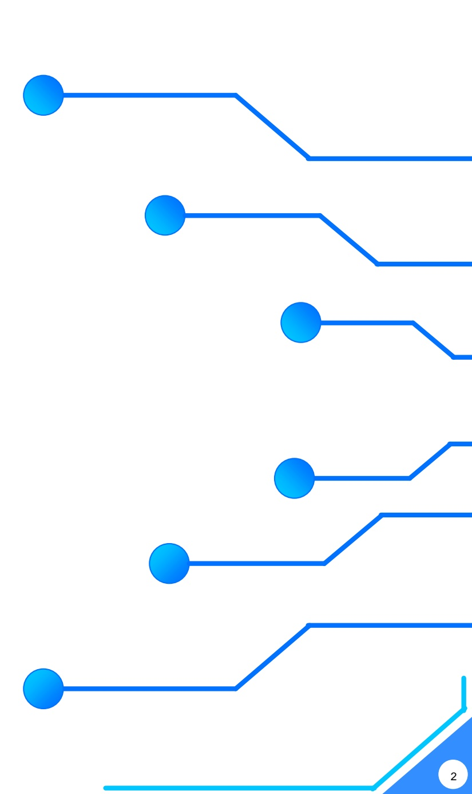
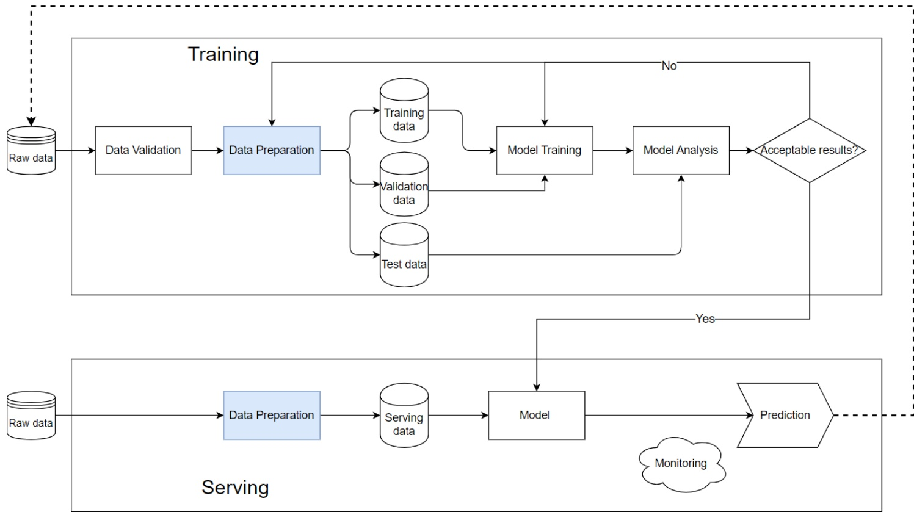
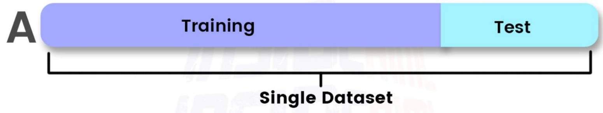
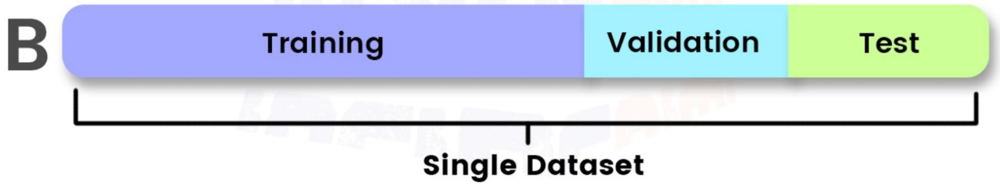
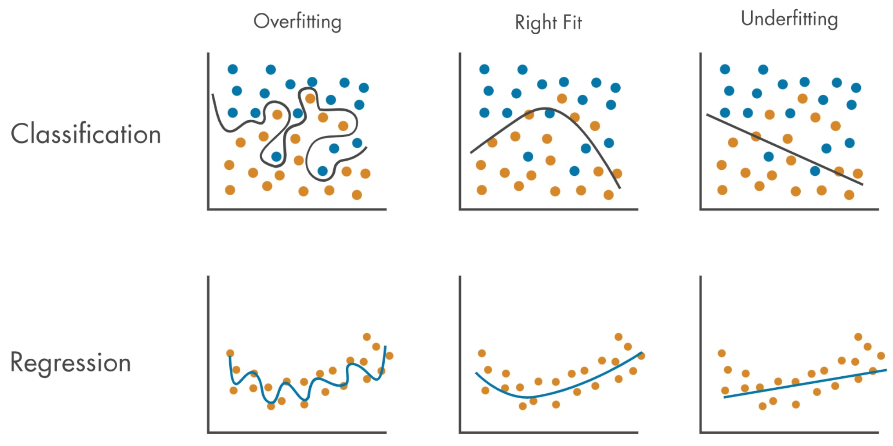
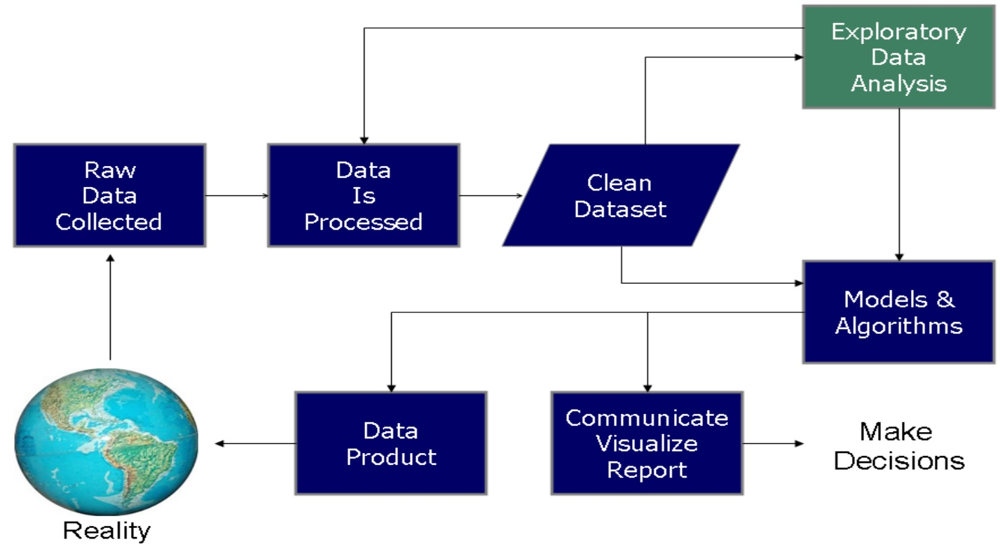
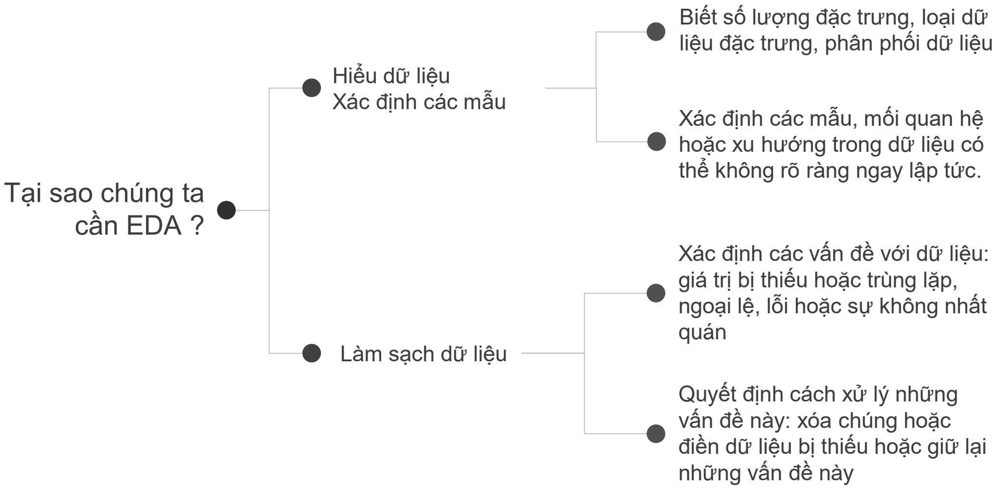
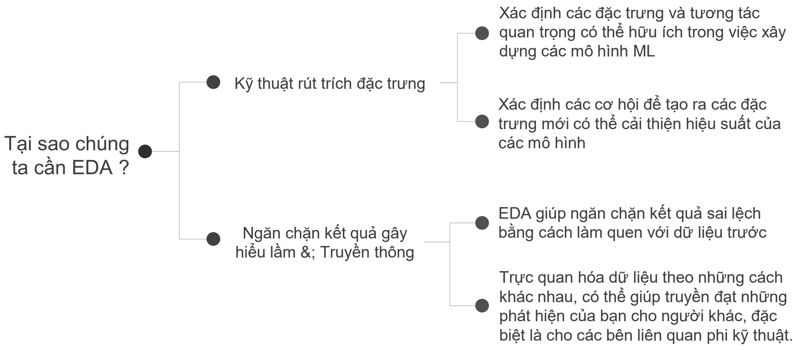

<!-- page: 1 -->

# CS116 – LẬP TRÌNH PYTHON CHO MÁY HỌC

# Bài 03 - A QUY TRÌNH XÂY DỰNG MÔ HÌNH MÁY HỌC Machine learning Pipeline

TS. Nguyễn Vinh Tiệp

<!-- page: 2 -->

## NỘI DUNG

1. Machine Learning Pipeline ? 2. Exploratory Data Analysis (EDA)?

<!-- page: 3 -->

## What-why-how

What

Why

How

**What**: Vấn đề/đối tượng là gì?

**Why**: Tại sao phải dùng đối tượng đó? Tại sao phải giải quyết vấn đề đó?

**How**: Chúng ta phải làm như thế nào?

<!-- page: 4 -->

https://machinelearningcoban.com/tabml\_book/ch\_intro/pipeline.htmlThực hiện bởi Trường Đại học Công nghệ Thông tin, ĐHQG-HCM

## ML Pipeline là gì?

❏ ML pipeline là một cách để mã hóa và tự động hóa quy trình làm việc của mô hình ML

❏ Bao gồm nhiều bước tuần tự thực hiện mọi thứ từ trích xuất dữ liệu, xử lý dữ liệu đến huấn luyện, đánh giá và triển khai mô hình

<!-- page: 5 -->

## Data preparation

• Data fusion

• Data cleaning

• Data augmentation

• Data visualization

• Data splitting

<!-- page: 6 -->

## Data splitting

• Training data → huấn luyện mô hình

• Testing data → kiểm tra hiệu suất mô hình

• Validation data → tối ưu hyper-parameters

<!-- page: 7 -->

## Data splitting

• Ví dụ: train : test : valid = 7: 2 : 1

https://insideaiml.com/blog/Everything-you-need-to-know-about-Splitting-Dataset-1156

<!-- page: 8 -->

## Model training

• Lựa chọn mô hình ML (bài toán)

• Phương pháp tối ưu mô hình (deep learning)

• Chọn hyper-parameter

<!-- page: 9 -->

## Model overfiting

Overfitting

Right Fit

Thực hiện bởi Trường Đại học Công nghệ Thông tin, ĐHQG-HCM

<!-- page: 10 -->

## Model overfiting

| Error | Overfitting | Right Fit | Underfitting |
| --- | --- | --- | --- |
| Training | Low | Low | High |
| Test | High | Low | High |

<!-- page: 11 -->

## Model analysis

• Đánh giá hiệu suất mô hình dựa trên số liệu và hình ảnh

• Tùy chỉnh hyper-parameter

<!-- page: 12 -->

## Tại sao chọn ML Pipeline?

- 01 Tiêu chuẩn hóa và hiệu quả
- Tự động hóa và chuẩn hóa quy trình xây dựng, đánh giá và triển khai các mô hình ML → tiết kiệm thời gian và nguồn lực
- 02 Khả năng lặp lại
- Làm cho nó có thể tái tạo kết quả của một thử nghiệm học máy
- 03 Độ lặp lại
- Làm cho nó có thể và đáng tin cậy để lặp lại cùng một quá trình nhiều lần
- 04 Hợp tác
- Toàn bộ quá trình được mã hóa trong mã → chia sẻ ý tưởng và làm việc cùng nhau

<!-- page: 13 -->

## Tại sao chọn ML Pipeline?

05 Khả năng tái sử dụng mã và tính mô-đun

06

Kiểm soát và giám sát phiên bản

07

Đơn giản hóa việc triển khai sản xuất

Quản lý thời gian tốt hơn và ít lỗi hơn Nếu một phần của pipeline cần phải được thay đổi?

Cho phép các nhà phát triển theo dõi các thay đổi và đảm bảo rằng họ đang làm việc với phiên bản mới nhất

Mô hình được đào tạo, tối ưu hóa và sẵn sàng triển khai vào sản xuất → tất cả các bước cần thiết đã sẵn sàng

<!-- page: 14 -->

## Giới thiệu về EDA

❏ Trong thống kê, EDA là một cách tiếp cận phân tích các tập dữ liệu để tóm tắt các đặc điểm chính của chúng, thường sử dụng đồ họa thống kê và các phương pháp trực quan hóa dữ liệu khác

Data Science Process

[https://en.wikipedia.org/wiki/Exploratory\_data\_analysis](https://en.wikipedia.org/wiki/Exploratory_data_analysis)

Thực hiện bởi Trường Đại học Công nghệ Thông tin, ĐHQG-HCM

<!-- page: 15 -->

## EDA - Phân tích dữ liệu thăm dò

<!-- page: 16 -->

## EDA - Phân tích dữ liệu thăm dò

<!-- page: 17 -->

## Mục tiêu của EDA

## Mục tiêu của EDA là:

❑ Cho phép khám phá bất ngờ trong dữ liệu

❑ Đề xuất các giả thuyết về nguyên nhân của các hiện tượng quan sát được

❑ Đánh giá các giả định dựa trên suy luận thống kê nào

❑ Hỗ trợ lựa chọn các công cụ và kỹ thuật thống kê phù hợp

❑ Cung cấp cơ sở để thu thập thêm dữ liệu thông qua khảo sát hoặc thí nghiệm

<!-- page: 18 -->

## QUIZ & CÂU HỎI
