<!-- page: 1 -->

# CS116 – LẬP TRÌNH PYTHON CHO MÁY HỌC

## Bài 08 Phân loại mô hình & các mô hình máy học

TS. Nguyễn Vinh Tiệp

<!-- page: 2 -->

## NỘI DUNG

1. Phân loại mô hình

2. Các mô hình máy học

1. Mô hình cơ bản

2. Bagging và Boosting

3. Mô hình dựa trên cấu trúc cây

3. Auto ML


<!-- page: 3 -->


## Phân loại mô hình

❏ Mô hình học có giám sát và không giám sát:

❏ Học có giám sát là có dữ liệu **(x)** và nhãn **(y)** ❏ Học không giám sát là chỉ có dữ liệu **(x)**

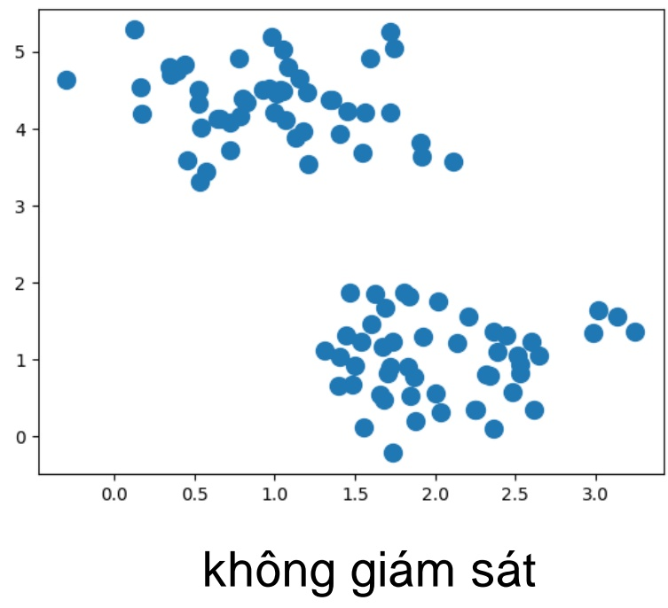

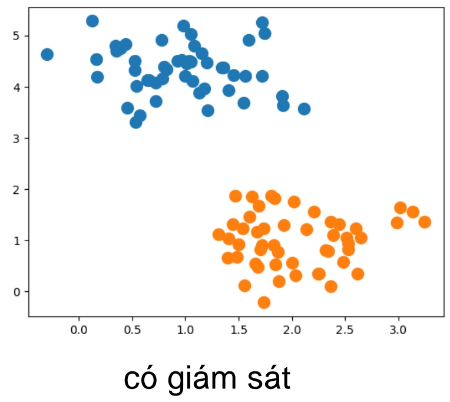

Thực hiện bởi Trường Đại học Công nghệ Thông tin, ĐHQG-HCM

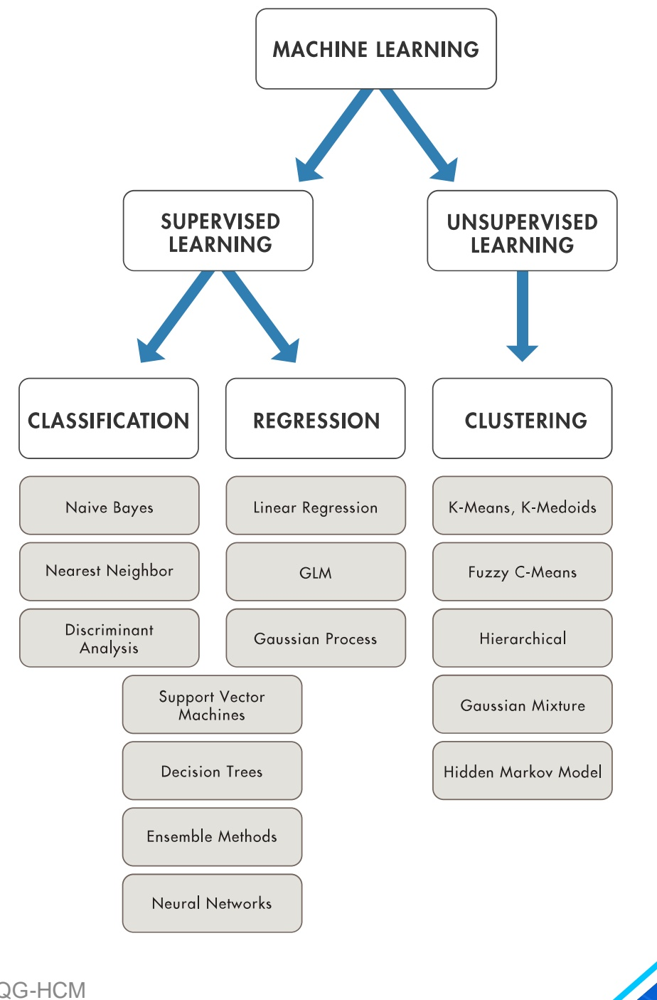

<!-- page: 4 -->


## Mô hình máy học

1. Mô hình cơ bản

1. Hồi quy tuyến tính (Linear Regression)

2. Hồi quy luận lý (Logistic Regression)

3. Cây quyết định (Decision Tree)

2. Bagging và Boosting

3. Mô hình dựa trên cấu trúc cây

1. Random Forest

2. XGBoost

3. LightGBM

4. CatBoost

<!-- page: 5 -->

## Hồi quy tuyến tính

❏ Hãy cho biết 1 người cao 1m77 sẽ nặng bao nhiêu kg? Cho trước dữ liệu cho bên dưới.

| Chiều cao (cm) | Cân nặng (kg) | Chiều cao (cm) | Cân nặng (kg) |
| --- | --- | --- | --- |
| 147 | 49 | 168 | 60 |
| 150 | 50 | 170 | 72 |
| 153 | 51 | 173 | 63 |
| 155 | 52 | 175 | 64 |
| 158 | 54 | 178 | 66 |
| 160 | 56 | 180 | 67 |
| 163 | 58 | 183 | 68 |
| 165 | 59 |  |  |

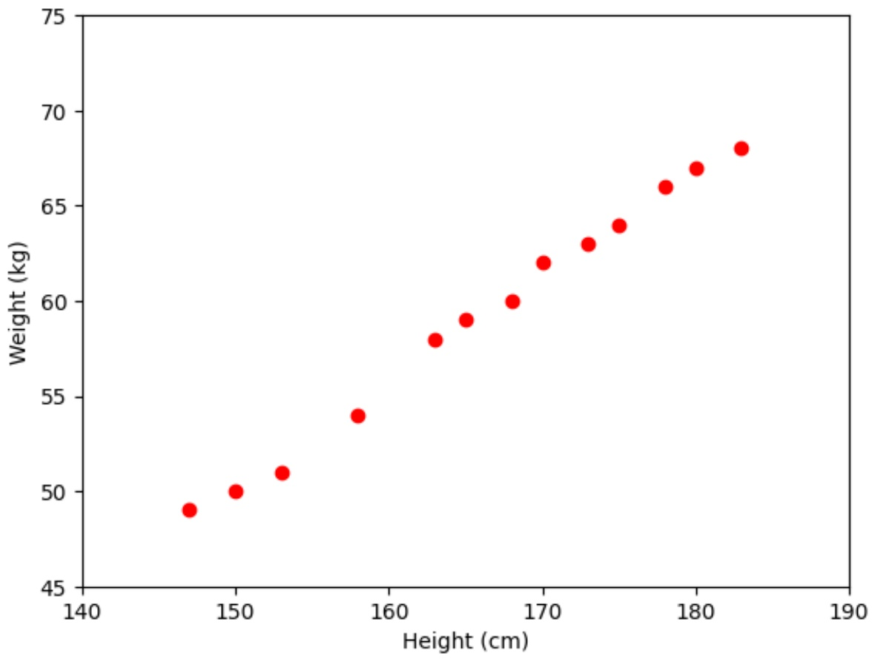

<!-- page: 6 -->

## Hồi quy tuyến tính

❏ Một cách tiếp cận tuyến tính để mô hình hóa mối quan hệ giữa một biến phản hồi (scalar response) và một/ nhiều biến (explanatory variable) -> Mô hình tham số ❏ Nhạy cảm với nhiễu/ngoại lệ

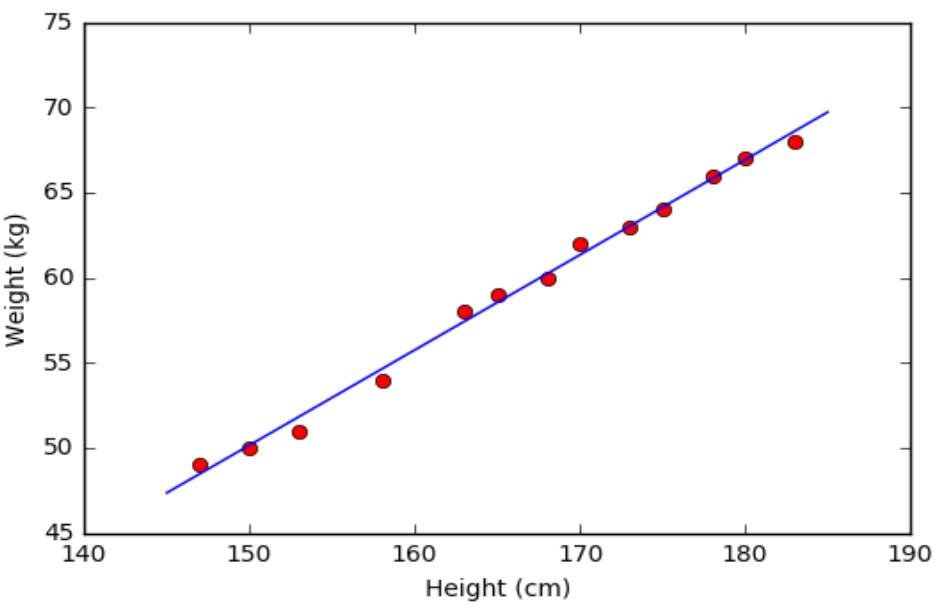

[https://machinelearningcoban.com/2016/12/28/linearregression/](https://machinelearningcoban.com/2016/12/28/linearregression/)

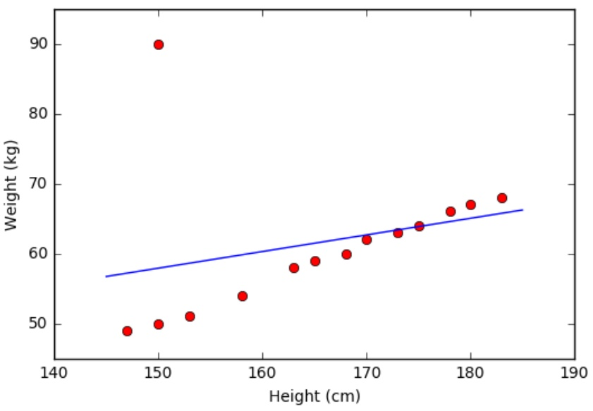

[https://machinelearningcoban.com/2016/12/28/linearregression/](https://machinelearningcoban.com/2016/12/28/linearregression/)

Thực hiện bởi Trường Đại học Công nghệ Thông tin, ĐHQG-HCM Thực hiện bởi Trường Đại học Công nghệ Thông tin, ĐHQG-HCM

<!-- page: 7 -->

## Hồi quy tuyến tính: Toán học

❏ Độ lỗi, ước lượng tham số, tính Bias, Variance

$$
Y = \beta * X + \epsilon
$$

$$
L _ {o l s} (\hat {\beta}) = \sum_ {i = 0} ^ {n} \left\| y _ {i} - x _ {i} * \hat {\beta} _ {i} \right\| ^ {2} = \left\| Y - X * \hat {\beta} \right\| ^ {2}
$$

$$
\hat {\beta_ {o l s}} = \left(X ^ {T} X\right) ^ {- 1} \left(X ^ {T} Y\right)
$$

$$
B i a s (h a t \beta) = E (\hat {\beta}) - \beta
$$

$$
V a r i a n c e \left(\hat {\beta}\right) = \sigma^ {2} \left(X ^ {\prime} X\right) ^ {- 1}
$$

<!-- page: 8 -->

## Hồi quy tuyến tính: Độ lỗi

$$
E r r o r - t e r m = \left(E \left(X \hat {\beta}\right) - X \beta\right) ^ {2} + E \left(X \hat {\beta} - E \left(X \hat {\beta}\right)\right) ^ {2} + \sigma^ {2}
$$

Câu hỏi đặt ra: Làm thế nào để có được độ phức tạp mô hình tối ưu

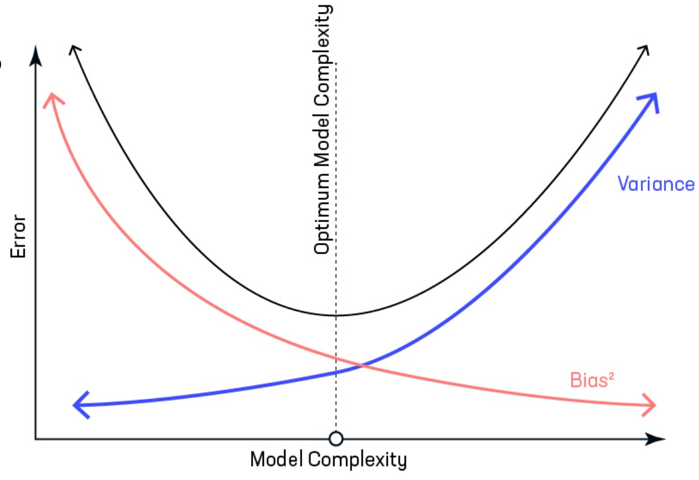

<!-- page: 9 -->


## Hồi quy tuyến tính: Ví dụ

## ❏ Sử dụng thư viện sklearn & công thức toán (Slide 7)

```python
# Step 1: add x0 =1 to dataset
X_train_0 = np.c_[np.ones((X_train.shape[0],1)),X_train]
X_test_0 = np.c_[np.ones((X_test.shape[0],1)),X_test]

# Step2: build model
theta = np.matmul(np.linalg.inv( np.matmul(X_train_0.T,X_train_0) ), np.matmul(X_train_0.T,y_train))
```

```python
# Scikit Learn module
from sklearn.linear_model import LinearRegression
lin_reg = LinearRegression()
lin_reg.fit(X_train,y_train) # Note: x_0 =1 is no need to add, sklearn will take care of it.

#Parameter
sk_theta = [lin_reg.intercept_]+list(lin_reg.coef_)
parameter_df = parameter_df.join(pd.Series(sk_theta, name='Sklearn_theta'))
parameter_df
```

|  | Parameter | Columns | theta | Sklearn_theta |
| --- | --- | --- | --- | --- |
| 0 | theta_0 | intersect:x_0=1 | 7.059171 | 7.059171 |
| 1 | theta_1 | age | 0.033134 | 0.033134 |
| 2 | theta_2 | bmi | 0.013517 | 0.013517 |
| 3 | theta_3 | OHE_male | -0.067767 | -0.067767 |
| 4 | theta_4 | OHE_1 | 0.149457 | 0.149457 |
| 5 | theta_5 | OHE_2 | 0.272919 | 0.272919 |
| 6 | theta_6 | OHE_3 | 0.244095 | 0.244095 |

[https://www.kaggle.com/code/sudhirnl7/linear-regression-tutorial](https://www.kaggle.com/code/sudhirnl7/linear-regression-tutorial)

<!-- page: 10 -->

## LASSO

❏ Hồi quy tuyến tính + L1 Regularization → LASSO

❏ Có thể sử dụng để chọn lọc đặc trưng (Bài 7)

$$
L _ {l a s s o} = \operatorname{argmin} _ {\hat {\beta}} \left(\| Y - \beta * X \| ^ {2} + \lambda * \| \beta \| _ {1}\right)
$$

<!-- page: 11 -->


## Ridge Regression

❏ Hồi quy tuyến tính + L2 Regularization → Ridge

$$
L _ {r i d g e} = \operatorname{argmin} _ {\hat {\beta}} \left(\| Y - \beta * X \| ^ {2} + \lambda * \| \beta \| _ {2} ^ {2}\right)
$$

where λ is regularization penalty.

<!-- page: 12 -->


## Hồi quy tuyến tính + Regularizations

❏ Hồi quy tuyến tính + (L1 + L2) Regularization → Elastic Net

❏ Có thể kết hợp ưu điểm của cả Lasso và Ridge

$$
L _ {e l a s t i c N e t} = \operatorname{argmin} _ {\hat {\beta}} \left(\hat {\beta}\right) \left(\sum \left(y - x _ {i} ^ {J} \hat {\beta}\right) ^ {2}\right) / 2 n + \lambda \left((1 - \alpha) / 2 * \sum_ {j = 1} ^ {m} \hat {\beta} _ {j} ^ {2} + \alpha * \sum_ {j = 1} ^ {m} \left\| \hat {\beta} _ {j} \right\|\right)
$$

<!-- page: 13 -->

## Ví dụ về hồi quy tuyến tính với R

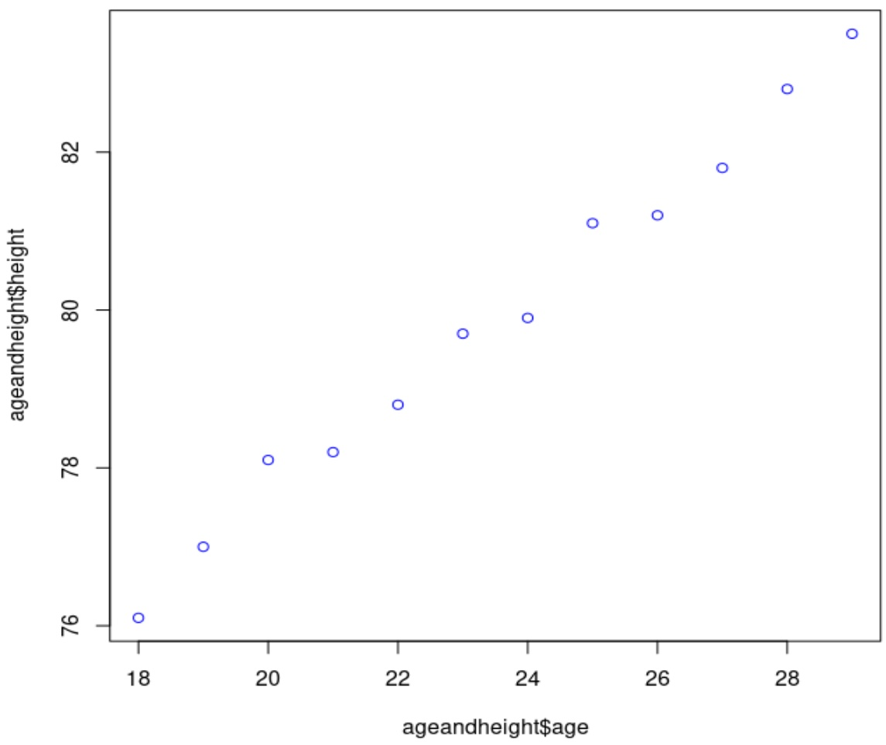

Thực hiện bởi Trường Đại học Công nghệ Thông tin, ĐHQG-HCM

<!-- page: 14 -->

## Ví dụ về hồi quy tuyến tính với R

Call: lm(formula = height \~ age, data = ageandheight)

Residuals: Min 10 Median 3Q Max 0.27238 -0.24248 -0.02762 0.16014 0.47238

## Coefficients:

Estimate Std. Error t value Pr(>|t|) (Intercept) 64.9283 0.5084 127.71 < 2e-16 \* \* \* age 0.6350 0.0214 29.66 4.43e-11 \* \* \*

Signif. codes: 0 \*\*\*’ 0.001 \*\*’ 0.01 ‘\*’ 0.05 .’ 0.1’1

Residual standard error: 0.256 on 10 degrees of freedom Multiple R-squared: 0.9888 Adjusted R-squared: 0.9876 F-statistic: 880 on 1 and10 DF," p-value: 4.428e-11

<!-- page: 15 -->

## Ví dụ về hồi quy tuyến tính với R

Call: lm(formula = height \~ age + no\_siblings, data = ageandheight)

Residuals: Min 1Q Median 3Q Max -0.32065 -0.13587 0.03329 0.17380 0.36860

## Coefficients:

Estimate Std. Error t value Pr(>|t|) (Intercept) 64.65632 0.50961 126.875 5.96e-16 \* \* \* age 0.64007 0.02038 31.407 1.65e-10 \*\*\* no\_siblings 0.09123 0.05970 1.528 0.161

Signif. codes: 0‘\*\*\*’0.001 ‘\*\*’0.01 ‘\*’0.05 .’0.1’1

Residual standard error: 0.2404 on 9 degrees of freedom Multiple R-squared: 0.9911, Adjusted R-squared: 0.9891 F-statistic: 499.9 on 2 and 9 DF, p-value: 5.982e-10

<!-- page: 16 -->

## Ví dụ về hồi quy tuyến tính với R

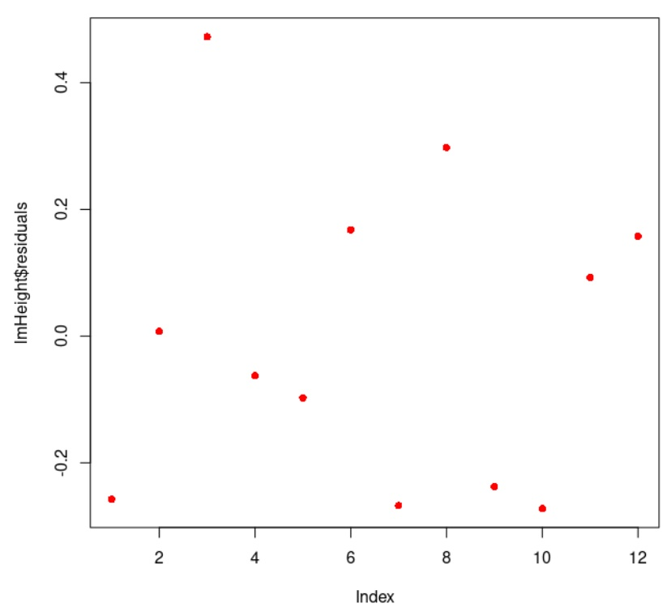

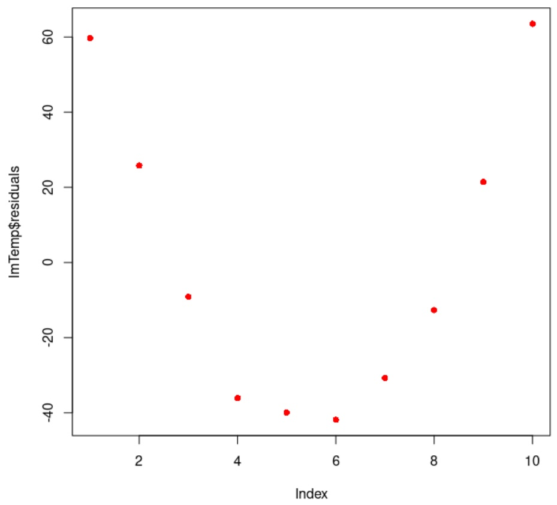

<!-- page: 17 -->

## Logistic Regression - Hồi quy luận lý

❏ Ước lượng các tham số của mô hình logistic (the coefficients in the linear combination)

Why name is Logistic Regression but can use for Binary Classification?

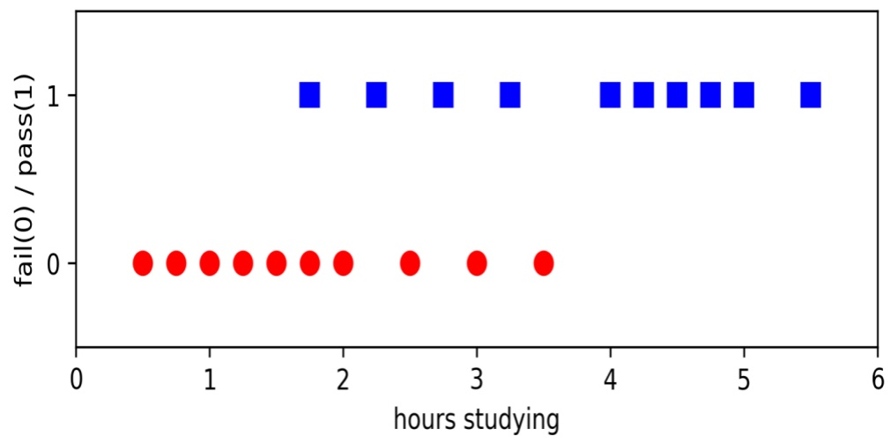

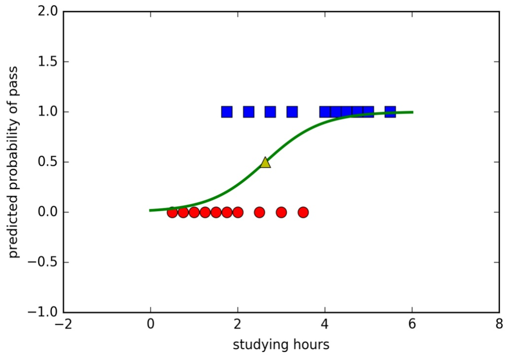

<!-- page: 18 -->


## Hồi quy luận lý: Về mặt toán học

❏ Hàm Sigmoid

$$
\sigma (t) = \frac {e ^ {t}}{e ^ {t} + 1} = \frac {1}{1 + e ^ {- t}}
$$

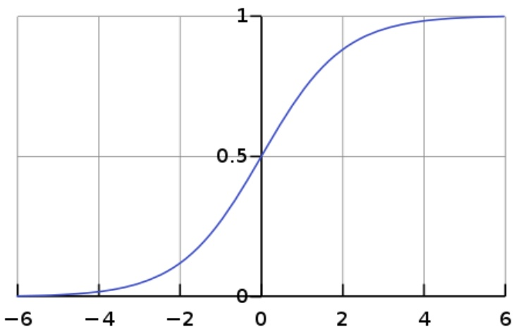

[https://en.wikipedia.org/wiki/Logistic\_regression](https://en.wikipedia.org/wiki/Logistic_regression)

$$
t = \beta_ {0} + \beta_ {1} x
$$

And the general logistic function $p:\mathbb{R}\to(0,1)$ can now be written as:

$$
p (x) = \sigma (t) = \frac {1}{1 + e ^ {- (\beta_ {0} + \beta_ {1} x)}}
$$

$$
\ell = \sum_ {k = 1} ^ {K} y _ {k} \log_ {b} (p (\boldsymbol {x} _ {\boldsymbol {k}})) + \sum_ {k = 1} ^ {K} (1 - y _ {k}) \log_ {b} (1 - p (\boldsymbol {x} _ {\boldsymbol {k}}))
$$

Hàm độ lỗi

<!-- page: 19 -->


## Hồi quy luận lý: Ví dụ

## [Notebook example](https://www.kaggle.com/code/prashant111/logistic-regression-classifier-tutorial)

```python
# train a logistic regression model on the training set
from sklearn.linear_model import LogisticRegression

# instantiate the model
logreg = LogisticRegression(solver='liblinear', random_state=0)

# fit the model
logreg.fit(X_train, y_train)
```

```python
logreg.predict_proba(X_test)[ :,1]
```

Huấn luyện và dự đoán cho mô hình hồi quy luận lý

```python
LogisticRegression(C=1.0, class_weight=None, dual=False, fit_intercept=True,
                          intercept_scaling=1, l1_ratio=None, max_iter=100,
                          multi_class='warn', n_jobs=None, penalty='l2',
                          random_state=0, solver='liblinear', tol=0.0001, verbose=0,
                          warm_start=False)
```

Tham số của mô hình hồi quy luận lý

<!-- page: 20 -->

## Tổng kết

## [Cheat Sheet](https://drive.google.com/drive/folders/1IGiethDMHashf9Gsfx3sPTsJOnl15Zvx)

Visual Representation:

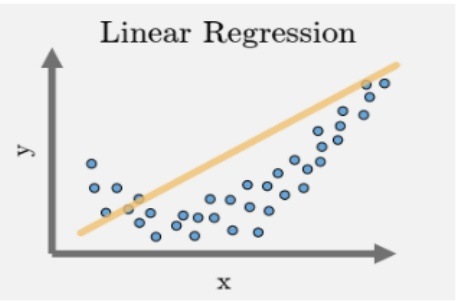

Summary:

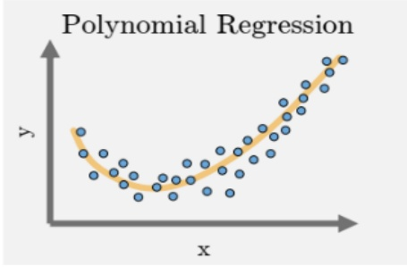

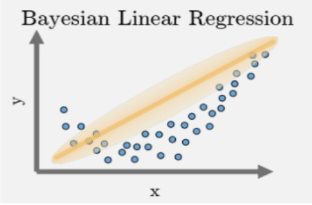

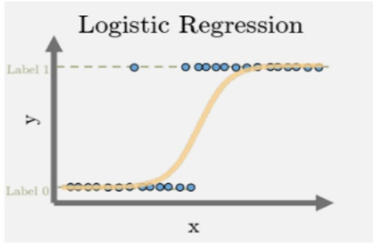

<table><tr><td></td><td>What does it fit?</td><td>Estimated function</td><td>Error Function</td></tr><tr><td>Linear</td><td>A line in n dimensions</td><td> $f_{\beta}^{linear}(x_i) = \beta_0 + \beta_1 x_i$ </td><td> $\sum_{i=0}^{m} \|y_i - f_{\beta}(x_i)\|^2$ .</td></tr><tr><td>Polynomial</td><td>A polynomial of order k</td><td> $f_{\beta}^{poly}(x_i) = \beta_0 + \beta_1 x_i + \beta_2 x_i^2 + \ldots$ </td><td> $\sum_{i=0}^{m} \|y_i - f_{\beta}(x_i)\|^2$ .</td></tr><tr><td>Bayesian Linear</td><td>Gaussian distribution for each point</td><td> $\mathcal{N}\left(f_{\beta}(x_i), \sigma^2\right)$ </td><td> $\sum_{i} \|y_i - \mathcal{N}\left(f_{\beta}(x_i), \sigma^2\right)\|^2$ </td></tr><tr><td>Ridge</td><td>Linear/polynomial</td><td> $f_{\beta}^{poly}(x_i) \ or \ f_{\beta}^{linear}(x_i)$ </td><td> $\sum_{i=0}^{m} \|y_i - f_{\beta}(x_i)\|^2 + \sum_{j=0}^{n} \beta_j^2$ </td></tr><tr><td>LASSO</td><td>Linear/polynomial</td><td> $f_{\beta}^{poly}(x_i) \ or \ f_{\beta}^{linear}(x_i)$ </td><td> $\sum_{i=0}^{m} \|y_i - f_{\beta}(x_i)\|^2 + \sum_{j=0}^{n} |\beta_j|$ </td></tr><tr><td>Logistic</td><td>Linear/polynomial with sigmoid</td><td colspan="2"> $\sigma(f_{\beta}(x_i)) \quad min_{\beta} \sum_{i} - y_i log(\sigma(f_{\beta}(x_i))) - (1 - y_i) log(1 - \sigma(f_{\beta}(x_i)))$ </td></tr></table>

<!-- page: 21 -->

## Cây quyết định – Decision tree

❏ Là một công cụ giúp bạn đưa ra quyết định bằng cách xem xét tất cả các lựa chọn có sẵn và kết quả tiềm năng của mỗi lựa chọn. Nó cũng tính đến các yếu tố như rủi ro, chi phí và lợi ích.

❏ Mô hình **không tham số**

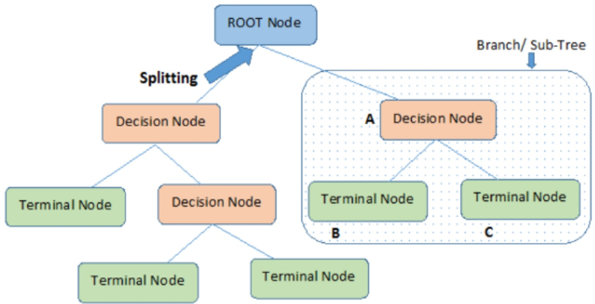

[https://www.analyticsvidhya.com/blog/2021/08/decision-tree-algorithm/](https://www.analyticsvidhya.com/blog/2021/08/decision-tree-algorithm/)Thực hiện bởi Trường Đại học Công nghệ Thông tin, ĐHQG-HCM

<!-- page: 22 -->


## Cây quyết định: Ví dụ

❏ Hôm nay trời nắng, độ ẩm cao, gió yếu. Chúng ta có nên chơi cầu lông không?

❏ Chúng ta có nên quyết định dựa trên thời tiết không?

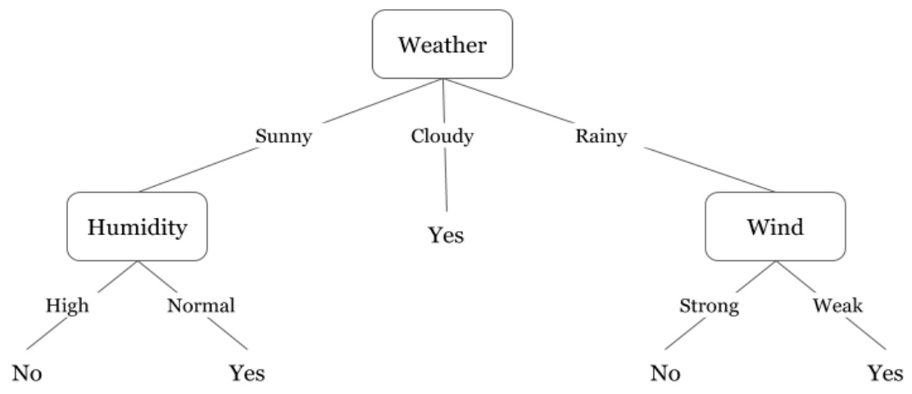

[https://www.hackerearth.com/practice/machine-learning/machine-learning-algorithms/ml-decision-tree/tutorial/](https://www.hackerearth.com/practice/machine-learning/machine-learning-algorithms/ml-decision-tree/tutorial/)

Thực hiện bởi Trường Đại học Công nghệ Thông tin, ĐHQG-HCM

<!-- page: 23 -->

## Xây dựng cây quyết định

Cho một bộ dữ liệu, làm sao để xây dựng cây quyết định?

| Day | Weather | Temperature | Humidity | Wind | Play? |
| --- | --- | --- | --- | --- | --- |
| 1 | Sunny | Hot | High | Weak | No |
| 2 | Cloudy | Hot | High | Weak | Yes |
| 3 | Sunny | Mild | Normal | Strong | Yes |
| 4 | Cloudy | Mild | High | Strong | Yes |
| 5 | Rainy | Mild | High | Strong | No |
| 6 | Rainy | Cool | Normal | Strong | No |
| 7 | Rainy | Mild | High | Weak | Yes |
| 8 | Sunny | Hot | High | Strong | No |
| 9 | Cloudy | Hot | Normal | Weak | Yes |
| 10 | Rainy | Mild | High | Strong | No |

<!-- page: 24 -->

## Entropy & thông tin thu thập

Làm thế nào chúng ta có thể định lượng được thông tin thu thập?

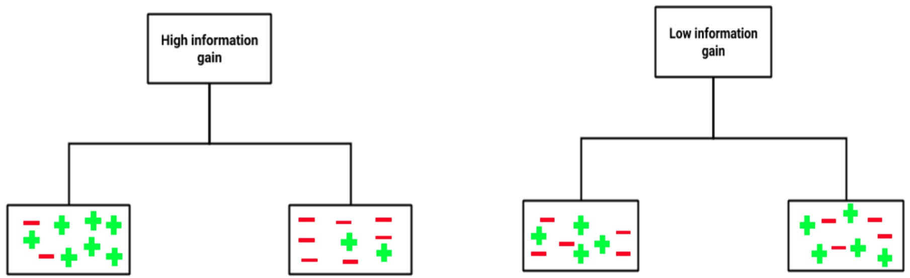

[https://www.hackerearth.com/practice/machine-learning/machine-learning-algorithms/ml-decision-tree/tutorial/](https://www.hackerearth.com/practice/machine-learning/machine-learning-algorithms/ml-decision-tree/tutorial/)

<!-- page: 25 -->

## Entropy & thông tin thu thập

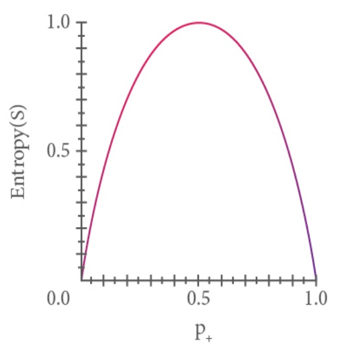

Entropy(S) = −p+log2p+ − p−log2p−

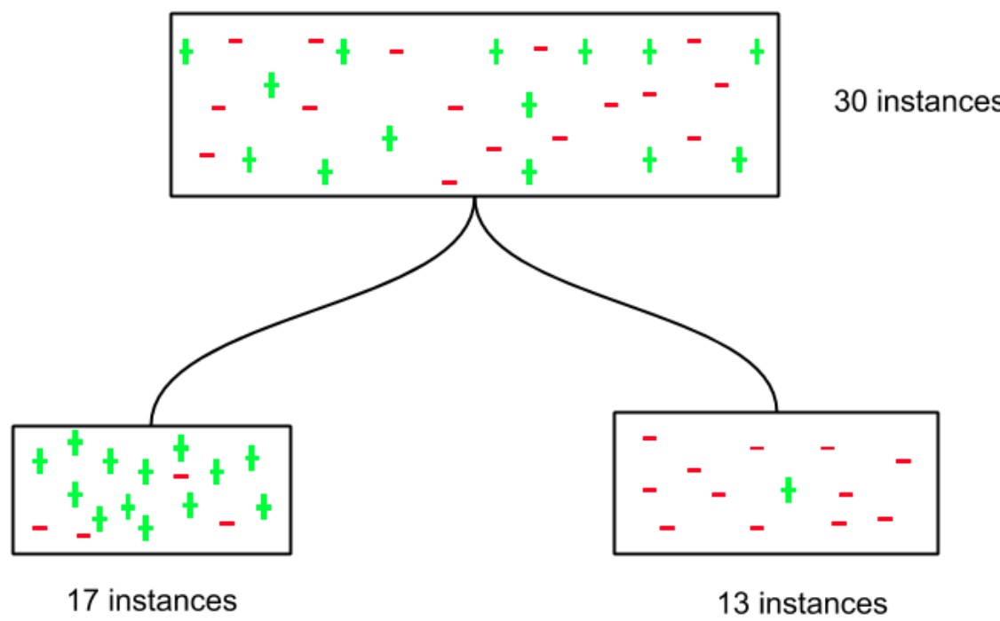

InformationGain = Entropy(parentnode) – [AverageEntropy(children)]

[https://www.hackerearth.com/practice/machine-learning/machine-learning-algorithms/ml-decision-tree/tutorial/](https://www.hackerearth.com/practice/machine-learning/machine-learning-algorithms/ml-decision-tree/tutorial/)

<!-- page: 26 -->

## Khi nào thì dừng phân tách?

Nút có entropy bằng 0

Giới hạn độ sâu của cây (khoảng cách từ nút đó đến nút gốc đạt **tối đa**)

Tổng số nút lá vượt quá một ngưỡng nhất định (**min\_samples\_leaf**)

Nếu chia nút đó không làm giảm entropy quá nhiều (thông tin thu được nhỏ hơn một ngưỡng nhất định)

<!-- page: 27 -->


## Tránh Overfitting: Cắt tỉa (Pruning)

❏ Một phương pháp khác có thể giúp chúng ta tránh overfitting ❏ Cắt các nút hoặc nút phụ không đáng kể ❏ Loại bỏ các nhánh có tầm quan trọng rất thấp

## Pre-pruning

Chúng ta có thể ngừng xây dựng cây sớm hơn, điều đó có nghĩa là chúng ta có thể tỉa/loại bỏ/cắt một nút nếu nó có tầm quan trọng thấp trong quá trình xây dựng cây.

## Post-pruning

Khi cây đã được xây dựng theo chiều sâu, chúng ta có thể bắt đầu cắt tỉa các nút dựa trên tầm quan trọng của chúng.

<!-- page: 28 -->


## Cây quyết định: Ví dụ (Titanic)

## [Notebook example](https://www.kaggle.com/code/jhoward/how-random-forests-really-work)

mean\_absolute\_error(val\_y, m.predict(val\_xs))

0.2242152466367713

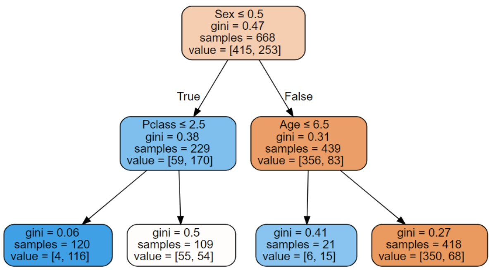

Cây quyết định đơn giản (max\_leaf\_node = 4)

<!-- page: 29 -->


## Cây quyết định: Ví dụ (Titanic)

Bigger Tree (min\_samples\_leaf = 50) → get **better result**

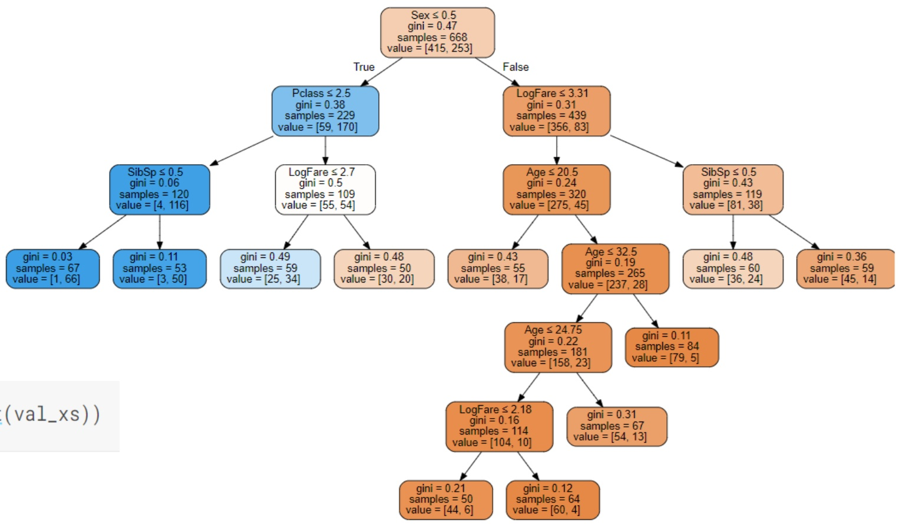

mean\_absolute\_error(val\_y, m.predict(val\_xs))

0.18385650224215247

<!-- page: 30 -->

## Ưu điểm & Nhược điểm

| Ưu điểm | Nhược điểm |
| --- | --- |
| Khả năng giải thích: sử dụng trực quan | Overfitting: dễ dàng overfit dữ liệu nếu không được "cắt tỉa" đúng cách hoặc nếu chúng được phép phát triển quá sâu (mô hình quá phức tạp) |
| Có khả năng xử lý cả numerical và categorical features | Tính không ổn định: có thể không ổn định vì những thay đổi nhỏ trong dữ liệu có thể dẫn đến một cây hoàn toàn khác → được giảm thiểu bằng các phương pháp ensemble, như Random Forests |

<!-- page: 31 -->

## Ưu điểm & Nhược điểm

| Ưu điểm | Nhược điểm |
| --- | --- |
| Phi tham số: không đưa ra giả định về sự phân bố của các biến và mối quan hệ giữa các đặc trưng và đầu ra | Khó để tối ưu: Tìm kiếm cây quyết định tối ưu cho tập dữ liệu rất tốn kém về mặt tính toán. Các phương pháp phỏng đoán như thuật toán tham lam không đảm bảo sẽ tìm được cây tối ưu. |
| Lựa chọn đặc trưng: thực hiện lựa chọn đặc trưng tiềm ẩn bằng cách ưu tiên chọn các đặc trưng nhiều thông tin để phân tách. | Bias: Chúng có xu hướng bị ảnh hưởng bởi các đặc trưng có nhiều cấp độ hơn (trong trường hợp biến phân loại) hoặc phạm vi lớn hơn (trong trường hợp biến số), vì chúng cung cấp nhiều tùy chọn hơn để phân tách dữ liệu. |

<!-- page: 32 -->


## QUIZ & QUESTIONS
