<!-- page: 1 -->

## MÔ HÌNH VÀ BÀI TOÁN MÁY HỌC

TS. Nguyễn Vinh Tiệp

<!-- page: 2 -->

## NỘI DUNG

I. Bài toán máy học

II. Mô hình máy học
A. Nền tầng
B. Bagging and Boosting
C. Mô hình cây (tree-based)
III. Máy học tự động (Auto Machine learning)

<!-- page: 3 -->

## Bagging

□ Thuộc vào nhóm mô hình học kết hợp (ensemble-based learning)

□ Các mô hình Weak learners mà chủng học song song và độc lập, kết hợp các mô hình để xác định dự đoán trung bình của mô hình

☐ Vd: Random Forest

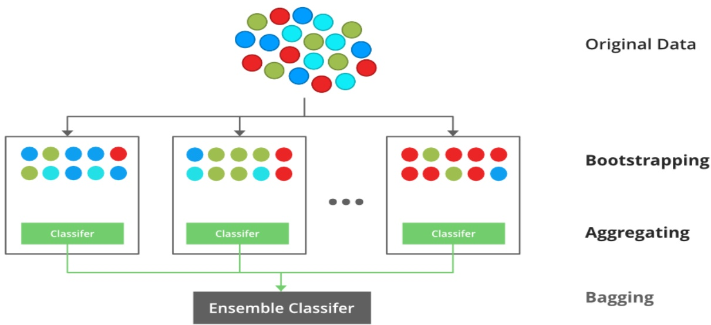

https://www.geeksforgeeks.org/bagging-vs-boosting-in-machine-learning/

Trường ĐH CNTT – Lập trình Python cho Máy học (CS116)

<!-- page: 4 -->

## Các bước thực hiện của mô hình Bagging

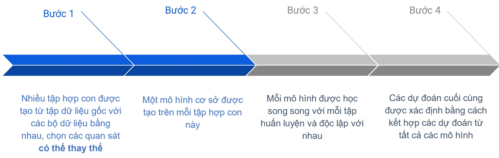

<!-- page: 5 -->

## Random Forest

□ Sử dụng Bagging (Bootstrap Aggregating) để huấn luyện từng mô hình Decision Tree trên một tập hợp con dữ liệu ngẫu nhiên khác nhau

□ Giảm sự tương quan giữa các cây và làm cho ensemble trở nên mạnh mê hơn

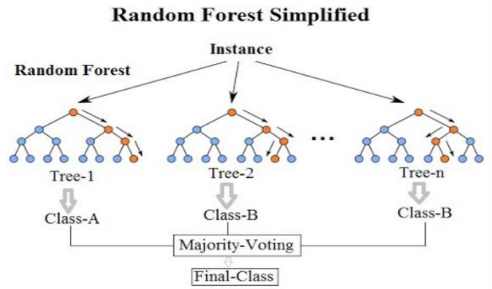

https://en.wikipedia.org/wiki/Random\_forest

Trường ĐH CNTT – Lập trình Python cho Máy học (CS116)

<!-- page: 6 -->

## Siêu tham số quan trọng

□ Siêu tham số để tăng khả năng dự đoán
□ Random Forest sklearn

n\_estimators
Số cây trong rừng -
The number of trees
in forest

max\_features
Số lượng đặc trưng
cần xem xét khi tìm
kiểm sự phân chia
tốt nhất

min\_samples\_leaf
Số lượng mẫu tối
thiếu cần có ở một nút
lá

criterion
Chức năng đo lường
chất lượng của sự
phân chia

max\_depth
Độ sâu tối đa của cây. Nếu Không, thì các nút sẽ được mở rộng cho đến khi tất cả các lá đều thuần túy hoặc cho đến khi tất cả các lá chứa ít hơn min\_samples\_split max\_leaf\_nodes
Phát triển với
max\_leaf\_nodes theo
cách tốt nhất đầu tiên

Trường ĐH CNTT – Lập trình Python cho Máy học (CS116)

<!-- page: 7 -->

## U'u điểm

Hiệu quả

Được coi là mô hình rất chính xác và mạnh mê và chạy hiệu quả trên tập dữ liệu lớn

Xử lý chiều dữ liệu
cao (high
dimensionality)

Có thể xử lý các tập dữ liệu có số lượng đặc trưng cao và không yêu cầu chia tỷ lệ đặc trưng

Tính linh hoạt

Có thể được sử dụng cho bài toán hồi quy và phân loại, đồng thời chúng tương đối dễ điều chỉnh vì không yêu cầu điều chỉnh siêu tham số nhiều

<!-- page: 8 -->

## U'u điểm

Mạnh mê với dữ liệu
outlier & non-linear

Ít có xu hướng overfitting và mạnh mê đối với các ngoại lệ, cũng như có khả năng mô hình hóa mối quan hệ phi tuyến tính, phức tạp

Parallelizable

Việc huấn luyện các cây
khác nhau có thể được
thực hiện song song vì
mỗi cây được xây dựng
độc lập

Feature Importance

Đưa ra ước tính tốt về những đặc trùng nào là quan trọng trong dữ liệu cơ bản đang được lập mô hình hóa → lựa chọn tính năng

<!-- page: 9 -->

## Nhược điểm

Interpretability

Khó diễn giải so với cây
quyết định

Computational complexity

Có thể tạo số lượng cây quyết định khá lớn và tổn nhiều bộ nhớ

Bias with imbalanced data

Có thể có bias đối với lớp
chiếm đa số khi xử lý các
tập dữ liệu mất cân bằng

<!-- page: 10 -->

Notebook example

```python
from sklearn.ensemble import RandomForestClassifier

rf = RandomForestClassifier(criterion='gini',
                      n_estimators=700,
                      min_samples_split=10,
                      min_samples_leaf=1,
                      max_features='auto',
                      oob_score=True,
                      random_state=1,
                      n_jobs=-1)
rf.fit(train.iloc[:, 1:], train.iloc[:, 0])
print("%.4f" % rf.oob_score_)
```

0.8294

<!-- page: 11 -->

## Boosting

□ Thuộc vào nhóm mô hình học kết hợp (ensemble-based learning)

☐ Weak learners học tuần tự và thích ứng để cải thiện dự đoán mô hình của thuật toán học

☐ AdaBoost, XGBoost, LightGBM, CatBoost

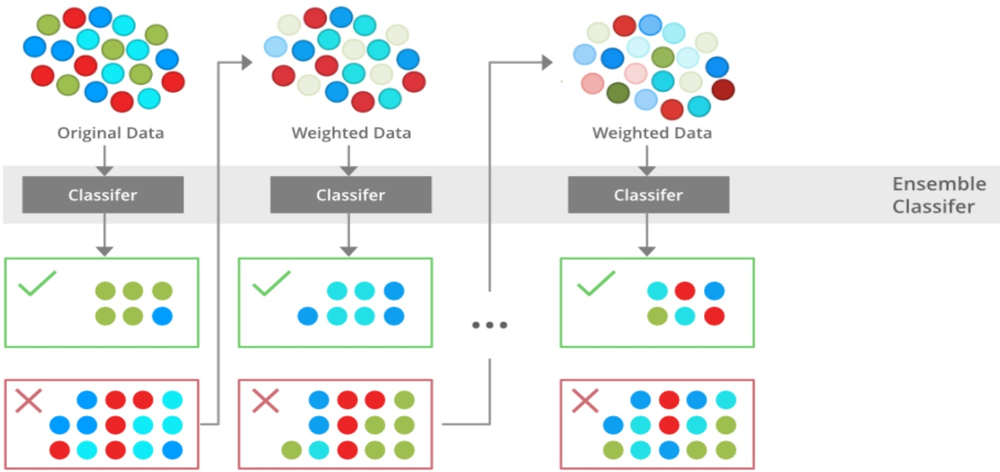

https://www.geeksforgeeks.org/bagging-vs-boosting-in-machine-learning/

Trường ĐH CNTT – Lập trình Python cho Máy học (CS116)

<!-- page: 12 -->

## Các bước cài đặt phương pháp Boosting

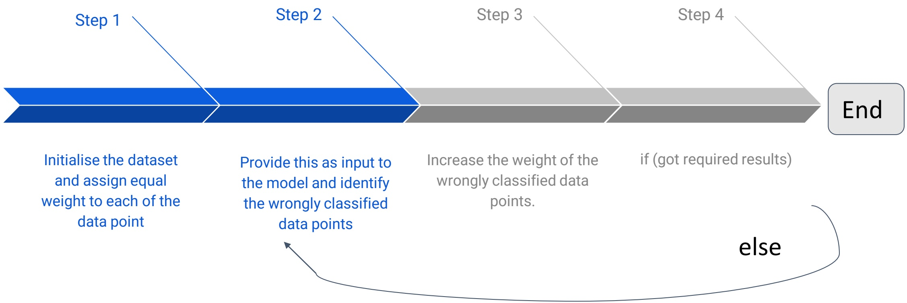

Trường ĐH CNTT – Lập trình Python cho Máy học (CS116)

<!-- page: 13 -->

## How Gradient Boosting Work?

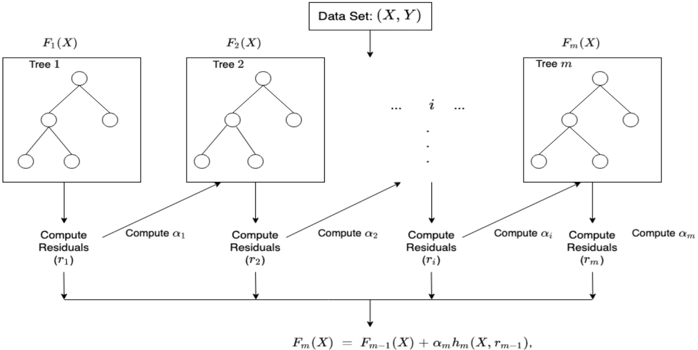

where $\alpha_{i}$, and $r_i$ are the regularization parameters and residuals computed with the $i^{th}$ tree respectfully, and $h_i$ is a function that is trained to predict residuals, $r_i$ using $X$ for the $i^{th}$ tree. To compute $\alpha_{i}$ we use the residuals computed, $r_i$ and compute the following: $\arg \min_{\alpha} = \sum_{i=1}^{m} L(Y_i, F_{i-1}(X_i) + \alpha h_i(X_i, r_{i-1}))$ where $L(Y, F(X))$ is a differentiable loss function.

https://docs.aws.amazon.com/sagemaker/latest/dg/xgboost-HowItWorks.html

Trường ĐH CNTT – Lập trình Python cho Máy học (CS116)

<!-- page: 14 -->

## Gradient Boosting: Ví dụ

Bạn có thể xây dựng mô hình Gradient Boosting để dự đoán mức lương dựa trên số năm kinh nghiệm không?

| Year | Salary (1000 $) |
| --- | --- |
| 5 | 82 |
| 7 | 80 |
| 12 | 103 |
| 23 | 118 |
| 25 | 172 |
| 28 | 127 |
| 29 | 204 |
| 34 | 189 |
| 35 | 99 |
| 40 | 166 |

Trường ĐH CNTT – Lập trình Python cho Máy học (CS116)

<!-- page: 15 -->

## Gradient Boosting: Ví dụ

□ Bước đầu tiên: mô hình nên được khởi tạo bằng một hàm F0(x).

□ Tính toán sai số dư cho từng trường hợp (y - F0(x)).

$$
F _ {0} (x) = \operatorname{argmin} _ {\gamma} \sum_ {i = 1} ^ {n} L (y _ {i}, \gamma)
$$

$$
a r g m i n _ {\gamma} \sum_ {i = 1} ^ {n} L (y _ {i}, \gamma) = a r g m i n _ {\gamma} \sum_ {i = 1} ^ {n} (y _ {i} - \gamma) ^ {2}
$$

$$
F _ {0} (x) = \frac {\sum_ {i = 1} ^ {n} y _ {i}}{n}
$$

| x | y | F0 | y - F0 |
| --- | --- | --- | --- |
| 5 | 82 | 134 | -52 |
| 7 | 80 | 134 | -54 |
| 12 | 103 | 134 | -31 |
| 23 | 118 | 134 | -16 |
| 25 | 172 | 134 | 38 |
| 28 | 127 | 134 | -7 |
| 29 | 204 | 134 | 70 |
| 34 | 189 | 134 | 55 |
| 35 | 99 | 134 | -35 |
| 40 | 166 | 134 | 32 |

<!-- page: 16 -->

## Gradient Boosting: Ví dụ

□ Sử dụng sai số dư (y - F0(x)) để tạo một bộ học yếu h1(x)

□ Dự đoán được tính: F1(x) = F0(x) + h1(x)

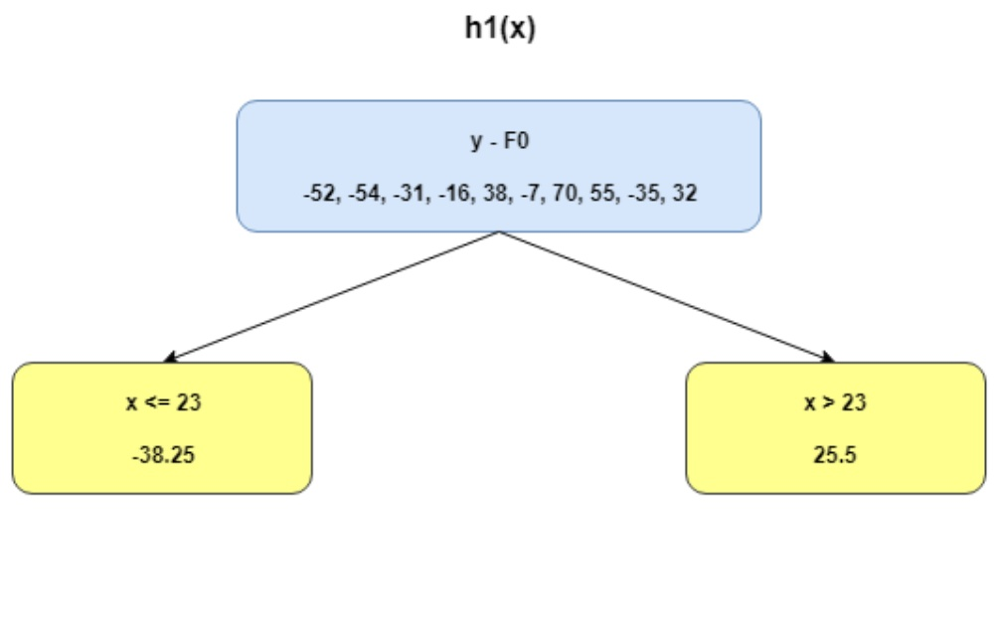

| x | y | F0 | y-F0 | h1 | F1 |
| --- | --- | --- | --- | --- | --- |
| 5 | 82 | 134 | -52 | -38.25 | 95.75 |
| 7 | 80 | 134 | -54 | -38.25 | 95.75 |
| 12 | 103 | 134 | -31 | -38.25 | 95.75 |
| 23 | 118 | 134 | -16 | -38.25 | 95.75 |
| 25 | 172 | 134 | 38 | 25.50 | 159.50 |
| 28 | 127 | 134 | -7 | 25.50 | 159.50 |
| 29 | 204 | 134 | 70 | 25.50 | 159.50 |
| 34 | 189 | 134 | 55 | 25.50 | 159.50 |
| 35 | 99 | 134 | -35 | 25.50 | 159.50 |
| 40 | 166 | 134 | 32 | 25.50 | 159.50 |

<!-- page: 17 -->

## Gradient Boosting: Ví dụ

□ Việc này có thể lặp lại thêm 2 lần để tính toán h2(x) và h3(x).

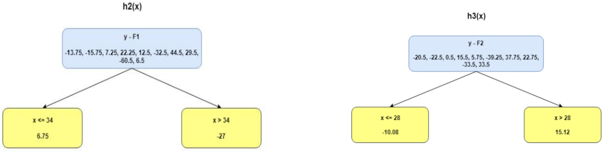

<!-- page: 18 -->

## Gradient Boosting: Ví dụ

☐ MSE cho F0(x), F1(x) và F2(x) lần lượt là 875, 692 và 540 → Xây dựng h4(x), h5(x) .. và so sánh MSE?

| x | y | F0 | y-F0 | h1 | F1 | y-F1 | h2 | F2 | y-F2 | h3 | F3 |
| --- | --- | --- | --- | --- | --- | --- | --- | --- | --- | --- | --- |
| 5 | 82 | 134 | -52 | -38.25 | 95.75 | -13.75 | 6.75 | 102.50 | -20.50 | -10.08333 | 92.41667 |
| 7 | 80 | 134 | -54 | -38.25 | 95.75 | -15.75 | 6.75 | 102.50 | -22.50 | -10.08333 | 92.41667 |
| 12 | 103 | 134 | -31 | -38.25 | 95.75 | 7.25 | 6.75 | 102.50 | 0.50 | -10.08333 | 92.41667 |
| 23 | 118 | 134 | -16 | -38.25 | 95.75 | 22.25 | 6.75 | 102.50 | 15.50 | -10.08333 | 92.41667 |
| 25 | 172 | 134 | 38 | 25.50 | 159.50 | 12.50 | 6.75 | 166.25 | 5.75 | -10.08333 | 156.16667 |
| 28 | 127 | 134 | -7 | 25.50 | 159.50 | -32.50 | 6.75 | 166.25 | -39.25 | -10.08333 | 156.16667 |
| 29 | 204 | 134 | 70 | 25.50 | 159.50 | 44.50 | 6.75 | 166.25 | 37.75 | 15.12500 | 181.37500 |
| 34 | 189 | 134 | 55 | 25.50 | 159.50 | 29.50 | 6.75 | 166.25 | 22.75 | 15.12500 | 181.37500 |
| 35 | 99 | 134 | -35 | 25.50 | 159.50 | -60.50 | -27.00 | 132.50 | -33.50 | 15.12500 | 147.62500 |
| 40 | 166 | 134 | 32 | 25.50 | 159.50 | 6.50 | -27.00 | 132.50 | 33.50 | 15.12500 | 147.62500 |

<!-- page: 19 -->

## Gradient Boosting: Residual Error

□ Tại giai đoạn mà độ chính xác tối đa được đạt bằng phương pháp boosting, các sai số dư xuất hiện có về được phân bổ ngẫu nhiên mà không có bất kỳ mẫu nào.

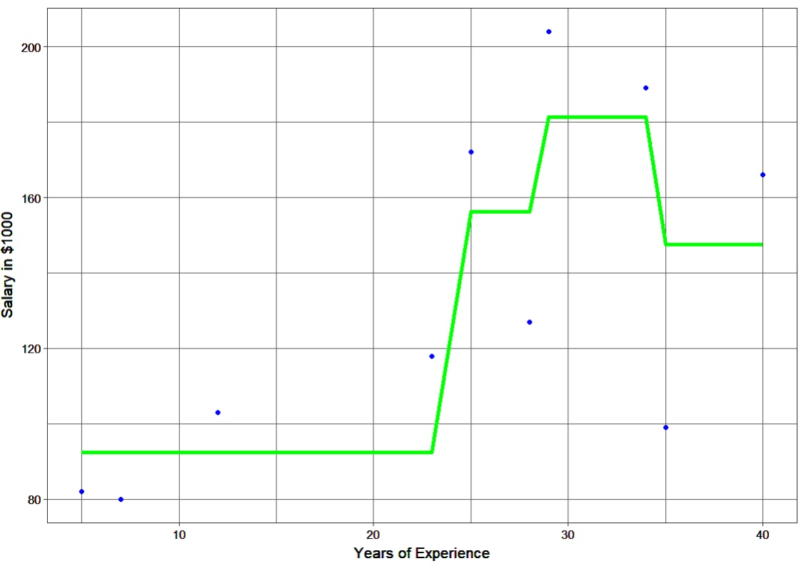

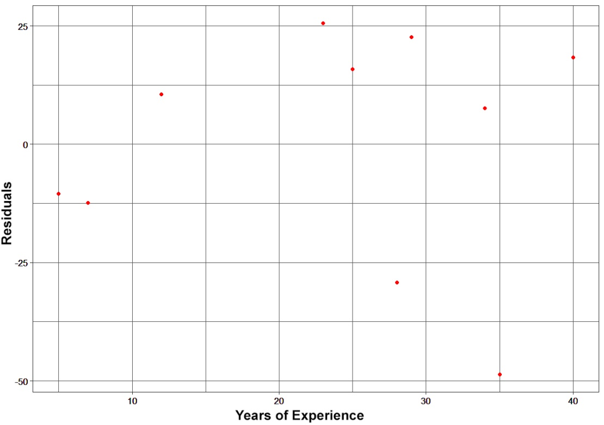

Trường ĐH CNTT – Lập trình Python cho Máy học (CS116)

<!-- page: 20 -->

## Sự khác biệt giữa Bagging và Boosting

| Bagging | Boosting |
| --- | --- |
| Giảm sự biến động | Giảm sự thiên vị |
| Mỗi mô hình được xây dựng độc lập | Các mô hình mới bị ảnh hưởng bởi hiệu suất của các mô hình được xây dựng trước đó |
| Các mô hình yếu (weak models) được huấn luyện song song | Các mô hình yếu (weak models) được huấn luyện tuần tự |

<!-- page: 21 -->

## XGBoost (Extreme Gradient Boosting)

□ Các mô hình XGBoost (regularizing gradient boosting) được sử dụng nhiều ở các cuộc thi Kaggle Competitions

☐ Documentations & paper


Trường ĐH CNTT – Lập trình Python cho Máy học (CS116)

<!-- page: 22 -->

## XGBoost: Tôi vụ hóa & cải tiến

01 Regularization

02 Parallelization and Cache block

Hợp tác của các mô học yếu → dẫn đến một mô hình rất phức tạp → XGBoost sử dụng cả L1 và L2 để trùng phạt mô hình rất phức tạp.

Chúng ta không thể huấn luyện nhiều cây cùng lúc, nhưng nó có thể tạo ra các nút khác nhau của cây một cách song song → dữ liệu cần được sắp xếp theo thứ tự.

<!-- page: 23 -->

## XGBoost: Tôi vụ hóa & cải tiến

03 Sparity Awareness

04 Tree Pruning - XGBoost có thể xử lý dữ liệu thừa thốt có thể được tạo ra từ các bước tiền xử lý hoặc giá trị thiếu. Nó sử dụng một thuật toán tìm phân chia đặc biệt.

\- XGBoost sử dụng tham số max\_depth để xác định điều kiện dùng cho việc chia nhánh và bắt đầu tia cây từ phía sau.
- Tiếp cận theo chiều sâu này cải thiện đáng kể hiệu suất tính toán.

<!-- page: 24 -->

## XGBoost: Tôi vụ hóa & cải tiến

05 In-build Cross Validation

06 Weighted Quantile Sketch

07 Cache awareness and Out-of-core computing

XGBoost có tích hợp tính năng xác thực chéo được thực hiện ở mỗi vòng lập trong quá trình tạo mô hình. Điều này ngăn chặn tình trạng quá khớp khi tập dữ liệu không quá lớn.

XGBoost tích hợp sẵn thuật toán weighted quantile sketch có tính phân phối, giúp dễ dàng tìm các điểm chia tối ưu trong các tập dữ liệu có trọng số.

XGBoost tận dụng tài nguyên phần cứng một cách hiệu quả và hợp lý. XGBoost sử dụng tính năng tính toán ngoài bộ nhớ để tối ưu hóa không gian đĩa có sẵn → XGBoost cổ gắng giảm tập dữ liệu bằng cách nén nó.

Trường ĐH CNTT – Lập trình Python cho Máy học (CS116)

<!-- page: 25 -->

https://xgboost.readthedocs.io/en/stable/tutorials/model.html

## Hiệu quả của việc chính quy hóa trong XGBoost

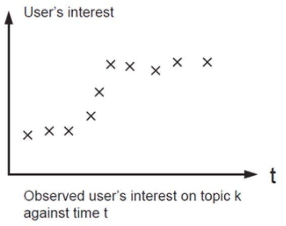

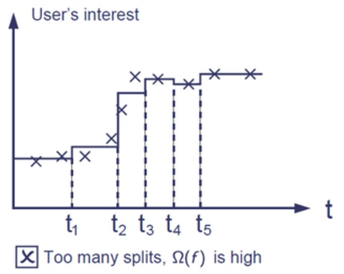

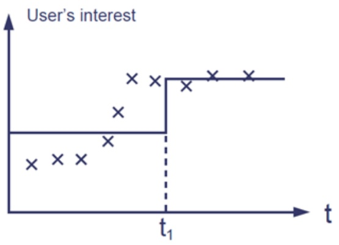

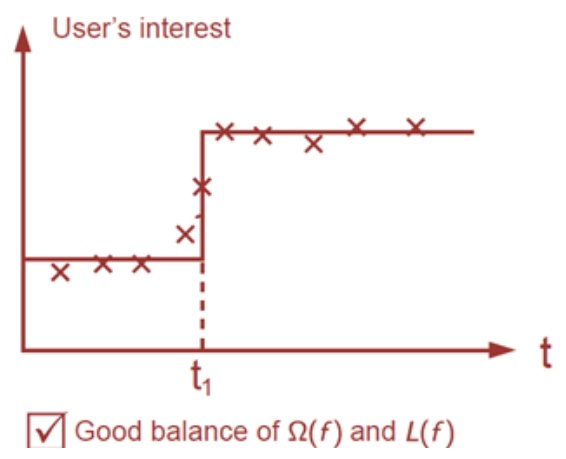

Trường ĐH CNTT – Lập trình Python cho Máy học (CS116)

<!-- page: 26 -->

## Tìm kiểm phân tách nhận biết thưa thốt

Có nhiều nguyên nhân có thể gây ra tình trạng thưa thốt

Sự xuất hiện của các giá trị thiếu trong dữ liệu.

Các mục nhập không
thường xuyên có giá
trị bằng không trong
thống kê.

Các hiện tượng tạo ra từ kỹ thuật đặc trưng như mã hóa one-hot.

<!-- page: 27 -->

## XGBoost xử lý các giá trị bị thiếu như thể nào?

Cải tiến quan trọng là chỉ
xem xét các mục không bị
thiếu, xem việc không xuất
hiện như một giá trị thiểu và
học cách xử lý giá trị thiểu
một cách tốt nhất.

<div class="docvortex-algorithm" style="white-space: pre-wrap; font-family:monospace;">
Algorithm 3: Sparsity-aware Split Finding
Input: $I$, instance set of current node
Input: $I_k = \{i \in I | x_{ik} \neq \text{missing}\}$
Input: $d$, feature dimension
Also applies to the approximate setting, only collect statistics of non-missing entries into buckets
gain $\leftarrow 0$
$G \leftarrow \sum_{i \in I}, g_i, H \leftarrow \sum_{i \in I} h_i$
for $k = 1$ to $m$ do
    // enumerate missing value goto right
    $G_L \leftarrow 0, H_L \leftarrow 0$
    for $j$ in sorted($I_k$, ascent order by $\mathbf{x}_{jk}$) do
        $G_L \leftarrow G_L + g_j, H_L \leftarrow H_L + h_j$
        $G_R \leftarrow G - G_L, H_R \leftarrow H - H_L$
        score $\leftarrow \max(score, \frac{G_L^2}{H_L + \lambda} + \frac{G_R^2}{H_R + \lambda} - \frac{G^2}{H + \lambda})$
    end
    // enumerate missing value goto left
    $G_R \leftarrow 0, H_R \leftarrow 0$
    for $j$ in sorted($I_k$, descent order by $\mathbf{x}_{jk}$) do
        $G_R \leftarrow G_R + g_j, H_R \leftarrow H_R + h_j$
        $G_L \leftarrow G - G_R, H_L \leftarrow H - H_R$
        score $\leftarrow \max(score, \frac{G_L^2}{H_L + \lambda} + \frac{G_R^2}{H_R + \lambda} - \frac{G^2}{H + \lambda})$
    end
end
Output: Split and default directions with max gain
https://arxiv.org/pdf/1603.02754.pdf
</div>

<!-- page: 28 -->

https://xgboost.readthedocs.io/en/stable/tutorials/custom\_metric\_obj.html

## Tùy chỉnh hàm mục tiêu

Chúng ta cần tính toán độ đốc (gradient) và ma trận Hessian của hàm mục tiêu (objective function).

<div class="docvortex-algorithm" style="white-space: pre-wrap; font-family:monospace;">
$\frac{1}{2} [log(pred + 1) - log(label + 1)]^2$
</div>

https://www.kaggle.com/competitions/m5-forecasting-accuracy/discussion/140564

```python
import numpy as np
import xgboost as xgb
from typing import Tuple

def gradient(predt: np.ndarray, dtrain: xgb.DMatrix) -> np.ndarray:
    '''Compute the gradient squared log error.’''
    y = dtrain.get_label()
    return (np.log1p(predt) - np.log1p(y)) / (predt + 1)

def hessian(predt: np.ndarray, dtrain: xgb.DMatrix) -> np.ndarray:
    '''Compute the hessian for squared log error.’''
    y = dtrain.get_label()
    return ((-np.log1p(predt) + np.log1p(y) + 1) /
        np.power(predt + 1, 2))

def squared_log(predt: np.ndarray,
            dtrain: xgb.DMatrix) -> Tuple[np.ndarray, np.ndarray]:
    '''Squared Log Error objective. A simplified version for RMSLE used as objective function.
    '''
    predt[predt < -1] = -1 + 1e-6
    grad = gradient(predt, dtrain)
    hess = hessian(predt, dtrain)
    return grad, hess
```

```python
xgb.train({'tree_method': 'hist', 'seed': 1994},  # any other tree method is fine.
    dtrain=dtrain,
    num_boost_round=10,
    obj=squared_log)
```

Trường ĐH CNTT – Lập trình Python cho Máy học (CS116)

<!-- page: 29 -->

## Tùy chỉnh độ đo đánh giá

☐ Sau khi có một hàm mục tiêu mới, chúng ta có thể cần một độ đo tương ứng để theo dõi hiệu suất của mô hình của chúng ta.

```python
def rmsle(predt: np.ndarray, dtrain: xgb.DMatrix) -> Tuple[str, float]:
    ''' Root mean squared log error metric.'''
    y = dtrain.get_label()
    predt[predt < -1] = -1 + 1e-6
    elements = np.power(np.log1p(y) - np.log1p(predt), 2)
    return 'PyRMSLE', float(np.sqrt(np.sum(elements) / len(y)))
```

```python
xgb.train({'tree_method': 'hist', 'seed': 1994,
        'disable_default_eval_metric': 1},
        dtrain=dtrain,
        num_boost_round=10,
        obj=squared_log,
        feval=rmsle,
        evals=[(dtrain, 'dtrain'), (dtest, 'dtest')],
        evals_result=results)
```

<!-- page: 30 -->

## Ưu điểm của XGBoost

Hiệu suất

Tạo ra các kết quả chất lượng cao trong các nhiệm vụ học máy đa dạng (ví dụ: Cuộc thi Kaggle).

Khả năng mở rộng

Được thiết kế đề huấn luyện hiệu quả và có khả năng mở rộng của các mô hình học máy, làm cho nó phù hợp cho các tập dữ liệu lớn.

Khả năng tùy chỉnh

Sự đa dạng các siêu tham
số có thể được điều chỉnh
đề tối ưu hiệu suất, làm
cho XGBoost có tính tùy
chình cao

Giải quyết giá trị
thiếu

Hỗ trợ tích hợp sẵn để xử lý giá trị thiếu, giúp làm việc với dữ liệu thực tế dễ dàng.

<!-- page: 31 -->

## Nhược điểm của XGBoost

Độ phúc tạp tính toán

Vẫn có thể mất thời gian và đồi hỏi tài nguyên tính toán đáng kể đối với các tập dữ liệu lớn hoặc các mô hình phức tạp.

Overfitting
Nếu không được điều chỉnh một cách thích hợp hoặc nếu dữ liệu có nhiều, tập dữ liệu huấn luyện nhỏ nhưng sử dụng mô hình phức tạp có thể dẫn đến hiện tượng overfitting

Tình chỉnh siêu tham
số

Yêu cầu hiểu biết tốt về các siêu tham số và việc điều chỉnh và tối ưu hóa cần thận.

Lack of Interpretability

Tương tự như nhiều phương pháp hợp tác khác, các dự đoán được thực hiện bởi XGBoost không dễ dàng có thể giải thích.

<!-- page: 32 -->

## Lưu ý về điều chỉnh tham số

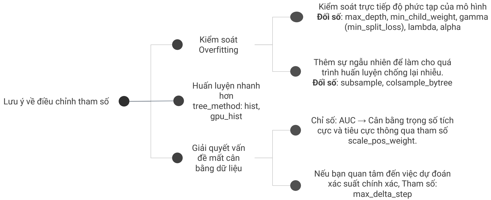

Trường ĐH CNTT – Lập trình Python cho Máy học (CS116)

<!-- page: 33 -->

## XGBoost: Tips for Hyperparameters Tuning

## Tuning parameters – expert approach (xgboost)

## Tuning parameters = experience + intuition + resources at hand

## Typical routine:

1. Set learning rate (eta) parameter 0.1-0.2 (based on dataset size and available resources); all other parameters at default; personal experience: eta does not influence other parameter tuning!

2. Test maximum tree depth parameter, rule: 6-8-10-12-14; pick best performing on CV

3. Introduce regularization on leaf splits (alpha/lambda), rule: $2^{\wedge}k$; IF it helps on CV, try to tune it as much as possible!

4. Tune min leaf node size (min\_child\_weight), rule: 1-0-5-10-20-50; IF it helps on CV, try to tune it as much as possible; IF it does not help, use value 0 (default = 1 is worse most of the times!); If 3-4 works – repeat step 2.

5. Tune randomness of each iteration (column/row sampling); Usually 0.7/0.7 is best and rarely needs to be tuned

6. Decrease eta to value which you are comfortable with your hardware; 0.025 is typically a good choice; lower values than 0.01 don't provide significant score uplift

7. If training time is reasonable, introduce bagging (num\_parallel\_trees) – how many models should be averaged in each training iteration; random forests + gradient boosting 😊 recommended value - up to 5.

https://www.slideshare.net/DariusBaruauskas/tips-and-tricks-to-win-kaggle-data-science-competitions

Trường ĐH CNTT – Lập trình Python cho Máy học (CS116)

<!-- page: 34 -->

## LightGBM

□ Tương tự như XGBoost, LightGBM (do Microsoft phát triển) là một framework phân tán hiệu năng cao sử dụng cây quyết định cho nhiệm vụ xếp hạng, phân loại và hồi quy.

Documentations

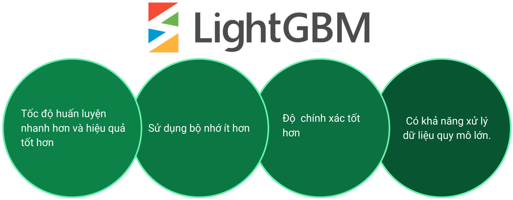

Trường ĐH CNTT – Lập trình Python cho Máy học (CS116)

<!-- page: 35 -->

## Leaf-wise (Best-first) Tree growth

□ Nó sẽ chọn lá có độ lỗi delta tối đa để phát triển.

□ Giữ nguyên số lá, thuật toán dựa trên lá thường đạt được tỷ lệ mất mát thấp hơn so với thuật toán dựa trên mức.

□ Dựa trên lá có thể gây ra tình trạng overfiting khi tập dữ liệu nhỏ, vì vậy LightGBM bao gồm tham số max\_depth để giới hạn độ sâu của câv.

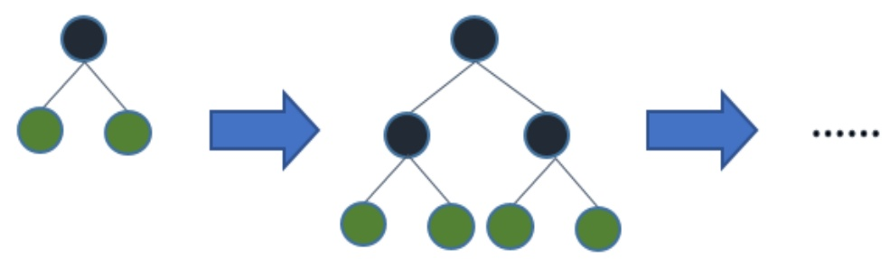

Level-wise tree growth

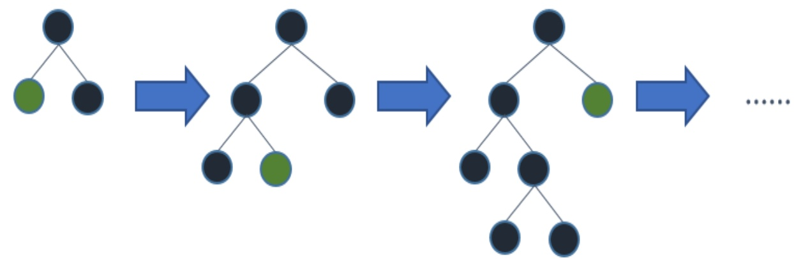

Leaf-wise tree growth

<!-- page: 36 -->

## Optimization in Speed and Memory usage

□ Nhiều công cụ boosting sử dụng thuật toán dựa trên sắp xếp trước (ví dụ: thuật toán mặc định trong xgboost) để học cây quyết định

□ LightGBM sử dụng thuật toán dựa trên biểu đồ histogram → nhóm các giá trị đặc trùng (thuộc tính) liên tục vào các thùng riêng biệt

Reduce cost of calculating the gain for each split

Histogram-based O(bins) > pre-sort based O(data)

Use histogram subtraction for further speedup

To get one leaf's histograms in a binary tree, use the histogram subtraction of its parent and its neighbor

Reduce memory usage

No need to store additional information for pre-sorting feature values Use small data type to store data (int8: bins)

Trường ĐH CNTT – Lập trình Python cho Máy học (CS116)

<!-- page: 37 -->

## Phân chia tối ưu cho các đặc trưng hạng mục

☐ Không sử dụng mã hóa one-hot (không tối ưu cho các mô hình học cây)

□ Sắp xếp các danh mục theo mục tiêu huấn luyện tại mỗi phân chia

□ LightGBM sắp xếp biểu đồ (cho một đặc trưng hạng mục) dựa trên giá trị tích lũy của nó (sum\_gradient / sum\_hessian) và sau đó tìm điểm chia tốt nhất trên biểu đồ đã được sắp xếp.

<!-- page: 38 -->

## Điều gì làm cho LightGBM nhanh?

## Reference

## ☐ GOSS (Gradient Based One Side Sampling)

□ Giữ lại các trường hợp có gradient lớn trong khi thực hiện lấy mẫu ngẫu nhiên trên các trường hợp có độ đốc nhỏ.

## ☐ EFB (Exclusive Feature Bundling)

□ Giảm số lượng đặc trưng bằng cách gom các đặc trưng lại với nhau.

□ Dữ liệu có nhiều đặc trưng mà chúng là đặc trưng độc quyền lẫn nhau, tức là chúng không
bao giờ có giá trị bằng không cùng một lúc → gom chúng thành một đặc trưng duy nhất.

<!-- page: 39 -->

## Lưu ý khi tinh chỉnh tham số

Tốc độ học và số
Lượng ước lượng

Tốc độ học thấp →
thường mang lại kết quả
tốt hơn nhưng yêu cầu
nhiều tài nguyên tính toán
hơn.

Kiểm soát độ phức
tạp của các cây.
max\_depth
num\_leaves (<=
2^max\_depth)

Ngăn chặn
Overfitting

min\_data\_in\_leaf
feature\_fraction
(\~colsample\_bytree)
bagging\_fraction
regularization: lambda\_l1,
lambda\_l2

Early Stopping

early\_stopping\_rounds: 50, 100

<!-- page: 40 -->

## CatBoost

□ Tự động xử lý các đặc trưng hạng mục.

☐ Cho phép Fast Gradient Boosting trên Cây quyết định bằng cách sử dụng GPU.

Github

Documentations


<!-- page: 41 -->

## AutoML

☐ Quá trình tự động hóa toàn bộ quy trình áp dụng máy học cho các bài toán thực tế.
☐ AutoML Tools: H2O AutoML, PyCaret, AutoGluon, Auto-sklearn,...

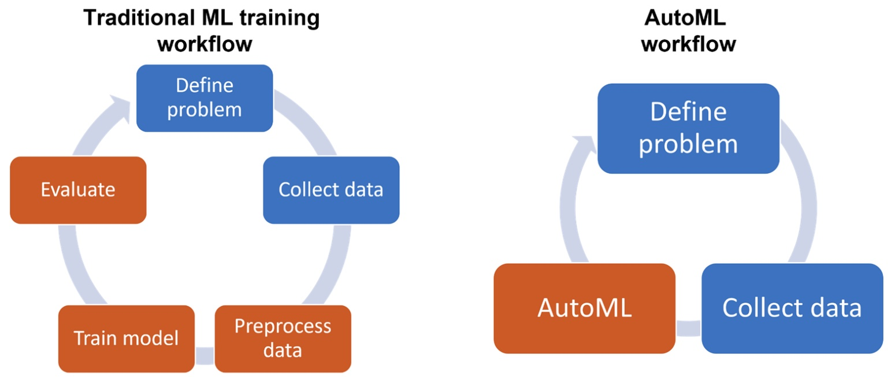

Preprocess data

Define problem

AutoML

Trường ĐH CNTT – Lập trình Python cho Máy học (CS116)

<!-- page: 42 -->

## Tại sao cần AutoML?

Tự động hóa xử lý dữ liệu

Tự động hóa thiết kế
đặc trung

Tự động hóa tinh
chình siêu tham
số

Tự động hóa việc đánh giá và lựa chọn mô hình.

<!-- page: 43 -->

## H2O AutoML

□ Có thể sử dụng để tự động hóa luồng làm việc trong học máy, bao gồm việc tự động huấn luyện và điều chỉnh nhiều mô hình trong một thời gian được người dùng chỉ định.

□ Đề xuất nhiều phương pháp giải thích mô hình - model explainability

<!-- page: 44 -->

```txt
# View the AutoML Leaderboard
lb = aml.leaderboard
lb.head(rows=lb.nrows)  # Print all rows instead of default (10 rows)
```

## H2O AutoML: Ví dụ

## Example notebook

Nhận diện biến dự đoán và biến phần hồi.

```txt
x = train.columns[:-1]
y = 'isFraud'
# For binary classification, response should be a factor
train[y] = train[y].asfactor()
```

## Chạy AutoML cho 30 mô hình cơ sở.

```python
aml = H2OAutoML(max_models=30, seed=55, max_runtime_secs=30000)
aml.train(x=x, y=y, training_frame=train)
```

## Xem bằng xếp hạng AutoML.

| model_id | auc | logloss | mean_per_class_error | rmse | mse |
| --- | --- | --- | --- | --- | --- |
| XGBoost_1_AutoML_20200722_023615 | 0.958309 | 0.0586498 | 0.168992 | 0.118115 | 0.0139513 |
| StackedEnsemble_AllModels_AutoML_20200722_023615 | 0.957977 | 0.0649631 | 0.169127 | 0.118389 | 0.014016 |
| StackedEnsemble_BestOfFamily_AutoML_20200722_023615 | 0.957977 | 0.0649631 | 0.169127 | 0.118389 | 0.014016 |
| XGBoost_2_AutoML_20200722_023615 | 0.903715 | 0.110041 | 0.225731 | 0.144857 | 0.0209837 |

Trường ĐH CNTT – Lập trình Python cho Máy học (CS116)

<!-- page: 45 -->

## H2O AutoML: Giải thích mô hình

## □ Hỗ trợ giải thích mô hình đơn và nhiều mô hình

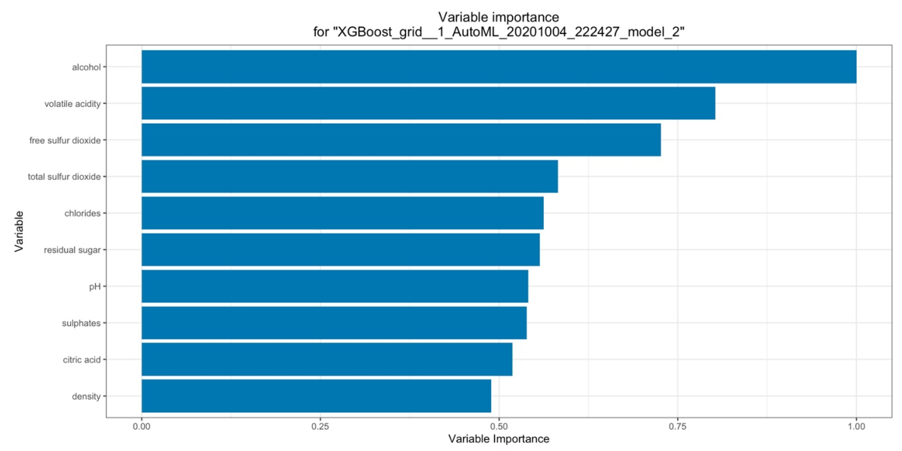

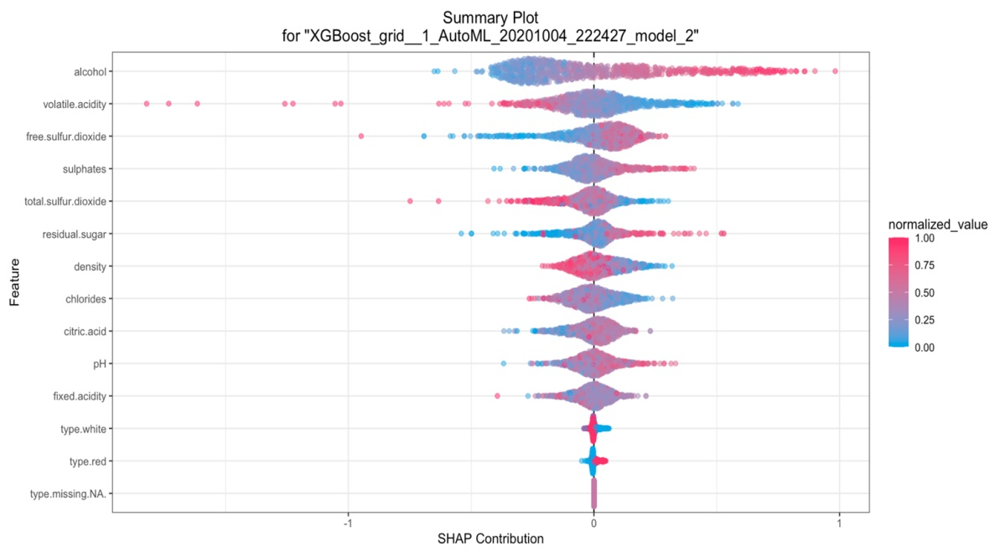

<!-- page: 46 -->

## PyCaret AutoML

□ PyCaret là thư viện máy học mã nguồn mở, thư viện máy học ngôn ngữ thấp Python cho phép tự động hóa quy trình máy học

Github

Documentations


Data
Preparation


Model
Training


Hyperparameter
Tuning


Analysis & Interpretability


Model
Selection


Experiment
Logging

Trường ĐH CNTT – Lập trình Python cho Máy học (CS116)

<!-- page: 47 -->

## PyCaret: Xử lý dữ liệu

Details

Chuẩn bị dữ liệu

Dữ liệu bị thiếu
Categorical encoding: One-hot, Label encoder,..
Target imbalanced
Remove outliers

Quy mô và chuyển
đổi

Normalization
Feature Transformation
Target Transformation Thiết kế đặc trưng

Feature Interaction
Group Aggregations
Binning Feature
Cluster Feature

Lựa chọn đặc trưng

Feature Selection
Method: univariate,
sequential,..
Remove Multicollinearity
PCA
Ignore Low Variance

<!-- page: 48 -->

## PyCaret: Tính năng

Details

Khởi tạo

Tạo ra các pipeline biến đổi đến tất cả tham số đưa vào của hàm
Đối số yêu cầu: data, target

Huấn luyện
Huấn luyện và đánh giá hiệu suất của tất cả các bộ uróc lượng có sẵn trong thư viện mô hình bằng cách sử dụng kiểm tra chéo.C
So sánh mô hình, tạo mô hình

Tôi ựu

Hàm này tinh chính các
siêu tham số của mô
hình.
Tình chính mô hình, tạo
mô hình kết hợp và tối ưu
hóa ngưỡng,...

Phân tích

Phân tích và giải thích mô hình
Vẽ đỏ thị mô hình, diễn giải mô hình, kiểm tra tính công bằng,...

Triển khai

Các chức năng triển khai như mô hình dự đoán, lưu mô hình, kiểm tra sự thay đổi dữ liệu, triển khai trên AWS, Azure, Tạo API, Docker

<!-- page: 49 -->

## PyCaret: Ví dụ

Notebook example

Example github

\- Normalization of the numerical features with Z-Score.

\- Feature Selection with permutation importance techniques.

\- Outliers Removal.

\- Features Removal based on Multicollinearity.

\- Features Scalling Transformation.

\- Ignore low variance on Features.

• PCA for Dimensionality Reduction, as the dataset has many features.

\- Numeric binning on the features MonthlyCharges and TotalCharges.

• 70% of samples for Train and 30% for test.

• Fix Imbalance with SMOTE.

```python
exp01 = setup(data=data, target="Churn", session_id=RANDOM_SEED, ignore_features=["customerID"],
        numeric_features=["SeniorCitizen"], normalize=True,
        feature_selection=True, remove_outliers=True,
        remove_multicollinearity=True, fix_imbalance=True,
        transformation=True, ignore_low_variance=True, pca=True,
        bin_numeric_features=["MonthlyCharges", "TotalCharges"],
        silent=True, experiment_name="customer-churn-prediction",
        log_experiment=True)
```

Trường ĐH CNTT – Lập trình Python cho Máy học (CS116)

<!-- page: 50 -->

## PyCaret: Ví dụ

□ So sánh các mô hình, điều chỉnh siêu tham số, mô hình tập hợp (bagging, boosting, blending)

Example github

```python
top_model = compare_models(fold=K_FOLDS,
                    sort="F1",
                    n_select=1,
                    blacklist=["gbc", "catboost"])
```

<table><tr><td colspan="2"></td><td>Model</td><td>Accuracy</td><td>AUC</td><td>Recall</td><td>Prec.</td><td>F1</td><td>Kappa</td><td>MCC</td><td>TT (Sec)</td></tr><tr><td>0</td><td></td><td>Logistic Regression</td><td>0.7516</td><td>0.8373</td><td>0.7777</td><td>0.5349</td><td>0.6336</td><td>0.4553</td><td>0.4739</td><td>0.0468</td></tr><tr><td>1</td><td></td><td>Ridge Classifier</td><td>0.7416</td><td>0.0000</td><td>0.7897</td><td>0.5216</td><td>0.6279</td><td>0.4424</td><td>0.4653</td><td>0.0136</td></tr><tr><td>2</td><td></td><td>Linear Discriminant Analysis</td><td>0.7414</td><td>0.8358</td><td>0.7897</td><td>0.5213</td><td>0.6277</td><td>0.4421</td><td>0.4650</td><td>0.0485</td></tr><tr><td>3</td><td></td><td>SVM - Linear Kernel</td><td>0.7419</td><td>0.0000</td><td>0.7356</td><td>0.5253</td><td>0.6115</td><td>0.4267</td><td>0.4417</td><td>0.0532</td></tr><tr><td>4</td><td></td><td>Ada Boost Classifier</td><td>0.7464</td><td>0.8042</td><td>0.7004</td><td>0.5313</td><td>0.6040</td><td>0.4226</td><td>0.4316</td><td>1.3652</td></tr></table>

```python
tuned_model = tune_model(estimator=top_model, fold=K_FOLDS,
                     optimize="F1", choose_better=True,
                     verbose=False)
```

```txt
bagged_model = ensemble_model(tuned_model, fold=K_FOLDS)
```

```python
boosted_model = ensemble_model(tuned_model, fold=K_FOLDS,
                          method="Boosting")
```

```python
blended_model = blend_models(estimator_list=[tuned_model, boosted_model],
                    fold=K_FOLDS)
```

<!-- page: 51 -->

## AutoGluon AutoML

□ Auto ML cho hình ảnh, văn bản, chuỗi thời gian và dữ liệu dạng bằng

Documentations

https://github.com/autogluon/autogluon

<!-- page: 52 -->

## AutoGluon: Tính năng

Details

Thiết kế đặc trưng
tùy chỉnh

Giá trị bị mất
Mã hóa phân loại: One-hot,
Mã hóa nhãn,..
Mục tiêu mất cân bằng
Xóa các ngoại lệ

Điều chỉnh siêu tham
số

Chuẩn hóa
Chuyển đổi đặc trưng
Chuyển đổi mục tiêu

Kết hợp mô hình

Bagging
Stacking
Weighted Ensemble

Khác
Khả năng giải thích (độ quan trọng của đặc trưng)
Tăng tốc suy luận
Chung cắt mẫu
Hỗ trợ đa dữ liệu: tabular+image+text

<!-- page: 53 -->

## AutoGluon: Ví dụ

## Example notebook

```python
# Fit end-to-end with raw data in under 1 hour, with one line of code
predictor = TabularPredictor(
    label=label,
    eval_metric='log_loss',
    learner_kwargs={'ignored_columns': ['id']}
).fit(
    train_data,
    presets='best_quality',
    hyperparameters={
        KNNRapidsModel: {},
        LinearRapidsModel: {},
        'RF': {},
        'XGB': {'ag_args_fit': {'num_gpus': 1}},
        'CAT': {'ag_args_fit': {'num_gpus': 1}},
        'GBM': [{}, {'extra_trees': True, 'ag_args': {'name_suffix': 'XT'}}, 'GBMLarge'],
        'NN': {'ag_args_fit': {'num_gpus': 1}},
        'FASTAI': {'ag_args_fit': {'num_gpus': 1}},
    },
)
```

<!-- page: 54 -->

## Auto-sklearn

□ Bộ công cụ máy học tự động và một công cụ thay thế sẵn có cho công cụ ước tính scikit-learn.

github

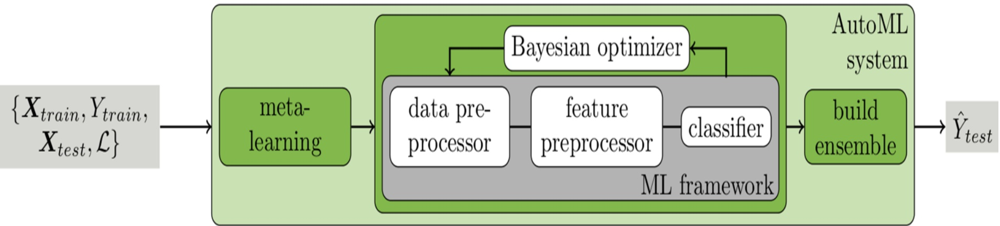

https://github.com/automl/auto-sklearn

Trường ĐH CNTT – Lập trình Python cho Máy học (CS116)

<!-- page: 55 -->

## Auto-sklearn: Làm sao sử dụng?

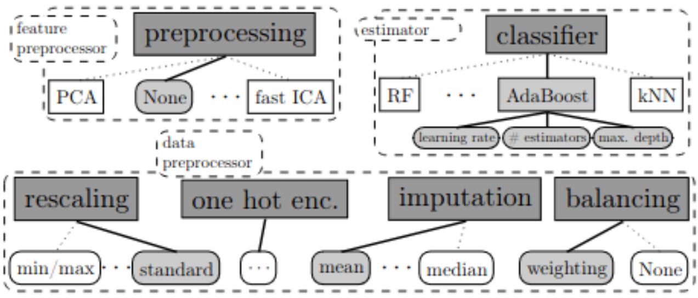

import autosklearn.classification
cls = autosklearn.classification.AutoSklearnClassifier()
cls.fit(X\_train, y\_train)
predictions = cls.predict(X\_test)

<!-- page: 56 -->

## Tài liệu tham khảo

https://web.stanford.edu/class/stats202/intro.html

https://towardsdatascience.com/what-makes-lightgbm-lightning-fast-a27cf0d9785e

http://arogozhnikov.github.io/2016/06/24/gradient\_boosting\_explained.html

https://aman.ai/cs229/ensemble-methods/

https://web.stanford.edu/class/stats202/notes/Tree/Boosting.html

https://www.geeksforgeeks.org/xgboost/

https://neptune.ai/blog/xgboost-vs-lightgbm

☐ Cheat Sheet: https://drive.google.com/drive/folders/1IGiethDMHashf9Gsfx3sPTsJOnl15Zvx

<!-- page: 57 -->


## HỔI ĐÁP
