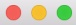
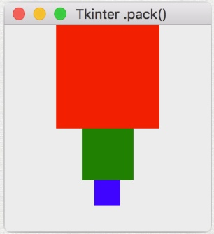
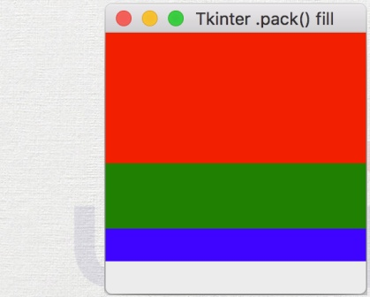
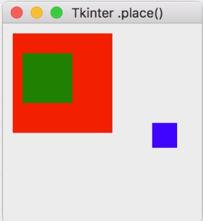
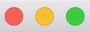

<!-- page: 1 -->

## GUI Toolkit

Tran Giang Son, tran-giang.son@usth.edu.vn

ICT Department, USTH

<!-- page: 2 -->

## GUI

<!-- page: 3 -->

## What

## • GUI

• Graphical User Interface

• Interactive with graphical components

• Windows, scrollbars, buttons, textboxes,

• Sexy (?)

## • CLI

• Command Line Interface

• Writing commands in terminal

• Wait for response from system

• Old school, boring (?)

<!-- page: 4 -->

## CLI vs GUI

| Feature | CLI | GUI |
| --- | --- | --- |
| Learning curve | Steep | Easy |
| Flexibility | Very high | Limited |
| Memory | Low | Higher |
| Speed | Fast | Slower |
| Interact | Keyboard | Keyboard, Mouse |
| Theming | Limited | Easy |

<!-- page: 5 -->

## Why

• User friendly, intuitive for new comers

• Easy to learn, no need to remember comments

• Better multitasking

<!-- page: 6 -->

## Python GUI Toolkit

<!-- page: 7 -->

## Toolkits

| Feature | Tkinter | PyQt | Kivy | wxPython |
| --- | --- | --- | --- | --- |
| Included? | Yes | No | No | No |
| Cross platform | Yes | Yes | Yes | Yes |
| Backend | Tcl/Tk | Qt | OpenGL | wxWidgets |

<!-- page: 8 -->

## Tkinter

• Simplicity

• Flexibility

• Focusing on new comers • TODO: image of student management system here

<!-- page: 9 -->

## Tkinter

• Window

• Widgets

• Layout

• Window event loop

<!-- page: 10 -->

```txt
sub = tk.Toplevel(window)
sub.title("Students")
sub.geometry("600x400")
```

## Tkinter: Window

• Types: Main window and sub window

1. Window

2. Widgets

• Important attributes: title, size

3. Layout

4. Window event loop

• Main window

```python
import tkinter as tk
window = tk.Tk()
window.title("Student Information System")
window.geometry("800x600")
```

## • Sub window

<!-- page: 11 -->



## Tkinter: Widgets

• Everything is widget

• Frame

• Label

• Buttons

• Entry

• Check Button

• Radio Button

• List Box

• ComboBox

• Menu

• . . .

## • Important attributes

Dimension: width = 400, height 300

• Background color: bg = "green"

Tkinter widgets

This is a Label

Button 1

Button 2

Entry for text input

Checkbutton option 1

Checkbutton option 2

Radiobutton option 1

Radiobutton option 2

I See Tea

Icy Tea

Ice City

<!-- page: 12 -->

## Tkinter: Widgets

1. Window

2. Widgets

3. Layout

4. Window event loop

## • Frame

5. Message box

• A container for other widgets

• tk.Frame(window, width = 100, height = 100)

## • Label

• Show texts

• tk.Label(window, text = "This is a Label")

<!-- page: 13 -->

## Tkinter: Widgets

1. Window

2. Widgets

3. Layout

## • Button

• Clickable

4. Window event loop

5. Message box

• Handle click: command = onClickFunc

from tkinter import messagebox

```python
def onClick():
    messagebox.showinfo(message="Button 1 clicked")
```

```txt
tk.Button(window, text = "Button 1", command = onClick)
```

<!-- page: 14 -->

## Tkinter: Widgets

1. Window

## • Entry

• Input texts

2. Widgets

3. Layout

4. Window event loop

5. Message box

• Can be used for password field (with show = "\*")

```txt
entry = tk.Entry(window)
entry.insert(-1, "Entry for text input")
```

## • Checkbutton

• Checkboxes

• 2 states: check and uncheck

tk.Checkbutton(window, text = "Checkbutton option 1")

<!-- page: 15 -->

## Tkinter: Widgets

• Radiobutton

• Single choice among options

• Text != Value

```txt
1. Window
2. Widgets
3. Layout
4. Window event loop
5. Message box
```

```lua
radioValue = tk.StringVar(value = "op1")
tk.Radiobutton(window, variable = radioValue,
    text = "Radiobutton option 1", value = "op1")
tk.Radiobutton(window, variable = radioValue,
    text = "Radiobutton option 2", value = "op2")
```

<!-- page: 16 -->

## Tkinter: Widgets

1. Window

2. Widgets

## • Listbox

• Selectable item

• A list of items

3. Layout

4. Window event loop

5. Message box

• Get selected item: listbox.get(tk.ACTIVE)

```python
icts = ["ICT", "I See Tea", "Icy Tea", "Ice City"]
listbox = tk.Listbox(window)
```

## for i in icts:

```txt
listbox.insert(icts.index(i), i)
```

<!-- page: 17 -->

## Tkinter: Widgets

1. Window

2. Widgets

3. Layout

4. Window event loop

## • Combobox

5. Message box

• A list of selectable items

• Initially collapsed, can be expanded

• Get selected item: combobox.get()

```python
from tkinter import ttk
icts = ["ICT", "I See Tea", "Icy Tea", "Ice City"]
ttk.Combobox(window, values = icts)
```

<!-- page: 18 -->

## Tkinter: Layout

1. Window

• Geometry manager

2. Widgets

3. Layout

4. Window event loop

5. Message box

• Handle placements (positions) of widgets on windows

• Main container: tk.Frame

• Widget methods for geometry management

• .pack()

• .place()

• .grid()

<!-- page: 19 -->

## Tkinter: Layout

## • .pack()

• Packing algorithm

• Similar to HTML div

• Default

• Vertically align

• Horizontally centered

• Alignment direction: side = tk.LEFT

1. Window

2. Widgets

3. Layout

4. Window event loop

5. Message box

• Automatic expand: fill = tk.X, fill = tk.Y

<!-- page: 20 -->

## Tkinter: Layout

\# default window

tk.Frame(window, width = 100, ..., bg="red").pack()

tk.Frame(window, width = 50, ..., bg="green").pack()

1. Window

2. Widgets

tk.Frame(window, width = 25, ..., bg="blue").pack()

3. Layout

4. Window event loop

\# secondary window with fill

5. Message box

tk.Frame(sub, width = 100, ..., bg="red").pack(fill = tk.X)

tk.Frame(sub, width = 50, ..., bg="green").pack(fill = tk.X)

tk.Frame(sub, width = 25, ..., bg="blue").pack(fill = tk.X)





Tran Giang Son, tran-giang.son@usth.edu.vn

<!-- page: 21 -->

## Tkinter: Layout

1. Window

2. Widgets

• .place()

3. Layout

4. Window event loop

• Similar to HTML position: absolute

5. Message box

• Unit: pixels

• Absolute values

• Position: x = 10, y = 10

• Dimension: width = 400, height = 300

## • Relative values [0...1]

• Position: relx = 0.1, rely = 0.1

• Dimension: relwidth = 0.5, relheight = 0.7

<!-- page: 22 -->

## Tkinter: Layout

tk.Frame(window, bg="red").place(x = 10, y = 10, width = 100, height = 100) tk.Frame(window, bg="green").place(x = 20, y = 30, width = 50, height = 50) tk.Frame(window, bg="blue").place(x = 150, y = 100, width = 25, height = 25)

1. Window

2. Widgets

3. Layout

4. Window event loop

5. Message box

## Output:



<!-- page: 23 -->

## Tkinter: Layout

## • .grid()

• Similar to HTML table

• Position: column = 0, row = 2

• Stretching: sticky = tk.EW

• Padding: padx = 3, pady = 3

• Spanning

• columnspan = 3

• rowspan = 2

1. Window

2. Widgets

3. Layout

4. Window event loop

5. Message box

<!-- page: 24 -->

```txt
Tkinter: Layout
    1. Window
    2. Widgets
    3. Layout
    4. Window event loop
    5. Message box
    tk.Label(window, text = "Username").grid(
        column = 0, row = 0, sticky = tk.EW, padx = 3, pady = 3)
    tk.Label(window, text = "Password").grid(
        column = 0, row = 1, sticky = tk.EW, padx = 3, pady = 3)

    tk.Entry(window).grid(
        column = 1, row = 0, sticky = tk.EW, padx = 3, pady = 3, columnspan = 4)
    tk.Entry(window).grid(
        column = 1, row = 1, sticky = tk.EW, padx = 3, pady = 3, columnspan = 4)

    tk.Button(window, text = "Login").grid(
        column = 0, row = 2, columnspan = 2)
    tk.Button(window, text = "Exit").grid(
        column = 2, row = 2, columnspan = 2)
```

<!-- page: 25 -->

## Tkinter: Layout



Username

Tkinter .grid()

Password

Login

Exit

1. Window

2. Widgets

3. Layout

4. Window event loop

5. Message box

<!-- page: 26 -->

Tkinter: Window loop

• A **blocking** method

• Handles input, output events

• window.mainloop()

<!-- page: 27 -->

## Practice!

<!-- page: 28 -->

## Practical work 9: GUI’ed management system

• Copy your pw8 directory to pw9 directory

• Upgrade your user interface to GUI using Tkinter

• Push your work to corresponding forked Github repository
