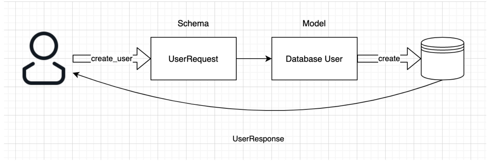
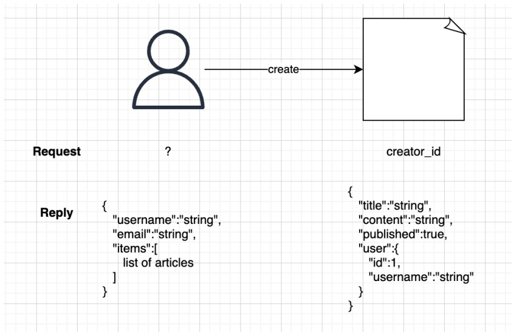

<!-- page: 1 -->

## FastAPI

Intro

<!-- page: 2 -->

## Intro

Welcome, thanks for being here

<!-- page: 3 -->

## Intro

Welcome, thanks for being here

FastAPI

<!-- page: 4 -->

## Intro

Welcome, thanks for being here

FastAPI

Easy to use, fast, lightweight

<!-- page: 5 -->

## Intro

Welcome, thanks for being here

FastAPI

Easy to use, fast, lightweight

Swagger doc feature is awesome

<!-- page: 6 -->

## Intro

Welcome, thanks for being here

FastAPI

Easy to use, fast, lightweight

Swagger doc feature is awesome

You will learn everything you need to know about FastAPI

<!-- page: 7 -->

## Intro

Welcome, thanks for being here

FastAPI

Easy to use, fast, lightweight

Swagger doc feature is awesome

You will learn everything you need to know about FastAPI

Implement a real world API project

<!-- page: 8 -->

## Intro

Welcome, thanks for being here

FastAPI

Easy to use, fast, lightweight

Swagger doc feature is awesome

You will learn everything you need to know about FastAPI

Implement a real world API project

Add 2 different clients that connect to API

<!-- page: 9 -->

## FastAPI

Overview

<!-- page: 10 -->

## Getting started overview

Installation

Features

First code

<!-- page: 11 -->

## FastAPI

Features

<!-- page: 12 -->

## Features

Automatic documentation

<!-- page: 13 -->

## Features

Automatic documentation

● Swagger

● ReDoc

<!-- page: 14 -->

## Features

Automatic documentation

● Swagger

● ReDoc

Standard python3

<!-- page: 15 -->

## Features

Automatic documentation

● Swagger

● ReDoc

Standard python3

Security and authentication

<!-- page: 16 -->

## Features

Automatic documentation

● Swagger

● ReDoc

Standard python3

Security and authentication

Dependency injection

<!-- page: 17 -->

## Features

Automatic documentation

● Swagger

● ReDoc

Standard python3

Security and authentication

Dependency injection

Testing - 100% coverage

<!-- page: 18 -->

## FastAPI

GET method overview

<!-- page: 19 -->

## GET method overview

Path parameters

Predefined values

Query parameters

<!-- page: 20 -->

## FastAPI

Path parameters

<!-- page: 21 -->

## Path parameters

## Path parameters

**@app.get('/blog/{id}')**

**def index(id):**

**return {"message": f"Blog with id {id}"}**

<!-- page: 22 -->

## Path parameters

## Path parameters

## Type validation

**@app.get('/blog/{id}')**

**def index(id: int):**

**return {"message": f"Blog with id {id}"}**

<!-- page: 23 -->

## Path parameters

## Path parameters

## Type validation

**@app.get('/blog/{id}')**

**def index(id: int):**

**return {"message": f"Blog with id {id}"}**

Pydantic

<!-- page: 24 -->

## Path parameters

## Path parameters

## Type validation

**@app.get('/blog/{id}')**

**def index(id: int):**

**return {"message": f"Blog with id {id}"}**

Pydantic

Order is important

<!-- page: 25 -->

## FastAPI

Predefined path

<!-- page: 26 -->

## Predefined path

Predefined values with Enum

<!-- page: 27 -->

## Predefined path

## Predefined values with Enum

**class BlogType(str, Enum):**

**short = 'short'**

**story = 'story'**

**howto = 'howto'**

<!-- page: 28 -->

## Predefined path

## Predefined values with Enum

**class BlogType(str, Enum):**

**short = 'short'**

**story = 'story'**

**howto = 'howto'**

**@app.get('/blog/type/{type}')**

**def blog\_type(type: BlogType):**

**return {"message": f"Blog type: {type}"}**

<!-- page: 29 -->

## FastAPI

Query parameters

<!-- page: 30 -->

## Query parameters

http://localhost:8000/blogs/all?page=2&page\_size=10

Query parameters: page and page\_size

<!-- page: 31 -->

## Query parameters

http://localhost:8000/blogs/all?page=2&page\_size=10

Query parameters: page and page\_size

Any function parameters not part of the path

<!-- page: 32 -->

## Query parameters

http://localhost:8000/blogs/all?page=2&page\_size=10

Query parameters: page and page\_size

## Any function parameters not part of the path

**@app.get('/blog/all')**

**def get\_blogs(page, page\_size):**

**return {'message': f'All {page\_size} blogs on page {page}'}**

<!-- page: 33 -->

## Query parameters

Default values

<!-- page: 34 -->

## Query parameters

## Default values

**@app.get('/blog/all')**

**def get\_blogs(page = 1, page\_size = 10):**

**return {'message': f'All {page\_size} blogs on page {page}'}**

<!-- page: 35 -->

## Query parameters

## Default values

**@app.get('/blog/all')**

**def get\_blogs(page = 1, page\_size = 10):**

**return {'message': f'All {page\_size} blogs on page {page}'}**

Optional parameters

<!-- page: 36 -->

## Query parameters

## Default values

**@app.get('/blog/all')**

**def get\_blogs(page = 1, page\_size = 10):**

**return {'message': f'All {page\_size} blogs on page {page}'}**

## Optional parameters

**@app.get('/blog/all')**

**def get\_blogs(page = 1, page\_size: Optional[int] = None):**

**return {'message': f'All {page\_size} blogs on page {page}'}**

<!-- page: 37 -->

## Query parameters

## Default values

**@app.get('/blog/all')**

**def get\_blogs(page = 1, page\_size = 10):**

**return {'message': f'All {page\_size} blogs on page {page}'}**

## Optional parameters

**@app.get('/blog/all')**

**def get\_blogs(page = 1, page\_size: Optional[int] = None):**

**return {'message': f'All {page\_size} blogs on page {page}'}**

Query & path parameters

<!-- page: 38 -->

## FastAPI

Operation description overview

<!-- page: 39 -->

## Operation description overview

Status code

Tags

Summary and description

Response description

<!-- page: 40 -->

## FastAPI

Status code

<!-- page: 41 -->

## Status code

Indicates the outcome of an operation

<!-- page: 42 -->

## Status code

## Indicates the outcome of an operation

## Change the status code

**@app.get('/blog/{id}', status\_code=404)**

**def get\_blog(id: int):**

**if id > 5:**

**return {'error': f'Blog {id} not found'}**

**else :**

**return {'message': f'Blog with id {id}'}**

<!-- page: 43 -->

## Status code

## Indicates the outcome of an operation

## Change the status code

**@app.get('/blog/{id}', status\_code=status.HTTP\_404\_NOT\_FOUND)**

**def get\_blog(id: int):**

**if id > 5:**

**return {'error': f'Blog {id} not found'}**

**else :**

**return {'message': f'Blog with id {id}'}**

<!-- page: 44 -->

## Status code

## Change the status code on the response

**@app.get('/blog/{id}', status\_code=status.HTTP\_404\_NOT\_FOUND)**

**def get\_blog(id: int, response: Response):**

**if id > 5:**

**response.status\_code = status.HTTP\_404\_NOT\_FOUND**

**return {'error': f'Blog {id} not found'}**

**else :**

**response.status\_code = status.HTTP\_200\_OK**

**return {'message': f'Blog with id {id}'}**

<!-- page: 45 -->

## FastAPI

Tags

<!-- page: 46 -->

Categorize operations

<!-- page: 47 -->

Categorize operations

Multiple categories

<!-- page: 48 -->

## Tags

Categorize operations

Multiple categories

**@app.get('/blog/{id}/comments/{comment\_id}', tags=['blog', 'comment'])**

<!-- page: 49 -->

## FastAPI

Summary and description

<!-- page: 50 -->

## Summary and description

Info regarding operation

<!-- page: 51 -->

## Summary and description

## Info regarding operation

**@app.get(**

**'/blog/all',**

**tags=['blog'],**

**summary="Retrieve all blogs",**

**description="This api call simulates fetching all blogs"**

<!-- page: 52 -->

## Summary and description

## Info regarding operation

**@app.get(**

**'/blog/all',**

**tags=['blog'],**

**summary="Retrieve all blogs",**

**description="This api call simulates fetching all blogs"**

Description is also taken from function docstring

<!-- page: 53 -->

## FastAPI

Routers overview

<!-- page: 54 -->

## Routers overview

Routers

Refactoring the app

Adding a second router

<!-- page: 55 -->

## FastAPI

Routers

<!-- page: 56 -->

## Routers

Separate operations into multiple files

<!-- page: 57 -->

## Routers

Separate operations into multiple files

Share a prefix btw multiple operations

<!-- page: 58 -->

## Routers

Separate operations into multiple files

Share a prefix btw multiple operations

Share tags

<!-- page: 59 -->

## Routers

## Separate operations into multiple files

## Share a prefix btw multiple operations

## Share tags

**from fastapi import APIRouter**

**router = APIRouter(prefix='/blog', tags=['blog'])**

**@router.get('/')**

<!-- page: 60 -->

## Routers

## Separate operations into multiple files

## Share a prefix btw multiple operations

## Share tags

**from fastapi import APIRouter**

**router = APIRouter(prefix='/blog', tags=['blog'])**

**@router.get('/')**

**from routers import blog**

**app = FastAPI()**

**app.include\_router(blog.router)**

<!-- page: 61 -->

## FastAPI

Parameters overview

<!-- page: 62 -->

## Parameters overview

Request body

Path and Query parameters

Parameter metadata

Validators

Multiple values

Number validators

Complex subtypes

<!-- page: 63 -->

## FastAPI

Request body

<!-- page: 64 -->

## Request body

POST method

<!-- page: 65 -->

## Request body

POST method

Pydantic BaseModel

<!-- page: 66 -->

## Request body

## POST method

## Pydantic BaseModel

**class BlogModel(BaseModel):**

**title: str**

**content: str**

**published: Optional[bool]**

<!-- page: 67 -->

## Request body

## POST method

## Pydantic BaseModel

**class BlogModel(BaseModel):**

**title: str**

**content: str**

**published: Optional[bool]**

FastAPI will convert the data

<!-- page: 68 -->

## Request body

## POST method

## Pydantic BaseModel

**class BlogModel(BaseModel):**

**title: str**

**content: str**

**published: Optional[bool]**

## FastAPI will convert the data

**@router.post('/new')**

**def create\_blog(blog: BlogModel):**

**return blog**

<!-- page: 69 -->

## Request body

Read request body as JSON

<!-- page: 70 -->

## Request body

Read request body as JSON

Data validation

<!-- page: 71 -->

## Request body

Read request body as JSON

Data validation

Data conversion

<!-- page: 72 -->

## Request body

Read request body as JSON

Data validation

Data conversion

JSON schema

<!-- page: 73 -->

## FastAPI

Request body with parameters

<!-- page: 74 -->

## Path and query parameters

Combine all 3 types of data

<!-- page: 75 -->

## Path and query parameters

## Combine all 3 types of data

**@router.post('/new/{id}')**

**def create\_blog(blog: BlogModel, id: int, version: int = 1):**

<!-- page: 76 -->

## FastAPI

Parameter metadata

<!-- page: 77 -->

## Parameter metadata

Information displayed in docs

<!-- page: 78 -->

## Parameter metadata

Information displayed in docs

Using the Query, Path and Body imports

<!-- page: 79 -->

## Parameter metadata

Information displayed in docs

Using the Query, Path and Body imports

Set default value

<!-- page: 80 -->

## Parameter metadata

Information displayed in docs

Using the Query, Path and Body imports

Set default value

**comment\_id: int = Query(None)**

<!-- page: 81 -->

## Parameter metadata

## Add title and description

**comment\_id: int = Query(None,**

**title='Id of the comment',**

**description='Some description for comment\_id',**

<!-- page: 82 -->

## Parameter metadata

## Add title and description

**comment\_id: int = Query(None,**

**title='Id of the comment',**

**description='Some description for comment\_id',**

## Add alias

**comment\_id: int = Query(None,**

**alias='commentId',**

<!-- page: 83 -->

## Parameter metadata

## Add title and description

**comment\_id: int = Query(None,**

**title='Id of the comment',**

**description='Some description for comment\_id',**

## Add alias

**comment\_id: int = Query(None,**

**alias='commentId',**

## Add deprecation

**comment\_id: int = Query(None,**

**deprecated=True**

<!-- page: 84 -->

## FastAPI

Validators

<!-- page: 85 -->

## Validators

Validate data passed to parameters

<!-- page: 86 -->

## Validators

Validate data passed to parameters

Provide a default value

**content: str = Body('hi how are you')**

<!-- page: 87 -->

## Validators

Validate data passed to parameters

## Provide a default value

**content: str = Body('hi how are you')**

## Require a value (non-optional parameters)

**content: str = Body(...)**

<!-- page: 88 -->

## Validators

## Validate data passed to parameters

## Provide a default value

**content: str = Body('hi how are you')**

## Require a value (non-optional parameters)

**content: str = Body(...)**

**content: str = Body(Ellipsis)**

<!-- page: 89 -->

## Validators

## Require minimum length

**content: str = Body(...,**

**min\_length=10**

<!-- page: 90 -->

## Validators

## Require minimum length

**content: str = Body(...,**

**min\_length=10**

## Require maximum length

**content: str = Body(...,**

**max\_length=50**

<!-- page: 91 -->

## Validators

## Require minimum length

**content: str = Body(...,**

**min\_length=10**

## Require maximum length

**content: str = Body(...,**

**max\_length=50**

## Regex validation

**content: str = Body(...,**

**regex='regex'**

<!-- page: 92 -->

## FastAPI

Multiple values

<!-- page: 93 -->

## Multiple values

For query parameters

<!-- page: 94 -->

## Multiple values

For query parameters

**localhost:8001/blog/new/2/comment?commentId=4&v=1.0&v=1.1&v=1.2&v=3**

<!-- page: 95 -->

## Multiple values

## For query parameters

**localhost:8001/blog/new/2/comment?commentId=4&v=1.0&v=1.1&v=1.2&v=3**

Define an optional query parameter

**v: Optional[List[str]] = Query(None)**

<!-- page: 96 -->

## Multiple values

## For query parameters

**localhost:8001/blog/new/2/comment?commentId=4&v=1.0&v=1.1&v=1.2&v=3**

Define an optional query parameter

**v: Optional[List[str]] = Query(None)**

Provide default values

**v: Optional[List[str]] = Query(['1.0', '1.1', '1.2'])**

<!-- page: 97 -->

## FastAPI

Number validators

<!-- page: 98 -->

## Number validators

Greater than

**comment\_id: int = Path(None, gt=5)**

<!-- page: 99 -->

## Number validators

## Greater than

**comment\_id: int = Path(None, gt=5)**

## Greater than or equal to

**comment\_id: int = Path(None, ge=5)**

<!-- page: 100 -->

## Number validators

## Greater than

**comment\_id: int = Path(None, gt=5)**

## Greater than or equal to

**comment\_id: int = Path(None, ge=5)**

## Less than

**comment\_id: int = Path(None, lt=5)**

<!-- page: 101 -->

## Number validators

## Greater than

**comment\_id: int = Path(None, gt=5)**

## Greater than or equal to

**comment\_id: int = Path(None, ge=5)**

## Less than

**comment\_id: int = Path(None, lt=5)**

## Less than or equal to

**comment\_id: int = Path(None, le=5)**

<!-- page: 102 -->

## FastAPI

Complex subtypes

<!-- page: 103 -->

## Complex subtypes

Pydantic models are not restricted to simple types

<!-- page: 104 -->

## Complex subtypes

Pydantic models are not restricted to simple types

**tags: List[str] = []**

<!-- page: 105 -->

## Complex subtypes

Pydantic models are not restricted to simple types

**tags: List[str] = []**

List, set, dict, tuple

<!-- page: 106 -->

## Complex subtypes

Pydantic models are not restricted to simple types

**tags: List[str] = []**

## List, set, dict, tuple

**metadata: Dict[str, str] = {'key1': 'val1'}**

<!-- page: 107 -->

## Complex subtypes

Pydantic models are not restricted to simple types

**tags: List[str] = []**

List, set, dict, tuple

**metadata: Dict[str, str] = {'key1': 'val1'}**

Custom model subtypes

<!-- page: 108 -->

## Complex subtypes

## Pydantic models are not restricted to simple types

**tags: List[str] = []**

## List, set, dict, tuple

**metadata: Dict[str, str] = {'key1': 'val1'}**

## Custom model subtypes

**class Image(BaseModel):**

**url: str**

**alias: str**

<!-- page: 109 -->

## Complex subtypes

## Pydantic models are not restricted to simple types

**tags: List[str] = []**

## List, set, dict, tuple

**metadata: Dict[str, str] = {'key1': 'val1'}**

## Custom model subtypes

**class Image(BaseModel):**

**url: str**

**alias: str**

**image: Optional[Image] = None**

<!-- page: 110 -->

## FastAPI

Files section overview

<!-- page: 111 -->

## Files section overview

File

UploadFile

Making files statically available

Downloading files

<!-- page: 112 -->

## FastAPI

File

<!-- page: 113 -->

## File

Declared similarly to Form fields

<!-- page: 114 -->

## File

## Declared similarly to Form fields

**def get\_file(file: bytes = File(...)):**

<!-- page: 115 -->

## File

## Declared similarly to Form fields

**def get\_file(file: bytes = File(...)):**

Received as bytes

<!-- page: 116 -->

## File

## Declared similarly to Form fields

**def get\_file(file: bytes = File(...)):**

Received as bytes

Stored in memory

<!-- page: 117 -->

## FastAPI

UploadFile

<!-- page: 118 -->

## UploadFile

Provides more functionality

<!-- page: 119 -->

## UploadFile

Provides more functionality

Stored in memory up to a certain size, then on disk

<!-- page: 120 -->

## UploadFile

Provides more functionality

Stored in memory up to a certain size, then on disk

Python file like object

<!-- page: 121 -->

## Upload File[s]

<u>https://fastapi.tiangolo.com/tutorial/request-files</u>

● pip install python-multipart

<!-- page: 122 -->

## UploadFile

Provides more functionality

Stored in memory up to a certain size, then on disk

Python file like object

**def get\_upload\_file(upload\_file: UploadFile = File(...)):**

<!-- page: 123 -->

## FastAPI

Download file

<!-- page: 124 -->

## Download file

Provide more logic around file access

<!-- page: 125 -->

## Download file

Provide more logic around file access

Provide security

<!-- page: 126 -->

## Download file

## Provide more logic around file access

## Provide security

**@router.get("/download/{name}", response\_class=FileResponse)**

**def download\_file(name: str):**

**return path**

<!-- page: 127 -->

## FastAPI

Logger

<!-- page: 128 -->

## Logger

## import logging

## logging = logging.getLogger()

Logging levels: DEBUG, INFO, WARNING, ERROR, CRITICAL

● logging.debug('Debug')

● logging.info('Info')

● logging.warning('Warning')

● logging.error('Error')

● logging.critical('Critical')

<!-- page: 129 -->

## Config logger

```txt
- logging.basicConfig(level=logging.DEBUG)
```

```javascript
- logging.basicConfig(filename='app.log', filemode='w', format='%(name)s - %(levelname)s - %(message)s')
```

```python
logging.basicConfig(filename='applog_{:%Y-%m-%d}.log'.format(datetime.now()), filemode='a', format='%(asctime)s - %(name)s - %(levelname)s : %(message)s')
```

<!-- page: 130 -->

%(name)s%(levelno)s%(levelname)s%(pathname)s%(filename)s%(module)s%(lineno)d%(created)f%(asctime)s%(thread)d%(threadName)s%(process)d%(message)s

## Message Format

Name of the logger Numeric logging level Name of logging level Path of source file Filename of source file Module name Line number Time when logging call executed ASCII-formated date/time Thread-ID Thread name Process ID Logged message

<!-- page: 131 -->

## Handling Errors

<u>https://fastapi.tiangolo.com/tutorial/handling-errors</u>

● try...except…finally

raise HTTPException(status\_code=404, detail="Item not found")

<!-- page: 132 -->

## FastAPI

Databases overview

<!-- page: 133 -->

## Databases overview

Databases in FastAPI

Create database and tables

Write data

Create and read

Update and delete

Relationships

<!-- page: 134 -->

## FastAPI

Databases

<!-- page: 135 -->

## Databases

Any relational database

<!-- page: 136 -->

## Databases

Any relational database

ORM library

<!-- page: 137 -->

## Databases

Any relational database

ORM library

SQLAlchemy

<!-- page: 138 -->

## Databases



<!-- page: 139 -->

## FastAPI

Database and model

<!-- page: 140 -->

## Database and model

## Database definition

**from sqlalchemy import create\_engine**

**from sqlalchemy.ext.declarative import declarative\_base**

**from sqlalchemy.orm import sessionmaker**

**SQLALCHEMY\_DATABASE\_URL = "sqlite:///./fastapi-practice.db"**

**engine = create\_engine(**

**SQLALCHEMY\_DATABASE\_URL, connect\_args={"check\_same\_thread": False}**

**SessionLocal = sessionmaker(autocommit=False, autoflush=False, bind=engine)**

**Base = declarative\_base()**

<!-- page: 141 -->

## Database and model

## Table definition

**from .database import Base**

**from sqlalchemy import Column, Integer, String**

**class DbUser(Base):**

tablename = 'users

**id = Column(Integer, primary\_key=True, index=True)**

**username = Column(String)**

**email = Column(String)**

**password = Column(String)**

<!-- page: 142 -->

## Database and model

## Database creation

**models.Base.metadata.create\_all(engine)**

<!-- page: 143 -->

## FastAPI

Create user data

<!-- page: 144 -->

## Create user data

Database checklist

● Database definition

Model definition

Create database

database.py

models.py

main.py

<!-- page: 145 -->

## Create user data

Database checklist

● Database definition

Model definition

Create database

● Schema definition

database.py

models.py

main.py

schemas.py

<!-- page: 146 -->

## Create user data

## Database checklist

● Database definition

● Model definition

Create database

● Schema definition

ORM functionality

database.py

models.py

main.py

schemas.py

db\_user.py

<!-- page: 147 -->

## Create user data

## Database checklist

Database definition

● Model definition

Create database

● Schema definition

ORM functionality

● API functionality

database.py

models.py

main.py

schemas.py

db\_user.py

user.py

<!-- page: 148 -->

## FastAPI

Process review

<!-- page: 149 -->

## Process review

Import required libraries: sqlalchemy, passlib, bcrypt

<!-- page: 150 -->

## Process review

Import required libraries: sqlalchemy, passlib, bcrypt

Create database definition and run it in main.py

<!-- page: 151 -->

## Process review

Import required libraries: sqlalchemy, passlib, bcrypt

Create database definition and run it in main.py

Create database models (tables)

<!-- page: 152 -->

## Process review

Import required libraries: sqlalchemy, passlib, bcrypt

Create database definition and run it in main.py

Create database models (tables)

Create functionality to write to database

<!-- page: 153 -->

## Process review

Import required libraries: sqlalchemy, passlib, bcrypt

Create database definition and run it in main.py

Create database models (tables)

Create functionality to write to database

Create schemas

<!-- page: 154 -->

## Process review

Import required libraries: sqlalchemy, passlib, bcrypt

Create database definition and run it in main.py

Create database models (tables)

Create functionality to write to database

Create schemas

● Data from user: UserBase

● Response to user: UserDisplay

<!-- page: 155 -->

## Process review

Import required libraries: sqlalchemy, passlib, bcrypt

Create database definition and run it in main.py

Create database models (tables)

Create functionality to write to database

Create schemas

● Data from user: UserBase

● Response to user: UserDisplay

Create API operation

<!-- page: 156 -->

## Next

CRUD operations: Create, Read, Update, Delete

<!-- page: 157 -->

## FastAPI

Create and read

<!-- page: 158 -->

## Create and read

## Create element

**db.add(new\_user)**

**db.commit()**

**db.refresh(new\_user)**

<!-- page: 159 -->

## Create and read

## Create element

**db.add(new\_user)**

**db.commit()**

**db.refresh(new\_user)**

## Read all elements

**return db.query(DbUser).all()**

<!-- page: 160 -->

## Create and read

## Create element

**db.add(new\_user)**

**db.commit()**

**db.refresh(new\_user)**

## Read all elements

**return db.query(DbUser).all()**

## Read one element

**return db.query(DbUser).filter(DbUser.id == id).first()**

<!-- page: 161 -->

## FastAPI

Update and delete

<!-- page: 162 -->

## Update and delete

## Update element

**user = db.query(DbUser).filter(DbUser.id == id)**

**user.update({**

**DbUser.username: request.username,**

**})**

**db.commit()**

<!-- page: 163 -->

## Update and delete

## Update element

**user = db.query(DbUser).filter(DbUser.id == id)**

**user.update({**

**DbUser.username: request.username,**

**db.commit()**

## Delete element

**user = db.query(DbUser).filter(DbUser.id == id).first()**

**db.delete(user)**

**db.commit()**

<!-- page: 164 -->

## FastAPI

Relationships

<!-- page: 165 -->

## Relationships

Retrieve elements from multiple tables in a single request

<!-- page: 166 -->

## Relationships

Retrieve elements from multiple tables in a single request


<!-- page: 167 -->

## Relationships

## Retrieve elements from multiple tables in a single request

Request

Reply



<!-- page: 168 -->

## Relationships

Define relationship in models

<!-- page: 169 -->

## Relationships

Define relationship in models

**items = relationship("DbArticle", back\_populates="user")**

<!-- page: 170 -->

## Relationships

## Define relationship in models

**items = relationship("DbArticle", back\_populates="user")**

**user\_id = Column(Integer, ForeignKey("users.id"))**

**user = relationship("DbUser", back\_populates="items")**

<!-- page: 171 -->

## Relationships

## Define relationship in models

**items = relationship("DbArticle", back\_populates="user")**

**user\_id = Column(Integer, ForeignKey("users.id"))**

**user = relationship("DbUser", back\_populates="items")**

Add the elements we want to retrieve in schemas

<!-- page: 172 -->

## Relationships

## Define relationship in models

**items = relationship("DbArticle", back\_populates="user")**

**user\_id = Column(Integer, ForeignKey("users.id"))**

**user = relationship("DbUser", back\_populates="items")**

Add the elements we want to retrieve in schemas

**class UserDisplay(BaseModel):**

**items: List[Article] = []**

<!-- page: 173 -->

## Relationships

## Define relationship in models

**items = relationship("DbArticle", back\_populates="user")**

**user\_id = Column(Integer, ForeignKey("users.id"))**

**user = relationship("DbUser", back\_populates="items")**

## Add the elements we want to retrieve in schemas

**class UserDisplay(BaseModel):**

**items: List[Article] = []**

**class ArticleDisplay(BaseModel):**

**user: User**

<!-- page: 174 -->

## FastAPI

Authentication overview

<!-- page: 175 -->

## Authentication overview

Authentication

Securing an endpoint

Generating access token

User authentication

<!-- page: 176 -->

## FastAPI

Authentication

<!-- page: 177 -->

## Authentication

Complex topic

<!-- page: 178 -->

## Authentication

Complex topic

OAuth2 with username and password

<!-- page: 179 -->

## Authentication

Complex topic

## OAuth2 with username and password


<!-- page: 180 -->

## FastAPI

Token

<!-- page: 181 -->

Verify token

## Token

<!-- page: 182 -->

## Token

Verify token

Retrieve user associated with token

<!-- page: 183 -->

## Token

Verify token

Retrieve user associated with token

Secure more endpoints
