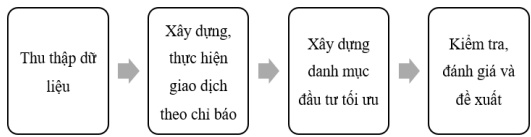
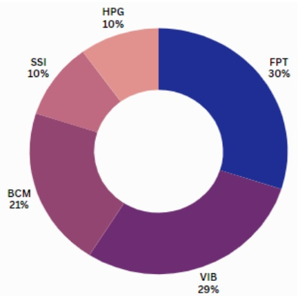
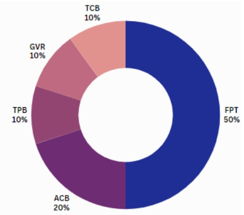
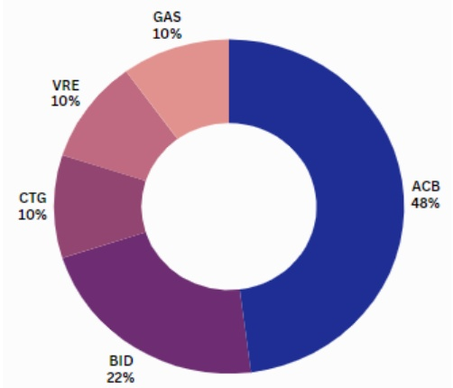
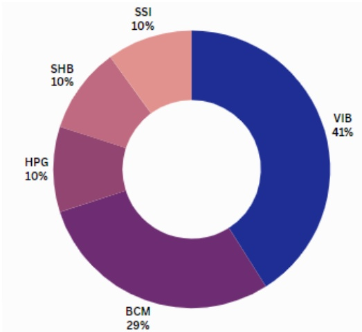
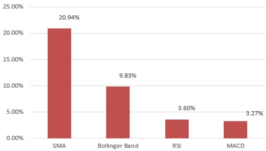

<!-- page: 1 -->

# Ứng dụng phương pháp học máy trong giao dịch chứng khoán theo chỉ báo bằng ngôn ngữ lập trình Python

Applying Machine Learning method in stock trading by indicator using Python programming language

**Lê Hoàng Anh, Nguyễn Lê Thanh Thy**

Trường Đại học Ngân hàng, Tp. Hồ Chí Minh

Tác giả liên hệ: Lê Hoàng Anh, E-mail: anhlh\_vnc@hub.edu.vn

**Tóm tắt:** Thị trường chứng khoán luôn được xem là kênh đầu tư đầy tiềm năng cho người dân. Tuy vậy, thị trường chứng khoán thường biến động khó lường đòi hỏi nhà đầu tư phải quan sát, đánh giá thị trường liên tục với lượng dữ liệu khổng lồ. Nghiên cứu này được thực hiện nhằm ứng dụng phương pháp học máy trong giao dịch chứng khoán tự động theo chỉ báo, giúp nhà đầu tư kiểm tra hiệu quả của các chiến lược giao dịch theo chỉ báo và đề xuất danh mục đầu tư phù hợp với chiến lược nhất, giảm thiểu thời gian và công sức xử lý thông tin dữ liệu. Cụ thể, quy trình ứng dụng được chúng tôi xây dựng và thực hiện qua 4 bước là: (i) thu thập dữ liệu, (ii) giao dịch tự động theo chỉ báo (SMA, dải Bollinger, RSI, MACD), (iii) dựa trên kết quả giao dịch tự động, xây dựng danh mục đầu tư tối ưu bằng phương pháp tỷ lệ Sharpe, (iv) kiểm tra và đánh giá kết quả giao dịch với dữ liệu mới. Với dữ liệu các mã cổ phiếu thu thập từ VN30, kết quả nghiên cứu cho thấy việc giao dịch theo chỉ báo kết hợp với đề xuất danh mục đầu tư tối ưu đem lại tỷ suất lợi nhuận cao và giảm thiểu rủi ro cho nhà đầu tư.

**Từ khóa:** Dải Bollinger; Danh mục đầu tư tối ưu; MACD; RSI; SMA; tỷ lệ Sharpe.

**Abstract:** The stock market is always considered a highly potential investment channel for the public. However, it is often characterized by unpredictable fluctuations that require investors to continuously monitor and analyze the market with a huge amount of data. This research was conducted to implement machine learning methods in automated stock trading based on indicators, aiding investors in evaluating the effectiveness of trading strategies based on these indicators and suggesting the most appropriate investment portfolios, thus minimizing the time and effort spent on data processing. Specifically, the application process we developed and implemented involves four steps: (i) data collection, (ii) automated trading based on indicators (SMA, Bollinger Bands, RSI, MACD), (iii) building an optimal investment portfolio based on automated trading results using the Sharpe ratio method, and (iv) testing and evaluating the trading results with new data. Using data collected from VN30 stocks, the study results demonstrate that trading based on indicators, coupled with proposing an optimal investment portfolio, yields high profit rates and minimizes risks for investors.

**Keywords:** Bollinger Bands; MACD; Optimal portfolio; RSI; Sharpe ratio.

<!-- page: 2 -->

Ứng dụng phương pháp học máy trong giao dịch chứng khoán theo chỉ báo bằng ngôn ngữ lập trình Python

## 1. Đặt vấn đề

Thị trường chứng khoán không chỉ đóng vai trò nguồn vốn cho doanh nghiệp mà còn là kênh đầu tư sinh lợi hấp dẫn cho người dân. Đặc biệt là khi dịch bệnh COVID – 19 diễn ra dẫn đến nhiều lĩnh vực hoạt động kinh doanh bị đóng băng, thị trường chứng khoán trở thành điểm nổi bật và đáng chú ý. Cổ phiếu là công cụ đầu tư sinh lợi cao trên thị trường vốn và sự phát triển mạnh mẽ của thị trường chứng khoán đã thu hút sự quan tâm của rất nhiều nhà đầu tư muốn đa dạng thu nhập, tài sản của mình. Theo thông tin từ Bộ Tài chính, chỉ trong năm 2023 số tài khoản của các nhà đầu tư mới tăng trên 350.000 tài khoản, đưa tổng số tài khoản lên hơn 7,4 triệu tài khoản, tương đương với 7,5% dân số [1]. Cùng với mức tăng của các nhà đầu tư mới, các doanh nghiệp cũng đang gia tăng hoạt động niêm yết để có thể tiếp cận nguồn vốn trên thị trường. Tuy nhiên, lợi nhuận hấp dẫn của cổ phiếu và thị trường chứng khoán đi kèm với những biến động, khó lường, rủi ro thị trường. Thị trường chứng khoán thường phản ứng nhanh trước lạm phát, sụt giảm kinh tế và đặc biệt là các xung đột địa chính trị quốc tế. Vì thế, thị trường chứng khoán đòi hỏi các nhà đầu tư khi tham gia thị trường phải nắm vững các kiến thức về kinh tế, xã hội, lĩnh vực đầu tư, tài chính, phân tích tài chính và cả khả năng cập nhật thông tin liên tục để đánh giá lựa chọn các mã cổ phiếu, chiến lược giao dịch phù hợp cũng như là ra quyết định đầu tư chính xác.

Việc ứng dụng công nghệ vào giao dịch chứng khoán được cho rằng tạo ra sự thay đổi lớn trong hoạt động đầu tư chứng khoán nhờ khả năng xử lý lượng dữ liệu khổng lồ trong thời gian nhanh chóng [2]. Đặc biệt khi các ngôn ngữ lập trình đã dần trở nên phổ biến và dễ học hơn, một trong số đó chính là ngôn ngữ lập trình Python. Python đang được rất nhiều nhà đầu tư hay nhà quản lý quỹ sử dụng để thu thập, xử lý dữ liệu và tính toán các phân tích kỹ thuật như chỉ báo, các chỉ số hiệu quả đầu tư [2]. Cùng với sự phát triển này, nhiều nghiên cứu trên thế giới đã ứng dụng ngôn ngữ lập trình để xây dựng các thuật toán giao dịch tự động giúp các nhà đầu tư có thể nhanh chóng đưa ra quyết định đầu tư [2], [3], [4], [5]. Tại Việt Nam, các nghiên cứu ứng dụng các phương pháp học máy để đề xuất danh mục đầu tư hiệu quả dựa trên chiến lược giao dịch vẫn còn hạn chế. Hầu hết các nghiên cứu này tập trung vào việc dự báo giá cổ phiếu [6], [7], [8]. Do đó, trong nghiên cứu này, chúng tôi một mặt xây dựng chiến lược giao dịch tự động dựa trên chỉ báo để lựa chọn các mã cổ phiếu có tỷ suất sinh lợi cao nhất từ danh mục VN30, sau đó tiếp tục đề xuất một danh mục đầu tư tối ưu dựa trên các mã cổ phiếu này để tối ưu hóa rủi ro cho nhà đầu tư dựa trên phương pháp tỷ lệ Sharpe. Với cách làm này, chúng tôi sẽ xây dựng được một quy trình lựa chọn cổ phiếu đảm bảo tỷ suất sinh lợi cao và rủi ro thấp nhất cho các nhà đầu tư.

Phần còn lại của nghiên cứu được cấu trúc như sau. Phần 2 là lược khảo lý thuyết về các chỉ báo, chiến lược giao dịch theo chỉ báo, phương pháp tối ưu rủi ro danh mục đầu tư. Phần 3 trình bày về quy trình nghiên cứu và mô tả dữ liệu. Phần 4 trình bày kết quả nghiên cứu và kết luận được trình bày ở phần 5.

## 2. Khảo lược lý thuyết về các chỉ báo và phương pháp tối ưu rủi ro

Chỉ báo kỹ thuật đã trở thành công cụ hữu hiệu cho các nhà đầu tư để nắm bắt xu hương giá của cổ phiếu từ đó nắm bắt

<!-- page: 3 -->

và giao dịch mua/bán. Về bản chất, các chỉ báo là các hàm số toán học tích hợp vào phần mềm phân tích kỹ thuật và được kiểm định hiệu quả đầu tư tốt.

Đường trung bình động giản đơn (Simple Moving Average – SMA) là công cụ phân tích tài chính phổ biến và dễ hiểu nhất trong phân tích kỹ thuật. Đường SMA được sử dụng để đo lường xu hướng giá của một cổ phiếu bằng cách tính trung bình giá đóng của nến giá gần nhất trong một khoảng thời gian nhất định [9]. Một trong các chiến lược giao dịch dựa trên đường SMA là nếu đường SMA ngắn hạn cắt từ dưới lên đường SMA dài hạn cho thấy thị trường tăng giá nên thực hiện giao dịch mua vào. Và ngược lại, nếu đường SMA cắt từ trên xuống đường SMA dài hạn cho thấy thị trường giảm giá nên thực hiện giao dịch bán ra. Nhóm tác giả sử dụng chiến lược trên với đường SMA20 và đường SMA50.

Dải Bollinger (Bollinger Bands) được tạo ra bởi John Bollinger vào những năm 1980, được sử dụng trong thị trường tài chính để đo lường biến động của giá cổ phiếu và xác định mức hỗ trợ và kháng cự tiềm năng. Dải Bollinger gồm đường SMA (có thể điều chỉnh theo chiến lược, thường là SMA 20 ngày) và hai đường Bollinger trên/dưới với công thức là đường SMA cộng (đối với đường Bollinger trên) và trừ (đối với đường Bollinger dưới) một số độ lệch chuẩn nhân với độ lệch chuẩn của giá trong một thời gian nhất định. Chiến lược giao dịch dựa theo tín hiệu từ việc bật lại dải băng lên hoặc dưới được nhóm tác giả sử dụng cho nghiên cứu. Nguyên nhân của việc bật lại này là dải trên và dải dưới của dải Bollinger đóng vai trò như những vùng hỗ trợ và kháng cự động. Vì thế nên chiến thuật giao dịch theo dải Bollinger được cụ thể là giao dịch mua khi giá vượt quá dải dưới và giao dịch bán khi giá vượt quá dải trên.

Chỉ số sức mạnh tương đối (Relative Strength Index – RSI) dùng để xác định xu hướng tiếp diễn của cổ phiếu, được giới thiệu công chúng lần đầu vào năm 1978 bởi kỹ sư cơ khí John Welles Wilder Jr. RSI so sánh độ lớn giá gần đây thay đổi giữa các cổ phiếu để xác định là cổ phiếu mua quá mức hoặc bán quá mực. Chỉ báo RSI tính toán tỷ lệ giữa mức tăng giá và giảm giá trung bình trong một khoảng thời gian nhất định (thường là 14 ngày) [9]. Giá trị của RSI được biểu diễn theo thang từ 0 đến 100. Chiến lược giao dịch theo chỉ báo RSI cụ thể là giao dịch mua khi chỉ số RSI dưới 30 cho thấy cổ phiếu đang bị quá bán và giao dịch bán khi chỉ số RSI trên 70 cho thấy cổ phiếu đang bị quá mua.

Đường trung bình động hội tụ phân kỳ (Moving Average Convergence Divergence – MACD) ra đời năm 1979 bởi nhà phát minh Gerald Appel. Đường MACD phản ánh biến động và cung cấp tín hiệu mua bán của thị trường. MACD là giá trị được tìm thấy khi lấy đường trung bình động (EMA) 12 ngày trừ đi đường trung bình động 26 ngày [9]. Một trong những chiến thuật phổ biến sử dụng chỉ báo MACD là chiến thuật giao dịch khi MACD cắt đường Zero. Cụ thể chiến lược là giao dịch mua khi đường MACD cắt đường Zero từ dưới lên hay đường MACD chuyển dịch từ âm sang dương và giao dịch bán khi đường MACD cắt đường Zero từ trên xuống hay đường MACD chuyển dịch từ dương sang âm.

Tỷ lệ Sharpe (Sharpe Ratio) là một thước đo xem lợi nhuận thu được là bao

<!-- page: 4 -->

nhiêu trên một đơn vị rủi ro khi đầu tư vào một tài sản hay đầu tư theo chiến lược kinh doanh. Tỷ lệ Sharpe được sử dụng để các nhà đầu hiểu được lợi tức của khoản đầu tư so với rủi ro của nó. Về cơ bản, tỷ lệ Sharpe là lợi nhuận trung bình kiếm được vượt quá lợi nhuận phi rủi ro trên mỗi đơn vị rủi ro. Tỷ lệ Sharpe của DMĐT càng lớn, hiệu suất được điều chỉnh theo rủi ro càng tốt. Như vậy, để tối ưu rủi ro của DMĐT cần phân bổ tỷ trọng vốn của từng tài sản trong danh mục để giá trị của tỷ lệ Sharpe đạt cực đại.

## 3. Quy trình nghiên cứu

Nghiên cứu này được thực hiện theo quy trình sau:

Hình 1. Quy trình nghiên cứu

Nhóm nghiên cứu thực hiện thu thập dữ liệu giá giao dịch trong vòng 5 năm (2018 – 2023) của các mã cổ phiếu thuộc VN30. Dữ liệu thu thập được chia làm hai giai đoạn: giai đoạn huấn luyện (2018 – 2022) và giai đoạn kiểm tra (2023). Đồng thời nhóm nghiên cứu xây dựng các thuật toán giao dịch dựa trên chiến lược giao dịch theo chỉ báo và thuật toán tối ưu rủi ro danh mục đầu tư dựa trên phương pháp tỷ lệ Sharpe. Cụ thể, trong giai đoạn huấn luyện, chúng tôi xây dựng thuật toán giao dịch theo các tín hiệu mua/bán của các chỉ báo (SMA, dải Bollinger, RSI, MACD) và thực thi thuật toán giao dịch tự động bằng ngôn ngữ lập trình Python với dữ liệu giá đóng của từ năm 2018 đến năm 2022 của 30 cổ phiếu thuộc VN30.

Nhóm nghiên cứu thực hiện giao dịch các mã cổ phiếu dựa trên các chiến lược giao dịch chỉ báo trong giai đoạn huấn luyện. Để tối đa lợi nhuận của danh mục đầu tư, 5 mã cổ phiếu có tỷ suất sinh lợi cao nhất ở mỗi chiến lược chỉ báo tạo thành một danh mục đầu tư. Việc lựa chọn số lượng mã cổ phiếu không có ảnh hưởng nhiều đến quy trình áp dụng thuật toán trong nghiên cứu này. Khi áp dụng thực tiễn, người sử dụng có thể lựa chọn số lượng cổ phiếu có tỷ suất sinh lợi cao nhất tùy theo nhu cầu. Thêm vào đó, nhóm nghiên cứu thực hiện tối ưu rủi ro cho các danh mục đầu tư bằng cách tính tỷ trọng phân bổ vốn đầu tư nhằm đạt được tỷ lệ Sharpe cực đại hay hiệu suất điều chỉnh rủi ro danh mục cao nhất. Dữ liệu được sử dụng để tối ưu rủi ro cho danh mục là dữ liệu trong giai đoạn huấn luyện. Sau đó, thực hiện giao dịch các danh mục đầu tư trên cùng với chiến lược tương ứng trong giai đoạn kiểm tra để tìm ra danh mục đầu tư và chiến lược tối ưu nhất dựa trên tỷ suất sinh lợi của các danh mục đầu tư.

## 4. Kết quả nghiên cứu

## 4.1. Kết quả xây dựng danh mục đầu tư

Sau thực hiện giao dịch trong giai đoạn huấn luyện, 4 danh mục đầu tư được xây dựng tương ứng với từng chiến lược giao dịch theo chỉ báo như sau:

Hình 2. Biểu đồ các khoản đầu tư tối ưu cho chiến lược giao dịch theo chỉ báo SMA

<!-- page: 5 -->

Dựa trên Hình 2, danh mục đầu tư tối ưu cho chiến lược giao dịch theo chỉ báo SMA gồm các mã cổ phiếu FPT, VIB, BCM, SSI, HPG có tỷ trọng phân bổ vốn lần lượt là 30%, 29%, 21% và 10% cho các mã còn lại. Với tỷ trọng này, tỷ lệ Sharpe đạt cực đại là 0.79, tỷ suất sinh lợi kỳ vọng của danh mục là 19%/ năm và rủi ro ước tính 21%.

**Hình 3.** Biểu đồ các khoản đầu tư tối ưu cho chiến lược giao dịch theo dải Bollinger Dựa trên Hình 3, danh mục đầu tư tối ưu cho chiến lược giao dịch theo dải Bollinger gồm các mã cổ phiếu FPT, ACB, TPB, GVR, TCB có tỷ trọng phân bổ vốn lần lượt là 50%, 20% và 10% cho các mã còn lại. Với tỷ trọng này, tỷ lệ Sharpe đạt cực đại là 0.86, tỷ suất sinh lợi kỳ vọng của danh mục là 18%/ năm và rủi ro ước tính 17%.

Hình 4. Biểu đồ các khoản đầu tư tối ưu cho chiến lược giao dịch theo chỉ báo RSI

Dựa trên Hình 4, danh mục đầu tư tối ưu cho chiến lược giao dịch theo chỉ báo RSI gồm các mã cổ phiếu ACB, BID, CTG, VRE, GAS có tỷ trọng phân bổ vốn lần lượt là 48%, 22% và 10% cho các mã còn lại. Với tỷ trọng này, tỷ lệ Sharpe đạt cực đại là 0.28, tỷ suất sinh lợi kỳ vọng của danh mục là 10%/ năm và rủi ro ước tính 24%.

Hình 5. Biểu đồ các khoản đầu tư tối ưu cho chiến lược giao dịch theo chỉ báo MACD

Dựa trên Hình 5, danh mục đầu tư tối ưu cho chiến lược giao dịch theo chỉ báo RSI gồm các mã cổ phiếu VIB, BCM, HPG, SHB, SSI có tỷ trọng phân bổ vốn lần lượt là 41%, 29% và 10% cho các mã còn lại. Với tỷ trọng này, tỷ lệ Sharpe đạt cực đại là 0.68, tỷ suất sinh lợi kỳ vọng của danh mục là 19%/ năm và rủi ro ước tính 24%.

## 4.2. Kết quả giao dịch của các danh mục đầu tư

Dựa vào Hình 6, có thể thấy các DMĐT theo chỉ báo đều sinh lợi. DMĐT theo chỉ báo SMA có mức sinh lợi cao nhất là 20,94% vượt qua TSSL kỳ vọng cho năm 2023 của danh mục là 19%. Kết quả cuối cùng của quá trình cho thấy DMĐT và chiến lược giao dịch theo chỉ báo SMA là tối ưu nhất cho nhà đầu tư.

<!-- page: 6 -->

Hình 6. Tỷ suất sinh lợi của các danh mục đầu tư theo chỉ báo sau giao dịch năm 2023

Tuy vậy khi giao dịch thực tế cần phải theo dõi, kiểm tra định kỳ (3 tháng, 6 tháng, ...) hiệu quả của danh mục đầu tư để có những điều chỉnh thích hợp. Các điều chỉnh dựa trên dữ liệu giá gần nhất và các nhà đầu tư có thể lựa chọn lại chiến thuật đầu tư hoặc thay đổi các cổ phiếu trong danh mục.

## 5. Kết luận và đề xuất

## 5.1. Kết luận

Trong nghiên cứu này, nhóm tác giả đã sử dụng phương pháp học máy để xây dựng danh mục đầu tư tối ưu theo chỉ báo. Kết quả cho thấy quy trình ứng dụng của nghiên cứu có giá trị ứng dụng vào thực tiễn cho phép các nhà đầu tư tìm kiếm và kiểm tra chiến lược giao dịch theo chỉ báo và danh mục đầu tư tối ưu.

Tuy nhiên, nghiên cứu cũng còn các hạn chế, như số lượng cổ phiếu, các chỉ báo và phương pháp tối ưu rủi ro cho danh mục còn hạn chế. Nhóm nghiên cứu hi vọng nghiên cứu tiếp theo có thể mở rộng toàn thị trường chứng khoán Việt Nam, kết hợp các chỉ báo trong cùng một chiến lược giao dịch và tối ưu rủi ro danh mục bằng nhiều phương pháp khác.

## 5.2. Đề xuất áp dụng thực tiễn

Dựa trên thuật toán được xây dựng và kết quả sau quá trình nghiên cứu đề tài, quy trình áp dụng thực tiễn ứng dụng phương pháp học máy trong giao dịch cổ phiếu theo chỉ báo, được đề xuất như sau:

## Bước 1: Thu thập dữ liệu

Lựa chọn cổ phiếu: Nhà đầu tư lập danh sách các cổ phiếu mà bản thân đang quan tâm theo tiêu chí của mình như các mã thuộc bảng xếp hạng, theo ngành, ...

Thu thập dữ liệu giá của các cổ phiếu trong danh sách:

\- Dữ liệu thu thập là giá giao dịch

\- Thời gian thu thập dữ liệu ít nhất là 5 năm

\- Dữ liệu được chia theo thành:

\+ Dữ liệu huấn luyện ít nhất 2 năm

\+ Dữ liệu kiểm tra nhiều nhất 1 năm

Dữ liệu được thu thập trong 5 năm từ 2018 – 2023. Dữ liệu được chia thành dữ liệu huấn luyện (từ 2018 đến 2022), dữ liệu kiểm tra (2023)

<u>Bước 2</u>: Xây dựng chiến lược giao dịch theo chỉ báo, tối ưu rủi ro danh mục Nhóm nghiên cứu đã xây dựng thuật toán giao dịch theo các chỉ báo (SMA, dải Bollinger, RSI và MACD), thuật toán xác định tỷ trọng phân bổ vốn tối ưu rủi ro cho DMĐT theo phương pháp Sharpe. Tuy nhiên, mỗi chỉ báo có nhiều chiến lược giao dịch khác nhau và có nhiều phương pháp tối ưu rủi ro. Vì vậy ở bước này, nhà đầu tư nên tự lựa chọn các chỉ báo và xác định cách các chỉ báo được sử dụng để tạo ra tín hiệu mua và bán chính xác, điều chỉnh ngưỡng ra tín hiệu của chỉ báo để phù hợp với điều kiện thị trường cụ thể. Xây dựng các thuật toán thực hiện giao dịch dựa trên các chiến lược giao dịch theo chỉ báo. Đồng thời, xây dựng thuật toán tối ưu hóa rủi ro cho DMĐT.

<!-- page: 7 -->

## Bước 3: Giao dịch và tối ưu rủi ro DMĐT bằng dữ liệu huấn luyện

Warren Buffet từng nói DMĐT nên được đa dạng hóa nhưng không quá nhiều từ 3 đến 6 tài sản cho một danh mục có thể là “tất cả sự đa dạng hóa mà bạn cần”, tránh việc đầu tư vào những thứ họ không hiểu. Vì vậy, nhà đầu tư nên chọn 3 – 6 mã cổ phiếu tạo thành DMĐT. Nhằm tối đa lợi nhuận, cổ phiếu được đưa vào DMĐT dựa trên TSSL của cổ phiếu sau giao dịch bằng dữ liệu huấn luyện. Và thực hiện xác định tỷ trọng phân bổ vốn tối ưu rủi ro của các danh mục bằng dữ liệu huấn luyện

## Bước 4: Giao dịch DMĐT tối ưu bằng dữ liệu kiểm tra

Với cùng vốn đầu tư cho các danh mục và phân bổ vốn theo tỷ trọng tối ưu tương ứng, thực hiện giao dịch bằng dữ liệu kiểm tra. Kết quả thu được sau giao dịch cho nhà đầu tư thấy được DMĐT mang lại lợi nhuận cao nhất tương ứng với chiến lược đầu tư hiệu quả nhất.

<u>Bước 5:</u> Triển khai và theo dõi thực tế Dựa vào kết quả ở bước 4, nhà đầu tư triển khai DMĐT và giao dịch với chiến lược theo chỉ báo tương ứng. Đồng thời theo dõi hiệu suất của danh mục theo các mốc thời gian (3 tháng, 6 tháng, 1 năm...) và điều chỉnh danh mục khi cần thiết để duy trì hiệu suất tốt nhất bằng cách thực hiện lại quy trình.

## Tài liệu tham khảo

[1] Bình Khánh, “Sớm đưa hệ thống công nghệ mới vào hoạt động để đảm bảo giao dịch chứng khoán,” TUOI TRE ONLINE, Jan. 02, 2024. Accessed: Apr. 03, 2024. [Online]. Available: https://tuoitre.vn/som-dua-he-thong-cong-nghe-moi-vao-hoat-dong-de-dam-bao-giao-dich-chung-khoan-20240102084226245.htm

[2] I. Simanjuntak, H. Heriyant, A. Rochendi, Y. Rahmawati, K. Salamah, and S. Sulistiyono, “Trading Simulation Using Python and Visualization on Streamlit with Machine Learning Decision Tree,” in Proceedings of the 2022 International Conference on Computer, Control, Informatics and Its Applications, in IC3INA ’22. New York, NY, USA: Association for Computing Machinery, Tháng Hai 2023, pp. 286–291. doi: 10.1145/3575882.3575937.

[3] C.-H. Cheng, M.-C. Tsai, and C. Chang, “A Time Series Model Based on Deep Learning and Integrated Indicator Selection Method for Forecasting Stock Prices and Evaluating Trading Profits,” Systems, vol. 10, no. 6, Art. no. 6, Dec. 2022, doi: 10.3390/systems10060243.

[4] A. Frattini, I. Bianchini, A. Garzonio, and L. Mercuri, “Financial Technical Indicator and Algorithmic Trading Strategy Based on Machine Learning and Alternative Data,” Risks, vol. 10, no. 12, Art. no. 12, Dec. 2022, doi: 10.3390/risks10120225.

[5] I. Letteri, “VolTS: A Volatility-based Trading System to forecast Stock Markets Trend using Statistics and Machine Learning.” arXiv, Aug. 17, 2023.doi:10.48550/arXiv.2307.13422.

[6] Nhật N. M. and Trung N. Đ., “Ứng dụng giao dịch định lượng trên thị trường chứng khoán Việt Nam,” 1, no. 183, Art. no. 183, 2021.

[7] Trương Thị Thùy Dương, “Dự báo chiều biến động của chỉ số chứng

<!-- page: 8 -->

khoán bằng thuật toán tăng cường-Trương Thị Thùy Dương,” 2023, Accessed: Apr. 12, 2024. [Online]. Available:http://hvnh.edu.vn//tapchi/vi/thang-5-2023/du-bao-chieu-bien-dong-cua-chi-so-chung-khoan-bang-thuat-toan-tang-cuong-truong-thi-thuy-duong-10755.html

[8] Tuyên T. Đ., “Đánh giá hiệu suất mô hình phức hợp LSTM-GRU: nghiên cứu điển hình về dự báo chỉ số đo lường xu hướng biến động giá cổ phiếu trên sàn giao dịch chứng khoán Hồ Chí Minh,” Tạp chí Khoa học Đại học cần Thơ, vol. 60, no. 1, Art. no. 1, Feb. 2024, doi: 10.22144/ctujos.2023.232.

Y. Hilpisch, “Python for Algorithmic Trading,” 2020.

**Ngày nhận bài: 15/1/2024 Ngày hoàn thành sửa bài: 25/3/2024 Ngày chấp nhận đăng: 25/3/2024**
