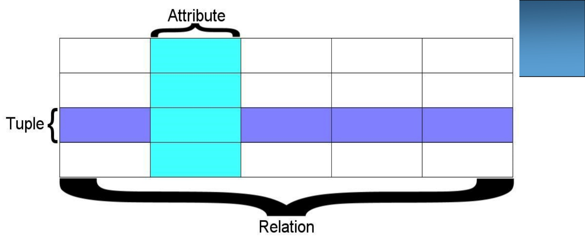

<!-- page: 1 -->

## python IsQLite

## Relational Database and SQLite

<!-- page: 2 -->


## SQLite Browser

SQLite Database Browser - /Users/jc/tmp/example.db

New Database


Open Database

Database Structure

Browse Data

Edit Pragmas

Execute SQL

Table:

total\_members

New Record

Delete Record

<table><tr><td rowspan="2"></td><td>list</td><td>month</td><td>members</td></tr><tr><td>Filter</td><td>Filter</td><td>Filter</td></tr><tr><td>1</td><td>gluster-board</td><td>2013-09-05</td><td>99999</td></tr><tr><td>2</td><td>gluster-users</td><td>2013-09-05</td><td>99999</td></tr></table>

1 - 2 of 12 >

Go to:

×

SQL Log

Show SQL submitted by

Application

Clear

```sql
PRAGMA foreign_keys = "1";
PRAGMA encoding
SELECT type, name, sql, tbl_name FROM sqlite_master;
SELECT COUNT(*) FROM (SELECT rowid,* FROM `total_members` ORDER BY `rowid` ASC);
SELECT rowid,* FROM `total_members` ORDER BY `rowid` ASC LIMIT 0, 50000;
```

<!-- page: 3 -->

## Relational Databases

Relational databases model data by storing rows and columns in tables. The power of the relational database lies in its ability to efficiently retrieve data from those tables and in particular where there are multiple tables and the relationships between those tables involved in the query.

[http://en.wikipedia.org/wiki/Relational\_database](http://en.wikipedia.org/wiki/Relational_database)

<!-- page: 4 -->

## Terminology

Database - contains many tables

Relation (or table) - contains tuples and attributes

Tuple (or row) - a set of fields that generally represents an “object” like a person or a music track

Attribute (also column or field) - one of possibly many elements of data corresponding to the object represented by the row

<!-- page: 5 -->



A relation is defined as a set of tuples that have the same attributes. A tuple usually represents an object and information about that object. Objects are typically physical objects or concepts. A relation is usually described as a table, which is organized into rows and columns. All the data referenced by an attribute are in the same domain and conform to the same constraints. (Wikipedia)

<!-- page: 6 -->

<table><tr><td colspan="4">Columns / Attributes</td></tr><tr><td>TITLE</td><td>RATING</td><td>LEN</td><td rowspan="3">Rows / Tuples</td></tr><tr><td>About to Rock</td><td>3</td><td>354</td></tr><tr><td>Who Made Who</td><td>4</td><td>252</td></tr><tr><td></td><td></td><td></td><td></td></tr><tr><td></td><td colspan="2">Tables / Relations</td><td></td></tr><tr><td></td><td></td><td></td><td></td></tr><tr><td></td><td></td><td></td><td></td></tr></table>

<!-- page: 7 -->

## SQL

## Structured Query Language is the language we use to issue commands to the database

\- Create data (a.k.a Insert)

\- Retrieve data

\- Update data

\- Delete data

[http://en.wikipedia.org/wiki/SQL](http://en.wikipedia.org/wiki/SQL)


## python TM

<!-- page: 8 -->

Input Files

Excel

D3.js

Output Files

Python Programs

SQL

Database File

SQL

SQLite Browser

<!-- page: 9 -->

End User

Application Software

SQL

Developer

DBA

Database Data Server

SQL

Database Tools

<!-- page: 10 -->

## SQL: Insert

## Câu lệnh INSERT Chèn 1 dòng vào bảng

INSERT INTO HocVien (HoTen, DienThoai) VALUES (‘Nhất Nghệ', '028393 22735')

<!-- page: 11 -->

## SQL: Delete

## Xóa các dòng dựa vào điều kiện chọn

DELETE FROM HocVien WHERE DienThoai=‘0909123456

<!-- page: 12 -->

## SQL: Update

## Cập nhật một/một vài cột theo điều kiện

UPDATE HocVien SET HoTen=‘Hồng Anh’ WHERE MaHV=3

<!-- page: 13 -->

## Retrieving Records: Select

The select statement retrieves a group of records - you can either retrieve all the records or a subset of the records with a WHERE clause

SELECT \* FROM HocVien

SELECT \* FROM HocVien

WHERE DienThoai=‘0909123456'

<!-- page: 14 -->

## Sắp xếp với ORDER BY

Sử dụng ORDER BY ở câu lệnh SELECT để lấy kết quả có sắp xếp tăng hay giảm dần theo điều kiện nào đó.

SELECT \* FROM HocVien ORDER BY HoTen SELECT \* FROM HocVien ORDER BY DienThoai DESC

<!-- page: 15 -->

## Python vs SQLite

• Chèn thư viện:

**import sqlite3**

• Mở database để thao tác:

**MyDB=sqlite3.connect(‘NhatNgheDB.db’)**

→ trả về đối tượng Connection


## python TM

<!-- page: 16 -->

## Đối tượng cursor()

Đối tượng này trỏ tới các bảng ghi (records/rows) trong tập dữ liệu lấy về và thực thi các câu truy vấn

```txt
import sqlite3
```

```txt
MyDB = sqlite3.connect('N:\\NhatNgheDb.db')
```

```txt
C = MyDB.cursor()
```

<!-- page: 17 -->

## Thực thi truy vấn – execute()

## Cú pháp: cursor.execute() Ví dụ: Câu lệnh DDL tạo bảng

```sql
#create a table of students
c.execute('''
CREATE TABLE HocVien
(
    MaHV text PRIMARY KEY,
    HoTen text,
    DienThoai text,
    NgaySinh date,
    Email text
)
')
```

<!-- page: 18 -->

## Thực thi truy vấn – execute()

Cú pháp: cursor.**execute**() Ví dụ: Câu lệnh DDL tạo mới dữ liệu

```txt
#insert data into our table
c.execute('''INSERT INTO HocVien VALUES ('001','Hien Luong', '0909009900',
       '1/1/1981','hyhien@gmail.com')
'''')
```

<!-- page: 19 -->

## Chú ý

Sử dụng hàm **commit()**để lưu các thay đổi và sử dụng <u>hàm</u> <strong><u>close()</u></strong><u>để đóng kết nối.</u>

```txt
#insert data into our table
c.execute('''INSERT INTO HocVien VALUES ('001','Hien','Luong','1/1/1981','11W')''')
```

```txt
#Save changes using the commit() function
MyDB.commit()
```

```txt
#Close the database connection
MyDB.close()
```

<!-- page: 20 -->

## Phương thức executemany()

• Cho phép thực thi nhiều câu lệnh SQL cùng một lúc

• Ví dụ:

products = (

```javascript
(1, 'Ti vi', 1234),
```

```javascript
(2, 'Máy giặt', 5712),
```

```csv
(3, 'Điều hòa', 9000),
```

(4, 'Volvo', 29000),

(5, 'Bentley', 350000),

```javascript
(6, 'Hummer', 41400),
```

```javascript
(7, 'Volkswagen', 21600)
```

cursor.**executemany**("INSERT INTO HangHoa VALUES(?, ?, ?)", products)


## python

<!-- page: 21 -->

## Truy vấn lấy dữ liệu - SELECT

• Bước 1:

cursor.**execute**(“SELECT statement”)

• Bước 2:

data = cursor.**fetchone()**

rows = cursor.**fetchall()**

• Bước 3:

for row in rows:

print(row) ）

<!-- page: 22 -->

## Xem thêm

[• https://www.sqlitetutorial.net/](https://www.sqlitetutorial.net/)

[• https://www.sqlitetutorial.net/sqlite-python/](https://www.sqlitetutorial.net/sqlite-python/)

<u>https://www.datacamp.com/community/tutor</u>[ials/sqlite-in-python](https://www.datacamp.com/community/tutorials/sqlite-in-python)
