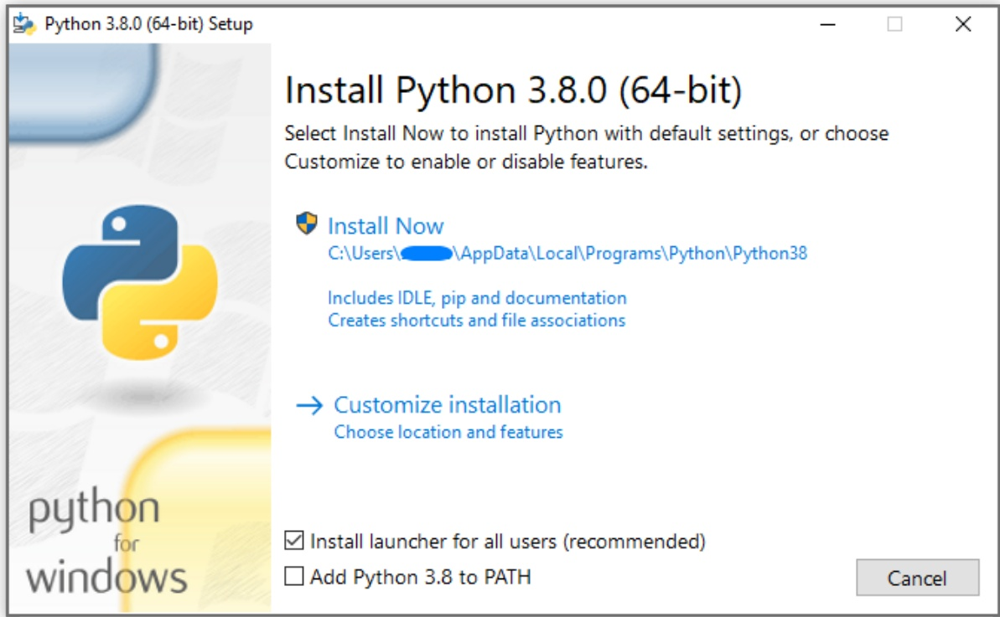

<!-- page: 1 -->

# Python Setup and Usage

**Release 3.10.15**

**Guido van Rossum**

**and the Python development team**

**September 09, 2024**

<!-- page: 2 -->

<!-- page: 3 -->

## CONTENTS

- **1 Command line and environment** 3
- 1.1 Command line . . . . . . . . . . . . . . . . . . . . . . . . . . . . . . . . . . . . . . . . . . . 3
- 1.1.1 Interface options . . . . . . . . . . . . . . . . . . . . . . . . . . 3
- 1.1.2 Generic options . . . . . . . . . . . . . . . . . . 5
- 1.1.3 Miscellaneous options . . . . . . . . . . . . . 5
- 1.1.4 Options you shouldn't use . . . . . . . . . 8
- 1.2 Environment variables . . . . . . . . . . . 9
- 1.2.1 Debug-mode variables . . . . . . 13
- **2 Using Python on Unix platforms 15**
- 2.1 Getting and installing the latest version of Python 15
- 2.1.1 On Linux 15
- 2.1.2 On FreeBSD and OpenBSD 15
- 2.1.3 On OpenSolaris 16
- 2.2 Building Python 16
- 2.3 Python-related paths and files 16
- 2.4 Miscellaneous 16
- 2.5 Custom OpenSSL 17
- **3 Configure Python 19**
- 3.1 Configure Options 19
- 3.1.1 General Options 19
- 3.1.2 Install Options 20
- 3.1.3 Performance options 21
- 3.1.4 Python Debug Build 22
- 3.1.5 Debug options 22
- 3.1.6 Linker options 23
- 3.1.7 Libraries options 23
- 3.1.8 Security Options 24
- 3.1.9 macOS Options 25
- 3.2 Python Build System 25
- 3.2.1 Main files of the build system 25
- 3.2.2 Main build steps 26
- 3.2.3 Main Makefile targets 26
- 3.2.4 C extensions 26
- 3.3 Compiler and linker flags 27
- 3.3.1 Preprocessor flags 27
- 3.3.2 Compiler flags 27
- 3.3.3 Linker flags 29
- **4 Using Python on Windows 31**
- 4.1 The full installer 31
- 4.1.1 Installation steps 31
- 4.1.2 Removing the MAX\_PATH Limitation 33

<!-- page: 4 -->

- 4.1.3 Installing Without UI 33
- 4.1.4 Installing Without Downloading 35
- 4.1.5 Modifying an install 35
- 4.2 The Microsoft Store package 36
- 4.2.1 Known issues 36
- 4.3 The nuget.org packages 37
- 4.4 The embeddable package 38
- 4.4.1 Python Application 38
- 4.4.2 Embedding Python 38
- 4.5 Alternative bundles 39
- 4.6 Configuring Python 39
- 4.6.1 Excursus: Setting environment variables 39
- 4.6.2 Finding the Python executable 40
- 4.7 UTF-8 mode 40
- 4.8 Python Launcher for Windows 41
- 4.8.1 Getting started 41
- 4.8.2 Shebang Lines 42
- 4.8.3 Arguments in shebang lines 43
- 4.8.4 Customization 43
- 4.8.5 Diagnostics 44
- 4.9 Finding modules 45
- 4.10 Additional modules 46
- 4.10.1 PyWin32 46
- 4.10.2 cx\_Freeze 47
- 4.11 Compiling Python on Windows 47
- 4.12 Other Platforms 47
- **5 Using Python on a Mac 49**
- 5.1 Getting and Installing MacPython 49
- 5.1.1 How to run a Python script 49
- 5.1.2 Running scripts with a GUI 50
- 5.1.3 Configuration 50
- 5.2 The IDE 50
- 5.3 Installing Additional Python Packages 50
- 5.4 GUI Programming on the Mac 50
- 5.5 Distributing Python Applications on the Mac 51
- 5.6 Other Resources 51
- **6 Editors and IDEs 53**
- **A Glossary 55**
- **B About these documents 69**
- B.1 Contributors to the Python Documentation 69
- **C History and License 71**
- C.1 History of the software 71
- C.2 Terms and conditions for accessing or otherwise using Python 72
- C.2.1 PSF LICENSE AGREEMENT FOR PYTHON 3.10.15 72
- C.2.2 BEOPEN.COM LICENSE AGREEMENT FOR PYTHON 2.0 73
- C.2.3 CNRI LICENSE AGREEMENT FOR PYTHON 1.6.1 74
- C.2.4 CWI LICENSE AGREEMENT FOR PYTHON 0.9.0 THROUGH 1.2 75
- C.2.5 ZERO-CLAUSE BSD LICENSE FOR CODE IN THE PYTHON 3.10.15 DOCUMENTATION 75
- C.3 Licenses and Acknowledgements for Incorporated Software 76
- C.3.1 Mersenne Twister 76
- C.3.2 Sockets 77
- C.3.3 Asynchronous socket services 77
- C.3.4 Cookie management 78

<!-- page: 5 -->

- C.3.5 Execution tracing . 78
- C.3.6 UUencode and UUdecode functions . 79
- C.3.7 XML Remote Procedure Calls . 79
- C.3.8 test\_epoll . 80
- C.3.9 Select kqueue . 80
- C.3.10 SipHash24 . 81
- C.3.11 strtod and dtoa . 81
- C.3.12 OpenSSL . 82
- C.3.13 expat . 84
- C.3.14 libffi . 84
- C.3.15 zlib . 85
- C.3.16 cfuhash . 85
- C.3.17 libmpdec . 86
- C.3.18 W3C C14N test suite . 86
- C.3.19 Audioop . 87
- Copyright **89**
- **91**

## D Copyright

<!-- page: 6 -->

<!-- page: 7 -->

This part of the documentation is devoted to general information on the setup of the Python environment on different platforms, the invocation of the interpreter and things that make working with Python easier.

<!-- page: 8 -->

<!-- page: 9 -->

# COMMAND LINE AND ENVIRONMENT

The CPython interpreter scans the command line and the environment for various settings.

**CPython implementation detail:** Other implementations’ command line schemes may differ. See implementations for further resources.

## 1.1 Command line

When invoking Python, you may specify any of these options:

```powershell
python [-bBdEhiIOqsSuvVWx?] [-c command | -m module-name | script | - ] [args]
```

The most common use case is, of course, a simple invocation of a script:

```batch
python myscript.py
```

## 1.1.1 Interface options

The interpreter interface resembles that of the UNIX shell, but provides some additional methods of invocation:

• When called with standard input connected to a tty device, it prompts for commands and executes them until an EOF (an end-of-file character, you can produce that with Ctrl-D on UNIX or Ctrl-Z, Enter on Windows) is read.

• When called with a file name argument or with a file as standard input, it reads and executes a script from that file.

• When called with a directory name argument, it reads and executes an appropriately named script from that directory.

• When called with -c command, it executes the Python statement(s) given as command. Here command may contain multiple statements separated by newlines. Leading whitespace is significant in Python statements!

• When called with -m module-name, the given module is located on the Python module path and executed as a script.

In non-interactive mode, the entire input is parsed before it is executed.

An interface option terminates the list of options consumed by the interpreter, all consecutive arguments will end up in sys.argv – note that the first element, subscript zero (sys.argv[0]), is a string reflecting the program’s source.

## -c &lt;command&gt;

Execute the Python code in command. command can be one or more statements separated by newlines, with significant leading whitespace as in normal module code.

If this option is given, the first element of sys.argv will be "-c" and the current directory will be added to the start of sys.path (allowing modules in that directory to be imported as top level modules).

<!-- page: 10 -->

```txt
-m <module-name>
```

Raises an auditing event cpython.run\_command with argument command.

Search sys.path for the named module and execute its contents as the \_\_main\_\_ module.

Since the argument is a module name, you must not give a file extension (.py). The module name should be a valid absolute Python module name, but the implementation may not always enforce this (e.g. it may allow you to use a name that includes a hyphen).

Package names (including namespace packages) are also permitted. When a package name is supplied instead of a normal module, the interpreter will execute &lt;pkg&gt;.\_\_main\_\_ as the main module. This behaviour is deliberately similar to the handling of directories and zipfiles that are passed to the interpreter as the script argument.

**Note:** This option cannot be used with built-in modules and extension modules written in C, since they do not have Python module files. However, it can still be used for precompiled modules, even if the original source file is not available.

If this option is given, the first element of sys.argv will be the full path to the module file (while the module file is being located, the first element will be set to "-m"). As with the -c option, the current directory will be added to the start of sys.path.

-I option can be used to run the script in isolated mode where sys.path contains neither the current directory nor the user’s site-packages directory. All PYTHON\* environment variables are ignored, too.

Many standard library modules contain code that is invoked on their execution as a script. An example is the timeit module:

```shell
python -m timeit -s 'setup here' 'benchmarked code here'
python -m timeit -h # for details
```

Raises an auditing event cpython.run\_module with argument module-name.

## See also:

**runpy.run\_module()** Equivalent functionality directly available to Python code

[**PEP 338**](https://www.python.org/dev/peps/pep-0338) – Executing modules as scripts

Changed in version 3.1: Supply the package name to run a \_\_main\_\_ submodule.

Changed in version 3.4: namespace packages are also supported

Read commands from standard input (sys.stdin). If standard input is a terminal, -i is implied.

If this option is given, the first element of sys.argv will be "-" and the current directory will be added to the start of sys.path.

Raises an auditing event cpython.run\_stdin with no arguments.

## &lt;script&gt;

Execute the Python code contained in script, which must be a filesystem path (absolute or relative) referring to either a Python file, a directory containing a \_\_main\_\_.py file, or a zipfile containing a \_\_main\_\_.py file.

If this option is given, the first element of sys.argv will be the script name as given on the command line.

If the script name refers directly to a Python file, the directory containing that file is added to the start of sys.path, and the file is executed as the \_\_main\_\_ module.

If the script name refers to a directory or zipfile, the script name is added to the start of sys.path and the \_main\_\_.py file in that location is executed as the \_\_main\_\_ module.

<!-- page: 11 -->

-I option can be used to run the script in isolated mode where sys.path contains neither the script’s directory nor the user’s site-packages directory. All PYTHON\* environment variables are ignored, too.

Raises an auditing event cpython.run\_file with argument filename.

**See also:**

**runpy.run\_path()** Equivalent functionality directly available to Python code

If no interface option is given, -i is implied, sys.argv[0] is an empty string ("") and the current directory will be added to the start of sys.path. Also, tab-completion and history editing is automatically enabled, if available on your platform (see rlcompleter-config).

**See also:**

tut-invoking

Changed in version 3.4: Automatic enabling of tab-completion and history editing.

## 1.1.2 Generic options

```txt
-?
-h
--help
    Print a short description of all command line options.
-V
--version
    Print the Python version number and exit. Example output could be:
```

```txt
Python 3.8.0b2+
```

When given twice, print more information about the build, like:

```txt
Python 3.8.0b2+ (3.8:0c076caaa8, Apr 20 2019, 21:55:00)
[GCC 6.2.0 20161005]
```

New in version 3.6: The -VV option.

## 1.1.3 Miscellaneous options

Issue a warning when comparing bytes or bytearray with str or bytes with int. Issue an error when the option is given twice (-bb).

Changed in version 3.5: Affects comparisons of bytes with int.

## -B

If given, Python won’t try to write .pyc files on the import of source modules. See also PYTHONDONTWRITEBYTECODE.

## --check-hash-based-pycs default|always|never

Control the validation behavior of hash-based .pyc files. See pyc-invalidation. When set to default, checked and unchecked hash-based bytecode cache files are validated according to their default semantics. When set to always, all hash-based .pyc files, whether checked or unchecked, are validated against their corresponding source file. When set to never, hash-based .pyc files are not validated against their corresponding source files.

The semantics of timestamp-based .pyc files are unaffected by this option.

<!-- page: 12 -->

## -d

Turn on parser debugging output (for expert only, depending on compilation options). See also PYTHONDEBUG.

## -E

Ignore all PYTHON\* environment variables, e.g. PYTHONPATH and PYTHONHOME, that might be set.

## -i

When a script is passed as first argument or the -c option is used, enter interactive mode after executing the script or the command, even when sys.stdin does not appear to be a terminal. The PYTHONSTARTUP file is not read.

This can be useful to inspect global variables or a stack trace when a script raises an exception. See also PYTHONINSPECT.

## -I

Run Python in isolated mode. This also implies -E and -s. In isolated mode sys.path contains neither the script’s directory nor the user’s site-packages directory. All PYTHON\* environment variables are ignored, too. Further restrictions may be imposed to prevent the user from injecting malicious code.

New in version 3.4.

## -O

Remove assert statements and any code conditional on the value of \_\_debug\_\_. Augment the filename for compiled (bytecode) files by adding .opt-1 before the .pyc extension (see [**PEP 488**](https://www.python.org/dev/peps/pep-0488)). See also PYTHONOPTIMIZE.

Changed in version 3.5: Modify .pyc filenames according to [**PEP 488**](https://www.python.org/dev/peps/pep-0488).

## -OO

Do -O and also discard docstrings. Augment the filename for compiled (bytecode) files by adding .opt-2 before the .pyc extension (see [**PEP 488**](https://www.python.org/dev/peps/pep-0488)).

Changed in version 3.5: Modify .pyc filenames according to [**PEP 488**](https://www.python.org/dev/peps/pep-0488).

## -q

Don’t display the copyright and version messages even in interactive mode.

New in version 3.2.

## -R

Turn on hash randomization. This option only has an effect if the PYTHONHASHSEED environment variable is set to 0, since hash randomization is enabled by default.

On previous versions of Python, this option turns on hash randomization, so that the \_\_hash\_\_() values of str and bytes objects are “salted” with an unpredictable random value. Although they remain constant within an individual Python process, they are not predictable between repeated invocations of Python.

Hash randomization is intended to provide protection against a denial-of-service caused by carefully chosen inputs that exploit the worst case performance of a dict construction, O(n<sup>2</sup>) complexity. See [http://www.ocert.org/advisories/ocert-2011-003.html](http://www.ocert.org/advisories/ocert-2011-003.html) for details.

PYTHONHASHSEED allows you to set a fixed value for the hash seed secret.

Changed in version 3.7: The option is no longer ignored.

New in version 3.2.3.

## -s

Don’t add the user site-packages directory to sys.path.

## See also:

[**PEP 370**](https://www.python.org/dev/peps/pep-0370) – Per user site-packages directory

## -S

Disable the import of the module site and the site-dependent manipulations of sys.path that it entails. Also disable these manipulations if site is explicitly imported later (call site.main() if you want them to be triggered).

<!-- page: 13 -->

Force the stdout and stderr streams to be unbuffered. This option has no effect on the stdin stream.

```txt
See also PYTHONUNBUFFERED.
```

Changed in version 3.7: The text layer of the stdout and stderr streams now is unbuffered.

Print a message each time a module is initialized, showing the place (filename or built-in module) from which it is loaded. When given twice (-vv), print a message for each file that is checked for when searching for a module. Also provides information on module cleanup at exit.

Changed in version 3.10: The site module reports the site-specific paths and .pth files being processed.

See also PYTHONVERBOSE.

## -W arg

Warning control. Python’s warning machinery by default prints warning messages to sys.stderr.

The simplest settings apply a particular action unconditionally to all warnings emitted by a process (even those that are otherwise ignored by default):

```txt
-Wdefault # Warn once per call location
-Werror # Convert to exceptions
-Walways # Warn every time
-Wmodule # Warn once per calling module
-Wonce # Warn once per Python process
-Wignore # Never warn
```

The action names can be abbreviated as desired and the interpreter will resolve them to the appropriate action name. For example, -Wi is the same as -Wignore.

The full form of argument is:

```yaml
action:message:category:module:lineno
```

Empty fields match all values; trailing empty fields may be omitted. For example -W ignore::DeprecationWarning ignores all DeprecationWarning warnings.

The action field is as explained above but only applies to warnings that match the remaining fields.

The message field must match the whole warning message; this match is case-insensitive.

The category field matches the warning category (ex: DeprecationWarning). This must be a class name; the match test whether the actual warning category of the message is a subclass of the specified warning category.

The module field matches the (fully qualified) module name; this match is case-sensitive.

The lineno field matches the line number, where zero matches all line numbers and is thus equivalent to an omitted line number.

Multiple -W options can be given; when a warning matches more than one option, the action for the last matching option is performed. Invalid -W options are ignored (though, a warning message is printed about invalid options when the first warning is issued).

Warnings can also be controlled using the PYTHONWARNINGS environment variable and from within a Python program using the warnings module. For example, the warnings.filterwarnings() function can be used to use a regular expression on the warning message.

See warning-filter and describing-warning-filters for more details.

Skip the first line of the source, allowing use of non-Unix forms of #!cmd. This is intended for a DOS specific hack only.

Reserved for various implementation-specific options. CPython currently defines the following possible values:

<!-- page: 14 -->

• -X faulthandler to enable faulthandler;

• -X showrefcount to output the total reference count and number of used memory blocks when the program finishes or after each statement in the interactive interpreter. This only works on debug builds.

• -X tracemalloc to start tracing Python memory allocations using the tracemalloc module. By default, only the most recent frame is stored in a traceback of a trace. Use -X tracemalloc=NFRAME to start tracing with a traceback limit of NFRAME frames. See the tracemalloc.start() for more information.

• -X int\_max\_str\_digits configures the integer string conversion length limitation. See also PYTHONINTMAXSTRDIGITS.

• -X importtime to show how long each import takes. It shows module name, cumulative time (including nested imports) and self time (excluding nested imports). Note that its output may be broken in multi-threaded application. Typical usage is python3 -X importtime -c 'import asyncio'. See also PYTHONPROFILEIMPORTTIME.

• -X dev: enable Python Development Mode, introducing additional runtime checks that are too expensive to be enabled by default.

• -X utf8 enables the Python UTF-8 Mode. -X utf8=0 explicitly disables Python UTF-8 Mode (even when it would otherwise activate automatically).

• -X pycache\_prefix=PATH enables writing .pyc files to a parallel tree rooted at the given directory instead of to the code tree. See also PYTHONPYCACHEPREFIX.

• -X warn\_default\_encoding issues a EncodingWarning when the locale-specific default encoding is used for opening files. See also PYTHONWARNDEFAULTENCODING.

It also allows passing arbitrary values and retrieving them through the sys.\_xoptions dictionary.

Changed in version 3.2: The -X option was added.

New in version 3.3: The -X faulthandler option.

New in version 3.4: The -X showrefcount and -X tracemalloc options.

New in version 3.6: The -X showalloccount option.

New in version 3.7: The -X importtime, -X dev and -X utf8 options.

New in version 3.8: The -X pycache\_prefix option. The -X dev option now logs close() exceptions in io.IOBase destructor.

Changed in version 3.9: Using -X dev option, check encoding and errors arguments on string encoding and decoding operations.

The -X showalloccount option has been removed.

New in version 3.10: The -X warn\_default\_encoding option.

New in version 3.10.7: The -X int\_max\_str\_digits option.

Deprecated since version 3.9, removed in version 3.10: The -X oldparser option.

## 1.1.4 Options you shouldn’t use

**-J**

Reserved for use by [Jython](https://www.jython.org/).

<!-- page: 15 -->

## 1.2 Environment variables

These environment variables influence Python’s behavior, they are processed before the command-line switches other than -E or -I. It is customary that command-line switches override environmental variables where there is a conflict.

## PYTHONHOME

Change the location of the standard Python libraries. By default, the libraries are searched in prefix/lib/ pythonversion and exec\_prefix/lib/pythonversion, where prefix and exec\_prefix are installation-dependent directories, both defaulting to /usr/local.

When PYTHONHOME is set to a single directory, its value replaces both prefix and exec\_prefix. To specify different values for these, set PYTHONHOME to prefix:exec\_prefix.

## PYTHONPATH

Augment the default search path for module files. The format is the same as the shell’s PATH: one or more directory pathnames separated by os.pathsep (e.g. colons on Unix or semicolons on Windows). Non-existent directories are silently ignored.

In addition to normal directories, individual PYTHONPATH entries may refer to zipfiles containing pure Python modules (in either source or compiled form). Extension modules cannot be imported from zipfiles.

The default search path is installation dependent, but generally begins with prefix/lib/ pythonversion (see PYTHONHOME above). It is always appended to PYTHONPATH.

An additional directory will be inserted in the search path in front of PYTHONPATH as described above under Interface options. The search path can be manipulated from within a Python program as the variable sys. path.

## PYTHONPLATLIBDIR

If this is set to a non-empty string, it overrides the sys.platlibdir value.

New in version 3.9.

## PYTHONSTARTUP

If this is the name of a readable file, the Python commands in that file are executed before the first prompt is displayed in interactive mode. The file is executed in the same namespace where interactive commands are executed so that objects defined or imported in it can be used without qualification in the interactive session. You can also change the prompts sys.ps1 and sys.ps2 and the hook sys.\_\_interactivehook\_ in this file.

Raises an auditing event cpython.run\_startup with the filename as the argument when called on startup.

## PYTHONOPTIMIZE

If this is set to a non-empty string it is equivalent to specifying the -O option. If set to an integer, it is equivalent to specifying -O multiple times.

## PYTHONBREAKPOINT

If this is set, it names a callable using dotted-path notation. The module containing the callable will be imported and then the callable will be run by the default implementation of sys.breakpointhook() which itself is called by built-in breakpoint(). If not set, or set to the empty string, it is equivalent to the value “pdb.set\_trace”. Setting this to the string “0” causes the default implementation of sys. breakpointhook() to do nothing but return immediately.

New in version 3.7.

## PYTHONDEBUG

If this is set to a non-empty string it is equivalent to specifying the -d option. If set to an integer, it is equivalent to specifying -d multiple times.

## PYTHONINSPECT

If this is set to a non-empty string it is equivalent to specifying the -i option.

This variable can also be modified by Python code using os.environ to force inspect mode on program termination.

Raises an auditing event cpython.run\_stdin with no arguments.

<!-- page: 16 -->

Changed in version 3.10.15: (also 3.9.20, and 3.8.20) Emits audit events.

## PYTHONUNBUFFERED

If this is set to a non-empty string it is equivalent to specifying the -u option.

## PYTHONVERBOSE

If this is set to a non-empty string it is equivalent to specifying the -v option. If set to an integer, it is equivalent to specifying -v multiple times.

## PYTHONCASEOK

If this is set, Python ignores case in import statements. This only works on Windows and macOS.

## PYTHONDONTWRITEBYTECODE

If this is set to a non-empty string, Python won’t try to write .pyc files on the import of source modules. This is equivalent to specifying the -B option.

## PYTHONPYCACHEPREFIX

If this is set, Python will write .pyc files in a mirror directory tree at this path, instead of in \_\_pycache directories within the source tree. This is equivalent to specifying the -X pycache\_prefix=PATH option.

New in version 3.8.

## PYTHONHASHSEED

If this variable is not set or set to random, a random value is used to seed the hashes of str and bytes objects.

If PYTHONHASHSEED is set to an integer value, it is used as a fixed seed for generating the hash() of the types covered by the hash randomization.

Its purpose is to allow repeatable hashing, such as for selftests for the interpreter itself, or to allow a cluster of python processes to share hash values.

The integer must be a decimal number in the range [0,4294967295]. Specifying the value 0 will disable hash randomization.

New in version 3.2.3.

## PYTHONINTMAXSTRDIGITS

If this variable is set to an integer, it is used to configure the interpreter’s global integer string conversion length limitation.

New in version 3.10.7.

## PYTHONIOENCODING

If this is set before running the interpreter, it overrides the encoding used for stdin/stdout/stderr, in the syntax encodingname:errorhandler. Both the encodingname and the :errorhandler parts are optional and have the same meaning as in str.encode().

For stderr, the :errorhandler part is ignored; the handler will always be 'backslashreplace'.

Changed in version 3.4: The encodingname part is now optional.

Changed in version 3.6: On Windows, the encoding specified by this variable is ignored for interactive console buffers unless PYTHONLEGACYWINDOWSSTDIO is also specified. Files and pipes redirected through the standard streams are not affected.

## PYTHONNOUSERSITE

If this is set, Python won’t add the user site-packages directory to sys.path.

## See also:

[**PEP 370**](https://www.python.org/dev/peps/pep-0370) – Per user site-packages directory

## PYTHONUSERBASE

Defines the user base directory, which is used to compute the path of the user site-packages directory and Distutils installation paths for python setup.py install --user.

## See also:

[**PEP 370**](https://www.python.org/dev/peps/pep-0370) – Per user site-packages directory

<!-- page: 17 -->

## PYTHONEXECUTABLE

If this environment variable is set, sys.argv[0] will be set to its value instead of the value got through the C runtime. Only works on macOS.

## PYTHONWARNINGS

This is equivalent to the -W option. If set to a comma separated string, it is equivalent to specifying -W multiple times, with filters later in the list taking precedence over those earlier in the list.

The simplest settings apply a particular action unconditionally to all warnings emitted by a process (even those that are otherwise ignored by default):

```txt
PYTHONWARNINGS=default # Warn once per call location
PYTHONWARNINGS=error # Convert to exceptions
PYTHONWARNINGS=always # Warn every time
PYTHONWARNINGS=module # Warn once per calling module
PYTHONWARNINGS=once # Warn once per Python process
PYTHONWARNINGS=ignore # Never warn
```

See warning-filter and describing-warning-filters for more details.

## PYTHONFAULTHANDLER

If this environment variable is set to a non-empty string, faulthandler.enable() is called at startup: install a handler for SIGSEGV, SIGFPE, SIGABRT, SIGBUS and SIGILL signals to dump the Python traceback. This is equivalent to -X faulthandler option.

New in version 3.3.

## PYTHONTRACEMALLOC

If this environment variable is set to a non-empty string, start tracing Python memory allocations using the tracemalloc module. The value of the variable is the maximum number of frames stored in a traceback of a trace. For example, PYTHONTRACEMALLOC=1 stores only the most recent frame. See the tracemalloc. start() for more information.

New in version 3.4.

## PYTHONPROFILEIMPORTTIME

If this environment variable is set to a non-empty string, Python will show how long each import takes. This is exactly equivalent to setting -X importtime on the command line.

New in version 3.7.

## PYTHONASYNCIODEBUG

If this environment variable is set to a non-empty string, enable the debug mode of the asyncio module.

New in version 3.4.

## PYTHONMALLOC

Set the Python memory allocators and/or install debug hooks.

Set the family of memory allocators used by Python:

• default: use the default memory allocators.

• malloc: use the malloc() function of the C library for all domains (PYMEM\_DOMAIN\_RAW, PYMEM\_DOMAIN\_MEM, PYMEM\_DOMAIN\_OBJ).

• pymalloc: use the pymalloc allocator for PYMEM\_DOMAIN\_MEM and PYMEM\_DOMAIN\_OBJ domains and use the malloc() function for the PYMEM\_DOMAIN\_RAW domain.

## Install debug hooks:

• debug: install debug hooks on top of the default memory allocators.

• malloc\_debug: same as malloc but also install debug hooks.

• pymalloc\_debug: same as pymalloc but also install debug hooks.

<!-- page: 18 -->

Changed in version 3.7: Added the "default" allocator.

New in version 3.6.

## PYTHONMALLOCSTATS

If set to a non-empty string, Python will print statistics of the pymalloc memory allocator every time a new pymalloc object arena is created, and on shutdown.

This variable is ignored if the PYTHONMALLOC environment variable is used to force the malloc() allocator of the C library, or if Python is configured without pymalloc support.

Changed in version 3.6: This variable can now also be used on Python compiled in release mode. It now has no effect if set to an empty string.

## PYTHONLEGACYWINDOWSFSENCODING

If set to a non-empty string, the default filesystem encoding and error handler mode will revert to their pre-3.6 values of ‘mbcs’ and ‘replace’, respectively. Otherwise, the new defaults ‘utf-8’ and ‘surrogatepass’ are used.

This may also be enabled at runtime with sys.\_enablelegacywindowsfsencoding().

Availability: Windows.

New in version 3.6: See [**PEP 529**](https://www.python.org/dev/peps/pep-0529) for more details.

## PYTHONLEGACYWINDOWSSTDIO

If set to a non-empty string, does not use the new console reader and writer. This means that Unicode characters will be encoded according to the active console code page, rather than using utf-8.

This variable is ignored if the standard streams are redirected (to files or pipes) rather than referring to console buffers.

Availability: Windows.

New in version 3.6.

## PYTHONCOERCECLOCALE

If set to the value 0, causes the main Python command line application to skip coercing the legacy ASCII-based C and POSIX locales to a more capable UTF-8 based alternative.

If this variable is not set (or is set to a value other than 0), the LC\_ALL locale override environment variable is also not set, and the current locale reported for the LC\_CTYPE category is either the default C locale, or else the explicitly ASCII-based POSIX locale, then the Python CLI will attempt to configure the following locales for the LC\_CTYPE category in the order listed before loading the interpreter runtime:

• C.UTF-8

• C.utf8

• UTF-8

If setting one of these locale categories succeeds, then the LC\_CTYPE environment variable will also be set accordingly in the current process environment before the Python runtime is initialized. This ensures that in addition to being seen by both the interpreter itself and other locale-aware components running in the same process (such as the GNU readline library), the updated setting is also seen in subprocesses (regardless of whether or not those processes are running a Python interpreter), as well as in operations that query the environment rather than the current C locale (such as Python’s own locale.getdefaultlocale()).

Configuring one of these locales (either explicitly or via the above implicit locale coercion) automatically enables the surrogateescape error handler for sys.stdin and sys.stdout (sys.stderr continues to use backslashreplace as it does in any other locale). This stream handling behavior can be overridden using PYTHONIOENCODING as usual.

For debugging purposes, setting PYTHONCOERCECLOCALE=warn will cause Python to emit warning messages on stderr if either the locale coercion activates, or else if a locale that would have triggered coercion is still active when the Python runtime is initialized.

Also note that even when locale coercion is disabled, or when it fails to find a suitable target locale, PYTHONUTF8 will still activate by default in legacy ASCII-based locales. Both features must be disabled in order to force the interpreter to use ASCII instead of UTF-8 for system interfaces.

<!-- page: 19 -->

Availability: \*nix.

New in version 3.7: See [**PEP 538**](https://www.python.org/dev/peps/pep-0538) for more details.

## PYTHONDEVMODE

If this environment variable is set to a non-empty string, enable Python Development Mode, introducing additional runtime checks that are too expensive to be enabled by default.

New in version 3.7.

## PYTHONUTF8

If set to 1, enable the Python UTF-8 Mode.

If set to 0, disable the Python UTF-8 Mode.

Setting any other non-empty string causes an error during interpreter initialisation.

New in version 3.7.

## PYTHONWARNDEFAULTENCODING

If this environment variable is set to a non-empty string, issue a EncodingWarning when the locale-specific default encoding is used.

See io-encoding-warning for details.

New in version 3.10.

## 1.2.1 Debug-mode variables

## PYTHONTHREADDEBUG

If set, Python will print threading debug info into stdout.

Need a debug build of Python.

Deprecated since version 3.10, will be removed in version 3.12.

## PYTHONDUMPREFS

If set, Python will dump objects and reference counts still alive after shutting down the interpreter.

Need Python configured with the --with-trace-refs build option.

<!-- page: 20 -->

<!-- page: 21 -->

# USING PYTHON ON UNIX PLATFORMS

## 2.1 Getting and installing the latest version of Python

## 2.1.1 On Linux

Python comes preinstalled on most Linux distributions, and is available as a package on all others. However there are certain features you might want to use that are not available on your distro’s package. You can easily compile the latest version of Python from source.

In the event that Python doesn’t come preinstalled and isn’t in the repositories as well, you can easily make packages for your own distro. Have a look at the following links:

## See also:

[**https://www.debian.org/doc/manuals/maint-guide/first.en.html**](https://www.debian.org/doc/manuals/maint-guide/first.en.html) for Debian users

[**https://en.opensuse.org/Portal:Packaging**](https://en.opensuse.org/Portal:Packaging) for OpenSuse users

[**https://docs-old.fedoraproject.org/en-US/Fedora\_Draft\_Documentation/0.1/html/RPM\_Guide/ch-creating-rpms.html**](https://docs-old.fedoraproject.org/en-US/Fedora_Draft_Documentation/0.1/html/RPM_Guide/ch-creating-rpms.html)for Fedora users

[**http://www.slackbook.org/html/package-management-making-packages.html**](http://www.slackbook.org/html/package-management-making-packages.html) for Slackware users

## 2.1.2 On FreeBSD and OpenBSD

• FreeBSD users, to add the package use:

```txt
pkg install python3
```

• OpenBSD users, to add the package use:

```shell
pkg_add -r python

pkg_add ftp://ftp.openbsd.org/pub/OpenBSD/4.2/packages/<insert your
architecture here>/python-<version>.tgz
```

For example i386 users get the 2.5.1 version of Python using:

```txt
pkg_add ftp://ftp.openbsd.org/pub/OpenBSD/4.2/packages/i386/python-2.5.1p2.tgz
```

<!-- page: 22 -->

## 2.1.3 On OpenSolaris

You can get Python from [OpenCSW](https://www.opencsw.org/). Various versions of Python are available and can be installed with e.g. pkgutil -i python27.

## 2.2 Building Python

If you want to compile CPython yourself, first thing you should do is get the [source](https://www.python.org/downloads/source/). You can download either the latest release’s source or just grab a fresh [clone](https://devguide.python.org/setup/#get-the-source-code). (If you want to contribute patches, you will need a clone.)

The build process consists of the usual commands:

```txt
./configure
make
make install
```

Configuration options and caveats for specific Unix platforms are extensively documented in the [README.rst](https://github.com/python/cpython/tree/3.10/README.rst) file in the root of the Python source tree.

**Warning:** make install can overwrite or masquerade the python3 binary. make altinstall is therefore recommended instead of make install since it only installs exec\_prefix/bin/ pythonversion.

## 2.3 Python-related paths and files

These are subject to difference depending on local installation conventions; prefix and exec\_prefix are installation-dependent and should be interpreted as for GNU software; they may be the same.

For example, on most Linux systems, the default for both is /usr.

| File/directory | Meaning |
| --- | --- |
| exec_prefix/bin/python3 | Recommended location of the interpreter. |
| prefix/lib/pythonversion, | Recommended locations of the directories containing the standard |
| exec_prefix/lib/ | modules. |
| pythonversion |  |
| prefix/include/pythonversion, | Recommended locations of the directories containing the include |
| exec_prefix/include/ | files needed for developing Python extensions and embedding the |
| pythonversion | interpreter. |

## 2.4 Miscellaneous

To easily use Python scripts on Unix, you need to make them executable, e.g. with

```txt
\$ chmod +x script
```

and put an appropriate Shebang line at the top of the script. A good choice is usually

```txt
#!/usr/bin/env python3
```

which searches for the Python interpreter in the whole PATH. However, some Unices may not have the **env** command, so you may need to hardcode /usr/bin/python3 as the interpreter path.

To use shell commands in your Python scripts, look at the subprocess module.

<!-- page: 23 -->

## 2.5 Custom OpenSSL

1. To use your vendor’s OpenSSL configuration and system trust store, locate the directory with openssl.cnf file or symlink in /etc. On most distribution the file is either in /etc/ssl or /etc/pki/tls. The directory should also contain a cert.pem file and/or a certs directory.

```shell
$ find /etc/ -name openssl.cnf -printf "%h\n" /etc/ssl
```

2. Download, build, and install OpenSSL. Make sure you use install\_sw and not install. The install\_sw target does not override openssl.cnf.

```shell
$ curl -O https://www.openssl.org/source/openssl-VERSION.tar.gz
$ tar xzf openssl-VERSION
$ pushd openssl-VERSION
$ ./config \
    --prefix=/usr/local/custom-openssl \
    --libdir=lib \
    --openssldir=/etc/ssl
$ make -j1 depend
$ make -j8
$ make install_sw
$ popd
```

3. Build Python with custom OpenSSL (see the configure --with-openssl and --with-openssl-rpath options)

```shell
$ pushd python-3.x.x
$ ./configure -C \
    --with-openssl=/usr/local/custom-openssl \
    --with-openssl-rpath=auto \
    --prefix=/usr/local/python-3.x.x
$ make -j8
$ make altinstall
```

**Note:** Patch releases of OpenSSL have a backwards compatible ABI. You don’t need to recompile Python to update OpenSSL. It’s sufficient to replace the custom OpenSSL installation with a newer version.

<!-- page: 24 -->

<!-- page: 25 -->

# CONFIGURE PYTHON

## 3.1 Configure Options

List all ./configure script options using:

```gitattributes
./configure --help
```

See also the Misc/SpecialBuilds.txt in the Python source distribution.

## 3.1.1 General Options

## --enable-loadable-sqlite-extensions

Support loadable extensions in the \_sqlite extension module (default is no).

See the sqlite3.Connection.enable\_load\_extension() method of the sqlite3 module.

New in version 3.6.

## --disable-ipv6

Disable IPv6 support (enabled by default if supported), see the socket module.

## --enable-big-digits=[15|30]

Define the size in bits of Python int digits: 15 or 30 bits.

By default, the number of bits is selected depending on sizeof(void\*): 30 bits if void\* size is 64-bit or larger, 15 bits otherwise.

Define the PYLONG\_BITS\_IN\_DIGIT to 15 or 30.

See sys.int\_info.bits\_per\_digit.

## --with-cxx-main

## --with-cxx-main=COMPILER

Compile the Python main() function and link Python executable with C++ compiler: \$CXX, or COMPILER if specified.

## --with-suffix=SUFFIX

Set the Python executable suffix to SUFFIX.

The default suffix is .exe on Windows and macOS (python.exe executable), and an empty string on other platforms (python executable).

## --with-tzpath=&lt;list of absolute paths separated by pathsep&gt;

Select the default time zone search path for zoneinfo.TZPATH. See the Compile-time configuration of the zoneinfo module.

Default: /usr/share/zoneinfo:/usr/lib/zoneinfo:/usr/share/lib/zoneinfo:/ etc/zoneinfo.

See os.pathsep path separator.

<!-- page: 26 -->

New in version 3.9.

## --without-decimal-contextvar

Build the \_decimal extension module using a thread-local context rather than a coroutine-local context (default), see the decimal module.

See decimal.HAVE\_CONTEXTVAR and the contextvars module.

New in version 3.9.

## --with-dbmliborder=db1:db2:...

Override order to check db backends for the dbm module

A valid value is a colon (:) separated string with the backend names:

• ndbm;

• gdbm;

• bdb.

## --without-c-locale-coercion

Disable C locale coercion to a UTF-8 based locale (enabled by default).

Don’t define the PY\_COERCE\_C\_LOCALE macro.

See PYTHONCOERCECLOCALE and the [**PEP 538**](https://www.python.org/dev/peps/pep-0538).

## --with-platlibdir=DIRNAME

Python library directory name (default is lib).

Fedora and SuSE use lib64 on 64-bit platforms.

See sys.platlibdir.

New in version 3.9.

## --with-wheel-pkg-dir=PATH

Directory of wheel packages used by the ensurepip module (none by default).

Some Linux distribution packaging policies recommend against bundling dependencies. For example, Fedora installs wheel packages in the /usr/share/python-wheels/ directory and don’t install the ensurepip.\_bundled package.

New in version 3.10.

## 3.1.2 Install Options

## --prefix=PREFIX

Install architecture-independent files in PREFIX. On Unix, it defaults to /usr/local.

This value can be retrived at runtime using sys.prefix.

As an example, one can use --prefix="\$HOME/.local/" to install a Python in its home directory.

## --exec-prefix=EPREFIX

Install architecture-dependent files in EPREFIX, defaults to --prefix.

This value can be retrived at runtime using sys.exec\_prefix.

## --disable-test-modules

Don’t build nor install test modules, like the test package or the \_testcapi extension module (built and installed by default).

New in version 3.10.

## --with-ensurepip=[upgrade|install|no]

Select the ensurepip command run on Python installation:

• upgrade (default): run python -m ensurepip --altinstall --upgrade command.

<!-- page: 27 -->

• install: run python -m ensurepip --altinstall command;

• no: don’t run ensurepip;

New in version 3.6.

## 3.1.3 Performance options

Configuring Python using --enable-optimizations --with-lto (PGO + LTO) is recommended for best performance.

## --enable-optimizations

Enable Profile Guided Optimization (PGO) using PROFILE\_TASK (disabled by default).

The C compiler Clang requires llvm-profdata program for PGO. On macOS, GCC also requires it: GCC is just an alias to Clang on macOS.

Disable also semantic interposition in libpython if --enable-shared and GCC is used: add -fno-semantic-interposition to the compiler and linker flags.

New in version 3.6.

Changed in version 3.10: Use -fno-semantic-interposition on GCC.

## PROFILE\_TASK

Environment variable used in the Makefile: Python command line arguments for the PGO generation task.

Default: -m test --pgo --timeout=\$(TESTTIMEOUT).

New in version 3.8.

## --with-lto

Enable Link Time Optimization (LTO) in any build (disabled by default).

The C compiler Clang requires llvm-ar for LTO (ar on macOS), as well as an LTO-aware linker (ld. gold or lld).

New in version 3.6.

## --with-computed-gotos

Enable computed gotos in evaluation loop (enabled by default on supported compilers).

## --without-pymalloc

Disable the specialized Python memory allocator pymalloc (enabled by default).

See also PYTHONMALLOC environment variable.

## --without-doc-strings

Disable static documentation strings to reduce the memory footprint (enabled by default). Documentation strings defined in Python are not affected.

Don’t define the WITH\_DOC\_STRINGS macro.

See the PyDoc\_STRVAR() macro.

## --enable-profiling

Enable C-level code profiling with gprof (disabled by default).

<!-- page: 28 -->

## 3.1.4 Python Debug Build

A debug build is Python built with the --with-pydebug configure option.

Effects of a debug build:

• Display all warnings by default: the list of default warning filters is empty in the warnings module.

• Add d to sys.abiflags.

• Add sys.gettotalrefcount() function.

• Add -X showrefcount command line option.

• Add PYTHONTHREADDEBUG environment variable.

• Add support for the \_\_ltrace\_\_ variable: enable low-level tracing in the bytecode evaluation loop if the variable is defined.

• Install debug hooks on memory allocators to detect buffer overflow and other memory errors.

• Define Py\_DEBUG and Py\_REF\_DEBUG macros.

• Add runtime checks: code surroundeded by #ifdef Py\_DEBUG and #endif. Enable assert(...) and \_PyObject\_ASSERT(...) assertions: don’t set the NDEBUG macro (see also the --with-assertions configure option). Main runtime checks:

– Add sanity checks on the function arguments.

– Unicode and int objects are created with their memory filled with a pattern to detect usage of uninitialized objects.

– Ensure that functions which can clear or replace the current exception are not called with an exception raised.

– The garbage collector (gc.collect() function) runs some basic checks on objects consistency.

– The Py\_SAFE\_DOWNCAST() macro checks for integer underflow and overflow when downcasting from wide types to narrow types.

See also the Python Development Mode and the --with-trace-refs configure option.

Changed in version 3.8: Release builds and debug builds are now ABI compatible: defining the Py\_DEBUG macro no longer implies the Py\_TRACE\_REFS macro (see the --with-trace-refs option), which introduces the only ABI incompatibility.

## 3.1.5 Debug options

## --with-pydebug

Build Python in debug mode: define the Py\_DEBUG macro (disabled by default).

**--with-trace-refs**

Enable tracing references for debugging purpose (disabled by default).

Effects:

• Define the Py\_TRACE\_REFS macro.

• Add sys.getobjects() function.

• Add PYTHONDUMPREFS environment variable.

This build is not ABI compatible with release build (default build) or debug build (Py\_DEBUG and Py\_REF\_DEBUG macros).

New in version 3.8.

<!-- page: 29 -->

## --with-assertions

Build with C assertions enabled (default is no): assert(...); and \_PyObject\_ASSERT(...);.

If set, the NDEBUG macro is not defined in the OPT compiler variable.

See also the --with-pydebug option (debug build) which also enables assertions.

New in version 3.6.

## --with-valgrind

Enable Valgrind support (default is no).

## --with-dtrace

Enable DTrace support (default is no).

See Instrumenting CPython with DTrace and SystemTap.

New in version 3.6.

## --with-address-sanitizer

Enable AddressSanitizer memory error detector, asan (default is no).

New in version 3.6.

## --with-memory-sanitizer

Enable MemorySanitizer allocation error detector, msan (default is no).

New in version 3.6.

## --with-undefined-behavior-sanitizer

Enable UndefinedBehaviorSanitizer undefined behaviour detector, ubsan (default is no).

New in version 3.6.

## 3.1.6 Linker options

## --enable-shared

Enable building a shared Python library: libpython (default is no).

## --without-static-libpython

Do not build libpythonMAJOR.MINOR.a and do not install python.o (built and enabled by default).

New in version 3.10.

## 3.1.7 Libraries options

## --with-libs='lib1 ...'

Link against additional libraries (default is no).

## --with-system-expat

Build the pyexpat module using an installed expat library (default is no).

## --with-system-ffi

Build the \_ctypes extension module using an installed ffi library, see the ctypes module (default is system-dependent).

## --with-system-libmpdec

Build the \_decimal extension module using an installed mpdec library, see the decimal module (default is no).

New in version 3.3.

## --with-readline=editline

Use editline library for backend of the readline module.

Define the WITH\_EDITLINE macro.

<!-- page: 30 -->

New in version 3.10.

Don’t build the readline module (built by default).

```txt
Don't define the HAVE_LIBREADLINE macro.
```

New in version 3.10.

```txt
--with-tcltk-includes='-I...'
Override search for Tcl and Tk include files.
```

```txt
--with-tcltk-libs='-L...'
    Override search for Tcl and Tk libraries.
```

```txt
--with-libm=STRING
    Override libm math library to STRING (default is system-dependent).
```

```txt
Override libc C library to STRING (default is system-dependent).
```

```txt
--with-openssl=DIR
```

```txt
Root of the OpenSSL directory.
```

```txt
New in version 3.7.
```

```txt
--with-openssl-rpath=[no|auto|DIR]
```

Set runtime library directory (rpath) for OpenSSL libraries:

• no (default): don’t set rpath;

• auto: auto-detect rpath from --with-openssl and pkg-config;

• DIR: set an explicit rpath.

New in version 3.10.

## 3.1.8 Security Options

**--with-hash-algorithm**=[fnv|siphash24]

Select hash algorithm for use in Python/pyhash.c:

• siphash24 (default).

• fnv;

New in version 3.4.

**--with-builtin-hashlib-hashes**=md5,sha1,sha256,sha512,sha3,blake2 Built-in hash modules:

• md5;

• sha1;

• sha256;

• sha512;

• sha3 (with shake);

• blake2.

New in version 3.9.

**--with-ssl-default-suites**=[python|openssl|STRING]

Override the OpenSSL default cipher suites string:

• python (default): use Python’s preferred selection;

• openssl: leave OpenSSL’s defaults untouched;

<!-- page: 31 -->

## • STRING: use a custom string

See the ssl module.

New in version 3.7.

Changed in version 3.10: The settings python and STRING also set TLS 1.2 as minimum protocol version.

## 3.1.9 macOS Options

See Mac/README.rst.

## --enable-universalsdk

## --enable-universalsdk=SDKDIR

Create a universal binary build. SDKDIR specifies which macOS SDK should be used to perform the build (default is no).

## --enable-framework

## --enable-framework=INSTALLDIR

Create a Python.framework rather than a traditional Unix install. Optional INSTALLDIR specifies the installation path (default is no).

## --with-universal-archs=ARCH

Specify the kind of universal binary that should be created. This option is only valid when --enable-universalsdk is set.

Options:

• universal2;

• 32-bit;

• 64-bit;

• 3-way;

• intel;

• intel-32;

• intel-64;

• all.

## --with-framework-name=FRAMEWORK

Specify the name for the python framework on macOS only valid when --enable-framework is set (default: Python).

## 3.2 Python Build System

## 3.2.1 Main files of the build system

• configure.ac => configure;

• Makefile.pre.in => Makefile (created by configure);

• pyconfig.h (created by configure);

• Modules/Setup: C extensions built by the Makefile using Module/makesetup shell script;

• setup.py: C extensions built using the distutils module.

<!-- page: 32 -->

## 3.2.2 Main build steps

• C files (.c) are built as object files (.o).

• A static libpython library (.a) is created from objects files.

• python.o and the static libpython library are linked into the final python program.

• C extensions are built by the Makefile (see Modules/Setup) and python setup.py build.

## 3.2.3 Main Makefile targets

• make: Build Python with the standard library.

• make platform:: build the python program, but don’t build the standard library extension modules.

• make profile-opt: build Python using Profile Guided Optimization (PGO). You can use the configure --enable-optimizations option to make this the default target of the make command (make all or just make).

• make buildbottest: Build Python and run the Python test suite, the same way than buildbots test Python. Set TESTTIMEOUT variable (in seconds) to change the test timeout (1200 by default: 20 minutes).

• make install: Build and install Python.

• make regen-all: Regenerate (almost) all generated files; make regen-stdlib-module-names and autoconf must be run separately for the remaining generated files.

• make clean: Remove built files.

• make distclean: Same than make clean, but remove also files created by the configure script.

## 3.2.4 C extensions

Some C extensions are built as built-in modules, like the sys module. They are built with the Py\_BUILD\_CORE\_BUILTIN macro defined. Built-in modules have no \_\_file\_\_ attribute:

```txt
>>> import sys
>>> sys
<module 'sys' (built-in)>
>>> sys.__file__
Traceback (most recent call last):
  File "<stdin>", line 1, in <module>
AttributeError: module 'sys' has no attribute '__file__'
```

Other C extensins are built as dynamic libraries, like the \_asyncio module. They are built with the Py\_BUILD\_CORE\_MODULE macro defined. Example on Linux x86-64:

```txt
>>> import _asyncio
>>> _asyncio
<module '_asyncio' from '/usr/lib64/python3.9/lib-dynload/_asyncio.cpython-39-x86_64-linux-gnu.so'>
>>> _asyncio.__file__
'/usr/lib64/python3.9/lib-dynload/_asyncio.cpython-39-x86_64-linux-gnu.so'
```

Modules/Setup is used to generate Makefile targets to build C extensions. At the beginning of the files, C extensions are built as built-in modules. Extensions defined after the \*shared\* marker are built as dynamic libraries.

The setup.py script only builds C extensions as shared libraries using the distutils module.

The PyAPI\_FUNC(), PyAPI\_API() and PyMODINIT\_FUNC() macros of Include/pyport.h are defined differently depending if the Py\_BUILD\_CORE\_MODULE macro is defined:

• Use Py\_EXPORTED\_SYMBOL if the Py\_BUILD\_CORE\_MODULE is defined

<!-- page: 33 -->

• Use Py\_IMPORTED\_SYMBOL otherwise.

If the Py\_BUILD\_CORE\_BUILTIN macro is used by mistake on a C extension built as a shared library, its PyInit\_xxx() function is not exported, causing an ImportError on import.

## 3.3 Compiler and linker flags

Options set by the ./configure script and environment variables and used by Makefile.

## 3.3.1 Preprocessor flags

## CONFIGURE\_CPPFLAGS

Value of CPPFLAGS variable passed to the ./configure script.

New in version 3.6.

## CPPFLAGS

(Objective) C/C++ preprocessor flags, e.g. -I&lt;include dir&gt; if you have headers in a nonstandard directory &lt;include dir&gt;.

Both CPPFLAGS and LDFLAGS need to contain the shell’s value for setup.py to be able to build extension modules using the directories specified in the environment variables.

## BASECPPFLAGS

New in version 3.4.

## PY\_CPPFLAGS

Extra preprocessor flags added for building the interpreter object files.

Default: \$(BASECPPFLAGS) -I. -I\$(srcdir)/Include \$(CONFIGURE\_CPPFLAGS) \$(CPPFLAGS).

New in version 3.2.

## 3.3.2 Compiler flags

## CC

C compiler command.

Example: gcc -pthread.

## MAINCC

C compiler command used to build the main() function of programs like python.

Variable set by the --with-cxx-main option of the configure script.

Default: \$(CC).

## CXX

C++ compiler command.

Used if the --with-cxx-main option is used.

Example: g++ -pthread.

## CFLAGS

C compiler flags.

## CFLAGS\_NODIST

CFLAGS\_NODIST is used for building the interpreter and stdlib C extensions. Use it when a compiler flag should not be part of the distutils CFLAGS once Python is installed ([bpo-21121](https://bugs.python.org/issue?@action=redirect&bpo=21121)).

In particular, CFLAGS should not contain:

<!-- page: 34 -->

• the compiler flag -I (for setting the search path for include files). The -I flags are processed from left to right, and any flags in CFLAGS would take precedence over user- and package-supplied -I flags.

• hardening flags such as -Werror because distributions cannot control whether packages installed by users conform to such heightened standards.

New in version 3.5.

**EXTRA\_CFLAGS** Extra C compiler flags.

**CONFIGURE\_CFLAGS** Value of CFLAGS variable passed to the ./configure script. New in version 3.2.

## CONFIGURE\_CFLAGS\_NODIST

Value of CFLAGS\_NODIST variable passed to the ./configure script.

New in version 3.5.

## BASECFLAGS

Base compiler flags.

## OPT

Optimization flags.

## CFLAGS\_ALIASING

Strict or non-strict aliasing flags used to compile Python/dtoa.c.

New in version 3.7.

## CCSHARED

Compiler flags used to build a shared library. For example, -fPIC is used on Linux and on BSD.

## CFLAGSFORSHARED

Extra C flags added for building the interpreter object files. Default: \$(CCSHARED) when --enable-shared is used, or an empty string otherwise.

## PY\_CFLAGS PY\_CFLAGS

Default: \$(BASECFLAGS) \$(OPT) \$(CONFIGURE\_CFLAGS) \$(CFLAGS) \$(EXTRA\_CFLAGS).

**PY\_CFLAGS\_NODIST** Default: \$(CONFIGURE\_CFLAGS\_NODIST) \$(CFLAGS\_NODIST) -I\$(srcdir)/Include/ internal. New in version 3.5.

## PY\_STDMODULE\_CFLAGS

C flags used for building the interpreter object files. Default: \$(PY\_CFLAGS) \$(PY\_CFLAGS\_NODIST) \$(PY\_CPPFLAGS) \$(CFLAGSFORSHARED). New in version 3.7.

## PY\_CORE\_CFLAGS

Default: \$(PY\_STDMODULE\_CFLAGS) -DPy\_BUILD\_CORE.

New in version 3.2.

## PY\_BUILTIN\_MODULE\_CFLAGS

Compiler flags to build a standard library extension module as a built-in module, like the posix module.

Default: \$(PY\_STDMODULE\_CFLAGS) -DPy\_BUILD\_CORE\_BUILTIN.

New in version 3.8.

<!-- page: 35 -->

## PURIFY

Purify command. Purify is a memory debugger program.

Default: empty string (not used).

## 3.3.3 Linker flags

## LINKCC

Linker command used to build programs like python and \_testembed.

Default: \$(PURIFY) \$(MAINCC).

## CONFIGURE\_LDFLAGS

Value of LDFLAGS variable passed to the ./configure script.

Avoid assigning CFLAGS, LDFLAGS, etc. so users can use them on the command line to append to these values without stomping the pre-set values.

New in version 3.2.

## LDFLAGS\_NODIST

LDFLAGS\_NODIST is used in the same manner as CFLAGS\_NODIST. Use it when a linker flag should not be part of the distutils LDFLAGS once Python is installed ([bpo-35257](https://bugs.python.org/issue?@action=redirect&bpo=35257)).

In particular, LDFLAGS should not contain:

• the compiler flag -L (for setting the search path for libraries). The -L flags are processed from left to right, and any flags in LDFLAGS would take precedence over user- and package-supplied -L flags.

## CONFIGURE\_LDFLAGS\_NODIST

Value of LDFLAGS\_NODIST variable passed to the ./configure script.

New in version 3.8.

## LDFLAGS

Linker flags, e.g. -L&lt;lib dir&gt; if you have libraries in a nonstandard directory &lt;lib dir&gt;.

Both CPPFLAGS and LDFLAGS need to contain the shell’s value for setup.py to be able to build extension modules using the directories specified in the environment variables.

## LIBS

Linker flags to pass libraries to the linker when linking the Python executable.

Example: -lrt.

## LDSHARED

Command to build a shared library.

Default: @LDSHARED@ \$(PY\_LDFLAGS).

## BLDSHARED

Command to build libpython shared library.

Default: @BLDSHARED@ \$(PY\_CORE\_LDFLAGS).

## PY\_LDFLAGS

Default: \$(CONFIGURE\_LDFLAGS) \$(LDFLAGS).

## PY\_LDFLAGS\_NODIST

Default: \$(CONFIGURE\_LDFLAGS\_NODIST) \$(LDFLAGS\_NODIST).

New in version 3.8.

## PY\_CORE\_LDFLAGS

Linker flags used for building the interpreter object files.

New in version 3.8.

<!-- page: 36 -->

<!-- page: 37 -->

## USING PYTHON ON WINDOWS

This document aims to give an overview of Windows-specific behaviour you should know about when using Python on Microsoft Windows.

Unlike most Unix systems and services, Windows does not include a system supported installation of Python. To make Python available, the CPython team has compiled Windows installers (MSI packages) with every [release](https://www.python.org/download/releases/) for many years. These installers are primarily intended to add a per-user installation of Python, with the core interpreter and library being used by a single user. The installer is also able to install for all users of a single machine, and a separate ZIP file is available for application-local distributions.

As specified in [**PEP 11**](https://www.python.org/dev/peps/pep-0011), a Python release only supports a Windows platform while Microsoft considers the platform under extended support. This means that Python 3.10 supports Windows 8.1 and newer. If you require Windows 7 support, please install Python 3.8.

There are a number of different installers available for Windows, each with certain benefits and downsides.

The full installer contains all components and is the best option for developers using Python for any kind of project.

The Microsoft Store package is a simple installation of Python that is suitable for running scripts and packages, and using IDLE or other development environments. It requires Windows 10 and above, but can be safely installed without corrupting other programs. It also provides many convenient commands for launching Python and its tools.

The nuget.org packages are lightweight installations intended for continuous integration systems. It can be used to build Python packages or run scripts, but is not updateable and has no user interface tools.

The embeddable package is a minimal package of Python suitable for embedding into a larger application.

## 4.1 The full installer

## 4.1.1 Installation steps

Four Python 3.10 installers are available for download - two each for the 32-bit and 64-bit versions of the interpreter. The web installer is a small initial download, and it will automatically download the required components as necessary. The offline installer includes the components necessary for a default installation and only requires an internet connection for optional features. See Installing Without Downloading for other ways to avoid downloading during installation.

After starting the installer, one of two options may be selected:

<!-- page: 38 -->



If you select “Install Now”:

• You will not need to be an administrator (unless a system update for the C Runtime Library is required or you install the Python Launcher for Windows for all users)

• Python will be installed into your user directory

• The Python Launcher for Windows will be installed according to the option at the bottom of the first page

• The standard library, test suite, launcher and pip will be installed

• If selected, the install directory will be added to your PATH

• Shortcuts will only be visible for the current user

Selecting “Customize installation” will allow you to select the features to install, the installation location and other options or post-install actions. To install debugging symbols or binaries, you will need to use this option.

To perform an all-users installation, you should select “Customize installation”. In this case:

• You may be required to provide administrative credentials or approval

• Python will be installed into the Program Files directory

• The Python Launcher for Windows will be installed into the Windows directory

• Optional features may be selected during installation

• The standard library can be pre-compiled to bytecode

• If selected, the install directory will be added to the system PATH

• Shortcuts are available for all users

<!-- page: 39 -->

## 4.1.2 Removing the MAX\_PATH Limitation

Windows historically has limited path lengths to 260 characters. This meant that paths longer than this would not resolve and errors would result.

In the latest versions of Windows, this limitation can be expanded to approximately 32,000 characters. Your administrator will need to activate the “Enable Win32 long paths” group policy, or set LongPathsEnabled to 1 in the registry key HKEY\_LOCAL\_MACHINE\SYSTEM\CurrentControlSet\Control\FileSystem.

This allows the open() function, the os module and most other path functionality to accept and return paths longer than 260 characters.

After changing the above option, no further configuration is required.

Changed in version 3.6: Support for long paths was enabled in Python.

## 4.1.3 Installing Without UI

All of the options available in the installer UI can also be specified from the command line, allowing scripted installers to replicate an installation on many machines without user interaction. These options may also be set without suppressing the UI in order to change some of the defaults.

To completely hide the installer UI and install Python silently, pass the /quiet option. To skip past the user interaction but still display progress and errors, pass the /passive option. The /uninstall option may be passed to immediately begin removing Python - no confirmation prompt will be displayed.

All other options are passed as name=value, where the value is usually 0 to disable a feature, 1 to enable a feature, or a path. The full list of available options is shown below.

<!-- page: 40 -->

| Name | Description | Default |
| --- | --- | --- |
| Instal-1Al-IUsers | Perform a system-wide installation. | 0 |
| Target-Dir | The installation directory | Selected based on InstallAllUsers |
| Default-AllUsers\\Target-Dir | The default installation directory for all-user installs | %ProgramFiles%\\Python X.Y or %ProgramFiles(x86)%\\Python X.Y |
| DefaultJust-ForMeTargetDir | The default install directory for just-for-me installs | %LocalAppData%\\Programs\\Python\\PythonXY or %LocalAppData%\\Programs\\Python\\PythonXY-32 or %LocalAppData%\\Programs\\Python\\PythonXY-64 |
| Default-Custom-Target-Dir | The default custom install directory displayed in the UI | (empty) |
| AssociateFiles | Create file associations if the launcher is also installed. | 1 |
| CompileAll | Compile all .py files to .pyc. | 0 |
| Prepend-Path | Add install and Scripts directories to PATH and .PY to PATHEXT | 0 |
| Short-cuts | Create shortcuts for the interpreter, documentation and IDLE if installed. | 1 |
| Include_doc | Install Python manual | 1 |
| Include_debug | Install debug binaries | 0 |
| Include_dev | Install developer headers and libraries. Omitting this may lead to an unusable installation. | 1 |
| Include_exe | Install python.exe and related files. Omitting this may lead to an unusable installation. | 1 |
| Include_launchWindows. | Install Python Launcher for Windows. | 1 |
| Install-Laucher-AllUsers | Installs the launcher for all users. Also requires Include_launcher to be set to 1 | 1 |
| Include_lib | Install standard library and extension modules. Omitting this may lead to an unusable installation. | 1 |
| Include_pip | Install bundled pip and setup-tools | 1 |
| Include_symbolslib | Install debugging symbols (*. symbollib) | 0 |
| Include_tcltk | Install Tcl/Tk support and IDLE | 1 |
| Include_test | Install standard library test suite | 1 |
| Include_tools | Install utility scripts | 1 |
| 34 | Only installs the launcher. This will override most other options. | Chapter 4. Using Python on Windows |
| Simple-Install | Disable most install UI | 0 |
| Sim- | A custom message to display | (empty) |

<!-- page: 41 -->

For example, to silently install a default, system-wide Python installation, you could use the following command (from an elevated command prompt):

```batch
python-3.9.0.exe /quiet InstallAllUsers=1 PrependPath=1 Include_test=0
```

To allow users to easily install a personal copy of Python without the test suite, you could provide a shortcut with the following command. This will display a simplified initial page and disallow customization:

```txt
python-3.9.0.exe InstallAllUsers=0 Include_launcher=0 Include_test=0
    SimpleInstall=1 SimpleInstallDescription="Just for me, no test suite."
```

(Note that omitting the launcher also omits file associations, and is only recommended for per-user installs when there is also a system-wide installation that included the launcher.)

The options listed above can also be provided in a file named unattend.xml alongside the executable. This file specifies a list of options and values. When a value is provided as an attribute, it will be converted to a number if possible. Values provided as element text are always left as strings. This example file sets the same options as the previous example:

```xml
<Options>
    <Option Name="InstallAllUsers" Value="no" />
    <Option Name="Include_launcher" Value="0" />
    <Option Name="Include_test" Value="no" />
    <Option Name="SimpleInstall" Value="yes" />
    <Option Name="SimpleInstallDescription">Just for me, no test suite</Option>
</Options>
```

## 4.1.4 Installing Without Downloading

As some features of Python are not included in the initial installer download, selecting those features may require an internet connection. To avoid this need, all possible components may be downloaded on-demand to create a complete layout that will no longer require an internet connection regardless of the selected features. Note that this download may be bigger than required, but where a large number of installations are going to be performed it is very useful to have a locally cached copy.

Execute the following command from Command Prompt to download all possible required files. Remember to substitute python-3.9.0.exe for the actual name of your installer, and to create layouts in their own directories to avoid collisions between files with the same name.

```txt
python-3.9.0.exe /layout [optional target directory]
```

You may also specify the /quiet option to hide the progress display.

## 4.1.5 Modifying an install

Once Python has been installed, you can add or remove features through the Programs and Features tool that is part of Windows. Select the Python entry and choose “Uninstall/Change” to open the installer in maintenance mode.

“Modify” allows you to add or remove features by modifying the checkboxes - unchanged checkboxes will not install or remove anything. Some options cannot be changed in this mode, such as the install directory; to modify these, you will need to remove and then reinstall Python completely.

“Repair” will verify all the files that should be installed using the current settings and replace any that have been removed or modified.

“Uninstall” will remove Python entirely, with the exception of the Python Launcher for Windows, which has its own entry in Programs and Features.

<!-- page: 42 -->

## 4.2 The Microsoft Store package

New in version 3.7.2.

The Microsoft Store package is an easily installable Python interpreter that is intended mainly for interactive use, for example, by students.

To install the package, ensure you have the latest Windows 10 updates and search the Microsoft Store app for “Python 3.10”. Ensure that the app you select is published by the Python Software Foundation, and install it.

**Warning:** Python will always be available for free on the Microsoft Store. If you are asked to pay for it, you have not selected the correct package.

After installation, Python may be launched by finding it in Start. Alternatively, it will be available from any Command Prompt or PowerShell session by typing python. Further, pip and IDLE may be used by typing pip or idle. IDLE can also be found in Start.

All three commands are also available with version number suffixes, for example, as python3.exe and python3. x.exe as well as python.exe (where 3.x is the specific version you want to launch, such as 3.10). Open “Manage App Execution Aliases” through Start to select which version of Python is associated with each command. It is recommended to make sure that pip and idle are consistent with whichever version of python is selected.

Virtual environments can be created with python -m venv and activated and used as normal.

If you have installed another version of Python and added it to your PATH variable, it will be available as python. exe rather than the one from the Microsoft Store. To access the new installation, use python3.exe or python3. x.exe.

The py.exe launcher will detect this Python installation, but will prefer installations from the traditional installer.

To remove Python, open Settings and use Apps and Features, or else find Python in Start and right-click to select Uninstall. Uninstalling will remove all packages you installed directly into this Python installation, but will not remove any virtual environments

## 4.2.1 Known issues

## Redirection of local data, registry, and temporary paths

Because of restrictions on Microsoft Store apps, Python scripts may not have full write access to shared locations such as TEMP and the registry. Instead, it will write to a private copy. If your scripts must modify the shared locations, you will need to install the full installer.

At runtime, Python will use a private copy of well-known Windows folders and the registry. For example, if the environment variable %APPDATA% is c:\Users\&lt;user&gt;\AppData\, then when writing to C:\ Users\&lt;user&gt;\AppData\Local will write to C:\Users\&lt;user&gt;\AppData\Local\Packages\ PythonSoftwareFoundation.Python.3.8\_qbz5n2kfra8p0\LocalCache\Local\.

When reading files, Windows will return the file from the private folder, or if that does not exist, the real Windows directory. For example reading C:\Windows\System32 returns the contents of C:\Windows\System32 plus the contents of C:\Program Files\WindowsApps\package\_name\VFS\SystemX86.

You can find the real path of any existing file using os.path.realpath():

```python
>>> import os
>>> test_file = 'C:\\Users\\example\\AppData\\Local\\test.txt'
>>> os.path.realpath(test_file)
'C:\\Users\\example\\AppData\\Local\\Packages\\PythonSoftwareFoundation.Python.3.8_→qbz5n2kfra8p0\\LocalCache\\Local\\test.txt'
```

When writing to the Windows Registry, the following behaviors exist:

<!-- page: 43 -->

• Reading from HKLM\\Software is allowed and results are merged with the registry.dat file in the package.

• Writing to HKLM\\Software is not allowed if the corresponding key/value exists, i.e. modifying existing keys.

• Writing to HKLM\\Software is allowed as long as a corresponding key/value does not exist in the package and the user has the correct access permissions.

For more detail on the technical basis for these limitations, please consult Microsoft’s documentation on packaged full-trust apps, currently available at [docs.microsoft.com/en-us/windows/msix/desktop/desktop-to-uwp-behind-the-scenes](https://docs.microsoft.com/en-us/windows/msix/desktop/desktop-to-uwp-behind-the-scenes)

## 4.3 The nuget.org packages

New in version 3.5.2.

The nuget.org package is a reduced size Python environment intended for use on continuous integration and build systems that do not have a system-wide install of Python. While nuget is “the package manager for .NET”, it also works perfectly fine for packages containing build-time tools.

Visit [nuget.org](https://www.nuget.org/) for the most up-to-date information on using nuget. What follows is a summary that is sufficient for Python developers.

The nuget.exe command line tool may be downloaded directly from https://aka.ms/nugetclidl, for example, using curl or PowerShell. With the tool, the latest version of Python for 64-bit or 32-bit machines is installed using:

```powershell
nuget.exe install python -ExcludeVersion -OutputDirectory .
nuget.exe install pythonx86 -ExcludeVersion -OutputDirectory .
```

To select a particular version, add a -Version 3.x.y. The output directory may be changed from ., and the package will be installed into a subdirectory. By default, the subdirectory is named the same as the package, and without the -ExcludeVersion option this name will include the specific version installed. Inside the subdirectory is a tools directory that contains the Python installation:

```powershell
# Without -ExcludeVersion
> .\python.3.5.2\tools\python.exe -V Python 3.5.2

# With -ExcludeVersion
> .\python\tools\python.exe -V Python 3.5.2
```

In general, nuget packages are not upgradeable, and newer versions should be installed side-by-side and referenced using the full path. Alternatively, delete the package directory manually and install it again. Many CI systems will do this automatically if they do not preserve files between builds.

Alongside the tools directory is a build\native directory. This contains a MSBuild properties file python. props that can be used in a C++ project to reference the Python install. Including the settings will automatically use the headers and import libraries in your build.

The package information pages on nuget.org are [www.nuget.org/packages/python](https://www.nuget.org/packages/python) for the 64-bit version and [www.nuget.org/packages/pythonx86](https://www.nuget.org/packages/pythonx86) for the 32-bit version.

<!-- page: 44 -->

## 4.4 The embeddable package

New in version 3.5.

The embedded distribution is a ZIP file containing a minimal Python environment. It is intended for acting as part of another application, rather than being directly accessed by end-users.

When extracted, the embedded distribution is (almost) fully isolated from the user’s system, including environment variables, system registry settings, and installed packages. The standard library is included as pre-compiled and optimized .pyc files in a ZIP, and python3.dll, python37.dll, python.exe and pythonw.exe are all provided. Tcl/tk (including all dependants, such as Idle), pip and the Python documentation are not included.

**Note:** The embedded distribution does not include the [Microsoft C Runtime](https://docs.microsoft.com/en-US/cpp/windows/latest-supported-vc-redist#visual-studio-2015-2017-2019-and-2022) and it is the responsibility of the application installer to provide this. The runtime may have already been installed on a user’s system previously or automatically via Windows Update, and can be detected by finding ucrtbase.dll in the system directory.

Third-party packages should be installed by the application installer alongside the embedded distribution. Using pip to manage dependencies as for a regular Python installation is not supported with this distribution, though with some care it may be possible to include and use pip for automatic updates. In general, third-party packages should be treated as part of the application (“vendoring”) so that the developer can ensure compatibility with newer versions before providing updates to users.

The two recommended use cases for this distribution are described below.

## 4.4.1 Python Application

An application written in Python does not necessarily require users to be aware of that fact. The embedded distribution may be used in this case to include a private version of Python in an install package. Depending on how transparent it should be (or conversely, how professional it should appear), there are two options.

Using a specialized executable as a launcher requires some coding, but provides the most transparent experience for users. With a customized launcher, there are no obvious indications that the program is running on Python: icons can be customized, company and version information can be specified, and file associations behave properly. In most cases, a custom launcher should simply be able to call Py\_Main with a hard-coded command line.

The simpler approach is to provide a batch file or generated shortcut that directly calls the python.exe or pythonw.exe with the required command-line arguments. In this case, the application will appear to be Python and not its actual name, and users may have trouble distinguishing it from other running Python processes or file associations.

With the latter approach, packages should be installed as directories alongside the Python executable to ensure they are available on the path. With the specialized launcher, packages can be located in other locations as there is an opportunity to specify the search path before launching the application.

## 4.4.2 Embedding Python

Applications written in native code often require some form of scripting language, and the embedded Python distribution can be used for this purpose. In general, the majority of the application is in native code, and some part will either invoke python.exe or directly use python3.dll. For either case, extracting the embedded distribution to a subdirectory of the application installation is sufficient to provide a loadable Python interpreter.

As with the application use, packages can be installed to any location as there is an opportunity to specify search paths before initializing the interpreter. Otherwise, there is no fundamental differences between using the embedded distribution and a regular installation.

<!-- page: 45 -->

## 4.5 Alternative bundles

Besides the standard CPython distribution, there are modified packages including additional functionality. The following is a list of popular versions and their key features:

[**ActivePython**](https://www.activestate.com/activepython/) Installer with multi-platform compatibility, documentation, PyWin32

[**Anaconda**](https://www.anaconda.com/download/) Popular scientific modules (such as numpy, scipy and pandas) and the conda package manager.

[**Enthought Deployment Manager**](https://www.enthought.com/edm/) “The Next Generation Python Environment and Package Manager”.

Previously Enthought provided Canopy, but it [reached end of life in 2016](https://support.enthought.com/hc/en-us/articles/360038600051-Canopy-GUI-end-of-life-transition-to-the-Enthought-Deployment-Manager-EDM-and-Visual-Studio-Code).

[**WinPython**](https://winpython.github.io/) Windows-specific distribution with prebuilt scientific packages and tools for building packages.

Note that these packages may not include the latest versions of Python or other libraries, and are not maintained or supported by the core Python team.

## 4.6 Configuring Python

To run Python conveniently from a command prompt, you might consider changing some default environment variables in Windows. While the installer provides an option to configure the PATH and PATHEXT variables for you, this is only reliable for a single, system-wide installation. If you regularly use multiple versions of Python, consider using the Python Launcher for Windows.

## 4.6.1 Excursus: Setting environment variables

Windows allows environment variables to be configured permanently at both the User level and the System level, or temporarily in a command prompt.

To temporarily set environment variables, open Command Prompt and use the **set** command:

```batch
C:\>set PATH=C:\Program Files\Python 3.9;%PATH%
C:\>set PYTHONPATH=%PYTHONPATH%;C:\My_python_lib
C:\>python
```

These changes will apply to any further commands executed in that console, and will be inherited by any applications started from the console.

Including the variable name within percent signs will expand to the existing value, allowing you to add your new value at either the start or the end. Modifying PATH by adding the directory containing **python.exe** to the start is a common way to ensure the correct version of Python is launched.

To permanently modify the default environment variables, click Start and search for ‘edit environment variables’, or open System properties, Advanced system settings and click the Environment Variables button. In this dialog, you can add or modify User and System variables. To change System variables, you need non-restricted access to your machine (i.e. Administrator rights).

**Note:** Windows will concatenate User variables after System variables, which may cause unexpected results when modifying PATH.

The PYTHONPATH variable is used by all versions of Python, so you should not permanently configure it unless the listed paths only include code that is compatible with all of your installed Python versions.

## See also:

[**https://docs.microsoft.com/en-us/windows/win32/procthread/environment-variables**](https://docs.microsoft.com/en-us/windows/win32/procthread/environment-variables) Overview of environment variables on Windows

<!-- page: 46 -->

[**https://docs.microsoft.com/en-us/windows-server/administration/windows-commands/set\_1**](https://docs.microsoft.com/en-us/windows-server/administration/windows-commands/set_1) The set command, for temporarily modifying environment variables

[**https://docs.microsoft.com/en-us/windows-server/administration/windows-commands/setx**](https://docs.microsoft.com/en-us/windows-server/administration/windows-commands/setx) The setx command, for permanently modifying environment variables

## 4.6.2 Finding the Python executable

## Changed in version 3.5.

Besides using the automatically created start menu entry for the Python interpreter, you might want to start Python in the command prompt. The installer has an option to set that up for you.

On the first page of the installer, an option labelled “Add Python to PATH” may be selected to have the installer add the install location into the PATH. The location of the Scripts\ folder is also added. This allows you to type **python** to run the interpreter, and **pip** for the package installer. Thus, you can also execute your scripts with command line options, see Command line documentation.

If you don’t enable this option at install time, you can always re-run the installer, select Modify, and enable it. Alternatively, you can manually modify the PATH using the directions in Excursus: Setting environment variables. You need to set your PATH environment variable to include the directory of your Python installation, delimited by a semicolon from other entries. An example variable could look like this (assuming the first two entries already existed):

C:\WINDOWS\system32;C:\WINDOWS;C:\Program Files\Python 3.9

## 4.7 UTF-8 mode

## New in version 3.7.

Windows still uses legacy encodings for the system encoding (the ANSI Code Page). Python uses it for the default encoding of text files (e.g. locale.getpreferredencoding()).

This may cause issues because UTF-8 is widely used on the internet and most Unix systems, including WSL (Windows Subsystem for Linux).

You can use the Python UTF-8 Mode to change the default text encoding to UTF-8. You can enable the Python UTF-8 Mode via the -X utf8 command line option, or the PYTHONUTF8=1 environment variable. See PYTHONUTF8 for enabling UTF-8 mode, and Excursus: Setting environment variables for how to modify environment variables.

When the Python UTF-8 Mode is enabled, you can still use the system encoding (the ANSI Code Page) via the “mbcs” codec.

Note that adding PYTHONUTF8=1 to the default environment variables will affect all Python 3.7+ applications on your system. If you have any Python 3.7+ applications which rely on the legacy system encoding, it is recommended to set the environment variable temporarily or use the -X utf8 command line option.

**Note:** Even when UTF-8 mode is disabled, Python uses UTF-8 by default on Windows for:

• Console I/O including standard I/O (see [**PEP 528**](https://www.python.org/dev/peps/pep-0528) for details).

• The filesystem encoding (see [**PEP 529**](https://www.python.org/dev/peps/pep-0529) for details).

<!-- page: 47 -->

```txt
py
```

## 4.8 Python Launcher for Windows

New in version 3.3.

The Python launcher for Windows is a utility which aids in locating and executing of different Python versions. It allows scripts (or the command-line) to indicate a preference for a specific Python version, and will locate and execute that version.

Unlike the PATH variable, the launcher will correctly select the most appropriate version of Python. It will prefer peruser installations over system-wide ones, and orders by language version rather than using the most recently installed version.

The launcher was originally specified in [**PEP 397**](https://www.python.org/dev/peps/pep-0397).

## 4.8.1 Getting started

**From the command-line**

Changed in version 3.6.

System-wide installations of Python 3.3 and later will put the launcher on your PATH. The launcher is compatible with all available versions of Python, so it does not matter which version is installed. To check that the launcher is available, execute the following command in Command Prompt:

You should find that the latest version of Python you have installed is started - it can be exited as normal, and any additional command-line arguments specified will be sent directly to Python.

If you have multiple versions of Python installed (e.g., 3.7 and 3.10) you will have noticed that Python 3.10 was started - to launch Python 3.7, try the command:

```txt
py -3.7
```

If you want the latest version of Python 2 you have installed, try the command:

```txt
py -2
```

You should find the latest version of Python 3.x starts.

If you see the following error, you do not have the launcher installed:

```txt
'py' is not recognized as an internal or external command, operable program or batch file.
```

Per-user installations of Python do not add the launcher to PATH unless the option was selected on installation.

The command:

```txt
py --list
```

displays the currently installed version(s) of Python.

<!-- page: 48 -->

## Virtual environments

New in version 3.5.

If the launcher is run with no explicit Python version specification, and a virtual environment (created with the standard library venv module or the external virtualenv tool) active, the launcher will run the virtual environment’s interpreter rather than the global one. To run the global interpreter, either deactivate the virtual environment, or explicitly specify the global Python version.

## From a script

Let’s create a test Python script - create a file called hello.py with the following contents

```python
#! python
import sys
sys.stdout.write("hello from Python %s\n" % (sys.version,))
```

From the directory in which hello.py lives, execute the command:

```txt
py hello.py
```

You should notice the version number of your latest Python 2.x installation is printed. Now try changing the first line to be:

```txt
#! python3
```

Re-executing the command should now print the latest Python 3.x information. As with the above command-line examples, you can specify a more explicit version qualifier. Assuming you have Python 3.7 installed, try changing the first line to #! python3.7 and you should find the 3.7 version information printed.

Note that unlike interactive use, a bare “python” will use the latest version of Python 2.x that you have installed. This is for backward compatibility and for compatibility with Unix, where the command python typically refers to Python 2.

## From file associations

The launcher should have been associated with Python files (i.e. .py, .pyw, .pyc files) when it was installed. This means that when you double-click on one of these files from Windows explorer the launcher will be used, and therefore you can use the same facilities described above to have the script specify the version which should be used.

The key benefit of this is that a single launcher can support multiple Python versions at the same time depending on the contents of the first line.

## 4.8.2 Shebang Lines

If the first line of a script file starts with #!, it is known as a “shebang” line. Linux and other Unix like operating systems have native support for such lines and they are commonly used on such systems to indicate how a script should be executed. This launcher allows the same facilities to be used with Python scripts on Windows and the examples above demonstrate their use.

To allow shebang lines in Python scripts to be portable between Unix and Windows, this launcher supports a number of ‘virtual’ commands to specify which interpreter to use. The supported virtual commands are:

• /usr/bin/env python

• /usr/bin/python

• /usr/local/bin/python

• python

<!-- page: 49 -->

For example, if the first line of your script starts with

```txt
#!/usr/bin/python
```

The default Python will be located and used. As many Python scripts written to work on Unix will already have this line, you should find these scripts can be used by the launcher without modification. If you are writing a new script on Windows which you hope will be useful on Unix, you should use one of the shebang lines starting with /usr.

Any of the above virtual commands can be suffixed with an explicit version (either just the major version, or the major and minor version). Furthermore the 32-bit version can be requested by adding “-32” after the minor version. I.e. /usr/bin/python3.7-32 will request usage of the 32-bit python 3.7.

New in version 3.7: Beginning with python launcher 3.7 it is possible to request 64-bit version by the “-64” suffix. Furthermore it is possible to specify a major and architecture without minor (i.e. /usr/bin/python3-64).

The /usr/bin/env form of shebang line has one further special property. Before looking for installed Python interpreters, this form will search the executable PATH for a Python executable. This corresponds to the behaviour of the Unix env program, which performs a PATH search.

## 4.8.3 Arguments in shebang lines

The shebang lines can also specify additional options to be passed to the Python interpreter. For example, if you have a shebang line:

```shell
#!/usr/bin/python -v
```

Then Python will be started with the -v option

## 4.8.4 Customization

## Customization via INI files

Two .ini files will be searched by the launcher - py.ini in the current user’s “application data” directory (i.e. the directory returned by calling the Windows function SHGetFolderPath with CSIDL\_LOCAL\_APPDATA) and py.ini in the same directory as the launcher. The same .ini files are used for both the ‘console’ version of the launcher (i.e. py.exe) and for the ‘windows’ version (i.e. pyw.exe).

Customization specified in the “application directory” will have precedence over the one next to the executable, so a user, who may not have write access to the .ini file next to the launcher, can override commands in that global .ini file.

## Customizing default Python versions

In some cases, a version qualifier can be included in a command to dictate which version of Python will be used by the command. A version qualifier starts with a major version number and can optionally be followed by a period (‘.’) and a minor version specifier. Furthermore it is possible to specify if a 32 or 64 bit implementation shall be requested by adding “-32” or “-64”.

For example, a shebang line of #!python has no version qualifier, while #!python3 has a version qualifier which specifies only a major version.

If no version qualifiers are found in a command, the environment variable PY\_PYTHON can be set to specify the default version qualifier. If it is not set, the default is “3”. The variable can specify any value that may be passed on the command line, such as “3”, “3.7”, “3.7-32” or “3.7-64”. (Note that the “-64” option is only available with the launcher included with Python 3.7 or newer.)

If no minor version qualifiers are found, the environment variable PY\_PYTHON{major} (where {major} is the current major version qualifier as determined above) can be set to specify the full version. If no such option is found,

<!-- page: 50 -->

the launcher will enumerate the installed Python versions and use the latest minor release found for the major version, which is likely, although not guaranteed, to be the most recently installed version in that family.

On 64-bit Windows with both 32-bit and 64-bit implementations of the same (major.minor) Python version installed, the 64-bit version will always be preferred. This will be true for both 32-bit and 64-bit implementations of the launcher - a 32-bit launcher will prefer to execute a 64-bit Python installation of the specified version if available. This is so the behavior of the launcher can be predicted knowing only what versions are installed on the PC and without regard to the order in which they were installed (i.e., without knowing whether a 32 or 64-bit version of Python and corresponding launcher was installed last). As noted above, an optional “-32” or “-64” suffix can be used on a version specifier to change this behaviour.

## Examples:

• If no relevant options are set, the commands python and python2 will use the latest Python 2.x version installed and the command python3 will use the latest Python 3.x installed.

• The command python3.7 will not consult any options at all as the versions are fully specified.

• If PY\_PYTHON=3, the commands python and python3 will both use the latest installed Python 3 version.

• If PY\_PYTHON=3.7-32, the command python will use the 32-bit implementation of 3.7 whereas the command python3 will use the latest installed Python (PY\_PYTHON was not considered at all as a major version was specified.)

• If PY\_PYTHON=3 and PY\_PYTHON3=3.7, the commands python and python3 will both use specifically 3.7

In addition to environment variables, the same settings can be configured in the .INI file used by the launcher. The section in the INI file is called [defaults] and the key name will be the same as the environment variables without the leading PY\_ prefix (and note that the key names in the INI file are case insensitive.) The contents of an environment variable will override things specified in the INI file.

For example:

• Setting PY\_PYTHON=3.7 is equivalent to the INI file containing:

```ini
[defaults]
python=3.7
```

• Setting PY\_PYTHON=3 and PY\_PYTHON3=3.7 is equivalent to the INI file containing:

```ini
[defaults]
python=3
python3=3.7
```

## 4.8.5 Diagnostics

If an environment variable PYLAUNCH\_DEBUG is set (to any value), the launcher will print diagnostic information to stderr (i.e. to the console). While this information manages to be simultaneously verbose and terse, it should allow you to see what versions of Python were located, why a particular version was chosen and the exact command-line used to execute the target Python.

<!-- page: 51 -->

## 4.9 Finding modules

Python usually stores its library (and thereby your site-packages folder) in the installation directory. So, if you had installed Python to C:\Python\, the default library would reside in C:\Python\Lib\ and third-party modules should be stored in C:\Python\Lib\site-packages\.

To completely override sys.path, create a .\_pth file with the same name as the DLL (python37.\_pth) or the executable (python.\_pth) and specify one line for each path to add to sys.path. The file based on the DLL name overrides the one based on the executable, which allows paths to be restricted for any program loading the runtime if desired.

When the file exists, all registry and environment variables are ignored, isolated mode is enabled, and site is not imported unless one line in the file specifies import site. Blank paths and lines starting with # are ignored. Each path may be absolute or relative to the location of the file. Import statements other than to site are not permitted, and arbitrary code cannot be specified.

Note that .pth files (without leading underscore) will be processed normally by the site module when import site has been specified.

When no .\_pth file is found, this is how sys.path is populated on Windows:

• An empty entry is added at the start, which corresponds to the current directory.

• If the environment variable PYTHONPATH exists, as described in Environment variables, its entries are added next. Note that on Windows, paths in this variable must be separated by semicolons, to distinguish them from the colon used in drive identifiers (C:\ etc.).

• Additional “application paths” can be added in the registry as subkeys of \SOFTWARE\ Python\PythonCore{version}\PythonPath under both the HKEY\_CURRENT\_USER and HKEY\_LOCAL\_MACHINE hives. Subkeys which have semicolon-delimited path strings as their default value will cause each path to be added to sys.path. (Note that all known installers only use HKLM, so HKCU is typically empty.)

• If the environment variable PYTHONHOME is set, it is assumed as “Python Home”. Otherwise, the path of the main Python executable is used to locate a “landmark file” (either Lib\os.py or pythonXY.zip) to deduce the “Python Home”. If a Python home is found, the relevant sub-directories added to sys.path (Lib, plat-win, etc) are based on that folder. Otherwise, the core Python path is constructed from the PythonPath stored in the registry.

• If the Python Home cannot be located, no PYTHONPATH is specified in the environment, and no registry entries can be found, a default path with relative entries is used (e.g. .\Lib;.\plat-win, etc).

If a pyvenv.cfg file is found alongside the main executable or in the directory one level above the executable, the following variations apply:

• If home is an absolute path and PYTHONHOME is not set, this path is used instead of the path to the main executable when deducing the home location.

The end result of all this is:

• When running python.exe, or any other .exe in the main Python directory (either an installed version, or directly from the PCbuild directory), the core path is deduced, and the core paths in the registry are ignored. Other “application paths” in the registry are always read.

• When Python is hosted in another .exe (different directory, embedded via COM, etc), the “Python Home” will not be deduced, so the core path from the registry is used. Other “application paths” in the registry are always read.

• If Python can’t find its home and there are no registry value (frozen .exe, some very strange installation setup) you get a path with some default, but relative, paths.

For those who want to bundle Python into their application or distribution, the following advice will prevent conflicts with other installations:

• Include a .\_pth file alongside your executable containing the directories to include. This will ignore paths listed in the registry and environment variables, and also ignore site unless import site is listed.

<!-- page: 52 -->

• If you are loading python3.dll or python37.dll in your own executable, explicitly call Py\_SetPath() or (at least) Py\_SetProgramName() before Py\_Initialize().

• Clear and/or overwrite PYTHONPATH and set PYTHONHOME before launching python.exe from your application.

• If you cannot use the previous suggestions (for example, you are a distribution that allows people to run python.exe directly), ensure that the landmark file (Lib\os.py) exists in your install directory. (Note that it will not be detected inside a ZIP file, but a correctly named ZIP file will be detected instead.)

These will ensure that the files in a system-wide installation will not take precedence over the copy of the standard library bundled with your application. Otherwise, your users may experience problems using your application. Note that the first suggestion is the best, as the others may still be susceptible to non-standard paths in the registry and user site-packages.

Changed in version 3.6:

• Adds .\_pth file support and removes applocal option from pyvenv.cfg.

• Adds pythonXX.zip as a potential landmark when directly adjacent to the executable.

Deprecated since version 3.6: Modules specified in the registry under Modules (not PythonPath) may be imported by importlib.machinery.WindowsRegistryFinder. This finder is enabled on Windows in 3.6.0 and earlier, but may need to be explicitly added to sys.meta\_path in the future.

## 4.10 Additional modules

Even though Python aims to be portable among all platforms, there are features that are unique to Windows. A couple of modules, both in the standard library and external, and snippets exist to use these features.

The Windows-specific standard modules are documented in mswin-specific-services.

## 4.10.1 PyWin32

The [PyWin32](https://pypi.org/project/pywin32) module by Mark Hammond is a collection of modules for advanced Windows-specific support. This includes utilities for:

• [Component Object Model](https://docs.microsoft.com/en-us/windows/win32/com/component-object-model--com--portal) (COM)

• Win32 API calls

• Registry

• Event log

• [Microsoft Foundation Classes](https://docs.microsoft.com/en-us/cpp/mfc/mfc-desktop-applications) (MFC) user interfaces

[PythonWin](https://web.archive.org/web/20060524042422/https://www.python.org/windows/pythonwin/) is a sample MFC application shipped with PyWin32. It is an embeddable IDE with a built-in debugger.

## See also:

[**Win32 How Do I…?**](http://timgolden.me.uk/python/win32_how_do_i.html) by Tim Golden

[**Python and COM**](https://www.boddie.org.uk/python/COM.html) by David and Paul Boddie

<!-- page: 53 -->

## 4.10.2 cx\_Freeze

[cx\_Freeze](https://cx-freeze.readthedocs.io/en/latest/) is a distutils extension (see extending-distutils) which wraps Python scripts into executable Windows programs (\*.exe files). When you have done this, you can distribute your application without requiring your users to install Python.

## 4.11 Compiling Python on Windows

If you want to compile CPython yourself, first thing you should do is get the [source](https://www.python.org/downloads/source/). You can download either the latest release’s source or just grab a fresh [checkout](https://devguide.python.org/setup/#get-the-source-code).

The source tree contains a build solution and project files for Microsoft Visual Studio, which is the compiler used to build the official Python releases. These files are in the PCbuild directory.

Check PCbuild/readme.txt for general information on the build process.

For extension modules, consult building-on-windows.

## 4.12 Other Platforms

With ongoing development of Python, some platforms that used to be supported earlier are no longer supported (due to the lack of users or developers). Check [**PEP 11**](https://www.python.org/dev/peps/pep-0011) for details on all unsupported platforms.

• [Windows CE](https://pythonce.sourceforge.net/) is [no longer supported](https://github.com/python/cpython/issues/71542) since Python 3 (if it ever was).

• The [Cygwin](https://cygwin.com/) installer offers to install the [Python interpreter](https://cygwin.com/packages/summary/python3.html) as well

See [Python for Windows](https://www.python.org/downloads/windows/) for detailed information about platforms with pre-compiled installers.

<!-- page: 54 -->

<!-- page: 55 -->

# USING PYTHON ON A MAC

## Author Bob Savage <[bobsavage@mac.com](mailto:bobsavage@mac.com)>

Python on a Mac running macOS is in principle very similar to Python on any other Unix platform, but there are a number of additional features such as the IDE and the Package Manager that are worth pointing out.

## 5.1 Getting and Installing MacPython

macOS used to come with Python 2.7 pre-installed between versions 10.8 and [12.3](https://developer.apple.com/documentation/macos-release-notes/macos-12_3-release-notes#Python). You are invited to install the most recent version of Python 3 from the Python website ([https://www.python.org](https://www.python.org)). A current “universal binary” build of Python, which runs natively on the Mac’s new Intel and legacy PPC CPU’s, is available there.

What you get after installing is a number of things:

• A Python 3.12 folder in your Applications folder. In here you find IDLE, the development environment that is a standard part of official Python distributions; and PythonLauncher, which handles doubleclicking Python scripts from the Finder.

• A framework /Library/Frameworks/Python.framework, which includes the Python executable and libraries. The installer adds this location to your shell path. To uninstall MacPython, you can simply remove these three things. A symlink to the Python executable is placed in /usr/local/bin/.

The Apple-provided build of Python is installed in /System/Library/Frameworks/Python.framework and /usr/bin/python, respectively. You should never modify or delete these, as they are Apple-controlled and are used by Apple- or third-party software. Remember that if you choose to install a newer Python version from python.org, you will have two different but functional Python installations on your computer, so it will be important that your paths and usages are consistent with what you want to do.

IDLE includes a help menu that allows you to access Python documentation. If you are completely new to Python you should start reading the tutorial introduction in that document.

If you are familiar with Python on other Unix platforms you should read the section on running Python scripts from the Unix shell.

## 5.1.1 How to run a Python script

Your best way to get started with Python on macOS is through the IDLE integrated development environment, see section The IDE and use the Help menu when the IDE is running.

If you want to run Python scripts from the Terminal window command line or from the Finder you first need an editor to create your script. macOS comes with a number of standard Unix command line editors, **vim** and **emacs** among them. If you want a more Mac-like editor, **BBEdit** or **TextWrangler** from Bare Bones Software (see [http://www.barebones.com/products/bbedit/index.html](http://www.barebones.com/products/bbedit/index.html)) are good choices, as is **TextMate** (see [https://macromates.com/](https://macromates.com/)). Other editors include **Gvim** ([https://macvim-dev.github.io/macvim/](https://macvim-dev.github.io/macvim/)) and **Aquamacs** ([http://aquamacs.org/](http://aquamacs.org/)).

To run your script from the Terminal window you must make sure that /usr/local/bin is in your shell search path.

<!-- page: 56 -->

To run your script from the Finder you have two options:

• Drag it to **PythonLauncher**

• Select **PythonLauncher** as the default application to open your script (or any .py script) through the finder Info window and double-click it. **PythonLauncher** has various preferences to control how your script is launched. Option-dragging allows you to change these for one invocation, or use its Preferences menu to change things globally.

## 5.1.2 Running scripts with a GUI

With older versions of Python, there is one macOS quirk that you need to be aware of: programs that talk to the Aqua window manager (in other words, anything that has a GUI) need to be run in a special way. Use **pythonw** instead of **python** to start such scripts.

With Python 3.9, you can use either **python** or **pythonw**.

## 5.1.3 Configuration

Python on macOS honors all standard Unix environment variables such as PYTHONPATH, but setting these variables for programs started from the Finder is non-standard as the Finder does not read your .profile or .cshrc at startup. You need to create a file \~/.MacOSX/environment.plist. See Apple’s Technical Document QA1067 for details.

For more information on installation Python packages in MacPython, see section Installing Additional Python Packages.

## 5.2 The IDE

MacPython ships with the standard IDLE development environment. A good introduction to using IDLE can be found at [http://www.hashcollision.org/hkn/python/idle\_intro/index.html](http://www.hashcollision.org/hkn/python/idle_intro/index.html).

## 5.3 Installing Additional Python Packages

There are several methods to install additional Python packages:

• Packages can be installed via the standard Python distutils mode (python setup.py install).

• Many packages can also be installed via the **setuptools** extension or **pip** wrapper, see [https://pip.pypa.io/](https://pip.pypa.io/).

## 5.4 GUI Programming on the Mac

There are several options for building GUI applications on the Mac with Python.

PyObjC is a Python binding to Apple’s Objective-C/Cocoa framework, which is the foundation of most modern Mac development. Information on PyObjC is available from [https://pypi.org/project/pyobjc/](https://pypi.org/project/pyobjc/).

The standard Python GUI toolkit is tkinter, based on the cross-platform Tk toolkit ([https://www.tcl.tk](https://www.tcl.tk)). An Aqua-native version of Tk is bundled with OS X by Apple, and the latest version can be downloaded and installed from [https://www.activestate.com](https://www.activestate.com); it can also be built from source.

wxPython is another popular cross-platform GUI toolkit that runs natively on macOS. Packages and documentation are available from [https://www.wxpython.org](https://www.wxpython.org).

PyQt is another popular cross-platform GUI toolkit that runs natively on macOS. More information can be found at [https://riverbankcomputing.com/software/pyqt/intro](https://riverbankcomputing.com/software/pyqt/intro).

<!-- page: 57 -->

## 5.5 Distributing Python Applications on the Mac

The standard tool for deploying standalone Python applications on the Mac is **py2app**. More information on installing and using py2app can be found at [https://pypi.org/project/py2app/](https://pypi.org/project/py2app/).

## 5.6 Other Resources

The MacPython mailing list is an excellent support resource for Python users and developers on the Mac:

[https://www.python.org/community/sigs/current/pythonmac-sig/](https://www.python.org/community/sigs/current/pythonmac-sig/)

Another useful resource is the MacPython wiki:

[https://wiki.python.org/moin/MacPython](https://wiki.python.org/moin/MacPython)

<!-- page: 58 -->

<!-- page: 59 -->

## EDITORS AND IDES

There are a number of IDEs that support Python programming language. Many editors and IDEs provide syntax highlighting, debugging tools, and [**PEP 8**](https://www.python.org/dev/peps/pep-0008) checks.

Please go to [Python Editors](https://wiki.python.org/moin/PythonEditors) and [Integrated Development Environments](https://wiki.python.org/moin/IntegratedDevelopmentEnvironments) for a comprehensive list.

<!-- page: 60 -->

<!-- page: 61 -->

# GLOSSARY

**>>>** The default Python prompt of the interactive shell. Often seen for code examples which can be executed interactively in the interpreter.

**...** Can refer to:

• The default Python prompt of the interactive shell when entering the code for an indented code block, when within a pair of matching left and right delimiters (parentheses, square brackets, curly braces or triple quotes), or after specifying a decorator.

• The Ellipsis built-in constant.

**2to3** A tool that tries to convert Python 2.x code to Python 3.x code by handling most of the incompatibilities which can be detected by parsing the source and traversing the parse tree.

2to3 is available in the standard library as lib2to3; a standalone entry point is provided as Tools/ scripts/2to3. See 2to3-reference.

**abstract base class** Abstract base classes complement duck-typing by providing a way to define interfaces when other techniques like hasattr() would be clumsy or subtly wrong (for example with magic methods). ABCs introduce virtual subclasses, which are classes that don’t inherit from a class but are still recognized by isinstance() and issubclass(); see the abc module documentation. Python comes with many built-in ABCs for data structures (in the collections.abc module), numbers (in the numbers module), streams (in the io module), import finders and loaders (in the importlib.abc module). You can create your own ABCs with the abc module.

**annotation** A label associated with a variable, a class attribute or a function parameter or return value, used by convention as a type hint.

Annotations of local variables cannot be accessed at runtime, but annotations of global variables, class attributes, and functions are stored in the \_\_annotations\_\_ special attribute of modules, classes, and functions, respectively.

See variable annotation, function annotation, [**PEP 484**](https://www.python.org/dev/peps/pep-0484) and [**PEP 526**](https://www.python.org/dev/peps/pep-0526), which describe this functionality. Also see annotations-howto for best practices on working with annotations.

**argument** A value passed to a function (or method) when calling the function. There are two kinds of argument:

• keyword argument: an argument preceded by an identifier (e.g. name=) in a function call or passed as a value in a dictionary preceded by \*\*. For example, 3 and 5 are both keyword arguments in the following calls to complex():

```python
complex(real=3, imag=5)
complex(**{'real': 3, 'imag': 5})
```

• positional argument: an argument that is not a keyword argument. Positional arguments can appear at the beginning of an argument list and/or be passed as elements of an iterable preceded by \*. For example, 3 and 5 are both positional arguments in the following calls:

```txt
complex(3, 5)
complex(*(3, 5))
```

<!-- page: 62 -->

Arguments are assigned to the named local variables in a function body. See the calls section for the rules governing this assignment. Syntactically, any expression can be used to represent an argument; the evaluated value is assigned to the local variable.

See also the parameter glossary entry, the FAQ question on the difference between arguments and parameters, and [**PEP 362**](https://www.python.org/dev/peps/pep-0362).

**asynchronous context manager** An object which controls the environment seen in an async with statement by defining \_\_aenter\_\_() and \_\_aexit\_\_() methods. Introduced by [**PEP 492**](https://www.python.org/dev/peps/pep-0492).

**asynchronous generator** A function which returns an asynchronous generator iterator. It looks like a coroutine function defined with async def except that it contains yield expressions for producing a series of values usable in an async for loop.

Usually refers to an asynchronous generator function, but may refer to an asynchronous generator iterator in some contexts. In cases where the intended meaning isn’t clear, using the full terms avoids ambiguity.

An asynchronous generator function may contain await expressions as well as async for, and async with statements.

**asynchronous generator iterator** An object created by a asynchronous generator function.

This is an asynchronous iterator which when called using the \_\_anext\_\_() method returns an awaitable object which will execute the body of the asynchronous generator function until the next yield expression.

Each yield temporarily suspends processing, remembering the location execution state (including local variables and pending try-statements). When the asynchronous generator iterator effectively resumes with another awaitable returned by \_\_anext\_\_(), it picks up where it left off. See [**PEP 492**](https://www.python.org/dev/peps/pep-0492) and [**PEP 525**](https://www.python.org/dev/peps/pep-0525).

**asynchronous iterable** An object, that can be used in an async for statement. Must return an asynchronous iterator from its \_\_aiter\_\_() method. Introduced by [**PEP 492**](https://www.python.org/dev/peps/pep-0492).

**asynchronous iterator** An object that implements the \_\_aiter\_\_() and \_\_anext\_\_() methods. \_anext\_\_ must return an awaitable object. async for resolves the awaitables returned by an asynchronous iterator’s \_\_anext\_\_() method until it raises a StopAsyncIteration exception. Introduced by [**PEP 492**](https://www.python.org/dev/peps/pep-0492).

**attribute** A value associated with an object which is usually referenced by name using dotted expressions. For example, if an object o has an attribute a it would be referenced as o.a.

It is possible to give an object an attribute whose name is not an identifier as defined by identifiers, for example using setattr(), if the object allows it. Such an attribute will not be accessible using a dotted expression, and would instead need to be retrieved with getattr().

**awaitable** An object that can be used in an await expression. Can be a coroutine or an object with an \_await\_\_() method. See also [**PEP 492**](https://www.python.org/dev/peps/pep-0492).

**BDFL** Benevolent Dictator For Life, a.k.a. [Guido van Rossum](https://gvanrossum.github.io/), Python’s creator.

**binary file** A file object able to read and write bytes-like objects. Examples of binary files are files opened in binary mode ('rb', 'wb' or 'rb+'), sys.stdin.buffer, sys.stdout.buffer, and instances of io. BytesIO and gzip.GzipFile.

See also text file for a file object able to read and write str objects.

**borrowed reference** In Python’s C API, a borrowed reference is a reference to an object, where the code using the object does not own the reference. It becomes a dangling pointer if the object is destroyed. For example, a garbage collection can remove the last strong reference to the object and so destroy it.

Calling Py\_INCREF() on the borrowed reference is recommended to convert it to a strong reference inplace, except when the object cannot be destroyed before the last usage of the borrowed reference. The Py\_NewRef() function can be used to create a new strong reference.

**bytes-like object** An object that supports the bufferobjects and can export a C-contiguous buffer. This includes all bytes, bytearray, and array.array objects, as well as many common memoryview objects. Byteslike objects can be used for various operations that work with binary data; these include compression, saving to a binary file, and sending over a socket.

<!-- page: 63 -->

Some operations need the binary data to be mutable. The documentation often refers to these as “readwrite bytes-like objects”. Example mutable buffer objects include bytearray and a memoryview of a bytearray. Other operations require the binary data to be stored in immutable objects (“read-only byteslike objects”); examples of these include bytes and a memoryview of a bytes object.

**bytecode** Python source code is compiled into bytecode, the internal representation of a Python program in the CPython interpreter. The bytecode is also cached in .pyc files so that executing the same file is faster the second time (recompilation from source to bytecode can be avoided). This “intermediate language” is said to run on a virtual machine that executes the machine code corresponding to each bytecode. Do note that bytecodes are not expected to work between different Python virtual machines, nor to be stable between Python releases.

A list of bytecode instructions can be found in the documentation for the dis module.

**callable** A callable is an object that can be called, possibly with a set of arguments (see argument), with the following syntax:

```txt
callable(argument1, argument2, ...)
```

A function, and by extension a method, is a callable. An instance of a class that implements the \_\_call\_\_() method is also a callable.

**callback** A subroutine function which is passed as an argument to be executed at some point in the future.

**class** A template for creating user-defined objects. Class definitions normally contain method definitions which operate on instances of the class.

**class variable** A variable defined in a class and intended to be modified only at class level (i.e., not in an instance of the class).

**coercion** The implicit conversion of an instance of one type to another during an operation which involves two arguments of the same type. For example, int(3.15) converts the floating point number to the integer 3, but in 3+4.5, each argument is of a different type (one int, one float), and both must be converted to the same type before they can be added or it will raise a TypeError. Without coercion, all arguments of even compatible types would have to be normalized to the same value by the programmer, e.g., float(3)+4.5 rather than just 3+4.5.

**complex number** An extension of the familiar real number system in which all numbers are expressed as a sum of a real part and an imaginary part. Imaginary numbers are real multiples of the imaginary unit (the square root of -1), often written i in mathematics or j in engineering. Python has built-in support for complex numbers, which are written with this latter notation; the imaginary part is written with a j suffix, e.g., 3+1j. To get access to complex equivalents of the math module, use cmath. Use of complex numbers is a fairly advanced mathematical feature. If you’re not aware of a need for them, it’s almost certain you can safely ignore them.

**context manager** An object which controls the environment seen in a with statement by defining \_\_enter\_\_() and \_\_exit\_\_() methods. See [**PEP 343**](https://www.python.org/dev/peps/pep-0343).

**context variable** A variable which can have different values depending on its context. This is similar to Thread-Local Storage in which each execution thread may have a different value for a variable. However, with context variables, there may be several contexts in one execution thread and the main usage for context variables is to keep track of variables in concurrent asynchronous tasks. See contextvars.

**contiguous** A buffer is considered contiguous exactly if it is either C-contiguous or Fortran contiguous. Zerodimensional buffers are C and Fortran contiguous. In one-dimensional arrays, the items must be laid out in memory next to each other, in order of increasing indexes starting from zero. In multidimensional Ccontiguous arrays, the last index varies the fastest when visiting items in order of memory address. However, in Fortran contiguous arrays, the first index varies the fastest.

**coroutine** Coroutines are a more generalized form of subroutines. Subroutines are entered at one point and exited at another point. Coroutines can be entered, exited, and resumed at many different points. They can be implemented with the async def statement. See also [**PEP 492**](https://www.python.org/dev/peps/pep-0492).

**coroutine function** A function which returns a coroutine object. A coroutine function may be defined with the async def statement, and may contain await, async for, and async with keywords. These were introduced by [**PEP 492**](https://www.python.org/dev/peps/pep-0492).

<!-- page: 64 -->

**CPython** The canonical implementation of the Python programming language, as distributed on [python.org](https://www.python.org). The term “CPython” is used when necessary to distinguish this implementation from others such as Jython or IronPython.

**decorator** A function returning another function, usually applied as a function transformation using the @wrapper syntax. Common examples for decorators are classmethod() and staticmethod().

The decorator syntax is merely syntactic sugar, the following two function definitions are semantically equivalent:

```python
def f(arg):
    ...
f = staticmethod(f)

@staticmethod
def f(arg):
    ...
```

The same concept exists for classes, but is less commonly used there. See the documentation for function definitions and class definitions for more about decorators.

**descriptor** Any object which defines the methods \_\_get\_\_(), \_\_set\_\_(), or \_\_delete\_\_(). When a class attribute is a descriptor, its special binding behavior is triggered upon attribute lookup. Normally, using a.b to get, set or delete an attribute looks up the object named b in the class dictionary for a, but if b is a descriptor, the respective descriptor method gets called. Understanding descriptors is a key to a deep understanding of Python because they are the basis for many features including functions, methods, properties, class methods, static methods, and reference to super classes.

For more information about descriptors’ methods, see descriptors or the Descriptor How To Guide.

**dictionary** An associative array, where arbitrary keys are mapped to values. The keys can be any object with \_\_hash\_\_() and \_\_eq\_\_() methods. Called a hash in Perl.

**dictionary comprehension** A compact way to process all or part of the elements in an iterable and return a dictionary with the results. results = {n: n \*\* 2 for n in range(10)} generates a dictionary containing key n mapped to value n \*\* 2. See comprehensions.

**dictionary view** The objects returned from dict.keys(), dict.values(), and dict.items() are called dictionary views. They provide a dynamic view on the dictionary’s entries, which means that when the dictionary changes, the view reflects these changes. To force the dictionary view to become a full list use list(dictview). See dict-views.

**docstring** A string literal which appears as the first expression in a class, function or module. While ignored when the suite is executed, it is recognized by the compiler and put into the \_\_doc\_\_ attribute of the enclosing class, function or module. Since it is available via introspection, it is the canonical place for documentation of the object.

**duck-typing** A programming style which does not look at an object’s type to determine if it has the right interface; instead, the method or attribute is simply called or used (“If it looks like a duck and quacks like a duck, it must be a duck.”) By emphasizing interfaces rather than specific types, well-designed code improves its flexibility by allowing polymorphic substitution. Duck-typing avoids tests using type() or isinstance(). (Note, however, that duck-typing can be complemented with abstract base classes.) Instead, it typically employs hasattr() tests or EAFP programming.

**EAFP** Easier to ask for forgiveness than permission. This common Python coding style assumes the existence of valid keys or attributes and catches exceptions if the assumption proves false. This clean and fast style is characterized by the presence of many try and except statements. The technique contrasts with the LBYL style common to many other languages such as C.

**expression** A piece of syntax which can be evaluated to some value. In other words, an expression is an accumulation of expression elements like literals, names, attribute access, operators or function calls which all return a value. In contrast to many other languages, not all language constructs are expressions. There are also statements which cannot be used as expressions, such as while. Assignments are also statements, not expressions.

**extension module** A module written in C or C++, using Python’s C API to interact with the core and with user code.

<!-- page: 65 -->

**f-string** String literals prefixed with 'f' or 'F' are commonly called “f-strings” which is short for formatted string literals. See also [**PEP 498**](https://www.python.org/dev/peps/pep-0498).

**file object** An object exposing a file-oriented API (with methods such as read() or write()) to an underlying resource. Depending on the way it was created, a file object can mediate access to a real on-disk file or to another type of storage or communication device (for example standard input/output, in-memory buffers, sockets, pipes, etc.). File objects are also called file-like objects or streams.

There are actually three categories of file objects: raw binary files, buffered binary files and text files. Their interfaces are defined in the io module. The canonical way to create a file object is by using the open() function.

**file-like object** A synonym for file object.

**filesystem encoding and error handler** Encoding and error handler used by Python to decode bytes from the operating system and encode Unicode to the operating system.

The filesystem encoding must guarantee to successfully decode all bytes below 128. If the file system encoding fails to provide this guarantee, API functions can raise UnicodeError.

The sys.getfilesystemencoding() and sys.getfilesystemencodeerrors() functions can be used to get the filesystem encoding and error handler.

The filesystem encoding and error handler are configured at Python startup by the PyConfig\_Read() function: see filesystem\_encoding and filesystem\_errors members of PyConfig.

See also the locale encoding.

**finder** An object that tries to find the loader for a module that is being imported.

Since Python 3.3, there are two types of finder: meta path finders for use with sys.meta\_path, and path entry finders for use with sys.path\_hooks.

See [**PEP 302**](https://www.python.org/dev/peps/pep-0302), [**PEP 420**](https://www.python.org/dev/peps/pep-0420) and [**PEP 451**](https://www.python.org/dev/peps/pep-0451) for much more detail.

**floor division** Mathematical division that rounds down to nearest integer. The floor division operator is //. For example, the expression 11 // 4 evaluates to 2 in contrast to the 2.75 returned by float true division. Note that (-11) // 4 is -3 because that is -2.75 rounded downward. See [**PEP 238**](https://www.python.org/dev/peps/pep-0238).

**function** A series of statements which returns some value to a caller. It can also be passed zero or more arguments which may be used in the execution of the body. See also parameter, method, and the function section.

**function annotation** An annotation of a function parameter or return value.

Function annotations are usually used for type hints: for example, this function is expected to take two int arguments and is also expected to have an int return value:

```txt
def sum_two_numbers(a: int, b: int) -> int:
    return a + b
```

Function annotation syntax is explained in section function.

See variable annotation and [**PEP 484**](https://www.python.org/dev/peps/pep-0484), which describe this functionality. Also see annotations-howto for best practices on working with annotations.

future\_\_ A future statement, from **\_\_future\_\_** import &lt;feature&gt;, directs the compiler to compile the current module using syntax or semantics that will become standard in a future release of Python. The future\_\_ module documents the possible values of feature. By importing this module and evaluating its variables, you can see when a new feature was first added to the language and when it will (or did) become the default:

```python
>>> import __future__
>>> __future__.division
_Feature((2, 2, 0, 'alpha', 2), (3, 0, 0, 'alpha', 0), 8192)
```

<!-- page: 66 -->

**garbage collection** The process of freeing memory when it is not used anymore. Python performs garbage collection via reference counting and a cyclic garbage collector that is able to detect and break reference cycles. The garbage collector can be controlled using the gc module.

**generator** A function which returns a generator iterator. It looks like a normal function except that it contains yield expressions for producing a series of values usable in a for-loop or that can be retrieved one at a time with the next() function.

Usually refers to a generator function, but may refer to a generator iterator in some contexts. In cases where the intended meaning isn’t clear, using the full terms avoids ambiguity.

**generator iterator** An object created by a generator function.

Each yield temporarily suspends processing, remembering the location execution state (including local variables and pending try-statements). When the generator iterator resumes, it picks up where it left off (in contrast to functions which start fresh on every invocation).

**generator expression** An expression that returns an iterator. It looks like a normal expression followed by a for clause defining a loop variable, range, and an optional if clause. The combined expression generates values for an enclosing function:

```txt
>>> sum(i*i for i in range(10))          # sum of squares 0, 1, 4, ... 81
285
```

**generic function** A function composed of multiple functions implementing the same operation for different types. Which implementation should be used during a call is determined by the dispatch algorithm.

See also the single dispatch glossary entry, the functools.singledispatch() decorator, and [**PEP 443**](https://www.python.org/dev/peps/pep-0443).

**generic type** A type that can be parameterized; typically a container class such as list or dict. Used for type hints and annotations.

For more details, see generic alias types, [**PEP 483**](https://www.python.org/dev/peps/pep-0483), [**PEP 484**](https://www.python.org/dev/peps/pep-0484), [**PEP 585**](https://www.python.org/dev/peps/pep-0585), and the typing module.

**GIL** See global interpreter lock.

**global interpreter lock** The mechanism used by the CPython interpreter to assure that only one thread executes Python bytecode at a time. This simplifies the CPython implementation by making the object model (including critical built-in types such as dict) implicitly safe against concurrent access. Locking the entire interpreter makes it easier for the interpreter to be multi-threaded, at the expense of much of the parallelism afforded by multi-processor machines.

However, some extension modules, either standard or third-party, are designed so as to release the GIL when doing computationally intensive tasks such as compression or hashing. Also, the GIL is always released when doing I/O.

Past efforts to create a “free-threaded” interpreter (one which locks shared data at a much finer granularity) have not been successful because performance suffered in the common single-processor case. It is believed that overcoming this performance issue would make the implementation much more complicated and therefore costlier to maintain.

**hash-based pyc** A bytecode cache file that uses the hash rather than the last-modified time of the corresponding source file to determine its validity. See pyc-invalidation.

**hashable** An object is hashable if it has a hash value which never changes during its lifetime (it needs a \_hash\_\_() method), and can be compared to other objects (it needs an \_\_eq\_\_() method). Hashable objects which compare equal must have the same hash value.

Hashability makes an object usable as a dictionary key and a set member, because these data structures use the hash value internally.

Most of Python’s immutable built-in objects are hashable; mutable containers (such as lists or dictionaries) are not; immutable containers (such as tuples and frozensets) are only hashable if their elements are hashable. Objects which are instances of user-defined classes are hashable by default. They all compare unequal (except with themselves), and their hash value is derived from their id().

<!-- page: 67 -->

**IDLE** An Integrated Development and Learning Environment for Python. idle is a basic editor and interpreter environment which ships with the standard distribution of Python.

**immutable** An object with a fixed value. Immutable objects include numbers, strings and tuples. Such an object cannot be altered. A new object has to be created if a different value has to be stored. They play an important role in places where a constant hash value is needed, for example as a key in a dictionary.

**import path** A list of locations (or path entries) that are searched by the path based finder for modules to import. During import, this list of locations usually comes from sys.path, but for subpackages it may also come from the parent package’s \_\_path\_\_ attribute.

**importing** The process by which Python code in one module is made available to Python code in another module.

**importer** An object that both finds and loads a module; both a finder and loader object.

**interactive** Python has an interactive interpreter which means you can enter statements and expressions at the interpreter prompt, immediately execute them and see their results. Just launch python with no arguments (possibly by selecting it from your computer’s main menu). It is a very powerful way to test out new ideas or inspect modules and packages (remember help(x)).

**interpreted** Python is an interpreted language, as opposed to a compiled one, though the distinction can be blurry because of the presence of the bytecode compiler. This means that source files can be run directly without explicitly creating an executable which is then run. Interpreted languages typically have a shorter development/debug cycle than compiled ones, though their programs generally also run more slowly. See also interactive.

**interpreter shutdown** When asked to shut down, the Python interpreter enters a special phase where it gradually releases all allocated resources, such as modules and various critical internal structures. It also makes several calls to the garbage collector. This can trigger the execution of code in user-defined destructors or weakref callbacks. Code executed during the shutdown phase can encounter various exceptions as the resources it relies on may not function anymore (common examples are library modules or the warnings machinery).

The main reason for interpreter shutdown is that the \_\_main\_\_ module or the script being run has finished executing.

**iterable** An object capable of returning its members one at a time. Examples of iterables include all sequence types (such as list, str, and tuple) and some non-sequence types like dict, file objects, and objects of any classes you define with an \_\_iter\_\_() method or with a \_\_getitem\_\_() method that implements Sequence semantics.

Iterables can be used in a for loop and in many other places where a sequence is needed (zip(), map(), …). When an iterable object is passed as an argument to the built-in function iter(), it returns an iterator for the object. This iterator is good for one pass over the set of values. When using iterables, it is usually not necessary to call iter() or deal with iterator objects yourself. The for statement does that automatically for you, creating a temporary unnamed variable to hold the iterator for the duration of the loop. See also iterator, sequence, and generator.

**iterator** An object representing a stream of data. Repeated calls to the iterator’s \_\_next\_\_() method (or passing it to the built-in function next()) return successive items in the stream. When no more data are available a StopIteration exception is raised instead. At this point, the iterator object is exhausted and any further calls to its \_\_next\_\_() method just raise StopIteration again. Iterators are required to have an iter\_\_() method that returns the iterator object itself so every iterator is also iterable and may be used in most places where other iterables are accepted. One notable exception is code which attempts multiple iteration passes. A container object (such as a list) produces a fresh new iterator each time you pass it to the iter() function or use it in a for loop. Attempting this with an iterator will just return the same exhausted iterator object used in the previous iteration pass, making it appear like an empty container.

More information can be found in typeiter.

**CPython implementation detail:** CPython does not consistently apply the requirement that an iterator define iter\_\_().

**key function** A key function or collation function is a callable that returns a value used for sorting or ordering. For example, locale.strxfrm() is used to produce a sort key that is aware of locale specific sort conventions.

<!-- page: 68 -->

A number of tools in Python accept key functions to control how elements are ordered or grouped. They include min(), max(), sorted(), list.sort(), heapq.merge(), heapq.nsmallest(), heapq. nlargest(), and itertools.groupby().

There are several ways to create a key function. For example. the str.lower() method can serve as a key function for case insensitive sorts. Alternatively, a key function can be built from a lambda expression such as lambda r: (r[0], r[2]). Also, the operator module provides three key function constructors: attrgetter(), itemgetter(), and methodcaller(). See the Sorting HOW TO for examples of how to create and use key functions.

## keyword argument See argument.

**lambda** An anonymous inline function consisting of a single expression which is evaluated when the function is called. The syntax to create a lambda function is lambda [parameters]: expression

**LBYL** Look before you leap. This coding style explicitly tests for pre-conditions before making calls or lookups. This style contrasts with the EAFP approach and is characterized by the presence of many if statements.

In a multi-threaded environment, the LBYL approach can risk introducing a race condition between “the looking” and “the leaping”. For example, the code, if key in mapping: return mapping[key] can fail if another thread removes key from mapping after the test, but before the lookup. This issue can be solved with locks or by using the EAFP approach.

**locale encoding** On Unix, it is the encoding of the LC\_CTYPE locale. It can be set with locale. setlocale(locale.LC\_CTYPE, new\_locale).

On Windows, it is the ANSI code page (ex: cp1252).

locale.getpreferredencoding(False) can be used to get the locale encoding.

Python uses the filesystem encoding and error handler to convert between Unicode filenames and bytes filenames.

**list** A built-in Python sequence. Despite its name it is more akin to an array in other languages than to a linked list since access to elements is O(1).

**list comprehension** A compact way to process all or part of the elements in a sequence and return a list with the results. result = ['{:#04x}'.format(x) for x in range(256) if x % 2 == 0] generates a list of strings containing even hex numbers (0x..) in the range from 0 to 255. The if clause is optional. If omitted, all elements in range(256) are processed.

**loader** An object that loads a module. It must define a method named load\_module(). A loader is typically returned by a finder. See [**PEP 302**](https://www.python.org/dev/peps/pep-0302) for details and importlib.abc.Loader for an abstract base class.

**magic method** An informal synonym for special method.

**mapping** A container object that supports arbitrary key lookups and implements the methods specified in the Mapping or MutableMapping abstract base classes. Examples include dict, collections. defaultdict, collections.OrderedDict and collections.Counter.

**meta path finder** A finder returned by a search of sys.meta\_path. Meta path finders are related to, but different from path entry finders.

See importlib.abc.MetaPathFinder for the methods that meta path finders implement.

**metaclass** The class of a class. Class definitions create a class name, a class dictionary, and a list of base classes. The metaclass is responsible for taking those three arguments and creating the class. Most object oriented programming languages provide a default implementation. What makes Python special is that it is possible to create custom metaclasses. Most users never need this tool, but when the need arises, metaclasses can provide powerful, elegant solutions. They have been used for logging attribute access, adding thread-safety, tracking object creation, implementing singletons, and many other tasks.

More information can be found in metaclasses.

**method** A function which is defined inside a class body. If called as an attribute of an instance of that class, the method will get the instance object as its first argument (which is usually called self). See function and nested scope.

<!-- page: 69 -->

**method resolution order** Method Resolution Order is the order in which base classes are searched for a member during lookup. See [The Python 2.3 Method Resolution Order](https://www.python.org/download/releases/2.3/mro/) for details of the algorithm used by the Python interpreter since the 2.3 release.

**module** An object that serves as an organizational unit of Python code. Modules have a namespace containing arbitrary Python objects. Modules are loaded into Python by the process of importing.

See also package.

**module spec** A namespace containing the import-related information used to load a module. An instance of importlib.machinery.ModuleSpec.

**MRO** See method resolution order.

**mutable** Mutable objects can change their value but keep their id(). See also immutable.

**named tuple** The term “named tuple” applies to any type or class that inherits from tuple and whose indexable elements are also accessible using named attributes. The type or class may have other features as well.

Several built-in types are named tuples, including the values returned by time.localtime() and os. stat(). Another example is sys.float\_info:

```python
>>> sys.float_info[1]                      # indexed access
1024
>>> sys.float_info.max_exp                 # named field access
1024
>>> isinstance(sys.float_info, tuple)   # kind of tuple
True
```

Some named tuples are built-in types (such as the above examples). Alternatively, a named tuple can be created from a regular class definition that inherits from tuple and that defines named fields. Such a class can be written by hand or it can be created with the factory function collections.namedtuple(). The latter technique also adds some extra methods that may not be found in hand-written or built-in named tuples.

**namespace** The place where a variable is stored. Namespaces are implemented as dictionaries. There are the local, global and built-in namespaces as well as nested namespaces in objects (in methods). Namespaces support modularity by preventing naming conflicts. For instance, the functions builtins.open and os.open() are distinguished by their namespaces. Namespaces also aid readability and maintainability by making it clear which module implements a function. For instance, writing random.seed() or itertools.islice() makes it clear that those functions are implemented by the random and itertools modules, respectively.

**namespace package** A [**PEP 420**](https://www.python.org/dev/peps/pep-0420) package which serves only as a container for subpackages. Namespace packages may have no physical representation, and specifically are not like a regular package because they have no init\_\_.py file.

See also module.

**nested scope** The ability to refer to a variable in an enclosing definition. For instance, a function defined inside another function can refer to variables in the outer function. Note that nested scopes by default work only for reference and not for assignment. Local variables both read and write in the innermost scope. Likewise, global variables read and write to the global namespace. The nonlocal allows writing to outer scopes.

**new-style class** Old name for the flavor of classes now used for all class objects. In earlier Python versions, only new-style classes could use Python’s newer, versatile features like \_\_slots\_\_, descriptors, properties, getattribute\_\_(), class methods, and static methods.

**object** Any data with state (attributes or value) and defined behavior (methods). Also the ultimate base class of any new-style class.

**package** A Python module which can contain submodules or recursively, subpackages. Technically, a package is a Python module with a \_\_path\_\_ attribute.

See also regular package and namespace package.

**parameter** A named entity in a function (or method) definition that specifies an argument (or in some cases, arguments) that the function can accept. There are five kinds of parameter:

<!-- page: 70 -->

```txt
See PEP 1.
```

• positional-or-keyword: specifies an argument that can be passed either positionally or as a keyword argument. This is the default kind of parameter, for example foo and bar in the following:

```txt
def func(foo, bar=None): ...
```

• positional-only: specifies an argument that can be supplied only by position. Positional-only parameters can be defined by including a / character in the parameter list of the function definition after them, for example posonly1 and posonly2 in the following:

```txt
def func(posonly1, posonly2, /, positional_or_keyword): ...
```

• keyword-only: specifies an argument that can be supplied only by keyword. Keyword-only parameters can be defined by including a single var-positional parameter or bare \* in the parameter list of the function definition before them, for example kw\_only1 and kw\_only2 in the following:

```txt
def func(arg, *, kw_only1, kw_only2): ...
```

• var-positional: specifies that an arbitrary sequence of positional arguments can be provided (in addition to any positional arguments already accepted by other parameters). Such a parameter can be defined by prepending the parameter name with \*, for example args in the following:

```txt
def func(*args, **kwargs): ...
```

• var-keyword: specifies that arbitrarily many keyword arguments can be provided (in addition to any keyword arguments already accepted by other parameters). Such a parameter can be defined by prepending the parameter name with \*\*, for example kwargs in the example above.

Parameters can specify both optional and required arguments, as well as default values for some optional arguments.

See also the argument glossary entry, the FAQ question on the difference between arguments and parameters, the inspect.Parameter class, the function section, and [**PEP 362**](https://www.python.org/dev/peps/pep-0362).

**path entry** A single location on the import path which the path based finder consults to find modules for importing.

**path entry finder** A finder returned by a callable on sys.path\_hooks (i.e. a path entry hook) which knows how to locate modules given a path entry.

See importlib.abc.PathEntryFinder for the methods that path entry finders implement.

**path entry hook** A callable on the sys.path\_hook list which returns a path entry finder if it knows how to find modules on a specific path entry.

**path based finder** One of the default meta path finders which searches an import path for modules.

**path-like object** An object representing a file system path. A path-like object is either a str or bytes object representing a path, or an object implementing the os.PathLike protocol. An object that supports the os. PathLike protocol can be converted to a str or bytes file system path by calling the os.fspath() function; os.fsdecode() and os.fsencode() can be used to guarantee a str or bytes result instead, respectively. Introduced by [**PEP 519**](https://www.python.org/dev/peps/pep-0519).

**PEP** Python Enhancement Proposal. A PEP is a design document providing information to the Python community, or describing a new feature for Python or its processes or environment. PEPs should provide a concise technical specification and a rationale for proposed features.

PEPs are intended to be the primary mechanisms for proposing major new features, for collecting community input on an issue, and for documenting the design decisions that have gone into Python. The PEP author is responsible for building consensus within the community and documenting dissenting opinions.

**portion** A set of files in a single directory (possibly stored in a zip file) that contribute to a namespace package, as defined in [**PEP 420**](https://www.python.org/dev/peps/pep-0420).

**positional argument** See argument.

<!-- page: 71 -->

**provisional API** A provisional API is one which has been deliberately excluded from the standard library’s backwards compatibility guarantees. While major changes to such interfaces are not expected, as long as they are marked provisional, backwards incompatible changes (up to and including removal of the interface) may occur if deemed necessary by core developers. Such changes will not be made gratuitously – they will occur only if serious fundamental flaws are uncovered that were missed prior to the inclusion of the API.

Even for provisional APIs, backwards incompatible changes are seen as a “solution of last resort” - every attempt will still be made to find a backwards compatible resolution to any identified problems.

This process allows the standard library to continue to evolve over time, without locking in problematic design errors for extended periods of time. See [**PEP 411**](https://www.python.org/dev/peps/pep-0411) for more details.

**provisional package** See provisional API.

**Python 3000** Nickname for the Python 3.x release line (coined long ago when the release of version 3 was something in the distant future.) This is also abbreviated “Py3k”.

**Pythonic** An idea or piece of code which closely follows the most common idioms of the Python language, rather than implementing code using concepts common to other languages. For example, a common idiom in Python is to loop over all elements of an iterable using a for statement. Many other languages don’t have this type of construct, so people unfamiliar with Python sometimes use a numerical counter instead:

```python
for i in range(len(food)):
    print(food[i])
```

As opposed to the cleaner, Pythonic method:

```python
for piece in food:
    print(piece)
```

**qualified name** A dotted name showing the “path” from a module’s global scope to a class, function or method defined in that module, as defined in [**PEP 3155**](https://www.python.org/dev/peps/pep-3155). For top-level functions and classes, the qualified name is the same as the object’s name:

```python
>>> class C:
...     class D:
...         def meth(self):
...             pass
...
>>> C.__qualname__
'C'
>>> C.D.__qualname__
'C.D'
>>> C.D.meth.__qualname__
'C.D.meth'
```

When used to refer to modules, the fully qualified name means the entire dotted path to the module, including any parent packages, e.g. email.mime.text:

```python
>>> import email.mime.text
>>> email.mime.text.__name'
'Semail.mime.text'
```

**reference count** The number of references to an object. When the reference count of an object drops to zero, it is deallocated. Reference counting is generally not visible to Python code, but it is a key element of the CPython implementation. The sys module defines a getrefcount() function that programmers can call to return the reference count for a particular object.

**regular package** A traditional package, such as a directory containing an \_\_init\_\_.py file.

See also namespace package.

slots\_\_ A declaration inside a class that saves memory by pre-declaring space for instance attributes and eliminating instance dictionaries. Though popular, the technique is somewhat tricky to get right and is best reserved for rare cases where there are large numbers of instances in a memory-critical application.

<!-- page: 72 -->

**sequence** An iterable which supports efficient element access using integer indices via the \_\_getitem\_\_() special method and defines a \_\_len\_\_() method that returns the length of the sequence. Some built-in sequence types are list, str, tuple, and bytes. Note that dict also supports \_\_getitem\_\_() and \_len\_\_(), but is considered a mapping rather than a sequence because the lookups use arbitrary immutable keys rather than integers.

The collections.abc.Sequence abstract base class defines a much richer interface that goes beyond just \_\_getitem\_\_() and \_\_len\_\_(), adding count(), index(), \_\_contains\_\_(), and reversed\_\_(). Types that implement this expanded interface can be registered explicitly using register().

**set comprehension** A compact way to process all or part of the elements in an iterable and return a set with the results. results = {c for c in 'abracadabra' if c not in 'abc'} generates the set of strings {'r', 'd'}. See comprehensions.

**single dispatch** A form of generic function dispatch where the implementation is chosen based on the type of a single argument.

**slice** An object usually containing a portion of a sequence. A slice is created using the subscript notation, [] with colons between numbers when several are given, such as in variable\_name[1:3:5]. The bracket (subscript) notation uses slice objects internally.

**special method** A method that is called implicitly by Python to execute a certain operation on a type, such as addition. Such methods have names starting and ending with double underscores. Special methods are documented in specialnames.

**statement** A statement is part of a suite (a “block” of code). A statement is either an expression or one of several constructs with a keyword, such as if, while or for.

**strong reference** In Python’s C API, a strong reference is a reference to an object which is owned by the code holding the reference. The strong reference is taken by calling Py\_INCREF() when the reference is created and released with Py\_DECREF() when the reference is deleted.

The Py\_NewRef() function can be used to create a strong reference to an object. Usually, the Py\_DECREF() function must be called on the strong reference before exiting the scope of the strong reference, to avoid leaking one reference.

See also borrowed reference.

**text encoding** A string in Python is a sequence of Unicode code points (in range U+0000–U+10FFFF). To store or transfer a string, it needs to be serialized as a sequence of bytes.

Serializing a string into a sequence of bytes is known as “encoding”, and recreating the string from the sequence of bytes is known as “decoding”.

There are a variety of different text serialization codecs, which are collectively referred to as “text encodings”.

**text file** A file object able to read and write str objects. Often, a text file actually accesses a byte-oriented datastream and handles the text encoding automatically. Examples of text files are files opened in text mode ('r' or 'w'), sys.stdin, sys.stdout, and instances of io.StringIO.

See also binary file for a file object able to read and write bytes-like objects.

**triple-quoted string** A string which is bound by three instances of either a quotation mark (”) or an apostrophe (‘). While they don’t provide any functionality not available with single-quoted strings, they are useful for a number of reasons. They allow you to include unescaped single and double quotes within a string and they can span multiple lines without the use of the continuation character, making them especially useful when writing docstrings.

**type** The type of a Python object determines what kind of object it is; every object has a type. An object’s type is accessible as its \_\_class\_\_ attribute or can be retrieved with type(obj).

**type alias** A synonym for a type, created by assigning the type to an identifier.

Type aliases are useful for simplifying type hints. For example:

<!-- page: 73 -->

```python
def remove_gray_shades(
    colors: list[tuple[int, int, int]]) -> list[tuple[int, int, int]]:
    pass
```

could be made more readable like this:

```txt
Color = tuple[int, int, int]

def remove_gray_shades(colors: list[Color]) -> list[Color]:
    pass
```

See typing and [**PEP 484**](https://www.python.org/dev/peps/pep-0484), which describe this functionality.

**type hint** An annotation that specifies the expected type for a variable, a class attribute, or a function parameter or return value.

Type hints are optional and are not enforced by Python but they are useful to static type analysis tools, and aid IDEs with code completion and refactoring.

Type hints of global variables, class attributes, and functions, but not local variables, can be accessed using typing.get\_type\_hints().

See typing and [**PEP 484**](https://www.python.org/dev/peps/pep-0484), which describe this functionality.

**universal newlines** A manner of interpreting text streams in which all of the following are recognized as ending a line: the Unix end-of-line convention '\n', the Windows convention '\r\n', and the old Macintosh convention '\r'. See [**PEP 278**](https://www.python.org/dev/peps/pep-0278) and [**PEP 3116**](https://www.python.org/dev/peps/pep-3116), as well as bytes.splitlines() for an additional use.

**variable annotation** An annotation of a variable or a class attribute.

When annotating a variable or a class attribute, assignment is optional:

```txt
class C:
    field: 'annotation'
```

Variable annotations are usually used for type hints: for example this variable is expected to take int values:

```txt
count: int = 0
```

Variable annotation syntax is explained in section annassign.

See function annotation, [**PEP 484**](https://www.python.org/dev/peps/pep-0484) and [**PEP 526**](https://www.python.org/dev/peps/pep-0526), which describe this functionality. Also see annotations-howto for best practices on working with annotations.

**virtual environment** A cooperatively isolated runtime environment that allows Python users and applications to install and upgrade Python distribution packages without interfering with the behaviour of other Python applications running on the same system.

See also venv.

**virtual machine** A computer defined entirely in software. Python’s virtual machine executes the bytecode emitted by the bytecode compiler.

**Zen of Python** Listing of Python design principles and philosophies that are helpful in understanding and using the language. The listing can be found by typing “import this” at the interactive prompt.

<!-- page: 74 -->

<!-- page: 75 -->

## ABOUT THESE DOCUMENTS

These documents are generated from [reStructuredText](https://docutils.sourceforge.io/rst.html) sources by [Sphinx](https://www.sphinx-doc.org/), a document processor specifically written for the Python documentation.

Development of the documentation and its toolchain is an entirely volunteer effort, just like Python itself. If you want to contribute, please take a look at the reporting-bugs page for information on how to do so. New volunteers are always welcome!

## Many thanks go to:

• Fred L. Drake, Jr., the creator of the original Python documentation toolset and writer of much of the content;

• the [Docutils](https://docutils.sourceforge.io/) project for creating reStructuredText and the Docutils suite;

• Fredrik Lundh for his Alternative Python Reference project from which Sphinx got many good ideas.

## B.1 Contributors to the Python Documentation

Many people have contributed to the Python language, the Python standard library, and the Python documentation. See [Misc/ACKS](https://github.com/python/cpython/tree/3.10/Misc/ACKS) in the Python source distribution for a partial list of contributors.

It is only with the input and contributions of the Python community that Python has such wonderful documentation – Thank You!

<!-- page: 76 -->

<!-- page: 77 -->

## HISTORY AND LICENSE

## C.1 History of the software

Python was created in the early 1990s by Guido van Rossum at Stichting Mathematisch Centrum (CWI, see [https://www.cwi.nl/](https://www.cwi.nl/)) in the Netherlands as a successor of a language called ABC. Guido remains Python’s principal author, although it includes many contributions from others.

In 1995, Guido continued his work on Python at the Corporation for National Research Initiatives (CNRI, see [https://www.cnri.reston.va.us/](https://www.cnri.reston.va.us/)) in Reston, Virginia where he released several versions of the software.

In May 2000, Guido and the Python core development team moved to BeOpen.com to form the BeOpen Python-Labs team. In October of the same year, the PythonLabs team moved to Digital Creations (now Zope Corporation; see [https://www.zope.org/](https://www.zope.org/)). In 2001, the Python Software Foundation (PSF, see [https://www.python.org/psf/](https://www.python.org/psf/)) was formed, a non-profit organization created specifically to own Python-related Intellectual Property. Zope Corporation is a sponsoring member of the PSF.

All Python releases are Open Source (see [https://opensource.org/](https://opensource.org/) for the Open Source Definition). Historically, most, but not all, Python releases have also been GPL-compatible; the table below summarizes the various releases.

| Release | Derived from | Year | Owner | GPL compatible? |
| --- | --- | --- | --- | --- |
| 0.9.0 thru 1.2 | n/a | 1991-1995 | CWI | yes |
| 1.3 thru 1.5.2 | 1.2 | 1995-1999 | CNRI | yes |
| 1.6 | 1.5.2 | 2000 | CNRI | no |
| 2.0 | 1.6 | 2000 | BeOpen.com | no |
| 1.6.1 | 1.6 | 2001 | CNRI | no |
| 2.1 | 2.0+1.6.1 | 2001 | PSF | no |
| 2.0.1 | 2.0+1.6.1 | 2001 | PSF | yes |
| 2.1.1 | 2.1+2.0.1 | 2001 | PSF | yes |
| 2.1.2 | 2.1.1 | 2002 | PSF | yes |
| 2.1.3 | 2.1.2 | 2002 | PSF | yes |
| 2.2 and above | 2.1.1 | 2001-now | PSF | yes |

**Note:** GPL-compatible doesn’t mean that we’re distributing Python under the GPL. All Python licenses, unlike the GPL, let you distribute a modified version without making your changes open source. The GPL-compatible licenses make it possible to combine Python with other software that is released under the GPL; the others don’t.

<!-- page: 78 -->

## C.2 Terms and conditions for accessing or otherwise using Python

Python software and documentation are licensed under the PSF License Agreement.

Starting with Python 3.8.6, examples, recipes, and other code in the documentation are dual licensed under the PSF License Agreement and the Zero-Clause BSD license.

Some software incorporated into Python is under different licenses. The licenses are listed with code falling under that license. See Licenses and Acknowledgements for Incorporated Software for an incomplete list of these licenses.

## C.2.1 PSF LICENSE AGREEMENT FOR PYTHON 3.10.15

```txt
1. This LICENSE AGREEMENT is between the Python Software Foundation
  ( "PSF"), and
    the Individual or Organization ("Licensee") accessing and otherwise
  using Python
    3.10.15 software in source or binary form and its associated
  documentation.
```

```txt
2. Subject to the terms and conditions of this License Agreement, PSF
→ hereby
  grants Licensee a nonexclusive, royalty-free, world-wide license to
→ reproduce,
  analyze, test, perform and/or display publicly, prepare derivative
→ works,
  distribute, and otherwise use Python 3.10.15 alone or in any derivative
  version, provided, however, that PSF's License Agreement and PSF's
→ notice of
  copyright, i.e., "Copyright © 2001-2023 Python Software Foundation; All
→ Rights
  Reserved" are retained in Python 3.10.15 alone or in any derivative
→ version
  prepared by Licensee.
```

```txt
3. In the event Licensee prepares a derivative work that is based on or incorporates Python 3.10.15 or any part thereof, and wants to make the derivative work available to others as provided herein, then Licensee hereby agrees to include in any such work a brief summary of the changes made to Python 3.10.15.
```

```txt
4. PSF is making Python 3.10.15 available to Licensee on an "AS IS" basis.
    PSF MAKES NO REPRESENTATIONS OR WARRANTIES, EXPRESS OR IMPLIED. BY WAY OF
    EXAMPLE, BUT NOT LIMITATION, PSF MAKES NO AND DISCLAIMS ANY REPRESENTATION OR
    WARRANTY OF MERCHANTABILITY OR FITNESS FOR ANY PARTICULAR PURPOSE OR THAT THE
    USE OF PYTHON 3.10.15 WILL NOT INFRINGE ANY THIRD PARTY RIGHTS.
```

```txt
5. PSF SHALL NOT BE LIABLE TO LICENSEE OR ANY OTHER USERS OF PYTHON 3.10.15
    FOR ANY INCIDENTAL, SPECIAL, OR CONSEQUENTIAL DAMAGES OR LOSS AS A
→RESULT OF
MODIFYING, DISTRIBUTING, OR OTHERWISE USING PYTHON 3.10.15, OR ANY
→DERIVATIVE
THEREOF, EVEN IF ADVISED OF THE POSSIBILITY THEREOF.
```

<!-- page: 79 -->

```txt
6. This License Agreement will automatically terminate upon a material
    breach of
        its terms and conditions.

7. Nothing in this License Agreement shall be deemed to create any
    relationship
        of agency, partnership, or joint venture between PSF and Licensee.
    This License
        Agreement does not grant permission to use PSF trademarks or trade name
    in a
        trademark sense to endorse or promote products or services of Licensee,
    or any
        third party.

8. By copying, installing or otherwise using Python 3.10.15, Licensee
    agrees
        to be bound by the terms and conditions of this License Agreement.
```

## C.2.2 BEOPEN.COM LICENSE AGREEMENT FOR PYTHON 2.0

## BEOPEN PYTHON OPEN SOURCE LICENSE AGREEMENT VERSION 1

```txt
This LICENSE AGREEMENT is between BeOpen.com ("BeOpen"), having an office at 160 Saratoga Avenue, Santa Clara, CA 95051, and the Individual or Organization ("Licensee") accessing and otherwise using this software in source or binary form and its associated documentation ("the Software").
Subject to the terms and conditions of this BeOpen Python License Agreement, BeOpen hereby grants Licensee a non-exclusive, royalty-free, world-wide license to reproduce, analyze, test, perform and/or display publicly, prepare derivative works, distribute, and otherwise use the Software alone or in any derivative version, provided, however, that the BeOpen Python License is retained in the Software, alone or in any derivative version prepared by Licensee.
BeOpen is making the Software available to Licensee on an "AS IS" basis. BEOPEN MAKES NO REPRESENTATIONS OR WARRANTIES, EXPRESS OR IMPLIED. BY WAY OF EXAMPLE, BUT NOT LIMITATION, BEOPEN MAKES NO AND DISCLAIMS ANY REPRESENTATION OR WARRANTY OF MERCHANTABILITY OR FITNESS FOR ANY PARTICULAR PURPOSE OR THAT THE USE OF THE SOFTWARE WILL NOT INFRINGE ANY THIRD PARTY RIGHTS.
BEOPEN SHALL NOT BE LIABLE TO LICENSEE OR ANY OTHER USERS OF THE SOFTWARE FOR ANY INCIDENTAL, SPECIAL, OR CONSEQUENTIAL DAMAGES OR LOSS AS A RESULT OF USING, MODIFYING OR DISTRIBUTING THE SOFTWARE, OR ANY DERIVATIVE THEREOF, EVEN IF ADVISED OF THE POSSIBILITY THEREOF.
This License Agreement will automatically terminate upon a material breach of its terms and conditions.
This License Agreement shall be governed by and interpreted in all respects by the law of the State of California, excluding conflict of law provisions. Nothing in this License Agreement shall be deemed to create any relationship of agency, partnership, or joint venture between BeOpen and Licensee. This License Agreement does not grant permission to use BeOpen trademarks or trade names in a trademark sense to endorse or promote products or services of Licensee, or any third party. As an exception, the "BeOpen Python" logos available at http://www.pythonlabs.com/logos.html may be used according to the permissions granted on that web page.
```

(continues on next page)

<!-- page: 80 -->

(continued from previous page)

7. By copying, installing or otherwise using the software, Licensee agrees to be bound by the terms and conditions of this License Agreement.

## C.2.3 CNRI LICENSE AGREEMENT FOR PYTHON 1.6.1

1. This LICENSE AGREEMENT is between the Corporation for National Research Initiatives, having an office at 1895 Preston White Drive, Reston, VA 20191 ("CNRI"), and the Individual or Organization ("Licensee") accessing and otherwise using Python 1.6.1 software in source or binary form and its associated documentation.

2. Subject to the terms and conditions of this License Agreement, CNRI hereby grants Licensee a nonexclusive, royalty-free, world-wide license to reproduce, analyze, test, perform and/or display publicly, prepare derivative works, distribute, and otherwise use Python 1.6.1 alone or in any derivative version, provided, however, that CNRI's License Agreement and CNRI's notice of copyright, i.e., "Copyright © 1995-2001 Corporation for National Research Initiatives; All Rights Reserved" are retained in Python 1.6.1 alone or in any derivative version prepared by Licensee. Alternately, in lieu of CNRI's License Agreement, Licensee may substitute the following text (omitting the quotes): "Python 1.6.1 is made available subject to the terms and conditions in CNRI's License Agreement. This Agreement together with Python 1.6.1 may be located on the internet using the following unique, persistent identifier (known as a handle): 1895.22/1013. This Agreement may also be obtained from a proxy server on the internet using the following URL: http://hdl.handle.net/1895.22/1013."

3. In the event Licensee prepares a derivative work that is based on or incorporates Python 1.6.1 or any part thereof, and wants to make the derivative work available to others as provided herein, then Licensee hereby agrees to include in any such work a brief summary of the changes made to Python 1.6.1.

4. CNRI is making Python 1.6.1 available to Licensee on an "AS IS" basis. CNRI MAKES NO REPRESENTATIONS OR WARRANTIES, EXPRESS OR IMPLIED. BY WAY OF EXAMPLE, BUT NOT LIMITATION, CNRI MAKES NO AND DISCLAIMS ANY REPRESENTATION OR WARRANTY OF MERCHANTABILITY OR FITNESS FOR ANY PARTICULAR PURPOSE OR THAT THE USE OF PYTHON 1.6.1 WILL NOT INFRINGE ANY THIRD PARTY RIGHTS.

5. CNRI SHALL NOT BE LIABLE TO LICENSEE OR ANY OTHER USERS OF PYTHON 1.6.1 FOR ANY INCIDENTAL, SPECIAL, OR CONSEQUENTIAL DAMAGES OR LOSS AS A RESULT OF MODIFYING, DISTRIBUTING, OR OTHERWISE USING PYTHON 1.6.1, OR ANY DERIVATIVE THEREOF, EVEN IF ADVISED OF THE POSSIBILITY THEREOF.

6. This License Agreement will automatically terminate upon a material breach of its terms and conditions.

7. This License Agreement shall be governed by the federal intellectual property law of the United States, including without limitation the federal copyright law, and, to the extent such U.S. federal law does not apply, by the law of the Commonwealth of Virginia, excluding Virginia's conflict of law provisions. Notwithstanding the foregoing, with regard to derivative works based on Python 1.6.1 that incorporate non-separable material that was previously distributed under the GNU General Public License (GPL), the law of the Commonwealth of Virginia shall govern this License Agreement only as to issues arising under or with respect to Paragraphs 4, 5, and 7 of this License Agreement. Nothing in this License Agreement shall be deemed to create any relationship of agency, partnership, or joint venture between CNRI and Licensee. This License Agreement does not grant permission to use CNRI trademarks or trade name in a trademark sense to endorse or promote products or services of Licensee, or any third party.

(continues on next page)

<!-- page: 81 -->

```txt
(continued from previous page)

8. By clicking on the "ACCEPT" button where indicated, or by copying, installing or otherwise using Python 1.6.1, Licensee agrees to be bound by the terms and conditions of this License Agreement.
```

## C.2.4 CWI LICENSE AGREEMENT FOR PYTHON 0.9.0 THROUGH 1.2

```txt
Copyright © 1991 - 1995, Stichting Mathematisch Centrum Amsterdam, The Netherlands. All rights reserved.

Permission to use, copy, modify, and distribute this software and its documentation for any purpose and without fee is hereby granted, provided that the above copyright notice appear in all copies and that both that copyright notice and this permission notice appear in supporting documentation, and that the name of Stichting Mathematisch Centrum or CWI not be used in advertising or publicity pertaining to distribution of the software without specific, written prior permission.

STICHTING MATHEMATISCH CENTRUM DISCLAIMS ALL WARRANTIES WITH REGARD TO THIS SOFTWARE, INCLUDING ALL IMPLIED WARRANTIES OF MERCHANTABILITY AND FITNESS, IN NO EVENT SHALL STICHTING MATHEMATISCH CENTRUM BE LIABLE FOR ANY SPECIAL, INDIRECT OR CONSEQUENTIAL DAMAGES OR ANY DAMAGES WHATSOEVER RESULTING FROM LOSS OF USE, DATA OR PROFITS, WHETHER IN AN ACTION OF CONTRACT, NEGLIGENCE OR OTHER TORTIOUS ACTION, ARISING OUT OF OR IN CONNECTION WITH THE USE OR PERFORMANCE OF THIS SOFTWARE.
```

## C.2.5 ZERO-CLAUSE BSD LICENSE FOR CODE IN THE PYTHON 3.10.15 DOCU-MENTATION

```txt
Permission to use, copy, modify, and/or distribute this software for any purpose with or without fee is hereby granted.

THE SOFTWARE IS PROVIDED "AS IS" AND THE AUTHOR DISCLAIMS ALL WARRANTIES WITH REGARD TO THIS SOFTWARE INCLUDING ALL IMPLIED WARRANTIES OF MERCHANTABILITY AND FITNESS. IN NO EVENT SHALL THE AUTHOR BE LIABLE FOR ANY SPECIAL, DIRECT, INDIRECT, OR CONSEQUENTIAL DAMAGES OR ANY DAMAGES WHATSOEVER RESULTING FROM LOSS OF USE, DATA OR PROFITS, WHETHER IN AN ACTION OF CONTRACT, NEGLIGENCE OR OTHER TORTIOUS ACTION, ARISING OUT OF OR IN CONNECTION WITH THE USE OR PERFORMANCE OF THIS SOFTWARE.
```

<!-- page: 82 -->

## C.3 Licenses and Acknowledgements for Incorporated Software

This section is an incomplete, but growing list of licenses and acknowledgements for third-party software incorporated in the Python distribution.

## C.3.1 Mersenne Twister

The \_random module includes code based on a download from [http://www.math.sci.hiroshima-u.ac.jp/\~m-mat/MT/MT2002/emt19937ar.html](http://www.math.sci.hiroshima-u.ac.jp/~m-mat/MT/MT2002/emt19937ar.html). The following are the verbatim comments from the original code:

```txt
A C-program for MT19937, with initialization improved 2002/1/26.
Coded by Takuji Nishimura and Makoto Matsumoto.

Before using, initialize the state by using init_genrand(seed)
or init_by_array(init_key, key_length).

Copyright (C) 1997 - 2002, Makoto Matsumoto and Takuji Nishimura,
All rights reserved.

Redistribution and use in source and binary forms, with or without
modification, are permitted provided that the following conditions
are met:

1. Redistributions of source code must retain the above copyright
notice, this list of conditions and the following disclaimer.

2. Redistributions in binary form must reproduce the above copyright
notice, this list of conditions and the following disclaimer in the
documentation and/or other materials provided with the distribution.

3. The names of its contributors may not be used to endorse or promote
products derived from this software without specific prior written
permission.

THIS SOFTWARE IS PROVIDED BY THE COPYRIGHT HOLDERS AND CONTRIBUTORS
"AS IS" AND ANY EXPRESS OR IMPLIED WARRANTIES, INCLUDING, BUT NOT
LIMITED TO, THE IMPLIED WARRANTIES OF MERCHANTABILITY AND FITNESS FOR
A PARTICULAR PURPOSE ARE DISCLAIMED. IN NO EVENT SHALL THE COPYRIGHT OWNER OR
CONTRIBUTORS BE LIABLE FOR ANY DIRECT, INDIRECT, INCIDENTAL, SPECIAL,
EXEMPLARY, OR CONSEQUENTIAL DAMAGES (INCLUDING, BUT NOT LIMITED TO,
PROCUREMENT OF SUBSTITUTE GOODS OR SERVICES; LOSS OF USE, DATA, OR
PROFITS; OR BUSINESS INTERRUPTION) HOWEVER CAUSED AND ON ANY THEORY OF
LIABILITY, WHETHER IN CONTRACT, STRICT LIABILITY, OR TORT (INCLUDING
NEGLIGENCE OR OTHERWISE) ARISING IN ANY WAY OUT OF THE USE OF THIS
SOFTWARE, EVEN IF ADVISED OF THE POSSIBILITY OF SUCH DAMAGE.

Any feedback is very welcome.
http://www.math.sci.hiroshima-u.ac.jp/~m-mat/MT/emt.html
email: m-mat @ math.sci.hiroshima-u.ac.jp (remove space)
```

<!-- page: 83 -->

## C.3.2 Sockets

The socket module uses the functions, getaddrinfo(), and getnameinfo(), which are coded in separate source files from the WIDE Project, [https://www.wide.ad.jp/](https://www.wide.ad.jp/).

```txt
Copyright (C) 1995, 1996, 1997, and 1998 WIDE Project.
All rights reserved.

Redistribution and use in source and binary forms, with or without modification, are permitted provided that the following conditions are met:
1. Redistributions of source code must retain the above copyright notice, this list of conditions and the following disclaimer.
2. Redistributions in binary form must reproduce the above copyright notice, this list of conditions and the following disclaimer in the documentation and/or other materials provided with the distribution.
3. Neither the name of the project nor the names of its contributors may be used to endorse or promote products derived from this software without specific prior written permission.

THIS SOFTWARE IS PROVIDED BY THE PROJECT AND CONTRIBUTORS ``AS IS'' AND ANY EXPRESS OR IMPLIED WARRANTIES, INCLUDING, BUT NOT LIMITED TO, THE IMPLIED WARRANTIES OF MERCHANTABILITY AND FITNESS FOR A PARTICULAR PURPOSE ARE DISCLAIMED. IN NO EVENT SHALL THE PROJECT OR CONTRIBUTORS BE LIABLE FOR ANY DIRECT, INDIRECT, INCIDENTAL, SPECIAL, EXEMPLARY, OR CONSEQUENTIAL DAMAGES (INCLUDING, BUT NOT LIMITED TO, PROCUREMENT OF SUBSTITUTE GOODS OR SERVICES; LOSS OF USE, DATA, OR PROFITS; OR BUSINESS INTERRUPTION) HOWEVER CAUSED AND ON ANY THEORY OF LIABILITY, WHETHER IN CONTRACT, STRICT LIABILITY, OR TORT (INCLUDING NEGLIGENCE OR OTHERWISE) ARISING IN ANY WAY OUT OF THE USE OF THIS SOFTWARE, EVEN IF ADVISED OF THE POSSIBILITY OF SUCH DAMAGE.
```

## C.3.3 Asynchronous socket services

The asynchat and asyncore modules contain the following notice:

```txt
Copyright 1996 by Sam Rushing
All Rights Reserved
Permission to use, copy, modify, and distribute this software and its documentation for any purpose and without fee is hereby granted, provided that the above copyright notice appear in all copies and that both that copyright notice and this permission notice appear in supporting documentation, and that the name of Sam Rushing not be used in advertising or publicity pertaining to distribution of the software without specific, written prior permission.
SAM RUSHING DISCLAIMS ALL WARRANTIES WITH REGARD TO THIS SOFTWARE, INCLUDING ALL IMPLIED WARRANTIES OF MERCHANTABILITY AND FITNESS, IN NO EVENT SHALL SAM RUSHING BE LIABLE FOR ANY SPECIAL, INDIRECT OR CONSEQUENTIAL DAMAGES OR ANY DAMAGES WHATSOEVER RESULTING FROM LOSS OF USE, DATA OR PROFITS, WHETHER IN AN ACTION OF CONTRACT, NEGLIGENCE OR OTHER TORTIOUS ACTION, ARISING OUT OF OR IN CONNECTION WITH THE USE OR PERFORMANCE OF THIS SOFTWARE.
```

<!-- page: 84 -->

## C.3.4 Cookie management

The http.cookies module contains the following notice:

```txt
Copyright 2000 by Timothy O'Malley <timo@alum.mit.edu>

All Rights Reserved

Permission to use, copy, modify, and distribute this software and its documentation for any purpose and without fee is hereby granted, provided that the above copyright notice appear in all copies and that both that copyright notice and this permission notice appear in supporting documentation, and that the name of Timothy O'Malley not be used in advertising or publicity pertaining to distribution of the software without specific, written prior permission.

Timothy O'Malley DISCLAIMS ALL WARRANTIES WITH REGARD TO THIS SOFTWARE, INCLUDING ALL IMPLIED WARRANTIES OF MERCHANTABILITY AND FITNESS, IN NO EVENT SHALL Timothy O'Malley BE LIABLE FOR ANY SPECIAL, INDIRECT OR CONSEQUENTIAL DAMAGES OR ANY DAMAGES WHATSOEVER RESULTING FROM LOSS OF USE, DATA OR PROFITS, WHETHER IN AN ACTION OF CONTRACT, NEGLIGENCE OR OTHER TORTIOUS ACTION, ARISING OUT OF OR IN CONNECTION WITH THE USE OR PERFORMANCE OF THIS SOFTWARE.
```

## C.3.5 Execution tracing

The trace module contains the following notice:

```txt
portions copyright 2001, Autonomous Zones Industries, Inc., all rights...
err... reserved and offered to the public under the terms of the
Python 2.2 license.
Author: Zooko O'Whielacronx
http://zooko.com/
mailto:zooko@zooko.com

Copyright 2000, Mojam Media, Inc., all rights reserved.
Author: Skip Montanaro

Copyright 1999, Bioreason, Inc., all rights reserved.
Author: Andrew Dalke

Copyright 1995-1997, Automatrix, Inc., all rights reserved.
Author: Skip Montanaro

Copyright 1991-1995, Stichting Mathematisch Centrum, all rights reserved.

Permission to use, copy, modify, and distribute this Python software and
its associated documentation for any purpose without fee is hereby
granted, provided that the above copyright notice appears in all copies,
and that both that copyright notice and this permission notice appear in
supporting documentation, and that the name of neither Automatrix,
Bioreason or Mojam Media be used in advertising or publicity pertaining to
distribution of the software without specific, written prior permission.
```

<!-- page: 85 -->

## C.3.6 UUencode and UUdecode functions

The uu module contains the following notice:

```txt
Copyright 1994 by Lance Ellinghouse
Cathedral City, California Republic, United States of America.
All Rights Reserved
Permission to use, copy, modify, and distribute this software and its documentation for any purpose and without fee is hereby granted, provided that the above copyright notice appear in all copies and that both that copyright notice and this permission notice appear in supporting documentation, and that the name of Lance Ellinghouse not be used in advertising or publicity pertaining to distribution of the software without specific, written prior permission.
LANCE ELLINGHOUSE DISCLAIMS ALL WARRANTIES WITH REGARD TO THIS SOFTWARE, INCLUDING ALL IMPLIED WARRANTIES OF MERCHANTABILITY AND FITNESS, IN NO EVENT SHALL LANCE ELLINGHOUSE CENTRUM BE LIABLE FOR ANY SPECIAL, INDIRECT OR CONSEQUENTIAL DAMAGES OR ANY DAMAGES WHATSOEVER RESULTING FROM LOSS OF USE, DATA OR PROFITS, WHETHER IN AN ACTION OF CONTRACT, NEGLIGENCE OR OTHER TORTIOUS ACTION, ARISING OUT OF OR IN CONNECTION WITH THE USE OR PERFORMANCE OF THIS SOFTWARE.

Modified by Jack Jansen, CWI, July 1995:
- Use binascii module to do the actual line-by-line conversion between ascii and binary. This results in a 1000-fold speedup. The C version is still 5 times faster, though.
- Arguments more compliant with Python standard
```

## C.3.7 XML Remote Procedure Calls

The xmlrpc.client module contains the following notice:

```txt
The XML-RPC client interface is

Copyright (c) 1999-2002 by Secret Labs AB
Copyright (c) 1999-2002 by Fredrik Lundh

By obtaining, using, and/or copying this software and/or its associated documentation, you agree that you have read, understood, and will comply with the following terms and conditions:

Permission to use, copy, modify, and distribute this software and its associated documentation for any purpose and without fee is hereby granted, provided that the above copyright notice appears in all copies, and that both that copyright notice and this permission notice appear in supporting documentation, and that the name of Secret Labs AB or the author not be used in advertising or publicity pertaining to distribution of the software without specific, written prior permission.

SECRET LABS AB AND THE AUTHOR DISCLAIMS ALL WARRANTIES WITH REGARD TO THIS SOFTWARE, INCLUDING ALL IMPLIED WARRANTIES OF MERCHANTABILITY AND FITNESS. IN NO EVENT SHALL SECRET LABS AB OR THE AUTHOR BE LIABLE FOR ANY SPECIAL, INDIRECT OR CONSEQUENTIAL DAMAGES OR ANY DAMAGES WHATSOEVER RESULTING FROM LOSS OF USE, DATA OR PROFITS, WHETHER IN AN ACTION OF CONTRACT, NEGLIGENCE OR OTHER TORTIOUS ACTION, ARISING OUT OF OR IN CONNECTION WITH THE USE OR PERFORMANCE OF THIS SOFTWARE.
```

<!-- page: 86 -->

## C.3.8 test\_epoll

The test\_epoll module contains the following notice:

```txt
Copyright (c) 2001-2006 Twisted Matrix Laboratories.

Permission is hereby granted, free of charge, to any person obtaining a copy of this software and associated documentation files (the "Software"), to deal in the Software without restriction, including without limitation the rights to use, copy, modify, merge, publish, distribute, sublicense, and/or sell copies of the Software, and to permit persons to whom the Software is furnished to do so, subject to the following conditions:

The above copyright notice and this permission notice shall be included in all copies or substantial portions of the Software.

THE SOFTWARE IS PROVIDED "AS IS", WITHOUT WARRANTY OF ANY KIND, EXPRESS OR IMPLIED, INCLUDING BUT NOT LIMITED TO THE WARRANTIES OF MERCHANTABILITY, FITNESS FOR A PARTICULAR PURPOSE AND NONINFRINGEMENT. IN NO EVENT SHALL THE AUTHORS OR COPYRIGHT HOLDERS BE LIABLE FOR ANY CLAIM, DAMAGES OR OTHER LIABILITY, WHETHER IN AN ACTION OF CONTRACT, TORT OR OTHERWISE, ARISING FROM, OUT OF OR IN CONNECTION WITH THE SOFTWARE OR THE USE OR OTHER DEALINGS IN THE SOFTWARE.
```

## C.3.9 Select kqueue

The select module contains the following notice for the kqueue interface:

```txt
Copyright (c) 2000 Doug White, 2006 James Knight, 2007 Christian Heimes All rights reserved.

Redistribution and use in source and binary forms, with or without modification, are permitted provided that the following conditions are met:
1. Redistributions of source code must retain the above copyright notice, this list of conditions and the following disclaimer.
2. Redistributions in binary form must reproduce the above copyright notice, this list of conditions and the following disclaimer in the documentation and/or other materials provided with the distribution.

THIS SOFTWARE IS PROVIDED BY THE AUTHOR AND CONTRIBUTORS ``AS IS'' AND ANY EXPRESS OR IMPLIED WARRANTIES, INCLUDING, BUT NOT LIMITED TO, THE IMPLIED WARRANTIES OF MERCHANTABILITY AND FITNESS FOR A PARTICULAR PURPOSE ARE DISCLAIMED. IN NO EVENT SHALL THE AUTHOR OR CONTRIBUTORS BE LIABLE FOR ANY DIRECT, INDIRECT, INCIDENTAL, SPECIAL, EXEMPLARY, OR CONSEQUENTIAL DAMAGES (INCLUDING, BUT NOT LIMITED TO, PROCUREMENT OF SUBSTITUTE GOODS OR SERVICES; LOSS OF USE, DATA, OR PROFITS; OR BUSINESS INTERRUPTION) HOWEVER CAUSED AND ON ANY THEORY OF LIABILITY, WHETHER IN CONTRACT, STRICT LIABILITY, OR TORT (INCLUDING NEGLIGENCE OR OTHERWISE) ARISING IN ANY WAY OUT OF THE USE OF THIS SOFTWARE, EVEN IF ADVISED OF THE POSSIBILITY OF SUCH DAMAGE.
```

<!-- page: 87 -->

## C.3.10 SipHash24

The file Python/pyhash.c contains Marek Majkowski’ implementation of Dan Bernstein’s SipHash24 algorithm. It contains the following note:

```txt
<MIT License>
Copyright (c) 2013 Marek Majkowski <marek@popcount.org>

Permission is hereby granted, free of charge, to any person obtaining a copy of this software and associated documentation files (the "Software"), to deal in the Software without restriction, including without limitation the rights to use, copy, modify, merge, publish, distribute, sublicense, and/or sell copies of the Software, and to permit persons to whom the Software is furnished to do so, subject to the following conditions:

The above copyright notice and this permission notice shall be included in all copies or substantial portions of the Software.
</MIT License>

Original location:
https://github.com/majek/csiphash/

Solution inspired by code from:
Samuel Neves (supercop/crypto_auth/siphash24/little)
djb (supercop/crypto_auth/siphash24/little2)
Jean-Philippe Aumasson (https://131002.net/siphash/siphash24.c)
```

## C.3.11 strtod and dtoa

The file Python/dtoa.c, which supplies C functions dtoa and strtod for conversion of C doubles to and from strings, is derived from the file of the same name by David M. Gay, currently available from [https://web.archive.org/web/20220517033456/http://www.netlib.org/fp/dtoa.c](https://web.archive.org/web/20220517033456/http://www.netlib.org/fp/dtoa.c). The original file, as retrieved on March 16, 2009, contains the following copyright and licensing notice:

```c
/******************************************************************
*
* The author of this software is David M. Gay.
*
* Copyright (c) 1991, 2000, 2001 by Lucent Technologies.
*
* Permission to use, copy, modify, and distribute this software for any
* purpose without fee is hereby granted, provided that this entire notice
* is included in all copies of any software which is or includes a copy
* or modification of this software and in all copies of the supporting
* documentation for such software.
*
* THIS SOFTWARE IS BEING PROVIDED "AS IS", WITHOUT ANY EXPRESS OR IMPLIED
* WARRANTY. IN PARTICULAR, NEITHER THE AUTHOR NOR LUCENT MAKES ANY
* REPRESENTATION OR WARRANTY OF ANY KIND CONCERNING THE MERCHANTABILITY
* OF THIS SOFTWARE OR ITS FITNESS FOR ANY PARTICULAR PURPOSE.
*
**********************************************************************/
```

<!-- page: 88 -->

## C.3.12 OpenSSL

The modules hashlib, posix, ssl, crypt use the OpenSSL library for added performance if made available by the operating system. Additionally, the Windows and macOS installers for Python may include a copy of the OpenSSL libraries, so we include a copy of the OpenSSL license here:

```txt
LICENSE ISSUES
==============================

The OpenSSL toolkit stays under a dual license, i.e. both the conditions of the OpenSSL License and the original SSLeay license apply to the toolkit.
See below for the actual license texts. Actually both licenses are BSD-style Open Source licenses. In case of any license issues related to OpenSSL please contact openssl-core@openssl.org.

OpenSSL License
---------------------------------------------------
/* =================……
* Copyright (c) 1998-2008 The OpenSSL Project. All rights reserved.
*
* Redistribution and use in source and binary forms, with or without
* modification, are permitted provided that the following conditions
* are met:
*
* 1. Redistributions of source code must retain the above copyright
* notice, this list of conditions and the following disclaimer.
*
* 2. Redistributions in binary form must reproduce the above copyright
* notice, this list of conditions and the following disclaimer in
* the documentation and/or other materials provided with the
* distribution.
*
* 3. All advertising materials mentioning features or use of this
* software must display the following acknowledgment:
* "This product includes software developed by the OpenSSL Project
* for use in the OpenSSL Toolkit. (http://www.openssl.org/)"
*
* 4. The names "OpenSSL Toolkit" and "OpenSSL Project" must not be used to
* endorse or promote products derived from this software without
* prior written permission. For written permission, please contact
* openssl-core@openssl.org.
*
* 5. Products derived from this software may not be called "OpenSSL"
* nor may "OpenSSL" appear in their names without prior written
* permission of the OpenSSL Project.
*
* 6. Redistributions of any form whatsoever must retain the following
* acknowledgment:
* "This product includes software developed by the OpenSSL Project
* for use in the OpenSSL Toolkit (http://www.openssl.org/)"
*
* THIS SOFTWARE IS PROVIDED BY THE OpenSSL PROJECT ``AS IS'' AND ANY
* EXPRESSED OR IMPLIED WARRANTIES, INCLUDING, BUT NOT LIMITED TO, THE
* IMPLIED WARRANTIES OF MERCHANTABILITY AND FITNESS FOR A PARTICULAR
* PURPOSE ARE DISCLAIMED. IN NO EVENT SHALL THE OpenSSL PROJECT OR
* ITS CONTRIBUTORS BE LIABLE FOR ANY DIRECT, INDIRECT, INCIDENTAL,
* SPECIAL, EXEMPLARY, OR CONSEQUENTIAL DAMAGES (INCLUDING, BUT
* NOT LIMITED TO, PROCUREMENT OF SUBSTITUTE GOODS OR SERVICES;
* LOSS OF USE, DATA, OR PROFITS; OR BUSINESS INTERRUPTION)
* HOWEVER CAUSED AND ON ANY THEORY OF LIABILITY, WHETHER IN CONTRACT,
* STRICT LIABILITY, OR TORT (INCLUDING NEGLIGENCE OR OTHERWISE)
```

(continues on next page)

<!-- page: 89 -->

(continued from previous page)

```txt
* ARISING IN ANY WAY OUT OF THE USE OF THIS SOFTWARE, EVEN IF ADVISED
* OF THE POSSIBILITY OF SUCH DAMAGE.
* ====================
*
* This product includes cryptographic software written by Eric Young
* (eay@cryptsoft.com).  This product includes software written by Tim
* Hudson (tjh@cryptsoft.com).
*
*/

Original SSLeay License
-------------------------------------------------------------------

/* Copyright (C) 1995-1998 Eric Young (eay@cryptsoft.com)
* All rights reserved.
*
* This package is an SSL implementation written
* by Eric Young (eay@cryptsoft.com).
* The implementation was written so as to conform with Netscapes SSL.
*
* This library is free for commercial and non-commercial use as long as
* the following conditions are aheaded to.  The following conditions
* apply to all code found in this distribution, be it the RC4, RSA,
* lhash, DES, etc., code; not just the SSL code.  The SSL documentation
* included with this distribution is covered by the same copyright terms
* except that the holder is Tim Hudson (tjh@cryptsoft.com).
*
* Copyright remains Eric Young's, and as such any Copyright notices in
* the code are not to be removed.
* If this package is used in a product, Eric Young should be given attribution
* as the author of the parts of the library used.
* This can be in the form of a textual message at program startup or
* in documentation (online or textual) provided with the package.
*
* Redistribution and use in source and binary forms, with or without
* modification, are permitted provided that the following conditions
* are met:
* 1. Redistributions of source code must retain the copyright
*    notice, this list of conditions and the following disclaimer.
* 2. Redistributions in binary form must reproduce the above copyright
*    notice, this list of conditions and the following disclaimer in the
*    documentation and/or other materials provided with the distribution.
* 3. All advertising materials mentioning features or use of this software
*    must display the following acknowledgement:
*    "This product includes cryptographic software written by
*    Eric Young (eay@cryptsoft.com)"
*    The word 'cryptographic' can be left out if the routines from the library
*    being used are not cryptographic related :-).
* 4. If you include any Windows specific code (or a derivative thereof) from
*    the apps directory (application code) you must include an acknowledgement:
*    "This product includes software written by Tim Hudson (tjh@cryptsoft.com)"
*
* THIS SOFTWARE IS PROVIDED BY ERIC YOUNG ``AS IS'' AND
* ANY EXPRESS OR IMPLIED WARRANTIES, INCLUDING, BUT NOT LIMITED TO, THE
* IMPLIED WARRANTIES OF MERCHANTABILITY AND FITNESS FOR A PARTICULAR PURPOSE
* ARE DISCLAIMED.  IN NO EVENT SHALL THE AUTHOR OR CONTRIBUTORS BE LIABLE
* FOR ANY DIRECT, INDIRECT, INCIDENTAL, SPECIAL, EXEMPLARY, OR CONSEQUENTIAL
* DAMAGES (INCLUDING, BUT NOT LIMITED TO, PROCUREMENT OF SUBSTITUTE GOODS
* OR SERVICES; LOSS OF USE, DATA, OR PROFITS; OR BUSINESS INTERRUPTION)
* HOWEVER CAUSED AND ON ANY THEORY OF LIABILITY, WHETHER IN CONTRACT, STRICT
* LIABILITY, OR TORT (INCLUDING NEGLIGENCE OR OTHERWISE) ARISING IN ANY WAY
```

(continues on next page)

<!-- page: 90 -->

(continued from previous page)

```c
* OUT OF THE USE OF THIS SOFTWARE, EVEN IF ADVISED OF THE POSSIBILITY OF
* SUCH DAMAGE.
*
* The licence and distribution terms for any publically available version or
* derivative of this code cannot be changed. i.e. this code cannot simply be
* copied and put under another distribution licence
* [including the GNU Public Licence.]
*/
```

## C.3.13 expat

The pyexpat extension is built using an included copy of the expat sources unless the build is configured --with-system-expat:

```txt
Copyright (c) 1998, 1999, 2000 Thai Open Source Software Center Ltd and Clark Cooper

Permission is hereby granted, free of charge, to any person obtaining a copy of this software and associated documentation files (the "Software"), to deal in the Software without restriction, including without limitation the rights to use, copy, modify, merge, publish, distribute, sublicense, and/or sell copies of the Software, and to permit persons to whom the Software is furnished to do so, subject to the following conditions:

The above copyright notice and this permission notice shall be included in all copies or substantial portions of the Software.

THE SOFTWARE IS PROVIDED "AS IS", WITHOUT WARRANTY OF ANY KIND, EXPRESS OR IMPLIED, INCLUDING BUT NOT LIMITED TO THE WARRANTIES OF MERCHANTABILITY, FITNESS FOR A PARTICULAR PURPOSE AND NONINFRINGEMENT. IN NO EVENT SHALL THE AUTHORS OR COPYRIGHT HOLDERS BE LIABLE FOR ANY CLAIM, DAMAGES OR OTHER LIABILITY, WHETHER IN AN ACTION OF CONTRACT, TORT OR OTHERWISE, ARISING FROM, OUT OF OR IN CONNECTION WITH THE SOFTWARE OR THE USE OR OTHER DEALINGS IN THE SOFTWARE.
```

## C.3.14 libffi

The \_ctypes extension is built using an included copy of the libffi sources unless the build is configured --with-system-libffi:

```txt
Copyright (c) 1996-2008 Red Hat, Inc and others.

Permission is hereby granted, free of charge, to any person obtaining a copy of this software and associated documentation files (the ``Software''), to deal in the Software without restriction, including without limitation the rights to use, copy, modify, merge, publish, distribute, sublicense, and/or sell copies of the Software, and to permit persons to whom the Software is furnished to do so, subject to the following conditions:

The above copyright notice and this permission notice shall be included in all copies or substantial portions of the Software.

THE SOFTWARE IS PROVIDED ``AS IS'', WITHOUT WARRANTY OF ANY KIND, EXPRESS OR IMPLIED, INCLUDING BUT NOT LIMITED TO THE WARRANTIES OF MERCHANTABILITY, FITNESS FOR A PARTICULAR PURPOSE AND
```

(continues on next page)

<!-- page: 91 -->

```txt
NONINFRINGEMENT. IN NO EVENT SHALL THE AUTHORS OR COPYRIGHT HOLDERS BE LIABLE FOR ANY CLAIM, DAMAGES OR OTHER LIABILITY, WHETHER IN AN ACTION OF CONTRACT, TORT OR OTHERWISE, ARISING FROM, OUT OF OR IN CONNECTION WITH THE SOFTWARE OR THE USE OR OTHER DEALINGS IN THE SOFTWARE.
```

(continued from previous page)

## C.3.15 zlib

The zlib extension is built using an included copy of the zlib sources if the zlib version found on the system is too old to be used for the build:

```txt
Copyright (C) 1995-2011 Jean-loup Gailly and Mark Adler

This software is provided 'as-is', without any express or implied warranty. In no event will the authors be held liable for any damages arising from the use of this software.

Permission is granted to anyone to use this software for any purpose, including commercial applications, and to alter it and redistribute it freely, subject to the following restrictions:

1. The origin of this software must not be misrepresented; you must not claim that you wrote the original software. If you use this software in a product, an acknowledgment in the product documentation would be appreciated but is not required.

2. Altered source versions must be plainly marked as such, and must not be misrepresented as being the original software.

3. This notice may not be removed or altered from any source distribution.

Jean-loup Gailly          Mark Adler
jloup@gzip.org           madler@alumni.caltech.edu
```

## C.3.16 cfuhash

The implementation of the hash table used by the tracemalloc is based on the cfuhash project:

```txt
Copyright (c) 2005 Don Owens
All rights reserved.

This code is released under the BSD license:

Redistribution and use in source and binary forms, with or without modification, are permitted provided that the following conditions are met:

* Redistributions of source code must retain the above copyright notice, this list of conditions and the following disclaimer.

* Redistributions in binary form must reproduce the above copyright notice, this list of conditions and the following disclaimer in the documentation and/or other materials provided with the distribution.

* Neither the name of the author nor the names of its contributors may be used to endorse or promote products derived
```

(continues on next page)

<!-- page: 92 -->

(continued from previous page)

```txt
from this software without specific prior written permission.

THIS SOFTWARE IS PROVIDED BY THE COPYRIGHT HOLDERS AND CONTRIBUTORS "AS IS" AND ANY EXPRESS OR IMPLIED WARRANTIES, INCLUDING, BUT NOT LIMITED TO, THE IMPLIED WARRANTIES OF MERCHANTABILITY AND FITNESS FOR A PARTICULAR PURPOSE ARE DISCLAIMED. IN NO EVENT SHALL THE COPYRIGHT OWNER OR CONTRIBUTORS BE LIABLE FOR ANY DIRECT, INDIRECT, INCIDENTAL, SPECIAL, EXEMPLARY, OR CONSEQUENTIAL DAMAGES (INCLUDING, BUT NOT LIMITED TO, PROCUREMENT OF SUBSTITUTE GOODS OR SERVICES; LOSS OF USE, DATA, OR PROFITS; OR BUSINESS INTERRUPTION) HOWEVER CAUSED AND ON ANY THEORY OF LIABILITY, WHETHER IN CONTRACT, STRICT LIABILITY, OR TORT (INCLUDING NEGLIGENCE OR OTHERWISE) ARISING IN ANY WAY OUT OF THE USE OF THIS SOFTWARE, EVEN IF ADVISED OF THE POSSIBILITY OF SUCH DAMAGE.
```

## C.3.17 libmpdec

The \_decimal module is built using an included copy of the libmpdec library unless the build is configured --with-system-libmpdec:

```txt
Copyright (c) 2008-2020 Stefan Krah. All rights reserved.

Redistribution and use in source and binary forms, with or without modification, are permitted provided that the following conditions are met:

1. Redistributions of source code must retain the above copyright notice, this list of conditions and the following disclaimer.

2. Redistributions in binary form must reproduce the above copyright notice, this list of conditions and the following disclaimer in the documentation and/or other materials provided with the distribution.

THIS SOFTWARE IS PROVIDED BY THE AUTHOR AND CONTRIBUTORS "AS IS" AND ANY EXPRESS OR IMPLIED WARRANTIES, INCLUDING, BUT NOT LIMITED TO, THE IMPLIED WARRANTIES OF MERCHANTABILITY AND FITNESS FOR A PARTICULAR PURPOSE ARE DISCLAIMED. IN NO EVENT SHALL THE AUTHOR OR CONTRIBUTORS BE LIABLE FOR ANY DIRECT, INDIRECT, INCIDENTAL, SPECIAL, EXEMPLARY, OR CONSEQUENTIAL DAMAGES (INCLUDING, BUT NOT LIMITED TO, PROCUREMENT OF SUBSTITUTE GOODS OR SERVICES; LOSS OF USE, DATA, OR PROFITS; OR BUSINESS INTERRUPTION) HOWEVER CAUSED AND ON ANY THEORY OF LIABILITY, WHETHER IN CONTRACT, STRICT LIABILITY, OR TORT (INCLUDING NEGLIGENCE OR OTHERWISE) ARISING IN ANY WAY OUT OF THE USE OF THIS SOFTWARE, EVEN IF ADVISED OF THE POSSIBILITY OF SUCH DAMAGE.
```

## C.3.18 W3C C14N test suite

The C14N 2.0 test suite in the test package (Lib/test/xmltestdata/c14n-20/) was retrieved from the W3C website at [https://www.w3.org/TR/xml-c14n2-testcases/](https://www.w3.org/TR/xml-c14n2-testcases/) and is distributed under the 3-clause BSD license:

```txt
Copyright (c) 2013 W3C(R) (MIT, ERCIM, Keio, Beihang), All Rights Reserved.

Redistribution and use in source and binary forms, with or without modification, are permitted provided that the following conditions are met:
```

(continues on next page)

<!-- page: 93 -->

(continued from previous page)

```txt
* Redistributions of works must retain the original copyright notice, this list of conditions and the following disclaimer.
* Redistributions in binary form must reproduce the original copyright notice, this list of conditions and the following disclaimer in the documentation and/or other materials provided with the distribution.
* Neither the name of the W3C nor the names of its contributors may be used to endorse or promote products derived from this work without specific prior written permission.

THIS SOFTWARE IS PROVIDED BY THE COPYRIGHT HOLDERS AND CONTRIBUTORS "AS IS" AND ANY EXPRESS OR IMPLIED WARRANTIES, INCLUDING, BUT NOT LIMITED TO, THE IMPLIED WARRANTIES OF MERCHANTABILITY AND FITNESS FOR A PARTICULAR PURPOSE ARE DISCLAIMED. IN NO EVENT SHALL THE COPYRIGHT OWNER OR CONTRIBUTORS BE LIABLE FOR ANY DIRECT, INDIRECT, INCIDENTAL, SPECIAL, EXEMPLARY, OR CONSEQUENTIAL DAMAGES (INCLUDING, BUT NOT LIMITED TO, PROCUREMENT OF SUBSTITUTE GOODS OR SERVICES; LOSS OF USE, DATA, OR PROFITS; OR BUSINESS INTERRUPTION) HOWEVER CAUSED AND ON ANY THEORY OF LIABILITY, WHETHER IN CONTRACT, STRICT LIABILITY, OR TORT (INCLUDING NEGLIGENCE OR OTHERWISE) ARISING IN ANY WAY OUT OF THE USE OF THIS SOFTWARE, EVEN IF ADVISED OF THE POSSIBILITY OF SUCH DAMAGE.
```

## C.3.19 Audioop

The audioop module uses the code base in g771.c file of the SoX project. [https://sourceforge.net/projects/sox/files/sox/12.17.7/sox-12.17.7.tar.gz](https://sourceforge.net/projects/sox/files/sox/12.17.7/sox-12.17.7.tar.gz)

This source code is a product of Sun Microsystems, Inc. and is provided for unrestricted use. Users may copy or modify this source code without charge.

SUN SOURCE CODE IS PROVIDED AS IS WITH NO WARRANTIES OF ANY KIND INCLUD-ING THE WARRANTIES OF DESIGN, MERCHANTIBILITY AND FITNESS FOR A PARTICU-LAR PURPOSE, OR ARISING FROM A COURSE OF DEALING, USAGE OR TRADE PRAC-TICE.

Sun source code is provided with no support and without any obligation on the part of Sun Microsystems, Inc. to assist in its use, correction, modification or enhancement.

SUN MICROSYSTEMS, INC. SHALL HAVE NO LIABILITY WITH RESPECT TO THE IN-FRINGEMENT OF COPYRIGHTS, TRADE SECRETS OR ANY PATENTS BY THIS SOFTWARE OR ANY PART THEREOF.

In no event will Sun Microsystems, Inc. be liable for any lost revenue or profits or other special, indirect and consequential damages, even if Sun has been advised of the possibility of such damages.

Sun Microsystems, Inc. 2550 Garcia Avenue Mountain View, California 94043

<!-- page: 94 -->

<!-- page: 95 -->

## COPYRIGHT

Python and this documentation is:

Copyright © 2001-2023 Python Software Foundation. All rights reserved.

Copyright © 2000 BeOpen.com. All rights reserved.

Copyright © 1995-2000 Corporation for National Research Initiatives. All rights reserved.

Copyright © 1991-1995 Stichting Mathematisch Centrum. All rights reserved.

See History and License for complete license and permissions information.

<!-- page: 96 -->

<!-- page: 97 -->

## Non-alphabetical

..., **55** -? command line option, 5%APPDATA%, 36 2to3, **55** >>>, **55** future\_\_, 59 slots\_\_, 65

## A

abstract base class, **55** annotation, **55** argument, **55** asynchronous context manager, **56** asynchronous generator, **56** asynchronous generator iterator, **56** asynchronous iterable, **56** asynchronous iterator, **56** attribute, **56** awaitable, **56**

## B

-B command line option, 5 -b command line option, 5 BDFL, **56** binary file, **56** borrowed reference, **56** bytecode, **57** bytes-like object, **56**

## C

-c &lt;command&gt; command line option, 3 callable, **57** callback, **57** C-contiguous, 57 CFLAGS, 2729 CFLAGS\_NODIST, 2729 --check-hash-based-pycs default|always|never command line option, 5 class, **57** class variable, **57**

## INDEX

coercion, **57** command line option -?, 5 -B, 5 -b, 5 -c &lt;command&gt;, 3 --check-hash-based-pycs default|always|never, 5 -d, 5 --disable-ipv6, 19 --disable-test-modules, 20 -E, 6 --enable-big-digits=[15|30], 19 --enable-framework, 25 --enable-framework=INSTALLDIR, 25 -enable-loadable-sqlite-extensions, 19 -enable-optimizations, 21 --enable-profiling, 21 --enable-shared, 23 --enable-universalsdk, 25 --enable-universalsdk=SDKDIR, 25 --exec-prefix=EPREFIX, 20 -h, 5 --help, 5 -I, 6 -i, 6 -J, 8 -m &lt;module-name&gt;, 4 -O, 6 -OO, 6 --prefix=PREFIX, 20 -q, 6 -R, 6 -S, 6 -s, 6 -u, 7 -V, 5 -v, 7 --version, 5 -W arg, 7 --with-address-sanitizer, 23 --with-assertions, 22 --with-builtin-hashlib-hashes=md5,sha1,sha256, 24 --with-computed-gotos, 21

<!-- page: 98 -->

```txt
--with-cxx-main, 19
--with-cxx-main=COMPILER, 19
--with-dbmliborder=db1:db2:...,20
--with-dtrace, 23
--with-ensurepip=[upgrade|install|no], command line option, 19
20
--with-framework-name=FRAMEWORK, 25
--with-hash-algorithm=[fnv|siphash24]
24
--with-libc=STRING, 24
--with-libm=STRING, 24
--with-libs='lib1 ...', 23
--with-lto, 21
--with-memory-sanitizer, 23
--with-openssl=DIR, 24
--with-openssl-rpath=[no|auto|DIR],
24
--without-c-locale-coercion, 20
--without-decimal-contextvar, 20
--without-doc-strings, 21
--without-pymalloc, 21
--without-readline, 24
--without-static-libpython, 23
--with-platlibdir=DIRNAME, 20
--with-pydebug, 22
--with-readline=editline, 23
--with-ssl-default-suites=[python|openssl STRING]
24
--with-suffix=SUFFIX, 19
--with-system-expat, 23
--with-system-ffi, 23
--with-system-libmpdec, 23
--with-tcltk-includes='-I...', 24
--with-tcltk-libs='-L...', 24
--with-trace-refs, 22
--with-tzpath=<list of absolute paths separated by pathsep>, 19
--with-undefined-behavior-sanitizer,
23
--with-universal-archs=ARCH, 25
--with-valgrind, 23
--with-wheel-pkg-dir=PATH, 20
-X, 7
-x, 7
complex number, 57
context manager, 57
context variable, 57
contiguous, 57
coroutine, 57
coroutine function, 57
CPPFLAGS, 27, 29
CPython, 58
D
-d
command line option, 5
decorator, 58
descriptor, 58
```

<!-- page: 99 -->

PATH, 9, 16, 32, 34, 3941, 43 PATHEXT, 34 PROFILE\_TASK, 21 PURIFY, 28 PY\_BUILTIN\_MODULE\_CFLAGS, 28 PY\_CFLAGS, 28 PY\_CFLAGS\_NODIST, 28 PY\_CORE\_CFLAGS, 28 PY\_CORE\_LDFLAGS, 29 PY\_CPPFLAGS, 27 PY\_LDFLAGS, 29 PY\_LDFLAGS\_NODIST, 29 PY\_PYTHON, 43 PY\_STDMODULE\_CFLAGS, 28 PYTHON\*, 46 PYTHONASYNCIODEBUG, 11 PYTHONBREAKPOINT, 9 PYTHONCASEOK, 10 PYTHONCOERCECLOCALE, 12, 20 PYTHONDEBUG, 6, 9 PYTHONDEVMODE, 13 PYTHONDONTWRITEBYTECODE, 5, 10 PYTHONDUMPREFS, 13, 22 PYTHONEXECUTABLE, 10 PYTHONFAULTHANDLER, 11 PYTHONHASHSEED, 6, 10 PYTHONHOME, 6, 9, 45, 46 PYTHONINSPECT, 6, 9 PYTHONINTMAXSTRDIGITS, 8, 10 PYTHONIOENCODING, 10, 12 PYTHONLEGACYWINDOWSFSENCODING, 12 PYTHONLEGACYWINDOWSSTDIO, 10, 12 PYTHONMALLOC, 11, 12, 21 PYTHONMALLOCSTATS, 12 PYTHONNOUSERSITE, 10 PYTHONOPTIMIZE, 6, 9 PYTHONPATH, 6, 9, 39, 45, 46, 50 PYTHONPLATLIBDIR, 9 PYTHONPROFILEIMPORTTIME, 8, 11 PYTHONPYCACHEPREFIX, 8, 10 PYTHONSTARTUP, 6, 9 PYTHONTHREADDEBUG, 13, 22 PYTHONTRACEMALLOC, 11 PYTHONUNBUFFERED, 7, 10 PYTHONUSERBASE, 10 PYTHONUTF8, 12, 13, 40 PYTHONVERBOSE, 7, 10 PYTHONWARNDEFAULTENCODING, 8, 13 PYTHONWARNINGS, 7, 11 TEMP, 36 exec-prefix=EPREFIX command line option, 20 pression, 58 tension module, **58**

## F

f-string, **59** file object, **59**

file-like object, **59** filesystem encoding and error handler, **59** finder, **59** floor division, **59** Fortran contiguous, 57 function, **59** function annotation, **59**

## G

garbage collection, **60** generator, **60** generator expression, **60** generator iterator, **60** generic function, **60** generic type, **60** GIL, **60** global interpreter lock, **60**

## H

-h command line option, 5 hash-based pyc, **60** hashable, **60** --help command line option, 5

-I command line option, 6 -i command line option, 6 IDLE, **61** immutable, **61** import path, **61** importer, **61** importing, **61** interactive, **61** interpreted, **61** interpreter shutdown, **61** iterable, **61** iterator, **61**

-J command line option, 8

## K

key function, **61** keyword argument, **62**

lambda, **62** LBYL, **62** LDFLAGS, 27, 29 LDFLAGS\_NODIST, 29 list, **62**

<!-- page: 100 -->

list comprehension, **62** loader, **62** locale encoding, **62**

## M

-m &lt;module-name&gt; command line option, 4 magic method, 62 magic method, **62** mapping, **62** meta path finder, **62** metaclass, **62** method, **62** magic, 62 special, 66 method resolution order, **63** module, **63** module spec, **63** MRO, **63** mutable, **63**

## N

named tuple, **63** namespace, **63** namespace package, **63** nested scope, **63** new-style class, **63**

-O command line option, 6 object, **63** -OO command line option, 6 OPT, 23

## P

package, **63** parameter, **63** PATH, 9, 16, 32, 34, 3941, 43 path based finder, **64** path entry, **64** path entry finder, **64** path entry hook, **64** path-like object, **64** PATHEXT, 34 PEP, **64** portion, **64** positional argument, **64** --prefix=PREFIX command line option, 20 PROFILE\_TASK, 21 provisional API, **65** provisional package, **65** PY\_PYTHON, 43 Python 3000, **65** Python Enhancement Proposals

PEP 1, 64 PEP 8, 53 PEP 11, 31, 47 PEP 238, 59 PEP 278, 67 PEP 302, 59, 62 PEP 338, 4 PEP 343, 57 PEP 362, 56, 64 PEP 370, 6, 10 PEP 397, 41 PEP 411, 65 PEP 420, 59, 63, 64 PEP 443, 60 PEP 451, 59 PEP 483, 60 PEP 484, 55, 59, 60, 67 PEP 488, 6 PEP 492, 56, 57 PEP 498, 59 PEP 519, 64 PEP 525, 56 PEP 526, 55, 67 PEP 528, 40 PEP 529, 12, 40 PEP 538, 13, 20 PEP 585, 60 PEP 3116, 67 PEP 3155, 65 PYTHON\*, 46 PYTHONCOERCECLOCALE, 20 PYTHONDEBUG, 6 PYTHONDONTWRITEBYTECODE, 5 PYTHONDUMPREFS, 22 PYTHONHASHSEED, 6, 10 PYTHONHOME, 6, 9, 45, 46 Pythonic, **65** PYTHONINSPECT, 6 PYTHONINTMAXSTRDIGITS, 8 PYTHONIOENCODING, 12 PYTHONLEGACYWINDOWSSTDIO, 10 PYTHONMALLOC, 12, 21 PYTHONOPTIMIZE, 6 PYTHONPATH, 6, 9, 39, 45, 46, 50 PYTHONPROFILEIMPORTTIME, 8 PYTHONPYCACHEPREFIX, 8 PYTHONSTARTUP, 6 PYTHONTHREADDEBUG, 22 PYTHONUNBUFFERED, 7 PYTHONUTF8, 12, 40 PYTHONVERBOSE, 7 PYTHONWARNDEFAULTENCODING, 8 PYTHONWARNINGS, 7

## Q

command line option, 6 qualified name, **65**

<!-- page: 101 -->

## R

-R command line option, 6 reference count, **65** regular package, **65**

## S

command line option, 6 -s command line option, 6 sequence, **66** set comprehension, **66** single dispatch, **66** slice, **66** special method, 66 special method, **66** statement, **66** strong reference, **66**

## T

TEMP, 36 text encoding, **66** text file, **66** triple-quoted string, **66** type, **66** type alias, **66** type hint, **67**

-u command line option, 7 universal newlines, **67**

## V

-V command line option, 5 -v command line option, 7 variable annotation, **67** --version command line option, 5 virtual environment, **67** virtual machine, **67**

## W

-W arg command line option, 7 --with-address-sanitizer command line option, 23 --with-assertions command line option, 22 --with-builtin-hashlib-hashes=md5, command line option, 24 --with-computed-gotos command line option, 21

--with-cxx-main command line option, 19 --with-cxx-main=COMPILER command line option, 19 --with-dbmliborder=db1:db2:.. command line option, 20 -with-dtrace command line option, 23 -with-ensurepip=[upgrade|install|no] command line option, 20 --with-framework-name=FRAMEWORK command line option, 25 --with-hash-algorithm=[fnv|siphash24] command line option, 24 --with-libc=STRING command line option, 24 --with-libm=STRING command line option, 24 -with-libs='lib1 ... command line option, 23 --with-lto command line option, 21 --with-memory-sanitizer command line option, 23 --with-openssl=DIR command line option, 24 --with-openssl-rpath=[no|auto|DIR] command line option, 24 --without-c-locale-coercion command line option, 20 --without-decimal-contextvar command line option, 20 --without-doc-strings command line option, 21 --without-pymalloc command line option, 21 --without-readline command line option, 24 --without-static-libpython command line option, 23 --with-platlibdir=DIRNAME command line option, 20 --with-pydebug command line option, 22 --with-readline=editline command line option, 23 --with-ssl-default-suites=[python|openssl|STRING] command line option, 24 --with-suffix=SUFFIX command line option, 19 --with-system-expat command line option, 23 -with-system-ffi command line option, 23,sha256,sha512,sha3,blake2--with-system-libmpdec command line option, 23 --with-tcltk-includes='-I.. command line option, 24

<!-- page: 102 -->

```txt
--with-tcltk-libs='-L...'
    command line option,24
--with-trace-refs
    command line option,22
--with-tzpath=<list of absolute
        paths separated by pathsep>
    command line option,19
--with-undefined-behavior-sanitizer
    command line option,23
--with-universal-archs=ARCH
    command line option,25
--with-valgrind
    command line option,23
--with-wheel-pkg-dir=PATH
    command line option,20
```

## X

-X command line option, 7 -x command line option, 7

## Z

Zen of Python, **67**
