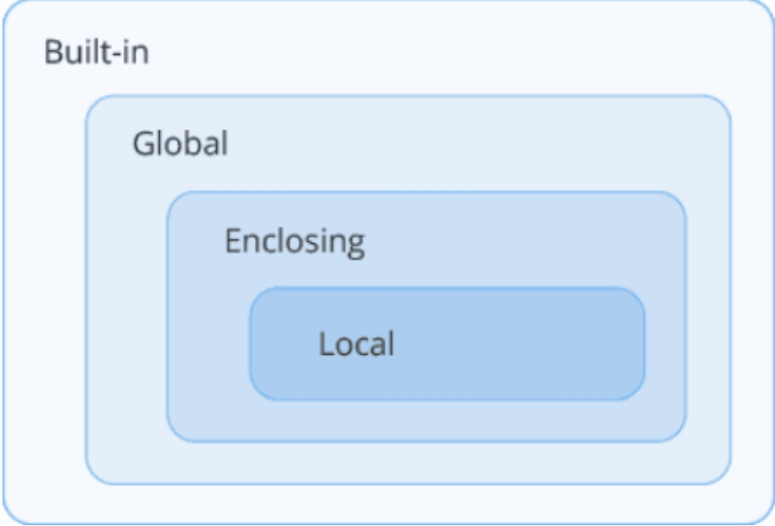

<!-- page: 1 -->

## PHẠM VI CỦA BIẾN TRONG PYTHON

## 7

<!-- page: 2 -->


Không phải mọi biến đều có thể truy cập ở mọi vị trí trong chương trình, phạm vi của chương trình mà tại đó một biến có thể truy cập gọi là “scope”, được xác định tại nơi mà biến được khai báo.

## Python có 3 phạm vi:

1. Local scope

2. Global scope

3. Enclosing scope

## LEGB rule:



<!-- page: 3 -->

## 1. Local scope:


Một biến được khai báo trong phạm vi của 1 hàm được có phạm vi local scope. Khi đó biến sẽ được truy cập từ vị trí nó được khai báo cho tới hết phạm vi của hàm, chừng nào hàm còn được thực hiện thì nó còn tồn tại.


def printNum(): x = 2804 #local scope print(x)

printNum()

**OUTPUT** 2804


Biến local sẽ được xóa khỏi bộ nhớ khi hàm chứa nó kết thúc, vì thế việc cố gắng truy cập vào biến local khi hàm kết thúc sẽ xảy ra lỗi.

## 00 EXAMPLE

00

def printNum(): x = 2804 #local scope print(x)

print(x) # error

**OUTPUT**

NameError: name 'x' is not defined

<!-- page: 4 -->

## 2. Global scope:


Biến được khai báo bên ngoài các hàm có phạm vi global, biến này có thể truy cập trong toàn bộ chương trình, tính từ vị trí nó được khai báo cho tới cuối file mã nguồn.

00 EXAMPLE

00

x = 2804

00 EXAMPLE

def printNum(): print(x) #OK printNum() print(x)

**OUTPUT** 2804 2804

00

x = 2804

def printNum(): x = 1000 print(x) printNum() print(x)

**OUTPUT** 1000 2804

<!-- page: 5 -->

## 2. Global scope:


Để hay đổi giá trị của biến toàn cục trong hàm con, ta sử dụng keyword global để chỉ rõ biến x là biến global, nếu không Python sẽ tạo 1 biến local có tên là x, và những thay đổi trên x local không ảnh hưởng tới x global.

```python
x = 2804
def printNum():
    global x
    x = 1000
    print(x)
printNum()
print(x)
```

<!-- page: 6 -->

## 3. Enclosing scope:


Trong nested function, khi bạn khai báo 2 biến có cùng tên ở trong 2 hàm này thì 2 biến này có phạm vi khác nhau

```python
def outer():
    x = 2804
    def inner():
        print(x)
    inner()
    print(x)
outer()
```

<!-- page: 7 -->

```python
Python tạo 1 biến x có cùng tên
    trong phạm vi của hàm inner

def outer():
    x = 2804
    def inner():
        x = 1000
        print(x)
    inner()
    print(x)
outer()
```

## 3. Enclosing scope:

00 EXAMPLE

00 EXAMPLE 00

**Sử dụng keyword nonlocal để tránh Python tạo 1 biến khác cùng tên trong hàm inner**

```python
def outer():
    x = 2804
    def inner():
        nonlocal x
        x = 1000
        print(x)
    inner()
    print(x)
outer()
```

**OUTPUT**

1000 1000
