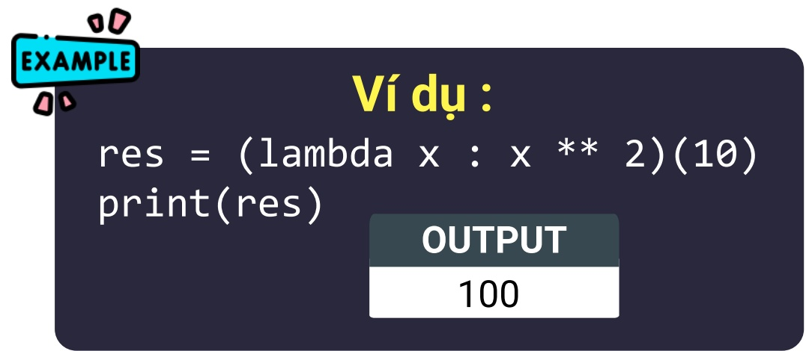

<!-- page: 1 -->

## LAMBDA FUNCTION

## 一<1>

<!-- page: 2 -->

Lambda là một trong những tính năng cực kì mạnh mẽ, quan trọng và thú vị của ngôn ngữ lập trình Python, tuy nhiên kiến thức này thường bị hiểu sai hoặc hiểu thiếu.

<!-- page: 3 -->

## 1. Lambda là gì ?

Lambda là một cách đơn giản để định nghĩa một hàm trong Python. Lambda thường được gọi dưới cái tên toán tử lambda hoặc hàm lambda.

Lambda là một cách để định nghĩa hàm vô danh (anonymous), một hàm mà không cần tên hàm. Nó được sử dụng khi bạn cần xây dựng những.hà l bdhàm chỉ bao gồm 1 câu lệnh, khi đó việc sử dụng keyword def để định nghĩa hàm là quá thừa thãi và dài dòng.

## CÚ PHÁP

lambda parameters : expression

<!-- page: 4 -->

## 1. Lambda là gì ?

## Ví dụ về hàm và lambda

**Xây dựng hàm:**

def func(n): return 2 \* n

print(func(10)) print(func(20))

**OUTPUT** 20 40

**Sử dụng lambda:**

func = lambda x : x \* 2

print(func(10)) print(func(20))

**OUTPUT**

20 40

**Chú ý:** Trong biểu thức lambda, các bạn không cần câu lệnh return, lambda tự động trả về giá trị cho bạn.

<!-- page: 5 -->

## 2. Các tính chất của lambda:

• **Lambda không thể chứa các câu lệnh:** Ví dụ như return, assest, pass…

**Lambda chỉ chứa 1 biểu thức duy nhất**.

**IIFE : Immediately Invoked Function Expression:** Biểu thức lambda có ột cách đơn giản để định nghĩa một hàthể được gọi ngay lập tức

<!-- page: 6 -->

## 3. Lambda với nhiều tham số:

Bạn có thể gửi bao nhiêu tham số tùy ý, chỉ cần phân cách giữa các tham số bằng dấu phẩy.

## 00 EXAMPLE

**Viết lambda tính tổng của 3 số**

hàm lambda.sum = lambda x, y, z : x + y + z print(sum(100, 200, 300))

print((lambda x, y, z : x + y + z)(100, 200, 300))

**OUTPUT**

<!-- page: 7 -->

## 4. Truyền đối số cho Lambda:

## Positional argument

sum = lambda x, y, z : x + y + z print(sum(100, 200, 300))

ể**OUTPUT**

## Keyword argument

sum = lambda x, y, z: x + y + z
print(sum(10, z = 20, y = 30))

**OUTPUT**

## Default argument

sum = lambda x, y = 20, z = 30 : x + y + z print(sum(10))

**OUTPUT**

<!-- page: 8 -->

## 5. Lambda và map():

**Hàm map()** trong Python có 2 đối số là một hàm và 1 list, map áp dụng hàm này với các phần tử trong list.

## 00 mbda là

00

$$
\begin{array}{l} \text {a = [1, 2, 3, 4, 5]} \\ \text {b = list(map(lambda x : x ** 2, a))} \\ \text {print(b)} \end{array}
$$

**OUTPUT**

[1, 4, 9, 16, 25]

## 6. Lambda và filter():

**Hàm filter()** tương tự như hàm map, khi apply các hàm trong filter với từng phần tử trong list mà giá trị của hàm trả về True thì filter lọc ra các phần tử này.

## 00 thon. L

amb

a = [1, 2, -3, -4, 5]
b = list(filter(lambda x : x > 0, a))
print(b)

**OUTPUT** [1, 2, 5]

<!-- page: 9 -->

## 7. If else và lambda:

Bạn có thể kết hợp if else trong lambda.

## 00 EXAMPLE

00

da là một cách đơn giản để định nghĩa một hàm trong PytfindMax = lambda x, y : x if x > y else y print(findMax(100, 200))

**OUTPUT**

200

<!-- page: 10 -->

## 8. List comprehension và lambda:

change = lambda l : [x for x in l if x >= 0] a = [1, 2, -3, -4, 5, -10, 12] print(change(a))

**OUTPUT**

L bd[1, 2, 5, 12]

## 00 EXAMPLE 0

flatten = lambda big\_list : [item for small\_list in big\_list for item in small\_list] a = [[1, 2, 3], [4, 5, 6], [7, 8, 9]]

print(flatten(a))

**OUTPUT**

[1, 2, 3, 4, 5, 6, 7, 8, 9]
