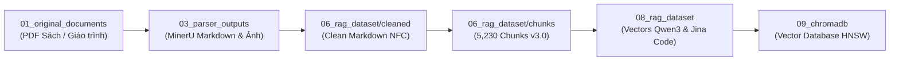

# DATA DIRECTORY — TỔNG QUAN KHO DỮ LIỆU RAG ĐA PHƯƠNG THỨC

Thư mục `data/` quản lý toàn bộ vòng đời dữ liệu từ tài liệu gốc, bóc tách cấu trúc, làm sạch, phân đoạn ngữ cảnh, nhúng vector đến cơ sở dữ liệu Vector Database.

---

## 🗺️ SƠ ĐỒ VÒNG ĐỜI DỮ LIỆU (DATA PIPELINE)

---

## 📂 CẤU TRÚC CHI TIẾT CÁC THƯ MỤC

| Thư mục | Mục đích sử dụng | Định dạng dữ liệu |
| :--- | :--- | :--- |
| **`01_original_documents/`** | Kho chứa sách và tài liệu lập trình PDF chính thống ban đầu. | `.pdf`, `.rst` |
| **`03_parser_outputs/mineru/`** | Đầu ra bóc tách layout từ MinerU (Markdown thô, ảnh, bảng biểu). | `.md`, `.json`, `images/` |
| **`04_benchmark/`** | Bộ câu hỏi kiểm thử truy vấn RAG, ground truth 36 câu hỏi, benchmark queries. | `.json` |
| **`06_rag_dataset/`** | Dữ liệu trung gian RAG đã làm sạch (`cleaned/`) và chia đoạn (`chunks/all_chunks.json`). | `.md`, `.json` |
| **`08_rag_dataset/`** | Kho lưu trữ các vector nhúng sinh ra từ Kaggle GPU (`qwen3_text` & `jina_code`). | `.jsonl`, `.tar.gz` |
| **`09_chromadb/`** | Cơ sở dữ liệu vector ChromaDB PersistentClient sẵn sàng phục vụ truy vấn. | `.sqlite3`, `.bin` |

---

## 🚀 QUY TẮC BẢO QUẢN & GIT LFS

- Các tệp dữ liệu lớn (> 50 MB) như `data/08_rag_dataset/embeddings/*/*.jsonl` và `data/09_chromadb/chroma.sqlite3` được theo dõi an toàn qua **Git LFS** (Large File Storage) để tránh vượt quá giới hạn push của GitHub.
- Tài liệu hướng dẫn chi tiết từng công đoạn: xem tại [LOTRINH_14_NGAY_RAG_MULTIMODAL_TUTOR.md](../LOTRINH_14_NGAY_RAG_MULTIMODAL_TUTOR.md).
