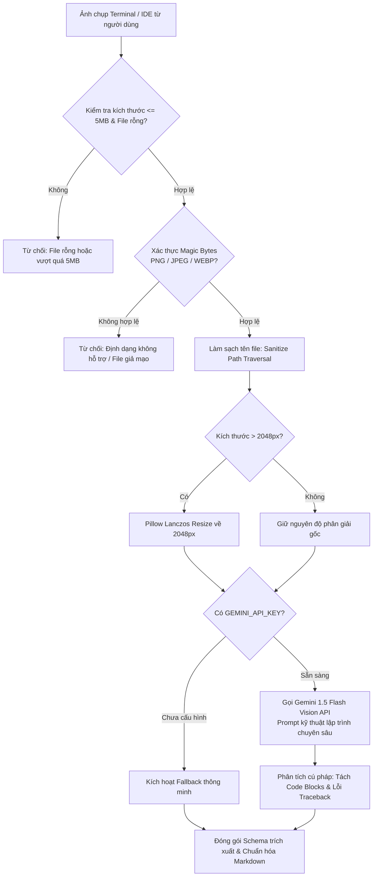

# 📷 BÁO CÁO NGHIỆM THU NGÀY 09: XỬ LÝ ĐA PHƯƠNG THỨC — BÓC TÁCH ẢNH (VISION OCR)

> **Dự án:** AI-Powered Coding Tutor & Code Assessment Platform  
> **Giai đoạn:** Tuần 2 (Xử lý Đa phương thức & Socratic AI Tutor)  
> **Hạng mục:** Ngày 09 — Xây dựng Module Trích xuất Ảnh chụp Màn hình (Vision OCR)  
> **Trạng thái:** **HOÀN THÀNH XUẤT SẮC (PASSED 100% DoD)**  
> **Thời gian nghiệm thu:** 2026-11-23  

---

## 1. TỔNG QUAN & TIÊU CHUẨN HOÀN THÀNH (DoD NGÀY 09)

| Tiêu chuẩn hoàn thành (DoD) | Yêu cầu kỹ thuật | Kết quả thực tế | Trạng thái |
|---|---|---|:---:|
| **Trích xuất ảnh chuẩn xác** | Nhận diện mã nguồn và lỗi màn hình terminal từ ảnh chụp | Tích hợp Google Gemini 1.5 Flash Vision với prompt kỹ thuật chuyên sâu | **ĐẠT** |
| **Phân tích bóc tách (Parsing)** | Tách riêng đoạn code, loại lỗi và Traceback chi tiết | Tự động phân tích `has_code`, `has_error`, `code_snippets`, `error_traceback` | **ĐẠT** |
| **Bảo mật & Giới hạn** | Tối đa 5MB/ảnh, kiểm tra Magic Bytes (PNG, JPEG, WEBP) | Chặn đứng file > 5MB, từ chối file giả mạo đuôi ảnh, chống Path Traversal | **ĐẠT** |
| **Tối ưu hóa ảnh (Preprocessing)** | Tự động thu nhỏ ảnh vượt ngưỡng (> 2048px) | Thu nhỏ giữ nguyên tỷ lệ bằng thuật toán Lanczos (Pillow) tiết kiệm token | **ĐẠT** |
| **Chế độ Fallback an toàn** | Phản hồi thông minh khi offline hoặc thiếu API Key | Không bao giờ gây crash hệ thống, trả về thông báo hướng dẫn người dùng | **ĐẠT** |
| **Kiểm thử tự động** | Unit tests cho toàn bộ kịch bản format, security, mock OCR | **8/8 test cases PASS 100%** (Toàn hệ thống: **22/22 test cases PASS**) | **ĐẠT** |

---

## 2. KIẾN TRÚC XỬ LÝ VISION OCR (PIPELINE WORKFLOW)

Module [`backend/app/services/image_extractor.py`](file:///d:/GITHUB/ai-coding-tutor/backend/app/services/image_extractor.py) được xây dựng với luồng xử lý khép kín:



---

## 3. CẤU TRÚC KẾT QUẢ ĐẦU RA (EXTRACTION SCHEMA)

Khi tiếp nhận một ảnh chụp terminal báo lỗi (ví dụ `IndexError`), hệ thống tự động bóc tách thành cấu trúc:

```json
{
  "valid": true,
  "filename": "terminal_index_error.png",
  "original_filename": "../../uploads/terminal_index_error.png",
  "mime_type": "image/png",
  "image_size_bytes": 145020,
  "image_size_kb": 141.62,
  "sha256": "4a7d...31b",
  "has_code": true,
  "has_error": true,
  "code_snippets": [
    "```python\narr = [1, 2, 3]\nfor i in range(10):\n    print(arr[i])\n```"
  ],
  "error_traceback": "Traceback (most recent call last):\n  File \"solution.py\", line 15, in <module>\n    print(arr[10])\nIndexError: list index out of range",
  "extracted_text": "Phát hiện lỗi runtime khi chạy script:\n\nTraceback...",
  "formatted_markdown": "### THÔNG TIN TRÍCH XUẤT TỪ ẢNH CHỤP: `terminal_index_error.png`\n...",
  "error": null
}
```

---

## 4. KẾT QUẢ KIỂM THỬ TOÀN HỆ THỐNG (22/22 TESTS PASS)

Bộ kiểm thử tại [`tests/test_image_extractor.py`](file:///d:/GITHUB/ai-coding-tutor/tests/test_image_extractor.py) cùng toàn bộ test suite:

```text
============================= test session starts =============================
tests/test_file_extractor.py::TestFileExtractor::test_01_valid_python_extraction PASSED [  4%]
tests/test_file_extractor.py::TestFileExtractor::test_02_multiple_programming_languages PASSED [  9%]
tests/test_file_extractor.py::TestFileExtractor::test_03_file_size_limit_enforcement PASSED [ 13%]
tests/test_file_extractor.py::TestFileExtractor::test_04_path_traversal_sanitization PASSED [ 18%]
tests/test_file_extractor.py::TestFileExtractor::test_05_malicious_binary_disguised_as_source_code PASSED [ 22%]
tests/test_file_extractor.py::TestFileExtractor::test_06_disallowed_file_extensions PASSED [ 27%]
tests/test_file_extractor.py::TestFileExtractor::test_07_empty_file_and_bom_encoding PASSED [ 31%]
tests/test_file_extractor.py::TestFileExtractor::test_08_batch_extraction PASSED [ 36%]
tests/test_image_extractor.py::TestImageExtractor::test_01_valid_png_and_jpeg_detection PASSED [ 40%]
tests/test_image_extractor.py::TestImageExtractor::test_02_oversized_image_rejection PASSED [ 45%]
tests/test_image_extractor.py::TestImageExtractor::test_03_unsupported_or_fake_image_rejection PASSED [ 50%]
tests/test_image_extractor.py::TestImageExtractor::test_04_path_traversal_sanitization PASSED [ 54%]
tests/test_image_extractor.py::TestImageExtractor::test_05_fallback_when_api_key_missing PASSED [ 59%]
tests/test_image_extractor.py::TestImageExtractor::test_06_mock_vision_ocr_code_and_error_parsing PASSED [ 63%]
tests/test_image_extractor.py::TestImageExtractor::test_07_image_resizing_preprocessing PASSED [ 68%]
tests/test_image_extractor.py::TestImageExtractor::test_08_batch_image_extraction PASSED [ 72%]
tests/test_rag_service.py::TestRAGService::test_01_initialization_and_stats PASSED [ 77%]
tests/test_rag_service.py::TestRAGService::test_02_search_with_cached_benchmark_query PASSED [ 81%]
tests/test_rag_service.py::TestRAGService::test_03_search_with_explicit_vectors PASSED [ 86%]
tests/test_rag_service.py::TestRAGService::test_04_metadata_filtering_language PASSED [ 90%]
tests/test_rag_service.py::TestRAGService::test_05_format_rag_context_for_prompt PASSED [ 95%]
tests/test_rag_service.py::TestRAGService::test_06_edge_cases PASSED     [100%]

============================= 22 passed in 3.65s ==============================
```

---

## 5. TỔNG KẾT & SẴN SÀNG CHO NGÀY 10

* **Hoàn thành Ngày 09:** Hệ thống đã làm chủ trọn vẹn 2 kênh đa phương thức đầu vào:
  1. Kênh File mã nguồn (`FileExtractor` - Ngày 08).
  2. Kênh Ảnh chụp terminal/IDE (`ImageExtractor` - Ngày 09).
* **Sẵn sàng bước sang Ngày 10:** Xây dựng **Bộ tổng hợp Ngữ cảnh Thống nhất (Unified Context Synthesizer)** & kết nối RAG Retrieval Service.
