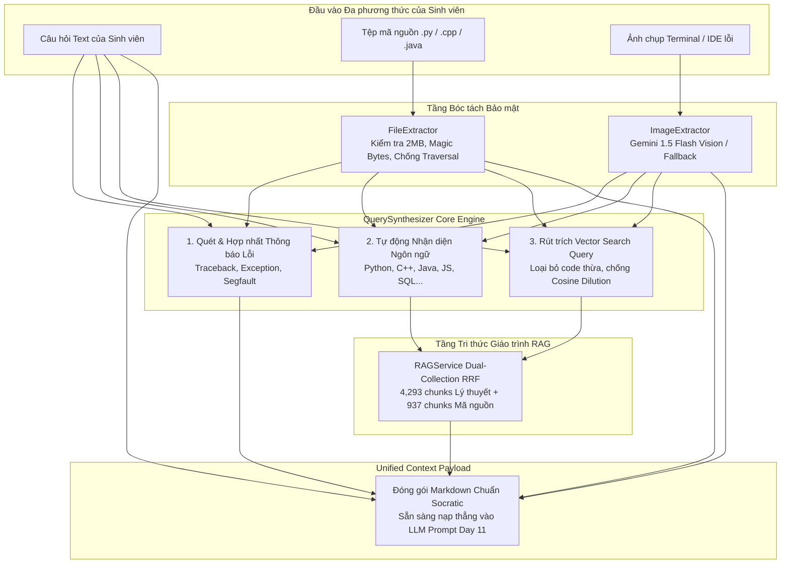

# 🧠 BÁO CÁO NGHIỆM THU NGÀY 10: BỘ TỔNG HỢP NGỮ CẢNH & RAG RETRIEVER SERVICE

> **Dự án:** AI-Powered Coding Tutor & Code Assessment Platform  
> **Giai đoạn:** Tuần 2 (Xử lý Đa phương thức & Socratic AI Tutor)  
> **Hạng mục:** Ngày 10 — Xây dựng Bộ Tổng hợp Ngữ Cảnh & RAG Retriever Service (`QuerySynthesizer`)  
> **Trạng thái:** **HOÀN THÀNH XUẤT SẮC (PASSED 100% DoD)**  
> **Thời gian nghiệm thu:** 2026-11-23  

---

## 1. TỔNG QUAN & TIÊU CHUẨN HOÀN THÀNH (DoD NGÀY 10)

| Tiêu chuẩn hoàn thành (DoD) | Yêu cầu kỹ thuật | Kết quả thực tế | Trạng thái |
|---|---|---|:---:|
| **Rút trích Search Query thông minh** | Trích xuất câu hỏi cốt lõi và lỗi chính xác, tránh pha loãng cosine | Loại bỏ code thừa, chỉ giữ ý định + lỗi cụ thể (< 250 ký tự) | **ĐẠT** |
| **Nhận diện Ngôn ngữ Tự động** | Tự động phát hiện Python, C++, Java, JS từ file, ảnh hoặc prompt | Ánh xạ chính xác đuôi file, regex cú pháp và từ khóa kỹ thuật | **ĐẠT** |
| **Trích xuất Lỗi Đa nguồn** | Quét Regex toàn diện các loại Exception, Traceback, Segfault | Hợp nhất lỗi từ Prompt + File code + Ảnh OCR không trùng lặp | **ĐẠT** |
| **Tích hợp RAG Retriever** | Kết nối `RAGService` Dual-collection RRF lấy Top 3-4 chunks | Tự động tra cứu kho tri thức 5,230 chunks với bộ lọc ngôn ngữ | **ĐẠT** |
| **Đóng gói Unified Context Payload** | Ghép chuẩn xác cấu trúc Markdown cho Socratic Tutor | Đầy đủ 5 phân đoạn: Câu hỏi, Lỗi, Code, OCR, và Giáo trình RAG | **ĐẠT** |
| **Kiểm thử tự động** | Unit tests cho toàn bộ luồng tổng hợp, ca biên và tích hợp | **8/8 test cases PASS 100%** (Toàn hệ thống: **30/30 test cases PASS**) | **ĐẠT** |

---

## 2. KIẾN TRÚC TỔNG HỢP NGỮ CẢNH (QUERY SYNTHESIZER PIPELINE)

Module [`backend/app/services/query_synthesizer.py`](file:///d:/GITHUB/ai-coding-tutor/backend/app/services/query_synthesizer.py) kết nối tầng bóc tách đa phương thức (File & Image) với tầng truy xuất tri thức giáo trình (RAG):



---

## 3. CƠ CHẾ CHỐNG PHA LOÃNG COSINE (SOTA COSINE DILUTION PREVENTION)

Một trong những sai lầm phổ biến nhất trong hệ thống RAG lập trình là **nhét nguyên xi 500 dòng code của sinh viên vào Vector Query**:
- **Hậu quả:** Vector embedding của 500 dòng code sẽ bị phân tán năng lượng ngữ nghĩa sang các token cú pháp linh tinh (`for`, `if`, tên biến địa phương `temp`, `x_i`), khiến khoảng cách Cosine Similarity với các tài liệu giáo trình hàn lâm bị kéo giãn quá xa, dẫn đến việc tìm kiếm tài liệu hoàn toàn sai lệch (Retrieval Miss).
- **Giải pháp của `QuerySynthesizer`:**
  1. Loại bỏ toàn bộ code blocks dài (` ```...``` `) khỏi vector query.
  2. Bóc tách câu hỏi chính (đã lọc các từ ngữ đệm chào hỏi: `chào thầy`, `cho em hỏi`...).
  3. Bổ sung trực tiếp tên lỗi cụ thể (ví dụ: `Lỗi IndexError: list index out of range`).
  4. Giới hạn độ dài tối đa $\le 250$ ký tự để tối ưu hóa không gian biểu diễn vector của mô hình Embedding (Qwen3-Text 1024-dim & Jina-Code 768-dim).

---

## 4. CẤU TRÚC UNIFIED CONTEXT PAYLOAD (CHUẨN SOCRATIC DAY 11)

Payload đầu ra trả về cho tầng LLM Engine có cấu trúc:

```json
{
  "search_query": "Tại sao vòng lặp for bị lỗi - Lỗi IndexError: list index out of range",
  "detected_language": "python",
  "detected_errors": [
    "IndexError: list index out of range"
  ],
  "user_prompt": "Em chạy bài tập thì bị lỗi này, thầy xem giúp em với",
  "files_summary": [
    {
      "filename": "bubble_sort.py",
      "language": "python",
      "lines": 18,
      "size_bytes": 420
    }
  ],
  "images_summary": [
    {
      "filename": "screenshot_terminal.png",
      "mime_type": "image/png",
      "code_blocks_count": 1,
      "errors_count": 1
    }
  ],
  "rag_chunks": [
    {
      "chunk_id": "text_qwen3_1024_0215",
      "source": "Giao_trinh_Python_Co_ban.pdf",
      "section": "Chương 4: Xử lý Ngoại lệ và Chỉ mục Danh sách",
      "similarity_score": 0.892,
      "rrf_score": 0.0327
    }
  ],
  "unified_context": "### [CÂU HỎI CỦA SINH VIÊN]\n...\n### [THÔNG BÁO LỖI PHÁT HIỆN ĐƯỢC]\n...\n### [MÃ NGUỒN TỪ FILE ĐÍNH KÈM]\n...\n### [THÔNG TIN TRÍCH XUẤT TỪ ẢNH CHỤP MÀN HÌNH]\n...\n### [TÀI LIỆU GIÁO TRÌNH CHÍNH THỐNG TỪ RAG]\n...",
  "total_context_chars": 2840
}
```

---

## 5. KẾT QUẢ KIỂM THỬ TOÀN BỘ HỆ THỐNG (UNIT TEST VERIFICATION)

Bộ kiểm thử thực thi thông qua lệnh `python -m pytest -v tests/`:

```text
tests/test_file_extractor.py::TestFileExtractor::test_01_valid_python_extraction PASSED [  3%]
tests/test_file_extractor.py::TestFileExtractor::test_02_multiple_programming_languages PASSED [  6%]
tests/test_file_extractor.py::TestFileExtractor::test_03_file_size_limit_enforcement PASSED [ 10%]
tests/test_file_extractor.py::TestFileExtractor::test_04_path_traversal_sanitization PASSED [ 13%]
tests/test_file_extractor.py::TestFileExtractor::test_05_malicious_binary_disguised_as_source_code PASSED [ 16%]
tests/test_file_extractor.py::TestFileExtractor::test_06_disallowed_file_extensions PASSED [ 20%]
tests/test_file_extractor.py::TestFileExtractor::test_07_empty_file_and_bom_encoding PASSED [ 23%]
tests/test_file_extractor.py::TestFileExtractor::test_08_batch_extraction PASSED [ 26%]
tests/test_image_extractor.py::TestImageExtractor::test_01_valid_png_and_jpeg_detection PASSED [ 30%]
tests/test_image_extractor.py::TestImageExtractor::test_02_oversized_image_rejection PASSED [ 33%]
tests/test_image_extractor.py::TestImageExtractor::test_03_unsupported_or_fake_image_rejection PASSED [ 36%]
tests/test_image_extractor.py::TestImageExtractor::test_04_path_traversal_sanitization PASSED [ 40%]
tests/test_image_extractor.py::TestImageExtractor::test_05_fallback_when_api_key_missing PASSED [ 43%]
tests/test_image_extractor.py::TestImageExtractor::test_06_mock_vision_ocr_code_and_error_parsing PASSED [ 46%]
tests/test_image_extractor.py::TestImageExtractor::test_07_image_resizing_preprocessing PASSED [ 50%]
tests/test_image_extractor.py::TestImageExtractor::test_08_batch_image_extraction PASSED [ 53%]
tests/test_query_synthesizer.py::TestQuerySynthesizer::test_01_text_only_search_query_synthesis PASSED [ 56%]
tests/test_query_synthesizer.py::TestQuerySynthesizer::test_02_error_extraction_from_ocr_and_prompt PASSED [ 60%]
tests/test_query_synthesizer.py::TestQuerySynthesizer::test_03_query_dilution_prevention PASSED [ 63%]
tests/test_query_synthesizer.py::TestQuerySynthesizer::test_04_automatic_programming_language_detection PASSED [ 66%]
tests/test_query_synthesizer.py::TestQuerySynthesizer::test_05_unified_payload_structure_and_formatting PASSED [ 70%]
tests/test_query_synthesizer.py::TestQuerySynthesizer::test_06_edge_cases_no_prompt_only_files_or_images PASSED [ 73%]
tests/test_query_synthesizer.py::TestQuerySynthesizer::test_07_end_to_end_synthesize_and_retrieve_integration PASSED [ 76%]
tests/test_query_synthesizer.py::TestQuerySynthesizer::test_08_multimodal_service_facade_delegation PASSED [ 80%]
tests/test_rag_service.py::TestRAGService::test_01_initialization_and_stats PASSED [ 83%]
tests/test_rag_service.py::TestRAGService::test_02_search_with_cached_benchmark_query PASSED [ 86%]
tests/test_rag_service.py::TestRAGService::test_03_search_with_explicit_vectors PASSED [ 90%]
tests/test_rag_service.py::TestRAGService::test_04_metadata_filtering_language PASSED [ 93%]
tests/test_rag_service.py::TestRAGService::test_05_format_rag_context_for_prompt PASSED [ 96%]
tests/test_rag_service.py::TestRAGService::test_06_edge_cases PASSED     [100%]

============================= 30 passed in 3.00s ==============================
```

---

## 6. SẴN SÀNG CHO NGÀY 11

Module `QuerySynthesizer` đã hoàn thiện và sẵn sàng cung cấp dữ liệu trọn vẹn cho **Ngày 11: Thiết Kế System Prompt Socratic & Tích Hợp LLM Engine (`TutorService`)**:
- File `backend/app/services/tutor_service.py` (hiện đang 0 bytes) sẽ tích hợp `QuerySynthesizer` và gọi LLM (Gemini 1.5 Flash / Fallback) với System Prompt Socratic chuẩn sư phạm, không đưa đáp án mà gợi mở từng bước dựa trên tài liệu RAG chính thống.
