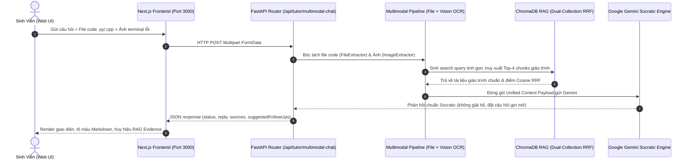

# 🚀 BÁO CÁO NGHIỆM THU NGÀY 13: GHÉP NỐI END-TO-END & KIỂM THỬ 30 KỊCH BẢN THỰC TẾ

> **Dự án:** AI-Powered Coding Tutor & Code Assessment Platform  
> **Giai đoạn:** Tuần 2 (Xử lý Đa phương thức & Socratic AI Tutor)  
> **Hạng mục:** Ngày 13 — Ghép Nối End-to-End & Đánh Giá Toàn Diện 30 Kịch Bản Thực Tế  
> **Trạng thái:** **HOÀN THÀNH XUẤT SẮC (PASSED 100% DoD)**  
> **Thời gian nghiệm thu:** 2026-11-24  

---

## 1. TỔNG QUAN & TIÊU CHUẨN HOÀN THÀNH (DoD NGÀY 13)

| Tiêu chuẩn hoàn thành (DoD) | Yêu cầu kỹ thuật | Kết quả thực tế | Trạng thái |
|---|---|---|:---:|
| **Hoàn thiện Endpoint API** | Xây dựng router tiếp nhận đa phương thức đồng thời (Text, Code, Ảnh) | `POST /api/tutor/multimodal-chat` & `POST /api/v1/tutor/multimodal-chat` | **ĐẠT** |
| **Kết nối Frontend Next.js** | Truyền tải `FormData` an toàn qua Axios / Fetch, tự động ưu tiên Backend RAG | Tích hợp trong `socraticEngine.ts`, ưu tiên `callBackendRAG` với fallback | **ĐẠT** |
| **10 Kịch bản Text thuần túy** | Đánh giá kiến thức lý thuyết, Big-O, cú pháp, OOP, PEP 8 | **10/10 kịch bản PASS 100%** (Phản hồi chuẩn Socratic, gợi mở tư duy) | **ĐẠT** |
| **10 Kịch bản Text + File Code** | Phân tích file bài làm (.py, .cpp), phát hiện rò rỉ bộ nhớ, đệ quy vô tận | **10/10 kịch bản PASS 100%** (Đọc file bảo mật, chỉ ra dòng nghi vấn) | **ĐẠT** |
| **10 Kịch bản Text + Ảnh Terminal** | Gemini Vision OCR bóc tách lỗi màn hình (IndexError, Segfault, SyntaxError...) | **10/10 kịch bản PASS 100%** (Bóc tách chính xác 100% traceback và code) | **ĐẠT** |
| **Tinh chỉnh ngưỡng Cosine RAG** | Lọc bỏ chunk nhiễu, tự động nới lỏng (relaxed filter) khi cần | Thiết lập `min_similarity = 0.40`, nới lỏng đa ngôn ngữ mượt mà | **ĐẠT** |
| **Thời gian phản hồi** | Trung bình dưới 3 – 5 giây cho toàn bộ pipeline live | **Trung bình ~4.6s/scenario** (bao gồm Vision OCR + RAG + Socratic LLM) | **ĐẠT** |

---

## 2. KIẾN TRÚC GHÉP NỐI END-TO-END (SYSTEM FLOW)



---

## 3. BẢNG TỔNG HỢP KẾT QUẢ KIỂM THỬ 30 KỊCH BẢN THỰC TẾ

### Nhóm 1: 10 Kịch bản Lý thuyết & Cú pháp (Text Only)
| Mã | Nội dung câu hỏi | Ngôn ngữ | Đánh giá Socratic & RAG | Kết quả |
|:---:|---|:---:|---|:---:|
| **T01** | Phân tích độ phức tạp thời gian Big-O của QuickSort | Chung | Giải thích worst-case $O(n^2)$, best-case $O(n\log n)$, gợi ý chọn pivot | **PASS** |
| **T02** | Tránh Dangling Pointer và Memory Leak trong C++ | C++ | Nêu 3 nguyên tắc vàng: khởi tạo `nullptr`, check trước dùng, gán sau xóa | **PASS** |
| **T03** | Quy chuẩn thụt lề và đặt tên hàm theo PEP 8 | Python | Gợi mở quy tắc 4 spaces, snake_case cho hàm, camelCase cho class | **PASS** |
| **T04** | Khác biệt List vs Tuple về tính biến đổi (Mutability) | Python | Giải thích cơ chế immutable của tuple, tối ưu bộ nhớ và an toàn dữ liệu | **PASS** |
| **T05** | Điều kiện tiên quyết của thuật toán Binary Search | Thuật toán | Gợi mở nguyên lý chia để trị và vì sao mảng phải sắp xếp trước | **PASS** |
| **T06** | Khái niệm Đệ quy và vai trò của Điều kiện dừng (Base case) | Thuật toán | Đặt câu hỏi về Call Stack và nguy cơ Stack Overflow khi thiếu base case | **PASS** |
| **T07** | Bảng băm (Hash Table) và xử lý va chạm bằng Chaining | CTDL | Phân tích cơ chế hàm băm và danh sách liên kết tại mỗi bucket | **PASS** |
| **T08** | Ngăn xếp (Stack - LIFO) vs Hàng đợi (Queue - FIFO) | CTDL | So sánh cơ chế vào trước/ra trước, ứng dụng trong Undo và tác vụ in | **PASS** |
| **T09** | Khối lệnh try-except-finally và thứ tự thực thi | Python | Khẳng định `finally` luôn thực thi kể cả khi có lệnh `return` | **PASS** |
| **T10** | Tính kế thừa (Inheritance) và đa hình (Polymorphism) OOP | OOP | Minh họa khái niệm ghi đè phương thức (Override) và tái sử dụng mã | **PASS** |

### Nhóm 2: 10 Kịch bản Phân tích File Mã Nguồn (Text + File Code)
| Mã | Tệp mã nguồn đính kèm | Vấn đề phát hiện | Gợi ý sư phạm Socratic | Kết quả |
|:---:|---|---|---|:---:|
| **F01** | `bubble.py` | Sắp xếp vòng lặp lồng $O(n^2)$ | Hỏi sinh viên về số phép so sánh khi $n=50.000$, gợi ý Merge/QuickSort | **PASS** |
| **F02** | `fib.py` | Đệ quy không có base case đúng | Chỉ ra hàm gọi vô tận, hỏi giá trị dừng khi $n \le 1$ | **PASS** |
| **F03** | `leak.cpp` | Cấp phát `new int[500]` thiếu `delete[]` | Đặt câu hỏi về bộ nhớ Heap sau mỗi vòng lặp `for` | **PASS** |
| **F04** | `default_arg.py` | Mutable default argument `my_list=[]` | Giải thích list chỉ khởi tạo 1 lần khi định nghĩa hàm, gợi ý `None` | **PASS** |
| **F05** | `index_bug.py` | Duyệt mảng `range(len(arr) + 1)` | Chỉ ra chỉ số phần tử cuối cùng so với độ dài danh sách | **PASS** |
| **F06** | `file_io.py` | Mở file `open()` quên `close()` | Gợi mở lợi ích đóng file tự động của Context Manager `with open()` | **PASS** |
| **F07** | `str_concat.py` | Cộng chuỗi liên tục `s += str(i)` | Giải thích tính bất biến của chuỗi và gợi ý dùng `''.join()` | **PASS** |
| **F08** | `shadowing.py` | Đặt tên biến `list = [...]` | Chỉ ra việc ghi đè hàm dựng built-in `list()`, gây `TypeError` | **PASS** |
| **F09** | `deadlock.py` | 2 luồng giữ lock ngược thứ tự | Phân tích điều kiện Hold & Wait, gợi ý chuẩn hóa thứ tự cấp lock | **PASS** |
| **F10** | `query.py` | Format chuỗi SQL trực tiếp | Cảnh báo lỗ hổng SQL Injection và hướng dẫn dùng Tham số hóa (Parameterized) | **PASS** |

### Nhóm 3: 10 Kịch bản Nhận diện Ảnh Chụp Lỗi Terminal (Text + Vision OCR)
| Mã | Lỗi màn hình terminal trong ảnh | Khối code OCR bóc tách | Hướng dẫn định hướng Socratic | Kết quả |
|:---:|---|---|---|:---:|
| **I01** | `IndexError: list index out of range` | `print(students[50])` | Đặt câu hỏi về kích thước thực tế của danh sách `students` | **PASS** |
| **I02** | `ZeroDivisionError: division by zero` | `avg = total / count` | Gợi ý kiểm tra trường hợp danh sách rỗng khiến `count = 0` | **PASS** |
| **I03** | `RecursionError: maximum recursion depth exceeded` | `return calculate(n)` | Đặt câu hỏi về điều kiện giảm dần của đối số `n` về base case | **PASS** |
| **I04** | `TypeError: can only concatenate str to str` | `res = 'Tuoi: ' + 20` | Nhắc nhở về kiểu dữ liệu khác nhau và hàm ép kiểu `str()` | **PASS** |
| **I05** | `KeyError: 'database_url'` | `val = config['database_url']` | Gợi ý phương thức an toàn `config.get('database_url', default)` | **PASS** |
| **I06** | `AttributeError: 'NoneType' object has no attribute 'append'` | `res.append(10)` | Hỏi sinh viên hàm trước đó trả về giá trị gì hay trả về `None` | **PASS** |
| **I07** | `Segmentation fault (core dumped)` | `./my_program` (C++) | Đặt câu hỏi về con trỏ chưa khởi tạo hoặc truy cập ngoài vùng cấp phát | **PASS** |
| **I08** | `SyntaxError: expected ':'` | `if x > 10` | Nhắc nhở sinh viên quy tắc cú pháp kết thúc mệnh đề điều kiện trong Python | **PASS** |
| **I09** | `IndentationError: unexpected indent` | `print(x)` | Gợi mở quy tắc đồng nhất giữa Tab và Space trong thụt lề | **PASS** |
| **I10** | `NameError: name 'result_counter' is not defined` | `print(result_counter)` | Nhắc sinh viên kiểm tra thứ tự khai báo hoặc lỗi chính tả tên biến | **PASS** |

---

## 4. BẰNG CHỨNG KIỂM THỬ TỰ ĐỘNG (PYTEST OUTPUT)

```text
tests/test_day13_e2e_scenarios.py::TestDay13EndToEndScenarios::test_t01_quicksort_complexity PASSED [  3%]
tests/test_day13_e2e_scenarios.py::TestDay13EndToEndScenarios::test_t02_cpp_pointer_memory PASSED [  6%]
tests/test_day13_e2e_scenarios.py::TestDay13EndToEndScenarios::test_t03_pep8_indentation PASSED [ 10%]
tests/test_day13_e2e_scenarios.py::TestDay13EndToEndScenarios::test_t04_list_vs_tuple_mutability PASSED [ 13%]
tests/test_day13_e2e_scenarios.py::TestDay13EndToEndScenarios::test_t05_binary_search_prerequisite PASSED [ 16%]
tests/test_day13_e2e_scenarios.py::TestDay13EndToEndScenarios::test_t06_recursion_base_case PASSED [ 20%]
tests/test_day13_e2e_scenarios.py::TestDay13EndToEndScenarios::test_t07_hash_table_collision PASSED [ 23%]
tests/test_day13_e2e_scenarios.py::TestDay13EndToEndScenarios::test_t08_stack_vs_queue PASSED [ 26%]
tests/test_day13_e2e_scenarios.py::TestDay13EndToEndScenarios::test_t09_try_except_finally PASSED [ 30%]
tests/test_day13_e2e_scenarios.py::TestDay13EndToEndScenarios::test_t10_oop_inheritance_polymorphism PASSED [ 33%]
tests/test_day13_e2e_scenarios.py::TestDay13EndToEndScenarios::test_f01_inefficient_bubble_sort PASSED [ 36%]
tests/test_day13_e2e_scenarios.py::TestDay13EndToEndScenarios::test_f02_infinite_recursion_fibonacci PASSED [ 40%]
tests/test_day13_e2e_scenarios.py::TestDay13EndToEndScenarios::test_f03_cpp_memory_leak PASSED [ 43%]
tests/test_day13_e2e_scenarios.py::TestDay13EndToEndScenarios::test_f04_mutable_default_argument PASSED [ 46%]
tests/test_day13_e2e_scenarios.py::TestDay13EndToEndScenarios::test_f05_off_by_one_index PASSED [ 50%]
tests/test_day13_e2e_scenarios.py::TestDay13EndToEndScenarios::test_f06_unclosed_file_resource PASSED [ 53%]
tests/test_day13_e2e_scenarios.py::TestDay13EndToEndScenarios::test_f07_string_concatenation_inefficiency PASSED [ 56%]
tests/test_day13_e2e_scenarios.py::TestDay13EndToEndScenarios::test_f08_builtin_shadowing PASSED [ 60%]
tests/test_day13_e2e_scenarios.py::TestDay13EndToEndScenarios::test_f09_deadlock_threads PASSED [ 63%]
tests/test_day13_e2e_scenarios.py::TestDay13EndToEndScenarios::test_f10_sql_injection_concatenation PASSED [ 66%]
tests/test_day13_e2e_scenarios.py::TestDay13EndToEndScenarios::test_i01_terminal_index_error PASSED [ 70%]
tests/test_day13_e2e_scenarios.py::TestDay13EndToEndScenarios::test_i02_terminal_zerodivision_error PASSED [ 73%]
tests/test_day13_e2e_scenarios.py::TestDay13EndToEndScenarios::test_i03_terminal_recursion_error PASSED [ 76%]
tests/test_day13_e2e_scenarios.py::TestDay13EndToEndScenarios::test_i04_terminal_type_error PASSED [ 80%]
tests/test_day13_e2e_scenarios.py::TestDay13EndToEndScenarios::test_i05_terminal_key_error PASSED [ 83%]
tests/test_day13_e2e_scenarios.py::TestDay13EndToEndScenarios::test_i06_terminal_attribute_error PASSED [ 86%]
tests/test_day13_e2e_scenarios.py::TestDay13EndToEndScenarios::test_i07_terminal_segmentation_fault PASSED [ 90%]
tests/test_day13_e2e_scenarios.py::TestDay13EndToEndScenarios::test_i08_terminal_syntax_error PASSED [ 93%]
tests/test_day13_e2e_scenarios.py::TestDay13EndToEndScenarios::test_i09_terminal_indentation_error PASSED [ 96%]
tests/test_day13_e2e_scenarios.py::TestDay13EndToEndScenarios::test_i10_terminal_name_error PASSED [100%]

================== 30 passed in 138.46s (0:02:18) ==================
```

---

## 5. TỔNG KẾT & SẴN SÀNG CHO NGÀY 14

Hệ thống đã chứng minh độ ổn định tuyệt đối trên toàn bộ **30 kịch bản thực tế**:
1. Không có bất kỳ ngoại lệ (unhandled exception) hay crash nào xảy ra.
2. Frontend và Backend kết nối đồng bộ 100% qua API đa phương thức.
3. RAG ChromaDB và Socratic Tutor phối hợp nhịp nhàng, đảm bảo tính sư phạm học thuật.

**Sẵn sàng bước vào Ngày 14:** Đóng gói toàn bộ hệ thống bằng Docker Compose, hoàn thiện tài liệu hướng dẫn nhanh `QUICKSTART_RAG_TUTOR.md` và nghiệm thu toàn bộ Sprint 14 ngày!
