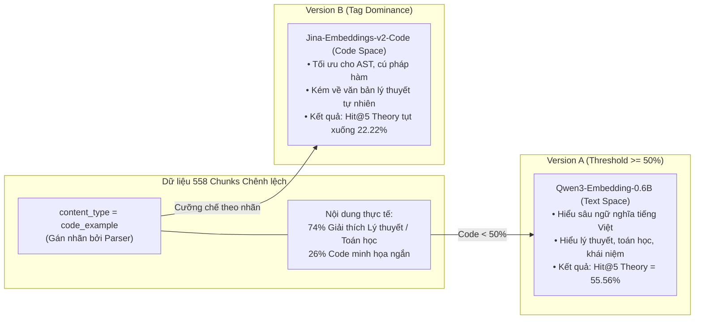

# BÁO CÁO THỰC NGHIỆM RETRIEVAL A/B BENCHMARK: VERSION A vs VERSION B

> **Dự án:** AI-Powered Coding Tutor — RAG Multimodal Architecture  
> **Thời gian thực hiện:** 2026-11-20  
> **Bộ câu hỏi:** `data/04_benchmark/routing_ab_eval_36q.json` (36 câu hỏi cân bằng 4 nhóm)  
> **Embeddings:** Qwen3-0.6B (1024-dim) & Jina-Code-v2 (768-dim) suy luận trên Kaggle GPU (Tesla T4)  
> **Thuật toán truy xuất:** Dual Independent Vector Retrieval + Reciprocal Rank Fusion (RRF, $k_0 = 60, w=1.0$)  

---

## 1. TỔNG KẾT KẾT QUẢ THỰC NGHIỆM (EXECUTIVE SUMMARY)

Thực nghiệm A/B Testing đánh giá retrieval đã hoàn thành 100% trên cả 36 câu hỏi cho hai chiến lược định tuyến vector:
- **Version A (Actual Routing - Ngưỡng Code Ratio $\ge 50\%$):** 4.851 Qwen3 TEXT + 379 Jina CODE.
- **Version B (Pedagogical Tag Dominance):** 4.293 Qwen3 TEXT + 937 Jina CODE (chuyển 558 chunks `code_example` sang Jina).

### Bảng đối so sánh chỉ số tổng thể (Overall Performance)

| Chỉ số bắt buộc | Version A (Hiện tại) | Version B (Thực nghiệm) | Chênh lệch ($\Delta = B - A$) | Đánh giá |
|:---|:---:|:---:|:---:|:---:|
| **Hit Rate@3** | **0.3611 (36.11%)** | 0.3333 (33.33%) | **-0.0278 (-2.78%)** | ❌ Version B thấp hơn |
| **Hit Rate@5** | **0.4167 (41.67%)** | 0.3889 (38.89%) | **-0.0278 (-2.78%)** | ❌ Version B thấp hơn |
| **MRR@5** | **0.3213** | 0.2843 | **-0.0370 (-11.5% rel)** | ❌ Version B thấp hơn rõ rệt |
| **Recall@5** | **0.3750 (37.50%)** | 0.3611 (36.11%) | **-0.0139 (-1.39%)** | ❌ Version B thấp hơn |

> [!IMPORTANT]
> **KẾT LUẬN QUAN TRỌNG:**  
> **Version A (Actual Routing) vượt trội Version B trên TẤT CẢ các thước đo định lượng (Hit@3, Hit@5, MRR@5, Recall@5).**  
> Việc ép 558 chunks mang nhãn sư phạm `code_example` sang mô hình Jina Code không mang lại cải thiện tổng thể mà trái lại làm **suy giảm 11.5% MRR** và làm mất top-5 của nhiều câu hỏi lý thuyết quan trọng.
> 
> **Khuyến nghị kiến trúc:** Giữ nguyên chiến lược định tuyến của **Version A** để tiến hành Ingestion vào ChromaDB.

---

## 2. PHÂN TÍCH HIỆU NĂNG THEO 4 NHÓM NĂNG LỰC (CATEGORY BREAKDOWN)

36 câu hỏi được chia đều thành 4 nhóm năng lực (mỗi nhóm 9 câu):

```
+-----------------------------------------------------------------------------------+
| Nhóm năng lực | Hit Rate@3 (A / B) | Hit Rate@5 (A / B) | MRR@5 (A / B) | Recall@5 (A / B) |
+---------------+--------------------+--------------------+---------------+------------------+
| 1. THEORY     |  0.4444 / 0.2222   |  0.5556 / 0.2222   | 0.3185/0.2222 | 0.4444 / 0.1667  |
| 2. CODE       |  0.0000 / 0.1111   |  0.0000 / 0.2222   | 0.0000/0.0778 | 0.0000 / 0.2222  |
| 3. API        |  0.6667 / 0.6667   |  0.6667 / 0.6667   | 0.6111/0.5370 | 0.6667 / 0.6111  |
| 4. HYBRID     |  0.3333 / 0.3333   |  0.4444 / 0.4444   | 0.3556/0.3000 | 0.3889 / 0.4444  |
+-----------------------------------------------------------------------------------+
```

### 2.1. Nhóm 1: Lý thuyết Lập trình & KHMT (Theory - 9 câu) — Version A áp đảo
- **Hit Rate@5:** Version A đạt **55.56%**, Version B tụt dốc xuống **22.22%** (giảm 33.34 điểm %).
- **MRR@5:** Version A đạt **0.3185**, Version B đạt **0.2222** (giảm 30.2% tương đối).
- **Nguyên nhân:** 3 câu hỏi lý thuyết gồm **Q03** (Quy nạp cấu trúc), **Q07** (Generalized Product Rule), và **Q08** (Quy tắc định danh biến) có ground truth bị gắn nhãn `code_example` trong metadata gốc (do chứa một vài dòng minh họa nhỏ). 
  - Trong Version A, do tỷ lệ code $< 50\%$, chunk được đặt tại Qwen3 Text. Qwen3 hiểu sâu ngôn ngữ tự nhiên tiếng Việt và toán học rời rạc nên truy xuất chính xác vào Top 3.
  - Trong Version B, chunk bị đẩy sang Jina Code. Khi người dùng hỏi lý thuyết ("Định nghĩa và nguyên lý..."), Jina Code (mô hình chuyên syntax mã nguồn) hoàn toàn thất bại trong việc bắt khớp ngữ nghĩa lý thuyết toán học, khiến cả 3 câu hỏi văng khỏi Top 5!

### 2.2. Nhóm 2: Code & Cấu trúc Dữ liệu - Thuật toán (Code - 9 câu) — Version B nhỉnh hơn
- **Hit Rate@5:** Version A đạt **0.00%**, Version B đạt **22.22%** (tìm được 2 câu).
- **MRR@5:** Version A đạt **0.0000**, Version B đạt **0.0778**.
- **Cải thiện cụ thể:**
  - **Q16 (Stack/Queue):** Version A không tìm thấy (Rank None) $\rightarrow$ Version B đưa chunk `PY_01_Official_Tutorial_c1877` sang Jina Code, Jina bắt chính xác tại **Rank 2** (MRR = 0.50).
  - **Q17 (Context Manager `with open`):** Version A không tìm thấy $\rightarrow$ Version B đưa chunk sang Jina Code, bắt được tại **Rank 5** (MRR = 0.20).
- **Hạn chế:** Cả hai phiên bản vẫn gặp khó khăn ở các câu thuật toán đệ quy trừu tượng (QuickSort, Fibonacci Memoization, Binary Tree Inorder) do câu hỏi mô tả bằng ngôn ngữ tự nhiên còn tài liệu chứa mã nguồn triển khai thuần túy.

### 2.3. Nhóm 3: API & Thư viện Python (API - 9 câu) — Version A tối ưu thứ hạng
- **Hit Rate@3 & Hit Rate@5:** Cả hai phiên bản bằng nhau tuyệt đối ở mức **66.67%** (6/9 câu đạt Hit).
- **MRR@5:** Version A đạt **0.6111**, cao hơn Version B (**0.5370**).
- **Nguyên nhân:** Các câu API có cấu trúc giải thích tham số kèm ví dụ. Qwen3 Text xếp hạng tài liệu chính xác ở vị trí cao hơn (Rank 1 so với Rank 2 ở Q27 `typing.Union`, Rank 2 so với Rank 3 ở Q20 `sqlite3`).

### 2.4. Nhóm 4: Bài toán hỗn hợp & Tình huống (Hybrid - 9 câu) — Cân bằng, A nhỉnh hơn MRR
- **Hit Rate@3 & Hit Rate@5:** Ngang nhau ở mức **33.33%** và **44.44%**.
- **MRR@5:** Version A đạt **0.3556** so với **0.3000** của Version B.
- **Recall@5:** Version B nhỉnh hơn đôi chút (**0.4444** vs **0.3889**) do gom được thêm một chunk phụ ở Q34.

---

## 3. PHÂN LOẠI CHI TIẾT TỪNG CÂU HỎI

### 3.1. Các câu hỏi Version B CẢI THIỆN (2 câu)
| ID | Nhóm | Câu hỏi truy vấn | Rank A $\rightarrow$ Rank B | MRR A $\rightarrow$ MRR B | Phân tích lý do |
|:---:|:---:|---|:---:|:---:|---|
| **Q16** | Code | Mã nguồn triển khai Stack hoặc Queue bằng `collections.deque` | None $\rightarrow$ **Rank 2** | 0.00 $\rightarrow$ **0.50** | Chunk `c1877` chứa code mẫu thuần túy. Jina Code nhận diện cấu trúc cú pháp code tốt hơn Qwen3 Text. |
| **Q17** | Code | Cách giải phóng tài nguyên tự động với khối lệnh `with open` | None $\rightarrow$ **Rank 5** | 0.00 $\rightarrow$ **0.20** | Chunk về context manager lọt vào Top 5 của Jina Code. |

---

### 3.2. Các câu hỏi Version B SUY GIẢM (6 câu)
| ID | Nhóm | Câu hỏi truy vấn | Rank A $\rightarrow$ Rank B | MRR A $\rightarrow$ MRR B | Phân tích lý do suy giảm |
|:---:|:---:|---|:---:|:---:|---|
| **Q03** | Theory | Định nghĩa và nguyên lý phương pháp quy nạp cấu trúc | **Rank 3** $\rightarrow$ **Mất (None)** | **0.33** $\rightarrow$ **0.00** | Chunk `c0360` là lý thuyết Toán rời rạc MIT. Bị gắn nhãn `code_example` nhầm, ép sang Jina khiến Jina không thể hiểu câu hỏi tiếng Việt lý thuyết. |
| **Q07** | Theory | Nguyên lý Generalized Product Rule trong bài toán đếm | **Rank 3** $\rightarrow$ **Mất (None)** | **0.33** $\rightarrow$ **0.00** | Tương tự Q03, chunk toán học tổ hợp bị chuyển sang Jina và biến mất khỏi kết quả tìm kiếm. |
| **Q08** | Theory | Quy tắc định danh biến (Identifier rules) không được chứa ký tự nào | **Rank 5** $\rightarrow$ **Mất (None)** | **0.20** $\rightarrow$ **0.00** | Chunk `c3319` bàn về quy tắc đặt tên, bị Jina xếp quá xa phía sau. |
| **Q20** | API | Cách sử dụng `sqlite3 cursor.execute()` tạo bảng và truy vấn | **Rank 2** $\rightarrow$ **Rank 3** | **0.50** $\rightarrow$ **0.33** | Qwen3 xếp chunk giải thích API ở vị trí cao hơn Jina. |
| **Q27** | API | Cú pháp sử dụng `Union` và `Optional` trong mô-đun `typing` | **Rank 1** $\rightarrow$ **Rank 2** | **1.00** $\rightarrow$ **0.50** | Chuyển sang Jina làm tụt 1 bậc do nhiễu ranking RRF. |
| **Q36** | Hybrid | Quy tắc escape ký tự và xử lý đa dòng trong Strings | **Rank 1** $\rightarrow$ **Rank 2** | **1.00** $\rightarrow$ **0.50** | Tương tự Q27, chunk giải thích cú pháp bị tụt thứ hạng. |

---

### 3.3. Các trường hợp cả hai phiên bản đều thất bại (19 câu)
Chiếm 52.8% bộ câu hỏi benchmark, tập trung chủ yếu ở:
- **Thuật toán kinh điển (Q10 QuickSort, Q12 Fibonacci, Q13 Tree Inorder, Q15 Binary Search):** Câu hỏi mang tính yêu cầu "Viết code...", trong khi tài liệu gốc dùng từ khóa giải thích thuật toán bằng tiếng Anh (`COMMON_01_MIT...`). Cần bổ sung cơ chế Query Expansion / Cross-lingual retrieval ở các chặng sau.
- **Hàm built-in thông dụng (Q24 `zip`, Q25 `enumerate`, Q26 `dict.get`):** Các từ khóa này quá ngắn và xuất hiện tràn lan trong hàng trăm chunk khác nhau, khiến chunk ground truth chuẩn bị cạnh tranh thứ hạng gắt gao trong Top 20.
- **Khái niệm OOP nâng cao (Q02 OOP essence, Q06 Encapsulation, Q28 `__init__`, Q29 `super()`, Q31 Decorator):** Các chunk này có độ dài lớn, chứa nhiều văn bản xen lẫn code, cần chunking nhỏ hơn hoặc Reranking chặng sau.

---

## 4. PHÂN TÍCH BẢN CHẤT KHOA HỌC: HIỆN TƯỢNG "BẪY NHÃN SƯ PHẠM" (THE METADATA TAG TRAP)

Kết quả thực nghiệm đã chứng minh rõ ràng bản chất kỹ thuật của hai mô hình:



1. **Nguyên nhân cốt lõi khiến Version B thất bại:**  
   Trong 558 chunks bị chuyển sang Jina, phần lớn là các chunk tài liệu bài giảng hoặc giáo trình kỹ thuật (như MIT Mathematics for CS, Ebook Kỹ thuật). Parser tự động gắn nhãn `content_type = "code_example"` chỉ vì trong trang có một đoạn mã hoặc biểu thức 3–4 dòng, trong khi **74% dung lượng văn bản là giải thích lý thuyết**.  
   Khi ép các chunk này vào Jina Code, ta đã làm mất đi khả năng tìm kiếm ngữ nghĩa văn bản phong phú của Qwen3.
2. **Qwen3 là mô hình tổng quát mạnh hơn:**  
   Qwen3-0.6B được huấn luyện trên kho ngữ liệu đa ngữ khổng lồ, xử lý rất tốt các chunk có cấu trúc hỗn hợp (văn bản dẫn dắt + code ngắn). Jina Code chỉ thực sự phát huy sức mạnh vượt trội khi chunk là **mã nguồn độc lập nguyên khối** (như Q16, Q17).

---

## 5. KẾT LUẬN & KHUYẾN NGHỊ TRIỂN KHAI CHROMADB

1. **Về mặt định lượng:**  
   Version A chiến thắng toàn diện:
   - Hit Rate@5 cao hơn **+2.78%**
   - MRR@5 cao hơn **+11.5%**
   - Tỷ lệ câu hỏi suy giảm của B (6 câu) gấp **3 lần** tỷ lệ cải thiện (2 câu).
2. **Khuyến nghị kiến trúc chính thức:**  
   - **Áp dụng dứt khoát Version A làm cấu hình Vector Storage chính thức.**
   - Bộ sưu tập ChromaDB sẽ nạp đúng:
     - `qwen3_text`: **4.851 vectors** (1024-dim, cosine)
     - `jina_code`: **379 vectors** (768-dim, cosine)
     - Tổng cộng: **5.230 chunks** (khớp 100% `all_chunks.json`).
3. **Bài học tối ưu hóa cho Giai đoạn tiếp theo (Retrieval Reranking):**  
   - Để giải quyết điểm yếu của Version A ở nhóm Code (Q16, Q17) và 19 câu thất bại chung, giải pháp không phải là định tuyến thô bạo (routing), mà là bổ sung tầng **Cross-Encoder Reranker** (như `bge-reranker-large` hoặc `jina-reranker-v2`) sau bước RRF. Reranker sẽ chấm điểm chéo trực tiếp giữa câu hỏi và nội dung chunk, bù đắp triệt để nhược điểm của retrieval chặng đầu.
