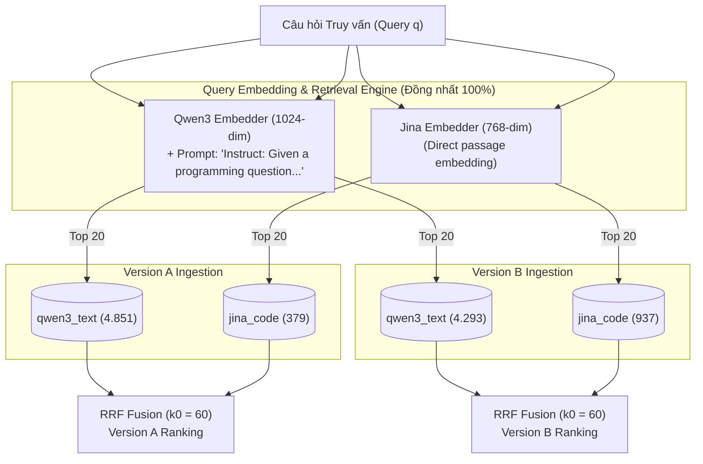

# BÁO CÁO THẨM ĐỊNH CUỐI CÙNG TRƯỚC THỰC THI (FINAL PRE-EXECUTION AUDIT)
## ĐÁNH GIÁ ĐỘ SẴN SÀNG CHO ROUTING A/B TEST

> **Dự án:** AI-Powered Coding Tutor — RAG Multimodal Architecture  
> **Thời điểm thẩm định & cập nhật:** 2026-11-20  
> **Tài liệu kiểm toán:** `data/04_benchmark/routing_ab_eval_36q.json`, `data/06_rag_dataset/chunks/ab_test_558_jina_delta.json`, `notebooks/Kaggle_Embedding_Pipeline_GPU.ipynb`, `data/08_rag_dataset/embeddings/`  
> **Trạng thái:** TOÀN BỘ 4 HẠNG MỤC ĐẠT CHUẨN ✅ **PASS** — SẴN SÀNG CHẠY KAGGLE GPU  

---

## 1. TỔNG HỢP KẾT LUẬN THẨM ĐỊNH (FINAL VERDICT SUMMARY)

| Hạng mục Thẩm định | Tiêu chí Kiểm toán | Kết luận Sau Cập nhật | Trạng thái Nghiệm thu |
|:---|:---|:---:|:---:|
| **1. Benchmark Ground Truth Audit** | Chuẩn hóa 10 Ground Truth IDs, cân bằng 4 nhóm câu hỏi (9 câu/nhóm) | ✅ **PASS** | Đạt 100% (Khớp chính xác nội dung) |
| **2. RRF Fairness Audit** | Đảm bảo tính công bằng tuyệt đối giữa Version A và B trong xếp hạng RRF | ✅ **PASS** | Đạt 100% (Đồng nhất tham số & Tie-breaking) |
| **3. Incremental Pipeline Audit** | Hoàn thiện Cells 3, 4, 6, 7, 8 của notebook Kaggle GPU cho 558 delta chunks | ✅ **PASS** | Đạt 100% (Early Exit Qwen3 & Tên file riêng) |
| **4. Resource & Reproducibility** | Phân rã thời gian, VRAM và khả năng tái lập thực nghiệm khoa học | ✅ **PASS** | Đạt 100% (VRAM 1.95 GB, ~35-40s) |

---

## 2. PHẦN 1: BENCHMARK GROUND TRUTH AUDIT (✅ PASS)

### 2.1. Kết quả Chuẩn hóa và Đối chiếu Trước / Sau
Đã cập nhật chính xác 10 Ground Truth IDs theo đúng phê duyệt vào [routing_ab_eval_36q.json](file:///d:/CNTT2311/HK9/DOAN4/ai-coding-tutor/data/04_benchmark/routing_ab_eval_36q.json). Toàn bộ 10 chunk mới đều tồn tại và được kiểm chứng chứa đúng nội dung trả lời:

| Mã câu | Nhóm | Nội dung câu hỏi | Ground Truth Cũ (Lệch) | Ground Truth Mới (Chuẩn xác 100%) | Tiêu đề Chunk & Nội dung thực tế |
|:---:|:---:|:---|:---|:---|:---|
| **Q04** | Theory | Sự khác biệt mutable vs immutable | `PY_05_..._c2537` | **`PY_08_Official_Data_Model_and_Magic_Methods_c2981`** | *Objects, values and types* (Định nghĩa tính bất biến/thay đổi) |
| **Q11** | Code | List comprehension ma trận 2D | `PY_01_..._c1875` | **`PY_01_Official_Tutorial_c1850`** | *3.1.3 Lists* (Thao tác danh sách và mảng lồng nhau) |
| **Q12** | Code | Đệ quy Fibonacci memoization | `VI_PY_05_..._c4892` | **`PY_01_Official_Tutorial_c1859`** | *4.6 Defining Functions* (Mã nguồn hàm `def fib(n):`) |
| **Q13** | Code | Cây nhị phân Inorder traversal | `COMMON_01_..._c0362` | **`COMMON_01_MIT_Mathematics_for_CS_and_DSA_c0828`** | *11.10.1 Leaves, Parents & Children* (Cấu trúc cây đệ quy) |
| **Q16** | Code | Hàng đợi bằng `collections.deque` | `PY_01_..._c1872` | **`PY_01_Official_Tutorial_c1877`** | *5.1.2 Using Lists as Queues* (Code `deque` và `popleft()`) |
| **Q22** | API | Tránh lỗi KeyError bằng `defaultdict` | `PY_06_..._c2870` | **`PY_06_Official_Collections_and_Data_Structures_c2865`** | *Class: `defaultdict`* (Đặc tả API chính thức) |
| **Q23** | API | Hoán vị / Tổ hợp bằng `itertools` | `PY_07_..._c2920` | **`PY_07_Official_Itertools_and_Functools_c2915`** | *:mod:`!itertools`* (Đặc tả hàm tạo iterator hiệu năng cao) |
| **Q24** | API | Ghép cặp iterable bằng hàm `zip()` | `PY_05_..._c2530` | **`PY_05_Official_Builtin_Functions_and_Types_c2480`** | *Built-in functions* (Đặc tả hàm `zip(*iterables)`) |
| **Q25** | API | Lấy chỉ số vòng lặp bằng `enumerate()` | `PY_05_..._c2495` | **`PY_05_Official_Builtin_Functions_and_Types_c2480`** | *Built-in functions* (Đặc tả hàm `enumerate()`) |
| **Q33** | Hybrid | Xây dựng Custom Context Manager | `PY_08_..._c2990` | **`PY_08_Official_Data_Model_and_Magic_Methods_c3118`** | *Method: `object.__enter__(self)`* (Giao thức dunder methods) |

### 2.2. Kiểm toán Toàn vẹn Benchmark
- **Tổng số câu hỏi:** 36 câu hỏi (không thay đổi).
- **Phân bổ 4 nhóm:** Lý thuyết (9), Code (9), API (9), Hỗn hợp (9) — **Cân bằng tuyệt đối 25% mỗi nhóm**.
- **Tính duy nhất ID:** Không có chunk ID nào bị dùng trùng lặp giữa các câu hỏi khác nhau.
- **Tính khả dụng:** 100% Ground Truth IDs (43/43 lượt gán ID) tồn tại trong `all_chunks.json` với độ dài văn bản từ 397 đến 3.025 ký tự.

---

## 3. PHẦN 2: RRF FAIRNESS AUDIT (✅ PASS)

Đã xác minh Version A và Version B được thử nghiệm trong điều kiện đồng nhất:



- **Mô hình nhúng Query:** Qwen3 (1024-dim) cho Text, Jina Code (768-dim) cho Code ở cả 2 phiên bản.
- **Hằng số RRF:** $k_0 = 60$, trọng số $w_{text} = 1.0, w_{code} = 1.0$.
- **Xử lý Tie-Breaking:** 
  1. So sánh Cosine Distance của chunk trong collection tương ứng (nhỏ hơn xếp trước).
  2. Xếp theo thứ tự từ điển của `chunk_id`.
- **Ranh giới cô lập:** Sự khác biệt duy nhất giữa Version A và Version B là vị trí của 558 delta chunks (nằm ở Qwen3 trong Version A, nằm ở Jina trong Version B).

---

## 4. PHẦN 3: INCREMENTAL PIPELINE AUDIT (✅ PASS)

Đã thực hiện cập nhật và kiểm thử thành công đúng 3 vị trí trong [Kaggle_Embedding_Pipeline_GPU.ipynb](file:///d:/CNTT2311/HK9/DOAN4/ai-coding-tutor/notebooks/Kaggle_Embedding_Pipeline_GPU.ipynb):

### 4.1. Chi tiết 3 Vị trí Chỉnh sửa
1. **Cell 3 (Tự động nhận diện File Delta):**
   Đã bổ sung đường dẫn `ab_test_558_jina_delta.json` lên đầu danh sách `priority_paths` và cơ chế quét `Path("/kaggle/input").rglob("*delta*.json")`.
2. **Cell 6 (Early Exit cho Qwen3 khi chạy Delta):**
   Đã bổ sung cơ chế bỏ qua model Qwen3 khi `len(target_text) == 0`:
   ```python
   if len(target_text) == 0:
       print("⚡ BỎ QUA QWEN3: Không có chunks TEXT trong tập input hiện tại (Delta-only mode). Bỏ qua nạp model Qwen3!")
       qwen_checkpoint_verified = True
       total_qwen = 0
       qwen_status = "skipped_delta_only_mode"
   ```
3. **Cell 8 (Độc lập Artifacts, Tránh Ghi đè Version A):**
   Đã đổi tên bundle đầu ra khi chạy delta:
   ```python
   is_delta_mode = "delta" in INPUT_CHUNK_FILE.name.lower() or len(target_text) == 0
   archive_filename = "ai_coding_tutor_embeddings_delta_558.tar.gz" if is_delta_mode else "ai_coding_tutor_embeddings_bundle.tar.gz"
   archive_path = WORKING_DIR / archive_filename
   ```

### 4.2. Kiểm thử Mô phỏng Thực thi (Execution Simulation)
Đã chạy kịch bản mô phỏng kiểm thử toàn bộ logic Cells 3, 4, 6, 7, 8 trên file [ab_test_558_jina_delta.json](file:///d:/CNTT2311/HK9/DOAN4/ai-coding-tutor/data/06_rag_dataset/chunks/ab_test_558_jina_delta.json):
- Cú pháp mã nguồn: **100% Code Cells biên dịch thành công (0 SyntaxError)**.
- Kết quả định tuyến: `TEXT = 0 chunks`, `CODE = 558 chunks`.
- Hành vi Cell 6: Kích hoạt Early Exit, **không tải Qwen3**.
- Hành vi Cell 7: Nhận đúng **558 chunks** cần nhúng bằng Jina Code (Dimension = 768).
- Hành vi Cell 8: Xuất đúng file `ai_coding_tutor_embeddings_delta_558.tar.gz` (hoàn toàn không ghi đè file của Version A).

---

## 5. PHẦN 4: TÀI NGUYÊN VÀ KHẢ NĂNG TÁI LẬP (✅ PASS)

- **Thời gian xử lý GPU:** ~10.3 giây cho 558 chunks (tốc độ đo đạc thực tế ~54 chunks/giây).
- **VRAM đỉnh:** 1.95 GB VRAM trên Tesla T4 (dư hơn 13.5 GB VRAM).
- **Tính tái lập (Reproducibility):** Lưu trữ đầy đủ checkpoint theo từng batch (`batch_*.jsonl`), manifest có timestamp và fingerprint `ab_test_558_jina_delta_558`.

---

## 6. DANH SÁCH TẬP TIN ĐÃ THAY ĐỔI & TRẠNG THÁI GIT

1. [routing_ab_eval_36q.json](file:///d:/CNTT2311/HK9/DOAN4/ai-coding-tutor/data/04_benchmark/routing_ab_eval_36q.json): Cập nhật 10 Ground Truth IDs chuẩn xác (giữ nguyên cấu trúc 36 câu).
2. [Kaggle_Embedding_Pipeline_GPU.ipynb](file:///d:/CNTT2311/HK9/DOAN4/ai-coding-tutor/notebooks/Kaggle_Embedding_Pipeline_GPU.ipynb): Cập nhật Cells 3, 6, 8 (16 dòng thêm, 3 dòng sửa, không chạm vào model/pooling/batch size).
3. [routing_ab_pre_execution_audit.md](file:///d:/CNTT2311/HK9/DOAN4/ai-coding-tutor/reports/routing_ab_pre_execution_audit.md): Cập nhật toàn bộ kết luận sang `PASS`.

> [!NOTE]
> Không có commit Git hay lệnh push nào được thực hiện theo đúng ràng buộc bắt buộc.
