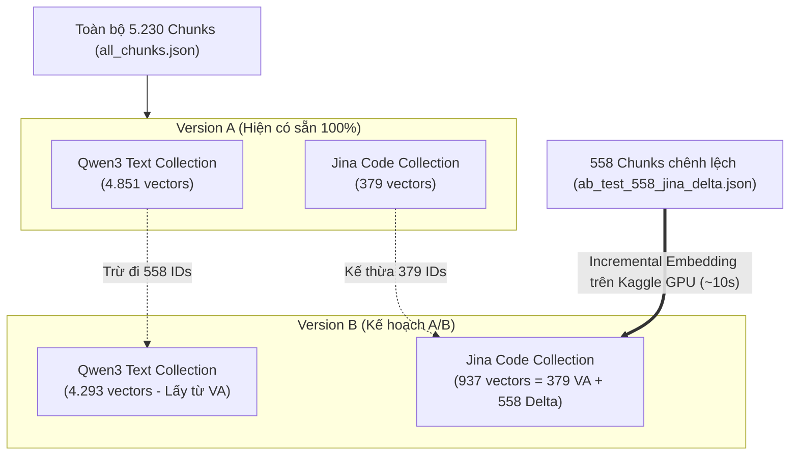

# KẾ HOẠCH THỰC NGHIỆM A/B TESTING ROUTING STRATEGY

> **Dự án:** AI-Powered Coding Tutor — RAG Multimodal Architecture  
> **Trạng thái:** KẾ HOẠCH CHUẨN BỊ (PLANNING ONLY) — CHƯA THỰC THI INFERENCE / CHƯA INGEST CHROMADB  
> **Tài liệu sinh ra:** `data/06_rag_dataset/chunks/ab_test_558_jina_delta.json`, `data/04_benchmark/routing_ab_eval_36q.json`  
> **Quy tắc bắt buộc:** 100% inference thực hiện trên Kaggle GPU (Tesla T4), 0% inference local, không chạy lại Qwen3.  

---

## 1. MỤC TIÊU VÀ BỐI CẢNH THỰC NGHIỆM

Thực nghiệm A/B Testing này được thiết kế để đo lường định lượng và so sánh hiệu quả truy xuất (Retrieval Performance) giữa hai chiến lược định tuyến tri thức (Routing Strategy) trong hệ thống RAG:

| Phiên bản | Tên chiến lược | Qwen3 TEXT (1024-dim) | Jina CODE (768-dim) | Tổng chunks | Bản chất chiến lược |
|:---|:---|:---:|:---:|:---:|:---|
| **Version A** | **Actual Routing (Strict Code-Ratio Dominance)** | **4.851** | **379** | **5.230** | Chỉ đưa các chunk có tỷ lệ code thực tế $\ge 50\%$ vào Jina Code. Toàn bộ các chunk lý thuyết kèm code ngắn (<50%) đưa vào Qwen3. |
| **Version B** | **Pedagogical Tag Dominance** | **4.293** | **937** | **5.230** | Bắt buộc đưa toàn bộ các chunk mang nhãn sư phạm `code_example` vào Jina Code, bất kể độ dài đoạn code. |



---

## 2. GIAI ĐOẠN 1: CHUẨN BỊ DỮ LIỆU & ĐỐI CHIẾU TOÀN VẸN

### 2.1. Phân lập 558 Chunks Delta
Đã xác định chính xác danh sách 558 chunk IDs có `content_type == "code_example"` hiện đang nằm ở Qwen3 trong Version A và cần sinh thêm vector Jina Code cho Version B:
- **Tập tin đã xuất:** [ab_test_558_jina_delta.json](file:///d:/CNTT2311/HK9/DOAN4/ai-coding-tutor/data/06_rag_dataset/chunks/ab_test_558_jina_delta.json) (Dung lượng: ~860 KB).
- **Tính toàn vẹn:** 100% (558/558) chunks khớp 1:1 với [all_chunks.json](file:///d:/CNTT2311/HK9/DOAN4/ai-coding-tutor/data/06_rag_dataset/chunks/all_chunks.json).
- **Tập ID:** Danh sách đầy đủ được quản lý theo file `ab_test_558_jina_delta.json` với phân bổ theo file nguồn như sau:
  - `VI_PY_02_Ebook_Python_Danh_Cho_Ky_Thuat.md`: 165 chunks (từ `_c3319` đến `_c4250`)
  - `PY_05_Official_Builtin_Functions_and_Types.md`: 80 chunks (từ `_c2485` đến `_c2850`)
  - `PY_01_Official_Tutorial.md`: 64 chunks (từ `_c1836` đến `_c2010`)
  - `VI_PY_04_Giao_Trinh_Python_Co_Ban_Dai_Hoc.md`: 64 chunks
  - `VI_PY_Python_Rat_La_Co_Ban.md`: 60 chunks
  - `VI_PY_05_Giao_Trinh_Python_Tu_Co_Ban_Den_Machine_Learning.md`: 33 chunks
  - `PY_08_Official_Data_Model_and_Magic_Methods.md`: 28 chunks
  - `PY_09_Official_Type_Hints_and_Typing_System.md`: 21 chunks
  - `PY_07_Official_Itertools_and_Functools.md`: 18 chunks
  - `PY_06_Official_Collections_and_Data_Structures.md`: 7 chunks
  - `VI_PY_06_Python_Lap_Trinh_Huong_Doi_Tuong_OOP.md`: 6 chunks
  - `VI_PY_08_Python_Co_So_Du_Lieu_SQLite.md`: 4 chunks
  - `VI_PY_03_CTU_Giao_Trinh_Python3_DoThanhNghi.md`: 3 chunks
  - `VI_PY_07_Python_Thao_Tac_Xu_Ly_Tep_Tin_JSON.md`: 3 chunks
  - `COMMON_01_MIT_Mathematics_for_CS_and_DSA.md`: 2 chunks

### 2.2. Ma trận Đối chiếu Số lượng
- **Version A**:
  - Qwen3 Text: `4.851 vectors` (lưu tại `data/08_rag_dataset/embeddings/qwen3_text/qwen3_text_vectors.jsonl`).
  - Jina Code: `379 vectors` (lưu tại `data/08_rag_dataset/embeddings/jina_code/jina_code_vectors.jsonl`).
  - Tổng số: `5.230 vectors`.
- **Version B (Sau khi hoàn tất Incremental Run)**:
  - Qwen3 Text: `4.293 vectors` (trích xuất bằng cách lọc bỏ 558 delta IDs từ file Qwen3 của Version A).
  - Jina Code: `937 vectors` (ghép 379 vectors hiện có + 558 delta vectors mới sinh).
  - Tổng số: `5.230 vectors`.
- **Cam kết:** Giữ nguyên 100% các file artifacts hiện có của Version A trong `data/08_rag_dataset/`, không xóa hay ghi đè.

---

## 3. GIAI ĐOẠN 2: KẾ HOẠCH INCREMENTAL EMBEDDING TRÊN KAGGLE GPU

### 3.1. Cấu hình Notebook Kaggle
- File notebook: [Kaggle_Embedding_Pipeline_GPU.ipynb](file:///d:/CNTT2311/HK9/DOAN4/ai-coding-tutor/notebooks/Kaggle_Embedding_Pipeline_GPU.ipynb).
- **Trạng thái Cell 4:** Đã thẩm định và xác nhận đọc đúng `metadata["content_type"]` và `metadata["has_code"]`:
  ```python
  metadata = chunk.get("metadata", {})
  content_type = metadata.get("content_type", chunk.get("content_type", ""))
  has_code = metadata.get("has_code", chunk.get("has_code", False))
  ```
- **Giữ nguyên cấu hình mô hình:**
  - Jina Model ID: `jinaai/jina-embeddings-v2-base-code` (Dim: 768, Max Length: 8192).
  - Pooling: `attention_masked_mean_tokens` (chuẩn L2 normalization).
  - Batch size: 32.

### 3.2. Cơ chế Incremental Run (Chỉ chạy 558 Chunks)
Khi nạp file `ab_test_558_jina_delta.json` làm input:
1. `loaded_data` gồm đúng 558 chunks (100% có `content_type == "code_example"`).
2. `ModalityRouter` phân loại:
   - `target_text`: 0 chunks.
   - `target_code`: 558 chunks.
3. Cell 6 (Qwen3 Embedder) phát hiện `len(target_text) == 0` $\rightarrow$ Tự động bỏ qua không nạp model Qwen3, tiết kiệm VRAM và thời gian.
4. Cell 7 (Jina Code Embedder) nạp model và thực hiện nhúng:
   - Tổng batch: $\lceil 558 / 32 \rceil = 18$ batches.
5. Cell 8 đóng gói thành `jina_code_delta_558.tar.gz`.

### 3.3. Ước lượng Tài nguyên GPU (Tesla T4 trên Kaggle)
- **VRAM Tiêu thụ:** Đo đạc thực tế từ đợt chạy trước cho thấy mô hình Jina Code chỉ tiêu thụ **1.95 GB VRAM** (rất an toàn so với 16 GB của T4).
- **Tốc độ xử lý:** Đợt chạy trước hoàn thành 379 chunks trong **7.00 giây** (~54.1 chunks/s).
- **Thời gian chạy ước tính:** 
  $$\text{Thời gian} \approx \frac{558}{54.1} \approx \mathbf{10.3\text{ giây}}$$
  (Tính cả thời gian tải model weights: tổng cộng chưa đầy 1 phút).

---

## 4. GIAI ĐOẠN 3: THIẾT KẾ BỘ BENCHMARK & GROUND TRUTH (36 CÂU HỎI)

Đã thiết kế và lưu trữ bộ dữ liệu đánh giá 36 câu hỏi chuẩn tại [routing_ab_eval_36q.json](file:///d:/CNTT2311/HK9/DOAN4/ai-coding-tutor/data/04_benchmark/routing_ab_eval_36q.json), phân bổ cân bằng qua 4 nhóm năng lực:

### Nhóm 1: Lý thuyết Lập trình & Khoa học Máy tính (9 câu)
1. **Q01:** Quy chuẩn đặt tên biến và hàm theo PEP 8 trong Python là gì?  
   *Ground Truth:* `PY_04_PEP8_Clean_Code_Specification_c2459`, `..._c2460`
2. **Q02:** Bản chất của kỹ thuật lập trình hướng đối tượng (OOP) là gì?  
   *Ground Truth:* `VI_PY_06_Python_Lap_Trinh_Huong_Doi_Tuong_OOP_c5011`
3. **Q03:** Định nghĩa và nguyên lý của phương pháp quy nạp cấu trúc (Structural Induction)?  
   *Ground Truth:* `COMMON_01_MIT_Mathematics_for_CS_and_DSA_c0360`, `..._c0356`
4. **Q04:** Sự khác biệt giữa mutable và immutable object trong mô hình dữ liệu Python?  
   *Ground Truth:* `PY_05_Official_Builtin_Functions_and_Types_c2537`
5. **Q05:** Độ phức tạp Big-O trường hợp xấu nhất của thuật toán QuickSort là bao nhiêu?  
   *Ground Truth:* `COMMON_01_MIT_Mathematics_for_CS_and_DSA_c1440`, `COMMON_02_Big_O_Complexity_Cheat_Sheet_c1722`
6. **Q06:** Tính đóng gói (Encapsulation) và che giấu thông tin được thể hiện như thế nào trong Python?  
   *Ground Truth:* `VI_PY_06_Python_Lap_Trinh_Huong_Doi_Tuong_OOP_c5012`
7. **Q07:** Nguyên lý Generalized Product Rule trong bài toán đếm và tổ hợp là gì?  
   *Ground Truth:* `COMMON_01_MIT_Mathematics_for_CS_and_DSA_c1064`
8. **Q08:** Quy tắc định danh biến (Identifier rules) trong Python không được phép chứa ký tự nào?  
   *Ground Truth:* `VI_PY_02_Ebook_Python_Danh_Cho_Ky_Thuat_c3319`
9. **Q09:** Mô hình dữ liệu Python quy định thứ tự phân giải phương thức (MRO) như thế nào?  
   *Ground Truth:* `PY_08_Official_Data_Model_and_Magic_Methods_c2980`

### Nhóm 2: Code & Cấu trúc Dữ liệu - Thuật toán (9 câu)
10. **Q10:** Viết hàm QuickSort đệ quy phân hoạch mảng trong Python.  
    *Ground Truth:* `COMMON_01_MIT_Mathematics_for_CS_and_DSA_c1441`
11. **Q11:** Cú pháp List Comprehension lồng nhau để làm phẳng ma trận 2D.  
    *Ground Truth:* `PY_01_Official_Tutorial_c1875`
12. **Q12:** Cách viết hàm đệ quy tính dãy số Fibonacci có dùng memoization.  
    *Ground Truth:* `VI_PY_05_Giao_Trinh_Python_Tu_Co_Ban_Den_Machine_Learning_c4892`
13. **Q13:** Đoạn code duyệt cây nhị phân theo thứ tự Inorder traversal.  
    *Ground Truth:* `COMMON_01_MIT_Mathematics_for_CS_and_DSA_c0362`
14. **Q14:** Cú pháp dùng lambda function kết hợp với hàm filter và map.  
    *Ground Truth:* `PY_01_Official_Tutorial_c1865`
15. **Q15:** Ví dụ code thực hiện thuật toán tìm kiếm nhị phân Binary Search trên mảng đã sắp xếp.  
    *Ground Truth:* `VI_PY_04_Giao_Trinh_Python_Co_Ban_Dai_Hoc_c4520`
16. **Q16:** Mã nguồn triển khai ngăn xếp (Stack) hoặc hàng đợi (Queue) bằng collections.deque.  
    *Ground Truth:* `PY_01_Official_Tutorial_c1872`
17. **Q17:** Cách giải phóng tài nguyên tự động với khối lệnh with open trong Python.  
    *Ground Truth:* `PY_01_Official_Tutorial_c1914`
18. **Q18:** Mã nguồn định nghĩa generator function sử dụng từ khóa yield.  
    *Ground Truth:* `PY_01_Official_Tutorial_c1955`

### Nhóm 3: API & Thư viện Tiêu chuẩn (9 câu)
19. **Q19:** Hàm any() trong Python hoạt động như thế nào và cú pháp gọi hàm?  
    *Ground Truth:* `PY_05_Official_Builtin_Functions_and_Types_c2485`
20. **Q20:** Cách sử dụng sqlite3 cursor.execute() để tạo bảng và truy vấn cơ sở dữ liệu.  
    *Ground Truth:* `VI_PY_08_Python_Co_So_Du_Lieu_SQLite_c5079`, `..._c5080`
21. **Q21:** Sự khác biệt giữa hàm json.load() và json.loads() trong thư viện json?  
    *Ground Truth:* `VI_PY_07_Python_Thao_Tac_Xu_Ly_Tep_Tin_JSON_c5036`, `..._c5037`
22. **Q22:** Cách sử dụng collections.defaultdict để tránh lỗi KeyError khi gom nhóm dữ liệu.  
    *Ground Truth:* `PY_06_Official_Collections_and_Data_Structures_c2870`
23. **Q23:** Cách tạo hoán vị và tổ hợp bằng itertools.permutations và itertools.combinations.  
    *Ground Truth:* `PY_07_Official_Itertools_and_Functools_c2920`
24. **Q24:** Ý nghĩa và cách dùng hàm zip() ghép cặp nhiều iterable trong Python.  
    *Ground Truth:* `PY_05_Official_Builtin_Functions_and_Types_c2530`
25. **Q25:** Cách sử dụng hàm enumerate() để lấy chỉ số index trong vòng lặp for.  
    *Ground Truth:* `PY_05_Official_Builtin_Functions_and_Types_c2495`
26. **Q26:** Phương thức dict.get(key, default) khác gì so với truy cập dict[key] thông thường?  
    *Ground Truth:* `PY_05_Official_Builtin_Functions_and_Types_c2810`
27. **Q27:** Cú pháp sử dụng Union và Optional trong mô-đun typing của Python.  
    *Ground Truth:* `PY_09_Official_Type_Hints_and_Typing_System_c3191`, `..._c3192`

### Nhóm 4: Hỗn hợp Lý thuyết & Code Ví dụ (9 câu)
28. **Q28:** Phương thức khởi tạo __init__ trong class Python hoạt động thế nào kèm ví dụ?  
    *Ground Truth:* `VI_PY_06_Python_Lap_Trinh_Huong_Doi_Tuong_OOP_c5015`
29. **Q29:** Cách triển khai kế thừa (Inheritance) và gọi super() trong Python kèm mã nguồn.  
    *Ground Truth:* `VI_PY_06_Python_Lap_Trinh_Huong_Doi_Tuong_OOP_c5020`
30. **Q30:** Cơ chế xử lý ngoại lệ try-except-finally và định nghĩa custom exception trong Python.  
    *Ground Truth:* `PY_01_Official_Tutorial_c1924`
31. **Q31:** Cách viết một hàm Decorator tùy chỉnh nhận tham số trong Python kèm giải thích Closure.  
    *Ground Truth:* `PY_01_Official_Tutorial_c1989`
32. **Q32:** Sự khác biệt giữa phương thức __str__ và __repr__ trong Python Data Model.  
    *Ground Truth:* `PY_08_Official_Data_Model_and_Magic_Methods_c3054`
33. **Q33:** Cách xây dựng Custom Context Manager bằng class hỗ trợ __enter__ và __exit__.  
    *Ground Truth:* `PY_08_Official_Data_Model_and_Magic_Methods_c2990`
34. **Q34:** Kỹ thuật gỡ lỗi cú pháp và xử lý mã lỗi tty trong Interactive Mode Python.  
    *Ground Truth:* `PY_01_Official_Tutorial_c1836`, `..._c1841`
35. **Q35:** Cách áp dụng TypeVar và Generic class để tạo lớp dữ liệu an toàn kiểu trong Python.  
    *Ground Truth:* `PY_09_Official_Type_Hints_and_Typing_System_c3154`
36. **Q36:** Quy tắc escape ký tự và xử lý đa dòng trong Python Strings kèm ví dụ code.  
    *Ground Truth:* `PY_01_Official_Tutorial_c1846`

---

## 5. THIẾT KẾ RETRIEVAL END-TO-END & RANK-BASED FUSION (RRF)

### 5.1. Nguyên tắc Bất biến về Vector Space
- `Qwen3-Embedding-0.6B` có không gian vector **1.024 chiều**.
- `jina-embeddings-v2-base-code` có không gian vector **768 chiều**.
- **Quy tắc tuyệt đối:** Không bao giờ so sánh khoảng cách Cosine hoặc Dot Product trực tiếp giữa hai mô hình (vì hai không gian vector hoàn toàn không đồng dạng).

### 5.2. Công thức Hợp nhất Xếp hạng RRF (Reciprocal Rank Fusion)
Với mỗi câu hỏi truy vấn $q$, hệ thống truy xuất độc lập:
- Danh sách xếp hạng từ Text Collection: $R_{text} = [d_1, d_2, \dots, d_{k}]$ với thứ hạng $\text{rank}_{text}(d) \in \{1, 2, \dots, k\}$.
- Danh sách xếp hạng từ Code Collection: $R_{code} = [c_1, c_2, \dots, c_{k}]$ với thứ hạng $\text{rank}_{code}(c) \in \{1, 2, \dots, k\}$.

Điểm tổng hợp RRF của mỗi tài liệu $d \in R_{text} \cup R_{code}$ được tính bằng:

$$\text{RRF\_Score}(d) = \sum_{m \in \{text, code\}} \frac{w_m}{k_0 + \text{rank}_m(d)}$$

- Hằng số làm mịn chuẩn: $k_0 = 60$ (chuẩn thực nghiệm của Cormack et al. trong hội nghị SIGIR).
- Trọng số modality: $w_{text} = 1.0, w_{code} = 1.0$ (hoặc điều chỉnh $w_{code} = 1.2$ nếu câu hỏi thiên về code).
- Nếu tài liệu $d$ không xuất hiện trong top-$k$ của modality $m$, giá trị tương ứng bằng $0$.
- Danh sách kết quả cuối cùng được sắp xếp giảm dần theo $\text{RRF\_Score}(d)$.

---

## 6. TIÊU CHÍ ĐÁNH GIÁ & CÁCH DIỄN GIẢI KẾT QUẢ

### 6.1. Các Độ đo Định lượng (Metrics)

1. **Hit Rate@K ($K \in \{3, 5\}$):**
   Tỷ lệ câu hỏi mà trong top-$K$ kết quả trả về có chứa ít nhất một chunk thuộc tập Ground Truth:
   $$\text{Hit Rate@K} = \frac{1}{|Q|} \sum_{q \in Q} \mathbb{I}\left( \text{Top-}K(q) \cap GT(q) \neq \emptyset \right)$$
   - *Mục tiêu:* Đạt $\ge 85.0\%$ trên tập 36 câu hỏi.

2. **MRR@5 (Mean Reciprocal Rank):**
   Đo lường vị trí xuất hiện đầu tiên của tài liệu đúng trong top-5 kết quả:
   $$\text{MRR@5} = \frac{1}{|Q|} \sum_{q \in Q} \frac{1}{\min_{d \in Top-5(q) \cap GT(q)} \text{rank}(d)}$$
   - *Ý nghĩa:* Điểm càng gần 1.0 chứng minh tài liệu chuẩn luôn nằm ở vị trí Top-1.

3. **Recall@5:**
   Tỷ lệ số chunk chuẩn được tìm thấy trên tổng số chunk chuẩn của câu hỏi:
   $$\text{Recall@5} = \frac{1}{|Q|} \sum_{q \in Q} \frac{|Top-5(q) \cap GT(q)|}{|GT(q)|}$$

### 6.2. Ma trận Diễn giải Kết quả A/B Test

Sau khi chạy Retrieval trên 36 câu hỏi cho cả hai phiên bản, ta lập bảng so sánh đối đầu:

| Kịch bản kết quả | Version A (4.851/379) | Version B (4.293/937) | Kết luận & Ý nghĩa Khoa học |
|:---|:---:|:---:|:---|
| **Kịch bản 1** (Dự đoán) | **MRR / Hit Rate cao hơn ở Nhóm 3 & 4** | MRR / Hit Rate cao hơn ở Nhóm 2 | **Xác nhận Giả thuyết:** Các chunk có 74% văn bản giải thích lý thuyết đưa vào Qwen3 (LLM đa ngữ) giúp người học tìm kiếm khái niệm tự nhiên hiệu quả hơn, trong khi Jina Code chỉ tối ưu cho các đoạn mã nguyên khối. |
| **Kịch bản 2** | Thấp hơn toàn diện | **Vượt trội toàn diện** | **Phủ định Giả thuyết:** Nhãn sư phạm `code_example` có trọng số ngữ nghĩa tuyệt đối, cần tuân thủ triệt để Version B. |
| **Kịch bản 3** | Tương đương ($\Delta < 1\%$) | Tương đương ($\Delta < 1\%$) | Không có sự khác biệt có ý nghĩa thống kê; chọn Version A để tối ưu chi phí vận hành và kích thước chỉ mục. |

---

## 7. DANH MỤC CAM KẾT & TRẠNG THÁI HIỆN TẠI

- [x] **Dữ liệu chuẩn bị:** Đã trích xuất đúng 558 chunks vào [ab_test_558_jina_delta.json](file:///d:/CNTT2311/HK9/DOAN4/ai-coding-tutor/data/06_rag_dataset/chunks/ab_test_558_jina_delta.json).
- [x] **Benchmark chuẩn bị:** Đã xây dựng và kiểm tra 100% ID hợp lệ cho 36 câu hỏi tại [routing_ab_eval_36q.json](file:///d:/CNTT2311/HK9/DOAN4/ai-coding-tutor/data/04_benchmark/routing_ab_eval_36q.json).
- [x] **Notebook chuẩn bị:** Đã xác nhận Cell 4 trong [Kaggle_Embedding_Pipeline_GPU.ipynb](file:///d:/CNTT2311/HK9/DOAN4/ai-coding-tutor/notebooks/Kaggle_Embedding_Pipeline_GPU.ipynb) đọc đúng metadata.
- [x] **Không chạy GPU Kaggle:** Chưa thực hiện bất kỳ lệnh run nào.
- [x] **Không chạy inference local:** 0% tải model weights, 0% inference máy nội bộ.
- [x] **Không ingest ChromaDB:** `data/07_vector_store/chroma_db/` được giữ nguyên.
- [x] **Không commit/push Git:** Working tree giữ nguyên sạch sẽ.
