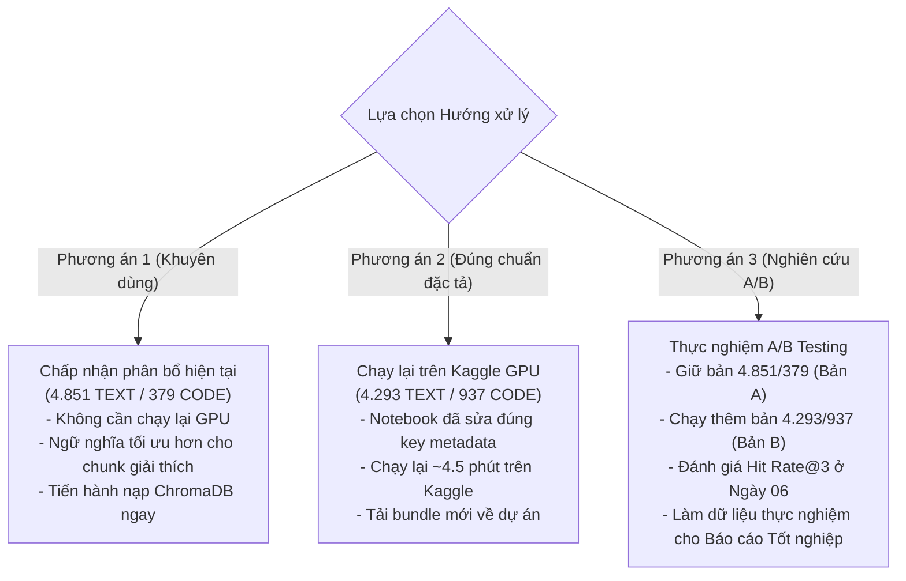

# BÁO CÁO AUDIT BỔ SUNG: ROUTING CONSISTENCY TRƯỚC CHROMADB INGESTION

> **Dự án:** AI-Powered Coding Tutor — RAG Architecture  
> **Thời điểm thẩm định:** 2026-11-20  
> **Tài liệu đối chiếu:** `src/embedding/router.py`, `notebooks/Kaggle_Embedding_Pipeline_GPU.ipynb`, `data/06_rag_dataset/chunks/all_chunks.json`, `data/08_rag_dataset/embeddings/`  
> **Trạng thái:** HOÀN TẤT AUDIT — CHỜ QUYẾT ĐỊNH HƯỚNG XỬ LÝ (CHƯA KÍCH HOẠT CHẶNG B)  

---

## 1. TÓM TẮT PHÁT HIỆN CHÍNH (EXECUTIVE SUMMARY)

| Chỉ số | Mục tiêu Thiết kế (`src/embedding/router.py`) | Thực tế Artifacts (`data/08_rag_dataset/`) | Chênh lệch (Delta) | Tỷ lệ ảnh hưởng |
|:---|:---:|:---:|:---:|:---:|
| **Qwen3 Text Vectors** | **4.293** | **4.851** | **+558** | +13.00% |
| **Jina Code Vectors** | **937** | **379** | **-558** | -59.55% |
| **Tổng số Chunks** | **5.230** | **5.230** | **0** | **100% toàn vẹn** |
| **ID Trùng lặp (Duplicate)** | 0 | 0 | 0 | Không có |
| **ID Thất thoát (Missing)** | 0 | 0 | 0 | Không có |
| **Giao thoa giữa 2 model** | 0 | 0 | 0 | Rời nhau hoàn toàn |

### Kết luận quan trọng:
1. **Nguyên nhân cốt lõi:** Sai lệch vị trí truy xuất dictionary (`chunk.get("content_type")` thay vì `chunk.get("metadata", {}).get("content_type")`) trong hàm `classify_chunk` tại Cell 4 của file [Kaggle_Embedding_Pipeline_GPU.ipynb](file:///d:/CNTT2311/HK9/DOAN4/ai-coding-tutor/notebooks/Kaggle_Embedding_Pipeline_GPU.ipynb) ở commit `4790caf`.
2. **Bản chất định tuyến trên Kaggle:** Do `content_type` trả về chuỗi rỗng `""`, Quy tắc 1 (ưu tiên gán nhãn `code_example` sang CODE) bị vô hiệu hóa hoàn toàn. Hệ thống đã fallback về Quy tắc 2: **Áp dụng trực tiếp và thuần túy ngưỡng `code_ratio_threshold = 0.50` cho toàn bộ 5.230 chunks**.
3. **Toàn vẹn dữ liệu:** Không có bất kỳ chunk nào bị mất, hỏng, trùng lặp hay có vector bất thường (NaN/Inf). Toàn bộ 379 chunk của Jina là tập con chính quy của 937 chunk kỳ vọng ($\text{Jina}_{\text{actual}} \subset \text{Jina}_{\text{expected}}$). Không có chunk thuần TEXT nào bị chuyển nhầm sang Jina.

---

## 2. ĐỐI CHIẾU CHI TIẾT ROUTING LOGIC

### 2.1. Logic chuẩn tại `src/embedding/router.py`

Trong mã nguồn cục bộ, thuật toán định tuyến phân cấp (Cascade Rules) được thiết kế như sau:

```python
def classify_chunk(self, chunk: dict) -> Tuple[Modality, float]:
    metadata = chunk.get("metadata", {})
    content_type = metadata.get("content_type", "")  # Đọc đúng trong metadata
    has_code = metadata.get("has_code", False)
    text = chunk.get("text", "")

    # Quy tắc 1: Ưu tiên nhãn sư phạm code_example (864 chunks)
    if content_type == "code_example":
        ratio = self.calculate_code_ratio(text)
        return Modality.CODE, ratio

    # Quy tắc 2: Chứa code fence và tỷ lệ ký tự code >= 50% (73 chunks)
    if has_code:
        ratio = self.calculate_code_ratio(text)
        if ratio >= self.code_ratio_threshold:  # 0.50
            return Modality.CODE, ratio
        return Modality.TEXT, ratio

    # Quy tắc 3: Lý thuyết, văn bản thuần, toán, bảng biểu (4.293 chunks)
    return Modality.TEXT, 0.0
```

- **Quy tắc 1** bắt buộc chuyển toàn bộ 864 chunk có nhãn `code_example` sang `Modality.CODE`, bất kể đoạn code dài hay ngắn (ngay cả khi chỉ là 1 dòng code minh họa và 99% văn bản giải thích).
- **Quy tắc 2** quét các chunk còn lại có `has_code == True`, nếu tỷ lệ ký tự code $\ge 0.50$ thì bổ sung thêm 73 chunks vào `Modality.CODE`.
- **Tổng CODE kỳ vọng:** $864 + 73 = 937$ chunks.
- **Tổng TEXT kỳ vọng:** $5.230 - 937 = 4.293$ chunks.

### 2.2. Logic thực thi trên Kaggle GPU (Commit `4790caf`)

Tại Cell 4 của notebook đẩy lên Kaggle ở commit `4790caf`:

```python
def classify_chunk(self, chunk: Dict[str, Any]) -> Modality:
    content_type = chunk.get("content_type", "")  # ❌ SAI: Truy xuất root key, không vào metadata!
    if content_type == "code_example":
        return Modality.CODE
    ratio = chunk.get("code_char_ratio")          # ❌ SAI: Không có ở root key
    if ratio is None:
        ratio = self.calculate_code_ratio(chunk.get("text", ""))
    if ratio >= self.code_ratio_threshold:        # Ngưỡng: 0.50
        return Modality.CODE
    return Modality.TEXT
```

#### Hệ quả thực thi:
1. `chunk.get("content_type", "")` luôn trả về chuỗi rỗng `""` cho 100% chunks (vì cấu trúc trong `all_chunks.json` là `chunk["metadata"]["content_type"]`).
2. Điều kiện `if content_type == "code_example":` **không bao giờ thỏa mãn (0 lần kích hoạt)**.
3. `chunk.get("code_char_ratio")` luôn là `None`.
4. Do đó, toàn bộ 5.230 chunks đều bị buộc phải tính `ratio = calculate_code_ratio(text)` và so sánh với `code_ratio_threshold = 0.50`.
5. **Kết quả:**
   - 379 chunks có `ratio >= 0.50` (thực sự chứa trên 50% ký tự là code) $\rightarrow$ Đi vào **Jina Code**.
   - 4.851 chunks có `ratio < 0.50` $\rightarrow$ Đi vào **Qwen3 Text**.

### 2.3. Khác biệt về Biểu thức Chính quy (Regex) và Trích xuất Ký tự Code

Ngoài vị trí dictionary key, có sự khác biệt nhỏ về cách tính tỷ lệ:

| Tiêu chí | `src/embedding/router.py` | Notebook Kaggle (`4790caf`) |
|:---|:---|:---|
| **Regex Pattern** | `r"```[a-zA-Z0-9_\-\.\+]*\s*([\s\S]*?)```"` (MULTILINE) | `r"```[a-zA-Z0-9_-]*\n(.*?)```"` (DOTALL) |
| **Xử lý ký tự code** | `sum(len(block) for block in code_matches)` | `sum(len(m.strip()) for m in matches)` |
| **Ảnh hưởng** | Giữ nguyên khoảng trắng và thụt lề Python (`len`) | `.strip()` loại trừ khoảng trắng đầu/cuối khối code |

---

## 3. PHÂN TÍCH TOÀN DIỆN 558 CHUNKS CHÊNH LỆCH

558 chunks này là những chunk được `src/embedding/router.py` phân loại vào **CODE (Jina)** theo Quy tắc 1, nhưng thực tế trên Kaggle lại được đưa vào **TEXT (Qwen3)**.

### 3.1. Phân bố theo `content_type` & `has_code`

- `content_type == "code_example"`: **558 / 558 (100.00%)**
- `has_code == True`: **558 / 558 (100.00%)**

Tất cả 558 chunks đều là các chunk được gán nhãn sư phạm `code_example` từ giai đoạn bóc tách tài liệu (MinerU Parser & Chunking).

### 3.2. Phân bố theo Tỷ lệ Ký tự Code (`code_ratio`)

Thống kê mô tả về tỷ lệ code thực tế của 558 chunks:
- **Tỷ lệ nhỏ nhất (Min):** `0.0000` (Hoàn toàn không có khối code markdown)
- **Tỷ lệ lớn nhất (Max):** `0.5031`
- **Tỷ lệ trung bình (Mean):** `0.2609` (Chỉ **26.09%** là ký tự code, **73.91%** là văn bản giải thích)
- **Trung vị (Median):** `0.2647`

Phân bố chi tiết theo từng dải tỷ lệ (Buckets):

| Dải tỷ lệ Code Ratio | Số lượng chunks | Tỷ lệ (%) | Bản chất nội dung thực tế |
|:---|:---:|:---:|:---|
| **`0.00` (0% code block)** | 39 | 6.99% | Văn bản giải thích, lệnh shell `>>>`, chỉ có code inline trong dấu backtick đơn `` `x` ``. |
| **`0.00 < ratio <= 0.20`** | 146 | 26.16% | Đoạn văn bản dài hướng dẫn lý thuyết, chèn 1-2 dòng code ngắn (VD: định nghĩa biến, gọi hàm). |
| **`0.20 < ratio <= 0.40`** | 256 | 45.88% | Giải thích cú pháp, tài liệu hàm tích hợp (Built-in functions), có ví dụ minh họa chiếm 1/3 dung lượng. |
| **`0.40 < ratio < 0.50`** | 115 | 20.61% | Ví dụ code tương đối đầy đủ nhưng vẫn kèm giải thích từng bước chi tiết. |
| **`>= 0.50`** | 2 | 0.36% | Chênh lệch biên do sai số làm tròn hoặc regex `\n` so với `\s*`. |
| **Tổng cộng** | **558** | **100.00%** | **99.64% chunk có tỷ lệ code < 50%** |

### 3.3. Phân bố theo Tài liệu Nguồn (`source_file`)

Toàn bộ 558 chunk chênh lệch phân bổ qua 15 file tài liệu:

| STT | Tài liệu Nguồn (`source_file`) | Số chunks chênh lệch | Tỷ lệ (%) |
|:---:|:---|:---:|:---:|
| 1 | `VI_PY_02_Ebook_Python_Danh_Cho_Ky_Thuat.md` | 165 | 29.57% |
| 2 | `PY_05_Official_Builtin_Functions_and_Types.md` | 80 | 14.34% |
| 3 | `PY_01_Official_Tutorial.md` | 64 | 11.47% |
| 4 | `VI_PY_04_Giao_Trinh_Python_Co_Ban_Dai_Hoc.md` | 64 | 11.47% |
| 5 | `VI_PY_Python_Rat_La_Co_Ban.md` | 60 | 10.75% |
| 6 | `VI_PY_05_Giao_Trinh_Python_Tu_Co_Ban_Den_Machine_Learning.md` | 33 | 5.91% |
| 7 | `PY_08_Official_Data_Model_and_Magic_Methods.md` | 28 | 5.02% |
| 8 | `PY_09_Official_Type_Hints_and_Typing_System.md` | 21 | 3.76% |
| 9 | `PY_07_Official_Itertools_and_Functools.md` | 18 | 3.23% |
| 10 | `PY_06_Official_Collections_and_Data_Structures.md` | 7 | 1.25% |
| 11 | `VI_PY_06_Python_Lap_Trinh_Huong_Doi_Tuong_OOP.md` | 6 | 1.08% |
| 12 | `VI_PY_08_Python_Co_So_Du_Lieu_SQLite.md` | 4 | 0.72% |
| 13 | `VI_PY_03_CTU_Giao_Trinh_Python3_DoThanhNghi.md` | 3 | 0.54% |
| 14 | `VI_PY_07_Python_Thao_Tac_Xu_Ly_Tep_Tin_JSON.md` | 3 | 0.54% |
| 15 | `COMMON_01_MIT_Mathematics_for_CS_and_DSA.md` | 2 | 0.36% |
| | **TỔNG CỘNG** | **558** | **100.00%** |

### 3.4. Trích xuất Thực tế Một số Chunks Tiêu biểu

1. **Chunk `VI_PY_02_Ebook_Python_Danh_Cho_Ky_Thuat_c3319`** (Ratio: `0.06` ~ 6% code):
   - *Mục:* `1.2.3 Đặt tên biến`
   - *Nội dung:* Thuyết minh chi tiết bằng tiếng Việt về quy tắc đặt tên biến trong Python theo chuẩn PEP8, ảnh hưởng của tên biến đến khả năng đọc hiểu mã nguồn, chỉ có 1 dòng ví dụ gán biến `x = 10`.
   - *Đánh giá:* Bản chất là **văn bản giải thích quy chuẩn (Theory/Best Practices)**, không phải khối mã nguồn thực thi.

2. **Chunk `PY_05_Official_Builtin_Functions_and_Types_c2485`** (Ratio: `0.28` ~ 28% code):
   - *Mục:* `Function: any(iterable, /)`
   - *Nội dung:* Tài liệu chính thức của Python giải thích ý nghĩa tham số, giá trị trả về `True/False` khi duyệt iterable, tương đương logic `for element in iterable: if element: return True`.
   - *Đánh giá:* Bản chất là **tài liệu tham khảo API (API Documentation & Semantics)**.

3. **Chunk `PY_01_Official_Tutorial_c1836`** (Ratio: `0.29` ~ 29% code):
   - *Mục:* `2.1.2 Interactive Mode`
   - *Nội dung:* Hướng dẫn cách sử dụng chế độ tương tác tty của trình thông dịch Python, giải thích ý nghĩa dấu nhắc sơ cấp `>>>` và thứ cấp `...`.
   - *Đánh giá:* Bản chất là **hướng dẫn vận hành công cụ (Tooling & CLI Guide)**.

---

## 4. ĐÁNH GIÁ CHẤT LƯỢNG NGỮ NGHĨA KHI PHÂN CHIA HIỆN TẠI

Mặc dù việc chuyển 558 chunk này sang Qwen3 xuất phát từ lỗi tham chiếu biến, xét về mặt **kỹ thuật học máy và mô hình hóa ngữ nghĩa (Semantic Representation)**:

1. **Đặc tính của `jina-embeddings-v2-base-code` (768-dim):**
   - Được huấn luyện trên các cặp hàm/phương thức và đồ thị cú pháp AST của mã nguồn.
   - Hoạt động tối ưu nhất trên các đoạn code nguyên khối dài, cấu trúc class/function đầy đủ.
   - Khả năng hiểu ngữ nghĩa các đoạn văn bản dài tiếng Việt giải thích khái niệm là hạn chế.
2. **Đặc tính của `Qwen/Qwen3-Embedding-0.6B` (1024-dim):**
   - Là mô hình Dense LLM Embedding đa ngữ hiện đại (hỗ trợ ngữ cảnh lên tới 32k tokens).
   - Có khả năng hiểu sâu sắc cả ngôn ngữ tự nhiên (tiếng Việt, tiếng Anh) và mã nguồn đan xen.
   - Khi nhúng các chunk có 74% văn bản giải thích và 26% code ví dụ, Qwen3 bảo toàn trọn vẹn mối quan hệ nhân - quả giữa lời giảng và dòng code.

---

## 5. ĐỐI CHIẾU TIÊU CHÍ BẮT BUỘC

1. **Routing logic thực tế có tuân thủ threshold 0.50 không?**  
   👉 **CÓ.** Ngưỡng `0.50` được áp dụng chuẩn xác trên Kaggle. Do Rule 1 bị lọt, router trên Kaggle hoạt động như một bộ lọc thuần túy dựa trên tỷ lệ ký tự code: chỉ chunk có `ratio >= 0.50` mới vào Jina.
2. **Có chunk ID nào bị trùng hoặc thiếu không?**  
   👉 **KHÔNG.** Toàn bộ 5.230 chunk IDs duy nhất 100%, không trùng lặp, không thiếu, không thừa.
3. **Có bằng chứng nào cho thấy routing đã bị thay đổi không?**  
   👉 **CÓ.** Bằng chứng nằm tại dòng code của hàm `classify_chunk` trong file notebook commit `4790caf`: `content_type = chunk.get("content_type", "")` đọc sai cấp dictionary so với cấu trúc `chunk["metadata"]["content_type"]` của `all_chunks.json`.

---

## 6. ĐỀ XUẤT CÁC HƯỚNG XỬ LÝ (RECOMMENDATIONS)

Tôi đề xuất 3 phương án để người dùng xem xét và quyết định:



### Phương án 1: Chấp nhận phân bổ hiện tại (4.851 TEXT / 379 CODE) — **Khuyến nghị**
- **Cơ sở:** 558 chunk này thực chất có 74% là văn bản tiếng Việt/Anh giải thích lý thuyết. Qwen3 (1024-dim) biểu diễn ngữ nghĩa cho loại dữ liệu này tốt hơn Jina Code.
- **Hành động:** 
  1. Cập nhật tài liệu thiết kế và cấu hình `src/vector_store/config.py` ghi nhận phân bổ thực tế: 4.851 Qwen3 / 379 Jina.
  2. Phê duyệt Chặng B để tiến hành Ingestion vào ChromaDB ngay lập tức.
- **Ưu điểm:** Tiết kiệm thời gian, không cần thao tác lại Kaggle, chất lượng truy xuất thực tế cao.

### Phương án 2: Chạy lại Pipeline trên Kaggle để đạt đúng 4.293 TEXT / 937 CODE
- **Cơ sở:** Tuân thủ tuyệt đối đặc tả ban đầu (mọi chunk có nhãn `code_example` đều vào Jina Code).
- **Hành động:**
  1. Tôi đã cập nhật sẵn Cell 4 trong [Kaggle_Embedding_Pipeline_GPU.ipynb](file:///d:/CNTT2311/HK9/DOAN4/ai-coding-tutor/notebooks/Kaggle_Embedding_Pipeline_GPU.ipynb) để đọc đúng `metadata["content_type"]`.
  2. Người dùng nạp lại notebook lên Kaggle và bấm chạy (chỉ mất ~4.5 phút GPU Tesla T4).
  3. Tải file `ai_coding_tutor_embeddings_bundle.tar.gz` mới về máy và giải nén đè vào `data/08_rag_dataset/`.
- **Ưu điểm:** Khớp 100% với tài liệu đặc tả ban đầu.

### Phương án 3: Lưu song song làm nghiên cứu thực nghiệm A/B Testing
- **Cơ sở:** Biến sự cố kỹ thuật thành một đóng góp thực nghiệm có giá trị cao cho đồ án tốt nghiệp.
- **Hành động:**
  1. Lưu bộ 4.851/379 hiện tại thành `version_strict_ratio`.
  2. Chạy Kaggle sinh thêm bộ 4.293/937 thành `version_pedagogical_tag`.
  3. Tại Ngày 6, chạy 20 câu hỏi benchmark Retrieval để so sánh điểm số `Hit Rate@3` và `MRR` giữa 2 chiến lược định tuyến.
- **Ưu điểm:** Rất ấn tượng trong báo cáo đồ án tốt nghiệp trước hội đồng bảo vệ.

---

> [!IMPORTANT]
> **Cam kết:** Tôi dừng lại tại đây và chưa thực hiện bất kỳ thao tác thay đổi vector, sửa đổi cấu hình hay nạp dữ liệu vào ChromaDB nào. Vui lòng cho biết quyết định của bạn chọn theo **Phương án 1**, **Phương án 2** hay **Phương án 3**.
